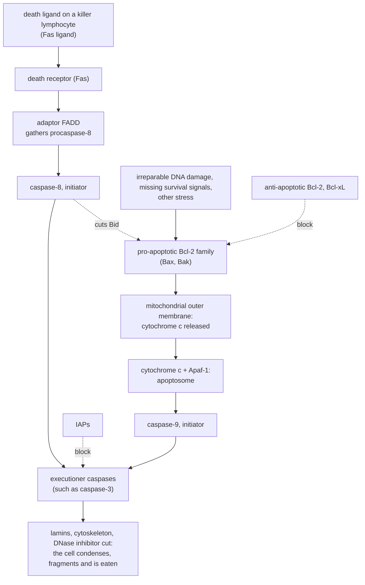

---
aliases:
  - Programmed Cell Death
  - Apoptotic Cell Death
  - Caspase Cascade
  - Intrinsic Pathway
  - Extrinsic Pathway
  - Apoptose
  - Mort cellulaire programmée
tags:
  - type/concept
  - domain/biology
  - domain/bioinformatics
  - level/L2
  - level/L3
mastery: 0
prerequisites:
  - "[[Cell Cycle]]"
  - "[[Mitochondrion]]"
  - "[[Cell Signaling]]"
  - "[[Cell Membrane]]"
  - "[[Enzyme]]"
related:
  - "[[Cancer]]"
  - "[[Tumor Suppressor Gene]]"
  - "[[Oncogene]]"
  - "[[DNA Repair]]"
  - "[[Immune System]]"
  - "[[Bistability]]"
  - "[[Feedback Loop]]"
  - "[[Single-Cell Quality Control]]"
  - "[[Biological Pathway]]"
  - "[[Developmental Biology]]"
projects: []
sources:
  - "[[Molecular Biology of the Cell (Alberts)]]"
  - "[[NobelPrize.org]]"
  - "[[Hanahan 2011 - Hallmarks of Cancer - The Next Generation]]"
  - "[[Luecken 2019 - Current Best Practices in Single-Cell RNA-Seq Analysis - A Tutorial]]"
  - "[[KEGG]]"
  - "[[MIT 8.591J - Systems Biology]]"
---

# Apoptosis

> [!abstract]
> Apoptosis is a cell's orderly suicide: a cascade of proteases dismantles the cell from within, its remains are eaten by neighbors without inflammation, and the decision to start weighs signals from outside against damage inside. Cancer cells survive in part by disabling it.

## Definition

**Apoptosis** is the main form of **programmed cell death** in animals: an intracellular program, carried out by proteases called **caspases**, by which a cell kills itself. The apoptotic cell shrinks and condenses, its cytoskeleton collapses, its nuclear envelope comes apart, its chromatin condenses and its DNA is cut into fragments; its surface changes so that a neighboring cell or a macrophage engulfs it before its contents leak, so no inflammation follows. Cells that die of acute injury, by **necrosis**, instead swell and burst, spilling their contents and provoking inflammation.[^alberts17]

## Why it matters

- **Cancer.** "Resisting cell death" is one of the six hallmarks of cancer, the capabilities that tumors acquire during their development ([[Cancer]]).[^hanahan] Genes of the apoptosis machinery are therefore natural candidates when a cancer genome is searched for drivers ([[Tumor Suppressor Gene]], [[Oncogene]]).
- **Single-cell quality control.** Damaged and dying cells pollute single-cell data: barcodes with few detected genes and a high fraction of mitochondrial reads can be cells whose cytoplasmic mRNA leaked out through a broken membrane, and are usually filtered, with care, because a high mitochondrial fraction can also be biology ([[Single-Cell Quality Control]], [[Single-Cell RNA Sequencing]]).[^luecken]
- **Pathway analysis.** KEGG draws the apoptosis machinery as pathway 04210 "Apoptosis", whose gene list is a standard set in enrichment analyses of expression data ([[Biological Pathway]], [[Over-Representation Analysis]]).[^kegg]
- **A genetics success.** The genes controlling programmed cell death were first found by genetics in the nematode *Caenorhabditis elegans*, and corresponding genes exist in humans: a direct lesson in using model organisms (2002 Nobel Prize to Brenner, Horvitz and Sulston).[^nobel02]

## Core (L2)

### Why cells kill themselves

- **Development.** Cell death sculpts tissues, as when the cells between the future digits of a mouse paw die, removes cells produced in excess, and eliminates structures that are no longer needed.[^alberts17]
- **Tissue balance.** In adult tissues, death balances division: large numbers of cells die every hour in the bone marrow and the intestine of an adult human.[^alberts17]
- **Damage and defense.** A cell whose DNA damage cannot be repaired can be pushed into apoptosis by p53 ([[Cell Cycle#Deeper (L2)]], [[DNA Repair]]); killer lymphocytes order infected cells to die ([[Immune System]]).[^alberts17]

Many animal cells also need continual **survival signals** from other cells; without them they activate their death program, which matches the number of cells to the supply of these signals.[^alberts17]

### The executioners: caspases

Caspases are proteases with a cysteine in their active site that cut their target proteins after aspartic acids. They are made as inactive **procaspases**. **Initiator caspases**, activated when they are brought together by adaptor proteins, cleave and activate **executioner caspases**, which cut a set of key proteins: nuclear lamins (the nuclear envelope collapses), cytoskeletal proteins, and an inhibitor that held a DNA-cutting enzyme in check (the DNA is fragmented). Each initiator activates many executioners: the cascade amplifies itself and, once started, is hard to stop.[^alberts17]

### Two pathways to the caspases



- **Extrinsic pathway.** A death ligand, such as the Fas ligand on a killer lymphocyte, binds a death receptor on the target cell; adaptor proteins (FADD) gather procaspase-8 molecules, which activate each other.[^alberts17]
- **Intrinsic pathway.** Stress from inside, such as DNA damage reported by p53, or the loss of survival signals, tips the balance of the **Bcl-2 family** at the mitochondrion toward its pro-apoptotic members, Bax and Bak, which release cytochrome c from the intermembrane space; in the cytosol, cytochrome c binds Apaf-1, which assembles an apoptosome that activates procaspase-9 ([[Mitochondrion#Deeper (L2)]]).[^alberts17]
- **Brakes and crosstalk.** Anti-apoptotic Bcl-2 family members (Bcl-2 itself, Bcl-xL) block the mitochondrial step; IAP proteins (inhibitors of apoptosis) bind and block caspases. Caspase-8 can cut the Bcl-2 family protein Bid, which then engages the mitochondria and amplifies an extrinsic signal.[^alberts17]

The nematode genes found by genetics turned out to have such counterparts in mammals, among them the Bcl-2 family, Apaf-1 and caspases.[^alberts17][^nobel02]

### Clean disposal

Apoptotic cells expose phosphatidylserine, a lipid normally confined to the inner leaflet of the plasma membrane ([[Cell Membrane]]), on their surface; phagocytes recognize it as an "eat me" signal and engulf the cell whole.[^alberts17]

## Advanced (L3)

### Why its failure matters in cancer

- **A hallmark.** Resisting cell death is one of six hallmark capabilities of tumors, alongside sustaining proliferative signaling, evading growth suppressors, enabling replicative immortality, inducing angiogenesis and activating invasion and metastasis; genome instability speeds the acquisition of all of them.[^hanahan]
- **Two ways to break it.** A tumor can lose a sensor that triggers death, such as p53, which is lost or mutated in many human cancers, or overproduce a brake: Bcl-2 was found overproduced in a B-cell lymphoma.[^alberts17][^alberts-cancer]
- **The consequences add up.** A cell that survives damage it should have died from keeps dividing with that damage, so further mutations accumulate in its lineage ([[Somatic Mutation]]); and since DNA-damaging treatments kill tumor cells in part through this same damage-triggered death program, a tumor that has lost p53 has also lost part of its sensitivity to them.
- **A small imbalance is enough.** In a tissue where division and death balance, a clone that dies slightly less often grows exponentially (Worked example): resisting death is a growth advantage even without faster division ([[Natural Selection]] at the level of cells).

### An irreversible switch

The decision to die is all or none: the self-amplifying caspase cascade, reinforced by the mitochondrial loop through Bid, makes commitment irreversible.[^alberts17] Positive feedback with a steep response gives exactly this behavior, bistability with a threshold ([[Bistability]], [[Feedback Loop]]).[^mit8591] The Mathematical and Computational representations build a minimal model: a transient stimulus below threshold leaves no trace, a stimulus above it commits the cell for good.

### In data

Pathway and gene set analyses use the KEGG apoptosis map;[^kegg] single-cell pipelines remove barcodes that look like damaged cells, tuning the mitochondrial threshold to the tissue.[^luecken] Because both dying and highly respiring cells can have high mitochondrial fractions, the threshold is a modeling choice to report, not a constant.

## Mathematical representation

**Tissue balance.** With division rate $b$ and death rate $a$ (per cell per unit time), a population of $N$ cells follows
$$\frac{dN}{dt} = (b - a)\,N \;\Rightarrow\; N(t) = N_0\, e^{(b-a)t}.$$
Homeostasis is $b = a$. A clone whose death rate falls to $a - \delta$ grows at rate $\delta$, doubling every $\ln 2/\delta$.

**A commitment switch.** Let $C$ be the level of active executioner caspase, $s$ an input from the initiators, $\beta$ the maximal rate of self-activation, $K$ and $n$ the half-activation level and steepness of that feedback, and $\gamma$ the removal rate:
$$\frac{dC}{dt} = s + \beta\,\frac{C^n}{K^n + C^n} - \gamma\, C.$$
With $s = 0$, $\beta = \gamma = 1$, $K = 0.5$, $n = 4$, the fixed points solve $\frac{C^4}{K^4 + C^4} = C$: $C = 0$ (stable, alive), $C = 0.5$ (unstable threshold) and $C \approx 0.92$ (stable, committed). The slope of the right-hand side, $\frac{\beta n K^n C^{n-1}}{(K^n + C^n)^2} - \gamma$, is $-1$ at 0 and $+1$ at 0.5, which confirms the stability of the first and the instability of the second.

## Computational representation

The model above, integrated with the Euler method; parameters are illustrative, in arbitrary units.

```python
def dcdt(c: float, s: float, beta: float = 1.0, k: float = 0.5, n: int = 4, gamma: float = 1.0) -> float:
    """Active executioner caspase c: input s, self-activation (Hill), removal at rate gamma."""
    return s + beta * c ** n / (k ** n + c ** n) - gamma * c


def run(pulse: float, duration: float, t_end: float = 30.0, dt: float = 0.001) -> float:
    """Euler integration from c = 0; stimulus `pulse` applied for t < duration, then removed."""
    c, t = 0.0, 0.0
    while t < t_end:
        c += dt * dcdt(c, pulse if t < duration else 0.0)
        t += dt
    return c


# fixed points without stimulus: sign changes of dc/dt on a grid
grid = [i / 10000 for i in range(0, 20001)]
roots = [round(a, 3) for a, b in zip(grid, grid[1:]) if dcdt(a, 0) == 0 or dcdt(a, 0) * dcdt(b, 0) < 0]
print("fixed points with s = 0:", roots)
for pulse in (0.05, 0.10, 0.15, 0.20, 0.30):
    print(f"pulse {pulse:.2f} for 5 time units -> caspase at t = 30: {run(pulse, 5):.3f}")
```

```text
fixed points with s = 0: [0.0, 0.5, 0.92]
pulse 0.05 for 5 time units -> caspase at t = 30: 0.000
pulse 0.10 for 5 time units -> caspase at t = 30: 0.000
pulse 0.15 for 5 time units -> caspase at t = 30: 0.000
pulse 0.20 for 5 time units -> caspase at t = 30: 0.000
pulse 0.30 for 5 time units -> caspase at t = 30: 0.920
```

Pulses up to 0.20 leave the cell exactly as before; a pulse of 0.30 carries $C$ over the threshold of 0.5, after which self-activation holds it at 0.92 long after the stimulus has stopped: the model remembers, as a dying cell does.

## Worked example

> [!example] How fast does a clone grow if it dies a little less?
> A tissue renews itself with division and death rates both equal to 0.10 per day (illustrative). One cell acquires a mutation that lowers its death rate by 10%, to 0.09 per day, without changing its division rate.
> 1. **Net rate of the clone**: $\delta = 0.10 - 0.09 = 0.010$ per day.
> 2. **Doubling time**: $\ln 2 / 0.010 = 69$ days.
> 3. **After one year**: $e^{0.010 \times 365} = 38$-fold more cells than at the start, while the normal tissue around it stays constant.
> 4. **Reading**: a 10% defect in apoptosis gives a clone that outgrows its neighbors forever. Each daughter cell is also a target for further mutations, which is why resisting cell death sits among the hallmarks.[^hanahan]

## Common misconceptions

> [!warning] "Apoptosis is a sign of disease"
> It is part of normal life: it sculpts organs during development and balances cell division in adult tissues every hour.[^alberts17]

> [!warning] "Every cell death is apoptosis"
> Cells killed by acute injury die by necrosis: they swell, burst and cause inflammation, whereas apoptotic cells are eaten intact.[^alberts17]

> [!warning] "Mitochondria only make ATP"
> They also hold cytochrome c, whose release into the cytosol starts the intrinsic pathway ([[Mitochondrion]]).[^alberts17]

> [!warning] "A high mitochondrial fraction always marks a dying cell"
> It can also reflect cell types with high respiration, so a single fixed threshold can remove real biology.[^luecken]

## Exercises

> [!question] Exercise 1 (L2)
> List four observable differences between a cell dying by apoptosis and one dying by necrosis.

> [!success]- Solution
> Apoptotic: shrinks and condenses, chromatin condenses and DNA is fragmented, surface exposes phosphatidylserine and the cell is engulfed whole, no inflammation. Necrotic: swells, membranes rupture, contents spill out, inflammation follows.

> [!question] Exercise 2 (L2)
> Predict whether each cell dies: (a) a cell lacking Apaf-1 with irreparable DNA damage; (b) the same cell attacked by a killer lymphocyte through Fas; (c) a cell overproducing Bcl-2 with irreparable DNA damage; (d) a cell lacking functional p53 with irreparable DNA damage.

> [!success]- Solution
> (a) No apoptosis by the intrinsic route: cytochrome c is released but no apoptosome forms. (b) It can still die: Fas activates caspase-8, which activates executioner caspases without the apoptosome. (c) Survives: Bcl-2 blocks the release of cytochrome c. (d) Survives and keeps dividing with damaged DNA, because the sensor that pushes it into apoptosis is missing; this is the cancer-prone situation.

> [!question] Exercise 3 (L2)
> Why does apoptosis cause no inflammation? What would happen in a tissue whose phagocytes could not recognize phosphatidylserine?

> [!success]- Solution
> Apoptotic cells are recognized by phosphatidylserine on their surface and engulfed whole before their contents leak.[^alberts17] Without that recognition, apoptotic cells would linger, eventually break open and release their contents, triggering the inflammation that clean disposal avoids.

> [!question] Exercise 4 (L3, Python)
> With `run` from the code above, find by bisection the smallest pulse that commits the cell for pulse durations of 1, 2, 5 and 10 time units. Interpret the trend.

> [!success]- Solution
> ```python
> for duration in (1, 2, 5, 10):
>     lo, hi = 0.0, 2.0
>     for _ in range(30):
>         mid = (lo + hi) / 2
>         lo, hi = (mid, hi) if run(mid, duration, t_end=duration + 20, dt=0.005) < 0.5 else (lo, mid)
>     print(f"duration {duration:2d}: minimal pulse {hi:.3f}")
> ```
> Output:
> ```text
> duration  1: minimal pulse 0.624
> duration  2: minimal pulse 0.379
> duration  5: minimal pulse 0.244
> duration 10: minimal pulse 0.209
> ```
> The switch integrates strength and duration: a short stimulus must be strong, a long one can be weaker. The minimal pulse levels off for long durations, at the smallest constant input that makes the "alive" state disappear; weaker inputs never commit the cell however long they last.

> [!question] Exercise 5 (L3, Python)
> Six barcodes from a single-cell experiment (invented counts) are listed below. Compute the mitochondrial fraction of each and apply an illustrative rule: remove if the fraction exceeds 20% and fewer than 500 genes are detected, check by hand if only the fraction exceeds 20%.

> [!success]- Solution
> ```python
> CELLS = [  # barcode, total counts, genes detected, mitochondrial counts (invented)
>     ("AAACCTG", 5200, 1850, 210),
>     ("AAAGATG", 4100, 1620, 160),
>     ("AACTCAG", 900, 240, 410),
>     ("AAGGTTC", 6100, 2050, 380),
>     ("ACATACG", 1500, 310, 720),
>     ("ACGCCAG", 3800, 1400, 1100),
> ]
> for barcode, total, genes, mito in CELLS:
>     frac = mito / total
>     flag = "remove?" if frac > 0.20 and genes < 500 else "check" if frac > 0.20 else "keep"
>     print(f"{barcode}  mito {frac:5.1%}  genes {genes:5d}  {flag}")
> ```
> Output:
> ```text
> AAACCTG  mito  4.0%  genes  1850  keep
> AAAGATG  mito  3.9%  genes  1620  keep
> AACTCAG  mito 45.6%  genes   240  remove?
> AAGGTTC  mito  6.2%  genes  2050  keep
> ACATACG  mito 48.0%  genes   310  remove?
> ACGCCAG  mito 28.9%  genes  1400  check
> ```
> The two barcodes with few genes and about half of their reads from mitochondria look like broken cells. ACGCCAG has a high fraction but many genes: it may be a damaged cell or a respiring cell type, and a fixed rule cannot tell; its expression profile and its cluster must decide.[^luecken]

> [!question] Exercise 6 (L3)
> In the Worked example, the mutant clone also divides 5% faster (0.105 per day instead of 0.100). Compute its net growth rate and its expansion after one year, and compare with the death defect alone.

> [!success]- Solution
> $\delta = 0.105 - 0.09 = 0.015$ per day, so $e^{0.015 \times 365} = 239$-fold in a year, against 38-fold for the death defect alone. The two defects add in the exponent and therefore multiply the expansion: a small advantage in survival and a small one in proliferation combine into a large clonal advantage.

## Mastery checklist

- [ ] 1 Recognized: I can define apoptosis, tell it from necrosis and name caspases, cytochrome c and the Bcl-2 family.
- [ ] 2 Understood: I can trace the extrinsic and intrinsic pathways to the executioner caspases, including brakes and crosstalk.
- [ ] 3 Practiced: I can model tissue balance and a bistable commitment switch, and compute quality-control metrics in Python.
- [ ] 4 Applied: I filtered a real single-cell data set with a justified mitochondrial threshold and checked an apoptosis gene set in an expression study.
- [ ] 5 Explained: I can teach why failed apoptosis drives cancer, from the hallmarks to clonal expansion and treatment resistance.

## References

[^alberts17]: [[Molecular Biology of the Cell (Alberts)]], 4th ed. (2002), ch. 17 "The Cell Cycle and Programmed Cell Death" (apoptosis compared with necrosis; shrinkage, chromatin condensation, DNA fragmentation, phosphatidylserine exposure and engulfment without inflammation; programmed cell death in development and in adult tissues; survival signals; caspases, procaspases, initiator and executioner caspases and their substrates; Fas, FADD and caspase-8; cytochrome c, Apaf-1 and caspase-9; the Bcl-2 family, Bid, and IAPs; p53 and DNA damage; mammalian counterparts of the nematode cell-death genes; irreversible amplifying cascade).
[^alberts-cancer]: [[Molecular Biology of the Cell (Alberts)]], 4th ed. (2002), treatment of cancer (loss of p53 in many human cancers; overproduction of Bcl-2 in a B-cell lymphoma).
[^nobel02]: [[NobelPrize.org]], press release of the Nobel Prize in Physiology or Medicine 2002 (Sydney Brenner, H. Robert Horvitz and John E. Sulston, for discoveries concerning the genetic regulation of organ development and programmed cell death; *C. elegans* as a model in which cell division and differentiation can be followed from the fertilized egg to the adult; corresponding genes in humans).
[^hanahan]: [[Hanahan 2011 - Hallmarks of Cancer - The Next Generation]], *Cell* 144:646-674 (the six hallmarks, including resisting cell death; genome instability as an enabling characteristic).
[^luecken]: [[Luecken 2019 - Current Best Practices in Single-Cell RNA-Seq Analysis - A Tutorial]], *Molecular Systems Biology* 15:e8746 (quality control: few detected genes and a high mitochondrial fraction as a mark of broken cells; high mitochondrial fractions that are biological).
[^kegg]: [[KEGG]], pathway 04210 "Apoptosis" (KEGG Orthology map ko04210).
[^mit8591]: [[MIT 8.591J - Systems Biology]], lecture "Autoregulation, Feedback and Bistability".
