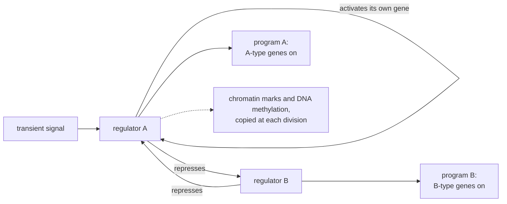

---
aliases:
  - Differentiation
  - Cellular Differentiation
  - Cell Fate
  - Cell Memory
  - Lineage Commitment
  - Différenciation cellulaire
tags:
  - type/concept
  - domain/biology
  - domain/bioinformatics
  - domain/mathematics
  - level/L2
  - level/L3
  - level/M1
mastery: 0
prerequisites:
  - "[[Cell]]"
  - "[[Gene Expression]]"
  - "[[Transcription]]"
  - "[[Cell Signaling]]"
  - "[[Cell Cycle]]"
related:
  - "[[Stem Cell]]"
  - "[[Gene Regulation]]"
  - "[[Transcription Factor]]"
  - "[[Gene Regulatory Network]]"
  - "[[Chromatin]]"
  - "[[DNA Methylation]]"
  - "[[Epigenetics]]"
  - "[[Bistability]]"
  - "[[Feedback Loop]]"
  - "[[Cell Type]]"
  - "[[Trajectory Inference]]"
  - "[[Developmental Biology]]"
projects: []
sources:
  - "[[Molecular Biology of the Cell (Alberts)]]"
  - "[[Anatomy and Physiology 2e (OpenStax)]]"
  - "[[NobelPrize.org]]"
  - "[[Takahashi 2006 - Induction of Pluripotent Stem Cells from Mouse Embryonic and Adult Fibroblast Cultures by Defined Factors]]"
  - "[[Trapnell 2014 - The Dynamics and Regulators of Cell Fate Decisions Are Revealed by Pseudotemporal Ordering of Single Cells]]"
  - "[[MIT 8.591J - Systems Biology]]"
---

# Cell Differentiation

> [!abstract]
> A neuron and a liver cell carry the same genome but keep different genes switched on. Differentiation is how cells acquire such distinct expression programs, and the programs last because transcription factors sustain themselves through feedback while chromatin and DNA methylation carry the memory through cell divisions.

## Definition

**Cell differentiation** is the process by which a less specialized cell becomes a more specialized cell type, with the structures and functions of that type; all the cell types of the body arise in this way from the fertilized egg.[^ap36] Differentiation changes which genes are expressed, not the genome: the different cell types of a multicellular organism contain the same DNA but make different sets of proteins.[^alberts-gc] The differentiated state is **stable**: it persists after the signals that induced it have gone and is passed on when the cell divides, a property called **cell memory**.[^alberts-gc]

## Why it matters

- **Single-cell atlases classify expression programs.** For the data, a cell type is a stable expression program; clusters of single-cell transcriptomes are its readout ([[Cell Type]], [[Single-Cell Clustering]], [[Cell Type Annotation]]).
- **Pseudotime.** Ordering single cells by their progress through differentiation recovers dynamics that bulk time courses blur: in differentiating human myoblasts it revealed switch-like changes in key regulators and sequential waves of gene regulation.[^trapnell] This is the starting point of [[Trajectory Inference]].
- **Regulatory networks.** Fates are chosen by transcription factors acting in combination, the object of [[Gene Regulatory Network Inference]].[^alberts-gc]
- **Reprogramming.** Four transcription factors turn fibroblasts into pluripotent cells, the basis of patient-derived cell models ([[Stem Cell]]).[^takahashi]
- **Bulk samples mix programs.** A tissue sample averages several differentiated states, which [[Cell-Type Deconvolution]] tries to separate.

## Core (L2)

### Same genome, different programs

- **Nuclear transfer.** In 1962 John Gurdon replaced the nucleus of a frog egg with the nucleus of a mature intestinal cell; the egg developed into a normal tadpole. The specialized nucleus still held all the information needed to build the animal: specialization is reversible.[^nobel12]
- **Plants.** A single differentiated plant cell can regenerate an entire plant.[^alberts-gc]
- **Exceptions** confirm the rule: lymphocytes rearrange parts of their DNA ([[V(D)J Recombination]]),[^alberts-gc] and human red blood cells lose their nucleus as they mature.[^ap-blood]

What differs is the set of proteins made: all cells make the housekeeping proteins, each type adds its specialized ones ([[Gene Expression]]).[^alberts-gc]

### Deciding: signals and transcription factors

- **Signals choose.** External signals from neighboring cells change which genes a cell expresses ([[Cell Signaling]]).[^alberts-gc]
- **Combinations specify.** A limited set of transcription regulators, used in different combinations, is enough to specify many cell types ([[Transcription Factor]], [[Gene Regulation]]).[^alberts-gc]
- **One factor can launch a program.** Expressing the regulator MyoD in fibroblasts makes them behave like muscle-cell precursors.[^alberts-gc]
- **Potential narrows step by step.** The totipotent cells of the early embryo give pluripotent cells, which give multipotent cells restricted to one or a few lineages, and finally specialized cells ([[Stem Cell]], [[Developmental Biology]]).[^ap36]

### Remembering: three layers of memory



1. **Transcriptional feedback.** A regulator that activates its own gene, directly or through a loop, stays on after the signal that started it is gone; two regulators that repress each other give two exclusive stable states ([[Feedback Loop]], [[Bistability]]).[^alberts-gc][^mit8591]
2. **DNA methylation.** In vertebrates, the pattern of methylated cytosines is copied onto the new strand when the DNA replicates, so silenced genes stay silent in the daughter cells ([[DNA Methylation]]).[^alberts-gc]
3. **Chromatin states.** Condensed, silenced chromatin can be inherited through divisions; in female mammals, one X chromosome is inactivated in each early embryonic cell and stays inactive in all its descendants ([[Chromatin]], [[Histone Modification]], [[Epigenetics]]).[^alberts-gc]

## Advanced (L3)

![[toggle-switch-phase-plane.svg]]

### A decision as a switch

Two regulators that repress each other form a **toggle switch**. In the phase plane, the curves where each level stops changing (the nullclines) cross three times: two stable states, "A on, B off" and "B on, A off", and an unstable saddle between them. The diagonal separates the two basins: wherever a cell starts, it ends in the fate of its side. A transient signal that pushes the state across the separatrix changes the fate for good, which is cell memory in its simplest form.[^mit8591] The switch exists only if repression is cooperative and synthesis strong enough (Mathematical representation).

### Stable but reversible

Differentiation is maintained, not fixed. Gurdon's nuclear transfer showed it in 1962; more than 40 years later, introducing four genes reprogrammed fibroblasts into immature, pluripotent stem cells.[^nobel12] The four factors were Oct3/4, Sox2, c-Myc and Klf4; the resulting induced pluripotent stem (iPS) cells behaved like embryonic stem cells, formed tissues of all three germ layers in tumors grown in mice, and contributed to mouse embryos.[^takahashi] In the switch picture, the factors force the cell out of its basin and into the basin of the pluripotent network.

## Frontier (M1)

- **Pseudotime as a computational object.** Monocle orders cells collected at several time points by their transcriptional progress, giving finer temporal resolution than bulk samples. In human myoblast differentiation, it uncovered regulators not known to act in differentiation, some confirmed in a loss-of-function screen.[^trapnell]
- **What the order assumes.** Cells sampled at one time are at different stages of an asynchronous process, and closeness in expression means closeness in progress. The simplest version projects cells onto one axis of variation (Exercise 6); real fate decisions branch, at the points where switches like the one above act ([[Trajectory Inference]], [[RNA Velocity]]).
- **Limits.** Pseudotime is an order, not a clock, and its direction comes from outside information, such as sampling times or known markers.

## Mathematical representation

Let $u$ and $v$ be the levels of regulators A and B, in units where the degradation rate and the repression threshold equal 1, $\alpha$ the maximal synthesis rate and $n$ the cooperativity of repression:
$$\frac{du}{dt} = \frac{\alpha}{1 + v^n} - u, \qquad \frac{dv}{dt} = \frac{\alpha}{1 + u^n} - v.$$

- **Nullclines**: $u = \alpha/(1+v^n)$ and $v = \alpha/(1+u^n)$; fixed points are their intersections.
- **Symmetric state**: $u = v = s$ with $s(1 + s^n) = \alpha$.
- **Its stability.** The Jacobian has $-1$ on the diagonal and, at the symmetric state, $-g$ off the diagonal, with
$$g = \frac{\alpha\, n\, s^{n-1}}{(1+s^n)^2} = \frac{n\, s^n}{1+s^n} \quad \text{(using } \alpha = s(1+s^n)\text{)}.$$
Its eigenvalues are $-1 \pm g$: the symmetric state is a saddle, and the system bistable, when $g > 1$, that is $s^n > 1/(n-1)$.
- **Consequences.** For $n = 1$, $g = s/(1+s) < 1$ always: without cooperativity there is no switch, whatever $\alpha$. For $n = 2$, the condition is $s > 1$, i.e. $\alpha = s(1+s^2) > 2$.

## Computational representation

The toggle switch with $\alpha = 4$ and $n = 2$, integrated with the Euler method (arbitrary units).

```python
def rates(u: float, v: float, alpha: float = 4.0, n: int = 2, signal: float = 0.0):
    """Toggle switch: regulators A (level u) and B (level v) repress each other's genes."""
    du = alpha / (1 + v ** n) - u + signal      # `signal` adds extra synthesis of A
    dv = alpha / (1 + u ** n) - v
    return du, dv


def simulate(u: float, v: float, t_end: float = 30.0, dt: float = 0.01, pulse=(0.0, 0.0)):
    """Euler integration; pulse = (strength, duration) of a transient signal driving A."""
    t = 0.0
    while t < t_end:
        du, dv = rates(u, v, signal=pulse[0] if t < pulse[1] else 0.0)
        u, v, t = u + dt * du, v + dt * dv, t + dt
    return round(u, 2), round(v, 2)


for start in [(0.3, 0.5), (0.5, 0.3), (2.0, 2.1), (2.1, 2.0)]:
    print("start", start, "-> end", simulate(*start))

fate_b = simulate(0.3, 0.5)                    # a cell committed to fate B (B high)
print("fate B, no signal:          ", simulate(*fate_b))
print("fate B, signal 3.0 for 0.5: ", simulate(*fate_b, pulse=(3.0, 0.5)))
print("fate B, signal 3.0 for 1.0: ", simulate(*fate_b, pulse=(3.0, 1.0)))
```

```text
start (0.3, 0.5) -> end (0.27, 3.73)
start (0.5, 0.3) -> end (3.73, 0.27)
start (2.0, 2.1) -> end (0.27, 3.73)
start (2.1, 2.0) -> end (3.73, 0.27)
fate B, no signal:           (0.27, 3.73)
fate B, signal 3.0 for 0.5:  (0.27, 3.73)
fate B, signal 3.0 for 1.0:  (3.73, 0.27)
```

Starting points on either side of the diagonal end in opposite fates, however close they start. A cell in fate B ignores a short signal for A but switches permanently after a longer one: the response outlasts the signal by 29 time units, and would forever.

## Worked example

> [!example] Fixed points of the toggle by hand, $n = 2$
> 1. **$\alpha = 2.5$, an asymmetric state.** Try $(u, v) = (0.5, 2.0)$: $\alpha/(1+v^2) = 2.5/5 = 0.5 = u$ and $\alpha/(1+u^2) = 2.5/1.25 = 2.0 = v$. It is a fixed point, and by symmetry so is $(2.0, 0.5)$.
> 2. **The symmetric state.** Solve $s(1 + s^2) = 2.5$: $s \approx 1.115$ (check: $1.115 \times 2.243 = 2.501$). Then $g = 2s^2/(1+s^2) = 2.486/2.243 = 1.108 > 1$: a saddle. The system is a switch.
> 3. **$\alpha = 1.5$.** $s(1+s^2) = 1.5$ gives $s \approx 0.861$ and $g = 2 \times 0.741/1.741 = 0.851 < 1$: the symmetric state is stable and the only one. Too little synthesis, no decision: both regulators sit at the same middling level.
> 4. **Reading.** The threshold $\alpha = 2$ separates a system that can commit from one that cannot; the code of Exercise 5 finds the same fixed points numerically.

## Common misconceptions

> [!warning] "Differentiated cells lose the genes they do not use"
> Nuclear transfer and plant regeneration show that the genome is kept whole;[^nobel12][^alberts-gc] the rare exceptions (lymphocytes, red blood cells) are special cases.

> [!warning] "Differentiation is irreversible"
> It is stable, not irreversible: nuclear transfer and four transcription factors can reset a differentiated cell to pluripotency.[^nobel12][^takahashi]

> [!warning] "Epigenetic memory means DNA methylation"
> Methylation is one layer; self-sustaining transcription factor circuits and inherited chromatin states also carry the memory.[^alberts-gc]

> [!warning] "Pseudotime is time"
> It orders cells by transcriptional progress; two cells with the same pseudotime may have been sampled at different times, and the direction must come from outside information.

## Exercises

> [!question] Exercise 1 (L2)
> What did Gurdon's 1962 experiment prove, and which hypothesis about differentiation did it rule out?

> [!success]- Solution
> A nucleus from a specialized intestinal cell, placed in an egg, directed the development of a normal tadpole: it still contained all the genetic information of the organism.[^nobel12] This ruled out differentiation by loss or irreversible alteration of the genes not used, and showed that the cytoplasm of the egg can reset the program.

> [!question] Exercise 2 (L2)
> A drug blocks the copying of methylation onto newly made DNA strands. What happens to the methylation of a silenced gene over successive divisions, and to its expression?

> [!success]- Solution
> At each replication the new strand stays unmethylated and the old methylated strands are never copied. After the first division no copy of the site is fully methylated any more, and the fraction of methylated strands halves with each division, to $2^{-k}$ after $k$ divisions. Genes kept silent by methylation can then be re-expressed and the cells may drift away from their program: the pattern survives only because it is copied actively at each replication.[^alberts-gc]

> [!question] Exercise 3 (L2)
> MyoD makes fibroblasts muscle-like; Oct3/4, Sox2, c-Myc and Klf4 make them pluripotent. What do both experiments say about how a cell's program is chosen?

> [!success]- Solution
> A few transcription factors at the top of a regulatory network are enough to launch a whole program, which then sustains itself: identity is set by regulators, not by the genome, which all these cells share.[^alberts-gc][^takahashi] In both cases the new program must also displace the fibroblast's own, which maintains itself through the memory mechanisms above.

> [!question] Exercise 4 (L3)
> Using the Mathematical representation, show that the toggle with $n = 2$ is bistable only for $\alpha > 2$, and that no value of $\alpha$ makes it bistable for $n = 1$.

> [!success]- Solution
> The symmetric state $s$ solves $s(1+s^n) = \alpha$, and is a saddle iff $g = n s^n/(1+s^n) > 1$. For $n = 2$: $2s^2 > 1 + s^2 \iff s > 1 \iff \alpha = s(1+s^2) > 2$, since $s(1+s^2)$ increases with $s$. For $n = 1$: $g = s/(1+s) < 1$ for every $s > 0$, so the symmetric state is always stable and unique: mutual repression without cooperativity cannot store a decision.

> [!question] Exercise 5 (L3, Python)
> Find all fixed points of the toggle for $\alpha = 1.5$, $2.5$ and $4$ with $n = 2$, and for $\alpha = 10$ with $n = 1$, by scanning for sign changes along the nullclines.

> [!success]- Solution
> Substituting one nullcline into the other gives a function of $u$ alone whose zeros are the fixed points.
> ```python
> def fixed_points(alpha: float, n: int = 2, steps: int = 200000):
>     """Intersections of the nullclines u = alpha/(1+v^n), v = alpha/(1+u^n), scanning u."""
>     g = lambda u: u - alpha / (1 + (alpha / (1 + u ** n)) ** n)
>     us = [alpha * i / steps for i in range(steps + 1)]
>     roots = [a for a, b in zip(us, us[1:]) if g(a) == 0 or g(a) * g(b) < 0]
>     return [(round(u, 3), round(alpha / (1 + u ** n), 3)) for u in roots]
>
> for alpha in (1.5, 2.5, 4.0):
>     print(alpha, fixed_points(alpha))
> print("n = 1, alpha = 10:", fixed_points(10.0, n=1))
> ```
> Output:
> ```text
> 1.5 [(0.861, 0.861)]
> 2.5 [(0.5, 2.0), (1.115, 1.115), (2.0, 0.5)]
> 4.0 [(0.268, 3.732), (1.379, 1.379), (3.732, 0.268)]
> n = 1, alpha = 10: [(2.702, 2.702)]
> ```
> One state below the threshold, three above it, as derived; with $n = 1$, even strong synthesis gives a single state.

> [!question] Exercise 6 (M1, Python)
> Eight cells (invented data) express a progenitor marker and a differentiation marker (log scale). Compute a pseudotime by projecting the cells onto their first principal axis, oriented toward the differentiation marker, and rescale it to $[0, 1]$. What does this method assume, and when would it fail?

> [!success]- Solution
> ```python
> import math
> CELLS = {  # cell: (progenitor marker, differentiation marker), log-scale expression (invented)
>     "c1": (5.1, 0.4), "c2": (4.6, 1.1), "c3": (3.9, 1.8), "c4": (3.1, 2.9),
>     "c5": (2.2, 3.4), "c6": (1.6, 4.2), "c7": (0.9, 4.6), "c8": (0.5, 5.3),
> }
> names = list(CELLS)
> xs = [CELLS[c][0] for c in names]
> ys = [CELLS[c][1] for c in names]
> mx, my = sum(xs) / len(xs), sum(ys) / len(ys)
> sxx = sum((x - mx) ** 2 for x in xs) / (len(xs) - 1)
> syy = sum((y - my) ** 2 for y in ys) / (len(ys) - 1)
> sxy = sum((x - mx) * (y - my) for x, y in zip(xs, ys)) / (len(xs) - 1)
> lam = (sxx + syy) / 2 + math.sqrt(((sxx - syy) / 2) ** 2 + sxy ** 2)   # largest eigenvalue
> vx, vy = sxy, lam - sxx                                                 # its eigenvector
> norm = math.hypot(vx, vy)
> vx, vy = vx / norm, vy / norm
> if vy < 0:                       # orient the axis toward the differentiation marker
>     vx, vy = -vx, -vy
> proj = {c: (x - mx) * vx + (y - my) * vy for c, x, y in zip(names, xs, ys)}
> lo, hi = min(proj.values()), max(proj.values())
> pseudotime = {c: (p - lo) / (hi - lo) for c, p in proj.items()}
> print("axis:", round(vx, 3), round(vy, 3), "explained:", round(lam / (sxx + syy), 3))
> print(" ".join(f"{c}:{t:.2f}" for c, t in sorted(pseudotime.items(), key=lambda kv: kv[1])))
> ```
> Output:
> ```text
> axis: -0.701 0.714 explained: 0.998
> c1:0.00 c2:0.13 c3:0.27 c4:0.47 c5:0.62 c6:0.77 c7:0.88 c8:1.00
> ```
> The axis explains 99.8% of the variance: one process dominates, the progenitor marker falling as the differentiation marker rises ([[Principal Component Analysis]]). The method assumes a single, unbranched path and needs outside knowledge to orient it (here, which marker means "late"). It fails at a fate decision, where cells split into two branches that one axis would mix, and when other sources of variation, such as the cell cycle, dominate the first axis.

## Mastery checklist

- [ ] 1 Recognized: I can define differentiation, cell memory and potency, and cite the evidence that differentiated cells keep their genome.
- [ ] 2 Understood: I can explain how signals and combinations of transcription factors select a program, and the three layers of memory that keep it.
- [ ] 3 Practiced: I can derive the bistability condition of a toggle switch and simulate commitment and memory in Python.
- [ ] 4 Applied: I ordered real single-cell data from a differentiation process along a trajectory and identified genes that change along it.
- [ ] 5 Explained: I can teach why differentiation is stable but reversible, and what pseudotime can and cannot tell about it.

## References

[^ap36]: [[Anatomy and Physiology 2e (OpenStax)]], section 3.6 "Cellular Differentiation" (specialized cell types arising from the fertilized egg; totipotent, pluripotent and multipotent cells).
[^ap-blood]: [[Anatomy and Physiology 2e (OpenStax)]], treatment of blood (erythrocytes).
[^alberts-gc]: [[Molecular Biology of the Cell (Alberts)]], 4th ed. (2002), treatment of the control of gene expression in multicellular organisms (the same DNA in all cell types, with plant regeneration from single differentiated cells and exceptions such as DNA rearrangement in lymphocytes; different sets of proteins in different cell types; external signals changing gene expression; combinatorial control; MyoD converting fibroblasts into muscle-like cells; cell memory by positive feedback; inheritance of DNA methylation patterns and of chromatin states, including X-chromosome inactivation).
[^nobel12]: [[NobelPrize.org]], press release of the Nobel Prize in Physiology or Medicine 2012 (John B. Gurdon and Shinya Yamanaka, for the discovery that mature cells can be reprogrammed to become pluripotent; Gurdon's 1962 transfer of a mature intestinal cell nucleus into a frog egg, which developed into a normal tadpole; reprogramming of fibroblasts by four genes more than 40 years later).
[^takahashi]: [[Takahashi 2006 - Induction of Pluripotent Stem Cells from Mouse Embryonic and Adult Fibroblast Cultures by Defined Factors]], *Cell* 126:663-676 (Oct3/4, Sox2, c-Myc and Klf4; ES-like iPS cells; three germ layers; contribution to embryos).
[^trapnell]: [[Trapnell 2014 - The Dynamics and Regulators of Cell Fate Decisions Are Revealed by Pseudotemporal Ordering of Single Cells]], *Nature Biotechnology* 32:381-386 (Monocle; human myoblast differentiation; switch-like regulators, sequential waves, new regulators validated in a loss-of-function screen).
[^mit8591]: [[MIT 8.591J - Systems Biology]], lecture "Autoregulation, Feedback and Bistability".
