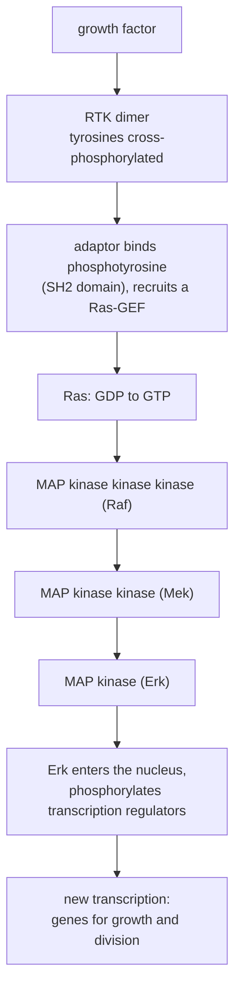

---
aliases:
  - Cell Communication
  - Signal Transduction
  - Signaling Pathway
  - Second Messenger
  - Kinase Cascade
  - Receptor
  - Signalisation cellulaire
  - Transduction du signal
tags:
  - type/concept
  - domain/biology
  - domain/bioinformatics
  - domain/mathematics
  - level/L2
  - level/L3
  - level/M1
mastery: 0
prerequisites:
  - "[[Cell Membrane]]"
  - "[[Membrane Transport]]"
  - "[[Protein]]"
  - "[[Enzyme]]"
  - "[[Gene Expression]]"
  - "[[Transcription]]"
related:
  - "[[Endocrine System]]"
  - "[[Post-Translational Modification]]"
  - "[[Transcription Factor]]"
  - "[[Gene Regulation]]"
  - "[[Ligand Binding]]"
  - "[[Hill Function]]"
  - "[[Cooperativity]]"
  - "[[Feedback Loop]]"
  - "[[Bistability]]"
  - "[[Biological Pathway]]"
  - "[[Cell Cycle]]"
  - "[[Apoptosis]]"
  - "[[Oncogene]]"
projects: []
sources:
  - "[[Molecular Biology of the Cell (Alberts)]]"
  - "[[Biology 2e (OpenStax)]]"
  - "[[MIT 8.591J - Systems Biology]]"
  - "[[KEGG]]"
  - "[[Gene Ontology]]"
  - "[[Manning 2002 - The Protein Kinase Complement of the Human Genome]]"
  - "[[IHGSC 2004 - Finishing the Euchromatic Sequence of the Human Genome]]"
---

# Cell Signaling

> [!abstract]
> Cells communicate with molecules: a signal binds a receptor, the receptor starts a relay of second messengers and protein kinases inside the cell, and the relay ends by changing which proteins are active and which genes are transcribed.

## Definition

**Cell signaling** (cell communication) is the process by which a cell detects an extracellular signal molecule and converts it into a response. The signal binds a specific **receptor** protein; the activated receptor switches on intracellular signaling proteins that relay, amplify and distribute the message to **effector** proteins, such as enzymes, ion channels, cytoskeletal proteins and transcription regulators, which change the cell's metabolism, shape, movement, gene expression, division or survival.[^alberts15][^os9] The conversion of the external signal into intracellular signals is **signal transduction**.

## Why it matters

- **Pathways are computable objects.** KEGG draws signaling pathways as reference maps with stable identifiers, such as map04010 "MAPK signaling pathway" (human version hsa04010) or map04024 "cAMP signaling pathway", whose gene lists drive pathway analyses of expression data ([[Biological Pathway]], [[Over-Representation Analysis]], [[Gene Set Enrichment Analysis]]).[^kegg] GO goes further with causal activity models that chain annotations into mechanisms.[^go]
- **The switches form a large gene family.** The human genome encodes 518 putative protein kinases, and 244 of them map to disease loci or cancer amplicons;[^manning] against 20,000 to 25,000 protein-coding genes,[^ihgsc] that is 2 to 2.6% of the genes.
- **Cancer is often signaling stuck on.** Mutant Ras proteins that cannot switch themselves off keep growth signals active, and such mutations occur in many human cancers ([[Oncogene]], [[Cancer]]).[^alberts15]
- **Transcriptomes are signaling readouts.** Signaling ends in transcription, so a change in gene expression after a stimulus is often the only trace of a pathway's activity that an RNA-seq experiment sees ([[Differential Expression Analysis]]).

## Core (L2)

### Signals and distances

Signals travel in four ways: through **contact** between membrane-bound signal and receptor, as **paracrine** local mediators acting on nearby cells, across **synapses** between neurons and their targets, and as **endocrine** hormones carried by the blood ([[Endocrine System]], [[Nervous System]]).[^alberts15] A cell can also respond to signals it releases itself (autocrine signaling).[^os9]

### Receptors

Small hydrophobic signals, such as steroid hormones, thyroid hormones, retinoids and vitamin D, cross the membrane and bind **intracellular receptors**, the nuclear receptors, which are ligand-activated transcription regulators. Large or hydrophilic signals stay outside and bind **cell-surface receptors** ([[Cell Membrane]]), of three classes:[^alberts15][^os9]

| Class | Structure | What binding does | Example |
|---|---|---|---|
| Ion-channel-coupled | channel gated by the ligand | opens a pore: ions flow within milliseconds ([[Membrane Transport]]) | acetylcholine receptor of muscle |
| G-protein-coupled (GPCR) | one chain crossing the membrane 7 times | activates a trimeric G protein; the largest family of cell-surface receptors | adrenaline receptors |
| Enzyme-coupled | mostly receptor tyrosine kinases (RTKs), single-pass | ligand brings two receptors together; they phosphorylate each other on tyrosines | growth-factor receptors |

### Molecular switches

Inside the cell, most signaling proteins are switches of two kinds:[^alberts15]

- **Phosphorylation switches.** A protein kinase adds a phosphate to serines and threonines, or to tyrosines; a protein phosphatase removes it ([[Post-Translational Modification]]).
- **GTP-binding switches.** A GTP-binding protein is on with GTP bound and off once it hydrolyzes GTP to GDP: trimeric G proteins, and monomeric GTPases such as Ras. Guanine nucleotide exchange factors (GEFs) turn them on, GTPase-activating proteins (GAPs) turn them off.

### Second messengers

Small intracellular mediators spread the signal fast and far:[^alberts15][^os9]

- **cyclic AMP (cAMP)**, made from ATP by adenylyl cyclase and destroyed by cAMP phosphodiesterase;
- **Ca²⁺**, kept around $10^{-4}$ mM in the cytosol and released from the ER or let in through channels (the steep gradient computed in [[Membrane Transport]]);
- **inositol trisphosphate (IP₃)** and **diacylglycerol**, cut from a membrane lipid by phospholipase C: IP₃ opens Ca²⁺ channels of the ER, diacylglycerol helps activate protein kinase C.

### A kinase cascade to the nucleus

Growth factors act through an RTK, Ras and a three-kinase module, the MAP kinase cascade:[^alberts15]



In mammals the MAP kinases fall into groups, ERK1/2, JNK1/2/3, p38 and ERK5, each activated by its own MAP kinase kinases; the module takes part in proliferation, differentiation and migration.[^kegg] Other routes reach transcription more directly: cytokine receptors activate JAK kinases that phosphorylate STAT transcription regulators, and TGF-β receptors phosphorylate Smad proteins, which move to the nucleus.[^alberts15]

### Switching off

Each step has its off switch: G proteins and Ras hydrolyze their GTP, phosphatases remove phosphates, phosphodiesterase destroys cAMP, pumps clear Ca²⁺, and receptors are desensitized or removed from the surface.[^alberts15] Without these, a transient signal would become permanent; with them, the cell responds to changes.

## Advanced (L3)

![[signaling-cascade-dose-response.svg]]

- **Amplification.** One receptor activates many G proteins, one adenylyl cyclase makes many cAMP molecules, one kinase phosphorylates many substrates: gains multiply along the relay.[^alberts15]
- **Shifting versus sharpening.** Some responses are graded, others switch abruptly at a threshold; steepness comes from cooperative binding, from several modifications needed on one target, or from positive feedback.[^alberts15][^mit8591] A cascade of non-cooperative steps is more sensitive (the dose for half-maximal response falls) but not steeper: composing hyperbolic responses gives another hyperbola (figure, and Mathematical representation). Steep, switch-like responses need cooperative steps, whose local steepnesses multiply.
- **Memory and adaptation.** Positive feedback can keep a response on after the signal is gone, a cellular memory that reappears in [[Cell Differentiation]] and [[Bistability]]; desensitization lets a cell adapt to a sustained signal and respond only to its changes ([[Feedback Loop]]).[^alberts15][^mit8591]
- **Networks, not chains.** Pathways share components and cross-regulate, and the same messengers (cAMP, Ca²⁺) serve several receptors. The linear pathway of a textbook figure is a projection of a network; KEGG reference maps are unions of what is known across organisms, so the genes actually present must be checked in each species.[^kegg]
- **Locked switches cause disease.** A Ras that cannot hydrolyze GTP keeps signaling; cholera toxin modifies the α subunit of the G protein Gs so that it cannot hydrolyze its GTP, cAMP stays high in intestinal cells, and Cl⁻ and water pour into the gut.[^alberts15]

## Frontier (M1)

- **The kinome as a data set.** A complete list of kinases (518 genes, 71 of them new when catalogued, plus 106 pseudogenes) turned signaling into a genome-scale question: which kinases are expressed, mutated or amplified in a tissue or a tumor.[^manning]
- **From maps to models.** Pathway maps record who acts on whom; mechanistic models add rates and doses. GO causal activity models link annotations into causal chains,[^go] and quantitative models start from the input functions, cooperativity and feedback treated in systems biology courses.[^mit8591]
- **Limits of pathway analysis.** A gene set does not know which of its members are active as proteins; an over-represented pathway in transcript data is a hypothesis about signaling, to be confirmed at the protein and phosphorylation level.

## Mathematical representation

- **Receptor occupancy.** For $R + L \rightleftharpoons RL$ at equilibrium, with dissociation constant $K_d = [R][L]/[RL]$, the fraction of occupied receptors is
$$\theta = \frac{[L]}{K_d + [L]},$$
half-occupancy at $[L] = K_d$ ([[Ligand Binding]]).
- **Hill function.** A cooperative step responds as
$$f(x) = \frac{x^n}{K^n + x^n},$$
with $K$ the input giving half the maximal output and $n$ the Hill coefficient, the steepness ([[Hill Function]], [[Cooperativity]]).[^mit8591]
- **Logarithmic sensitivity.** The response coefficient $\rho = \dfrac{d \ln f}{d \ln x}$ measures the percent change in output per percent change in input. For the Hill function, $\rho = n\,(1 - f)$: highest at low output, equal to $n/2$ at half-maximum.
- **Cascades multiply sensitivities.** For $y = f_3(f_2(f_1(x)))$, the chain rule gives $\rho_{\text{total}} = \rho_1\,\rho_2\,\rho_3$, each evaluated where that step operates. With $n = 1$ every $\rho_i \le 1$, so the cascade is never steeper than a single hyperbola.
- **Effective Hill coefficient.** For a Hill curve the doses giving 10% and 90% of the maximum satisfy $\mathrm{EC}_{90}/\mathrm{EC}_{10} = 81^{1/n}$, so any measured or simulated dose-response has $n_{\text{eff}} = \ln 81 / \ln(\mathrm{EC}_{90}/\mathrm{EC}_{10})$.

## Computational representation

Each downstream step receives the previous step's output (between 0 and 1) as its input; doses are in units of the receptor $K_d$, and the step parameters ($K = 0.5$, $n$) are illustrative.

```python
import math


def hill(x: float, k: float, n: float) -> float:
    """Fraction of a step switched on by input x: half-maximal at k, steepness n."""
    return x ** n / (k ** n + x ** n)


def cascade(x: float, n: float, steps: int = 2, k: float = 0.5) -> float:
    """Receptor occupancy (x = ligand / Kd), then `steps` downstream Hill steps."""
    y = x / (1 + x)
    for _ in range(steps):
        y = hill(y, k, n)
    return y


def dose_for(response, level: float, lo: float = 1e-6, hi: float = 1e6) -> float:
    """Ligand dose (in units of Kd) giving `level` of the maximal response; bisection in log space."""
    top = response(1e12)
    for _ in range(200):
        mid = math.sqrt(lo * hi)
        lo, hi = (mid, hi) if response(mid) / top < level else (lo, mid)
    return mid


MODELS = {
    "receptor only": lambda x: x / (1 + x),
    "receptor + 2 steps, n = 1": lambda x: cascade(x, 1),
    "receptor + 2 steps, n = 2": lambda x: cascade(x, 2),
}
for name, f in MODELS.items():
    ec10, ec50, ec90 = (dose_for(f, q) for q in (0.1, 0.5, 0.9))
    n_eff = math.log(81) / math.log(ec90 / ec10)
    print(f"{name:27s} EC50 = {ec50:6.3f}  EC90/EC10 = {ec90 / ec10:5.1f}  n_eff = {n_eff:.2f}")
```

```text
receptor only               EC50 =  1.000  EC90/EC10 =  81.0  n_eff = 1.00
receptor + 2 steps, n = 1   EC50 =  0.143  EC90/EC10 =  81.0  n_eff = 1.00
receptor + 2 steps, n = 2   EC50 =  0.631  EC90/EC10 =  10.4  n_eff = 1.87
```

Two non-cooperative steps make the response 7 times more sensitive ($\mathrm{EC}_{50}$ from 1 to 0.143 $K_d$) without changing its 81-fold dynamic range; two cooperative steps shrink the range from 81-fold to 10-fold. These curves are the figure above.

## Worked example

> [!example] Tracing a hormone from a GPCR to a gene
> A hormone acts on a cell through a Gs-coupled receptor; follow each step, what switches it on and what switches it off.[^alberts15]
> 1. **Receptor.** The hormone binds the GPCR, which changes shape on the cytosolic side. *Off*: the hormone dissociates; the receptor is desensitized.
> 2. **G protein.** The receptor makes the α subunit of Gs exchange GDP for GTP; α-GTP separates from βγ. *Off*: α hydrolyzes its GTP.
> 3. **Second messenger.** α-GTP activates adenylyl cyclase, which makes cAMP from ATP. *Off*: cAMP phosphodiesterase.
> 4. **Kinase.** cAMP binds the regulatory subunits of protein kinase A (PKA), releasing its active catalytic subunits. *Off*: cAMP falls, the subunits reassociate.
> 5. **Nucleus.** Catalytic subunits enter the nucleus and phosphorylate the transcription regulator CREB, which binds cAMP response elements (CRE) in target genes and, with a coactivator, switches on their transcription. *Off*: phosphatases.
> 6. **Reading it in data.** cAMP levels and PKA activity rise within seconds to minutes; new transcripts of CRE-containing genes appear later, and they are what an RNA-seq time course measures.

## Common misconceptions

> [!warning] "A signaling pathway is a linear chain"
> Pathways share components and feed back on each other; the chain in a figure is one path through a network, and pathway maps merge knowledge from many organisms.[^kegg]

> [!warning] "Every hormone binds a receptor on the cell surface"
> Small hydrophobic hormones such as steroids cross the membrane and bind intracellular receptors that act directly on transcription.[^alberts15][^os9]

> [!warning] "More steps always make a sharper switch"
> Non-cooperative steps shift the dose-response to lower doses without steepening it; switches need cooperativity or positive feedback (Computational representation).

> [!warning] "A kinase cascade exists to amplify"
> Amplification is one function; cascades also give separate points of regulation, branching to several effectors and integration of several inputs.[^alberts15]

## Exercises

> [!question] Exercise 1 (L2)
> For each signal, name the receptor class and whether the first response is a change in ion flow, in enzyme activity or in transcription: (a) acetylcholine at a muscle cell; (b) adrenaline on a liver cell; (c) a growth factor on a fibroblast; (d) cortisol.

> [!success]- Solution
> (a) Ion-channel-coupled receptor: ion flow, within milliseconds. (b) GPCR: enzyme activity (adenylyl cyclase, then PKA). (c) Receptor tyrosine kinase: enzyme activity (kinase cascade), transcription later. (d) Intracellular nuclear receptor: transcription directly. Only (d) needs no second messenger.

> [!question] Exercise 2 (L2)
> Predict the effect on signaling of: (a) a Ras mutant that cannot hydrolyze GTP; (b) cholera toxin; (c) an inhibitor of cAMP phosphodiesterase; (d) a receptor tyrosine kinase lacking its kinase domain, made in large amounts in a cell that also has the normal receptor.

> [!success]- Solution
> (a) Ras stays on: the MAP kinase cascade runs without growth factor, a cancer mechanism. (b) Gs stays active, cAMP stays high: the intestinal cells secrete Cl⁻ and water. (c) cAMP is destroyed slowly: every cAMP signal is larger and longer. (d) The mutant receptors pair with the normal ones, and a pair with one dead kinase cannot cross-phosphorylate: signaling is blocked, a dominant-negative effect.[^alberts15]

> [!question] Exercise 3 (L2)
> A step responds as a Hill function with $n = 2$. Compute its response coefficient $\rho = n(1-f)$ at 10%, 50% and 90% of its maximum. Then compute the overall coefficient of two such steps, both operating at 10%.

> [!success]- Solution
> $\rho = 1.8$, $1.0$ and $0.2$. Two steps at 10%: $1.8 \times 1.8 = 3.24$. A step is most sensitive when lightly activated; near saturation it transmits almost nothing, so a cascade is steep only if its steps work in their low range.

> [!question] Exercise 4 (L3, Python)
> With `cascade` and `dose_for` from the code above, compute $n_{\text{eff}}$ and $\mathrm{EC}_{50}$ for 0 to 4 downstream steps with $n = 2$. How does steepness grow with the number of cooperative steps?

> [!success]- Solution
> ```python
> for steps in range(0, 5):
>     f = lambda x, s=steps: cascade(x, 2, steps=s)
>     ec10, ec90 = dose_for(f, 0.1), dose_for(f, 0.9)
>     print(steps, round(math.log(81) / math.log(ec90 / ec10), 2), round(dose_for(f, 0.5), 3))
> ```
> Output:
> ```text
> 0 1.0 1.0
> 1 1.39 0.69
> 2 1.87 0.631
> 3 2.44 0.626
> 4 3.08 0.637
> ```
> $n_{\text{eff}}$ grows with each step but by less than a factor of 2, because each step does not operate at its most sensitive point everywhere along the curve; the sensitivity of the whole cascade is the product of local, not maximal, sensitivities.

> [!question] Exercise 5 (L3, Python)
> In an RNA-seq experiment (invented numbers), 500 of 20,000 genes are up-regulated after a stimulus, and 25 of them belong to a 300-gene signaling pathway. Compute the expected overlap and the hypergeometric probability of an overlap of at least 25 by chance.

> [!success]- Solution
> ```python
> from math import comb
>
>
> def hypergeom_sf(k: int, N: int, K: int, n: int) -> float:
>     """P(X >= k) when drawing n genes from N, of which K belong to the pathway."""
>     return sum(comb(K, i) * comb(N - K, n - i) for i in range(k, min(K, n) + 1)) / comb(N, n)
>
>
> N, K, n, k = 20000, 300, 500, 25      # invented numbers
> print(f"expected overlap {n * K / N:.1f}, observed {k}, P(X >= {k}) = {hypergeom_sf(k, N, K, n):.2e}")
> ```
> Output: `expected overlap 7.5, observed 25, P(X >= 25) = 1.64e-07`. The pathway is strongly over-represented ([[Over-Representation Analysis]]). Two cautions: with hundreds of pathways tested, the p-values need a multiple-testing correction ([[False Discovery Rate]]); and the result says the pathway's genes changed expression, not that its kinases are active.

> [!question] Exercise 6 (M1)
> Of the 518 human protein kinases, 244 map to disease loci or cancer amplicons.[^manning] What fraction is that? Why does lying in a disease locus or an amplicon not make a kinase a cause of the disease, and what data would strengthen the case?

> [!success]- Solution
> $244/518 = 47\%$. A locus or an amplicon spans many genes, so the kinase may be a bystander of a nearby causal gene. Evidence that strengthens the case: recurrent point mutations or focal amplifications of the kinase itself across many tumors, functional assays showing that the variant changes kinase activity, and loss of the phenotype when the kinase is inhibited.

## Mastery checklist

- [ ] 1 Recognized: I can name the three classes of cell-surface receptors, the intracellular receptors and the main second messengers.
- [ ] 2 Understood: I can trace a GPCR-cAMP-PKA signal and an RTK-Ras-MAP kinase signal to transcription, including the off switch of each step.
- [ ] 3 Practiced: I can compute occupancy, response coefficients and effective Hill coefficients, and simulate a cascade in Python.
- [ ] 4 Applied: I ran a pathway over-representation analysis on real differential expression results and checked which pathway genes exist in my organism.
- [ ] 5 Explained: I can teach why cascades shift but do not by themselves sharpen responses, and what pathway analysis can and cannot say about signaling activity.

## References

[^alberts15]: [[Molecular Biology of the Cell (Alberts)]], 4th ed. (2002), ch. 15 "Cell Communication" (contact-dependent, paracrine, synaptic and endocrine signaling; nuclear receptors for small hydrophobic signals; ion-channel-coupled, G-protein-coupled and enzyme-coupled receptors; phosphorylation and GTP-binding switches, GEFs and GAPs; trimeric G proteins, adenylyl cyclase, cAMP, phosphodiesterase, PKA and CREB; phospholipase C, IP₃, diacylglycerol and Ca²⁺; receptor tyrosine kinases, SH2 domains, Ras and the MAP kinase module; JAK-STAT and TGF-β-Smad routes; amplification, abrupt responses, memory by positive feedback and adaptation; cholera toxin; dominant-negative receptors; mutant Ras in human cancers).
[^os9]: [[Biology 2e (OpenStax)]], chapter "Cell Communication" (signaling molecules, autocrine signaling, intracellular and cell-surface receptors, second messengers).
[^mit8591]: [[MIT 8.591J - Systems Biology]], lectures "Input Function, Michaelis-Menten Kinetics, and Cooperativity" and "Autoregulation, Feedback and Bistability".
[^kegg]: [[KEGG]], pathway maps map04010 "MAPK signaling pathway" (human hsa04010: the MAPK cascade as a conserved module in proliferation, differentiation and migration; the ERK1/2, JNK1/2/3, p38 and ERK5 groups activated by specific MAPKKs) and map04024 "cAMP signaling pathway"; reference maps as knowledge across organisms.
[^go]: [[Gene Ontology]], GO Causal Activity Models (GO-CAMs) linking annotations into models of biological processes.
[^manning]: [[Manning 2002 - The Protein Kinase Complement of the Human Genome]], *Science* 298:1912-1934 (518 kinase genes, 71 newly described, 106 pseudogenes, 244 at disease loci or cancer amplicons).
[^ihgsc]: [[IHGSC 2004 - Finishing the Euchromatic Sequence of the Human Genome]], *Nature* 431:931-945 (20,000 to 25,000 protein-coding genes).
