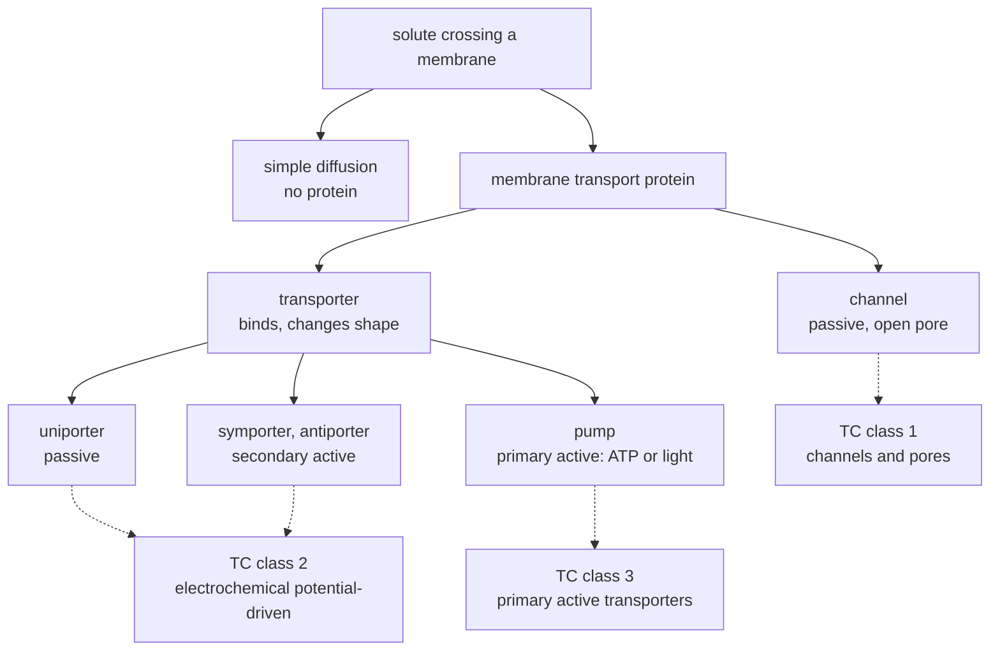

---
aliases:
  - Transmembrane Transport
  - Membrane Transport Protein
  - Transporter
  - Carrier Protein
  - Facilitated Diffusion
  - Active Transport
  - Ion Pump
  - Transport membranaire
tags:
  - type/concept
  - domain/biology
  - domain/physics
  - domain/bioinformatics
  - level/L2
  - level/L3
mastery: 0
prerequisites:
  - "[[Cell Membrane]]"
  - "[[Diffusion]]"
  - "[[Membrane Potential]]"
  - "[[Gibbs Free Energy]]"
  - "[[ATP]]"
  - "[[Enzyme]]"
related:
  - "[[Membrane Protein]]"
  - "[[Ion Channel]]"
  - "[[Michaelis-Menten Kinetics]]"
  - "[[Nernst Equation]]"
  - "[[Action Potential]]"
  - "[[Protein Family]]"
  - "[[Hydropathy Plot]]"
  - "[[Protein Targeting]]"
  - "[[Cell Signaling]]"
  - "[[ADMET]]"
projects: []
sources:
  - "[[Molecular Biology of the Cell (Alberts)]]"
  - "[[Biology 2e (OpenStax)]]"
  - "[[Biochemistry (Berg)]]"
  - "[[Anatomy and Physiology 2e (OpenStax)]]"
  - "[[Transporter Classification Database]]"
  - "[[ExplorEnz]]"
  - "[[Kyte 1982 - A Simple Method for Displaying the Hydropathic Character of a Protein]]"
---

# Membrane Transport

> [!abstract]
> Ions and polar molecules cannot cross the lipid bilayer on their own. Cells move them with membrane proteins: channels and carriers let a solute run down its gradient, while pumps and coupled transporters push it uphill with ATP or with another gradient.

## Definition

**Membrane transport** is the movement of solutes across a biological membrane. Small nonpolar molecules cross the lipid bilayer by **simple diffusion**; ions and most polar molecules cross only through **membrane transport proteins**, of two kinds: **transporters** (carriers, permeases), which bind the solute and change shape to move it, and **channels**, which form a water-filled pore that lets specific solutes, mostly inorganic ions, through when open.[^alberts11][^os52] Transport is **passive** when the solute moves down its electrochemical gradient and **active** when it is pushed up that gradient by coupling to an energy source.[^alberts11][^os53]

## Why it matters

- **Transporters are protein families that annotation must name.** The Transporter Classification Database (TCDB) orders transport systems in a hierarchy (class, subclass, family, subfamily, system) written as a five-part TC number whose first digit is the class: 1 channels and pores, 2 electrochemical potential-driven transporters, 3 primary active transporters. Its 2021 update held 20,653 proteins in 15,528 transport systems and 1,536 families.[^tcdb] Placing a new protein in a family is a [[Sequence Homology|homology]] search ([[Protein Family]], [[Gene Annotation]]).
- **Pumps are enzymes with EC numbers.** Since August 2018 the IUBMB enzyme list has a seventh class, the translocases (EC 7), for enzymes that move ions or molecules across membranes, subdivided by cargo (H⁺, inorganic cations, inorganic anions, amino acids and peptides, carbohydrates, other compounds). Several were previously ATPases in EC 3.6.3, so older annotations can carry obsolete numbers.[^explorenz]
- **The membrane-spanning part shows in the sequence.** A segment crossing the bilayer is typically an α helix of about 20 hydrophobic residues, which hydropathy profiles and topology predictors detect ([[Hydropathy Plot]], [[Membrane Protein]]).[^alberts-mem][^kyte]
- **Drugs and disease.** Multidrug-resistance ABC transporters pump anticancer drugs out of tumor cells, and cystic fibrosis is caused by mutations in CFTR, an ABC protein that works as a Cl⁻ channel.[^alberts11] Drug absorption and distribution pass through the same proteins ([[ADMET]], [[Drug Target]]).
- **Electrical signals.** Channels that open and close move the membrane potential, the basis of nerve impulses ([[Membrane Potential]], [[Action Potential]]).[^alberts11]

## Core (L2)

![[membrane-transport-modes.svg]]

### Two kinds of transport protein

[[Cell Membrane]] shows which molecules a bare bilayer lets through. Everything else needs a protein:[^alberts11]

| | Transporter (carrier) | Channel |
|---|---|---|
| Mechanism | binds the solute, then changes conformation to release it on the other side | forms an aqueous pore; solutes pass without tight binding |
| Selectivity | a binding site specific for one solute or a few | a filter on size and charge (K⁺ against Na⁺, for example) |
| Rate | limited by the conformational cycle; saturates | much faster |
| Energy | passive or active | always passive |

Channels are **gated**: they open in response to a change in membrane voltage (voltage-gated), the binding of a ligand (ligand-gated) or mechanical stress (mechanically gated). Patch-clamp recording of the current through one channel shows that it opens and closes abruptly, all or nothing ([[Ion Channel]]).[^alberts11]

### Passive transport

A solute crosses passively in the direction that lowers its free energy. For an uncharged molecule that is down its concentration gradient; for an ion, the membrane potential adds an electrical force, and the two combine into the **electrochemical gradient**.[^alberts11][^os53] Passive transport through a protein is **facilitated diffusion**, by channels or by **uniporters**, which carry a single solute such as glucose without coupling it to anything.[^os52][^alberts11]

Carrier-mediated transport behaves like an enzyme reaction: the rate rises with concentration, then **saturates** when all carriers are busy, at a maximal rate $J_{\max}$, with half that rate at the binding constant $K_m$. Simple diffusion keeps increasing linearly (panel B; [[Michaelis-Menten Kinetics]]).[^alberts11]

### Active transport: three energy sources

1. **Coupled transporters** use the downhill flow of one solute to drive another uphill: **symporters** move both in the same direction, **antiporters** in opposite directions. The driving gradient (Na⁺ in animal cells) was itself built by a pump, hence the name **secondary active transport**.[^alberts11][^os53]
2. **ATP-driven pumps** hydrolyze ATP: primary active transport.[^alberts11][^os53]
3. **Light-driven pumps**, in some bacteria, use light energy.[^alberts11]

The **Na⁺-K⁺ pump** of animal cells is the model ATP-driven pump: each cycle expels 3 Na⁺ and imports 2 K⁺ while hydrolyzing one ATP. It is a **P-type** pump, which phosphorylates itself during the cycle, and it is electrogenic, since it moves more positive charge out than in.[^alberts11] The gradients it maintains are the stored energy that channels ([[Membrane Potential]]) and Na⁺-coupled transporters spend.

**ABC transporters**, named after their two ATP-binding cassette domains, form the largest family of membrane transport proteins. In cancer cells, one of them, the multidrug-resistance protein, pumps hydrophobic drugs out; CFTR, mutated in cystic fibrosis, is an ABC protein that acts as a Cl⁻ channel.[^alberts11]

### A circuit: glucose across the gut epithelium

An intestinal epithelial cell uses three proteins on two faces. A Na⁺-glucose **symporter** in the apical membrane, facing the gut lumen, concentrates glucose inside using the Na⁺ gradient; a passive glucose **uniporter** in the basolateral membrane releases it into the blood, down its gradient; the Na⁺-K⁺ pump of the basolateral membrane exports the Na⁺ that came in.[^alberts11] Placed asymmetrically, three local mechanisms produce a net flow across the whole cell layer that none could achieve alone.

### Mechanism classes and protein families



The TC system classifies first by mechanism and energy source, then by family, a group of homologous proteins: the ABC transporters and the P-type ATPases, the family of the Na⁺-K⁺ pump, are both families of subclass 3.A, transporters driven by the hydrolysis of a diphosphate (P-P) bond such as that of ATP.[^tcdb]

## Advanced (L3)

- **Alternating access.** A transporter exposes its binding site to one side of the membrane at a time and switches between the two conformations. It is never open to both sides at once, which is why it saturates and how it couples two solutes: a Na⁺-glucose symporter switches only when both sites are occupied or both are empty.[^alberts11] A conducting channel, by contrast, is open to both sides at the same time.
- **Stoichiometry sets the reachable gradient.** At equilibrium, the free energy released by $n$ co-transported ions pays exactly for the solute's gradient, so the maximal accumulation grows exponentially with $n$ (Mathematical representation): with the Na⁺ gradient of an animal cell, one Na⁺ per glucose allows at most a 199-fold concentration, two allow about 40,000-fold (Computational representation).
- **The pump runs close to its thermodynamic limit.** One cycle of the Na⁺-K⁺ pump costs about 45 kJ/mol under typical gradients, against about 57 kJ/mol released by ATP hydrolysis in a living cell.[^os64] Steeper gradients or a lower ATP free energy would stall it.
- **Annotation at scale.** Transporters are recognized in new genomes by homology to characterized families and by their membrane topology, from the Kyte-Doolittle window to statistical topology predictors.[^tcdb][^kyte] Two classifications coexist: TC numbers describe mechanism and phylogeny, EC 7 numbers the catalyzed reaction, so a pump can carry both, and annotations made before 2018 may still list pumps as EC 3.6.3 hydrolases.[^explorenz]
- **Counting ions in a current.** A single open channel carries a current $i$; dividing by the elementary charge $e$ gives the ions crossing per second. For an illustrative $i = 1$ pA, that is $10^{-12}/(1.602 \times 10^{-19}) \approx 6 \times 10^6$ monovalent ions per second, through one protein.

## Mathematical representation

- **Simple diffusion**: $J = P\,(C_{\mathrm{out}} - C_{\mathrm{in}})$, the flux per unit area, with $P$ the permeability coefficient ([[Cell Membrane#Mathematical representation]]).
- **Carrier-mediated uptake**, initial rate with no solute inside yet:
$$J = \frac{J_{\max}\, C}{K_m + C},$$
with $C$ the outside concentration, $J_{\max}$ the rate when every carrier is occupied, and $K_m$ the concentration giving $J_{\max}/2$.[^alberts11] For $C \ll K_m$, $J \approx (J_{\max}/K_m)\,C$ mimics diffusion; for $C \gg K_m$, $J \to J_{\max}$.
- **Electrochemical free energy.** Moving 1 mol of a solute of charge $z$ from outside to inside changes the free energy by
$$\Delta G_{\mathrm{in}} = RT \ln\frac{C_{\mathrm{in}}}{C_{\mathrm{out}}} + zFV_m,$$
with $R$ the gas constant, $T$ the absolute temperature, $F$ the Faraday constant and $V_m = \phi_{\mathrm{in}} - \phi_{\mathrm{out}}$ the membrane potential.[^berg] Passive entry is possible only while $\Delta G_{\mathrm{in}} < 0$; setting $\Delta G_{\mathrm{in}} = 0$ gives the [[Nernst Equation]]. Moving the same solute out costs $\Delta G_{\mathrm{out}} = -\Delta G_{\mathrm{in}}$.
- **Coupling.** A transport cycle runs forward if the sum of the free-energy changes of its steps is negative. For a symporter carrying $n$ Na⁺ and one uncharged solute $S$ inward:
$$RT\ln\frac{[S]_{\mathrm{in}}}{[S]_{\mathrm{out}}} + n\,\Delta G^{\mathrm{Na}}_{\mathrm{in}} \le 0 \;\Longrightarrow\; \frac{[S]_{\mathrm{in}}}{[S]_{\mathrm{out}}} \le \exp\!\left(\frac{-n\,\Delta G^{\mathrm{Na}}_{\mathrm{in}}}{RT}\right).$$
- **Pump.** The Na⁺-K⁺ cycle is possible if $3\,\Delta G^{\mathrm{Na}}_{\mathrm{out}} + 2\,\Delta G^{\mathrm{K}}_{\mathrm{in}} + \Delta G_{\mathrm{ATP}} < 0$.

## Computational representation

Concentrations are the typical mammalian values (Na⁺ 5-15 mM inside and 145 mM outside, K⁺ 140 and 5 mM)[^alberts11] and $V_m = -70$ mV, the order of a neuron's resting potential.[^ap]

```python
import math

R = 8.314e-3     # gas constant, kJ mol^-1 K^-1
F = 96.485       # Faraday constant, kJ mol^-1 V^-1
T = 310.15       # 37 degrees C, in kelvin
RT = R * T       # about 2.58 kJ/mol


def dg_in(c_in: float, c_out: float, z: int, vm: float) -> float:
    """Free energy (kJ/mol) of moving 1 mol of a solute from outside to inside.
    c_in, c_out: concentrations (same unit); z: charge; vm = phi_in - phi_out (V)."""
    return RT * math.log(c_in / c_out) + z * F * vm


C_IN = {"Na+": 10, "K+": 140}     # mM, typical mammalian cell (10 = middle of 5-15)
C_OUT = {"Na+": 145, "K+": 5}     # mM
VM = -0.070                       # V, resting potential of the order of a neuron's

na_in = dg_in(C_IN["Na+"], C_OUT["Na+"], +1, VM)
k_in = dg_in(C_IN["K+"], C_OUT["K+"], +1, VM)
print(f"RT = {RT:.3f} kJ/mol")
print(f"Na+ entry: {na_in:+.2f} kJ/mol   K+ entry: {k_in:+.2f} kJ/mol")

pump = 3 * (-na_in) + 2 * k_in    # one cycle: 3 Na+ out, 2 K+ in
print(f"Na+/K+ pump cycle needs {pump:.1f} kJ/mol; one ATP gives about 57")

for n in (1, 2):                  # n Na+ entering per glucose (stoichiometry as a parameter)
    print(f"n = {n}: glucose in/out at most {math.exp(-n * na_in / RT):,.0f}")
```

```text
RT = 2.579 kJ/mol
Na+ entry: -13.65 kJ/mol   K+ entry: +1.84 kJ/mol
Na+/K+ pump cycle needs 44.6 kJ/mol; one ATP gives about 57
n = 1: glucose in/out at most 199
n = 2: glucose in/out at most 39,608
```

Na⁺ is pulled in by both its gradient and the field; K⁺, whose gradient pushes it out, is held back by the field and costs little to import. The pump spends most of its energy on expelling Na⁺.

## Worked example

> [!example] Can a Na⁺ symporter concentrate glucose 1000-fold?
> 1. **Driving force per Na⁺ entering**: $\Delta G^{\mathrm{Na}}_{\mathrm{in}} = 2.579 \ln(10/145) + 96.485 \times (-0.070) = -6.90 - 6.75 = -13.65$ kJ/mol. Half comes from the concentration ratio, half from the membrane potential.
> 2. **Cost of the glucose gradient**: $RT \ln 1000 = 2.579 \times 6.908 = 17.8$ kJ/mol.
> 3. **One Na⁺ per glucose**: $13.65 < 17.8$, impossible; the bound is 199-fold.
> 4. **Two Na⁺ per glucose**: $27.3 > 17.8$, possible; the bound is about $4 \times 10^4$-fold.
> 5. **Conclusion**: a 1000-fold accumulation needs $n \ge 17.8/13.65 = 1.3$, so at least two Na⁺ per glucose. Because half the push comes from $V_m$, depolarizing the cell weakens every Na⁺-coupled transporter at once.

## Common misconceptions

> [!warning] "Facilitated diffusion is active because it uses a protein"
> A channel or a uniporter only speeds up a movement that the electrochemical gradient already favors; the direction is set by the gradient, and no energy is spent.[^alberts11][^os52]

> [!warning] "Active transport always consumes ATP"
> Secondary active transporters spend an ion gradient, and some bacterial pumps use light. ATP is spent upstream, by the pump that built the gradient.[^alberts11]

> [!warning] "An ion always flows down its concentration gradient"
> It flows down its **electrochemical** gradient. K⁺, 28 times more concentrated inside, has no net flow when $V_m$ equals its Nernst potential ([[Membrane Potential]]), and the field adds to the gradient for Na⁺ (Worked example).

> [!warning] "Channels are just holes in the membrane"
> Channels are selective and gated, switching abruptly between closed and open states.[^alberts11] A permanent non-selective hole would discharge every gradient the pumps build.

## Exercises

> [!question] Exercise 1 (L2)
> Classify each process as simple diffusion, passive transport through a protein, secondary active or primary active transport: (a) O₂ entering a red blood cell; (b) K⁺ leaving a neuron through a leak channel; (c) glucose released into the blood by a uniporter; (d) glucose taken up from the gut lumen with Na⁺; (e) Ca²⁺ pumped from the cytosol into the endoplasmic reticulum by an ATP-driven pump; (f) H⁺ pumped out of a bacterium by a light-driven pump.

> [!success]- Solution
> (a) Simple diffusion (small nonpolar molecule). (b) Passive, channel. (c) Passive, uniporter. (d) Secondary active, symport driven by the Na⁺ gradient. (e) Primary active, ATP-driven. (f) Primary active, light-driven. Only (d), (e) and (f) can move a solute uphill.

> [!question] Exercise 2 (L2)
> Free Ca²⁺ is about $10^{-4}$ mM in the cytosol and 1-2 mM outside.[^alberts11] With `dg_in` from the code above, compute $\Delta G$ for Ca²⁺ entry at 2 mM outside and $V_m = -70$ mV, and say what opening Ca²⁺ channels does.

> [!success]- Solution
> `dg_in(1e-4, 2, +2, -0.070)` returns −39.0 kJ/mol: $RT\ln(5 \times 10^{-5}) = -25.5$ kJ/mol from the 20,000-fold gradient, plus $2F V_m = -13.5$ kJ/mol from the field, doubled by the charge. Opening Ca²⁺ channels causes a fast, strong influx: a small number of ions raises the cytosolic concentration many-fold, which is why Ca²⁺ works as an intracellular signal ([[Cell Signaling]]).

> [!question] Exercise 3 (L2)
> A carrier has $K_m = 2$ mM. (a) At which outside concentration does uptake reach 90% of $J_{\max}$? (b) A cell doubles the number of carriers in its membrane: what happens to $J_{\max}$ and to $K_m$?

> [!success]- Solution
> (a) $C/(K_m + C) = 0.9$ gives $C = 9K_m = 18$ mM. (b) $J_{\max}$ doubles, since it is proportional to the number of carriers; $K_m$, a property of each carrier's binding site, does not change. Measuring both separates "more transporters" from "different transporters".

> [!question] Exercise 4 (L3, Python)
> Initial uptake rates (invented data, nmol/min/mg) at outside concentrations 0.5, 1, 2, 4, 8 and 16 mM are 2.1, 3.2, 5.1, 6.5, 8.1 and 8.8. Fit simple diffusion ($J = kC$) and a carrier ($J = J_{\max}C/(K_m + C)$) by least squares with the standard library, and decide which mechanism the data support.

> [!success]- Solution
> For a fixed $K_m$, the model is linear in $J_{\max}$, whose best value has a closed form; scanning $K_m$ finishes the fit.
> ```python
> conc = [0.5, 1, 2, 4, 8, 16]            # mM (invented data)
> rate = [2.1, 3.2, 5.1, 6.5, 8.1, 8.8]   # uptake, nmol/min/mg (invented data)
>
>
> def sse(pred, obs):
>     return sum((p - o) ** 2 for p, o in zip(pred, obs))
>
>
> # Model 1, simple diffusion: J = k C (least squares through the origin)
> k = sum(c * j for c, j in zip(conc, rate)) / sum(c * c for c in conc)
> sse_lin = sse([k * c for c in conc], rate)
>
> # Model 2, carrier: J = Jmax C / (Km + C); for each Km the best Jmax is linear least squares
> best = None
> for i in range(1, 2001):
>     km = i / 100                            # scan Km from 0.01 to 20 mM
>     f = [c / (km + c) for c in conc]
>     jmax = sum(fi * j for fi, j in zip(f, rate)) / sum(fi * fi for fi in f)
>     s = sse([jmax * fi for fi in f], rate)
>     if best is None or s < best[0]:
>         best = (s, km, jmax)
>
> print(f"diffusion: k = {k:.3f}, SSE = {sse_lin:.2f}")
> print(f"carrier:   Km = {best[1]:.2f} mM, Jmax = {best[2]:.2f}, SSE = {best[0]:.2f}")
> ```
> Output:
> ```text
> diffusion: k = 0.721, SSE = 48.55
> carrier:   Km = 1.99 mM, Jmax = 9.95, SSE = 0.08
> ```
> The carrier model's sum of squared errors is about 600 times smaller, for one extra parameter: the rate saturates, so the uptake is protein-mediated. A clear plateau at high concentration is the experimental signature; data restricted to $C \ll K_m$ could not tell the two models apart.

> [!question] Exercise 5 (L3, Python)
> An antiporter imports 3 Na⁺ for each Ca²⁺ it exports (assumed stoichiometry). Using `na_in`, `F`, `RT` and `VM` from the code above, find the largest ratio $[\mathrm{Ca}^{2+}]_{\mathrm{out}}/[\mathrm{Ca}^{2+}]_{\mathrm{in}}$ it can maintain, and the lowest cytosolic Ca²⁺ with 2 mM outside. Compare with the measured $10^{-4}$ mM.

> [!success]- Solution
> The cycle runs while $3\,\Delta G^{\mathrm{Na}}_{\mathrm{in}} + RT\ln r - 2FV_m \le 0$, where $r$ is the outside/inside Ca²⁺ ratio and $-2FV_m$ is the electrical cost of exporting a doubly charged ion against the field.
> ```python
> ca_out_cost_field = -2 * F * VM               # electrical part of moving Ca2+ out
> budget = -3 * na_in                            # free energy released by 3 Na+ entering
> max_ratio = math.exp((budget - ca_out_cost_field) / RT)   # Ca_out / Ca_in at equilibrium
> print(f"3 Na+ entering release {budget:.1f} kJ/mol; field cost of Ca2+ export {ca_out_cost_field:.1f}")
> print(f"max Ca_out/Ca_in = {max_ratio:.2e}; min Ca_in with 2 mM outside = {2 / max_ratio * 1e6:.0f} nM")
> ```
> Output:
> ```text
> 3 Na+ entering release 40.9 kJ/mol; field cost of Ca2+ export 13.5
> max Ca_out/Ca_in = 4.18e+04; min Ca_in with 2 mM outside = 48 nM
> ```
> The exchanger can hold cytosolic Ca²⁺ down to about 48 nM, below the measured 100 nM ($10^{-4}$ mM): a 3:1 Na⁺ coupling is enough to explain the gradient without spending ATP directly. With 2:1 coupling, the same calculation gives a much higher floor (try it).

## Mastery checklist

- [ ] 1 Recognized: I can name simple diffusion, channels, uniporters, symporters, antiporters and pumps, and say which are passive.
- [ ] 2 Understood: I can explain the electrochemical gradient, carrier saturation, the three energy sources of active transport and the glucose circuit of the gut epithelium.
- [ ] 3 Practiced: I can compute $\Delta G$ for moving an ion, the energy budget of the Na⁺-K⁺ pump and the maximal gradient of a coupled transporter, and fit uptake data in Python.
- [ ] 4 Applied: I annotated the transporters of a real proteome with TC families and EC 7 numbers and checked their predicted transmembrane helices.
- [ ] 5 Explained: I can teach how stoichiometry and membrane potential limit coupled transport, and why the TC and EC classifications of one protein differ.

## References

[^alberts11]: [[Molecular Biology of the Cell (Alberts)]], 4th ed. (2002), ch. 11 "Membrane Transport of Small Molecules and the Electrical Properties of Membranes" (transporters and channels, passive and active transport, the electrochemical gradient, carrier saturation with $V_{\max}$ and $K_m$, alternating conformations, uniport, symport and antiport, coupled, ATP-driven and light-driven transport, the Na⁺-K⁺ pump as a P-type pump with its 3 Na⁺ / 2 K⁺ stoichiometry, ABC transporters with the multidrug-resistance protein and CFTR, transcellular glucose transport, ion-channel selectivity and gating, patch-clamp recording, Table 11-1 of ion concentrations).
[^alberts-mem]: [[Molecular Biology of the Cell (Alberts)]], 4th ed. (2002), treatment of membrane structure (membrane-spanning α helices of about 20 hydrophobic amino acids).
[^os52]: [[Biology 2e (OpenStax)]], section 5.2 "Passive Transport" (diffusion, facilitated transport through channel and carrier proteins).
[^os53]: [[Biology 2e (OpenStax)]], section 5.3 "Active Transport" (electrochemical gradient, primary and secondary active transport, the sodium-potassium pump).
[^os64]: [[Biology 2e (OpenStax)]], section 6.4 "ATP: Adenosine Triphosphate" (free-energy change of ATP hydrolysis, about −57 kJ/mol in a living cell).
[^berg]: [[Biochemistry (Berg)]], 5th ed. (2002), treatment of membrane channels and pumps (free-energy change of moving a species across a membrane, with its concentration and electrical terms).
[^ap]: [[Anatomy and Physiology 2e (OpenStax)]], nervous tissue chapter (resting membrane potential of a neuron, about −70 mV).
[^tcdb]: [[Transporter Classification Database]], Saier MH Jr et al., "The Transporter Classification Database (TCDB): 2021 update", *Nucleic Acids Research* 49(D1):D461-D467 (database counts, TC hierarchy, classes 1 to 3, subclass 3.A with the ABC and P-type ATPase families).
[^explorenz]: [[ExplorEnz]], IUBMB Enzyme List: class EC 7, translocases (August 2018), its six subclasses, and the transfer of former EC 3.6.3 ATPases.
[^kyte]: [[Kyte 1982 - A Simple Method for Displaying the Hydropathic Character of a Protein]], *Journal of Molecular Biology* 157:105-132.
