---
aliases:
  - Protein Sorting
  - Protein Localization
  - Subcellular Localization
  - Sorting Signal
  - Signal Peptide
  - Signal Sequence
  - Targeting Signal
  - Adressage des protéines
tags:
  - type/concept
  - domain/biology
  - domain/bioinformatics
  - level/L2
  - level/L3
  - level/M1
mastery: 0
prerequisites:
  - "[[Endomembrane System]]"
  - "[[Organelle]]"
  - "[[Cell Nucleus]]"
  - "[[Mitochondrion]]"
  - "[[Translation]]"
  - "[[Amino Acid]]"
related:
  - "[[Membrane Transport]]"
  - "[[Membrane Protein]]"
  - "[[Post-Translational Modification]]"
  - "[[Sequence Motif]]"
  - "[[Regular Expression]]"
  - "[[Position Weight Matrix]]"
  - "[[Hydropathy Plot]]"
  - "[[Protein Language Model]]"
  - "[[Gene Ontology Annotation]]"
  - "[[Precision and Recall]]"
  - "[[Bacteria]]"
projects: []
sources:
  - "[[Molecular Biology of the Cell (Alberts)]]"
  - "[[The Cell (Cooper)]]"
  - "[[NobelPrize.org]]"
  - "[[von Heijne 1983 - Patterns of Amino Acids Near Signal-Sequence Cleavage Sites]]"
  - "[[Teufel 2022 - SignalP 6.0 Predicts All Five Types of Signal Peptides Using Protein Language Models]]"
  - "[[Yu 2010 - PSORTb 3.0]]"
  - "[[Kyte 1982 - A Simple Method for Displaying the Hydropathic Character of a Protein]]"
  - "[[UniProt]]"
  - "[[Gene Ontology]]"
---

# Protein Targeting

> [!abstract]
> Almost every protein is made in the cytosol, yet each one ends up in its own compartment: short stretches of its sequence, the sorting signals, act as address labels read by receptors, and the same signals are what localization predictors learn to recognize.

## Definition

**Protein targeting**, or protein sorting, is the delivery of each newly made protein to the compartment where it works. In eukaryotes nearly all proteins start their synthesis on ribosomes in the cytosol (the exceptions are the few made inside mitochondria and plastids), and their destination is written in the protein itself as **sorting signals**: usually a continuous stretch of amino acids, a **signal sequence**, often removed once sorting is done; sometimes a **signal patch** of residues brought together by folding. Each signal is read by a complementary sorting receptor.[^alberts12] That proteins carry such intrinsic address tags was recognized by the 1999 Nobel Prize in Physiology or Medicine, awarded to Günter Blobel.[^nobel99]

## Why it matters

- **Localization prediction is a standard annotation step.** Predictors read the signals from sequence alone: SignalP for signal peptides (version 6.0 detects all five known types and their internal regions),[^signalp6] PSORTb for prokaryotic proteins, with one classifier per localization site of Gram-negative bacteria, Gram-positive bacteria and archaea.[^yu] Their output feeds the cellular component aspect of [[Gene Ontology Annotation|GO annotation]], where computed annotations must be told apart from experimental ones by their evidence code.[^go]
- **The mature protein is not the translated ORF.** Signal peptides and mitochondrial presequences are cut off after import,[^alberts12] so the first residues of a predicted protein may never exist in the cell. UniProt records them as sequence features: in human preproinsulin (entry P01308), residues 1-24 form the signal peptide.[^uniprot] Proteomics searches and recombinant expression depend on this boundary ([[Post-Translational Modification]], [[Bottom-Up Proteomics]]).
- **Mislocalization causes disease.** A number of human hereditary diseases are caused by errors in sorting signals and transport mechanisms,[^nobel99] so a variant inside a signal can matter as much as one in an active site ([[Variant Effect Prediction]]).

## Core (L2)

### Three ways into a compartment

Proteins move between compartments in three ways:[^alberts12]

1. **Gated transport** between cytosol and nucleus, through nuclear pore complexes acting as selective gates; proteins cross folded.
2. **Transmembrane transport**: protein translocators move a protein from the cytosol across a membrane into the ER, mitochondria, plastids or peroxisomes; the chain usually has to unfold to pass.
3. **Vesicular transport** from the ER onwards, from one compartment of the [[Endomembrane System]] to the next.

A protein with no sorting signal stays in the cytosol.[^alberts12]

```mermaid
flowchart TD
  R["cytosolic ribosome<br/>translation starts"] --> Q{"sorting signal?"}
  Q -->|"none"| CY["cytosol"]
  Q -->|"N-terminal signal peptide<br/>read during translation (SRP)"| ER["ER lumen or ER membrane"]
  ER -->|"vesicles"| GO["Golgi, then lysosome,<br/>plasma membrane or secretion"]
  Q -->|"N-terminal presequence<br/>after translation"| MI["mitochondrion<br/>TOM and TIM translocators"]
  Q -->|"C-terminal Ser-Lys-Leu<br/>after translation"| PX["peroxisome"]
  Q -->|"nuclear localization signal<br/>after translation"| NU["nucleus<br/>through nuclear pores"]
```



### The address labels

The main sorting signals:[^alberts12]

| Destination | Signal | Position | Hallmarks | Removed? |
|---|---|---|---|---|
| ER, then secretory pathway | signal peptide | N-terminus | hydrophobic core between a positive n-region and a polar c-region that ends at the cleavage site | yes, by signal peptidase in the ER |
| Mitochondrial matrix | presequence | N-terminus | amphipathic α helix: positive residues (Arg, Lys) on one face, hydrophobic ones on the other | yes, by a peptidase in the matrix |
| Nucleus | nuclear localization signal (NLS) | internal | one or two short clusters of Lys and Arg, such as Pro-Lys-Lys-Lys-Arg-Lys-Val (PKKKRKV) of the SV40 T antigen | no |
| Out of the nucleus | nuclear export signal | internal | rich in leucine | no |
| Peroxisome | Ser-Lys-Leu (SKL) | C-terminus | three residues | no |
| Back to the ER | Lys-Asp-Glu-Leu (KDEL) | C-terminus | retrieval from the Golgi ([[Endomembrane System#Deeper (L2)]]) | no |

Signals are read in the order the protein meets the machinery: an ER signal peptide acts while the chain is still being made, so it wins over any signal further along the chain.

### Signal peptides: n, h and c regions

![[signal-peptide-anatomy.svg]]

A signal peptide has three parts: a positively charged **n-region**, a hydrophobic **h-region** and a polar **c-region** ending at the cleavage site, a structure that SignalP 6.0 predicts residue by residue.[^signalp6] Where signal peptidase cuts follows a statistical rule found by von Heijne in 1983: only small, uncharged residues occur at positions −3 and −1 before the cut, the **(−3,−1) rule**.[^vonheijne] In preproinsulin, the cut falls after Ala24, with Ala22 at −3.[^uniprot]

The signal-recognition particle (SRP) binds the signal as it emerges from the ribosome and docks the ribosome on the ER membrane, where the chain is threaded through a translocator as it grows ([[Endomembrane System#Core (L1)]]).[^alberts12] Hydrophobicity alone does not make a signal peptide: an internal hydrophobic segment can start translocation without being cleaved and stay in the bilayer as a membrane anchor (Advanced).[^alberts12]

### After translation: mitochondria, nucleus, peroxisomes

Proteins for these compartments are completed in the cytosol and imported afterwards.[^alberts12]

- **Mitochondria.** Receptors of the translocase of the outer membrane (TOM) bind the presequence and pass the unfolded chain to a translocase of the inner membrane (TIM); import into the matrix uses the electrical potential across the inner membrane and ATP-driven chaperones, and the presequence is cut in the matrix.[^alberts12] Most mitochondrial proteins are encoded in the nucleus and enter this way ([[Mitochondrion]]).
- **Nucleus.** Nuclear import receptors bind the NLS and carry the folded cargo through nuclear pore complexes; the GTPase Ran gives the traffic its direction.[^alberts12][^cooper] The NLS is not cut off, because nuclear proteins must be imported again after each mitosis, when the nuclear envelope re-forms.[^alberts12]
- **Peroxisomes.** Many peroxisomal proteins carry Ser-Lys-Leu at their C-terminus as an import signal.[^alberts12]

## Advanced (L3)

### Start-transfer and stop-transfer signals

Membrane proteins are inserted into the ER membrane by hydrophobic segments that act as **start-transfer** signals (they begin translocation) or **stop-transfer** signals (they halt it and remain in the bilayer as transmembrane helices); their order and orientation fix the topology of single-pass and multipass proteins.[^alberts12] A predictor must therefore decide, for each hydrophobic N-terminal segment, between a cleaved signal peptide and an uncleaved anchor. The c-region and its cleavage site are the discriminating features, which is why window-based hydropathy alone confuses the two ([[Hydropathy Plot]], [[Membrane Protein]]).[^kyte]

### Prokaryotes

Signal peptides control protein secretion and translocation in all living organisms, and SignalP 6.0 predicts them across all domains of life.[^signalp6] Where a bacterial protein ends up after crossing the plasma membrane depends on the cell envelope ([[Prokaryote]]): PSORTb predicts five localization sites for Gram-negative bacteria, which have an outer membrane, and four for Gram-positive bacteria.[^yu]

### The logic of localization predictors

1. **Motif rules**: regular expressions for KDEL, SKL or basic clusters ([[Regular Expression]], [[Sequence Motif]]). Transparent, but short motifs also occur by chance (Mathematical representation), and real signals vary around any consensus.
2. **Physicochemical profiles**: hydropathy windows for h-regions and transmembrane helices.[^kyte]
3. **Position-specific scores and trained classifiers**: scores per position around the cleavage site ([[Position Weight Matrix]]), and classifiers trained on proteins of known location, such as the 13 support vector machines of PSORTb, one per localization site ([[Support Vector Machine]]).[^yu]
4. **Learned representations**: SignalP 6.0 starts from a protein language model trained on millions of unannotated sequences, then predicts the signal type and the n-, h- and c-regions ([[Protein Language Model]]).[^signalp6]

Every layer outputs a hypothesis. In GO, computed localizations carry their own evidence codes, and analyses that need certainty filter them out.[^go]

## Frontier (M1)

- **All signal types, any organism.** Earlier tools could not detect every known type of signal peptide. SignalP 6.0 covers all five, including the Sec/SPIII signals that control the translocation of type IV pilin-like proteins in prokaryotes, and it applies to metagenomic data, where most proteins have no characterized relative.[^signalp6]
- **Generalization is the real test.** SignalP 6.0 was reported to generalize better than SignalP 5.0 to sequences distantly related to its training data.[^signalp6] A model can score well on a random split of a database simply by recognizing families seen in training; a fair benchmark keeps the homologs of test proteins out of the training set ([[Cross-Validation]], [[Data Leakage]]).

## Mathematical representation

- **Sorting as classification.** With $\mathcal{A}$ the 20 amino acids and $\mathcal{C}$ the set of compartments, a deterministic predictor is a function $f: \mathcal{A}^* \to \mathcal{C}$; a probabilistic one returns $\big(P(c \mid s)\big)_{c \in \mathcal{C}}$ for a sequence $s$.
- **Cleavage-site score.** For a cut after residue $i$, write $s_{(k)}$ for the residue at position $k$ relative to the cut ($k = -p, \dots, -1$ before it, $k = +1, \dots, +q$ after it). A position-specific score is
$$S(i) = \sum_{k} \log \frac{f_k\big(s_{(k)}\big)}{b\big(s_{(k)}\big)},$$
with $f_k(a)$ the frequency of amino acid $a$ at position $k$ in known cleavage sites and $b(a)$ its background frequency; the predicted site is $\arg\max_i S(i)$. The (−3,−1) rule is the limit where $f_{-3}$ and $f_{-1}$ vanish outside small uncharged residues, so that any other residue there gives $S = -\infty$.
- **Base rates.** For a class of prevalence $\pi$, a predictor with sensitivity $\mathrm{Se}$ and specificity $\mathrm{Sp}$ has precision (positive predictive value)
$$\mathrm{PPV} = \frac{\mathrm{Se}\,\pi}{\mathrm{Se}\,\pi + (1 - \mathrm{Sp})(1 - \pi)},$$
by [[Bayes' Theorem]]: when $\pi$ is small, even a small false-positive rate $1 - \mathrm{Sp}$ fills the predictions with errors ([[Precision and Recall]]).
- **Chance motifs.** If residues were independent and uniform, a given C-terminal tripeptide such as SKL would end a protein with probability $20^{-3} = 1/8000$, so about 2.5 times in a proteome of 20,000 proteins by chance alone.

## Computational representation

A toy sorter, written to show the logic, not to compete with real predictors. The thresholds, the `SMALL` set and the sequences marked "toy" are invented; the preproinsulin fragment is residues 1-40 of UniProt entry P01308.

```python
import re

KD = {  # Kyte-Doolittle hydropathy (Kyte and Doolittle 1982)
    "I": 4.5, "V": 4.2, "L": 3.8, "F": 2.8, "C": 2.5, "M": 1.9, "A": 1.8,
    "G": -0.4, "T": -0.7, "S": -0.8, "W": -0.9, "Y": -1.3, "P": -1.6,
    "H": -3.2, "E": -3.5, "Q": -3.5, "D": -3.5, "N": -3.5, "K": -3.9, "R": -4.5,
}
HYDROPHOBIC = set("AILMFVW")
SMALL = set("AGSCT")        # toy reading of "small, uncharged" for the (-3,-1) rule


def signal_peptide(seq: str, core: int = 8, min_core: float = 2.0):
    """Toy n/h/c parser. Returns (n_end, h_end, cleave_after), 1-based, or None."""
    windows = [(sum(KD[a] for a in seq[i:i + core]) / core, i) for i in range(0, 30 - core + 1)]
    best, start = max(windows)
    if best < min_core or not any(a in "KR" for a in seq[:start]):
        return None                               # no hydrophobic core, or no positive n-region
    h_start, h_end = start, start + core          # 0-based half-open, then extend over hydrophobics
    while h_start > 0 and seq[h_start - 1] in HYDROPHOBIC:
        h_start -= 1
    while seq[h_end] in HYDROPHOBIC:
        h_end += 1
    for cut in range(h_end + 3, h_end + 11):      # c-region: cleave after residue `cut` (1-based)
        if seq[cut - 1] in SMALL and seq[cut - 3] in SMALL:
            return h_start, h_end, cut
    return h_start, h_end, None                   # hydrophobic N-terminus but no cleavage site


def sort_protein(seq: str) -> str:
    sp = signal_peptide(seq)
    head = seq[:25]
    if sp and sp[2]:
        where = "ER, retained (KDEL)" if seq.endswith("KDEL") else "secretory pathway"
        return f"{where}; signal peptide 1-{sp[2]}, n 1-{sp[0]}, h {sp[0] + 1}-{sp[1]}"
    if sp:
        return f"membrane? uncleaved hydrophobic segment {sp[0] + 1}-{sp[1]}"
    if (sum(a in "KR" for a in head) >= 3 and not any(a in "DE" for a in head)
            and sum(a in HYDROPHOBIC for a in head) / len(head) >= 0.3):
        return "mitochondrion (presequence-like N-terminus)"
    if seq.endswith("SKL"):
        return "peroxisome (C-terminal SKL)"
    if re.search(r"(?=([KR]{4}|[KR]{3}.[KR]|[KR].[KR]{3}))", seq):
        return "nucleus (cluster of basic residues)"
    return "cytosol (no signal found)"


PROTEINS = {
    "preproinsulin 1-40 (human, UniProt P01308)": "MALWMRLLPLLALLALWGPDPAAAFVNQHLCGSHLVEALY",
    "toy ER resident": "MKRLLSLAVLLAVLGASQAEDNKTWEPQRSGLHTDEKDEL",
    "toy mitochondrial": "MLRTSRLLGRAALRPLSRAFSTSAQNGEVKDHPLTEEQWA",
    "toy nuclear (SV40 NLS)": "MSEDTGNQAPSEGTPKKKRKVEDPQGLSNETASDHGSAE",
    "toy peroxisomal": "MSDNTGEQAPWEGHPQTEVSDPQGLTNETASDHGSASKL",
    "toy anchor": "MKNPLLVAILFVLLAVIGLWDNQEPSTEHRGSDNKTEQSPE",
    "toy cytosolic": "MSEDTGNQAPSEGTPQTEVSDPQGLSNETASDHGSAE",
}
for name, seq in PROTEINS.items():
    print(f"{name:44s} {sort_protein(seq)}")
```

```text
preproinsulin 1-40 (human, UniProt P01308)   secretory pathway; signal peptide 1-24, n 1-6, h 7-17
toy ER resident                              ER, retained (KDEL); signal peptide 1-17, n 1-6, h 7-14
toy mitochondrial                            mitochondrion (presequence-like N-terminus)
toy nuclear (SV40 NLS)                       nucleus (cluster of basic residues)
toy peroxisomal                              peroxisome (C-terminal SKL)
toy anchor                                   membrane? uncleaved hydrophobic segment 5-17
toy cytosolic                                cytosol (no signal found)
```

The rule recovers the annotated 1-24 signal peptide of preproinsulin. The toy anchor has a hydrophobic N-terminus as strong as a signal peptide's, but no c-region satisfying the (−3,−1) rule, so it is read as a membrane anchor: the c-region, not the hydrophobic core, separates the two. The order of the tests encodes the biology: the ER signal is checked first because it acts during translation.

## Worked example

> [!example] Reading the preproinsulin signal by hand
> Sequence 1-30: `MALWMR LLPLLALLALW GPDPAAA | FVNQHL`.
> 1. **n-region** (1-6): `MALWMR`, one positive residue, Arg6.
> 2. **h-region** (7-17): `LLPLLALLALW`, seven leucines; its mean Kyte-Doolittle hydropathy is $(7 \times 3.8 + 2 \times 1.8 - 1.6 - 0.9)/11 = 27.7/11 = 2.52$, strongly hydrophobic.
> 3. **c-region** (18-24): `GPDPAAA`, polar and small, with Asp20 and two prolines.
> 4. **(−3,−1) rule**: a cut after Ala22 puts Asp20 at −3, rejected; after Ala23 puts Pro21 at −3, rejected; after Ala24 puts Ala22 at −3 and Ala24 at −1, accepted. This is the annotated site.[^uniprot]
> 5. **Result**: the ER receives proinsulin starting at Phe25, which is cut further into insulin in secretory vesicles ([[Endomembrane System#Advanced (L3)]]).

## Common misconceptions

> [!warning] "Proteins are made where they work"
> Nearly all proteins start on cytosolic ribosomes; only the few encoded by mitochondrial and plastid genomes are made inside those organelles.[^alberts12]

> [!warning] "Sorting signals are always cut off"
> Signal peptides and presequences are removed, but the NLS, the C-terminal SKL and KDEL stay: the NLS must work again after every mitosis.[^alberts12]

> [!warning] "A hydrophobic N-terminus means a secreted protein"
> An uncleaved hydrophobic segment can anchor the protein in the membrane instead.[^alberts12] Without a c-region and a cleavage site, the call is "membrane", not "secreted".

> [!warning] "A predicted localization is a known localization"
> Predictions are hypotheses; GO keeps computed annotations apart from experimental ones through evidence codes, and the two should not be mixed silently in an analysis.[^go]

## Exercises

> [!question] Exercise 1 (L2)
> Predict where each protein goes: (a) an N-terminal signal peptide and a C-terminal KDEL; (b) an N-terminal amphipathic helix rich in Arg, without Asp or Glu; (c) a C-terminal SKL and nothing else; (d) an internal PKKKRKV; (e) no signal; (f) an N-terminal signal peptide and an internal NLS.

> [!success]- Solution
> (a) ER lumen, retrieved from the Golgi. (b) Mitochondrial matrix. (c) Peroxisome. (d) Nucleus. (e) Cytosol. (f) The ER, then the secretory pathway: the signal peptide acts during translation, the chain enters the ER lumen, and the NLS never meets the cytosolic import receptors.

> [!question] Exercise 2 (L2)
> Why is a mitochondrial presequence cut off after import while an NLS is kept? What would happen to a nuclear protein whose NLS were removed after import?

> [!success]- Solution
> A protein crosses the mitochondrial membranes once and stays inside, so the presequence has done its job. The nuclear envelope breaks down at each mitosis and nuclear proteins mix with the cytosol; they must be imported again into the daughter nuclei.[^alberts12] Without its NLS, the protein would stay in the cytosol after the first division.

> [!question] Exercise 3 (L3, Python)
> A proteome has 20,000 proteins, 10% of them with signal peptides (an illustrative prevalence). A predictor has sensitivity 0.95. Compute true positives, false positives and precision for specificities 0.95 and 0.99.

> [!success]- Solution
> ```python
> def precision(prev, sens, spec):
>     tp, fp = sens * prev, (1 - spec) * (1 - prev)
>     return tp / (tp + fp)
>
> N = 20000
> for spec in (0.95, 0.99):
>     tp = 0.95 * 0.10 * N
>     fp = (1 - spec) * 0.90 * N
>     print(f"spec {spec}: TP {tp:.0f}, FP {fp:.0f}, precision {precision(0.10, 0.95, spec):.3f}")
> ```
> Output:
> ```text
> spec 0.95: TP 1900, FP 900, precision 0.679
> spec 0.99: TP 1900, FP 180, precision 0.913
> ```
> With 95% specificity, almost a third of the predicted signal peptides are false, because negatives outnumber positives nine to one. Specificity matters most for rare classes.

> [!question] Exercise 4 (L3, Python)
> Use `signal_peptide` and `sort_protein` to test every substitution at positions 22 (−3) and 24 (−1) of preproinsulin: which keep the predicted cut after 24? What does the toy sorter predict for A24D, and why is this scan less informative than it looks?

> [!success]- Solution
> ```python
> s = PROTEINS["preproinsulin 1-40 (human, UniProt P01308)"]
> AA = "ACDEFGHIKLMNPQRSTVWY"
> for pos in (22, 24):                      # 1-based positions -3 and -1 of the insulin site
>     kept = []
>     for aa in AA:
>         mutant = s[:pos - 1] + aa + s[pos:]
>         sp = signal_peptide(mutant)
>         if sp and sp[2] == 24:
>             kept.append(aa)
>     print(pos, "".join(kept))
> mutant = s[:23] + "D" + s[24:]
> print("A24D ->", sort_protein(mutant))
> ```
> Output:
> ```text
> 22 ACGST
> 24 ACGST
> A24D -> membrane? uncleaved hydrophobic segment 7-17
> ```
> The scan only restates the hard-coded `SMALL` set, and every other residue flips the call to "uncleaved". A learned predictor gives a graded probability per position, so a substitution can lower the cleavage score without abolishing it; the actual fate of A24D (cleavage elsewhere, retention, anchoring) is an experimental question, answered for instance by sequencing the N-terminus of the mature protein.

> [!question] Exercise 5 (M1)
> A localization classifier reaches 95% accuracy on a random 80/20 split of reviewed UniProt proteins. Give two reasons this number may overestimate its accuracy on a metagenome, and design a better evaluation.

> [!success]- Solution
> (1) Homologs of test proteins sit in the training set, so the model can succeed by recognizing families rather than signals; metagenomic proteins are often distant from anything characterized.[^signalp6] (2) Classes are unbalanced: a model that favors the majority compartments can reach high accuracy while failing on rare ones. Better: cluster sequences by identity and split by cluster, so that no test protein has a close training homolog; report per-class precision and recall rather than overall accuracy; test separately on a set of distant sequences.

## Mastery checklist

- [ ] 1 Recognized: I can name the signals for the ER, mitochondria, nucleus and peroxisomes, and where each sits in the sequence.
- [ ] 2 Understood: I can explain gated, transmembrane and vesicular transport, the n/h/c structure of a signal peptide, the (−3,−1) rule, and why some signals are kept.
- [ ] 3 Practiced: I can parse a signal peptide by hand and in code, and compute the precision of a predictor from its sensitivity, specificity and the base rate.
- [ ] 4 Applied: I ran SignalP or PSORTb on a real proteome and compared the calls with UniProt features and GO cellular component annotations.
- [ ] 5 Explained: I can teach how predictors moved from motif rules to protein language models, and why homology-aware benchmarks are needed to trust them.

## References

[^alberts12]: [[Molecular Biology of the Cell (Alberts)]], 4th ed. (2002), ch. 12 "Intracellular Compartments and Protein Sorting" (cytosolic start of protein synthesis, signal sequences and signal patches, gated, transmembrane and vesicular transport, proteins without signals staying in the cytosol, typical sorting signals, the ER signal sequence, SRP and co-translational translocation, start- and stop-transfer signals, mitochondrial presequences as amphipathic helices, TOM and TIM complexes and the energy for import, nuclear localization and export signals, nuclear import receptors and Ran, the NLS kept for re-import after mitosis, the peroxisomal Ser-Lys-Leu signal, KDEL).
[^cooper]: [[The Cell (Cooper)]], 2nd ed. (2000), section "The Nuclear Envelope and Traffic between the Nucleus and the Cytoplasm".
[^nobel99]: [[NobelPrize.org]], press release of the Nobel Prize in Physiology or Medicine 1999 (Günter Blobel, "for the discovery that proteins have intrinsic signals that govern their transport and localization in the cell"; the ER signal discovered in the early 1970s; similar address tags for other organelles; universal in yeast, plant and animal cells; hereditary diseases caused by errors in these signals and transport mechanisms).
[^vonheijne]: [[von Heijne 1983 - Patterns of Amino Acids Near Signal-Sequence Cleavage Sites]], *European Journal of Biochemistry* 133:17-21 (the (−3,−1) rule).
[^signalp6]: [[Teufel 2022 - SignalP 6.0 Predicts All Five Types of Signal Peptides Using Protein Language Models]], *Nature Biotechnology* 40:1023-1025 (five signal peptide types, n-, h- and c-regions, protein language models, metagenomic data, Sec/SPIII and pilin-like proteins; generalization to distant sequences in the preprint version).
[^yu]: [[Yu 2010 - PSORTb 3.0]], *Bioinformatics* 26(13):1608-1615 (13 support vector machines, one per localization site: 5 Gram-negative, 4 Gram-positive, 4 archaeal).
[^kyte]: [[Kyte 1982 - A Simple Method for Displaying the Hydropathic Character of a Protein]], *Journal of Molecular Biology* 157:105-132.
[^uniprot]: [[UniProt]], entry P01308 (human insulin precursor): signal peptide, residues 1-24.
[^go]: [[Gene Ontology]], cellular component aspect, annotations and evidence codes (computed annotations are not experimental evidence).
