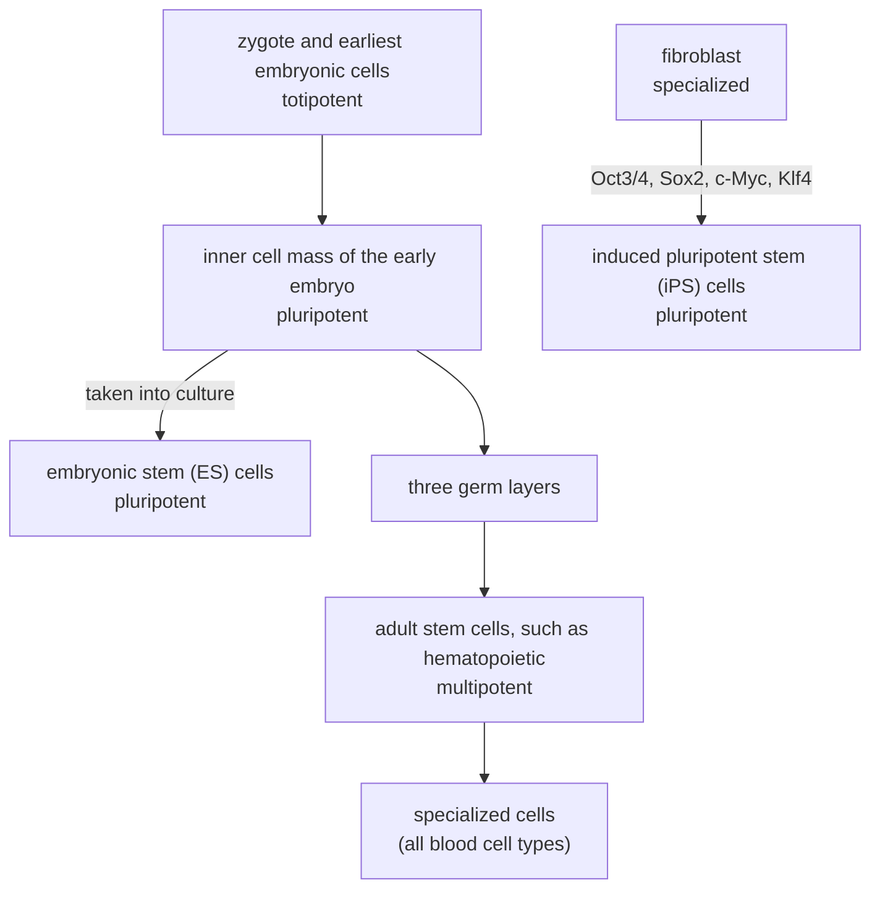

---
aliases:
  - Stem Cells
  - Self-Renewal
  - Potency
  - Pluripotency
  - Embryonic Stem Cell
  - Induced Pluripotent Stem Cell
  - iPS Cell
  - Cellule souche
tags:
  - type/concept
  - domain/biology
  - domain/mathematics
  - level/L2
  - level/L3
mastery: 0
prerequisites:
  - "[[Cell Differentiation]]"
  - "[[Cell Cycle]]"
  - "[[Mitosis]]"
  - "[[Gene Expression]]"
related:
  - "[[Developmental Biology]]"
  - "[[Hematopoiesis]]"
  - "[[Transcription Factor]]"
  - "[[Gene Regulatory Network]]"
  - "[[Trajectory Inference]]"
  - "[[Branching Process]]"
  - "[[Birth-Death Process]]"
  - "[[Apoptosis]]"
  - "[[Cancer]]"
  - "[[Cell Type]]"
projects: []
sources:
  - "[[Anatomy and Physiology 2e (OpenStax)]]"
  - "[[Molecular Biology of the Cell (Alberts)]]"
  - "[[Takahashi 2006 - Induction of Pluripotent Stem Cells from Mouse Embryonic and Adult Fibroblast Cultures by Defined Factors]]"
  - "[[NobelPrize.org]]"
---

# Stem Cell

> [!abstract]
> A stem cell can both copy itself and make specialized cells: self-renewal keeps a reservoir, differentiation supplies the tissue. Its potency, the range of cell types it can still make, goes from the totipotent fertilized egg to multipotent adult stem cells, and four transcription factors can turn a skin fibroblast back into a pluripotent cell.

## Definition

A **stem cell** is an unspecialized cell that can divide without limit as needed and can, under specific conditions, differentiate into specialized cells.[^ap36] Two properties define it:[^alberts-sc]

- **Self-renewal**: it is not terminally differentiated and can keep dividing, for the lifetime of the animal; when it divides, each daughter can either remain a stem cell or commit to differentiation.
- **Potency**: the range of cell types its descendants can become, which classifies stem cells as totipotent, pluripotent or multipotent.[^ap36]

## Why it matters

- **Tissue hierarchies are trees.** A renewing tissue is a lineage tree rooted in stem cells: in blood, multipotent hematopoietic stem cells give rise to all blood cell types ([[Hematopoiesis]]).[^alberts-sc][^ap-blood] Single-cell maps of such tissues are read as trajectories branching from the stem state ([[Trajectory Inference]], [[Cell Type]]).
- **Pluripotent cells without an embryo.** Induced pluripotent stem (iPS) cells are made from fibroblasts, including those of adult mice, with four defined transcription factors,[^takahashi] so pluripotent cells can be derived from an adult individual's own cells.
- **Validating a cell line is a data problem.** Whether a line is pluripotent is judged from functional tests and from marker gene expression, the comparison of a new line's profile to reference stem cells (Advanced).[^takahashi]
- **Clone dynamics are stochastic processes.** The fate of each division can be modeled as a random event, and the stem cell pool as a branching process whose clones drift ([[Branching Process]], [[Birth-Death Process]]).

## Core (L2)

### Self-renewal: three outcomes of a division

| Division | Daughters | Stem cell pool |
|---|---|---|
| symmetric renewal | 2 stem cells | +1 |
| asymmetric | 1 stem cell + 1 committed cell | unchanged |
| symmetric differentiation | 2 committed cells | −1 |

A tissue keeps a constant stem cell pool if, on average, half of the daughters remain stem cells: either every division is asymmetric, or symmetric renewals and symmetric differentiations occur equally often (Mathematical representation). In renewing tissues such as the epidermis, the gut lining and blood, stem cells usually divide slowly, and their committed daughters, the **transit amplifying cells**, divide several more times before differentiating, multiplying the output of each stem division ([[Cell Cycle]]).[^alberts-sc]

### Potency: from totipotent to multipotent



| Potency | Can give rise to | Examples |
|---|---|---|
| Totipotent | any cell needed for an organism to grow and develop | the earliest embryonic cells, from the zygote's first divisions[^ap36] |
| Pluripotent | any type of tissue of the body, but cannot by itself support the development of a whole organism | cells of the early embryo that precede the tissue layers;[^ap36] ES and iPS cells[^alberts-sc][^takahashi] |
| Multipotent | the cell types of one lineage or a small number of lineages | hematopoietic stem cells (blood cells)[^ap36][^alberts-sc] |

### Three kinds of stem cells

1. **Embryonic stem (ES) cells** are derived from the inner cell mass of an early embryo and grown in culture; injected into another early embryo, they can contribute to all its tissues, including germ cells ([[Developmental Biology]]).[^alberts-sc]
2. **Adult (tissue) stem cells** maintain renewing tissues throughout life; they are usually multipotent, such as the hematopoietic stem cells of the bone marrow.[^alberts-sc][^ap-blood]
3. **Induced pluripotent stem (iPS) cells** are made by reprogramming: Takahashi and Yamanaka introduced four transcription factors (Oct3/4, Sox2, c-Myc and Klf4) into mouse embryonic or adult fibroblasts and obtained cells that grew like ES cells and expressed ES cell marker genes.[^takahashi] The discovery that mature cells can be reprogrammed to become pluripotent earned Gurdon and Yamanaka the 2012 Nobel Prize in Physiology or Medicine ([[Cell Differentiation#Advanced (L3)]]).[^nobel12]

## Advanced (L3)

### Self-renewal belongs to the population

The table above makes self-renewal a balance, not a rule for each cell. If divisions are asymmetric, every stem cell keeps one stem daughter and the pool stays constant cell by cell. If divisions are symmetric and random, the pool stays constant only on average: individual clones, the descendants of one stem cell, grow or vanish by chance. The model then predicts that most clones die out while the survivors grow larger and larger, keeping the total constant (Mathematical and Computational representations). A small bias toward renewal makes the pool grow exponentially, as any unbalanced birth and death process does ([[Apoptosis#Worked example]]).

### Testing potency

Pluripotency is defined by what a cell can make, so it is tested functionally. Takahashi and Yamanaka checked their iPS cells three ways: ES-like morphology and growth with ES marker genes expressed; tumors grown under the skin of nude mice that contained tissues of all three germ layers; and contribution to mouse embryonic development after injection into embryos.[^takahashi] Marker expression is the cheap test a transcriptome provides; the functional tests are the proof. They also found that Nanog, important for maintaining pluripotency in ES cells, was not needed for the induction.[^takahashi]

### Potency is a network state

Reprogramming with four transcription factors shows that potency is a state of the regulatory network rather than a property of the genome: forcing the factors resets the network, which then maintains itself ([[Gene Regulatory Network]], [[Bistability]]).[^takahashi][^nobel12]

## Mathematical representation

**Division probabilities.** Each stem cell division gives two stem cells with probability $p$, one stem and one committed cell with probability $r$, and two committed cells with probability $q$, with $p + r + q = 1$. The expected number of stem daughters per division is
$$m = 2p + r = 1 + p - q,$$
and a pool of $S_0$ stem cells that divide once per round has $\mathbb{E}[S_k] = S_0\, m^k$ after $k$ rounds. Homeostasis is $m = 1$, that is $p = q$.

**Clone survival.** The number of stem daughters of one division has generating function $f(s) = q + r s + p s^2$. If $e_k$ is the probability that a clone founded by one stem cell has no stem cell left after $k$ rounds, then
$$e_0 = 0, \qquad e_k = f(e_{k-1}),$$
since the clone dies out by round $k$ exactly when every stem daughter of the first division founds a clone that dies out in the remaining $k-1$ rounds.

**Survivors grow.** At homeostasis $\mathbb{E}[S_k] = 1$, and since $\mathbb{E}[S_k] = \mathbb{E}[S_k \mid S_k > 0]\,(1 - e_k)$, the mean size of the surviving clones is
$$\mathbb{E}[S_k \mid S_k > 0] = \frac{1}{1 - e_k},$$
which grows as $e_k \to 1$: fewer and fewer clones carry the whole tissue.

## Computational representation

The exact recursion and a simulation of 20,000 clones with balanced divisions ($p = q = 0.25$, $r = 0.5$; illustrative values), for 50 rounds.

```python
import random


def survival(p: float, q: float, rounds: int) -> float:
    """P(a clone founded by one stem cell still has stem cells after `rounds` division rounds).
    Each division: 2 stem cells (p), 1 stem + 1 committed (r = 1 - p - q), 2 committed (q)."""
    r = 1 - p - q
    extinct = 0.0
    for _ in range(rounds):
        extinct = q + r * extinct + p * extinct ** 2    # generating function f(s) = q + r s + p s^2
    return 1 - extinct


def simulate_clone(p: float, q: float, rounds: int, rng: random.Random) -> int:
    """Number of stem cells in one clone after `rounds` rounds (every stem cell divides once per round)."""
    stem = 1
    for _ in range(rounds):
        new = 0
        for _ in range(stem):
            x = rng.random()
            new += 2 if x < p else 0 if x < p + q else 1
        stem = new
        if stem == 0:
            break
    return stem


rng = random.Random(1)
p, q, rounds, n = 0.25, 0.25, 50, 20000      # balanced divisions: p = q
sizes = [simulate_clone(p, q, rounds, rng) for _ in range(n)]
alive = [s for s in sizes if s > 0]
exact = survival(p, q, rounds)
print(f"mean stem cells per founder: {sum(sizes) / n:.2f}")
print(f"surviving clones: exact {exact:.3f}, simulated {len(alive) / n:.3f}")
print(f"mean size of survivors: exact {1 / exact:.1f}, simulated {sum(alive) / len(alive):.1f}")
```

```text
mean stem cells per founder: 1.05
surviving clones: exact 0.070, simulated 0.074
mean size of survivors: exact 14.2, simulated 14.2
```

On average each founder still has about one stem cell descendant, as homeostasis requires, yet after 50 rounds only 7% of the clones survive, each with about 14 stem cells. A constant pool hides a turnover of clones.

## Worked example

> [!example] Clone fate by hand, $p = q = 0.25$, $r = 0.5$
> 1. **One round.** The clone dies only if the first division makes two committed cells: $e_1 = f(0) = q = 0.25$, survival 0.75.
> 2. **Two rounds.** $e_2 = f(0.25) = 0.25 + 0.5 \times 0.25 + 0.25 \times 0.25^2 = 0.25 + 0.125 + 0.015625 = 0.390625$: survival 0.609. The mean size of surviving clones is $1/0.609 = 1.64$ stem cells.
> 3. **Unbalanced pool.** With $p = 0.3$, $q = 0.2$, $r = 0.5$: $m = 2 \times 0.3 + 0.5 = 1.1$, and after 20 rounds the pool is $1.1^{20} = 6.73$ times larger. A 10% excess of renewing divisions is enough to make the pool expand exponentially.

## Common misconceptions

> [!warning] "A stem cell always divides asymmetrically"
> Self-renewal only requires that, on average, half of the daughters remain stem cells; symmetric divisions can achieve it at the level of the population (Advanced).

> [!warning] "Pluripotent and totipotent mean the same"
> Totipotent cells can make everything an organism needs to develop; pluripotent cells can make any tissue of the body but cannot support the development of a whole organism on their own.[^ap36]

> [!warning] "Adult stem cells can make any cell type"
> Adult stem cells are usually multipotent: a hematopoietic stem cell makes blood cells, not neurons or liver cells.[^alberts-sc][^ap36]

> [!warning] "Expressing pluripotency markers proves pluripotency"
> Markers are evidence; potency is shown by what the cells make, as in the germ-layer and embryo contribution tests.[^takahashi]

## Exercises

> [!question] Exercise 1 (L2)
> Give the potency of: (a) a zygote; (b) an ES cell; (c) an iPS cell; (d) a hematopoietic stem cell; (e) a mature neuron.

> [!success]- Solution
> (a) Totipotent. (b) Pluripotent. (c) Pluripotent, by reprogramming. (d) Multipotent: all blood cell types. (e) None: a terminally differentiated cell, which makes no other cell type.

> [!question] Exercise 2 (L2)
> A laboratory derives a new iPS line. Which observations would you require before calling it pluripotent, and why is a transcriptome resembling that of ES cells not enough?

> [!success]- Solution
> ES-like growth and marker expression, then the functional tests: tumors in immunodeficient mice containing tissues of all three germ layers, and contribution to embryonic development after injection into an early embryo.[^takahashi] A transcriptome shows which genes are on now, not what the cells can become; a partially reprogrammed line can express markers without being able to make all lineages.

> [!question] Exercise 3 (L2)
> In a stem cell pool, 40% of divisions are symmetric renewals, 40% asymmetric and 20% symmetric differentiations. Compute $m$ and the pool size after 10 rounds. Which change of the division probabilities restores homeostasis without changing the share of asymmetric divisions?

> [!success]- Solution
> $m = 2 \times 0.4 + 0.4 = 1.2$, so the pool grows $1.2^{10} \approx 6.2$-fold in 10 rounds. Homeostasis needs $p = q$ with $r = 0.4$: $p = q = 0.3$.

> [!question] Exercise 4 (L3)
> Explain why $e_k = f(e_{k-1})$ with $f(s) = q + rs + ps^2$, and show that at homeostasis the mean size of surviving clones is $1/(1 - e_k)$.

> [!success]- Solution
> After the first division the clone consists of 0, 1 or 2 stem cells, with probabilities $q$, $r$ and $p$. Each of them founds an independent sub-clone that has $k - 1$ rounds left and dies out with probability $e_{k-1}$; the clone dies out if all of them do, which happens with probability $q + r\,e_{k-1} + p\,e_{k-1}^2 = f(e_{k-1})$. With $m = 1$, $\mathbb{E}[S_k] = 1 = \mathbb{E}[S_k \mid S_k > 0]\,(1 - e_k) + 0 \times e_k$, which gives the result.

> [!question] Exercise 5 (L3, Python)
> With `survival` from the code above, compare clone survival and the mean size of surviving clones after 10 and 100 rounds for $p = q = 0.1$, $0.25$ and $0.5$. How does the share of symmetric divisions change the drift of clones?

> [!success]- Solution
> ```python
> for p in (0.1, 0.25, 0.5):
>     for k in (10, 100):
>         s = survival(p, p, k)
>         print(f"p = q = {p:4.2f}, r = {1 - 2 * p:.1f}, round {k:3d}: survival {s:.3f}, mean survivor size {1 / s:6.1f}")
> ```
> Output:
> ```text
> p = q = 0.10, r = 0.8, round  10: survival 0.482, mean survivor size    2.1
> p = q = 0.10, r = 0.8, round 100: survival 0.089, mean survivor size   11.2
> p = q = 0.25, r = 0.5, round  10: survival 0.259, mean survivor size    3.9
> p = q = 0.25, r = 0.5, round 100: survival 0.037, mean survivor size   26.9
> p = q = 0.50, r = 0.0, round  10: survival 0.139, mean survivor size    7.2
> p = q = 0.50, r = 0.0, round 100: survival 0.019, mean survivor size   53.2
> ```
> The more divisions are symmetric, the faster clones are lost and the larger the survivors become, while every pool stays constant on average. Asymmetric divisions slow the drift: with $r = 0.8$, half the clones are still present after 10 rounds. Following the sizes of marked clones over time would therefore tell the division modes apart, even though the pool size cannot.

## Mastery checklist

- [ ] 1 Recognized: I can define a stem cell by self-renewal and potency, and name ES, adult and iPS cells.
- [ ] 2 Understood: I can place totipotent, pluripotent and multipotent cells in development, and explain how iPS cells are made and tested.
- [ ] 3 Practiced: I can compute pool growth from division probabilities and clone survival with the branching recursion, by hand and in Python.
- [ ] 4 Applied: I located the stem and progenitor states in a real single-cell data set of a renewing tissue and checked their marker genes.
- [ ] 5 Explained: I can teach why self-renewal is a population property and why marker expression does not prove potency.

## References

[^ap36]: [[Anatomy and Physiology 2e (OpenStax)]], section 3.6 "Cellular Differentiation" (stem cell as an unspecialized cell that can divide without limit as needed and, under specific conditions, differentiate into specialized cells; totipotent, pluripotent and multipotent stem cells).
[^ap-blood]: [[Anatomy and Physiology 2e (OpenStax)]], treatment of blood and its formation (hematopoietic stem cells of the bone marrow).
[^alberts-sc]: [[Molecular Biology of the Cell (Alberts)]], 4th ed. (2002), treatment of stem cells and tissue renewal (a stem cell is not terminally differentiated, can divide without limit, and its daughters either remain stem cells or commit to differentiation; renewal of epidermis, gut lining and blood; transit amplifying cells; multipotent hematopoietic stem cells; embryonic stem cells from the inner cell mass, able to contribute to all tissues including germ cells).
[^takahashi]: [[Takahashi 2006 - Induction of Pluripotent Stem Cells from Mouse Embryonic and Adult Fibroblast Cultures by Defined Factors]], *Cell* 126:663-676 (Oct3/4, Sox2, c-Myc and Klf4 in mouse embryonic or adult fibroblasts; ES-like growth and markers; Nanog not required; tumors with all three germ layers; contribution to embryonic development).
[^nobel12]: [[NobelPrize.org]], press release of the Nobel Prize in Physiology or Medicine 2012 (Gurdon and Yamanaka, for the discovery that mature cells can be reprogrammed to become pluripotent).
