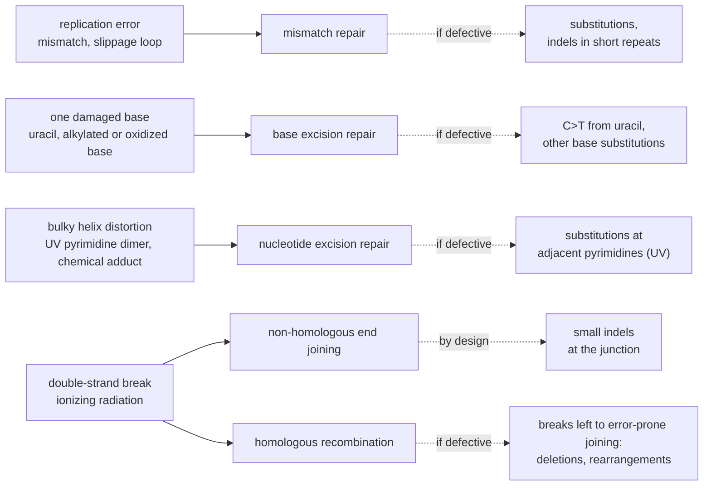

---
aliases:
  - DNA Damage Repair
  - Réparation de l'ADN
tags:
  - type/concept
  - domain/biology
  - domain/bioinformatics
  - level/L2
  - level/L3
  - level/M1
mastery: 0
prerequisites:
  - "[[DNA]]"
  - "[[Base Pairing]]"
  - "[[DNA Replication]]"
  - "[[Mutation]]"
related:
  - "[[Point Mutation]]"
  - "[[Indel]]"
  - "[[Mutation Rate]]"
  - "[[Somatic Mutation]]"
  - "[[Genetic Recombination]]"
  - "[[Cell Cycle]]"
  - "[[Cancer]]"
  - "[[Tumor Suppressor Gene]]"
  - "[[Somatic Variant Calling]]"
projects: []
sources:
  - "[[Molecular Biology of the Cell (Alberts)]]"
  - "[[Molecular Cell Biology (Lodish)]]"
  - "[[Biology 2e (OpenStax)]]"
  - "[[An Introduction to Genetic Analysis (Griffiths)]]"
  - "[[NobelPrize.org]]"
  - "[[Alexandrov 2013 - Signatures of Mutational Processes in Human Cancer]]"
---

# DNA Repair

> [!abstract]
> DNA repair is the set of pathways that find damaged or mispaired DNA and restore the original sequence, usually by cutting out the faulty stretch and copying the intact strand. Each pathway handles one class of lesion, so each repair defect leaves its own kind of mutation in the genome.

## Definition

**DNA repair** is the set of enzymatic processes by which a cell detects and corrects chemical damage and replication errors in its DNA.[^alberts][^os14] Most pathways exploit the fact that the double helix stores the information twice: the damaged or wrong part of one strand is removed, a DNA polymerase resynthesizes it using the other strand as template, and DNA ligase seals the nick. When both strands are broken, the ends are either joined directly or repaired by copying a homologous DNA molecule.[^alberts]

## Why it matters

- **Mutations are what repair missed.** Fewer than one in 1,000 accidental base changes in a cell's DNA becomes a permanent mutation; the rest are repaired.[^alberts] The variants in a sequencing file are the survivors ([[Mutation]], [[Mutation Rate]], [[Somatic Variant Calling]]).
- **Repair defects leave readable traces.** Each pathway prevents a particular class of mutation, so a cell that loses one accumulates that class. The somatic mutations of 7,042 cancers decompose into more than 20 **mutational signatures**, some associated with defects in DNA maintenance (Frontier).[^alexandrov]
- **Inherited cancer risk.** Inherited defects in mismatch repair predispose to colon cancer, in nucleotide excision repair to skin cancer, and in homologous recombination (BRCA2) to breast, ovarian and prostate cancer ([[Cancer]], [[Tumor Suppressor Gene]]).[^alberts][^nobel]

## Core (L2)

### Lesions and the general logic

Replication leaves mismatches and slippage loops; spontaneous chemistry removes purines and deaminates cytosine to uracil; UV light, alkylating chemicals and ionizing radiation add their own lesions (rates and mechanisms in [[Mutation#Deeper (L2)]]).[^alberts] A lesion is not yet a mutation: it becomes one when replication copies it into a wrong base pair, after which both strands agree and no repair system can see it.[^alberts] Excision pathways share four steps: **recognize** the lesion, **excise** it (one base, an oligonucleotide or a strand segment), **resynthesize** from the intact strand, **ligate**.[^alberts][^os14]



### The main pathways

| Pathway | Lesion | Mechanism | Template | Mutations prevented | Inherited defect |
|---|---|---|---|---|---|
| Mismatch repair (MMR) | mispaired bases, small insertion-deletion loops left by replication | MutS binds the mismatch, MutL couples it to removal of a stretch of the **new** strand, which is resynthesized | parental strand | substitutions; indels in short repeats | colon cancer (MSH2, MLH1 and other MMR genes) |
| Base excision repair (BER) | one damaged base: uracil from deaminated C, alkylated or oxidized bases | a DNA glycosylase removes the base; an AP endonuclease cuts the backbone at the abasic site; polymerase and ligase restore it | complementary strand | C>T from uracil, other substitutions | |
| Nucleotide excision repair (NER) | bulky, helix-distorting lesions: pyrimidine dimers (T-T, T-C, C-C), adducts of large hydrocarbons such as benzopyrene | a multiprotein complex detects the distortion, cuts the damaged strand on both sides and removes an oligonucleotide; the gap is filled | complementary strand | substitutions at adjacent pyrimidines and at adducts | xeroderma pigmentosum: UV sensitivity, skin cancer |
| Non-homologous end joining (NHEJ) | double-strand break | the ends are brought together and ligated, usually losing a few nucleotides | none | loss of chromosome pieces, at the price of small junction indels | |
| Homologous recombination (HR) | double-strand break after replication | the broken ends use the intact sister chromatid as template | sister chromatid | deletions and rearrangements from error-prone joining | BRCA2: breast, ovarian, prostate cancer |

(Mechanisms after [^alberts][^lodish][^os14]; inherited defects after [^alberts][^nobel].)

**Mismatch repair** must correct the new strand, not the template. In *E. coli* the parental strand carries methylated adenines in GATC sequences for a while after replication, which marks it as old; in eukaryotes the nicks of the newly made strand serve as the signal.[^os14][^alberts] MMR lowers the replication error rate about 100-fold beyond proofreading according to Alberts ([[DNA Replication#Deeper (L2)]]); the 2015 Nobel press release says "about a thousandfold".[^alberts][^nobel] Order-of-magnitude figures differ between sources: carry the range, not one number.

**Base excision repair** works because uracil is foreign to DNA: a uracil means a deaminated cytosine.[^alberts] Deamination of **5-methylcytosine**, by contrast, gives thymine, a normal base: a dedicated glycosylase removes the T of a T-G mismatch, but inefficiently, which is one reason why methylated CpG sites are mutation hotspots (C>T in a CpG context).[^alberts]

**Direct reversal.** A few lesions are undone without excision: an alkyl group on the O6 of guanine, which makes G pair with T (G:C → A:T transitions if left), is transferred to the repair protein itself.[^alberts][^griffiths]

**Double-strand breaks** have no intact partner strand. NHEJ trades accuracy for availability; HR is accurate because it copies a homologous molecule, normally the sister chromatid.[^alberts]

> [!info] Nobel Prize in Chemistry 2015
> Tomas Lindahl, Paul Modrich and Aziz Sancar were awarded the prize "for mechanistic studies of DNA repair": Lindahl for base excision repair, Modrich for mismatch repair, Sancar for nucleotide excision repair of UV damage.[^nobel]

## Advanced (L3)

- **Choosing a pathway for a break.** HR needs the sister chromatid, which exists only after replication (S and G2 phases); NHEJ needs no template and works throughout the [[Cell Cycle]].[^alberts] A break in G1 is therefore joined, with small errors.
- **Damage tolerance.** A replication fork that meets an unrepaired lesion can be rescued by translesion polymerases, which copy across the lesion with low fidelity; patients with the variant form of xeroderma pigmentosum are defective in this bypass and sensitive to UV.[^alberts] Tolerance avoids a broken fork at the price of a possible mutation.
- **Transcription-coupled repair.** RNA polymerase stalled at a lesion recruits the NER machinery, so the transcribed strand of active genes is repaired faster.[^alberts] Prediction from this mechanism: lesions on the non-transcribed strand persist longer, so mutations caused by them should show a **strand asymmetry** inside genes, a pattern spectra can test.
- **Checkpoints.** Damage signalling (through kinases such as ATM, missing in ataxia telangiectasia) halts the cell cycle, notably via p53, to allow repair, or triggers [[Apoptosis]].[^alberts] Losing these controls lets damaged cells divide, a step toward [[Cancer]].
- **Repeats and MMR.** Polymerase slippage in short tandem repeats creates insertion-deletion loops that MMR removes; cells lacking MMR accumulate repeat-length changes (microsatellite instability), seen in colon cancers with MMR defects.[^alberts][^lodish]

## Frontier (M1)

A tumour's somatic mutations mix the footprints of every process that acted on its lineage: damage, the repair pathways that handled it, replication. Alexandrov and colleagues analysed 4,938,362 mutations from 7,042 cancers and extracted more than 20 signatures: one attributed to APOBEC cytidine deaminases appears in many cancer types; others are associated with age at diagnosis, known mutagens or defects in DNA maintenance; many have no known cause. They also described **kataegis**, hypermutation concentrated in small genomic regions.[^alexandrov]

- Two computational tasks follow: **extracting** signatures de novo from many tumours (a non-negative matrix factorization), and **fitting** known signatures to one tumour (non-negative least squares, Exercise 6). A fitted signature is evidence, not a diagnosis: check the repair genes of the same sample ([[Somatic Variant Classification]]).

## Mathematical representation

**Fidelity layers.** If the polymerase misincorporates with probability $\varepsilon_0$ per nucleotide and correction layer $i$ leaves a fraction $1/f_i$ of the remaining errors, the error rate per nucleotide per replication is
$$\mu = \frac{\varepsilon_0}{\prod_i f_i}.$$
With $\varepsilon_0 \approx 10^{-5}$ and $f_{\text{proofreading}} \approx f_{\text{MMR}} \approx 100$,[^alberts] $\mu \approx 10^{-9}$; losing MMR multiplies $\mu$ by $f_{\text{MMR}}$ (Exercise 4).

**Lesions to mutations.** Let lesions of type $k$ arise $\lambda_k$ times per genome per cell cycle, be repaired before replication with probability $r_k$, and, if unrepaired, produce a mutation with probability $p_k$. Then
$$\mathbb{E}[M] = \sum_k \lambda_k\,(1 - r_k)\,p_k .$$
A pathway defect sets $r_k \approx 0$ for its lesion class, multiplying that term by $1/(1 - r_k)$: large precisely because healthy repair has $r_k$ close to 1.

**Strand choice.** If MMR picked the strand to correct at random, a mismatch would be fixed as a mutation with probability $1/2$. With probability $d$ of picking the new strand, the error is removed with probability $d$: the strand signal is what makes $d \approx 1$.

**Classes and signatures.** Writing the mutated base pair from its pyrimidine $b \in \{C, T\}$, with $b' \ne b$, gives $2 \times 3 = 6$ substitution types, and with the 5' and 3' neighbours $6 \times 4 \times 4 = 96$ classes, those of single-base-substitution signatures;[^alexandrov] a tumour's catalogue is $\mathbf{m} \in \mathbb{N}^{96}$. With $K$ signatures $\mathbf{s}_k \in \mathbb{R}_{\ge 0}^{96}$, $\sum_c s_{kc} = 1$, and exposures $e_k \ge 0$ (mutations contributed by process $k$):
$$\mathbf{m} \approx S\mathbf{e} = \sum_{k=1}^{K} e_k \mathbf{s}_k, \qquad \hat{\mathbf{e}} = \arg\min_{\mathbf{e} \ge 0} \lVert \mathbf{m} - S\mathbf{e} \rVert_2^2,$$
and the fit is scored by the cosine similarity $\cos(\mathbf{m}, S\hat{\mathbf{e}}) = \mathbf{m} \cdot S\hat{\mathbf{e}} \,/\, (\lVert \mathbf{m} \rVert\, \lVert S\hat{\mathbf{e}} \rVert)$. For $N$ tumours, $M \approx SE$ with $M \in \mathbb{N}^{96 \times N}$ and $E \ge 0$: a non-negative matrix factorization.

## Computational representation

A substitution from a [[VCF Format|VCF]] (position, REF, ALT, always on the `+` strand) plus one reference base on each side ([[Reference Genome]]) gives its class:

```python
COMPLEMENT = str.maketrans("ACGT", "TGCA")


def reverse_complement(seq: str) -> str:
    return seq.translate(COMPLEMENT)[::-1]


SUBSTITUTIONS = ["C>A", "C>G", "C>T", "T>A", "T>C", "T>G"]
CHANNELS = [f"{left}[{sub}]{right}" for sub in SUBSTITUTIONS
            for left in "ACGT" for right in "ACGT"]


def sbs96(genome: str, pos: int, alt: str) -> str:
    """Channel of a substitution at 0-based pos, read from the pyrimidine of the base pair."""
    context = genome[pos - 1:pos + 2]
    if context[1] in "AG":                       # purine reference: describe the other strand
        context, alt = reverse_complement(context), reverse_complement(alt)
    return f"{context[0]}[{context[1]}>{alt}]{context[2]}"


genome = "ATTCGGATCCGTTACGAAGT"                     # invented toy reference
calls = [(3, "T"), (4, "A"), (5, "T"), (12, "C")]   # invented (0-based position, alternative base)
print(len(CHANNELS), CHANNELS[:3])
for pos, alt in calls:
    print(pos, genome[pos - 1:pos + 2], f"{genome[pos]}>{alt}", "->", sbs96(genome, pos, alt))
```

```text
96 ['A[C>A]A', 'A[C>A]C', 'A[C>A]G']
3 TCG C>T -> T[C>T]G
4 CGG G>A -> C[C>T]G
5 GGA G>T -> T[C>A]C
12 TTA T>C -> T[T>C]A
```

Positions 3 and 4 are the C and the G of one CpG: deamination of either methylated cytosine, one per strand, lands in a C>T-at-CpG class. A spectrum is then a `Counter` over these 96 labels.

## Worked example

> [!example] One deaminated cytosine, repaired or not (invented sequence)
> Duplex `5'-ATTCGGA-3'` / `3'-TAAGCCT-5'`; the C at position 4 (1-based) deaminates to U, giving a U:G pair.
> 1. **BER.** Uracil-DNA glycosylase removes the U, leaving an abasic site; an AP endonuclease cuts the backbone; a polymerase inserts C opposite G; ligase seals. The sequence is restored and leaves no trace.
> 2. **No repair, one replication.** The U strand templates an A: daughter 1 is U:A. The G strand templates a C: daughter 2 is a normal C:G.
> 3. **Second replication.** U:A gives T:A: half of the descendants now carry C:G → T:A, a transition, in context `T[C>T]G`.
> 4. **If the C was methylated**, deamination gives T directly: a T:G mismatch that the specific glycosylase handles poorly, hence CpG hotspots.[^alberts]
> 5. **In a VCF** (always the `+` strand) this is `C>T` at position 4. Had the deaminated C been the other strand's C of the same CpG, the VCF would show `G>A` at position 5: the same class `C[C>T]G` once collapsed (positions 3 and 4, 0-based, in the code above).

## Common misconceptions

> [!warning] "Repair makes DNA error-free"
> Repair lowers the rates; it does not zero them. Fewer than one in 1,000 accidental base changes escapes,[^alberts] and with $\mu \approx 10^{-9}$ a diploid human genome still gains a few errors per replication (Exercise 4).

> [!warning] "A damaged base is already a mutation"
> A lesion is a chemical change in one strand, still repairable from the other. It becomes a mutation once replication writes it into both strands as a normal but wrong base pair, which repair cannot recognize.[^alberts]

> [!warning] "C>T and G>A are different mutation types"
> They are the same base-pair change read on the two strands. Spectra therefore use six classes written from the pyrimidine, not twelve.

## Exercises

> [!question] Exercise 1 (L2)
> Name the pathway that repairs: (a) a uracil in DNA; (b) a T-T pyrimidine dimer; (c) a G-T mismatch just after replication; (d) a double-strand break in G1; (e) a double-strand break in G2; (f) O6-methylguanine.

> [!success]- Solution
> (a) BER (uracil-DNA glycosylase). (b) NER (helix-distorting lesion). (c) MMR, which removes the base on the new strand. (d) NHEJ: no sister chromatid exists yet. (e) HR, using the sister chromatid (NHEJ is also possible). (f) Direct reversal: the methyl group is transferred to the repair protein.[^alberts]

> [!question] Exercise 2 (L2)
> Why must mismatch repair know which strand is new? Predict what happens to the mutation rate of an *E. coli* mutant that cannot methylate GATC sites.

> [!success]- Solution
> A mismatch is a disagreement between two strands; only the new strand holds the error. Correcting the template instead writes the error into both strands: a mutation. Choosing at random would fail half the time (Mathematical representation). Without GATC methylation, *E. coli* MMR loses its strand signal,[^os14] so the mutation rate is expected to rise.

> [!question] Exercise 3 (L2)
> Cytosine deaminates spontaneously to uracil. Use this to explain why DNA contains thymine rather than uracil.

> [!success]- Solution
> If U were a normal DNA base, a U produced by deamination of C would be indistinguishable from a genuine U, and the C:G → U:A → T:A change could not be prevented. With T in DNA, any U is a lesion, recognized and removed by BER.[^alberts] Methylcytosine shows the cost of the alternative: its deamination product is T, which repair recognizes poorly.

> [!question] Exercise 4 (L3, Python)
> Using $\varepsilon_0 = 10^{-5}$, a 100-fold gain from proofreading and a 100-fold gain from MMR, compute $\mu$ and the expected number of new errors per replication of a diploid human genome ($2 \times 3.055 \times 10^9$ bp, [[DNA]]), with and without MMR. Redo it with the 1,000-fold MMR gain of the Nobel press release.

> [!success]- Solution
> ```python
> for name, layers in (("with MMR", [1e-5, 1e-2, 1e-2]), ("without MMR", [1e-5, 1e-2])):
>     mu = 1.0
>     for factor in layers:
>         mu *= factor
>     print(f"{name:12s} mu = {mu:.0e}  errors per diploid genome copy = {mu * 2 * 3.055e9:.1f}")
> print("1000-fold MMR:", round(1e-5 * 1e-2 * 1e-3 * 2 * 3.055e9, 2))
> ```
> ```text
> with MMR     mu = 1e-09  errors per diploid genome copy = 6.1
> without MMR  mu = 1e-07  errors per diploid genome copy = 611.0
> 1000-fold MMR: 0.61
> ```
> About 6 new errors per division with MMR, about 600 without: a mutator phenotype. The tenfold disagreement between sources changes the absolute number, not the conclusion.

> [!question] Exercise 5 (L3, Python)
> Two invented tumours each give ten substitutions as (reference trinucleotide on the `+` strand, ALT). Classify them (with `reverse_complement` from above), count the six classes, and the C>T changes that sit at a dipyrimidine or at a CpG. Which process could explain each sample?

> [!success]- Solution
> ```python
> from collections import Counter
>
> sample_a = [("TCC", "T"), ("CCT", "T"), ("GGA", "A"), ("TCT", "T"), ("CCC", "T"),
>             ("AGG", "A"), ("TCA", "T"), ("ACG", "T"), ("TTC", "C"), ("AGA", "A")]
> sample_b = [("ACG", "T"), ("CGT", "A"), ("TCG", "T"), ("CGA", "A"), ("GCG", "T"),
>             ("CCG", "T"), ("ATA", "G"), ("CGG", "A"), ("TGC", "T"), ("ACG", "T")]
>
>
> def channel(context: str, alt: str) -> str:
>     if context[1] in "AG":
>         context, alt = reverse_complement(context), reverse_complement(alt)
>     return f"{context[0]}[{context[1]}>{alt}]{context[2]}"
>
>
> def describe(calls):
>     chans = [channel(c, a) for c, a in calls]
>     classes = Counter(ch[2:5] for ch in chans)
>     c_to_t = [ch for ch in chans if ch[2:5] == "C>T"]
>     dipyrimidine = sum(ch[0] in "CT" or ch[-1] in "CT" for ch in c_to_t)
>     cpg = sum(ch[-1] == "G" for ch in c_to_t)
>     return dict(classes), f"C>T at dipyrimidines {dipyrimidine}/{len(c_to_t)}", f"C>T at CpG {cpg}/{len(c_to_t)}"
>
>
> print("A", describe(sample_a))
> print("B", describe(sample_b))
> ```
> ```text
> A ({'C>T': 9, 'T>C': 1}, 'C>T at dipyrimidines 8/9', 'C>T at CpG 1/9')
> B ({'C>T': 8, 'T>G': 1, 'C>A': 1}, 'C>T at dipyrimidines 4/8', 'C>T at CpG 8/8')
> ```
> A: C>T at adjacent pyrimidines, the sites of UV photoproducts, which NER removes: a UV-like pattern. B: every C>T is at a CpG, the pattern of methylcytosine deamination. Note that 4 of B's CpG sites are also dipyrimidines (`CCG`, `TCG`): features overlap, which is why whole 96-class profiles are compared rather than one feature.

> [!question] Exercise 6 (M1, Python)
> Two invented signatures over the six classes (C>A, C>G, C>T, T>A, T>C, T>G) are $\mathbf{s}_1 = (0.05, 0.03, 0.80, 0.04, 0.05, 0.03)$ and $\mathbf{s}_2 = (0.70, 0.10, 0.08, 0.04, 0.04, 0.04)$. An invented tumour has counts $\mathbf{m} = (31, 6, 50, 5, 4, 4)$. Estimate the exposures by non-negative least squares and score the fit.

> [!success]- Solution
> With two signatures, NNLS can be solved exactly: solve the 2 × 2 normal equations; if a coefficient is negative, refit each signature alone and keep the better one.
> ```python
> import math
>
> S1 = [0.05, 0.03, 0.80, 0.04, 0.05, 0.03]   # invented signature: mostly C>T
> S2 = [0.70, 0.10, 0.08, 0.04, 0.04, 0.04]   # invented signature: mostly C>A
> m = [31, 6, 50, 5, 4, 4]                    # invented spectrum of one tumour (6 classes)
>
>
> def dot(u, v):
>     return sum(a * b for a, b in zip(u, v))
>
>
> def nnls2(s1, s2, m):
>     """Non-negative least squares with two signatures: try both, then each alone."""
>     a, b, c = dot(s1, s1), dot(s1, s2), dot(s2, s2)
>     det = a * c - b * b
>     e1 = (c * dot(s1, m) - b * dot(s2, m)) / det
>     e2 = (a * dot(s2, m) - b * dot(s1, m)) / det
>     if e1 >= 0 and e2 >= 0:
>         return e1, e2
>     candidates = [(dot(s1, m) / a, 0.0), (0.0, dot(s2, m) / c)]
>     return min(candidates, key=lambda e: sum((mi - e[0] * x - e[1] * y) ** 2
>                                              for mi, x, y in zip(m, s1, s2)))
>
>
> e1, e2 = nnls2(S1, S2, m)
> fit = [e1 * x + e2 * y for x, y in zip(S1, S2)]
> cosine = dot(m, fit) / math.sqrt(dot(m, m) * dot(fit, fit))
> print(round(e1, 1), round(e2, 1), round(cosine, 4))
> ```
> ```text
> 58.5 40.2 0.9997
> ```
> About 59 mutations are attributed to process 1 and 40 to process 2, with a near-perfect reconstruction. A high cosine does not prove the attribution: with 96 classes, many signatures and few mutations, different exposure sets can fit almost equally well, so real tools report uncertainty.

## Mastery checklist

- [ ] 1 Recognized: I can name MMR, BER, NER, NHEJ and HR and the lesion each one handles.
- [ ] 2 Understood: I can explain why a lesion becomes a mutation only after replication, how MMR finds the new strand, and why CpG sites and UV-exposed dipyrimidines are hotspots.
- [ ] 3 Practiced: I can classify substitutions into the 96 classes, compute error budgets with and without a pathway, and fit signature exposures in Python.
- [ ] 4 Applied: I built the spectrum of a public somatic VCF and fitted published signatures to it, checking the repair genes of the same sample.
- [ ] 5 Explained: I can teach the trade-offs between NHEJ and HR, damage tolerance, transcription-coupled repair, and the limits of signature attribution.

## References

[^alberts]: [[Molecular Biology of the Cell (Alberts)]], 4th ed. (2002), treatment of DNA repair: lesions and their consequences, base and nucleotide excision repair, mismatch repair, direct reversal, double-strand break repair, translesion synthesis, transcription-coupled repair, inherited repair syndromes and damage checkpoints.
[^lodish]: [[Molecular Cell Biology (Lodish)]], 4th ed. (2000), treatment of DNA repair and of repair defects in cancer.
[^os14]: [[Biology 2e (OpenStax)]], ch. 14 "DNA Structure and Function" (DNA repair: proofreading, mismatch repair with the methylated parental strand of *E. coli*, nucleotide excision repair).
[^griffiths]: [[An Introduction to Genetic Analysis (Griffiths)]], 7th ed. (2000), treatment of mutagens and repair (alkylated guanine mispairing with thymine, direct reversal of damage).
[^nobel]: [[NobelPrize.org]], Nobel Prize in Chemistry 2015, press release (7 October 2015): Lindahl, Modrich and Sancar, "for mechanistic studies of DNA repair".
[^alexandrov]: [[Alexandrov 2013 - Signatures of Mutational Processes in Human Cancer]], *Nature* 500:415-421.
