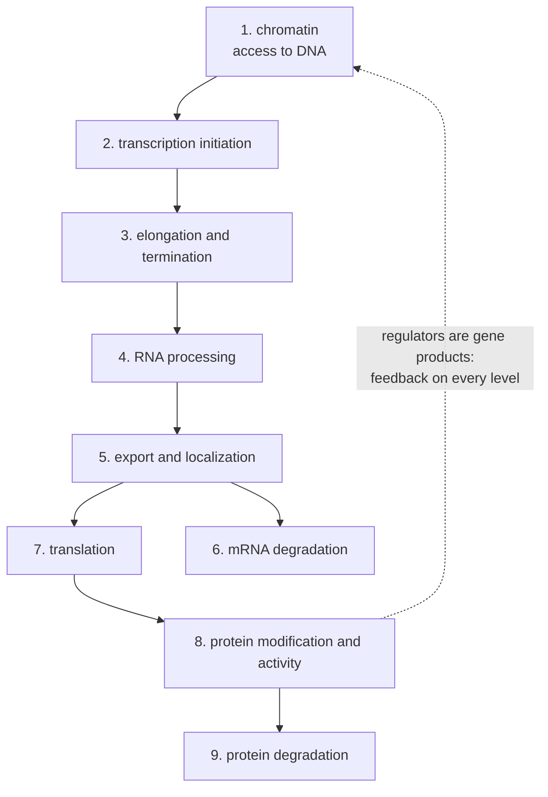

---
aliases:
  - Regulation of Gene Expression
  - Gene Control
  - Régulation de l'expression génique
tags:
  - type/concept
  - domain/biology
  - domain/bioinformatics
  - level/L2
  - level/L3
  - level/M1
mastery: 0
prerequisites:
  - "[[Gene Expression]]"
  - "[[Transcription]]"
  - "[[Translation]]"
  - "[[Messenger RNA]]"
related:
  - "[[Promoter]]"
  - "[[Transcription Factor]]"
  - "[[Operon]]"
  - "[[Enhancer]]"
  - "[[Chromatin]]"
  - "[[RNA Processing]]"
  - "[[Alternative Splicing]]"
  - "[[Non-Coding RNA]]"
  - "[[Epigenetics]]"
  - "[[Post-Translational Modification]]"
  - "[[Gene Regulatory Network]]"
  - "[[Feedback Loop]]"
  - "[[Hill Function]]"
projects: []
sources:
  - "[[Biology 2e (OpenStax)]]"
  - "[[Molecular Biology of the Cell (Alberts)]]"
  - "[[Molecular Cell Biology (Lodish)]]"
  - "[[An Introduction to Genetic Analysis (Griffiths)]]"
  - "[[MIT 8.591J - Systems Biology]]"
  - "[[Schwanhäusser 2011 - Global Quantification of Mammalian Gene Expression Control]]"
  - "[[Ingolia 2009 - Genome-Wide Analysis in Vivo of Translation with Nucleotide Resolution Using Ribosome Profiling]]"
  - "[[Johnson 2007 - Genome-Wide Mapping of in Vivo Protein-DNA Interactions]]"
  - "[[Ensembl]]"
---

# Gene Regulation

> [!abstract]
> Gene regulation is the set of mechanisms that decide how much product each gene makes, when and where. Control acts at every step, from the packing of DNA in chromatin to the destruction of the protein, and each step leaves its own signature in genomic data.

## Definition

**Gene regulation** is the control of [[Gene Expression]]: the mechanisms that set when, where and how much functional product, RNA or protein, a gene yields, in response to developmental programs and signals.[^os16][^alberts] It works through **cis-regulatory elements**, sequences that act only on the DNA or RNA molecule that carries them (promoters, enhancers, untranslated-region elements), and **trans-acting factors**, diffusible molecules that act on any copy of their targets (transcription factors, RNA-binding proteins, microRNAs).[^alberts][^griffiths]

## Why it matters

- **A fold change has a cause.** RNA-seq measures steady-state RNA, a balance between synthesis and degradation, so a differentially expressed gene may be regulated at transcription or at RNA stability (Mathematical representation, [[Differential Expression Analysis]]).
- **Each level has its own assay.** Chromatin accessibility, transcription factor binding (ChIP-seq), RNA, translation (ribosome profiling) and protein are measured by different experiments;[^johnson][^ingolia][^schwan] combining them is [[Multi-Omics Integration]].
- **Regulatory annotation.** Genome resources annotate regulatory elements alongside genes,[^ensembl] because a variant in a cis-regulatory element can change expression without changing any protein ([[Variant Effect Prediction]], [[Expression Quantitative Trait Locus]]).
- **Networks.** Regulators are themselves gene products, so regulation forms networks with feedback, the objects of [[Gene Regulatory Network]] inference and modeling.[^mit8591]

## Core (L2)

### Principles

- **Positive and negative control.** Activators increase expression, repressors decrease it; a system is **inducible** when a signal turns it on (the lac operon) and **repressible** when a signal turns it off (the trp operon, [[Operon]]).[^os16]
- **Transcription first.** Control can act at each step from DNA to active protein, but for most genes transcriptional control is the main one, and only it avoids making unneeded intermediates.[^alberts]
- **Bacteria versus eukaryotes.** Bacteria regulate mostly at transcription, and since they have no nucleus, translation starts on RNA still being made. Eukaryotes add control in chromatin, in RNA processing and export, in translation and after translation.[^os16]
- **Combinatorial control.** Several regulators act together on each gene, and each regulator acts on many genes, so a limited set of regulators can specify many expression patterns.[^alberts]

### From chromatin to protein degradation



| Level | Mechanism | Example | Genome-wide readout | Notes |
|---|---|---|---|---|
| 1. Chromatin | nucleosomes, histone modifications and DNA methylation open or close access to DNA | acetylated histones at active genes; methylated promoters silenced | accessibility assays, ChIP-seq of histone marks, [[Bisulfite Sequencing]] | [[Chromatin]], [[Epigenetics]] |
| 2. Initiation | transcription factors at promoters and enhancers recruit or block the transcription machinery | lac repressor; activators acting through Mediator | ChIP-seq of factors,[^johnson] RNA-seq | [[Promoter]], [[Transcription Factor]], [[Enhancer]] |
| 3. Elongation, termination | premature termination of the transcript | attenuation of the trp operon | | [[Operon]] |
| 4. RNA processing | alternative splicing, alternative cleavage and polyadenylation sites, RNA editing | sex determination in *Drosophila* by a splicing cascade; editing of apolipoprotein B mRNA | isoform-level RNA-seq | [[RNA Processing]], [[Alternative Splicing]] |
| 5. Export, localization | only processed mRNAs leave the nucleus; some are sent to regions of the cytoplasm | localized mRNAs in eggs and neurons | | [[Messenger RNA]] |
| 6. mRNA degradation | deadenylation then decay; stability elements in the 3' UTR; microRNAs; nonsense-mediated decay | transferrin receptor mRNA stabilized in low iron | mRNA half-lives[^schwan] | [[MicroRNA]], [[Nonsense-Mediated Decay]] |
| 7. Translation | global control of initiation factors; RNA-binding proteins on UTRs; microRNAs | phosphorylation of eIF2; ferritin mRNA blocked in low iron | ribosome profiling[^ingolia] | [[Translation]], [[Non-Coding RNA]] |
| 8. Protein activity | chemical modification (such as phosphorylation), allosteric ligands, localization | enzymes switched by phosphorylation | | [[Post-Translational Modification]], [[Allosteric Regulation]] |
| 9. Protein degradation | ubiquitin tags target proteins to the proteasome | cyclins destroyed at each cell cycle | protein turnover[^schwan] | [[Cell Cycle]] |

(Mechanisms and examples after [^os16][^alberts][^lodish].) The levels are not independent: capping and splicing happen during transcription, and many regulators of one level are produced under the control of others.[^alberts]

## Advanced (L3)

- **Input functions.** The transcription rate of a gene, as a function of the concentration of its regulator, is well described by a Hill function; cooperative binding (Hill coefficient $n > 1$) turns a graded input into a switch-like response ([[Hill Function]], [[Cooperativity]]).[^mit8591]
- **Timing is set by degradation.** In the linear model of [[Gene Expression#Mathematical representation]], a change in synthesis moves a product toward its new level with a half-time $\ln 2 / \delta$ that depends only on its degradation rate $\delta$ (Mathematical representation). Regulating degradation changes both the level and the speed; regulating synthesis changes only the level. Stable proteins respond slowly unless feedback intervenes.
- **Feedback.** A gene that represses itself (negative autoregulation) reaches its steady state faster than an unregulated gene with the same steady state (Computational representation); a gene that activates itself (positive feedback) can become bistable, with memory of past signals ([[Feedback Loop]], [[Bistability]], [[Network Motif]]).[^mit8591] The lac operon is the classic natural example ([[Operon#Frontier (M1)]]).
- **Noise.** With few molecules per cell, identical cells in identical conditions express different amounts ([[Stochastic Gene Expression]]); regulation shapes this variability as well as the mean.[^mit8591]

## Frontier (M1)

**Which level regulates a gene?** Genome-wide data can separate levels. Dividing ribosome footprints ([[Ribosome#Advanced (L3)]]) by mRNA abundance gives a **translation efficiency**, and comparing its change with the mRNA change separates transcriptional from translational responses (Exercise 6).[^ingolia] Measuring synthesis and degradation of mRNAs and proteins for more than 5,000 genes, Schwanhäusser and colleagues attributed most of the control of protein levels to translation, in one cell line at steady state ([[Gene Expression#Advanced (L3)]]).[^schwan] Mapping where regulators bind (ChIP-seq) and inferring networks from expression data ([[Gene Regulatory Network Inference]]) then link regulators to targets.[^johnson] The limits are those of all observational data: a correlation between a regulator and a target does not establish the direction of control.

## Mathematical representation

**Input functions.** For a regulator at concentration $x$, with maximal rate $\beta$, half-effect concentration $K$ and Hill coefficient $n$:[^mit8591]
$$f_{\text{act}}(x) = \beta \frac{x^n}{K^n + x^n}, \qquad f_{\text{rep}}(x) = \frac{\beta}{1 + (x/K)^n}.$$

**Regulated expression.** Extending the model of [[Gene Expression]], with mRNA $m$, protein $p$, translation rate $k_p$ and degradation rate constants $\delta_m, \delta_p$:
$$\frac{dm}{dt} = f(x) - \delta_m m, \qquad \frac{dp}{dt} = k_p m - \delta_p p, \qquad p^* = \frac{f(x)\, k_p}{\delta_m\, \delta_p}.$$
Taking logarithms, $\log_2 p^* = \log_2 f(x) + \log_2 k_p - \log_2 \delta_m - \log_2 \delta_p$: fold changes at different levels **multiply**, and their $\log_2$ contributions add (Exercise 4). Since mRNA half-life is $\ln 2/\delta_m$, doubling it acts on $p^*$ exactly like doubling transcription.

**Response time.** For $dy/dt = k - \delta y$ with $y(0) = 0$, $y(t) = \frac{k}{\delta}(1 - e^{-\delta t})$, so $y$ reaches half its steady state at $t_{1/2} = \ln 2/\delta$, whatever $k$.

**Negative autoregulation.** $dy/dt = f_{\text{rep}}(y) - \delta y$: production falls as $y$ rises, so a strong promoter can rise fast and brake near the steady state.

**Translation efficiency.** For gene $g$ with ribosome-footprint and RNA-seq abundances $r_g$ and $a_g$ (counts per million), $\mathrm{TE}_g = r_g / a_g$, and between two conditions $\log_2 \frac{\mathrm{TE}_g'}{\mathrm{TE}_g} = \mathrm{LFC}^{\text{ribo}}_g - \mathrm{LFC}^{\text{RNA}}_g$.

## Computational representation

Input functions and an Euler integration comparing negative autoregulation with constant production tuned to the same steady state (invented parameters):

```python
import math


def hill_activation(x: float, beta: float, K: float, n: float) -> float:
    """Production rate of a gene activated by a regulator at concentration x."""
    return beta * x ** n / (K ** n + x ** n)


def hill_repression(x: float, beta: float, K: float, n: float) -> float:
    """Production rate of a gene repressed by a regulator at concentration x."""
    return beta / (1 + (x / K) ** n)


def simulate(production, delta: float, x0: float = 0.0, t_end: float = 10.0, dt: float = 0.001) -> list[float]:
    """Euler integration of dx/dt = production(x) - delta * x."""
    xs, x = [], x0
    for _ in range(int(t_end / dt) + 1):
        xs.append(x)
        x += dt * (production(x) - delta * x)
    return xs


def half_time(xs: list[float], dt: float = 0.001) -> float:
    """Time to reach half of the final level."""
    target = xs[-1] / 2
    return next(i for i, v in enumerate(xs) if v >= target) * dt


print([round(hill_activation(x, 1, 1, 2), 3) for x in (0.5, 1, 2, 4)],
      [round(hill_repression(x, 1, 1, 2), 3) for x in (0.5, 1, 2, 4)])
delta = 1.0                                                     # invented: degradation rate 1 per hour
nar = simulate(lambda x: hill_repression(x, beta=10.0, K=1.0, n=2), delta)   # negative autoregulation
x_star = nar[-1]
simple = simulate(lambda x: delta * x_star, delta)              # constant production, same steady state
print(round(x_star, 3), round(half_time(simple), 3), round(half_time(nar), 3), round(math.log(2) / delta, 3))
```

```text
[0.2, 0.5, 0.8, 0.941] [0.8, 0.5, 0.2, 0.059]
2.0 0.693 0.147 0.693
```

At $x = K$ both functions are at half-maximum. The self-repressed gene settles at $y^* = 2$ (the root of $10/(1+y^2) = y$) and reaches half of it in 0.147 h, nearly five times faster than the unregulated gene, whose half-time is $\ln 2/\delta$.

## Worked example

> [!example] One RNA-binding protein, two levels of control: iron
> Cells must import iron when it is scarce and store it when it is abundant. The iron regulatory protein (IRP) binds iron-responsive elements (IREs), stem-loops in the untranslated regions of specific mRNAs, only when iron is low.[^alberts]
> 1. **Ferritin** (iron storage): its IRE lies in the **5' UTR**. Bound IRP blocks translation initiation: in low iron, little ferritin is made (level 7).
> 2. **Transferrin receptor** (iron import): its IREs lie in the **3' UTR**. Bound IRP protects the mRNA from degradation: in low iron, the mRNA accumulates and more receptor is made (level 6).
> 3. **High iron**: IRP releases the RNAs; ferritin is translated, the receptor mRNA is degraded.
> 4. **Data**: RNA-seq would show the receptor mRNA rising in low iron, but ferritin mRNA unchanged although ferritin protein falls. Only ribosome profiling or proteomics reveals the ferritin response. The position of a cis element, 5' or 3' UTR, decides which level the same trans factor controls.

## Common misconceptions

> [!warning] "Gene regulation means transcription factors"
> Transcriptional control dominates for most genes,[^alberts] but chromatin, RNA processing, mRNA stability, translation and protein degradation are all regulated, and several act on the same gene.

> [!warning] "An mRNA increase means the gene is transcribed more"
> Steady-state mRNA is synthesis divided by degradation: a doubled half-life doubles it too (Mathematical representation). Telling them apart requires measuring synthesis or decay.

> [!warning] "Genes are switched on or off"
> Input functions are graded unless cooperativity or feedback sharpens them,[^mit8591] and expression varies between identical cells. "On" usually means "above a threshold".

> [!warning] "A regulator has a fixed effect"
> The same transcription factor can activate or repress depending on its partners and binding site, and its effect depends on cell type: control is combinatorial.[^alberts]

## Exercises

> [!question] Exercise 1 (L2)
> Give the level (1-9 in the table) of: (a) histone acetylation at a promoter; (b) a repressor binding an operator; (c) exon skipping; (d) IRP bound to the ferritin 5' UTR; (e) a microRNA lowering an mRNA's half-life; (f) ubiquitination of a cyclin; (g) phosphorylation activating an enzyme; (h) trp attenuation.

> [!success]- Solution
> (a) 1, chromatin. (b) 2, initiation. (c) 4, processing. (d) 7, translation. (e) 6, mRNA degradation. (f) 9, protein degradation. (g) 8, protein activity. (h) 3, premature termination of transcription.

> [!question] Exercise 2 (L2)
> A diploid cell is heterozygous for (i) a mutation that inactivates the promoter of gene *X* on one chromosome, or (ii) a mutation that inactivates the activator protein of *X* encoded elsewhere. Which mutation affects only one copy of *X*? Which can be complemented by the other allele?

> [!success]- Solution
> (i) is cis-acting: the inactive promoter affects only the *X* copy on its own chromosome; the other copy is expressed normally. (ii) is trans-acting: the normal activator made from the other allele diffuses and acts on both copies of *X*, so the mutation is complemented (recessive) unless half the activator is not enough.[^griffiths] This cis-trans logic is how operators and repressors were told apart ([[Operon]]).

> [!question] Exercise 3 (L2)
> Why can bacteria regulate transcription through translation of the same RNA (as in attenuation), while eukaryotes cannot?

> [!success]- Solution
> Bacteria have no nucleus: ribosomes start translating an mRNA while RNA polymerase is still making it, so the progress of translation can influence transcription termination.[^os16] In eukaryotes, transcription happens in the nucleus and translation in the cytoplasm, after processing and export.

> [!question] Exercise 4 (L3, Python)
> A treatment doubles transcription, increases mRNA half-life 1.5-fold, halves the translation rate and leaves protein half-life unchanged. Compute the fold change of steady-state protein and each level's $\log_2$ contribution.

> [!success]- Solution
> ```python
> import math
>
> changes = {"transcription k_m": 2.0, "mRNA half-life": 1.5, "translation k_p": 0.5, "protein half-life": 1.0}
> total = math.prod(changes.values())
> print({k: round(math.log2(v), 3) for k, v in changes.items()}, round(total, 2), round(math.log2(total), 3))
> ```
> ```text
> {'transcription k_m': 1.0, 'mRNA half-life': 0.585, 'translation k_p': -1.0, 'protein half-life': 0.0} 1.5 0.585
> ```
> Protein rises 1.5-fold while mRNA rises $2 \times 1.5 = 3$-fold ($\log_2 = 1.585$): halving translation cancels 1 of the 1.585 $\log_2$ units gained at the RNA level, so RNA-seq alone would overestimate the protein response.

> [!question] Exercise 5 (L3, Python)
> With `simulate` and `half_time` from above, give three genes the same steady state ($y^* = 2$) but degradation rates $\delta = 0.5, 1, 2$ per hour, by setting production to $2\delta$. Compare their half-times with $\ln 2/\delta$.

> [!success]- Solution
> ```python
> for d in (0.5, 1.0, 2.0):
>     xs = simulate(lambda x, d=d: 2.0 * d, d, t_end=30.0)     # production scaled so the steady state is 2
>     print(d, round(xs[-1], 3), round(half_time(xs), 3), round(math.log(2) / d, 3))
> ```
> ```text
> 0.5 2.0 1.386 1.386
> 1.0 2.0 0.693 0.693
> 2.0 2.0 0.347 0.347
> ```
> Same level, three response times: the fast-degraded product responds four times faster than the slow one, at the price of four times more synthesis to maintain the same level. The simulation is run long enough (30 h) for the final value to be the steady state.

> [!question] Exercise 6 (M1, Python)
> Invented counts (RNA-seq control, RNA-seq stress, Ribo-seq control, Ribo-seq stress): geneA (500, 1000, 400, 800), geneB (800, 800, 900, 180), geneC (300, 150, 200, 100), geneD (1000, 1000, 1200, 1200). Compute the $\log_2$ changes of RNA and of translation efficiency, centred on the median gene, and say which gene is regulated at which level.

> [!success]- Solution
> ```python
> import math
> from statistics import median
>
> data = {"geneA": (500, 1000, 400, 800), "geneB": (800, 800, 900, 180),
>         "geneC": (300, 150, 200, 100), "geneD": (1000, 1000, 1200, 1200)}
>
>
> def lfc(i0: int, i1: int) -> dict[str, float]:
>     """log2 change of each gene's share of the library between columns i0 and i1."""
>     t0, t1 = (sum(v[i] for v in data.values()) for i in (i0, i1))
>     return {g: math.log2((v[i1] / t1) / (v[i0] / t0)) for g, v in data.items()}
>
>
> def centred(d: dict[str, float]) -> dict[str, float]:
>     """Subtract the median gene: assumes most genes do not change."""
>     m = median(d.values())
>     return {g: round(x - m, 2) + 0.0 for g, x in d.items()}
>
>
> rna_raw, ribo_raw = lfc(0, 1), lfc(2, 3)
> print("RNA", centred(rna_raw))
> print("TE ", centred({g: ribo_raw[g] - rna_raw[g] for g in data}))
> ```
> ```text
> RNA {'geneA': 1.0, 'geneB': 0.0, 'geneC': -1.0, 'geneD': 0.0}
> TE  {'geneA': 0.0, 'geneB': -2.32, 'geneC': 0.0, 'geneD': 0.0}
> ```
> geneA is induced at the RNA level (2-fold) with unchanged translation efficiency; geneC is repressed at the RNA level; geneB keeps its mRNA but its translation efficiency falls 5-fold, a translational response invisible to RNA-seq; geneD is unchanged. Without median centring, geneB's collapse in footprints would inflate every other gene's share of the Ribo-seq library ($+0.43$ in $\log_2$), the composition problem of [[Gene Expression#Advanced (L3)]].

## Mastery checklist

- [ ] 1 Recognized: I can list the levels of gene regulation from chromatin to protein degradation, with one mechanism each.
- [ ] 2 Understood: I can explain cis versus trans, positive versus negative control, and why transcription dominates but is not alone.
- [ ] 3 Practiced: I can write input functions, simulate regulated expression and feedback, and decompose a protein change into level contributions in Python.
- [ ] 4 Applied: I combined two public data layers (for example RNA-seq and ribosome profiling) for the same samples and classified genes by regulatory level.
- [ ] 5 Explained: I can teach how degradation sets response times, what feedback does to dynamics, and why one assay cannot reveal the level of control.

## References

[^os16]: [[Biology 2e (OpenStax)]], ch. 16 "Gene Expression" (prokaryotic versus eukaryotic regulation; inducible and repressible operons; epigenetic, transcriptional, post-transcriptional, translational and post-translational control).
[^alberts]: [[Molecular Biology of the Cell (Alberts)]], 4th ed. (2002), treatment of the control of gene expression: primacy of transcriptional control, combinatorial control, post-transcriptional controls (alternative splicing and polyadenylation, RNA editing, export and localization, translational control and the iron-responsive elements, mRNA degradation, eIF2 phosphorylation), ubiquitin-dependent proteolysis.
[^lodish]: [[Molecular Cell Biology (Lodish)]], 4th ed. (2000), treatment of gene control in eukaryotes, as a cross-check of the levels.
[^griffiths]: [[An Introduction to Genetic Analysis (Griffiths)]], 7th ed. (2000), treatment of the regulation of gene transcription (cis-acting and trans-acting mutations).
[^mit8591]: [[MIT 8.591J - Systems Biology]], lectures "Input Function, Michaelis-Menten Kinetics, and Cooperativity", "Autoregulation, Feedback and Bistability" and "Causes and Consequences of Stochastic Gene Expression".
[^schwan]: [[Schwanhäusser 2011 - Global Quantification of Mammalian Gene Expression Control]], *Nature* 473:337-342.
[^ingolia]: [[Ingolia 2009 - Genome-Wide Analysis in Vivo of Translation with Nucleotide Resolution Using Ribosome Profiling]], *Science* 324:218-223.
[^johnson]: [[Johnson 2007 - Genome-Wide Mapping of in Vivo Protein-DNA Interactions]], *Science* 316:1497-1502.
[^ensembl]: [[Ensembl]], regulatory annotation.
