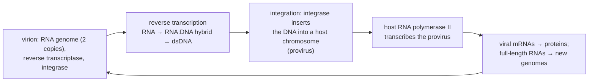
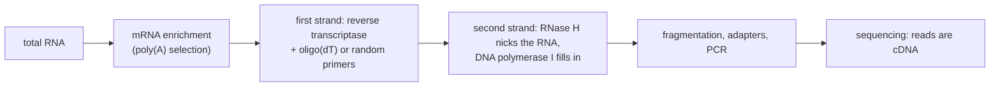

---
aliases:
  - cDNA Synthesis
  - RNA-Dependent DNA Synthesis
  - Transcription inverse
  - Rétrotranscription
tags:
  - type/concept
  - domain/biology
  - domain/bioinformatics
  - level/L2
  - level/L3
mastery: 0
prerequisites:
  - "[[RNA]]"
  - "[[Central Dogma]]"
  - "[[DNA Replication]]"
  - "[[Transcription]]"
  - "[[Messenger RNA]]"
related:
  - "[[Virus]]"
  - "[[Transposable Element]]"
  - "[[RNA Sequencing]]"
  - "[[Sequencing Library Preparation]]"
  - "[[Quantitative Polymerase Chain Reaction]]"
  - "[[Spliced Read Alignment]]"
  - "[[Transcript Quantification]]"
  - "[[Reverse Complement]]"
projects: []
sources:
  - "[[Molecular Biology of the Cell (Alberts)]]"
  - "[[Molecular Cell Biology (Lodish)]]"
  - "[[Crick 1970 - Central Dogma of Molecular Biology]]"
  - "[[Baltimore 1970 - RNA-Dependent DNA Polymerase in Virions of RNA Tumour Viruses]]"
  - "[[Lander 2001 - Initial Sequencing and Analysis of the Human Genome]]"
  - "[[Mortazavi 2008 - Mapping and Quantifying Mammalian Transcriptomes by RNA-Seq]]"
  - "[[Livak 2001 - Analysis of Relative Gene Expression Data Using Real-Time Quantitative PCR]]"
  - "[[Levin 2010 - Comprehensive Comparative Analysis of Strand-Specific RNA Sequencing Methods]]"
  - "[[Galaxy Training Network - Training Material]]"
  - "[[Sanger 1977 - DNA Sequencing with Chain-Terminating Inhibitors]]"
---

# Reverse Transcription

> [!abstract]
> Reverse transcription copies RNA into DNA. Retroviruses use it to turn their RNA genome into DNA that settles in a host chromosome, and laboratories use the same enzyme to turn mRNA into the cDNA that RNA-seq actually sequences.

## Definition

**Reverse transcription** is the synthesis of DNA on an RNA template by a **reverse transcriptase**, an RNA-dependent DNA polymerase. Like other DNA polymerases it extends a primer 5' → 3' and makes a strand complementary and antiparallel to its template; the DNA copy of an mRNA is called **complementary DNA (cDNA)**.[^alberts][^lodish] In the [[Central Dogma]] it is a "special" transfer, RNA → DNA.[^crick70] The enzyme was found in 1970 in the particles of RNA tumour viruses, by Baltimore and, in the same issue of *Nature*, by Temin and Mizutani.[^baltimore]

## Why it matters

- **Every RNA-seq read is a DNA read.** RNA is reverse transcribed, and the cDNA is fragmented, amplified and sequenced ([[RNA Sequencing]], [[Sequencing Library Preparation]]).[^mortazavi][^gtn] RT-qPCR also starts with this step ([[Quantitative Polymerase Chain Reaction]]).[^livak] The biases of reverse transcription (priming, drop-off, strand loss) are written into the data (L3).
- **Strandedness is a property of the library.** Whether a read's orientation tells which genomic strand was transcribed depends on how the cDNA was made, and counting tools must be told ([[Transcript Quantification]]).[^levin][^gtn]
- **Viruses and genomes.** Retroviruses such as HIV insert a DNA copy of their RNA genome into the host chromosome, and retrotransposons, copied through RNA in the same way, make up a large part of the human genome ([[Virus]], [[Transposable Element]]).[^alberts][^lander]

## Core (L2)

### The enzyme and the product

Reverse transcriptase combines three activities: copying RNA into DNA, copying DNA into DNA, and **RNase H**, which degrades the RNA strand of an RNA:DNA hybrid. It needs a primer with a free 3'-OH and has no 3' → 5' proofreading exonuclease, so it makes many more errors than replicative DNA polymerases.[^alberts][^lodish]

The first DNA strand is antiparallel to the RNA (toy sequences, invented):

```text
mRNA template      5'-AUGGCUGAAACUUGAAAAAAAAA-3'
oligo(dT) primer                  3'-TTTTTTTT-5'     anneals to the poly(A) tail
first-strand cDNA  3'-TACCGACTTTGAACTTTTTTTTT-5'     grows from the primer toward the RNA 5' end
```

Read 5' → 3', the first strand is `TTTTTTTTTCAAGTTTCAGCCAT`, the reverse complement of the mRNA in the DNA alphabet: it has the sequence of the gene's template strand ([[Transcription]]). The second strand, made on the first, has the mRNA sequence with T for U. A cDNA is a copy of the **mature** mRNA: it has no introns, which is why genomic DNA and cDNA of the same gene differ.[^alberts]

### In retroviruses

A retrovirus particle carries two copies of its RNA genome together with reverse transcriptase.[^alberts] In the infected cell:



(After [^alberts][^lodish]; the Baltimore classes of reverse-transcribing viruses are in [[Virus#Deeper (L2)]].) The integrated provirus is copied with the host genome at every cell division. The error-prone enzyme produces many variant genomes, one reason HIV evolves fast under drug treatment.[^alberts]

### In genomes: retrotransposons, telomeres, pseudogenes

- **Retrotransposons** move by a "copy and paste" through RNA: their RNA is reverse transcribed and the DNA inserted elsewhere. LINEs encode their own reverse transcriptase; SINEs such as Alu use the LINE machinery.[^lodish][^alberts] Transposon-derived sequences make up about 45% of the human genome: LINEs about 20%, SINEs about 13%, LTR retrotransposons about 8%, DNA transposons about 3%.[^lander]
- **Telomerase** is a reverse transcriptase that carries its own RNA template and extends chromosome ends ([[DNA Replication#Deeper (L2)]]).
- **Processed pseudogenes** are DNA copies of mRNAs inserted back into the genome: no introns, no promoter, often an A-rich stretch at the 3' end.[^alberts][^lodish]

### In the laboratory: cDNA for RNA-seq



Oligo(dT) primes only at the poly(A) tail; random primers anneal anywhere along the RNA.[^alberts][^mortazavi][^gtn] Because the cDNA is spliced, a read spanning an exon-exon junction aligns to the genome in two pieces ([[Spliced Read Alignment]]).

## Advanced (L3)

### Stranded and unstranded libraries

In an unstranded library, both cDNA strands are sequenced equally: a read and its mate say nothing about which genomic strand was transcribed, so overlapping genes on opposite strands cannot be told apart. Strand-specific protocols keep this information. In the **dUTP** method, the second strand is synthesized with dUTP instead of dTTP, which marks it for removal before amplification; Levin and colleagues found it among the best of seven protocols.[^levin] Only first-strand-derived molecules are then sequenced from read 1, so read 1 aligns to the strand **opposite** to the transcript ("reverse" strandedness in counting tools). Pipelines check the setting by aligning a sample of reads to annotated genes and counting orientations (Exercise 4).[^gtn]

### Drop-off and 3' bias (model)

An oligo(dT)-primed enzyme must travel from the poly(A) tail to the 5' end; if it falls off with a constant probability per nucleotide, coverage decays toward the 5' end, more for long transcripts, and a broken RNA is copied only between its 3' end and the break (Mathematical representation, Exercise 3). Random priming spreads starts along the molecule instead. Coverage profiles along transcripts are therefore a quality check of RNA integrity and library protocol.

### Errors and look-alikes

- **RT errors.** Without proofreading, the first strand carries errors. Each error sits in one cDNA molecule, so it appears in a few reads (more after PCR duplication, [[Duplicate Read]]), unlike a heterozygous variant expected in about half of the reads (Exercise 5).
- **Strand jumps in retroviruses.** Retroviral reverse transcription starts on a host tRNA primer and needs two transfers of the growing DNA between ends of the template, which builds the **long terminal repeats** (LTRs) at both ends of the provirus.[^lodish]
- **Processed pseudogenes** look like spliced cDNA: junction reads from the parent gene align contiguously to the pseudogene, and exonic reads map equally well to both loci, so they get low mapping quality or are split between them ([[Read Mapping]]).

## Mathematical representation

Let $\Sigma_R = \{A, C, G, U\}$, $\Sigma_D = \{A, C, G, T\}$, $\upsilon$ the map replacing T by U, and $\operatorname{rc}$ the reverse complement over $\Sigma_D$ ([[Reverse Complement]]). For an RNA $r \in \Sigma_R^n$, the cDNA strands are
$$c_1 = \operatorname{rc}(\upsilon^{-1}(r)), \qquad c_2 = \operatorname{rc}(c_1) = \upsilon^{-1}(r).$$
With $t$ the template strand of a gene and $\tau(t) = \upsilon(\operatorname{rc}(t))$ its transcript ([[Transcription#Mathematical representation]]), $c_1 = \operatorname{rc}(\operatorname{rc}(t)) = t$: reverse transcription returns the template strand (of the exons only, after splicing).

**Drop-off.** Suppose that before adding each nucleotide the enzyme detaches with probability $p$, independently. Starting at the 3' end of an RNA of length $L$, the probability of copying at least $d$ nucleotides is $(1 - p)^d \approx e^{-pd}$, so the coverage at distance $d$ from the 3' end is proportional to $(1-p)^d$, the fraction of full-length first strands is $(1 - p)^L$, and the coverage ratio between the 5' and 3' ends is $(1 - p)^{L-1}$.

**Read orientation.** Let $s$ be the fraction of fragments sequenced from the first strand. An unstranded library has $s = 1/2$; an ideal dUTP library has $s = 1$, so read 1 is antisense to the gene with probability 1. The observed antisense fraction estimates $s$.

**Errors.** With per-base error probability $\varepsilon$ and $n$ independent reads at a site, the number of error reads is $\text{Binomial}(n, \varepsilon)$; a heterozygous variant gives $\text{Binomial}(n, 1/2)$. Duplicates break the independence assumption.

## Computational representation

Sequence files hold cDNA reads; the transcript sequence is the second strand. A drop-off model reproduces 3' bias:

```python
import random

COMPLEMENT = str.maketrans("ACGT", "TGCA")


def reverse_complement(dna: str) -> str:
    return dna.translate(COMPLEMENT)[::-1]


def first_strand(rna: str) -> str:
    """First-strand cDNA, written 5'->3': reverse complement of the RNA in the DNA alphabet."""
    return reverse_complement(rna.replace("U", "T"))


def oligo_dt_coverage(length: int, p_off: float, n_molecules: int, seed: int = 1) -> list[int]:
    """Per-position coverage (index 0 = RNA 5' end) of first strands primed at the 3' end.
    Before each added nucleotide, the enzyme falls off with probability p_off."""
    rng = random.Random(seed)
    cover = [0] * length
    for _ in range(n_molecules):
        pos = length - 1                         # synthesis starts at the 3' end of the RNA
        while pos >= 0 and rng.random() >= p_off:
            cover[pos] += 1
            pos -= 1
    return cover


mrna = "AUGGCUGAAACUUGAAAAAAAAA"                 # invented spliced mRNA with a short poly(A) tail
c1 = first_strand(mrna)
c2 = reverse_complement(c1)                       # second strand = mRNA sequence written with T
print(c1, c2, c2.replace("T", "U") == mrna)

cov = oligo_dt_coverage(2000, 1e-3, 5000)       # invented drop-off rate, 2,000-nt transcript
print([cov[i] for i in (0, 500, 1000, 1500, 1999)])
print(round(cov[0] / cov[-1], 3), round((1 - 1e-3) ** 1999, 3))
```

```text
TTTTTTTTTCAAGTTTCAGCCAT ATGGCTGAAACTTGAAAAAAAAA True
[678, 1141, 1870, 3059, 4997]
0.136 0.135
```

The simulated 5'/3' coverage ratio matches the formula $(1-p)^{L-1}$. Real drop-off is not constant along a molecule (secondary structure, modified bases), which is why observed profiles are compared between samples rather than to a formula.

## Worked example

> [!example] From a spliced mRNA to reads on the genome (invented sequences)
> The pre-mRNA `AUGGCUGGUAAGUAUCCUUUCAGAAACUUGA` of [[Transcription#Exercises|Transcription, Exercise 4]] is spliced (exons 0-7 and 23-31) and polyadenylated: `AUGGCUGAAACUUGA` + `AAAAAAAA`.
> 1. **First strand** (oligo(dT) primer): `TTTTTTTTTCAAGTTTCAGCCAT`, the reverse complement of the mRNA.
> 2. **Second strand**: `ATGGCTGAAACTTGAAAAAAAAA`, the mRNA with T.
> 3. **Back to the genome** `ATGGCTGGTAAGTATCCTTTCAGAAACTTGA`: the first 7 bases match genome positions 0-7, the next 8 match 23-31; the poly(A) matches nothing. A read covering the junction must be split across the intron, and the tail soft-clipped.
> 4. **Strand of a read.** In a dUTP library, read 1 comes from the first strand: it reads `...CAAGTTTCAGCCAT` and aligns to the `-` strand of this `+` gene.

## Common misconceptions

> [!warning] "RNA-seq sequences RNA"
> Short-read RNA-seq sequences cDNA. Every step of making it (priming, reverse transcription, second-strand synthesis, PCR) shapes the counts, which is why library protocol is part of the metadata.[^mortazavi][^levin]

> [!warning] "Reverse transcription disproves the central dogma"
> Crick's statement already listed RNA → DNA as a possible special transfer; what the dogma forbids is information flowing out of protein.[^crick70] See [[Central Dogma]].

> [!warning] "A read's orientation shows the gene's strand"
> Only in a stranded library, and then often reversed: with the dUTP method, read 1 is antisense to the transcript.[^levin] In an unstranded library, orientation is random.

## Exercises

> [!question] Exercise 1 (L2)
> Give the first-strand cDNA of `5'-AUGCCGUAAAAAA-3'` primed with oligo(dT), written 5' → 3', and the second strand. Which strand of the gene does each resemble?

> [!success]- Solution
> First strand: reverse complement in the DNA alphabet, `TTTTTTACGGCAT`. Second strand: `ATGCCGTAAAAAA`, the mRNA with T. The first strand has the template-strand sequence, the second the coding-strand sequence (exons only). Checked with `first_strand` and `reverse_complement`.

> [!question] Exercise 2 (L2)
> A nucleotide analogue lacking a 3'-OH is accepted by reverse transcriptase. Predict its effect on cDNA synthesis, and why it can act against a retrovirus without stopping transcription of the host genome.

> [!success]- Solution
> A polymerase adds each nucleotide to the 3'-OH of the growing chain; an analogue without it ends the chain, the principle of chain-terminating inhibitors.[^sanger] Host transcription is not reverse transcription: the cell has no need to copy its own RNA into DNA for its genes, so an analogue preferentially used by the viral enzyme interferes with the virus's RNA → DNA step.

> [!question] Exercise 3 (L3, Python)
> With an invented drop-off probability $p = 10^{-3}$ per nucleotide, compute the fraction of full-length first strands for transcripts of 500, 2,000 and 8,000 nt. A 2,000-nt RNA is broken 600 nt upstream of its poly(A) tail: what fraction of oligo(dT)-primed cDNAs reach the break, and what coverage does the 5' part receive?

> [!success]- Solution
> ```python
> for L in (500, 2000, 8000):
>     print(L, round((1 - 1e-3) ** L, 4))
> print("degraded, 2000 nt cut at 600 nt from 3' end:", round((1 - 1e-3) ** 600, 3))
> ```
> ```text
> 500 0.6064
> 2000 0.1352
> 8000 0.0003
> degraded, 2000 nt cut at 600 nt from 3' end: 0.549
> ```
> Long transcripts are rarely copied to their 5' end. In the broken RNA, 55% of cDNAs reach the break, but the 1,400 nt upstream of it get no coverage at all from oligo(dT) priming: degradation turns into an extreme 3' bias.

> [!question] Exercise 4 (L3, Python)
> Invented counts of read 1 alignments over annotated genes: gene `+` / read `+`: 412; gene `+` / read `-`: 9,381; gene `-` / read `+`: 8,790; gene `-` / read `-`: 377. Infer the library type.

> [!success]- Solution
> ```python
> counts = {("+", "+"): 412, ("+", "-"): 9381, ("-", "+"): 8790, ("-", "-"): 377}
> same = counts[("+", "+")] + counts[("-", "-")]
> opposite = counts[("+", "-")] + counts[("-", "+")]
> frac_opposite = opposite / (same + opposite)
> kind = ("reverse-stranded (dUTP-like)" if frac_opposite > 0.9 else
>         "forward-stranded" if frac_opposite < 0.1 else "unstranded or mixed")
> print(round(frac_opposite, 3), kind)
> ```
> ```text
> 0.958 reverse-stranded (dUTP-like)
> ```
> 95.8% of reads are antisense to their gene: a reverse-stranded library, $\hat{s} \approx 0.96$. Counting with the wrong setting would assign most reads to nothing, or to antisense genes. The 0.1 and 0.9 cut-offs are a convention of this exercise.

> [!question] Exercise 5 (L3, Python)
> At a site covered by 40 independent reads, assume an invented combined error rate (reverse transcription plus sequencing) of $10^{-3}$ per base. Compute the probability of at least 1, 3 and 19 mismatching reads by error alone, and the probability that a heterozygous variant shows at least 10 alternative reads. Why can PCR duplicates mislead this test?

> [!success]- Solution
> ```python
> from math import comb
>
>
> def binom_tail(n: int, k: int, p: float) -> float:
>     """P(X >= k) for X ~ Binomial(n, p)."""
>     return sum(comb(n, i) * p ** i * (1 - p) ** (n - i) for i in range(k, n + 1))
>
>
> eps = 1e-3   # invented per-base error rate of RT plus sequencing, for illustration
> for k in (1, 3, 19):
>     print(k, f"{binom_tail(40, k, eps):.2e}")
> print("het variant, >= 10 alt reads:", round(binom_tail(40, 10, 0.5), 6))
> ```
> ```text
> 1 3.92e-02
> 3 9.61e-06
> 19 1.29e-46
> het variant, >= 10 alt reads: 0.99966
> ```
> One mismatching read is common (4%), 19 of 40 cannot be error: it looks like a heterozygous site. But duplicates are copies of one cDNA: an RT error copied by PCR into ten reads is one event, not ten, so duplicates must be collapsed before applying a binomial model ([[Duplicate Read]], [[Variant Calling]]).

## Mastery checklist

- [ ] 1 Recognized: I can define reverse transcriptase, cDNA, provirus and retrotransposon.
- [ ] 2 Understood: I can explain the orientation of first- and second-strand cDNA, the retroviral cycle, and why cDNA lacks introns.
- [ ] 3 Practiced: I can compute cDNA strands, model drop-off and 3' bias, and infer library strandedness in Python.
- [ ] 4 Applied: on a public RNA-seq dataset, I determined the strandedness, checked coverage profiles along transcripts and set the counting options accordingly.
- [ ] 5 Explained: I can teach how reverse transcription shapes RNA-seq data (priming, strand, errors, duplicates) and how retrotransposition shaped genomes.

## References

[^alberts]: [[Molecular Biology of the Cell (Alberts)]], 4th ed. (2002), treatment of retroviruses and reverse transcriptase, retrotransposons and processed pseudogenes, and cDNA synthesis for cloning.
[^lodish]: [[Molecular Cell Biology (Lodish)]], 4th ed. (2000), treatment of retroviruses (tRNA primer, strand transfers, long terminal repeats) and of LINEs and SINEs.
[^crick70]: [[Crick 1970 - Central Dogma of Molecular Biology]], *Nature* 227:561-563.
[^baltimore]: [[Baltimore 1970 - RNA-Dependent DNA Polymerase in Virions of RNA Tumour Viruses]], *Nature* 226:1209-1211; companion paper by Temin and Mizutani, *Nature* 226:1211-1213.
[^lander]: [[Lander 2001 - Initial Sequencing and Analysis of the Human Genome]], *Nature* 409:860-921, analysis of transposon-derived repeats.
[^mortazavi]: [[Mortazavi 2008 - Mapping and Quantifying Mammalian Transcriptomes by RNA-Seq]], *Nature Methods* 5:621-628.
[^livak]: [[Livak 2001 - Analysis of Relative Gene Expression Data Using Real-Time Quantitative PCR]], *Methods* 25:402-408.
[^levin]: [[Levin 2010 - Comprehensive Comparative Analysis of Strand-Specific RNA Sequencing Methods]], *Nature Methods* 7:709-715.
[^gtn]: [[Galaxy Training Network - Training Material]], topic "Transcriptomics" (reference-based RNA-seq: library preparation and strandedness).
[^sanger]: [[Sanger 1977 - DNA Sequencing with Chain-Terminating Inhibitors]], *PNAS* 74:5463-5467.
