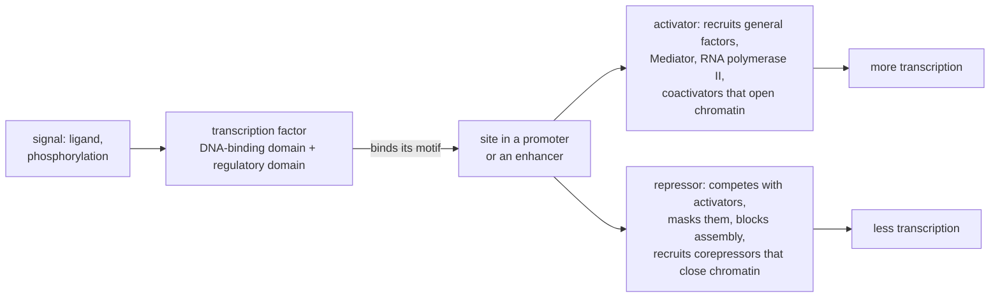

---
aliases:
  - TF
  - Gene Regulatory Protein
  - Sequence-Specific DNA-Binding Protein
  - Facteur de transcription
tags:
  - type/concept
  - domain/biology
  - domain/bioinformatics
  - level/L2
  - level/L3
  - level/M1
mastery: 0
prerequisites:
  - "[[DNA]]"
  - "[[Transcription]]"
  - "[[Promoter]]"
  - "[[Gene Regulation]]"
  - "[[Sequence Motif]]"
related:
  - "[[Enhancer]]"
  - "[[Chromatin]]"
  - "[[Operon]]"
  - "[[Position Weight Matrix]]"
  - "[[Sequence Logo]]"
  - "[[Motif Finding]]"
  - "[[ChIP-Seq]]"
  - "[[Protein Domain]]"
  - "[[Two-State Model]]"
  - "[[Boltzmann Distribution]]"
  - "[[Cooperativity]]"
  - "[[Gene Regulatory Network]]"
projects: []
sources:
  - "[[Molecular Biology of the Cell (Alberts)]]"
  - "[[Molecular Cell Biology (Lodish)]]"
  - "[[Biology 2e (OpenStax)]]"
  - "[[Das 2007 - A Survey of DNA Motif Finding Algorithms]]"
  - "[[Bioinformatics Algorithms (Compeau)]]"
  - "[[Lambert 2018 - The Human Transcription Factors]]"
  - "[[Johnson 2007 - Genome-Wide Mapping of in Vivo Protein-DNA Interactions]]"
  - "[[MIT 6.047 - Computational Biology]]"
  - "[[MIT 8.591J - Systems Biology]]"
---

# Transcription Factor

> [!abstract]
> A transcription factor is a protein that binds a short DNA sequence near a gene and turns its transcription up or down. It reads the sequence from the grooves of the double helix, then recruits or blocks the transcription machinery.

## Definition

A **transcription factor** (TF), or gene regulatory protein, is a protein that binds DNA at specific sequences and thereby activates or represses the transcription of nearby genes.[^alberts][^os16] Its preferred sites share a short, degenerate sequence pattern, a **motif** ([[Sequence Motif]]).[^das] Sequence-specific factors differ from the **general transcription factors**, which assemble on core promoters of all genes transcribed by RNA polymerase II ([[Promoter]]); in bacteria, repressors and activators such as the Lac repressor and CAP play the same role ([[Operon]]).[^alberts]

## Why it matters

- **Motif scanning.** A factor's binding preference is stored as a [[Position Weight Matrix]] and drawn as a [[Sequence Logo]]; scanning genomes with such matrices proposes candidate binding sites.[^compeau] More than 1,600 likely human TFs have been catalogued, with motifs known for about two-thirds of them.[^lambert]
- **In vivo binding maps.** ChIP-seq located the binding of the repressor NRSF (REST) at 1,946 places in the human genome with about ±50 bp resolution, enough to find its motif inside the peaks ([[ChIP-Seq]]).[^johnson]
- **Motif discovery.** Motifs shared by co-regulated promoters, or conserved across species, reveal unknown binding sites ([[Motif Finding]]).[^das][^mit6047]
- **Variants and networks.** A substitution in a binding site changes its score, and possibly its occupancy (Worked example); factors and their targets form [[Gene Regulatory Network|gene regulatory networks]].[^mit6047]

## Core (L2)

### Reading DNA without opening it

Each base pair exposes a distinct pattern of hydrogen-bond donors, acceptors and methyl groups in the major groove, so a protein can read the sequence without separating the strands ([[DNA#Deeper (L2)]]).[^alberts] A typical DNA-binding domain inserts an α-helix into the major groove and makes many contacts with base edges and backbone; each contact is weak, and together they make binding tight and specific.[^alberts] DNA-binding domains fall into a few structural families:[^alberts][^lodish]

| Structural family | Feature | Examples |
|---|---|---|
| Helix-turn-helix | two α-helices; one, the recognition helix, lies in the major groove | many bacterial repressors and activators |
| Homeodomain | a helix-turn-helix within a 60-residue domain | regulators of animal development |
| Zinc finger | small units folded around a zinc ion, often in tandem | a large family of eukaryotic factors |
| Leucine zipper (bZIP) | a coiled coil dimerizes two DNA-binding helices | dimeric eukaryotic factors |
| Helix-loop-helix (bHLH) | two helices joined by a loop, dimerizing | dimeric eukaryotic factors |

**Dimers and half-sites.** Many factors bind as dimers, each subunit reading a half-site, so their sites are often palindromic or spaced dyads ([[Reverse Complement]]).[^alberts][^das] Dimerization doubles the length of DNA read, and heterodimers combine half-site preferences, which multiplies the repertoire.[^alberts]

**Graded preference.** A factor binds its best sequence most tightly and many variants less tightly, so a motif is a probability profile, not a single word.[^compeau] In the logo below, each letter's height is its probability times the information content of the position:

![[toy-motif-sequence-logo.svg]]

### Activators and repressors

Eukaryotic factors are modular: a DNA-binding domain places the protein, and a separate regulatory domain acts on transcription; the DNA-binding domain of one factor can be fused to the activation domain of another.[^alberts]



(After [^alberts][^os16].) Activators bound at promoter-proximal sites or distant [[Enhancer|enhancers]] help assemble the transcription machinery and recruit coactivators such as histone acetyltransferases and chromatin-remodeling complexes. Repressors compete for overlapping sites, mask activation domains, interact with general factors, or recruit histone deacetylases and other enzymes that compact [[Chromatin]].[^alberts]

**Controlling the controllers.** A factor's activity is itself regulated: by ligand binding (nuclear hormone receptors), phosphorylation, release from an inhibitor, or entry into the nucleus.[^alberts] And several factors act together on each gene (combinatorial control), so the same factor can have different effects in different cells ([[Gene Regulation]]).[^alberts]

## Advanced (L3)

- **Binding is probabilistic.** At equilibrium, a site is occupied a fraction of the time that rises with the factor's concentration and with affinity, as in a [[Two-State Model]] (Mathematical representation). Cooperative binding of several factors, or of a dimer, sharpens the response into a switch ([[Cooperativity]], [[Hill Function]]).[^mit8591]
- **A motif match is not a bound site.** An 8-bp motif like the toy one matches a human-sized genome by chance hundreds of thousands of times even at stringent thresholds (Exercise 4), whereas NRSF, with a longer motif, was bound at 1,946 locations.[^johnson] In cells, binding also depends on chromatin accessibility, on partner factors, and on concentration;[^alberts] and some bound sites carry noncanonical motifs.[^johnson] Motif scans propose; binding data decide.
- **From peaks to motifs.** ChIP-seq peaks give many bound sequences (1,946 for NRSF); searching them for over-represented patterns, or comparing orthologous regions (phylogenetic footprinting), recovers motifs without prior knowledge.[^das][^johnson] Algorithms (greedy, Gibbs sampling, expectation-maximization) are in [[Motif Finding]].[^compeau]

## Frontier (M1)

- **Coverage of the catalogue.** With more than 1,600 likely human TFs and motifs for about two-thirds,[^lambert] about a third of the factors have no motif to scan for, and a motif enriched in a dataset must still be matched to a factor among those with similar preferences. Record the catalogue version used.
- **From sequence to occupancy.** Under the assumption that each position adds independently to the binding energy, log-odds scores become energies and a score difference becomes a concentration ratio (Exercise 5). The independence assumption cannot represent dependencies between positions; models that allow them, up to [[Convolutional Neural Network|convolutional networks]], are part of [[Motif Finding]].
- **Networks.** Regulatory genomics combines motifs, binding and expression to infer which factor controls which gene ([[Gene Regulatory Network Inference]]).[^mit6047]

## Mathematical representation

**Occupancy.** For a factor F and a site S, $\mathrm{F} + \mathrm{S} \rightleftharpoons \mathrm{FS}$ with dissociation constant $K_d = [\mathrm{F}][\mathrm{S}]/[\mathrm{FS}]$. The fraction of time the site is bound is
$$\theta = \frac{[\mathrm{F}]}{[\mathrm{F}] + K_d} = \frac{1}{1 + e^{(\Delta G - \mu)/k_BT}},$$
where $\Delta G = k_BT \ln(K_d/c_0)$ is the binding free energy relative to a standard concentration $c_0$ and $\mu = k_BT \ln([\mathrm{F}]/c_0)$ the factor's chemical potential ([[Boltzmann Distribution]]). $\theta = 1/2$ when $[\mathrm{F}] = K_d$. With $n$ cooperative sites, $\theta \approx [\mathrm{F}]^n / ([\mathrm{F}]^n + K^n)$.

**Position weight matrix.** From $N$ aligned sites of length $k$, with $N_{i,b}$ the count of base $b$ at position $i$, pseudocount $\alpha$ and background frequency $q_b$:
$$p_{i,b} = \frac{N_{i,b} + \alpha}{N + 4\alpha}, \qquad W_{i,b} = \log_2 \frac{p_{i,b}}{q_b}, \qquad S(x) = \sum_{i=1}^{k} W_{i, x_i},$$
and the information content of position $i$ (uniform background) is $\mathrm{IC}_i = 2 + \sum_b p_{i,b} \log_2 p_{i,b}$ bits ([[Shannon Entropy]]).[^compeau]

**Chance matches.** If $P_0(S \ge t)$ is the probability that a random $k$-mer drawn from the background scores at least $t$, a genome of length $L$ scanned on both strands has about $2L\,P_0(S \ge t)$ chance matches.

**Scores as energies (model).** If site probabilities follow Boltzmann weights, $p_{i,b} \propto q_b\, e^{-\varepsilon_{i,b}/k_BT}$, then $W_{i,b} \ln 2 = -\varepsilon_{i,b}/k_BT + \text{const}$: one bit of score is worth $\ln 2\, k_BT$ of binding energy, and two sites whose scores differ by $\Delta S$ bits need concentrations differing by a factor $2^{\Delta S}$ for equal occupancy.

## Computational representation

A PWM from aligned sites (the invented sites of the logo), then a scan of both strands:

```python
import math

SITES = ["ATGACGTA", "ATGACGTC", "GTGACGTA", "ATGACGCA", "ATGACTTA",   # invented binding sites,
         "CTGACGTA", "ATGACGTA", "ATTACGTA", "TTGACGTG", "ATGACGTA"]   # aligned, 5' -> 3'
BASES = "ACGT"
COMPLEMENT = str.maketrans("ACGT", "TGCA")


def reverse_complement(dna: str) -> str:
    return dna.translate(COMPLEMENT)[::-1]


def pwm(sites: list[str], pseudocount: float = 0.5, background: float = 0.25):
    """Probability profile and log2-odds matrix (one dict per position) from aligned sites."""
    n = len(sites)
    probs, weights = [], []
    for column in zip(*sites):
        p = {b: (column.count(b) + pseudocount) / (n + 4 * pseudocount) for b in BASES}
        probs.append(p)
        weights.append({b: math.log2(p[b] / background) for b in BASES})
    return probs, weights


def information_content(p: dict[str, float]) -> float:
    """Bits relative to a uniform background: 2 - Shannon entropy of the column."""
    return 2 + sum(v * math.log2(v) for v in p.values())


def score(word: str, weights) -> float:
    return sum(w[b] for w, b in zip(weights, word))


def scan(seq: str, weights, threshold: float):
    """Yield (0-based start, strand, site, score) for windows scoring >= threshold on either strand."""
    k = len(weights)
    for i in range(len(seq) - k + 1):
        word = seq[i:i + k]
        for strand, w in (("+", word), ("-", reverse_complement(word))):
            s = score(w, weights)
            if s >= threshold:
                yield i, strand, w, round(s, 2)


probs, weights = pwm(SITES)
print("consensus:", "".join(max(p, key=p.get) for p in probs))
print("IC (bits):", [round(information_content(p), 2) for p in probs])
best = sum(max(w.values()) for w in weights)
print("max score:", round(best, 2))
promoter = "GGCTACGTCATTTACCATGACGTAAGGCTTTGACGTCGA"     # invented sequence to scan
for hit in scan(promoter, weights, threshold=8.0):
    print(hit)
```

```text
consensus: ATGACGTA
IC (bits): [0.45, 1.26, 0.98, 1.26, 1.26, 0.98, 0.98, 0.71]
max score: 13.24
(3, '-', 'ATGACGTA', 13.24)
(16, '+', 'ATGACGTA', 13.24)
(29, '+', 'TTGACGTC', 8.41)
```

The window at 3 reads `TACGTCAT` on `+`: a perfect site on the other strand. The threshold of 8 bits is a choice; real pipelines calibrate it against the background distribution (Exercise 4).

## Worked example

> [!example] Does a variant weaken a binding site? (invented data, toy energy model)
> A variant changes the reference site `ATGACGTA` into `ATGATGTA` (position 5, C → T).
> 1. **Score change.** Only position 5 changes. Its column has C in all 10 sites: $p_C = 10.5/12 = 0.875$ and $p_T = 0.5/12 \approx 0.042$, so $\Delta S = \log_2(p_C/p_T) = \log_2 21 \approx 4.39$ bits. The code gives 13.24 and 8.84.
> 2. **Occupancy.** With the model $\Delta G = -S \ln 2\; k_BT$, `occupancy(s, mu) = 1 / (1 + exp(-s * ln 2 - mu))` gives, at $\mu = -12\,k_BT$ (low factor concentration), 0.056 for the reference and 0.003 for the variant; at $\mu = -8\,k_BT$, 0.764 and 0.133.
> 3. **Interpretation.** The same variant cuts occupancy 19-fold when the factor is scarce and 6-fold when it is abundant: its effect depends on the cell's factor concentration, and on whether the site is accessible at all. The score difference alone is a hypothesis about function.

## Common misconceptions

> [!warning] "A motif match is a binding site"
> Chance matches outnumber bound sites by orders of magnitude (Exercise 4); in vivo binding also needs accessible chromatin and partners.[^alberts][^johnson]

> [!warning] "The consensus sequence is the binding site"
> The consensus is the most likely letter at each position. Real sites deviate from it and are bound with graded affinities, which is why matrices replace words.[^compeau]

> [!warning] "A transcription factor is an activator or a repressor"
> The effect depends on context: partners, the site's position and the cell type. Control is combinatorial.[^alberts]

> [!warning] "General transcription factors are transcription factors like the others"
> General factors (TFIID, TFIIB, ...) assemble at core promoters of essentially all RNA polymerase II genes; sequence-specific factors decide which genes, and when.[^alberts]

## Exercises

> [!question] Exercise 1 (L2)
> Classify as sequence-specific activator, sequence-specific repressor, general transcription factor, or none: (a) the Lac repressor; (b) CAP bound to cAMP; (c) TFIID; (d) NRSF (REST); (e) RNA polymerase II.

> [!success]- Solution
> (a) Repressor ([[Operon]]). (b) Activator. (c) General factor: its TBP subunit binds the TATA box of many promoters. (d) Repressor: neuron-restrictive silencer factor.[^johnson] (e) None: the enzyme that transcribes, positioned by the factors.[^alberts]

> [!question] Exercise 2 (L2)
> A factor binds as a symmetric homodimer, each subunit reading 3 bp. Why is its site a reverse palindrome of 6 bp, and how many such sites exist? What does a heterodimer change?

> [!success]- Solution
> The two subunits face opposite directions, so each reads its half-site on a different strand: the site equals its reverse complement ([[DNA#Mathematical representation]]). A 6-bp reverse palindrome is fixed by its first 3 bases, so there are $4^3 = 64$ possible sites. A heterodimer combines two different half-site preferences, giving asymmetric sites and more combinations from the same set of monomers.[^alberts][^das]

> [!question] Exercise 3 (L2)
> For each case, name the repression mechanism: (a) a repressor's site overlaps an activator's site; (b) a repressor bound next to an activator covers its activation domain; (c) a repressor recruits a histone deacetylase; (d) the Lac repressor on its operator.

> [!success]- Solution
> (a) Competitive DNA binding. (b) Masking of the activation surface. (c) Chromatin compaction through a corepressor. (d) Steric block of RNA polymerase at the promoter.[^alberts]

> [!question] Exercise 4 (L3, Python)
> With `score` and `weights` from above, enumerate all $4^8$ words of length 8 and compute the fraction scoring at least 6, 8 and 10 bits under a uniform background. How many chance matches does that predict on both strands of a $3.055 \times 10^9$ bp genome ([[DNA]])?

> [!success]- Solution
> ```python
> from itertools import product
>
> scores = [score("".join(w), weights) for w in product(BASES, repeat=len(weights))]
> for t in (6.0, 8.0, 10.0):
>     frac = sum(s >= t for s in scores) / len(scores)
>     print(t, f"{frac:.2e}", round(2 * 3.055e9 * frac))
> ```
> ```text
> 6.0 2.58e-03 15756073
> 8.0 7.02e-04 4288635
> 10.0 1.37e-04 839081
> ```
> Even at 10 bits, close to the 13.24-bit maximum, about 840,000 chance matches are expected; NRSF, for comparison, was bound at 1,946 locations.[^johnson] Real genomes are not uniform, so the background should match the genome's composition, but the conclusion holds.

> [!question] Exercise 5 (M1, Python)
> With the toy energy model, find the chemical potential $\mu$ (in $k_BT$) at which the reference and variant sites of the Worked example are half occupied, and the fold change in factor concentration needed to bind the variant as well as the reference.

> [!success]- Solution
> ```python
> s_ref, s_alt = score("ATGACGTA", weights), score("ATGATGTA", weights)
> for name, s in (("reference", s_ref), ("variant", s_alt)):
>     mu_half = -s * math.log(2)                  # occupancy is 1/2 when mu equals the binding energy
>     print(name, round(s, 2), round(mu_half, 2))
> print("fold TF concentration for equal occupancy:", round(2 ** (s_ref - s_alt), 1))
> ```
> ```text
> reference 13.24 -9.17
> variant 8.84 -6.13
> fold TF concentration for equal occupancy: 21.0
> ```
> Since $\mu = k_BT \ln([\mathrm{F}]/c_0)$, a shift of $3.04\,k_BT$ is a factor $e^{3.04} = 2^{4.39} \approx 21$ in concentration: exactly the probability ratio $p_C/p_T$ of the changed position. Under this model, a PWM column is a table of relative affinities.

## Mastery checklist

- [ ] 1 Recognized: I can define transcription factor, motif, binding site, activator, repressor and general transcription factor.
- [ ] 2 Understood: I can explain recognition in the major groove, the main DNA-binding families, dimeric half-sites, and the mechanisms of activation and repression.
- [ ] 3 Practiced: I can build a PWM with pseudocounts, compute information content, scan both strands and estimate chance matches in Python.
- [ ] 4 Applied: I scanned real ChIP-seq peaks with a published matrix and compared motif enrichment in peaks against background regions.
- [ ] 5 Explained: I can teach why motif matches overestimate binding, how occupancy depends on concentration and affinity, and the limits of the independence assumption.

## References

[^alberts]: [[Molecular Biology of the Cell (Alberts)]], 4th ed. (2002), treatment of gene regulatory proteins: DNA recognition in the major groove, DNA-binding motifs, dimerization, modular activators, mechanisms of activation and repression, regulation of regulatory proteins, combinatorial control.
[^lodish]: [[Molecular Cell Biology (Lodish)]], 4th ed. (2000), treatment of eukaryotic transcription factors and their DNA-binding domains.
[^os16]: [[Biology 2e (OpenStax)]], ch. 16 "Gene Expression" (transcription factors, activators and repressors in eukaryotic transcriptional control).
[^das]: [[Das 2007 - A Survey of DNA Motif Finding Algorithms]], *BMC Bioinformatics* 8(Suppl 7):S21.
[^compeau]: [[Bioinformatics Algorithms (Compeau)]], chapter "Which DNA Patterns Play the Role of Molecular Clocks?" (motif finding: count and profile matrices, pseudocounts, entropy, motif logos).
[^lambert]: [[Lambert 2018 - The Human Transcription Factors]], *Cell* 172:650-665.
[^johnson]: [[Johnson 2007 - Genome-Wide Mapping of in Vivo Protein-DNA Interactions]], *Science* 316:1497-1502.
[^mit6047]: [[MIT 6.047 - Computational Biology]], networks part: motifs, regulatory genomics.
[^mit8591]: [[MIT 8.591J - Systems Biology]], lecture "Input Function, Michaelis-Menten Kinetics, and Cooperativity".
