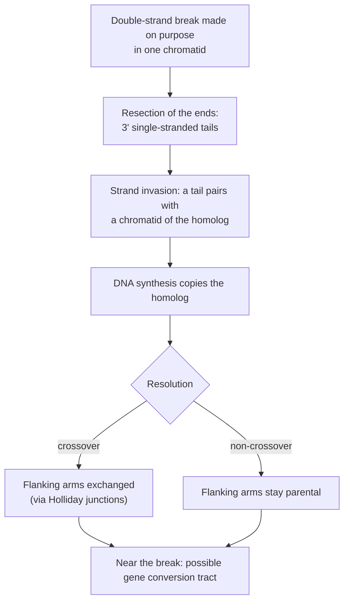

---
aliases:
  - Recombination
  - Meiotic Recombination
  - Crossing Over
  - Crossover
  - Recombination Frequency
  - Recombination Fraction
  - Recombinaison génétique
  - Enjambement
tags:
  - type/concept
  - domain/biology
  - domain/bioinformatics
  - level/L2
  - level/L3
  - level/M1
mastery: 0
prerequisites:
  - "[[Meiosis]]"
  - "[[Chromosome]]"
  - "[[Allele]]"
  - "[[Mendelian Inheritance]]"
  - "[[Binomial Distribution]]"
related:
  - "[[Genetic Linkage]]"
  - "[[Haplotype]]"
  - "[[Linkage Disequilibrium]]"
  - "[[Haplotype Phasing]]"
  - "[[Trio Analysis]]"
  - "[[DNA Repair]]"
  - "[[V(D)J Recombination]]"
  - "[[Independence (Probability)]]"
  - "[[Ancestral Recombination Graph]]"
projects: []
sources:
  - "[[An Introduction to Genetic Analysis (Griffiths)]]"
  - "[[Biology 2e (OpenStax)]]"
  - "[[Molecular Biology of the Cell (Alberts)]]"
  - "[[Principles of Population Genetics (Hartl)]]"
  - "[[MIT 7.03 - Genetics]]"
  - "[[Lander 2001 - Initial Sequencing and Analysis of the Human Genome]]"
  - "[[Baudat 2010 - PRDM9 Is a Major Determinant of Meiotic Recombination Hotspots in Humans and Mice]]"
---

# Genetic Recombination

> [!abstract]
> Recombination gives gametes new combinations of a parent's alleles: whole chromosomes are shuffled at meiosis, and crossing over swaps segments between homologous chromosomes, so each generation inherits a fresh mosaic of its grandparents' DNA.

## Definition

**Genetic recombination** is the production of gametes, or offspring, carrying combinations of alleles absent from the parental chromosomes. In meiosis it has two sources: the independent assortment of non-homologous chromosomes, and **crossing over**, a reciprocal exchange of segments between non-sister chromatids of homologous chromosomes.[^griffiths][^os13] For two loci, a gamete with a new combination is **recombinant** and one that keeps a parental combination is **parental**; the **recombination frequency** $r$ (or recombination fraction) is the proportion of recombinant gametes. It ranges from 0, for loci that never separate, to 0.5, for loci that assort independently.[^os13]

## Why it matters

- **Each inherited chromosome is a mosaic** of the parent's two homologs, switching at crossover points. In family sequencing data the switches locate individual crossovers (Computational representation), and [[Haplotype Phasing]] and [[Trio Analysis]] must allow for them.
- **Recombination frequency is the raw material of genetic maps** in centimorgans, which ordered genes along chromosomes long before sequencing and which linkage studies use to locate disease genes ([[Genetic Linkage]]).[^os13]
- **It erodes associations between alleles** at a speed set by $r$. The associations that survive between close variants ([[Linkage Disequilibrium]], [[Haplotype|haplotypes]]) are what imputation and the [[Genome-Wide Association Study]] rely on.[^hartl]
- **It is a source of variation**, with mutation, on which selection acts ([[Mutation]], [[Natural Selection]]).[^mit703]
- **Its rate varies along the genome**, so genetic and physical distances are not interchangeable.[^lander]

## Core (L2)

### Two ways to make new combinations

[[Meiosis]] recombines in two ways; which one applies depends on where the loci are.[^griffiths]

| Loci | Mechanism | Recombination frequency |
|---|---|---|
| On different chromosomes | Random orientation of each homolog pair at metaphase I | $r = 1/2$ |
| Far apart on one chromosome | Crossovers between them in nearly every meiosis | $r$ close to $1/2$ |
| Close on one chromosome | Only when a crossover falls between them | $0 \le r < 1/2$ |

### Crossing over involves four chromatids

Crossing over takes place in prophase I, after DNA replication, when each homolog is made of two sister chromatids; an exchange involves one chromatid of each homolog.[^griffiths][^os13] One crossover between loci A and B therefore yields two recombinant and two parental products:

![[crossing-over-four-chromatids.svg]]

Two consequences follow (proved in [[Meiosis#Mathematical representation]]):

1. **$r$ never exceeds 1/2.** Even with a crossover between A and B in every meiosis, only half of the products are recombinant.
2. **$r$ counts products, not crossovers.** Two crossovers between A and B on the same two chromatids restore the parental combination (second row of the figure). The farther apart two loci are, the more crossovers between them go unseen, which is why [[Genetic Linkage|genetic maps]] add up short intervals and correct long ones.

### Measuring r with a test cross

Cross a double heterozygote with a double recessive tester (`aabb`). The tester gives only `a` and `b`, so each offspring's phenotype reveals the gamete it received from the heterozygote, and $r$ is the fraction of offspring in the recombinant classes.[^griffiths][^os13] Which classes are recombinant depends on the **phase** of the heterozygote:[^griffiths]

| Phase | Chromosomes of the heterozygote | Produced by | Recombinant gametes |
|---|---|---|---|
| Coupling (cis) | `A B` and `a b` | `AABB` x `aabb` | `Ab`, `aB` |
| Repulsion (trans) | `A b` and `a B` | `AAbb` x `aaBB` | `AB`, `ab` |

When the phase is unknown, the data reveal it: as long as $r < 1/2$, the two most frequent classes are the parental ones.

### Reshuffling every generation

A diploid received one homolog of each pair from each parent. In its gametes, each chromosome carries a run of grandpaternal alleles, then, past a crossover, a run of grandmaternal ones, and crossovers fall at new positions in every meiosis. Together with the independent assortment of chromosomes, this breaks up the previous generation's combinations each time gametes are made.[^griffiths] In a population, associations between alleles at two loci therefore decay generation after generation, at a speed set by $r$ (Mathematical representation).[^hartl] Recombination creates no new allele at any site, which is the role of [[Mutation]]: it creates new combinations of existing alleles across sites.

## Advanced (L3)

### The molecular mechanism

A meiotic crossover is the repair of a deliberate break.[^alberts]



Because the broken chromatid copies the homolog, the region around the break can end up with the homolog's sequence: a short, non-reciprocal transfer called **gene conversion**, which fungal tetrads reveal as 3:1 instead of 2:2 allele ratios among the products of one meiosis.[^alberts][^griffiths] A conversion tract without a crossover changes a few close markers and leaves the flanking ones parental.

### Crossover control

- **Interference.** A crossover lowers the chance of another one nearby, so crossovers are more evenly spaced than independent random points; three-point crosses measure it ([[Genetic Linkage]]).[^griffiths]
- **At least one per arm.** In the human genome, recombination rates are much higher in the distal regions (around 20 Mb) of chromosomes and on shorter arms, a pattern that promotes at least one crossover per chromosome arm in each meiosis.[^lander] A homolog pair needs a chiasma to segregate correctly ([[Meiosis]]). Consequence for maps: centimorgans are not proportional to megabases.

### Recombination outside meiosis

| Kind | What happens | Consequence |
|---|---|---|
| Mitotic recombination | A somatic cell repairs a break using the homolog | A daughter cell can become homozygous for the region beyond the exchange: a **loss of heterozygosity**, one route by which a tumour cell loses the remaining normal copy of a tumour suppressor gene ([[Somatic Mutation]], [[Cancer]])[^alberts] |
| Site-specific recombination | Dedicated enzymes cut and join at specific sequences, without homology | Programmed rearrangements, such as the joining of antibody and T-cell receptor gene segments in lymphocytes ([[V(D)J Recombination]])[^alberts] |

## Frontier (M1)

- **Hotspots and PRDM9.** In humans and mice, crossovers concentrate in short hotspots. Baudat and colleagues identified the zinc-finger protein PRDM9 as a major determinant of their location: mouse strains that use different hotspots carry different versions of its DNA-binding zinc-finger array, the common human version is predicted to bind a 13-base motif enriched at human hotspots (binding supported in vitro), and zinc-finger variants are associated with differences in hotspot usage among people.[^baudat] A recombination map is therefore a property of a population and its PRDM9 alleles, not a constant of the DNA sequence.
- **Hotspots that erase themselves.** The chromatid that breaks is the one repaired from its homolog. An allele that makes its own chromosome break more often is therefore converted to the other allele in heterozygotes (Exercise 6).
- **Crossovers from sequencing data.** With phased parents, every transmission in a family records its crossovers (Exercise 5). Resolution depends on the density of heterozygous sites in the parent, and isolated one-site switches are more often genotyping or phasing errors, or gene conversion, than double crossovers, since interference makes two crossovers very close together unlikely.[^griffiths] At population scale, the history of past crossovers among sampled genomes is the [[Ancestral Recombination Graph]].

## Mathematical representation

- **Two loci.** Let a double heterozygote carry haplotypes $AB$ and $ab$ (coupling) and let $r$ be the recombination fraction. Its gametes have probabilities
$$P(AB) = P(ab) = \frac{1 - r}{2}, \qquad P(Ab) = P(aB) = \frac{r}{2}.$$
With $r = 1/2$ the four gametes are equally likely: the two loci are independent ([[Independence (Probability)]]).
- **Estimation.** Among $n$ test-cross offspring, the number of recombinants is $K \sim \mathrm{Binomial}(n, r)$ ([[Binomial Distribution]]). The maximum likelihood estimate is $\hat r = K/n$, with standard error $\sqrt{\hat r(1 - \hat r)/n}$.
- **Unknown phase.** Swapping the labels "parental" and "recombinant" replaces $\hat r$ by $1 - \hat r$; since $r \le 1/2$, the estimate is $\min(\hat r, 1 - \hat r)$.
- **Decay of associations.** In a large randomly mating population, let $p_{AB}$ be the frequency of haplotype $AB$, $p_A$ and $p_B$ the allele frequencies, and $D = p_{AB} - p_A p_B$ the [[Linkage Disequilibrium|linkage disequilibrium]]. A gamete carries an intact parental haplotype with probability $1 - r$; with probability $r$ it is recombinant, its two alleles coming from two different, independently drawn chromosomes. Hence
$$p'_{AB} = (1 - r)\,p_{AB} + r\,p_A p_B \quad\Rightarrow\quad D' = (1 - r)\,D, \qquad D_t = (1 - r)^t D_0.$$
Allele frequencies do not change; only their association decays.[^hartl] The half-life of $D$ is $t_{1/2} = \ln 2 / \left(-\ln(1 - r)\right)$ generations, close to $0.69/r$ for small $r$.

## Computational representation

Two everyday operations: estimating $r$ from classified offspring, and locating the crossovers of one transmission. In family data, at a site where a parent is heterozygous and its two haplotypes are phased, the allele a child received from that parent tells which haplotype it came from (its **grandparental origin**); a crossover lies between two consecutive informative sites of different origin.

```python
import math


def recombination_fraction(counts: dict[str, int], parental: set[str]) -> tuple[float, float]:
    """r and its standard error from test-cross offspring, classified by the gamete they
    received from the double heterozygote (the tester gives only recessive alleles)."""
    n = sum(counts.values())
    k = sum(c for gamete, c in counts.items() if gamete not in parental)
    r = k / n
    return r, math.sqrt(r * (1 - r) / n)


def parental_origin(hap1: str, hap2: str, transmitted: str) -> list[int]:
    """At sites where the parent is heterozygous, which of its two haplotypes (1 or 2)
    the child's allele comes from."""
    return [1 if t == a else 2 for t, a, b in zip(transmitted, hap1, hap2)]


def call_crossovers(origin: list[int], positions: list[float]):
    """Intervals where the origin switches, after flagging isolated one-site switches
    (more likely genotype or phasing errors, or gene conversion, than two crossovers)."""
    smoothed, flagged = origin[:], []
    for i in range(1, len(origin) - 1):
        if origin[i - 1] == origin[i + 1] != origin[i]:
            smoothed[i] = origin[i - 1]
            flagged.append(positions[i])
    switches = [(positions[i], positions[i + 1]) for i in range(len(smoothed) - 1)
                if smoothed[i] != smoothed[i + 1]]
    return switches, flagged


# Test cross (invented counts). The dihybrid comes from AAbb x aaBB: haplotypes Ab and aB.
offspring = {"Ab": 205, "aB": 195, "AB": 52, "ab": 48}
r, se = recombination_fraction(offspring, parental={"Ab", "aB"})
print(f"r = {r:.3f}, 95% CI [{r - 1.96 * se:.3f}, {r + 1.96 * se:.3f}]")
print("wrong phase:", recombination_fraction(offspring, parental={"AB", "ab"})[0])

# A mother's phased haplotypes at 10 heterozygous sites, and the alleles her child received
positions = [1.2, 3.5, 7.8, 12.0, 15.4, 21.9, 30.3, 33.1, 40.6, 48.2]   # Mb (invented)
hap1, hap2, child = "ACGTTAGCCA", "GTACCGATTG", "ACGTCGACTG"
origin = parental_origin(hap1, hap2, child)
print(origin)
print(call_crossovers(origin, positions))
```

```text
r = 0.200, 95% CI [0.165, 0.235]
wrong phase: 0.8
[1, 1, 1, 1, 2, 2, 2, 1, 2, 2]
([(12.0, 15.4)], [33.1])
```

The child received haplotype 1 up to 12.0 Mb and haplotype 2 from 15.4 Mb on: one maternal crossover in that interval. The lone origin-1 site at 33.1 Mb is flagged for checking in the reads rather than counted as two crossovers. Real tools read phased genotypes from a [[VCF Format|VCF]] and work chromosome by chromosome, but the logic is this one.

## Worked example

> [!example] A test cross in repulsion (invented counts)
> A plant from the cross `AAbb` x `aaBB` is test-crossed with `aabb`. The 500 offspring, classified by the gamete received from the dihybrid parent: 205 `Ab`, 195 `aB`, 52 `AB`, 48 `ab`.
> 1. **Phase.** The dihybrid received `Ab` from one parent and `aB` from the other: it is in repulsion, so `Ab` and `aB` are parental and `AB` and `ab` recombinant.
> 2. **Estimate.** $\hat r = (52 + 48)/500 = 0.20$.
> 3. **Precision.** $\mathrm{SE} = \sqrt{0.2 \times 0.8 / 500} = 0.018$; a 95 % interval is $0.20 \pm 1.96 \times 0.018 = [0.165, 0.235]$.
> 4. **Linked?** Under $r = 1/2$, recombinant and parental offspring would each be expected 250 times: $X^2 = \frac{(100 - 250)^2}{250} + \frac{(400 - 250)^2}{250} = 180$ on 1 df, far above 3.84 ([[Chi-Square Test]]). The loci are on one chromosome.
> 5. **Phase check.** Calling `AB` and `ab` parental would give $\hat r = 0.80 > 1/2$: impossible, the signature of an inverted phase.

## Common misconceptions

> [!warning] "Crossing over happens before replication, or between sister chromatids"
> It happens after replication, between non-sister chromatids of the two homologs, so one crossover gives two recombinant and two parental products.[^griffiths] An exchange between sister chromatids swaps identical sequences and changes nothing.

> [!warning] "The recombination frequency is the probability of a crossover between the loci"
> $r$ counts recombinant gametes. A crossover in every meiosis gives $r = 1/2$, not 1, and double crossovers between the loci leave them parental; $r$ falls further below the crossover count as distance grows.

> [!warning] "`Ab` and `aB` are the recombinant classes"
> Only in coupling. In repulsion the recombinants are `AB` and `ab`. State the parental haplotypes before counting; an estimate above 1/2 means the phase was inverted.

> [!warning] "Recombination is uniform, so 1 cM is a fixed number of base pairs"
> Rates are higher toward chromosome ends and on short arms in humans, and crossovers concentrate in hotspots whose positions depend on PRDM9 alleles.[^lander][^baudat]

## Exercises

> [!question] Exercise 1 (L2)
> An `AB/ab` plant is test-crossed with `ab/ab` (invented counts): 430 `AB`, 418 `ab`, 77 `Ab`, 75 `aB`. Which classes are recombinant? Estimate $r$ and its standard error.

> [!success]- Solution
> Coupling phase: `Ab` and `aB` are recombinant. $\hat r = (77 + 75)/1000 = 0.152$, $\mathrm{SE} = \sqrt{0.152 \times 0.848 / 1000} = 0.011$.

> [!question] Exercise 2 (L2)
> A double heterozygote of unknown origin gives (invented) 31 `AB`, 169 `Ab`, 172 `aB`, 28 `ab` in a test cross. What is its phase, and what is $r$?

> [!success]- Solution
> The two large classes, `Ab` and `aB`, are parental: the heterozygote is in repulsion. $\hat r = (31 + 28)/400 = 0.1475 \approx 0.15$. Assuming coupling would give 0.85, above 1/2, which is impossible.

> [!question] Exercise 3 (L2)
> How many test-cross offspring are needed to estimate $r \approx 0.1$ with a standard error of at most 0.01? And $r \approx 0.01$ with a standard error of at most 0.002?

> [!success]- Solution
> From $\mathrm{SE}^2 = r(1-r)/n$: $n \ge 0.1 \times 0.9 / 0.01^2 = 900$, and $n \ge 0.01 \times 0.99 / 0.002^2 = 2475$. Close loci need many meioses: a 1 % recombination fraction gives about one informative offspring per hundred.

> [!question] Exercise 4 (L3, Python)
> Using $D_t = (1 - r)^t D_0$, compute the half-life of linkage disequilibrium for $r = 0.5$, $0.1$, $0.01$ and $10^{-4}$, compare with the approximation $0.69/r$, and check the formula for $r = 0.1$ by iterating the haplotype-frequency recursion for 10 generations.

> [!success]- Solution
> ```python
> import math
>
> for r in (0.5, 0.1, 0.01, 0.0001):
>     print(r, round(math.log(0.5) / math.log(1 - r), 1), round(math.log(2) / r, 1))
>
> p_ab, p_a, p_b, r = 0.5, 0.5, 0.5, 0.1        # start: only AB and ab haplotypes
> d0 = p_ab - p_a * p_b
> for t in range(10):
>     p_ab = (1 - r) * p_ab + r * p_a * p_b      # allele frequencies stay constant
> print(round(p_ab - p_a * p_b, 5), round(d0 * (1 - r) ** 10, 5))
> ```
>
> ```text
> 0.5 1.0 1.4
> 0.1 6.6 6.9
> 0.01 69.0 69.3
> 0.0001 6931.1 6931.5
> 0.08717 0.08717
> ```
>
> Unlinked loci lose half their association every generation; at $r = 10^{-4}$ the half-life is about 6,900 generations. The approximation is good only for small $r$. Close variants can therefore stay associated over thousands of generations, the basis of [[Linkage Disequilibrium]] mapping.

> [!question] Exercise 5 (L3, Python)
> Five children of one mother have the following maternal origin vectors at the 10 sites of the Computational representation (invented). Using `call_crossovers`, count the crossovers per meiosis, estimate the maternal map length of the interval covered by the sites, and give a rough standard error. `c1 = [1,1,1,1,2,2,2,1,2,2]`, `c2 = [2,2,2,2,2,2,2,1,1,1]`, `c3 = [1,1,2,2,2,2,2,2,1,1]`, `c4 = [2]*10`, `c5 = [1,1,1,2,1,1,1,1,1,1]`.

> [!success]- Solution
> ```python
> children = {"c1": [1, 1, 1, 1, 2, 2, 2, 1, 2, 2], "c2": [2, 2, 2, 2, 2, 2, 2, 1, 1, 1],
>             "c3": [1, 1, 2, 2, 2, 2, 2, 2, 1, 1], "c4": [2, 2, 2, 2, 2, 2, 2, 2, 2, 2],
>             "c5": [1, 1, 1, 2, 1, 1, 1, 1, 1, 1]}
> counts = {name: len(call_crossovers(o, positions)[0]) for name, o in children.items()}
> mean = sum(counts.values()) / len(counts)
> span = positions[-1] - positions[0]
> print(counts, f"{100 * mean:.0f} cM over {span:.1f} Mb, SE {100 * math.sqrt(mean / len(counts)):.0f} cM")
> # {'c1': 1, 'c2': 1, 'c3': 2, 'c4': 0, 'c5': 0} 80 cM over 47.0 Mb, SE 40 cM
> ```
>
> The map length of an interval in Morgans is the expected number of crossovers per transmitted chromatid in it ([[Meiosis#Mathematical representation]]). The isolated switches of c1 and c5 are flagged, not counted. Mean 0.8 crossovers per meiosis: about 80 cM of maternal map over 47 Mb. Treating counts as Poisson gives $\mathrm{SE} = \sqrt{0.8/5} = 0.4$ Morgan; interference makes counts less variable than Poisson, so this is conservative. Five meioses give a rough number; published maps pool thousands.

> [!question] Exercise 6 (M1)
> At a site, allele `H` makes its own chromatid more likely to receive the programmed double-strand break than allele `h` (say, because PRDM9 binds `H`). Using the mechanism of the Advanced section, predict what an `H/h` heterozygote transmits after a break at the site, and the long-term fate of `H`. Why is this a paradox, and which observation in the Frontier section suggests a way out?

> [!success]- Solution
> The broken `H` chromatid is resected and resynthesized by copying an `h` chromatid of the homolog, so the site can be converted to `h`: the four products become `H`, `h`, `h`, `h` instead of two of each. `H` is under-transmitted every time it breaks, so it tends to be lost, and the hotspot with it. The paradox: hotspots should erase themselves, yet they exist. A way out is consistent with Baudat 2010: hotspot location depends on the binding specificity of PRDM9, which differs between its alleles,[^baudat] so new PRDM9 variants recognizing new motifs can create new hotspots while old ones erode.

## Mastery checklist

- [ ] 1 Recognized: I can define crossing over, parental and recombinant gametes, and the recombination frequency.
- [ ] 2 Understood: I can explain why crossing over at the four-chromatid stage caps $r$ at 1/2, why the phase decides which classes are recombinant, and how recombination reshuffles alleles every generation.
- [ ] 3 Practiced: I can estimate $r$ with its standard error from test-cross counts, and locate crossovers from phased family data in Python.
- [ ] 4 Applied: I located maternal and paternal crossovers in a real phased trio or family VCF and compared their positions with a published recombination map.
- [ ] 5 Explained: I can teach the double-strand break pathway, gene conversion, interference and hotspots, and how they shape linkage disequilibrium and the maps used by phasing and association methods.

## References

[^griffiths]: [[An Introduction to Genetic Analysis (Griffiths)]], 7th ed. (2000), mapping by recombination: recombination between and within chromosomes, crossing over at the four-chromatid stage, test crosses, coupling and repulsion phases, interference, and gene conversion in fungal tetrads.
[^os13]: [[Biology 2e (OpenStax)]], ch. 13 "Modern Understandings of Inheritance", section 13.1 "Chromosomal Theory and Genetic Linkage" (crossing over as homologous recombination, parental and nonparental types, recombination frequencies from 0 to 0.5, Sturtevant's map in centimorgans).
[^alberts]: [[Molecular Biology of the Cell (Alberts)]], 4th ed. (2002), treatment of general recombination (meiotic recombination initiated by double-strand breaks, strand invasion, Holliday junctions, crossover and non-crossover outcomes, gene conversion), of site-specific recombination and lymphocyte gene-segment joining, and of loss of heterozygosity in cancer.
[^hartl]: [[Principles of Population Genetics (Hartl)]], 4th ed. (2006), linkage disequilibrium and its decay by recombination.
[^mit703]: [[MIT 7.03 - Genetics]], course part on variation from recombination, mutation and selection.
[^lander]: [[Lander 2001 - Initial Sequencing and Analysis of the Human Genome]], *Nature* 409:860-921, key findings on recombination rates along chromosomes.
[^baudat]: [[Baudat 2010 - PRDM9 Is a Major Determinant of Meiotic Recombination Hotspots in Humans and Mice]], *Science* 327:836-840.
