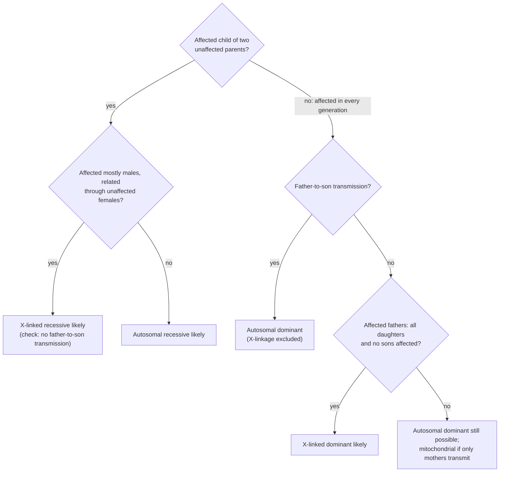

---
aliases:
  - Pedigree
  - Pedigree Chart
  - Family Tree
  - Mode of Inheritance
  - Recurrence Risk
  - Carrier Risk
  - Analyse de pedigree
  - Arbre généalogique
tags:
  - type/concept
  - domain/biology
  - domain/statistics
  - domain/bioinformatics
  - level/L2
  - level/L3
  - level/M1
mastery: 0
prerequisites:
  - "[[Mendelian Inheritance]]"
  - "[[Sex-Linked Inheritance]]"
  - "[[Dominance]]"
  - "[[Genotype]]"
  - "[[Conditional Probability]]"
related:
  - "[[Genetic Disease]]"
  - "[[Genetic Linkage]]"
  - "[[Trio Analysis]]"
  - "[[Variant Prioritization]]"
  - "[[Bayes' Theorem]]"
  - "[[Hardy-Weinberg Equilibrium]]"
  - "[[Inbreeding]]"
  - "[[Bayesian Network]]"
  - "[[Mitochondrial DNA]]"
projects: []
sources:
  - "[[An Introduction to Genetic Analysis (Griffiths)]]"
  - "[[MIT 7.03 - Genetics]]"
  - "[[Molecular Biology of the Cell (Alberts)]]"
  - "[[Introduction to Probability (Blitzstein)]]"
  - "[[Principles of Population Genetics (Hartl)]]"
  - "[[Richards 2015 - Standards and Guidelines for the Interpretation of Sequence Variants]]"
  - "[[Kong 2012 - Rate of De Novo Mutations and the Importance of Father's Age to Disease Risk]]"
---

# Pedigree Analysis

> [!abstract]
> A pedigree is a family tree that records who is affected; the pattern of affected relatives reveals how a trait is inherited, and the same transmission rules then give each relative's chance of being a carrier or of having an affected child.

## Definition

**Pedigree analysis** infers the mode of inheritance of a trait, and the genotype probabilities of family members, from a **pedigree**: a diagram of a family over several generations, drawn with standard symbols, that records sex, relationships and phenotypes.[^griffiths] It is the main tool of human transmission genetics, where controlled crosses are impossible.[^griffiths] It produces two kinds of numbers: the **carrier risk** of a relative (the probability of being heterozygous for a disease allele) and the **recurrence risk** (the probability that a future child is affected).

## Why it matters

- **Genetic counselling** quantifies the risks of families with an inherited disorder with exactly these calculations ([[Genetic Disease]]).[^griffiths][^mit703]
- **Family sequencing is filtered by the inferred mode.** A dominant model keeps heterozygous variants shared by the affected relatives, a recessive model keeps homozygous or two-hit genotypes, and a severe disorder in a child of unaffected parents points to de novo variants ([[Trio Analysis]], [[Variant Prioritization]]). Segregation with the disease and de novo occurrence are evidence types of variant classification.[^richards]
- **The pedigree is data, and can be wrong.** Misattributed parentage and sample swaps show up as genotypes inconsistent with segregation ([[Mendelian Inheritance#Advanced (L3)]]); and pedigree likelihoods are the engine of linkage analysis in families ([[Genetic Linkage]]).

## Core (L2)

### Reading a pedigree

![[pedigree-autosomal-recessive.svg]]

Squares are males, circles females and filled symbols affected individuals; a horizontal line joins partners (a double line marks a consanguineous mating), and a vertical line leads down to their children. Generations are numbered with Roman numerals and individuals within a generation with Arabic numerals, so II-2 is the second person of generation II. The **proband** is the affected person through whom the family came to attention. Heterozygous carriers look unaffected; when known, they are drawn half-filled.[^griffiths]

### Signatures of the modes of inheritance

Assuming a rare allele (people marrying into the family are not carriers), full penetrance and no new mutations:[^griffiths][^alberts]

| Mode | Typical pattern | Ruled out by |
|---|---|---|
| Autosomal recessive | Affected children of unaffected parents, often only sibs; both sexes; more frequent after consanguineous matings | Two affected parents with an unaffected child |
| Autosomal dominant | Vertical: every affected person has an affected parent; about half the children of an affected person affected; both sexes; father-to-son transmission | An affected child of two unaffected parents |
| X-linked recessive | Mostly males, related through unaffected carrier females | Father-to-son transmission; an affected daughter of an unaffected father |
| X-linked dominant | Affected father: all daughters, no sons; affected mother: half of the children of each sex | Father-to-son transmission; an unaffected daughter of an affected father |
| Y-linked | Father to every son, never to daughters | An affected female |
| Mitochondrial | Through mothers only, to children of both sexes ([[Mitochondrial DNA]]) | Transmission from an affected father |

The exclusion column follows from the transmission rules of [[Sex-Linked Inheritance#Core (L1)|sex chromosomes]] and segregation: a son receives his X from his mother, so a father cannot pass an X-linked allele to a son.

### Inferring the mode



Exclusion rules are stronger than tendencies: one father-to-son transmission excludes X-linkage, while "more affected males" only suggests it. Small families often fit several modes; then compare the likelihood of the pedigree under each (Frontier). Two events make a dominant disorder look recessive: a new mutation in the affected child, and **incomplete penetrance** in a parent who carries the allele without showing the trait ([[Genetic Disease]]).[^griffiths][^kong]

### Computing risks

Three rules do all the work: Mendelian segregation, the product rule for independent events, and conditioning on what is known ([[Mendelian Inheritance]], [[Conditional Probability]]).[^griffiths]

- **Unaffected sib of an affected child (autosomal recessive).** The parents are obligate carriers, so a child is `AA`, `Aa` or `aa` with probabilities 1/4, 1/2, 1/4. Knowing that the sib is unaffected removes `aa`: $P(\texttt{Aa} \mid \text{unaffected}) = \frac{1/2}{3/4} = \frac23$, not 1/2.
- **A couple of two such sibs**, from two different families: $P(\text{affected child}) = \frac23 \times \frac23 \times \frac14 = \frac19$.[^griffiths]
- **A partner without family history** is a carrier with the population frequency $2pq$ under [[Hardy-Weinberg Equilibrium]], where $q$ is the disease allele frequency and $p = 1 - q$.[^hartl]
- **Recurrence.** Each child of two carriers is affected with probability 1/4, whatever happened to the previous children: births are independent.
- **Dominant and X-linked.** A child of an affected heterozygote and an unaffected partner is affected with probability 1/2; so is a son of a carrier mother ([[Sex-Linked Inheritance#Worked example]]).

## Advanced (L3)

### Bayesian risks: using what the family shows

Prior risks from the pedigree structure are updated by phenotypes observed later, with [[Bayes' Theorem]].[^blitzstein] Example (X-linked recessive): a woman whose mother is a known carrier has prior $P(C) = \frac12$ of being a carrier herself. She has three unaffected sons. A son of a carrier is unaffected with probability 1/2, a son of a non-carrier with probability 1, so

$$P(C \mid 3 \text{ unaffected sons}) = \frac{\frac12 \left(\frac12\right)^3}{\frac12 \left(\frac12\right)^3 + \frac12 \cdot 1} = \frac{1/16}{9/16} = \frac19,$$

and the risk for her next son falls from $\frac12 \times \frac12 = \frac14$ to $\frac19 \times \frac12 = \frac1{18}$. Each unaffected son is evidence against carrier status.

### Incomplete penetrance

If carriers of a dominant allele are affected only with probability $f$, the **penetrance** ([[Genetic Disease]]), an unaffected child of an affected heterozygote may still carry the allele:[^griffiths]

$$P(\text{carrier} \mid \text{unaffected}) = \frac{\frac12 (1 - f)}{\frac12 (1 - f) + \frac12} = \frac{1 - f}{2 - f},$$

which is 1/6 for $f = 0.8$. An unaffected relative can therefore transmit the allele, and the pedigree skips a generation, mimicking recessive inheritance.

### Consanguinity

Children of related parents can receive two copies of one ancestral allele (**identical by descent**). The **inbreeding coefficient** $F$ is the probability of this at a locus ([[Inbreeding]]), and then $P(\texttt{aa}) = q^2 + Fpq$.[^hartl] For a child of first cousins, $F = 1/16$ (Mathematical representation). The risk of a recessive disorder is multiplied by $1 + Fp/q$, about 63 for $q = 0.001$: the rarer the allele, the stronger the effect of consanguinity (Exercise 6).[^hartl][^griffiths]

## Frontier (M1)

- **Pedigrees as Bayesian networks.** A pedigree is a [[Directed Acyclic Graph]] from parents to children. Adding founder genotype probabilities, transmission probabilities and penetrances turns it into a [[Bayesian Network]] over genotypes and phenotypes, in which every risk is a conditional probability. Enumerating configurations costs $3^N$ for $N$ individuals at one biallelic locus (Computational representation); summing out individuals one at a time, from the leaves of the pedigree inward, scales to large families, and the same computation over marker loci gives the likelihoods behind LOD scores ([[Genetic Linkage]]).
- **Trios and de novo variants.** Every child carries new mutations: about $1.2 \times 10^{-8}$ per nucleotide per generation in a study of 78 trios, with about 2 more mutations per year of the father's age.[^kong] Sequencing both parents separates these from inherited variants ([[Trio Analysis]], [[Mutation Rate]]).
- **Segregation as evidence.** In variant classification, co-segregation of a variant with the disease in several affected relatives supports pathogenicity, and its absence in an affected relative argues against it.[^richards]

## Mathematical representation

- Individuals $i = 1, \dots, N$ have a genotype $G_i \in \{0, 1, 2\}$ (copies of the disease allele) and a phenotype $Y_i$. Founders have no parents in the pedigree; a non-founder has father $f(i)$ and mother $m(i)$.
- **Founders**: $P(G_i = 0, 1, 2) = (p^2, 2pq, q^2)$ ([[Hardy-Weinberg Equilibrium]]). **Non-founders**: $P(G_i \mid G_{f(i)}, G_{m(i)})$ is Mendelian segregation, each parent transmitting the allele with probability $G/2$ ([[Mendelian Inheritance#Mathematical representation]]). **Penetrance**: $P(Y_i = \text{affected} \mid G_i = g) = f_g$, with $(f_0, f_1, f_2) = (0, 0, 1)$ for a fully penetrant recessive and $(0, 1, 1)$ for a fully penetrant dominant.
- The joint distribution factorizes over the pedigree:
$$P(\mathbf G, \mathbf Y) = \prod_{i \in \text{founders}} P(G_i) \prod_{i \notin \text{founders}} P(G_i \mid G_{f(i)}, G_{m(i)}) \prod_{i} P(Y_i \mid G_i).$$
A risk is a ratio of sums over configurations: $P(G_t = g \mid \mathbf Y_{\text{obs}}) = \sum_{\mathbf G:\, G_t = g} P(\mathbf G, \mathbf Y_{\text{obs}}) \big/ \sum_{\mathbf G} P(\mathbf G, \mathbf Y_{\text{obs}})$.
- **Inbreeding by path counting.** For each common ancestor $A$ of the two parents, with $n_1$ and $n_2$ generations from each parent up to $A$, $F = \sum_A \left(\tfrac12\right)^{n_1 + n_2 + 1}(1 + F_A)$.[^hartl] First cousins share two grandparents, each with $n_1 = n_2 = 2$ and $F_A = 0$: $F = 2 \times \left(\frac12\right)^5 = \frac1{16}$.

## Computational representation

A pedigree is a table with one row per individual: identifier, father, mother, sex and phenotype, with no parents for founders; family-aware tools take the same information as input. For a small pedigree, every genotype configuration can be enumerated and weighted by the factorization above, which gives exact risks with no rule to remember.

```python
from itertools import product


def transmit(g: int) -> dict[int, float]:
    """A parent with g copies of the disease allele (0, 1, 2) passes 0 or 1 copy."""
    return {0: 1 - g / 2, 1: g / 2}


def child_prob(g: int, g_father: int, g_mother: int) -> float:
    """P(child genotype g | parents' genotypes): Mendelian segregation."""
    return sum(pf * pm for af, pf in transmit(g_father).items()
               for am, pm in transmit(g_mother).items() if af + am == g)


def posterior(pedigree: dict, phenotypes: dict, penetrance: tuple, q: float, query) -> float:
    """P(query(genotypes) | phenotypes), enumerating every genotype configuration.
    pedigree: {id: (father, mother)}, (None, None) for founders, parents listed first;
    phenotypes: {id: affected?}; penetrance: P(affected | 0, 1, 2 copies); q: allele frequency."""
    hwe = {0: (1 - q) ** 2, 1: 2 * q * (1 - q), 2: q ** 2}      # founders
    num = den = 0.0
    for config in product((0, 1, 2), repeat=len(pedigree)):
        g = dict(zip(pedigree, config))
        w = 1.0
        for i, (f, m) in pedigree.items():
            w *= hwe[g[i]] if f is None else child_prob(g[i], g[f], g[m])
        for i, affected in phenotypes.items():
            w *= penetrance[g[i]] if affected else 1 - penetrance[g[i]]
        den += w
        num += w if query(g) else 0.0
    return num / den


RECESSIVE = (0.0, 0.0, 1.0)
# Two families with one affected child each; an unaffected sib from each marries the other.
family = {"I1": (None, None), "I2": (None, None), "II1": ("I1", "I2"), "II2": ("I1", "I2"),
          "I3": (None, None), "I4": (None, None), "II3": ("I3", "I4"), "II4": ("I3", "I4"),
          "III1": ("II2", "II3")}
seen = {"I1": False, "I2": False, "II1": True, "II2": False,
        "I3": False, "I4": False, "II3": False, "II4": True}
print(round(posterior(family, seen, RECESSIVE, 0.01, lambda g: g["II2"] == 1), 4))
print(round(posterior(family, seen, RECESSIVE, 0.01, lambda g: g["III1"] == 2), 4), round(1 / 9, 4))
```

```text
0.6667
0.1111 0.1111
```

The enumerator recovers the 2/3 carrier risk of II-2 and the 1/9 risk of the classic couple from the model alone. Its cost is $3^N$, here $3^9 = 19{,}683$ configurations; real software exploits the factorization to sum out one individual at a time.

## Worked example

> [!example] Risk for a couple with family history on one side (hypothetical allele frequency)
> A man's sister has an autosomal recessive disorder; their parents are unaffected. His partner has no family history, and in her population the disease allele has frequency $q = 0.02$ (hypothetical).
> 1. **The man.** His parents are obligate carriers and he is unaffected: $P(\text{carrier}) = 2/3$.
> 2. **His partner**: $P(\text{carrier}) = 2pq = 2 \times 0.98 \times 0.02 = 0.0392$, about 1 in 25.
> 3. **Their child** is affected only if both are carriers and both transmit the allele: $\frac23 \times 0.0392 \times \frac14 = 0.0065$, about 1 in 153.
> 4. **Comparison.** For two partners without family history, $0.0392^2 \times \frac14 = 0.00038$, about 1 in 2,600: the family history raises the risk seventeen-fold.

## Common misconceptions

> [!warning] "The healthy brother of an affected child has a 1/2 chance of being a carrier"
> Knowing that he is unaffected removes the `aa` class: the risk is 2/3.

> [!warning] "After an affected child, the next three will be unaffected"
> The 1/4 recurrence risk applies to each child independently; a family can have several affected children in a row.

> [!warning] "A trait that skips a generation is recessive"
> Incomplete penetrance makes dominant traits skip generations, and X-linked recessive traits pass silently through carrier females. Apply the exclusion rules before deciding.

> [!warning] "An affected child of unaffected parents proves recessive inheritance"
> A new mutation in the child, or a non-penetrant carrier parent, gives the same picture for a dominant disorder; only the recurrence in sibs or genotyping the parents distinguishes them.[^kong][^griffiths]

## Exercises

> [!question] Exercise 1 (L2)
> Assume a rare allele, full penetrance and no new mutations. Which modes remain possible? (a) Two unaffected parents have an affected daughter. (b) An affected father and an unaffected mother have an affected son and an unaffected daughter. (c) In three families, the 5 daughters of affected fathers are all affected and their 4 sons unaffected. (d) An affected woman has 2 affected sons and 2 affected daughters; her sons have 5 children (3 daughters, 2 sons), none affected.

> [!success]- Solution
> (a) Autosomal recessive only: no parent is affected (no dominant mode), an X-linked recessive daughter needs an affected father, and a Y-linked or mitochondrial trait cannot appear in a daughter of unaffected parents. (b) Autosomal dominant or Y-linked: the son's X comes from his non-carrier mother (no X-linked mode), the mother is not a carrier (no recessive mode), and fathers do not transmit mitochondria; one affected daughter would exclude Y-linkage. (c) X-linked dominant fits exactly; autosomal dominant is possible but gives this sex pattern with probability $(1/2)^9 \approx 0.002$; the other modes are excluded. (d) Mitochondrial: X-linked dominant would affect all three daughters of the affected sons, and autosomal dominant would give this outcome with probability $(1/2)^4 \times (1/2)^5 \approx 0.002$.

> [!question] Exercise 2 (L2)
> A woman heterozygous for a fully penetrant autosomal dominant disorder and an unaffected man plan three children. Find the probability that (a) the first two are unaffected, (b) at least one of the three is affected, (c) exactly one of the three is affected.

> [!success]- Solution
> Each child is affected with probability 1/2, independently. (a) $(1/2)^2 = 1/4$. (b) $1 - (1/2)^3 = 7/8$. (c) $\binom31 (1/2)^3 = 3/8$ ([[Binomial Distribution]]).

> [!question] Exercise 3 (L2)
> A man whose brother has an autosomal recessive disorder marries an unrelated woman from a population with carrier frequency 1/50 (hypothetical). What is the risk that their first child is affected? If that child is affected, what is the risk for the second child?

> [!success]- Solution
> $\frac23 \times \frac1{50} \times \frac14 = \frac1{300}$. An affected first child proves that both parents are carriers, so the risk for the second child jumps to 1/4: the same couple, but new information.

> [!question] Exercise 4 (L3)
> In the Worked example, the partner takes a carrier test that detects 90 % of the carriers in her population (hypothetical) and never flags a non-carrier. The result is negative. What are her residual carrier probability and the new risk for the couple's child?

> [!success]- Solution
> Bayes: $P(C \mid -) = \frac{0.0392 \times 0.1}{0.0392 \times 0.1 + 0.9608 \times 1} = 0.00406$. Risk: $\frac23 \times 0.00406 \times \frac14 = 0.00068$, about 1 in 1,477, ten times lower than before but not zero. The residual risk depends on the detection rate of the test in that population.

> [!question] Exercise 5 (L3, Python)
> With `posterior`, compute the probability that an unaffected child of an affected mother and an unaffected father carries the allele of an autosomal dominant disorder, for penetrance $f$ = 1.0, 0.8 and 0.5 in heterozygotes (1 in homozygotes, $q = 0.001$). Compare with $(1 - f)/(2 - f)$.

> [!success]- Solution
> ```python
> trio = {"F": (None, None), "M": (None, None), "C": ("F", "M")}
> for f in (1.0, 0.8, 0.5):
>     pen = (0.0, f, 1.0)
>     p = posterior(trio, {"F": False, "M": True, "C": False}, pen, 0.001, lambda g: g["C"] >= 1)
>     print(f, round(p, 4), round((1 - f) / (2 - f), 4))
> # 1.0 0.0 0.0
> # 0.8 0.1669 0.1667
> # 0.5 0.3339 0.3333
> ```
>
> The enumerator agrees with the formula; the small excess comes from the rare chance that the unaffected father is himself a non-penetrant carrier, which the formula ignores.

> [!question] Exercise 6 (M1, Python)
> Check $F = 1/16$ for a child of first cousins by gene dropping: give each founder two unique allele labels, transmit a random allele from each parent down the pedigree many times, and count how often the child's two alleles carry the same label. Then compute $P(\texttt{aa})$ for this child and for a child of unrelated parents, for $q = 0.01$ and $q = 0.001$.

> [!success]- Solution
> ```python
> import random
>
> pedigree = {"GF": None, "GM": None, "S1": None, "S2": None,       # founders
>             "C1": ("GF", "GM"), "C2": ("GF", "GM"),                # two siblings
>             "X": ("C1", "S1"), "Y": ("C2", "S2"), "Z": ("X", "Y")}  # cousins X, Y; their child Z
>
> def autozygous(rng: random.Random) -> bool:
>     """One gene drop: True if the child's two alleles are copies of one founder allele."""
>     alleles, label = {}, 0
>     for i, parents in pedigree.items():
>         if parents is None:
>             alleles[i] = (label, label + 1)
>             label += 2
>         else:
>             alleles[i] = tuple(rng.choice(alleles[p]) for p in parents)
>     return alleles["Z"][0] == alleles["Z"][1]
>
>
> rng, n = random.Random(1), 200_000
> print(sum(autozygous(rng) for _ in range(n)) / n, 1 / 16)
> for q in (0.01, 0.001):
>     risk = q ** 2 + (1 / 16) * (1 - q) * q
>     print(q, q ** 2, round(risk, 7), round(risk / q ** 2, 1))
> # 0.062065 0.0625
> # 0.01 0.0001 0.0007188 7.2
> # 0.001 1e-06 6.34e-05 63.4
> ```
>
> The simulated 0.0621 matches $1/16$ within sampling error. The risk ratio grows from 7 to 63 as the allele gets rarer: rare recessive disorders are strongly over-represented among children of consanguineous unions.[^hartl]

## Mastery checklist

- [ ] 1 Recognized: I can read the standard pedigree symbols and name the six modes of inheritance.
- [ ] 2 Understood: I can state the signature and exclusion rules of each mode, and explain why the unaffected sib of an affected child is a carrier with probability 2/3.
- [ ] 3 Practiced: I can compute carrier and recurrence risks by hand, update them with Bayes' theorem, and compute them with a pedigree enumerator in Python.
- [ ] 4 Applied: I filtered the variants of a real family (trio or larger) under the mode inferred from its pedigree and checked the segregation of the candidates.
- [ ] 5 Explained: I can teach how penetrance, new mutations, consanguinity and small families complicate inference, and how pedigree likelihoods are computed at scale.

## References

[^griffiths]: [[An Introduction to Genetic Analysis (Griffiths)]], 7th ed. (2000), human pedigree analysis: pedigree symbols, autosomal recessive and dominant, X-linked and Y-linked patterns, calculating risks in pedigrees, penetrance, consanguinity.
[^mit703]: [[MIT 7.03 - Genetics]], human genetics part: inherited disease.
[^alberts]: [[Molecular Biology of the Cell (Alberts)]], 4th ed. (2002), on the maternal, non-Mendelian inheritance of mitochondrial genes.
[^blitzstein]: [[Introduction to Probability (Blitzstein)]], 2nd ed. (2019), conditional probability and Bayes' rule.
[^hartl]: [[Principles of Population Genetics (Hartl)]], 4th ed. (2006), Hardy-Weinberg genotype frequencies, the inbreeding coefficient and its computation from pedigrees, and the effect of inbreeding on rare recessive genotypes.
[^richards]: [[Richards 2015 - Standards and Guidelines for the Interpretation of Sequence Variants]], *Genetics in Medicine* 17(5):405-424, segregation and de novo evidence criteria.
[^kong]: [[Kong 2012 - Rate of De Novo Mutations and the Importance of Father's Age to Disease Risk]], *Nature* 488:471-475.
