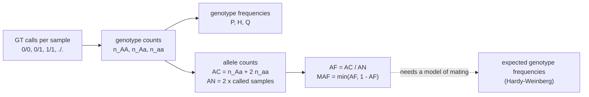

---
aliases:
  - Gene Frequency
  - Allele Frequencies
  - Allelic Frequency
  - Genotype Frequency
  - Minor Allele Frequency
  - MAF
  - Fréquence allélique
tags:
  - type/concept
  - domain/biology
  - domain/bioinformatics
  - domain/statistics
  - level/L2
  - level/L3
mastery: 0
prerequisites:
  - "[[Allele]]"
  - "[[Genotype]]"
  - "[[Ploidy]]"
  - "[[Mendelian Inheritance]]"
  - "[[Binomial Distribution]]"
  - "[[Sampling]]"
related:
  - "[[Hardy-Weinberg Equilibrium]]"
  - "[[Heterozygosity]]"
  - "[[Genetic Drift]]"
  - "[[Natural Selection]]"
  - "[[Gene Flow]]"
  - "[[Inbreeding]]"
  - "[[Single Nucleotide Polymorphism]]"
  - "[[VCF Format]]"
  - "[[Sex-Linked Inheritance]]"
  - "[[Confidence Interval]]"
  - "[[Genotype Likelihood]]"
  - "[[Fixation Index]]"
  - "[[Site Frequency Spectrum]]"
  - "[[Variant Prioritization]]"
projects:
  - "[[07-evolution-simulator]]"
  - "[[10-genomic-pipeline]]"
sources:
  - "[[Principles of Population Genetics (Hartl)]]"
  - "[[An Introduction to Genetic Analysis (Griffiths)]]"
  - "[[Biology 2e (OpenStax)]]"
  - "[[GA4GH hts-specs]]"
  - "[[Richards 2015 - Standards and Guidelines for the Interpretation of Sequence Variants]]"
  - "[[Nielsen 2011 - Genotype and SNP Calling from Next-Generation Sequencing Data]]"
---

# Allele Frequency

> [!abstract]
> The allele frequency is the share of all copies of a gene in a population that are a given allele; counting alleles in the genotypes of a sample estimates it, and its change across generations is what evolution means at the genetic level.

## Definition

At a locus, the **allele frequency** (or gene frequency) of an allele is the proportion of all gene copies at that locus in a population that are copies of this allele; the **genotype frequency** of a genotype is the proportion of individuals that carry it.[^hartl][^griffiths] In a sample, both are estimated by counting. Population genetics defines evolution as a change in allele frequencies from one generation to the next.[^os19]

## Why it matters

- **Every VCF can carry it.** The VCF specification reserves three INFO keys: `AC`, the count of each ALT allele in the called genotypes; `AN`, the total number of alleles in called genotypes; `AF`, the frequency of each ALT allele.[^hts] Tools compute them from the `GT` fields exactly as in the code below ([[VCF Format]], [[10-genomic-pipeline]]).
- **Variant interpretation.** In the ACMG/AMP guidelines, an allele frequency above 5% in large population databases (the guideline names the Exome Sequencing Project, 1000 Genomes and ExAC) is stand-alone evidence that a variant is benign for a Mendelian disorder.[^richards] Population frequency is therefore one of the first filters to consider in [[Variant Prioritization]].
- **The state variable of evolution.** Mutation, selection, drift and migration are each described by how they change allele frequencies ([[Natural Selection]], [[Genetic Drift]], [[Gene Flow]]),[^hartl] and [[07-evolution-simulator]] tracks exactly this number over generations.
- **Statistical power.** A variant carried by few people gives sparse tables, so the minor allele frequency decides which association tests are valid and how many samples are needed ([[Chi-Square Test]], [[Genome-Wide Association Study]]).

## Core (L2)

### Gene counting

A sample of $n$ diploid individuals at a biallelic locus with alleles A and a contains $2n$ gene copies ([[Allele]], [[Genotype]]). With genotype counts $n_{AA}$, $n_{Aa}$, $n_{aa}$:

| Quantity | Formula | Invented sample: 90 AA, 80 Aa, 30 aa |
|---|---|---|
| Genotype frequencies | $P = n_{AA}/n$, $H = n_{Aa}/n$, $Q = n_{aa}/n$ | 0.45, 0.40, 0.15 |
| Copies of A | $2n_{AA} + n_{Aa}$ (two per AA, one per Aa) | 260 of 400 |
| Allele frequencies | $p = \dfrac{2n_{AA} + n_{Aa}}{2n} = P + \dfrac{H}{2}$, $\quad q = 1 - p$ | $p = 0.65$, $q = 0.35$ |

Each homozygote contributes two copies of its allele and each heterozygote one copy of each: this is **gene counting**.[^hartl][^griffiths] Why the observed proportion is the best estimate (maximum likelihood) is worked in [[Extremum#Core (L1)]].

### Genotypes determine alleles, not the reverse

Allele frequencies follow from genotype frequencies, but one allele frequency is compatible with many genotype distributions: $p = 0.5$ holds for a population made only of heterozygotes, $(P, H, Q) = (0, 1, 0)$, and for one without any, $(0.5, 0, 0.5)$. Going back from alleles to genotypes needs a model of how gametes combine, which [[Hardy-Weinberg Equilibrium]] provides. Under its random-mating proportions the invented sample would be 0.4225, 0.455, 0.1225: it has slightly fewer heterozygotes than expected, and the test in that note decides whether this exceeds chance.

### More alleles, other copy numbers

- **Several alleles.** For alleles $A_1, \dots, A_k$, $\hat p_i = \dfrac{2n_{ii} + \sum_{j \ne i} n_{ij}}{2n}$, and the $\hat p_i$ sum to 1.[^hartl]
- **Count copies, not individuals.** Ploidy $k$ gives $kN$ copies ([[Ploidy]]); outside the pseudoautosomal regions of the X, $2N_f + N_m$ ([[Sex-Linked Inheritance]]).
- **Missing calls contribute nothing.** `AN` counts alleles in called genotypes only,[^hts] so it is twice the number of called diploid samples, not of all samples. Counting `./.` as `0/0` biases the frequency toward REF ([[Genotype]]).

### Minor allele frequency and the REF trap

The **minor allele frequency** (MAF) of a biallelic site is $\min(p, 1 - p)$. A VCF reports the frequency of the ALT allele, and REF is defined as the base(s) of the reference genome,[^hts] not as the common allele. At site 2000 of the code below, ALT has $AF = 0.833$: the reference genome carries the minor allele, with MAF 0.167. For multiallelic sites conventions differ; the code takes the frequency of the second most common allele.



### Sampling error

If the $2n$ copies are independent draws (unrelated individuals, random mating), the number of A copies is binomial, so $\hat p$ has standard error $\sqrt{p(1-p)/2n}$ ([[Binomial Distribution]]). For the invented sample, $\sqrt{0.65 \times 0.35 / 400} = 0.024$, and the 95% interval is about $0.65 \pm 0.047$. Precision depends on the number of copies genotyped and improves only as $1/\sqrt{n}$.

An allele **absent from a sample** is not absent from the population: with 0 copies among 200, the Wald interval collapses to $[0, 0]$, while the score (Wilson) interval gives $[0, 0.019]$ and the exact one-sided bound is $1 - 0.05^{1/200} = 0.015 \approx 3/200$, the rule of three ([[Confidence Interval#Deeper (L2)]]). Frequencies of rare variants from small cohorts are mostly upper bounds.

## Advanced (L3)

- **Correlated copies.** Relatives, inbreeding or population structure make the two copies of an individual correlated. With inbreeding coefficient $F$ ([[Inbreeding]]), $\operatorname{Var}(\hat p) = p(1-p)(1+F)/2n$ (Exercise 5): $n$ fully inbred individuals carry the information of only $n$ independent copies.
- **Frequencies from reads.** At low sequencing depth genotype calls are uncertain, and population allele frequencies can be estimated directly from [[Genotype Likelihood|genotype likelihoods]] instead of from hard calls.[^nielsen] An individual's **variant allele fraction** (ALT reads over total reads, near 0.5 for a heterozygote) describes one sample's reads, not a population ([[Ploidy]]).
- **Frequencies differ between populations.** Drift and selection act separately in each population, so one allele can be common in one and rare in another, which $F_{ST}$ measures ([[Fixation Index]], [[Population Structure]]). A database frequency is the frequency among the people sampled, a limit when a patient's ancestry is under-represented ([[Diversity in Genomic Research]]).
- **The spectrum across sites.** The distribution of allele frequencies over many sites is the [[Site Frequency Spectrum]], whose shape carries information about demography and selection ([[Population Genomics]]).
- **Hidden heterozygotes.** When the heterozygote looks like one homozygote (complete [[Dominance]]), gene counting is impossible; assuming Hardy-Weinberg proportions, the recessive allele frequency is estimated as $\hat q = \sqrt{n_{aa}/n}$,[^hartl] at a large cost in precision (Exercise 6).

## Mathematical representation

- Sampling $n$ individuals from a population with genotype frequencies $(P, H, Q)$ gives counts $(n_{AA}, n_{Aa}, n_{aa}) \sim \mathrm{Multinomial}(n; P, H, Q)$ ([[Multinomial Distribution]]).
- **Estimator.** $\hat p = (2n_{AA} + n_{Aa})/(2n)$, and $E[\hat p] = (2nP + nH)/(2n) = P + H/2 = p$: unbiased whatever the genotype frequencies.
- **Variance.** With $g_i \in \{0, 1, 2\}$ the number of A copies of individual $i$, $\hat p = \frac{1}{2n}\sum_{i=1}^{n} g_i$ and $\operatorname{Var}(\hat p) = \operatorname{Var}(g)/(4n)$. Under Hardy-Weinberg proportions $\operatorname{Var}(g) = 2pq$, giving $pq/2n$; with inbreeding $\operatorname{Var}(g) = 2pq(1 + F)$.
- **Genotype matrix.** For ALT dosages $X \in \{0, 1, 2, \varnothing\}^{n \times m}$ ($\varnothing$ = missing), site $j$ has $AC_j = \sum_{i : X_{ij} \ne \varnothing} X_{ij}$, $AN_j = 2\,\#\{i : X_{ij} \ne \varnothing\}$ and $AF_j = AC_j / AN_j$ ([[Genotype#Mathematical representation]]).
- **Several alleles.** $\hat{\mathbf p} = (\hat p_1, \dots, \hat p_k)$ with $\hat p_i = c_i / AN$, where $c_i$ counts copies of allele $i$ and $\sum_i c_i = AN$.

## Computational representation

The code reads the `GT` fields of an invented VCF, recomputes `AC`, `AN` and `AF` per ALT allele, the MAF and the genotype frequencies, then gives the interval for the invented sample of the Core section. Standard library only.

```python
from collections import Counter
from math import sqrt

# Invented VCF: six samples, three sites (one multiallelic), one missing call.
TOY_VCF = """\
#CHROM\tPOS\tID\tREF\tALT\tQUAL\tFILTER\tINFO\tFORMAT\ts1\ts2\ts3\ts4\ts5\ts6
chr1\t1000\t.\tA\tG\t.\t.\t.\tGT\t0/0\t0/1\t0/1\t1/1\t0/0\t./.
chr1\t2000\t.\tC\tT\t.\t.\t.\tGT\t1/1\t1/1\t0/1\t1/1\t1/1\t0|1
chr1\t3000\t.\tG\tA,T\t.\t.\t.\tGT\t0/1\t0/2\t1/2\t0/0\t0/0\t0/1
"""


def allele_counts(gts: list[str], n_alt: int) -> tuple[list[int], int]:
    """VCF-style AC (one count per ALT allele) and AN (called allele copies)."""
    ac, an = [0] * n_alt, 0
    for gt in gts:
        for allele in gt.replace("|", "/").split("/"):
            if allele == ".":
                continue                      # a missing allele is not counted in AN
            an += 1
            if allele != "0":
                ac[int(allele) - 1] += 1
    return ac, an


def genotype_frequencies(gts: list[str]) -> dict[str, float]:
    """Unordered genotype frequencies among called samples."""
    called = ["/".join(sorted(g.replace("|", "/").split("/"))) for g in gts if "." not in g]
    return {g: round(c / len(called), 3) for g, c in sorted(Counter(called).items())}


for line in TOY_VCF.splitlines():
    if line.startswith("#"):
        continue
    fields = line.split("\t")
    alts, gts = fields[4].split(","), fields[9:]
    ac, an = allele_counts(gts, len(alts))
    freqs = [1 - sum(ac) / an] + [c / an for c in ac]      # REF first, then each ALT
    print(fields[1], f"AC={ac} AN={an}", "AF=" + ",".join(f"{c / an:.3f}" for c in ac),
          f"MAF={sorted(freqs)[-2]:.3f}", genotype_frequencies(gts))


def wilson_interval(x: int, m: int, z: float = 1.96) -> tuple[float, float]:
    """Score (Wilson) interval for x copies among m allele copies."""
    phat = x / m
    centre = (phat + z * z / (2 * m)) / (1 + z * z / m)
    half = z * sqrt(phat * (1 - phat) / m + z * z / (4 * m * m)) / (1 + z * z / m)
    return max(0.0, centre - half), min(1.0, centre + half)


p, two_n = 260 / 400, 400                       # the invented sample: 90 AA, 80 Aa, 30 aa
se = sqrt(p * (1 - p) / two_n)
print(round(se, 4), (round(p - 1.96 * se, 3), round(p + 1.96 * se, 3)),
      tuple(round(v, 3) for v in wilson_interval(260, 400)))
print(tuple(round(v, 4) for v in wilson_interval(0, 200)), round(1 - 0.05 ** (1 / 200), 4))
```

```text
1000 AC=[4] AN=10 AF=0.400 MAF=0.400 {'0/0': 0.4, '0/1': 0.4, '1/1': 0.2}
2000 AC=[10] AN=12 AF=0.833 MAF=0.167 {'0/1': 0.333, '1/1': 0.667}
3000 AC=[3, 2] AN=12 AF=0.250,0.167 MAF=0.250 {'0/0': 0.333, '0/1': 0.333, '0/2': 0.167, '1/2': 0.167}
0.0238 (0.603, 0.697) (0.602, 0.695)
(0.0, 0.0188) 0.0149
```

Site 1000 has `AN = 10`, not 12, because sample s6 is missing; the phased `0|1` of site 2000 counts like `0/1`. At $p = 0.65$ with 400 copies the Wald and score intervals agree; at 0 copies only the score interval and the exact bound remain informative.

## Worked example

> [!example] From genotype counts to frequencies (invented sample)
> A study genotypes 200 unrelated individuals at a biallelic SNP: 90 AA, 80 Aa, 30 aa.
> 1. **Genotype frequencies**: $90/200 = 0.45$, $80/200 = 0.40$, $30/200 = 0.15$.
> 2. **Allele copies**: A appears $2 \times 90 + 80 = 260$ times among $2 \times 200 = 400$ copies, a appears $80 + 2 \times 30 = 140$ times.
> 3. **Allele frequencies**: $p = 260/400 = 0.65$, $q = 140/400 = 0.35$; check $p = P + H/2 = 0.45 + 0.20$.
> 4. **MAF**: 0.35, the frequency of a.
> 5. **Precision**: $\mathrm{SE} = \sqrt{0.65 \times 0.35/400} = 0.024$; 95% interval $[0.603, 0.697]$ (score interval $[0.602, 0.695]$).
> 6. **What the counts cannot say alone**: whether 80 heterozygotes is "too few" requires the expected count under random mating, $400 \times 0.65 \times 0.35 = 91$, and a test ([[Hardy-Weinberg Equilibrium]]).

## Common misconceptions

> [!warning] "Allele frequency is the fraction of people who carry the allele"
> Carrier frequency counts individuals with at least one copy; allele frequency counts copies. For a rare allele, most carriers are heterozygotes with a single copy, so the carrier frequency is about twice the allele frequency (Exercise 3).

> [!warning] "REF is the common allele, so AF is the minor allele frequency"
> REF is the allele of the reference genome assembly. Where the reference carries the rarer allele, `AF` of ALT is above 0.5 and the MAF is $1 - AF$. Filters such as "MAF ≥ 0.01" must compute $\min(AF, 1 - AF)$.

> [!warning] "A variant allele fraction of 30% means the allele has a 30% frequency"
> The fraction of ALT reads in one sample reflects its genotype, ploidy, purity and sampling of reads ([[Ploidy]]); a population frequency needs many individuals.

> [!warning] "Not seen in our cohort, so absent from the population"
> Zero copies among $2n$ only bounds the frequency, at about $3/2n$ with 95% confidence ([[Confidence Interval#Advanced (L3)]]).

## Exercises

> [!question] Exercise 1 (L2)
> The MN blood group is codominant, so every genotype is visible. An invented sample of 200 people has 120 MM, 60 MN and 20 NN. Give the genotype frequencies, the allele frequencies and the standard error of $\hat p_M$.

> [!success]- Solution
> Genotype frequencies 0.60, 0.30, 0.10. $\hat p_M = (2 \times 120 + 60)/400 = 0.75$, $\hat p_N = 0.25$. $\mathrm{SE} = \sqrt{0.75 \times 0.25/400} = 0.022$. Codominance is what makes gene counting possible: each phenotype reveals its genotype.

> [!question] Exercise 2 (L2)
> At a locus with three alleles, an invented sample of 100 individuals has $A_1A_1$ 20, $A_1A_2$ 30, $A_1A_3$ 10, $A_2A_2$ 15, $A_2A_3$ 15, $A_3A_3$ 10. Compute the three allele frequencies.

> [!success]- Solution
> $\hat p_1 = (2 \times 20 + 30 + 10)/200 = 0.40$, $\hat p_2 = (2 \times 15 + 30 + 15)/200 = 0.375$, $\hat p_3 = (2 \times 10 + 10 + 15)/200 = 0.225$. They sum to 1: each of the 200 copies is counted exactly once.

> [!question] Exercise 3 (L2)
> In an invented sample of 1,000 people, 90 are Aa and 5 are aa. What fraction carries a, and what is the frequency of a?

> [!success]- Solution
> Carriers: $(90 + 5)/1000 = 9.5\%$. Allele: $\hat q = (90 + 2 \times 5)/2000 = 0.05$. The carrier frequency is close to $2q = 0.10$, because almost every copy of a rare allele sits in a heterozygote.

> [!question] Exercise 4 (L3, Python)
> Using `wilson_interval` from the code above, write `site_summary(dosages)` for a list of ALT dosages (0, 1, 2, or `None` if missing) returning `AC`, `AN`, `AF`, MAF, whether ALT is the major allele, and the 95% interval of `AF`. Run it on three invented sites of 10 samples.

> [!success]- Solution
> ```python
> def site_summary(dosages: list[int | None]) -> dict:
>     """ALT dosages (0, 1, 2; None = missing) -> AC, AN, AF, MAF, 95% score interval of AF."""
>     called = [d for d in dosages if d is not None]
>     ac, an = sum(called), 2 * len(called)
>     af = ac / an
>     lo, hi = wilson_interval(ac, an)
>     return {"AC": ac, "AN": an, "AF": round(af, 3), "MAF": round(min(af, 1 - af), 3),
>             "ALT_is_major": af > 0.5, "CI": (round(lo, 3), round(hi, 3))}
>
> sites = {                                   # invented dosages for 10 samples
>     "s1": [0, 1, 0, 0, 2, 1, None, 0, 1, 0],
>     "s2": [2, 2, 1, 2, 2, 2, 2, 1, 2, None],
>     "s3": [0, 0, 0, 0, 0, 0, 0, 0, 0, 0],
> }
> for name, d in sites.items():
>     print(name, site_summary(d))
> ```
> ```text
> s1 {'AC': 5, 'AN': 18, 'AF': 0.278, 'MAF': 0.278, 'ALT_is_major': False, 'CI': (0.125, 0.509)}
> s2 {'AC': 16, 'AN': 18, 'AF': 0.889, 'MAF': 0.111, 'ALT_is_major': True, 'CI': (0.672, 0.969)}
> s3 {'AC': 0, 'AN': 20, 'AF': 0.0, 'MAF': 0.0, 'ALT_is_major': False, 'CI': (0.0, 0.161)}
> ```
> At s2 the reference carries the minor allele. At s3 nothing was seen, yet frequencies up to 16% are compatible with 20 copies. With 10 samples every interval is wide: frequency estimates need hundreds of individuals.

> [!question] Exercise 5 (L3)
> With inbreeding coefficient $F$, genotype frequencies are $p^2 + Fpq$, $2pq(1-F)$, $q^2 + Fpq$ ([[Inbreeding]]). Show that the number $g$ of A copies of one individual has variance $2pq(1+F)$, deduce $\operatorname{Var}(\hat p)$, and check numerically for $p = 0.3$, $F = 0.25$.

> [!success]- Solution
> $E[g] = 2(p^2 + Fpq) + 2pq(1 - F) = 2p^2 + 2pq = 2p$. $E[g^2] = 4(p^2 + Fpq) + 2pq(1 - F) = 4p^2 + 2pq + 2Fpq$. So $\operatorname{Var}(g) = 4p^2 + 2pq(1+F) - 4p^2 = 2pq(1+F)$, and $\operatorname{Var}(\hat p) = n\operatorname{Var}(g)/(2n)^2 = pq(1+F)/2n$. Numerically, summing over the three genotypes gives mean 0.6 and variance 0.525 $= 2 \times 0.3 \times 0.7 \times 1.25$. At $F = 1$ the variance doubles: the two copies of each individual are identical, so the $2n$ copies carry the information of $n$.

> [!question] Exercise 6 (L3)
> A recessive phenotype (aa) is seen in 25 of 10,000 people (invented), and heterozygotes cannot be told apart from AA. Estimate $q$ under Hardy-Weinberg proportions, its standard error by the delta method, and compare with the standard error you would get by genotyping the same people.

> [!success]- Solution
> $\hat q = \sqrt{25/10000} = 0.05$. The observed proportion $\hat r = n_{aa}/n$ has variance $q^2(1-q^2)/n$, and $\hat q = \sqrt{\hat r}$ has derivative $1/(2q)$, so $\operatorname{Var}(\hat q) \approx (1 - q^2)/(4n)$: SE $= 0.0050$. Gene counting would give $\sqrt{q(1-q)/2n} = 0.0015$. The variance ratio is 10.5: the phenotype-based estimate needs about ten times more people for the same precision, and it is only valid if the population really has Hardy-Weinberg proportions.

## Mastery checklist

- [ ] 1 Recognized: I can define allele and genotype frequencies and read `AC`, `AN` and `AF` in a VCF.
- [ ] 2 Understood: I can explain why genotype frequencies determine allele frequencies but not the reverse, and why REF need not be the major allele.
- [ ] 3 Practiced: I can compute allele, genotype and minor allele frequencies with missing calls and multiallelic sites, with an interval that behaves for rare alleles.
- [ ] 4 Applied: I recomputed `AC`, `AN` and `AF` from a real multi-sample VCF in [[10-genomic-pipeline]] and compared them with a population database, and I tracked allele frequencies over generations in [[07-evolution-simulator]].
- [ ] 5 Explained: I can teach the sampling error of allele frequencies, how relatedness and low depth change it, and how population frequencies are used and misused in variant interpretation.

## References

[^hartl]: [[Principles of Population Genetics (Hartl)]], 4th ed. (2006), treatment of allele and genotype frequencies (gene counting, multiple alleles, evolutionary forces as changes in allele frequency, estimating a recessive allele frequency under random mating).
[^griffiths]: [[An Introduction to Genetic Analysis (Griffiths)]], 7th ed. (2000), population genetics (allele and genotype frequencies).
[^os19]: [[Biology 2e (OpenStax)]], ch. 19 "The Evolution of Populations", section "Population Evolution" (population genetics; evolution as a change in allele frequencies).
[^hts]: [[GA4GH hts-specs]], VCF specification (v4.x): reserved INFO keys `AC`, `AN` and `AF`; the `REF` field.
[^richards]: [[Richards 2015 - Standards and Guidelines for the Interpretation of Sequence Variants]], population data criteria (BA1: allele frequency above 5% in the Exome Sequencing Project, 1000 Genomes Project or Exome Aggregation Consortium).
[^nielsen]: [[Nielsen 2011 - Genotype and SNP Calling from Next-Generation Sequencing Data]], *Nature Reviews Genetics* 12:443-451.
