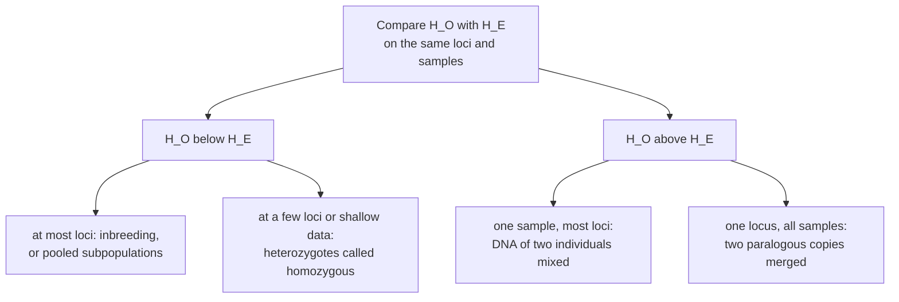

---
aliases:
  - Observed Heterozygosity
  - Expected Heterozygosity
  - Gene Diversity
  - H_O
  - H_E
  - Hétérozygotie
tags:
  - type/concept
  - domain/biology
  - domain/bioinformatics
  - domain/statistics
  - level/L2
  - level/L3
mastery: 0
prerequisites:
  - "[[Allele Frequency]]"
  - "[[Hardy-Weinberg Equilibrium]]"
  - "[[Genotype]]"
related:
  - "[[Genetic Drift]]"
  - "[[Effective Population Size]]"
  - "[[Inbreeding]]"
  - "[[Population Structure]]"
  - "[[Fixation Index]]"
  - "[[Nucleotide Diversity]]"
  - "[[K-mer Spectrum]]"
  - "[[Sex-Linked Inheritance]]"
  - "[[Genotype Likelihood]]"
projects:
  - "[[07-evolution-simulator]]"
sources:
  - "[[Principles of Population Genetics (Hartl)]]"
  - "[[Nei 1978 - Estimation of Average Heterozygosity and Genetic Distance from a Small Number of Individuals]]"
---

# Heterozygosity

> [!abstract]
> Heterozygosity is the share of heterozygous individuals at a locus (observed), or the chance that two gene copies drawn at random differ (expected): the simplest number that says how much genetic diversity a population holds.

## Definition

The **observed heterozygosity** $H_O$ at a locus is the proportion of individuals in a sample that are heterozygous; averaged over loci, it summarizes a sample. The **expected heterozygosity** $H_E = 1 - \sum_i p_i^2$, where $p_i$ are the allele frequencies, is the probability that two gene copies drawn at random from the population carry different alleles, which is also the heterozygote frequency expected under Hardy-Weinberg proportions.[^hartl] Estimated from $2n$ sampled copies, it is multiplied by $2n/(2n-1)$ to remove its small-sample bias.[^nei]

## Why it matters

- **The first diversity summary.** Heterozygosity is the simplest measure of genetic variation in a population, and the quantity that [[Genetic Drift]] erodes in small populations ([[Effective Population Size]]).[^hartl]
- **Sample quality control.** Over thousands of SNPs, each sample's heterozygosity rate is a fingerprint: too high suggests DNA from two people in one tube, too low suggests inbreeding or calls that miss heterozygotes (Exercise 3). On the X chromosome it separates one X from two ([[Sex-Linked Inheritance]]).
- **Genome heterozygosity.** The k-mers that cover a heterozygous site occur on one homolog only, at half the read depth, so the [[K-mer Spectrum|k-mer spectrum]] of one diploid's reads reveals its heterozygosity before any assembly ([[Ploidy]]); the same sites are where the two haplotypes of an assembly differ.
- **The bridge to sequence diversity.** Per site, expected heterozygosity is the probability that two random copies differ; averaged over all sites of a sequence it becomes [[Nucleotide Diversity]] ($\pi$).

## Core (L2)

### Observed and expected

For the invented sample of the code below (10 individuals, three loci):

| Locus | Alleles | $H_O$ | $H_E$ (naive) | $H_E$ (unbiased) | $F = 1 - H_O/H_E$ |
|---|---:|---:|---:|---:|---:|
| L1 | 4 | 0.600 | 0.705 | 0.742 | +0.191 |
| snp1 | 2 | 0.500 | 0.495 | 0.521 | +0.040 |
| snp2 | 2 | 0.300 | 0.375 | 0.395 | +0.240 |
| mean | | 0.467 | | 0.553 | |

$H_E$ depends only on allele frequencies: it describes the diversity of the gene pool. $H_O$ also depends on how alleles are packaged into individuals, so it is the mating system, structure or genotyping that moves it away from $H_E$. The relative deficit $F$ is the inbreeding coefficient estimate ([[Inbreeding]]); whether a given deficit exceeds chance is a [[Hardy-Weinberg Equilibrium|Hardy-Weinberg test]].

### What sets the expected value: number and evenness of alleles

With $k$ alleles, $H_E \le 1 - 1/k$, with equality when all alleles are equally frequent (proof in the Mathematical representation). A biallelic SNP can never exceed 0.5, while a locus with ten alleles can reach 0.9; but ten alleles with one at 0.91 and nine at 0.01 give only $1 - (0.91^2 + 9 \times 0.01^2) = 0.171$. Heterozygosities are therefore comparable between populations at the same markers, never between marker types.

### Small samples: Nei's correction

Allele frequencies estimated from few copies look less even than they are, so the naive $1 - \sum \hat p_i^2$ is biased downward by a factor $1 - 1/2n$. Nei's estimator multiplies it by $2n/(2n-1)$;[^nei] it equals the fraction of all pairs of distinct sampled copies that carry different alleles. The correction is 10% with 5 individuals and 0.5% with 100 (Exercise 4).

### Individual heterozygosity

The same counting applies to one individual across many loci: the fraction of its genotyped loci, or of its callable base pairs, that are heterozygous. Under random mating, an individual's two copies at a site are two random draws from the gene pool, so its expected heterozygosity at that site is $H_E$; averaged over sites, the per-base-pair heterozygosity of one genome estimates the population's [[Nucleotide Diversity]].



## Advanced (L3)

- **Loss by drift.** In a population of effective size $N_e$, expected heterozygosity decays as $H_t = H_0(1 - 1/2N_e)^t$ (derived in [[Binomial Distribution#Deeper (L2)]]), with a half-life of about $1.39\,N_e$ generations (Exercise 5).[^hartl] Measuring this decay is one way to estimate $N_e$ ([[Effective Population Size]], [[Genetic Drift]]).
- **Mutation-drift balance.** Mutation creates new alleles while drift removes them; under the infinite-alleles model the equilibrium is $H = \theta/(1 + \theta)$ with $\theta = 4N_e\mu$.[^hartl] Diversity thus measures the product of population size and mutation rate, not either alone.
- **Hierarchies.** With $H_S$ the mean expected heterozygosity within subpopulations and $H_T$ that of the pooled population, $H_T \ge H_S$, and $(H_T - H_S)/H_T$ is the $F_{ST}$ measure of differentiation ([[Fixation Index]]).[^hartl] The Wahlund deficit in [[Hardy-Weinberg Equilibrium#Advanced (L3)]] is the same inequality seen from a pooled sample.
- **Technical heterozygosity.** Missed heterozygotes at low depth or under reference bias lower $H_O$ ([[Genotype Likelihood]], [[Allele]]); reads from two paralogous copies mapped to one locus make every sample heterozygous at the fixed differences between the copies. A site-level $H_O$ far above $H_E$ is therefore a reason to filter the site.
- **Richness versus heterozygosity.** A short bottleneck removes rare alleles while barely changing $H_E$, to which rare alleles contribute little; allelic richness and heterozygosity answer different questions ([[Effective Population Size#Core (L2)]]).

## Mathematical representation

- **Observed.** For genotypes $(a_{i1}, a_{i2})$, $i = 1, \dots, n$: $H_O = \frac{1}{n}\sum_{i=1}^{n} \mathbf{1}[a_{i1} \ne a_{i2}]$; over $L$ loci, $\bar H_O = \frac{1}{L}\sum_{l} H_{O,l}$.
- **Expected.** For allele frequencies $p_1, \dots, p_k$ and independent copies $X, Y$ drawn from them: $H_E = P(X \ne Y) = 1 - \sum_{i=1}^{k} p_i^2$.
- **Maximum.** By the Cauchy-Schwarz inequality, $1 = \left(\sum_i p_i\right)^2 \le k\sum_i p_i^2$, so $\sum_i p_i^2 \ge 1/k$ and $H_E \le 1 - 1/k$, with equality if and only if $p_i = 1/k$ for all $i$.
- **Bias and correction.** If the $2n$ sampled copies are independent, the counts $c_i$ are multinomial and $\hat p_i = c_i/2n$ satisfies $E[\hat p_i^2] = p_i^2 + p_i(1 - p_i)/2n$. Summing, $E\left[1 - \sum_i \hat p_i^2\right] = \left(1 - \frac{1}{2n}\right)H_E$, hence the unbiased estimator
$$\hat H_E = \frac{2n}{2n - 1}\left(1 - \sum_i \hat p_i^2\right) = \frac{(2n)^2 - \sum_i c_i^2}{2n(2n - 1)},$$
the proportion of the $2n(2n-1)$ ordered pairs of distinct copies that differ.[^nei]
- **Deficit.** $F = 1 - H_O/H_E$ is 0 at Hardy-Weinberg proportions.
- **Drift.** $H_t = H_0(1 - 1/2N_e)^t \approx H_0 e^{-t/2N_e}$, so $H$ halves after $t_{1/2} = \ln 2 / -\ln(1 - 1/2N_e) \approx 2N_e \ln 2 \approx 1.39\,N_e$ generations.

## Computational representation

Genotypes as pairs of allele labels, so that multiallelic loci need no special case. Standard library only.

```python
from collections import Counter

# Invented genotypes of 10 diploid individuals at three loci.
LOCI = {
    "L1": [(12, 14), (14, 14), (12, 16), (14, 16), (12, 12),        # four alleles: 12, 14, 16, 18
           (14, 18), (16, 16), (12, 14), (14, 14), (16, 18)],
    "snp1": [("A", "G"), ("A", "A"), ("A", "G"), ("G", "G"), ("A", "G"),
             ("A", "A"), ("A", "G"), ("A", "A"), ("A", "G"), ("G", "G")],
    "snp2": [("C", "C"), ("C", "T"), ("C", "C"), ("C", "C"), ("C", "T"),
             ("C", "C"), ("C", "C"), ("T", "T"), ("C", "C"), ("C", "T")],
}


def observed_het(genotypes: list[tuple]) -> float:
    """H_O: fraction of individuals whose two alleles differ."""
    return sum(a != b for a, b in genotypes) / len(genotypes)


def expected_het(genotypes: list[tuple], unbiased: bool = True) -> float:
    """H_E = 1 - sum(p_i^2), with Nei's 2n / (2n - 1) correction for a sample of 2n copies."""
    counts = Counter(allele for g in genotypes for allele in g)
    two_n = sum(counts.values())
    h = 1 - sum((c / two_n) ** 2 for c in counts.values())
    return h * two_n / (two_n - 1) if unbiased else h


for locus, gts in LOCI.items():
    ho, he = observed_het(gts), expected_het(gts)
    k = len({allele for g in gts for allele in g})
    print(f"{locus:5s} k={k} H_O={ho:.3f} naive H_E={expected_het(gts, False):.3f} "
          f"H_E={he:.3f} F={1 - ho / he:+.3f}")
mean_ho = sum(observed_het(g) for g in LOCI.values()) / len(LOCI)
mean_he = sum(expected_het(g) for g in LOCI.values()) / len(LOCI)
print(f"mean over loci: H_O={mean_ho:.3f} H_E={mean_he:.3f}")
```

```text
L1    k=4 H_O=0.600 naive H_E=0.705 H_E=0.742 F=+0.191
snp1  k=2 H_O=0.500 naive H_E=0.495 H_E=0.521 F=+0.040
snp2  k=2 H_O=0.300 naive H_E=0.375 H_E=0.395 F=+0.240
mean over loci: H_O=0.467 H_E=0.553
```

With real data the input is a VCF: $H_O$ per site counts `0/1` calls among called samples, and $H_E$ comes from the site's allele frequency ([[Allele Frequency]]).

## Worked example

> [!example] Locus L1 by hand (invented data)
> Ten individuals: (12,14) (14,14) (12,16) (14,16) (12,12) (14,18) (16,16) (12,14) (14,14) (16,18).
> 1. **Observed**: six genotypes have two different alleles, so $H_O = 6/10 = 0.600$.
> 2. **Allele counts** among the 20 copies: 12 appears 5 times, 14 eight times, 16 five times, 18 twice; frequencies 0.25, 0.40, 0.25, 0.10.
> 3. **Expected**: $\sum p_i^2 = 0.0625 + 0.16 + 0.0625 + 0.01 = 0.295$, naive $H_E = 0.705$; corrected $0.705 \times 20/19 = 0.742$, close to the four-allele maximum of 0.75 because the frequencies are fairly even.
> 4. **Comparison**: about 7.4 heterozygotes expected, 6 observed, $F = 0.19$. With 10 individuals a deficit of this size is easily chance; it becomes informative only if most loci show it.

## Common misconceptions

> [!warning] "Low observed heterozygosity means low genetic diversity"
> A selfing or inbred population can have few heterozygotes and a diverse gene pool: $H_O$ is low, $H_E$ is high. Diversity is measured by $H_E$; the gap between the two measures the mating system ([[Inbreeding]]).

> [!warning] "A heterozygosity of 0.4 means the same at every marker"
> A biallelic SNP is capped at 0.5 and a highly multiallelic marker can approach 1. Compare populations on the same loci, never one marker type with another.

> [!warning] "More heterozygous calls means better data"
> A sample whose heterozygosity rate is well above its population's often contains DNA from two people, and a site where everyone is heterozygous is usually two loci mapped as one (Exercise 3).

## Exercises

> [!question] Exercise 1 (L2)
> A biallelic locus has 50 AA, 30 Aa and 20 aa among 100 individuals. Compute $H_O$, the naive and the unbiased $H_E$, and $F$.

> [!success]- Solution
> $\hat p_A = (100 + 30)/200 = 0.65$. $H_O = 0.30$. Naive $H_E = 2 \times 0.65 \times 0.35 = 0.455$; unbiased $0.455 \times 200/199 = 0.457$. $F = 1 - 0.30/0.457 = 0.34$: a strong heterozygote deficit, to be tested ([[Hardy-Weinberg Equilibrium]]) and then explained.

> [!question] Exercise 2 (L2)
> Give the maximum $H_E$ for 2, 4 and 10 alleles, then compute $H_E$ for a ten-allele locus where one allele has frequency 0.91 and the nine others 0.01 each.

> [!success]- Solution
> $1 - 1/k$: 0.5, 0.75 and 0.9. The uneven locus gives $1 - (0.8281 + 9 \times 0.0001) = 0.171$, less than a biallelic SNP at $p = 0.1$ ($2 \times 0.1 \times 0.9 = 0.18$). Allele number alone says little; evenness matters.

> [!question] Exercise 3 (L3, Python)
> Simulate 2,000 SNPs with invented ALT frequencies uniform between 0.05 and 0.5. Compute the heterozygosity rate of (a) an outbred individual, (b) a child of first cousins, whose two copies are identical by descent with probability $F = 1/16$,[^hartl] and (c) a sample containing the DNA of two unrelated people, called heterozygous whenever both alleles are present among its four copies. Compare with theory.

> [!success]- Solution
> ```python
> import random
>
> rng = random.Random(42)
> freqs = [rng.uniform(0.05, 0.5) for _ in range(2000)]      # invented ALT frequencies, 2,000 SNPs
>
>
> def heterozygous(p: float, copies: int) -> bool:
>     """Draw `copies` allele copies at ALT frequency p; True if both alleles are present."""
>     draws = {rng.random() < p for _ in range(copies)}
>     return len(draws) == 2
>
>
> F = 1 / 16                                                  # child of first cousins
> outbred = [heterozygous(p, 2) for p in freqs]
> inbred = [rng.random() >= F and heterozygous(p, 2) for p in freqs]   # with prob. F: copies identical
> mixture = [heterozygous(p, 4) for p in freqs]               # DNA of two people in one sample
>
> h_exp = sum(2 * p * (1 - p) for p in freqs) / len(freqs)
> h_mix = sum(1 - p ** 4 - (1 - p) ** 4 for p in freqs) / len(freqs)
> for name, calls, theory in (("outbred", outbred, h_exp), ("inbred", inbred, h_exp * (1 - F)),
>                             ("mixture", mixture, h_mix)):
>     print(f"{name:8s} observed={sum(calls) / len(calls):.3f} expected={theory:.3f}")
> ```
> ```text
> outbred  observed=0.382 expected=0.368
> inbred   observed=0.353 expected=0.345
> mixture  observed=0.663 expected=0.661
> ```
> Theory: $\overline{2pq}$ for the outbred sample, $(1 - F)\overline{2pq}$ for the inbred one, and $\overline{1 - p^4 - q^4}$ for the mixture. The mixture stands out by 80%, which is why heterozygosity is a contamination check. First-cousin inbreeding lowers the expected rate by only 6%, 2.3 points here, about twice the sampling noise of 2,000 sites ($\sqrt{0.37 \times 0.63 / 2000} = 1.1$ points): it needs many sites to be detected, and the pattern of homozygous stretches along the genome is more telling ([[Inbreeding]]).

> [!question] Exercise 4 (L3, Python)
> Draw 100,000 samples of 5 diploids (10 copies) from a locus with frequencies 0.5, 0.3, 0.2. Compare the average naive and corrected $H_E$ with the true value.

> [!success]- Solution
> ```python
> import random
> from collections import Counter
>
> rng = random.Random(1)
> p = {"a1": 0.5, "a2": 0.3, "a3": 0.2}
> true_h = 1 - sum(v * v for v in p.values())
> alleles, weights = list(p), list(p.values())
> naive = unbiased = 0.0
> reps, two_n = 100_000, 10                                 # samples of n = 5 diploids
> for _ in range(reps):
>     counts = Counter(rng.choices(alleles, weights, k=two_n))
>     h = 1 - sum((c / two_n) ** 2 for c in counts.values())
>     naive += h
>     unbiased += h * two_n / (two_n - 1)
> print(round(true_h, 4), round(naive / reps, 4), round(unbiased / reps, 4))
> ```
> Output: `0.62 0.5582 0.6202`. The naive mean is $0.62 \times 9/10 = 0.558$, exactly the predicted bias; the corrected estimator is unbiased. Its variance remains large with 5 individuals at one locus; Nei showed that when many loci are studied, a very small number of individuals is enough to estimate average heterozygosity.[^nei]

> [!question] Exercise 5 (L3)
> A captive population has $N_e = 50$ and $H_0 = 0.5$. What heterozygosity remains after 100 generations, and after how many generations is half of it lost?

> [!success]- Solution
> $H_{100} = 0.5 \times (1 - 1/100)^{100} = 0.183$. Half-life $t_{1/2} = \ln 2 / -\ln(0.99) = 69$ generations, close to $1.39 N_e$. Without new mutations or migrants, a population of effective size 50 loses a third of its heterozygosity in 40 generations; doubling $N_e$ halves the rate ([[Effective Population Size]]).

## Mastery checklist

- [ ] 1 Recognized: I can define observed and expected heterozygosity and say which one depends on the mating system.
- [ ] 2 Understood: I can explain why $H_E \le 1 - 1/k$, why the naive estimator is biased, and what an excess or a deficit of heterozygotes suggests.
- [ ] 3 Practiced: I can compute $H_O$, unbiased $H_E$ and $F$ per locus and per individual from genotypes, in Python.
- [ ] 4 Applied: I computed per-sample heterozygosity rates on a real VCF to check for contamination and sex mismatches, and tracked heterozygosity over generations in [[07-evolution-simulator]].
- [ ] 5 Explained: I can teach how drift, mutation, structure and genotyping errors each move heterozygosity, and why it differs from allelic richness and from nucleotide diversity.

## References

[^hartl]: [[Principles of Population Genetics (Hartl)]], 4th ed. (2006), treatment of heterozygosity (expected heterozygosity under random mating, its decay by random genetic drift, mutation-drift equilibrium under the infinite-alleles model, heterozygosity-based F-statistics, inbreeding coefficient of the offspring of first cousins).
[^nei]: [[Nei 1978 - Estimation of Average Heterozygosity and Genetic Distance from a Small Number of Individuals]], *Genetics* 89:583-590.
