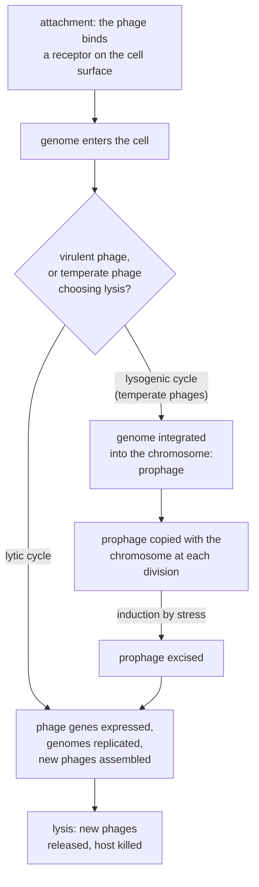

---
aliases:
  - Phage
  - Bacteriophages
  - Lytic Cycle
  - Lysogenic Cycle
  - Prophage
  - Temperate Phage
  - Bactériophage
tags:
  - type/concept
  - domain/biology
  - domain/bioinformatics
  - level/L2
  - level/L3
mastery: 0
prerequisites:
  - "[[Virus]]"
  - "[[Bacteria]]"
  - "[[Bacterial Growth]]"
related:
  - "[[Horizontal Gene Transfer]]"
  - "[[Plasmid]]"
  - "[[Baltimore Classification]]"
  - "[[CRISPR-Cas System]]"
  - "[[CRISPR-Cas9]]"
  - "[[Restriction Enzyme]]"
  - "[[Pathogen]]"
  - "[[Lotka-Volterra Model]]"
  - "[[Sanger Sequencing]]"
  - "[[Molecular Cloning]]"
  - "[[Metagenomics]]"
projects: []
sources:
  - "[[Biology 2e (OpenStax)]]"
  - "[[Microbiology (OpenStax)]]"
  - "[[Waldor 1996 - Lysogenic Conversion by a Filamentous Phage Encoding Cholera Toxin]]"
  - "[[Barrangou 2007 - CRISPR Provides Acquired Resistance Against Viruses in Prokaryotes]]"
  - "[[Luria 1943 - Mutations of Bacteria from Virus Sensitivity to Virus Resistance]]"
  - "[[Sanger 1977 - DNA Sequencing with Chain-Terminating Inhibitors]]"
  - "[[Molecular Biology of the Cell (Alberts)]]"
  - "[[Molecular Cell Biology (Lodish)]]"
  - "[[NobelPrize.org]]"
---

# Bacteriophage

> [!abstract]
> A bacteriophage is a virus that infects bacteria. It either multiplies and bursts its host (lytic cycle) or settles into the host's chromosome as a prophage (lysogenic cycle); both ways, phages shape bacterial evolution, and they have given molecular biology many of its tools.

## Definition

**Bacteriophages** (phages) are viruses that infect bacteria.[^os212] Like every virus they multiply only inside a host cell ([[Virus]]); many have a head-and-tail structure, with the genome packed in the head.[^os211] **Virulent** phages follow only the **lytic cycle**, which ends by lysing the host; **temperate** phages can also follow the **lysogenic cycle**, in which their genome joins the bacterial chromosome as a **prophage** and is copied with it.[^os212][^mvir]

## Why it matters

- **Prophages are part of bacterial genomes.** A bacterial assembly contains the prophages of its strain, and they can carry virulence genes: the cholera toxin genes of *Vibrio cholerae* belong to a phage, CTXφ.[^waldor] Annotating a pathogen genome includes finding its prophages ([[Gene Annotation]], [[Pathogen]]).
- **Phages move bacterial genes** between cells by transduction ([[Horizontal Gene Transfer]]).[^m11]
- **Phage defenses became tools.** Restriction enzymes protect bacteria against infecting phages ([[Restriction Enzyme]]),[^alberts] and CRISPR arrays give them acquired, sequence-specific resistance to phages ([[CRISPR-Cas System]]);[^barrangou] a CRISPR-Cas9 method for genome editing received the 2020 Nobel Prize in Chemistry ([[CRISPR-Cas9]]).[^nobel]
- **Invisible to 16S surveys.** Like all viruses, phages use the host's machinery to make their proteins and have no ribosomes of their own,[^osvir] so they carry no ribosomal RNA genes and their diversity is studied from viral sequences in metagenomes ([[Virus#Why it matters]], [[Metagenomics]]).

## Core (L2)

### Two cycles



| | Lytic cycle | Lysogenic cycle |
|---|---|---|
| Phages | virulent and temperate | temperate only |
| Phage genome | replicated on its own, many copies | integrated as a prophage, inherited by both daughter cells |
| Host | killed by lysis | survives and keeps dividing |
| Ends with | release of new phages | induction, then a lytic cycle |

Attachment is specific, as for all viruses: the phage's attachment proteins must recognize a receptor on the bacterial surface, which sets its host range.[^os212] Many tailed phages inject their genome through the tail and leave the empty capsid outside.[^os212] Environmental stress, such as starvation or toxic chemicals, can induce a prophage to leave the chromosome and enter the lytic cycle.[^os212]

### Counting phages: plaques

Mixed with bacteria and spread on a plate, each infectious phage starts rounds of infection and lysis that clear a spot in the bacterial lawn, a **plaque**. Counting plaques on a plate from a known dilution gives the titer in plaque-forming units (PFU) per mL.[^mvir] The number of phages released per infected cell is the **burst size** ([[Virus#Mathematical representation]]).

### Phages and bacterial evolution

- **Transduction.** In generalized transduction, a capsid packages host DNA by mistake and delivers it to the next cell; in specialized transduction, a prophage leaving the chromosome imprecisely takes neighbouring genes with it.[^m11]
- **Lysogenic conversion.** Prophage genes can change what the host does. The cholera toxin genes are carried by CTXφ, a filamentous phage related to coliphage M13, whose genome integrates into the *V. cholerae* chromosome or replicates as a plasmid, and which enters the cell through the toxin-coregulated pilus, a colonization factor of the bacterium.[^waldor] A harmless strain becomes toxigenic by infection.
- **An arms race.** Phages select for bacterial defenses. Resistance mutations arise at random before any contact with the phage: Luria and Delbrück showed it with the fluctuation test (Exercise 3).[^luria] Restriction enzymes cut unmethylated foreign DNA.[^alberts] And in *Streptococcus thermophilus*, bacteria surviving a phage challenge had inserted new spacers derived from the phage genome into their CRISPR arrays; adding or removing spacers changed their resistance, whose specificity followed spacer-phage sequence similarity.[^barrangou]

### Phages as tools

| Tool | What phage biology provided |
|---|---|
| Proof that mutations are random | phage resistance as a selectable trait in the fluctuation test[^luria] |
| DNA sequencing | the DNA of phage φX174, sequenced to demonstrate the chain-termination method ([[Sanger Sequencing]])[^sanger] |
| Cloning vectors | λ phage vectors for cloning DNA and building libraries ([[Molecular Cloning]])[^lodish] |
| Phage display | phages carrying a peptide or antibody on their surface, selected by what they bind; half of the 2018 Nobel Prize in Chemistry, "for the phage display of peptides and antibodies"[^nobel] |
| Genome editing | the anti-phage CRISPR-Cas system,[^barrangou] origin of the CRISPR-Cas9 method ([[CRISPR-Cas9]])[^nobel] |

## Advanced (L3)

- **Predator and prey.** Phages and bacteria form a predator-prey system: in the mass-action model below, a phage population can only grow when hosts exceed a threshold density, and the equilibrium phage density is set by the host's growth rate, not by the burst size ([[Lotka-Volterra Model]]).
- **Prophages in genome data.** A prophage appears in an assembly as a block of phage genes (integrase, capsid, tail, lysis genes) inside the chromosome; present in one strain and absent from a close relative, it is a strain-specific region of the [[Pangenome]], as CTXφ separates toxigenic from non-toxigenic cholera strains.[^waldor] Its composition can also differ from the host's ([[Horizontal Gene Transfer#Advanced (L3)]]).
- **Spacers as a record.** Because spacers are copied from phage genomes,[^barrangou] a spacer that matches a viral contig from a metagenome links that virus to a host lineage that met it or a close relative: a host-assignment method that works without culture ([[Metagenomics]]).

## Mathematical representation

**Titer.** A plate receiving volume $V$ (mL) of the dilution $10^{-d}$ shows $n$ plaques: the stock contains

$$T = \frac{n}{V \cdot 10^{-d}} \ \text{PFU/mL}.$$

If phages are spread at random, $n$ is approximately Poisson-distributed, so its relative standard error is about $1/\sqrt{n}$ ([[Poisson Distribution]]): count the plate with the most plaques that can still be told apart.

**Phage-bacteria dynamics (a mass-action model).** Bacteria $B$ (cells/mL) grow at rate $r$; phages $P$ (PFU/mL) adsorb at rate $k B P$, each adsorption kills a cell and, after lysis, yields $\beta$ phages (burst size); free phages decay at rate $m$:

$$\frac{dB}{dt} = rB - kBP, \qquad \frac{dP}{dt} = (\beta - 1)\,kBP - mP.$$

The phage population grows only if $(\beta - 1)kB > m$, that is above the threshold host density

$$B_{\text{th}} = \frac{m}{(\beta - 1)k}.$$

At the coexistence equilibrium, $B^* = B_{\text{th}}$ and $P^* = r/k$. The model ignores the latent period, lysogeny and resistance.

## Computational representation

```python
import math

# Invented plaque assay: 0.1 mL of each tenfold dilution plated on a bacterial lawn
PLATES = {5: "too many to count", 6: 152, 7: 17}   # dilution exponent d (10^-d) -> plaques


def titer(plaques: int, dilution_exponent: int, volume_ml: float = 0.1) -> float:
    """Plaque-forming units per mL of the undiluted stock."""
    return plaques / (volume_ml * 10 ** -dilution_exponent)


for d, count in PLATES.items():
    if isinstance(count, int):
        print(f"10^-{d}: {count:3d} plaques -> {titer(count, d):.2e} PFU/mL "
              f"(relative error ~{1 / math.sqrt(count):.0%})")

# Invented one-step growth experiment: 2.0e6 infected cells release 1.1e8 phages
print("burst size:", round(1.1e8 / 2.0e6))


def simulate(b0: float, p0: float, burst: int = 50, k: float = 1e-8, decay: float = 0.1,
             r: float = 0.0, hours: float = 10, dt: float = 0.001) -> tuple:
    """Euler integration of dB/dt = rB - kBP, dP/dt = (burst - 1)kBP - decay*P (invented rates)."""
    b, p = b0, p0
    for _ in range(int(hours / dt)):
        infections = k * b * p
        b, p = b + (r * b - infections) * dt, p + ((burst - 1) * infections - decay * p) * dt
    return b, p


threshold = 0.1 / ((50 - 1) * 1e-8)
print(f"threshold host density: {threshold:.2e} cells/mL")
for b0 in (1e5, 1e6):
    b, p = simulate(b0, 1e4)
    print(f"B0 = {b0:.0e}: after 10 h, B = {b:.2e}, P = {p:.2e}")
```

```text
10^-6: 152 plaques -> 1.52e+09 PFU/mL (relative error ~8%)
10^-7:  17 plaques -> 1.70e+09 PFU/mL (relative error ~24%)
burst size: 55
threshold host density: 2.04e+05 cells/mL
B0 = 1e+05: after 10 h, B = 9.99e+04, P = 6.00e+03
B0 = 1e+06: after 10 h, B = 9.88e+05, P = 4.87e+05
```

With the same phage and invented rates (non-growing hosts, $r = 0$), $10^5$ cells/mL lie below the threshold of $2.0 \times 10^5$: the phages decay. At $10^6$ cells/mL they multiply about fiftyfold in 10 hours.

## Worked example

> [!example] Titering a phage stock (invented counts)
> A stock is diluted tenfold in series and 0.1 mL of each dilution is plated with bacteria. The $10^{-5}$ plate is cleared almost completely, the $10^{-6}$ plate shows 152 plaques and the $10^{-7}$ plate 17.
> 1. **Choose the plate.** $10^{-5}$ cannot be counted. Both other plates can, but 152 plaques give a relative error near $1/\sqrt{152} \approx 8\%$, against $24\%$ for 17.
> 2. **Compute.** $T = 152 / (0.1 \times 10^{-6}) = 1.52 \times 10^9$ PFU/mL.
> 3. **Check consistency.** The $10^{-7}$ plate predicts $1.7 \times 10^9$ PFU/mL: tenfold fewer plaques, as expected, within counting error.
> 4. **Use it.** To infect $10^8$ cells at one phage per cell on average, add $10^8 / 1.52 \times 10^9 \approx 0.066$ mL of stock; the fraction of cells infected then follows the Poisson model of [[Virus#Worked example]].

## Common misconceptions

> [!warning] "A lysogenic phage is inactive"
> The prophage is replicated with the chromosome and can be induced into the lytic cycle;[^os212] its genes can also change the host's phenotype, as cholera toxin shows.[^waldor]

> [!warning] "Bacteria become resistant because the phage induces resistance"
> Resistance mutations arise at random before contact with the phage; the phage only selects them.[^luria] Acquired CRISPR resistance is different: the spacer is taken from the phage itself.[^barrangou]

> [!warning] "Each plaque is made by many phages"
> A plaque grows from a single infectious particle; that is why plaque counts measure infectious units (PFU), not total particles.[^mvir]

## Exercises

> [!question] Exercise 1 (L2)
> Lytic or lysogenic? (a) A dense culture becomes clear two hours after a phage is added. (b) A strain grows normally, but releases phages when exposed to a toxic chemical. (c) A toxigenic isolate carries its toxin genes inside a block of phage genes, which a non-toxigenic relative lacks.

> [!success]- Solution
> (a) Lytic: the infected cells lyse, clearing the culture. (b) Lysogenic: the strain carries a prophage, induced by stress into the lytic cycle.[^os212] (c) Lysogenic conversion: the toxin genes came with a prophage, as for cholera toxin and CTXφ.[^waldor]

> [!question] Exercise 2 (L2)
> 0.1 mL of a $10^{-8}$ dilution of a phage lysate gives 64 plaques. Give the titer and its approximate relative error. How much lysate is needed to add $5 \times 10^9$ PFU to a culture?

> [!success]- Solution
> $T = 64 / (0.1 \times 10^{-8}) = 6.4 \times 10^{10}$ PFU/mL, with a relative error near $1/\sqrt{64} = 12.5\%$. Volume: $5 \times 10^9 / 6.4 \times 10^{10} \approx 0.078$ mL.

> [!question] Exercise 3 (L2, Python)
> In one series of 20 parallel cultures, Luria and Delbrück counted phage-resistant bacteria: 11 cultures with none, the others 1, 1, 3, 5, 5, 6, 35, 64 and 107.[^luria] Compute the mean, the variance and their ratio. Which hypothesis does the ratio support, and why?

> [!success]- Solution
> ```python
> counts = [0] * 11 + [1, 1, 3, 5, 5, 6, 35, 64, 107]
> mean = sum(counts) / len(counts)
> var = sum((c - mean) ** 2 for c in counts) / (len(counts) - 1)
> print(round(mean, 2), round(var, 1), round(var / mean, 1))
> ```
> ```text
> 11.35 752.1 66.3
> ```
> If the phage induced resistance, each culture would yield resistant cells independently with a small probability per cell, and counts would be close to Poisson, with variance about equal to the mean. A variance 66 times the mean ("jackpots" of 35, 64 and 107) means that mutations arose at random times during growth before plating, and early mutations left large resistant clones.[^luria]

> [!question] Exercise 4 (L3)
> In the mass-action model, compute $B_{\text{th}}$ and $P^*$ for $\beta = 100$, $k = 10^{-8}$ mL/h, $m = 0.2$ h⁻¹ and $r = 0.5$ h⁻¹ (invented values). Then double the burst size. What changes, and what does not?

> [!success]- Solution
> $B_{\text{th}} = 0.2 / (99 \times 10^{-8}) \approx 2.0 \times 10^5$ cells/mL and $P^* = 0.5 / 10^{-8} = 5 \times 10^7$ PFU/mL. With $\beta = 200$: $B_{\text{th}} = 0.2 / (199 \times 10^{-8}) \approx 1.0 \times 10^5$ cells/mL, halved, while $P^*$ stays at $5 \times 10^7$. A more productive phage holds its hosts at a lower density, but the phage level at equilibrium is set by how fast the hosts grow, as in [[Lotka-Volterra Model|Lotka-Volterra]] predator-prey models.

> [!question] Exercise 5 (L3)
> A CRISPR array in a bacterial genome from a metagenome contains a 32-nt spacer identical to a segment of a viral contig from the same sample. What can you conclude, and what are the limits of the inference?

> [!success]- Solution
> Spacers are acquired from phage genomes during infection,[^barrangou] so the lineage of this bacterium has most likely met this virus or a close relative of it: a host assignment for the viral contig. Limits: the spacer may have been acquired from a related phage sharing that segment; a match says the virus can infect, or once infected, this lineage, not that it does so now; and the absence of a matching spacer is no evidence that the virus cannot infect this lineage. Confirm by other signals, such as a prophage of the virus in the host genome ([[Sequence Alignment]]).

## Mastery checklist

- [ ] 1 Recognized: I can define a bacteriophage and contrast virulent and temperate phages, lytic and lysogenic cycles.
- [ ] 2 Understood: I can explain induction, transduction, lysogenic conversion and the main bacterial defenses against phages.
- [ ] 3 Practiced: I can compute titers and their errors from plaque counts, burst sizes, and the threshold of the phage-bacteria model.
- [ ] 4 Applied: I located the prophages of a real bacterial genome and checked whether they carry virulence or resistance genes.
- [ ] 5 Explained: I can teach how phages drive bacterial evolution and how phage biology produced sequencing, cloning, phage display and genome editing tools.

## References

[^osvir]: [[Biology 2e (OpenStax)]], chapter "Viruses" (viruses replicate only inside host cells, using the host's machinery to make their proteins).
[^os211]: [[Biology 2e (OpenStax)]], section 21.1 "Viral Evolution, Morphology, and Classification" (head-and-tail structure of many bacteriophages).
[^os212]: [[Biology 2e (OpenStax)]], section 21.2 "Virus Infections and Hosts" (bacteriophages; attachment specificity and host range; lytic and lysogenic cycles; prophage; induction by environmental stress).
[^mvir]: [[Microbiology (OpenStax)]], treatment of viruses (virulent and temperate phages, plaque assays and plaque-forming units); chapter number not verified.
[^m11]: [[Microbiology (OpenStax)]], ch. 11 "Mechanisms of Microbial Genetics" (generalized and specialized transduction).
[^waldor]: [[Waldor 1996 - Lysogenic Conversion by a Filamentous Phage Encoding Cholera Toxin]], *Science* 272:1910-1914.
[^barrangou]: [[Barrangou 2007 - CRISPR Provides Acquired Resistance Against Viruses in Prokaryotes]], *Science* 315:1709-1712.
[^luria]: [[Luria 1943 - Mutations of Bacteria from Virus Sensitivity to Virus Resistance]], *Genetics* 28:491-511.
[^sanger]: [[Sanger 1977 - DNA Sequencing with Chain-Terminating Inhibitors]], *PNAS* 74:5463-5467.
[^alberts]: [[Molecular Biology of the Cell (Alberts)]], 4th ed. (2002), treatment of restriction-modification systems (restriction enzymes destroy foreign DNA such as that of infecting phages; the cell's own DNA is protected by methylation).
[^lodish]: [[Molecular Cell Biology (Lodish)]], 4th ed. (2000), treatment of recombinant DNA (λ phage cloning vectors and DNA libraries).
[^nobel]: [[NobelPrize.org]], "The Nobel Prize in Chemistry 2018" (prize motivation for George P. Smith and Gregory P. Winter) and "The Nobel Prize in Chemistry 2020" (Emmanuelle Charpentier and Jennifer Doudna, "for the development of a method for genome editing").
