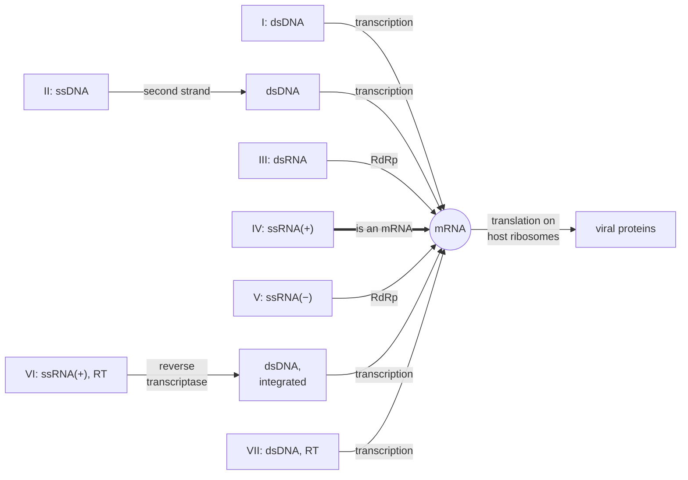

---
aliases:
  - Baltimore Groups
  - Baltimore Scheme
  - Baltimore Classes
  - Classification de Baltimore
tags:
  - type/concept
  - domain/biology
  - domain/bioinformatics
  - level/L2
  - level/L3
mastery: 0
prerequisites:
  - "[[Virus]]"
  - "[[Central Dogma]]"
  - "[[Messenger RNA]]"
  - "[[Reverse Complement]]"
related:
  - "[[Reverse Transcription]]"
  - "[[Bacteriophage]]"
  - "[[RNA Sequencing]]"
  - "[[Sequencing Library Preparation]]"
  - "[[Metagenomics]]"
  - "[[Genetic Code]]"
  - "[[Tree of Life]]"
projects: []
sources:
  - "[[Biology 2e (OpenStax)]]"
  - "[[Baltimore 1971 - Expression of Animal Virus Genomes]]"
  - "[[Baltimore 1970 - An RNA Polymerase in the Virion of Vesicular Stomatitis Virus]]"
  - "[[Baltimore 1970 - RNA-Dependent DNA Polymerase in Virions of RNA Tumour Viruses]]"
  - "[[Koonin 2021 - The Baltimore Classification of Viruses 50 Years Later]]"
  - "[[Molecular Biology of the Cell (Alberts)]]"
---

# Baltimore Classification

> [!abstract]
> The Baltimore classification sorts viruses into seven groups by one question: starting from the genome inside the particle, how does the virus make its mRNA? The answer fixes which enzymes the virus must bring, and how its genome must be handled in the laboratory and in sequence data.

## Definition

The **Baltimore classification** groups viruses by the type of nucleic acid in their genome (DNA or RNA, single- or double-stranded, and the sense of a single strand) and by the way the genome is used to produce mRNA.[^os211] David Baltimore proposed it in 1971: viruses fall into classes, each with its own way of transmitting its genetic information from one generation to the next and its own style of expressing it.[^balt71] The six original classes were later completed by a seventh.[^koonin] A **positive-sense** (+) strand has the same sequence as mRNA; a **negative-sense** (−) strand is complementary to it.[^os211]

## Why it matters

- **Sense decides how to read the data.** A negative-sense genome is the reverse complement of its mRNAs ([[Reverse Complement]]): reads from genome copies map antisense to the viral genes, reads from transcripts map sense, and a strand-specific library keeps the two apart ([[RNA Sequencing]], [[Sequencing Library Preparation]]).
- **The class predicts the laboratory route.** RNA genomes must be copied into DNA before sequencing ([[Virus#Why it matters]], [[Reverse Transcription]]).
- **Hallmark genes for virus discovery.** Viruses of groups III to V must encode an RNA-dependent RNA polymerase, and those of groups VI and VII a reverse transcriptase,[^alberts] which makes these genes the natural search targets for RNA and reverse-transcribing viruses in metatranscriptomes and metagenomes ([[Metagenomics]]).
- **Classes are not clades.** The RNA and reverse-transcribing classes share an origin, but DNA viruses arose many times independently:[^koonin] a Baltimore group is a strategy, not a lineage to put on one tree.

## Core (L2)

### mRNA at the center

Every class is a route to mRNA, which the host's ribosomes translate ([[Messenger RNA]]).[^os211][^balt71]



RdRp: RNA-dependent RNA polymerase. RT: reverse transcriptase.

### The seven classes

| Class | Genome | Route to mRNA | Example[^os211] |
|---|---|---|---|
| I | double-stranded DNA | transcription, as for host genes | herpes simplex virus |
| II | single-stranded DNA | made double-stranded, then transcribed | canine parvovirus |
| III | double-stranded RNA | mRNA copied from the RNA genome by RdRp | rotavirus |
| IV | single-stranded RNA, + sense | the genome itself serves as mRNA | poliovirus |
| V | single-stranded RNA, − sense | mRNA copied from the genome by RdRp | influenza virus |
| VI | single-stranded RNA, + sense, reverse-transcribing | RNA → DNA, integrated, then transcribed | HIV |
| VII | double-stranded DNA, reverse-transcribing | transcribed; new genomes made from an RNA intermediate by RT | hepatitis B virus |

Host cells copy DNA into DNA and transcribe DNA into RNA, but they do not copy RNA from an RNA template for their own genes, nor reverse-transcribe them: groups III to V must encode an RdRp, groups VI and VII a reverse transcriptase.[^alberts] Groups VI and VII both use reverse transcription, at opposite points of the cycle: VI packages RNA and makes DNA after entry, VII packages DNA and uses an RNA intermediate to make new genomes.[^os211]

### When the polymerase must travel inside the particle

A virus whose genome cannot be translated on arrival, and whose first step needs an enzyme the cell lacks, must bring that enzyme in the virion: nothing can be made before it acts. Two 1970 discoveries showed it. The RNA of vesicular stomatitis virus, a negative-strand virus, is not infectious on its own, and its particles contain an enzyme that makes RNA complementary to the genome.[^vsv] Particles of RNA tumour viruses contain a DNA polymerase that copies RNA into DNA, the reverse transcriptase.[^rt] A + sense genome, by contrast, is translated first, so its RdRp is made after entry (Computational representation).

## Advanced (L3)

### Classes and evolution

- **Shared and independent origins.** The five RNA and reverse-transcribing classes (III to VII) share an origin; single-stranded and double-stranded DNA viruses evolved on multiple independent occasions.[^koonin] A phylogeny of "all dsDNA viruses" would mix unrelated lineages; within the RNA and reverse-transcribing classes, a common origin makes deep comparisons meaningful.
- **Classes and realms.** Phylogenomic analyses now trace the connections between the Baltimore classes and the monophyletic **realms**, the highest ranks of virus taxonomy.[^koonin] Taxonomy follows ancestry; the Baltimore scheme follows strategy, and both are used side by side.
- **Deep time.** Most classes probably emerged in the earliest era of life, among primordial replicators, before modern-like cells with large dsDNA genomes.[^koonin]
- **Unrealized schemes.** Many expression-replication schemes that are logically admissible do not appear to exist in nature (Exercise 4).[^koonin]

### Strand-aware analysis of infected cells

Replicating a − sense genome requires a full-length + copy, and the mRNAs are + strands too, while the genome copies are −. Reads from a strand-specific library of infected cells therefore split into an antisense population (genomes) and a sense population (mRNAs and + copies), and their ratio follows the balance between replication and transcription. For a + sense virus, genomes and mRNAs share the sense orientation, and the − strand appears only as a replication intermediate.

## Mathematical representation

**Information-flow graph.** Let the nucleic acid species be nodes and each enzymatic step an edge from template to product, labelled by its activity: DNA→DNA, DNA→RNA, RNA→RNA or RNA→DNA. A class $c$ is described by its genome $G_c$, its expression path $E_c$ (the steps from $G_c$ to mRNA) and its replication path $R_c$ (the steps that produce new genomes).

**Requirements.** With $H = \{\text{DNA→DNA}, \text{DNA→RNA}\}$ the activities a host cell runs for its own genes, the virus must supply

$$V_c = (E_c \cup R_c) \setminus H,$$

and must carry an enzyme in the particle when

$$\pi_c = \big[E_c \neq \varnothing \ \wedge \ \text{first}(E_c) \notin H\big].$$

**Sense.** Over $\{A, C, G, U\}$, with the reverse complement $\mathrm{rc}$ of [[DNA#Mathematical representation]], a single-stranded genome $g$ (written 5' → 3') gives the mRNA

$$m = g \ \text{if + sense}, \qquad m = \mathrm{rc}(g) \ \text{if − sense},$$

and since $\mathrm{rc}$ is an involution, $g = \mathrm{rc}(m)$: a − sense genome can be annotated by translating its reverse complement ([[Genetic Code]]).

## Computational representation

```python
HOST = {"DNA->DNA", "DNA->RNA"}     # template -> product activities a cell runs for its own genes
ENZYME = {"DNA->DNA": "DNA polymerase", "DNA->RNA": "transcription",
          "RNA->RNA": "RNA-dependent RNA polymerase", "RNA->DNA": "reverse transcriptase"}

# class: (genome, steps from genome to mRNA, steps from mRNA or genome back to new genomes)
CLASSES = {
    "I":   ("dsDNA",       ["DNA->RNA"],             ["DNA->DNA"]),
    "II":  ("ssDNA",       ["DNA->DNA", "DNA->RNA"], ["DNA->DNA"]),
    "III": ("dsRNA",       ["RNA->RNA"],             ["RNA->RNA"]),
    "IV":  ("ssRNA(+)",    [],                       ["RNA->RNA"]),   # the genome is an mRNA
    "V":   ("ssRNA(-)",    ["RNA->RNA"],             ["RNA->RNA"]),
    "VI":  ("ssRNA(+)-RT", ["RNA->DNA", "DNA->RNA"], ["RNA->DNA", "DNA->RNA"]),
    "VII": ("dsDNA-RT",    ["DNA->RNA"],             ["DNA->RNA", "RNA->DNA"]),
}


def requirements(expression: list, replication: list) -> tuple:
    """Activities the virus must supply, and whether one must already be in the virion."""
    must_encode = sorted({ENZYME[s] for s in expression + replication if s not in HOST})
    in_virion = bool(expression) and expression[0] not in HOST   # needed before any translation
    return must_encode, in_virion


print(f"{'class':5s} {'genome':12s} {'in virion':9s} must encode")
for name, (genome, expression, replication) in CLASSES.items():
    encode, packaged = requirements(expression, replication)
    print(f"{name:5s} {genome:12s} {'yes' if packaged else 'no':9s} {', '.join(encode) or '-'}")

COMPLEMENT = str.maketrans("ACGU", "UGCA")


def mrna_from_genome(genome: str, sense: str) -> str:
    """mRNA 5'->3' from a single-stranded RNA genome written 5'->3'."""
    return genome if sense == "+" else genome.translate(COMPLEMENT)[::-1]


fragment = "UUACUUUGAAGCCAU"            # invented negative-sense fragment, 5'->3'
mrna = mrna_from_genome(fragment, "-")
print(mrna, [mrna[i:i + 3] for i in range(0, len(mrna), 3)])
```

```text
class genome       in virion must encode
I     dsDNA        no        -
II    ssDNA        no        -
III   dsRNA        yes       RNA-dependent RNA polymerase
IV    ssRNA(+)     no        RNA-dependent RNA polymerase
V     ssRNA(-)     yes       RNA-dependent RNA polymerase
VI    ssRNA(+)-RT  yes       reverse transcriptase
VII   dsDNA-RT     no        reverse transcriptase
AUGGCUUCAAAGUAA ['AUG', 'GCU', 'UCA', 'AAG', 'UAA']
```

The table is a minimum derived from the model: it says what a virus cannot do without, not that viruses encode nothing more. The two "yes" rows of groups V and VI are the 1970 observations;[^vsv][^rt] the invented fragment reads Met-Ala-Ser-Lys-stop only once reverse-complemented.

## Worked example

> [!example] Placing a new RNA virus (invented data)
> A stranded metatranscriptome of infected cells contains a viral contig. 90% of its reads map antisense to its open reading frames, 10% sense. Its longest ORF resembles an RNA-dependent RNA polymerase; no reverse transcriptase-like gene is found.
> 1. **RNA virus with an RdRp, no RT**: groups III to V.
> 2. **Strand balance.** Most viral RNA molecules are complementary to the mRNAs, so the abundant genome copies are − sense. A + sense virus would show mostly sense reads, a double-stranded RNA genome both strands in similar amounts.
> 3. **Classification**: group V, like influenza virus.
> 4. **Predictions**: the particles carry the RdRp, the purified genome alone should not be infectious, and the proteins are read from the reverse complement of the genome (`mrna_from_genome(..., "-")`).
> 5. **Caveat**: the class is inferred from expression data; it says nothing yet about the virus's lineage, which needs a phylogeny of its RdRp.

## Common misconceptions

> [!warning] "Baltimore classes are taxonomic groups"
> They group replication and expression strategies. DNA viruses with the same strategy arose several times independently, so a class can contain unrelated lineages.[^koonin]

> [!warning] "Positive-sense RNA viruses do not need an RNA polymerase"
> They need an RdRp to copy their genome, but they make it after entry by translating the genome, so they do not have to carry it in the particle.

> [!warning] "Retroviruses and hepatitis B virus belong together because both use reverse transcriptase"
> They use it at opposite steps: retroviruses package RNA and reverse-transcribe it after entry; hepatitis B virus packages DNA and reverse-transcribes an RNA intermediate to make new genomes.[^os211]

> [!warning] "Antisense reads from a viral contig are artefacts"
> For a negative-sense virus they are expected: the genome is the reverse complement of the mRNAs.

## Exercises

> [!question] Exercise 1 (L2)
> Give the Baltimore group of these invented viruses: (a) a single-stranded RNA genome that can be translated directly; (b) a double-stranded RNA genome; (c) a single-stranded DNA genome; (d) a single-stranded RNA genome complementary to the viral mRNAs; (e) a double-stranded DNA genome replicated through an RNA copy.

> [!success]- Solution
> (a) IV. (b) III. (c) II. (d) V. (e) VII. Among the RNA viruses, only (a) needs no enzyme from the particle in the requirement model (`requirements` returns `False` for group IV).

> [!question] Exercise 2 (L2)
> A fragment of a negative-sense RNA genome reads 5'-CAUUUUCCAGCCAUGGC-3' (invented). Write the mRNA it templates, 5' → 3', and translate from the first AUG.

> [!success]- Solution
> Reverse complement: 5'-GCCAUGGCUGGAAAAUG-3' (`mrna_from_genome("CAUUUUCCAGCCAUGGC", "-")` prints it). From the first AUG: AUG GCU GGA AAA → Met-Ala-Gly-Lys ([[Genetic Code]]). Read directly, the genome strand would give a different, meaningless sequence.

> [!question] Exercise 3 (L2)
> Why is the purified RNA of vesicular stomatitis virus not infectious, while the model predicts that the genome of a + sense virus such as poliovirus could start an infection on its own?

> [!success]- Solution
> The VSV genome is − sense: the cell cannot translate it and has no RNA-dependent RNA polymerase to copy it, so infection needs the polymerase carried in the particle, which purified RNA lacks.[^vsv] A + sense genome is an mRNA: host ribosomes translate it on arrival, producing the RdRp that then copies the genome. In the model, $\pi_c$ is false for group IV and true for group V.

> [!question] Exercise 4 (L3, Python)
> With `requirements`, analyse two invented schemes: a − sense RNA genome reverse-transcribed into DNA that is then transcribed, and a double-stranded RNA genome expressed by RdRp but replicated through a DNA copy. What would each virus need? Then explain why the existence of a logically consistent scheme does not mean that it occurs.

> [!success]- Solution
> ```python
> print(requirements(["RNA->DNA", "DNA->RNA"], ["RNA->DNA", "DNA->RNA"]))   # (-) RNA with RT
> print(requirements(["RNA->RNA"], ["RNA->DNA", "DNA->RNA"]))               # dsRNA with RT
> ```
> ```text
> (['reverse transcriptase'], True)
> (['RNA-dependent RNA polymerase', 'reverse transcriptase'], True)
> ```
> Both are consistent: the first needs a packaged RT, the second a packaged RdRp plus an RT. Logical admissibility is only a necessary condition; many admissible schemes do not appear to be realized in nature, a question of evolutionary history rather than of logic.[^koonin]

> [!question] Exercise 5 (L3)
> Cells infected by a group III, a group IV and a group V virus are sequenced with a strand-specific RNA-seq protocol. For each virus, predict the orientation of the viral reads relative to the viral ORFs, and say how you could follow the onset of genome replication over time.

> [!success]- Solution
> Group III: both strands, since the genome is double-stranded and the mRNAs add sense reads. Group IV: mostly sense (genomes and mRNAs are + strands); antisense reads come only from the − replication intermediate, so their rise marks replication. Group V: antisense reads from genomes and sense reads from mRNAs and + copies; early in infection the sense fraction reflects transcription by the incoming polymerase, and the later increase of antisense reads marks genome replication. Library protocols differ in which strand they report, so check the convention on a known transcript first ([[Sequencing Library Preparation]]).

## Mastery checklist

- [ ] 1 Recognized: I can name the seven Baltimore groups with their genome types and one example each.
- [ ] 2 Understood: I can explain why mRNA is the reference point, what + and − sense mean, and why some viruses must carry their polymerase.
- [ ] 3 Practiced: I can derive each group's enzyme requirements and turn a − sense genome into its mRNA in Python.
- [ ] 4 Applied: I classified a real virus from its genome record and its RNA-seq strand profile, and chose the matching sequencing route.
- [ ] 5 Explained: I can teach the difference between a Baltimore class and a lineage, and how strand-aware data reveal a virus's replication.

## References

[^os211]: [[Biology 2e (OpenStax)]], section 21.1 "Viral Evolution, Morphology, and Classification" (the Baltimore classification by genome type and mode of mRNA production; + and − sense; examples of each group).
[^balt71]: [[Baltimore 1971 - Expression of Animal Virus Genomes]], *Bacteriological Reviews* 35:235-241.
[^vsv]: [[Baltimore 1970 - An RNA Polymerase in the Virion of Vesicular Stomatitis Virus]], *PNAS* 66:572-576.
[^rt]: [[Baltimore 1970 - RNA-Dependent DNA Polymerase in Virions of RNA Tumour Viruses]], *Nature* 226:1209-1211.
[^koonin]: [[Koonin 2021 - The Baltimore Classification of Viruses 50 Years Later]], *Microbiology and Molecular Biology Reviews* 85:e00053-21.
[^alberts]: [[Molecular Biology of the Cell (Alberts)]], 4th ed. (2002), treatment of viruses and retroviruses (RNA-dependent RNA polymerases and reverse transcriptase encoded by viruses, integration of retroviral DNA).
