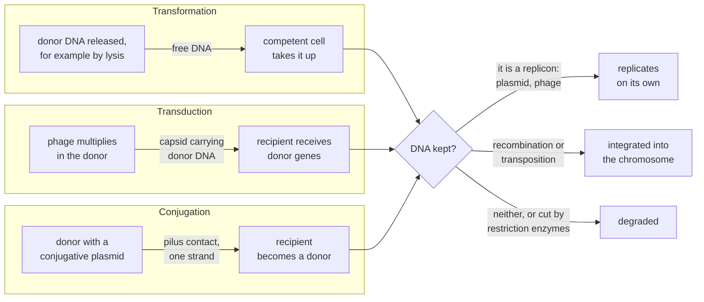

---
aliases:
  - HGT
  - Lateral Gene Transfer
  - LGT
  - Bacterial Transformation
  - Transduction
  - Bacterial Conjugation
  - Transfert horizontal de gènes
tags:
  - type/concept
  - domain/biology
  - domain/bioinformatics
  - level/L2
  - level/L3
mastery: 0
prerequisites:
  - "[[Bacteria]]"
  - "[[Virus]]"
  - "[[Mutation]]"
  - "[[Tree of Life]]"
  - "[[Plasmid]]"
related:
  - "[[Bacteriophage]]"
  - "[[Genetic Recombination]]"
  - "[[Transposable Element]]"
  - "[[Restriction Enzyme]]"
  - "[[GC Content]]"
  - "[[Codon Usage Bias]]"
  - "[[K-mer]]"
  - "[[Antimicrobial Resistance]]"
  - "[[Pangenome]]"
  - "[[Phylogenetic Network]]"
  - "[[Gene Tree Reconciliation]]"
  - "[[Convergent Evolution]]"
projects: []
sources:
  - "[[Microbiology (OpenStax)]]"
  - "[[Biology 2e (OpenStax)]]"
  - "[[Avery 1944 - Chemical Nature of the Substance Inducing Transformation of Pneumococcal Types]]"
  - "[[NobelPrize.org]]"
  - "[[Lawrence 1998 - Molecular Archaeology of the Escherichia coli Genome]]"
  - "[[Ochman 2000 - Lateral Gene Transfer and the Nature of Bacterial Innovation]]"
  - "[[Karlin 1995 - Dinucleotide Relative Abundance Extremes]]"
  - "[[Molecular Biology of the Cell (Alberts)]]"
  - "[[An Introduction to Genetic Analysis (Griffiths)]]"
  - "[[Hug 2016 - A New View of the Tree of Life]]"
---

# Horizontal Gene Transfer

> [!abstract]
> Horizontal gene transfer moves DNA between organisms that are not parent and offspring. Bacteria take up free DNA (transformation), receive it inside a phage (transduction) or from a mating partner (conjugation), and so gain in one step genes that other lineages took millions of years to evolve.

## Definition

**Horizontal (lateral) gene transfer** is the introduction of genetic material from one organism into another within the same generation, as opposed to vertical transmission from parent to offspring.[^m11][^os20] In prokaryotes it occurs by three main mechanisms: **transformation**, the uptake of free DNA from the environment; **transduction**, transfer by a bacteriophage; and **conjugation**, transfer through direct contact between cells, usually encoded by a plasmid.[^m11]

## Why it matters

- **Resistance spreads sideways.** R plasmids carry resistance genes and can be transferred between species by conjugation,[^m11] so a pathogen can become resistant without any mutation in its own lineage ([[Plasmid]], [[Antimicrobial Resistance]]).
- **Bacterial genomes are mosaics.** In *E. coli*, 755 of 4,288 genes entered by at least 234 transfer events since its divergence from *Salmonella*, about 100 million years ago.[^lawrence] Genome annotation, [[Comparative Genomics]] and [[Pangenome]] analyses must expect genes with no relative in closely related species.
- **Gene trees disagree.** Genes of one genome can have different histories, so the tree of a single gene need not be the tree of the organisms; HGT turned the tree of life into a web or network for part of its genes.[^os20] This is why prokaryotic phylogenetics needs [[Gene Tree Reconciliation]] and [[Phylogenetic Network|phylogenetic networks]].

## Core (L2)

### Three mechanisms, one question: is the DNA kept?



| | Transformation | Transduction | Conjugation |
|---|---|---|---|
| Vehicle | free DNA | a phage particle | direct contact through a pilus |
| Donor | releases DNA | is infected by a phage | carries a conjugative element |
| Recipient needs | competence | the phage's receptor ([[Virus#Core (L1)]]) | contact with a donor |
| Amount of DNA | fragments | what fits in a capsid | a plasmid, or long chromosomal segments (Hfr) |

### Transformation

A competent cell takes up DNA released by other cells and can incorporate it into its genome. Some bacterial species are naturally competent.[^m11] Transformation is also where molecular genetics began: a purified DNA fraction from type III pneumococci transformed unencapsulated cells into encapsulated type III cells, and its activity survived protein- and RNA-degrading enzymes but not DNA-degrading ones, identifying DNA as the transforming principle.[^avery] Artificially competent cells are the transformation step of [[Molecular Cloning]].

### Transduction

A phage carries bacterial DNA from one cell to the next ([[Bacteriophage]]).[^m11]

- **Generalized transduction.** During a lytic cycle, a fragment of the host's DNA is packaged by mistake into a capsid; the particle injects it into the next host. Any gene can be transferred.
- **Specialized transduction.** A temperate phage that leaves the chromosome imprecisely takes neighbouring host genes with it; only genes next to its insertion site are transferred.

### Conjugation

A cell carrying the F plasmid (F⁺) makes an F pilus, contacts an F⁻ cell and transfers one strand of the plasmid, which both cells then complete: both end F⁺. When F is integrated in the chromosome (an Hfr cell), transfer starts inside the plasmid and continues into chromosomal genes; R plasmids spread resistance genes the same way, including between species.[^m11] Because Hfr transfer proceeds from a fixed origin and is usually interrupted, the time at which each gene enters the recipient maps its position on the chromosome.[^griffiths] Plasmid transfer genes are described in [[Plasmid#Core (L2)]].

> [!info] History
> Joshua Lederberg received half of the 1958 Nobel Prize in Physiology or Medicine "for his discoveries concerning genetic recombination and the organization of the genetic material of bacteria".[^nobel]

### The fate of incoming DNA

Entry is not enough. Incoming DNA persists only if it can replicate as a replicon (a plasmid or a phage genome), or if it is integrated into the chromosome: by homologous recombination, which needs a stretch of similar sequence, by site-specific recombination, as for prophages, or by transposition.[^m11][^alberts] Otherwise it is degraded, and restriction enzymes cut foreign DNA that lacks the host's protective methylation ([[Restriction Enzyme]]).[^alberts]

### From events to genome evolution

Eukaryotes evolve mainly by modifying genes they already have; bacteria obtain a large share of their diversity by acquiring sequences from distantly related organisms, and their genomes are fluid, with much DNA gained and lost.[^ochman] In *E. coli*, the transferred genes had an average age of 14.4 million years, a transfer rate of 16 kb per million years per lineage; most acquired genes were later deleted, and those that persisted, about 18% of the current chromosome, opened ecological niches otherwise out of reach.[^lawrence]

## Advanced (L3)

### Detecting transferred genes

| Evidence | Idea | Blind spots |
|---|---|---|
| Composition (parametric) | A recent arrival still carries its donor's composition (GC, codon usage, dinucleotide signature), atypical in the host genome[^lawrence][^karlin] | donors with a similar composition; old transfers whose composition has drifted toward the host's; native genes atypical for other reasons ([[Codon Usage Bias]]) |
| Phylogeny (comparative) | The gene's tree conflicts with the species tree, or its closest relatives sit in a distant group; patchy presence across strains | conflicts also come from paralogs ([[Paralog]]), gene loss, [[Incomplete Lineage Sorting]] and tree errors such as [[Long-Branch Attraction]] |

Composition works on a single genome; phylogeny needs many. Composition beyond GC matters: the code below hides a segment with the host's GC content but a different dinucleotide structure, which a GC window cannot see ([[GC Content]]).

### Barriers: who exchanges with whom

Transfer is limited at entry (competence, phage receptors, conjugation machinery), at survival (restriction), and at integration: homologous recombination needs similar flanking sequence, which favours exchange between relatives.[^m11][^alberts] Elements that replicate on their own (plasmids) or bring their own integration machinery (prophages, transposable elements) escape the last barrier ([[Transposable Element]]).

### Trees in a world of transfers

Genome-scale trees of life are built from genes present in nearly all genomes and mostly inherited vertically: one 2016 tree of 3,083 genomes concatenated 16 ribosomal proteins.[^hug] The choice of genes is itself an answer to HGT. Whole-genome histories, with transfers as explicit events, belong to [[Gene Tree Reconciliation]] and [[Phylogenetic Network|networks]] (M1).

## Mathematical representation

**Dinucleotide signature.** For a sequence with base frequencies $f_X$ and dinucleotide frequencies $f_{XY}$, the relative abundance of $XY$ is the observed frequency over its expectation from base composition,[^karlin]

$$\rho_{XY} = \frac{f_{XY}}{f_X\, f_Y}, \qquad X, Y \in \{A, C, G, T\}.$$

Here we compare a window $w$ with the whole genome $g$ by the mean absolute difference of the 16 values,

$$\delta(w, g) = \frac{1}{16} \sum_{X,Y} \left| \rho_{XY}(w) - \rho_{XY}(g) \right|,$$

and flag windows whose $\delta$ exceeds what the genome's own windows show. A segment can keep $f_G + f_C$ equal to the host's while its $\rho$ values differ: GC content is a projection that loses this information.

**Spread of a conjugative plasmid (a mass-action model).** In a population of constant size $N$, let $D$ cells carry the plasmid and $N - D$ not. Transfer happens at rate $\gamma$ per donor-recipient pair, and segregation loss at rate $\lambda$ per carrier:

$$\frac{dD}{dt} = \gamma D (N - D) - \lambda D \quad\Longrightarrow\quad \frac{dp}{dt} = \gamma N p (1 - p) - \lambda p, \quad p = D/N.$$

The plasmid-free state $p = 0$ is unstable when $\gamma N > \lambda$, and carriers then settle at $p^* = 1 - \lambda / (\gamma N)$: in this model, infectious transfer alone can maintain a plasmid that brings no benefit, provided the population is dense enough.

## Computational representation

```python
import random
from itertools import product

BASES = "ACGT"
PARTNER = {"A": "T", "T": "A", "C": "G", "G": "C"}


def markov_sequence(n: int, preferred: dict, rng: random.Random) -> str:
    """First-order chain: the preferred next base has probability 0.4, each other base 0.2."""
    seq = [rng.choice(BASES)]
    for _ in range(n - 1):
        target = preferred[seq[-1]]
        weights = [0.4 if b == target else 0.2 for b in BASES]
        seq.append(rng.choices(BASES, weights)[0])
    return "".join(seq)


def rho(seq: str) -> dict:
    """Dinucleotide relative abundance: observed XY frequency over f(X) * f(Y)."""
    n = len(seq)
    f1 = {b: seq.count(b) / n for b in BASES}
    pairs = [seq[i:i + 2] for i in range(n - 1)]
    f2 = {x + y: 0 for x, y in product(BASES, repeat=2)}
    for p in pairs:
        f2[p] += 1
    return {xy: (c / (n - 1)) / (f1[xy[0]] * f1[xy[1]]) for xy, c in f2.items()}


def delta(r1: dict, r2: dict) -> float:
    """Mean absolute difference between two 16-value signatures."""
    return sum(abs(r1[k] - r2[k]) for k in r1) / 16


def gc(seq: str) -> float:
    return (seq.count("G") + seq.count("C")) / len(seq)


rng = random.Random(42)
host_pref = PARTNER                              # host: AT, TA, CG, GC steps favoured
foreign_pref = {b: b for b in BASES}             # donor: AA, CC, GG, TT steps favoured
genome = (markov_sequence(15_000, host_pref, rng)
          + markov_sequence(3_000, foreign_pref, rng)  # invented transferred segment at 15-18 kb
          + markov_sequence(12_000, host_pref, rng))
reference = rho(genome)
w = 1_000
print("start  GC     delta  flag")
for start in range(0, len(genome), w):
    window = genome[start:start + w]
    d = delta(rho(window), reference)
    if 12_000 <= start < 21_000:                 # print the region around the segment
        print(f"{start:5d}  {gc(window):.3f}  {d:.3f}  {'*' if d > 0.2 else ''}")
deltas = [delta(rho(genome[s:s + w]), reference) for s in range(0, len(genome), w)]
gcs = [gc(genome[s:s + w]) for s in range(0, len(genome), w)]
print("GC range", round(min(gcs), 3), round(max(gcs), 3), "| flagged windows:",
      [i * w for i, d in enumerate(deltas) if d > 0.2])
```

```text
start  GC     delta  flag
12000  0.474  0.067  
13000  0.484  0.099  
14000  0.503  0.101  
15000  0.478  0.420  *
16000  0.503  0.397  *
17000  0.485  0.377  *
18000  0.507  0.100  
19000  0.485  0.045  
20000  0.482  0.121  
GC range 0.47 0.527 | flagged windows: [15000, 16000, 17000]
```

Both chains have uniform base composition by construction (each column of their transition matrices sums to 1), so the segment's GC (0.478 to 0.503) sits inside the host's range (0.47 to 0.527), while its signature distance is three to four times the host's. Real tools use longer words (tetranucleotides, codon usage) and gene-level rather than window-level tests, on the same principle ([[K-mer]], [[Alignment-Free Sequence Comparison]]).

## Worked example

> [!example] Following up a suspicious segment (invented genome above)
> 1. **Signal.** Windows 15 to 18 kb have $\delta \approx 0.38$ to $0.42$, against at most about $0.12$ in the neighbouring host windows, with ordinary GC; being contiguous, they mark one inserted segment of about 3 kb, not scattered noise.
> 2. **Mechanism clues.** Next, annotate the segment's genes: an integrase, transposase or phage genes would point to how it arrived ([[Gene Annotation]]).
> 3. **Second line of evidence.** Search its genes against other genomes: closest relatives in a distant group, a gene tree in conflict with the species tree, or presence in only a few strains would support transfer.
> 4. **Conclusion.** Composition proposes, phylogeny and distribution confirm. Report the segment as a candidate transfer, not a proven one.

## Common misconceptions

> [!warning] "Conjugation is bacterial sex"
> Conjugation is a one-way transfer of DNA from a donor to a recipient; no cells fuse and no new individual is produced.[^m11]

> [!warning] "A transferred gene always looks foreign"
> Only if its donor's composition differed from the host's and the transfer is recent; a GC window can even miss a segment whose dinucleotide structure is foreign (Computational representation).

> [!warning] "Any conflict between a gene tree and the species tree means HGT"
> Paralogy, differential gene loss, incomplete lineage sorting and reconstruction errors produce conflicts too; HGT is one hypothesis to test against them.

## Exercises

> [!question] Exercise 1 (L2)
> Three transfer experiments between a donor and a recipient strain: (a) adding a DNA-degrading enzyme (DNase) to the medium abolishes transfer; (b) transfer still happens when the strains are separated by a filter that stops bacteria but lets phage particles through, and DNase has no effect; (c) transfer needs cell contact and is insensitive to DNase. Name the mechanism in each case and justify.

> [!success]- Solution
> (a) Transformation: only free DNA is exposed to an enzyme in the medium. (b) Transduction: the DNA travels protected inside capsids, which pass the filter. (c) Conjugation: DNA passes directly between cells in contact and is never exposed in the medium. Each test removes one route while leaving the others intact, the same logic of elimination as in the transforming-principle experiments.[^avery]

> [!question] Exercise 2 (L2)
> From the *E. coli* estimate (755 transferred ORFs out of 4,288, in at least 234 events): what fraction of the ORFs were transferred, and what is the largest possible mean number of ORFs per event? Why "at least"?

> [!success]- Solution
> $755 / 4{,}288 \approx 0.176$, about 18%.[^lawrence] At least 234 events means at most $755 / 234 \approx 3.2$ ORFs per event on average. The event count is a lower bound: separate transfers of adjacent, similar genes can look like a single one, so more and smaller events remain possible.

> [!question] Exercise 3 (L2)
> In an interrupted mating with an invented Hfr strain, genes enter the recipient at: *azi* 9 min, *ton* 11 min, *lac* 18 min, *gal* 25 min. A second Hfr strain transfers *gal* at 4 min, *lac* at 11 min and *ton* at 18 min. Give the gene order and distances, and explain what the two strains together show.

> [!success]- Solution
> Strain 1: azi, ton, lac, gal, at 2, 7 and 7 minutes apart. Strain 2 transfers the same genes in the reverse order with the same spacings (gal to lac 7 min, lac to ton 7 min): its origin lies on the other side of *gal* and points the other way. Different Hfr strains giving overlapping, consistently spaced orders, from different starting points and in both directions, are what led to a circular map of the *E. coli* chromosome measured in minutes.[^griffiths]

> [!question] Exercise 4 (L3, Python)
> With `genome`, `rho`, `delta` and `reference` from the code above, compute $\delta$ in non-overlapping windows of 250 bp and of 2,000 bp. For each size, report the largest value among windows outside the 15 to 18 kb segment and the smallest inside it. What does window size trade?

> [!success]- Solution
> ```python
> for size in (250, 2_000):
>     ds = [delta(rho(genome[s:s + size]), reference) for s in range(0, len(genome), size)]
>     host = [d for i, d in enumerate(ds) if not 15_000 <= i * size < 18_000]
>     isl = [d for i, d in enumerate(ds) if 15_000 <= i * size < 18_000]
>     print(size, "host max", round(max(host), 3), "island min", round(min(isl), 3) if isl else None,
>           "island windows", len(isl))
> ```
> ```text
> 250 host max 0.24 island min 0.322 island windows 12
> 2000 host max 0.188 island min 0.37 island windows 1
> ```
> At 250 bp, noise pushes some host windows to 0.24, above the 0.2 threshold used before: short windows locate boundaries finely but raise false positives. At 2 kb, only one window lies entirely in the segment, and the highest "host" value (0.188) is the window from 14 to 16 kb, half inside the segment: long windows are quiet but blur boundaries. The same trade-off as for GC windows ([[GC Content]]).

> [!question] Exercise 5 (L3)
> In the mass-action model, compute the equilibrium carrier fraction $p^*$ for $(\gamma N, \lambda) = (0.05, 0.01)$, $(0.01, 0.01)$ and $(0.005, 0.01)$ per hour (invented values). What does the result say about plasmids in dense versus sparse populations?

> [!success]- Solution
> $p^* = 1 - \lambda/(\gamma N)$ when $\gamma N > \lambda$, else 0: respectively $0.8$, $0$ and $0$. Transfer must outpace loss: at the threshold $\gamma N = \lambda$ the plasmid just fails to invade. Since $\gamma N$ grows with density, the same plasmid can persist without selection in a dense community and disappear in a sparse one, within the limits of this model.

> [!question] Exercise 6 (L3)
> A gene from a bacterium of phylum A has, as its closest relatives, genes from phylum B, while all of its genome's ribosomal-protein genes group with phylum A. List the hypotheses that could explain this and the data that would separate them.

> [!success]- Solution
> (1) Transfer from phylum B. (2) An ancient duplication followed by losses, so that the compared genes are paralogs, not orthologs ([[Paralog]], [[Ortholog]]). (3) Tree artefacts, such as long branches attracting each other ([[Long-Branch Attraction]]). Tests: atypical composition of the gene in its genome (recent transfer); a robust gene tree with the paralogs of both phyla included; distribution of the gene across phylum A (patchy presence fits transfer); flanking mobile-element or phage genes. A transfer is accepted when several independent lines agree.

## Mastery checklist

- [ ] 1 Recognized: I can define horizontal gene transfer and name transformation, transduction and conjugation.
- [ ] 2 Understood: I can explain each mechanism, generalized versus specialized transduction, F⁺, F⁻ and Hfr, and why incoming DNA must replicate or integrate to persist.
- [ ] 3 Practiced: I can identify a mechanism from experimental tests, map genes from Hfr entry times, and compute dinucleotide signatures in Python.
- [ ] 4 Applied: I screened a real bacterial genome for candidate transferred regions with a compositional method and checked one candidate by phylogeny.
- [ ] 5 Explained: I can teach why HGT makes bacterial genomes mosaics, how it complicates the tree of life, and the blind spots of compositional and phylogenetic detection.

## References

[^m11]: [[Microbiology (OpenStax)]], ch. 11 "Mechanisms of Microbial Genetics" (horizontal gene transfer; transformation and competence; generalized and specialized transduction; conjugation with F⁺, F⁻ and Hfr cells; R plasmids; integration of transferred DNA and transposition).
[^os20]: [[Biology 2e (OpenStax)]], ch. 20 "Phylogenies and the History of Life" (horizontal gene transfer and its mechanisms in prokaryotes; web and network models of the tree of life).
[^avery]: [[Avery 1944 - Chemical Nature of the Substance Inducing Transformation of Pneumococcal Types]], *Journal of Experimental Medicine* 79:137-158.
[^griffiths]: [[An Introduction to Genetic Analysis (Griffiths)]], 7th ed. (2000), treatment of bacterial genetics (Hfr crosses, interrupted mating and the mapping of genes by time of entry).
[^alberts]: [[Molecular Biology of the Cell (Alberts)]], 4th ed. (2002), treatment of genetic recombination (homologous recombination requires sequence similarity; site-specific recombination and transposition) and of restriction-modification systems.
[^nobel]: [[NobelPrize.org]], "The Nobel Prize in Physiology or Medicine 1958" (prize motivation for Joshua Lederberg).
[^lawrence]: [[Lawrence 1998 - Molecular Archaeology of the Escherichia coli Genome]], *PNAS* 95:9413-9417.
[^ochman]: [[Ochman 2000 - Lateral Gene Transfer and the Nature of Bacterial Innovation]], *Nature* 405:299-304.
[^karlin]: [[Karlin 1995 - Dinucleotide Relative Abundance Extremes]], *Trends in Genetics* 11:283-290 (dinucleotide relative abundance as a genomic signature).
[^hug]: [[Hug 2016 - A New View of the Tree of Life]], *Nature Microbiology* 1:16048.
