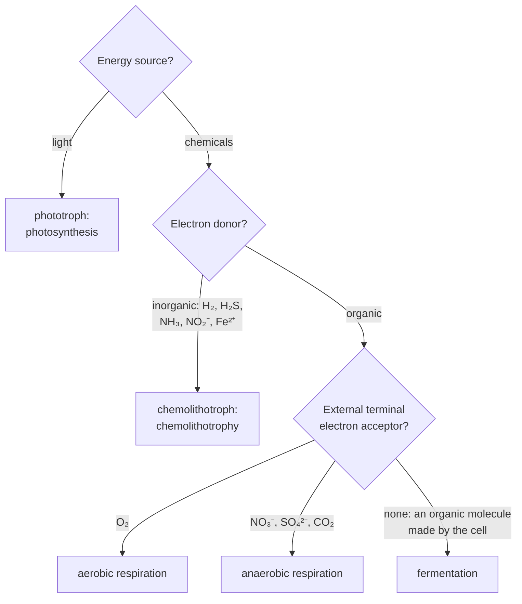

---
aliases:
  - Microbial Energy Metabolism
  - Bacterial Metabolism
  - Nutritional Types
  - Respiration and Fermentation
  - Chemolithotrophy
  - Métabolisme microbien
tags:
  - type/concept
  - domain/biology
  - domain/chemistry
  - level/L2
  - level/L3
mastery: 0
prerequisites:
  - "[[Metabolism]]"
  - "[[ATP]]"
  - "[[Redox Reaction]]"
  - "[[Gibbs Free Energy]]"
  - "[[Bacteria]]"
  - "[[Archaea]]"
related:
  - "[[Glycolysis]]"
  - "[[Citric Acid Cycle]]"
  - "[[Oxidative Phosphorylation]]"
  - "[[Reduction Potential]]"
  - "[[Metabolic Pathway]]"
  - "[[Bacterial Growth]]"
  - "[[Microbial Ecology]]"
  - "[[Functional Annotation]]"
  - "[[Flux Balance Analysis]]"
projects: []
sources:
  - "[[Microbiology (OpenStax)]]"
  - "[[Biology 2e (OpenStax)]]"
  - "[[Biochemistry (Berg)]]"
  - "[[Lehninger Principles of Biochemistry (Nelson)]]"
  - "[[KEGG]]"
  - "[[Orth 2010 - What Is Flux Balance Analysis]]"
  - "[[Daims 2015 - Complete Nitrification by Nitrospira Bacteria]]"
---

# Microbial Metabolism

> [!abstract]
> Microbes make ATP in four main ways: respiration and fermentation burn organic food, chemolithotrophy burns inorganic chemicals such as H₂ or ammonia, and photosynthesis captures light. What changes is where the electrons come from, where they end up, and how much energy their fall releases.

## Definition

**Microbial metabolism** is the set of chemical reactions by which microorganisms obtain energy and build cell material ([[Metabolism]]). Its energy-yielding part makes [[ATP]] in two ways: **substrate-level phosphorylation**, the direct transfer of a phosphate group from a high-energy organic intermediate to ADP, and **chemiosmosis**, in which an electron transport chain pumps protons across a membrane and ATP synthase uses the resulting proton motive force (oxidative phosphorylation, or photophosphorylation when light drives the electrons).[^m8][^os-resp] Microbes are classified by three sources: of **energy** (light: phototrophs; chemicals: chemotrophs), of **electrons** (organic molecules: organotrophs; inorganic ones: lithotrophs) and of **carbon** (CO₂: autotrophs; organic carbon: heterotrophs).[^m8]

## Why it matters

- **Metabolism is read from genomes.** Most microbes are known only from their sequences ([[Microorganism#Why it matters]]), so whether a lineage respires oxygen, reduces nitrate or fixes CO₂ is inferred by mapping its annotated genes onto reference pathways, the metabolic reconstruction that KEGG has performed through EC numbers since 1995.[^kegg] The categories of this note are the vocabulary of that [[Functional Annotation]].
- **Metabolisms are discovered in sequence data.** Complete oxidation of ammonia to nitrate by one organism (comammox) was established in 2015 when the genome of the only nitrifier in an enrichment culture, a *Nitrospira*, turned out to encode both ammonia- and nitrite-oxidation pathways (Advanced).[^daims]
- **Models of growth.** [[Flux Balance Analysis]] turns a reconstructed network into quantitative predictions by imposing steady-state mass balance, $Sv = 0$, and optimizing an objective under flux bounds.[^orth] Which electron acceptors the model lets in decides which pathways can carry flux.
- **Yields differ by an order of magnitude.** Fermenting a glucose gives 2 ATP, respiring it about 30 or more (Core), a factor that matters whenever growth with and without oxygen is compared ([[Bacterial Growth]]).

## Core (L2)

### Three questions classify any energy metabolism



The carbon source is a separate axis. Most bacteria, like animals, are **chemoorganoheterotrophs**; cyanobacteria are **photoautotrophs** that take electrons from water; nitrogen-oxidizing bacteria are **chemolithoautotrophs**; purple and green nonsulfur bacteria are **photoheterotrophs**.[^m8]

### Two ways to make ATP

- **Substrate-level phosphorylation.** An enzyme moves a phosphate from a high-energy intermediate onto ADP. In [[Glycolysis]] this nets 2 ATP per glucose.[^os-resp][^berg]
- **Chemiosmosis.** Carriers pass electrons down a chain to a terminal acceptor and pump protons across the membrane; ATP synthase lets them flow back and makes ATP ([[Oxidative Phosphorylation]]).[^os-resp] Prokaryotes have no mitochondria: their chain sits in the plasma membrane.[^m8]

### Four strategies side by side

| Strategy[^m8] | Electron donor | Terminal electron acceptor | ATP made by | Examples |
|---|---|---|---|---|
| Aerobic respiration | organic molecule | O₂ → H₂O | substrate level + oxidative phosphorylation | the reference case |
| Anaerobic respiration | organic molecule | NO₃⁻ (→ NO₂⁻, N₂O or N₂), SO₄²⁻ (→ H₂S), CO₂ (→ CH₄) | same, fewer ATP | denitrifiers, sulfate reducers, methanogenic archaea |
| Fermentation | organic molecule | none external: pyruvate or a molecule made from it | substrate level only | lactic acid bacteria (lactate), yeast (ethanol), *Escherichia* (mixed acids) |
| Photosynthesis | H₂O (oxygenic) or H₂S and other reduced compounds (anoxygenic) | NADP⁺, or the electrons cycle back | photophosphorylation | cyanobacteria (oxygenic), purple and green bacteria (anoxygenic) |
| Chemolithotrophy | H₂, H₂S, NH₃, NO₂⁻, Fe²⁺ | usually O₂ | oxidative phosphorylation | nitrifiers: NH₃ → NO₂⁻ (*Nitrosomonas*), NO₂⁻ → NO₃⁻ (*Nitrobacter*) |

Chemolithotrophy is respiration with an inorganic donor: the chain and ATP synthase are the same, only the input changes.

### Fermentation keeps glycolysis running

Glycolysis reduces NAD⁺ to NADH. Without an external acceptor, the cell must re-oxidize that NADH or glycolysis stops; fermentation does it by reducing pyruvate or a molecule derived from it, and excretes the product.[^m8][^os-resp]

```text
glucose + 2 NAD⁺ + 2 ADP + 2 Pi → 2 pyruvate + 2 NADH + 2 H⁺ + 2 ATP + 2 H₂O   (glycolysis, net)
pyruvate + NADH + H⁺ → lactate + NAD⁺                                          (lactic acid)
pyruvate → acetaldehyde + CO₂;  acetaldehyde + NADH + H⁺ → ethanol + NAD⁺      (alcohol)
```

The products (lactate, ethanol and CO₂, mixtures of acids and gases) differ between taxa and are used to identify bacteria in the laboratory.[^m8][^berg]

### Yields: why respiration wins

Per glucose, aerobic respiration makes 4 ATP by substrate-level phosphorylation (2 in glycolysis, 2 in the [[Citric Acid Cycle]]) and reoxidizes 10 NADH and 2 FADH₂. Counting 3 ATP per NADH and 2 per FADH₂ gives the textbook theoretical maximum of 38;[^m8] measured ratios of about 2.5 and 1.5 give 32 in the same accounting, and about 30 in eukaryotes, which pay to move NADH into mitochondria.[^berg] The number of protons pumped per electron pair also varies between species.[^m8] Fermentation stays at 2.

### Anaerobic respiration, photosynthesis and chemolithotrophy

- **Anaerobic respiration** keeps the chain but ends it on nitrate, sulfate or CO₂; it yields less ATP than aerobic respiration.[^m8] Advanced shows why.
- **Photosynthesis.** Light energizes electrons in (bacterio)chlorophylls; they flow down a chain that drives photophosphorylation, then reduce NADP⁺ for CO₂ fixation in the Calvin cycle, whose key enzyme is RuBisCO, or cycle back to the reaction center. Oxygenic photosynthesis (cyanobacteria) uses two photosystems in series and splits water, releasing O₂; anoxygenic photosynthesis (purple and green bacteria) uses other donors and releases no O₂.[^m8]
- **Chemolithotrophy.** Many chemolithotrophs fix CO₂ with the energy and electrons of their inorganic donor. Nitrification, the oxidation of ammonia to nitrate, has classically been split between ammonia oxidizers and nitrite oxidizers.[^m8]

## Advanced (L3)

### The redox tower

An electron transfer couples two half-reactions; its standard free-energy change is $\Delta G^{\circ\prime} = -nF\Delta E^{\circ\prime}$, with $\Delta E^{\circ\prime} = E^{\circ\prime}_{\text{acceptor}} - E^{\circ\prime}_{\text{donor}}$ ([[Reduction Potential]]).[^berg] Placing donor and acceptor couples on one axis turns every strategy into an arrow. Potentials of NAD⁺/NADH, pyruvate/lactate and O₂/H₂O from Berg,[^berg] of 2H⁺/H₂ (pH 7), S/H₂S, NO₃⁻/NO₂⁻ and NADP⁺/NADPH (−0.32 V, like NAD⁺/NADH) from Lehninger.[^lehn]

![[microbial-redox-tower-energy-pairs.svg]]

1. **NADH → O₂** releases about 220 kJ/mol, enough for at most 7 ATP under standard conditions; cells make about 2.5.[^berg]
2. **NADH → NO₃⁻** releases about two thirds of that, so nitrate respiration makes less ATP than aerobic respiration.
3. **NADH → pyruvate** releases 25 kJ/mol, less than one ATP: in fermentation this step pays for nothing, it only regenerates NAD⁺. The ATP came from substrate-level phosphorylation upstream.
4. **Lithotrophic donors differ widely.** H₂ is a stronger donor than NADH, so hydrogen oxidizers can reduce NAD⁺ directly. Nitrite sits at +0.42 V: its oxidation by O₂ releases only 77 kJ/mol per two electrons, and pushing its electrons up to NAD⁺, which CO₂ fixation requires, costs energy (Exercise 4).
5. **Photosynthesis is the reverse arrow**: light pays to move electrons from water (+0.82 V) up to NADP⁺ (−0.32 V).

Standard potentials assume 1 M reactants at pH 7. Actual free-energy changes depend on concentrations, so a transfer with a small $\Delta E^{\circ\prime}$ can be favorable or not in a real habitat.[^berg]

### Reading metabolism from a genome

- **Reconstruction.** Annotated genes are mapped to EC numbers and onto pathway maps; a reference map shows what is known across organisms, so a complete-looking pathway is a hypothesis about capability and an incomplete one may reflect annotation gaps.[^kegg]
- **Constraint-based models** add stoichiometry and mass balance to the reconstruction and compute feasible fluxes ([[Flux Balance Analysis]]).[^orth]
- **Comammox, a lesson in humility.** Complete nitrification by a single organism had been predicted to be energetically advantageous, yet no such nitrifier was known. In 2015, an enrichment culture that oxidized ammonia to nitrate contained only *Nitrospira* as nitrifiers, a genus known as nitrite oxidizers; genome analysis found the ammonia-oxidation genes in *Nitrospira*, and both pathways were active during growth.[^daims] A label inherited from a lineage ("*Nitrospira* = nitrite oxidizer") missed what the genome encoded.

## Mathematical representation

- **Nutritional type.** A triple $T = (e, d, c) \in \{\text{photo}, \text{chemo}\} \times \{\text{organo}, \text{litho}\} \times \{\text{auto}, \text{hetero}\}$, $2^3 = 8$ combinations, named by concatenation plus "troph".
- **Energy of an electron transfer.** For $n$ electrons from donor couple $D$ to acceptor couple $A$, with Faraday constant $F = 96.485$ kJ mol⁻¹ V⁻¹,[^berg]
$$\Delta G^{\circ\prime} = -nF\left(E^{\circ\prime}_A - E^{\circ\prime}_D\right).$$
- **ATP bound.** With $\Delta G_{ATP}$ the free energy needed per ATP (30.5 kJ/mol under standard conditions, about 57 kJ/mol in a living cell[^os64]), at most $N_{\max} = -\Delta G^{\circ\prime} / \Delta G_{ATP}$ ATP can be made per transfer.
- **ATP accounting for glucose.** $Y = s + p_N N_{NADH} + p_F N_{FADH_2}$ with $s = 4$, $N_{NADH} = 10$, $N_{FADH_2} = 2$: $(p_N, p_F) = (3, 2)$ gives $Y = 38$, $(2.5, 1.5)$ gives $Y = 32$. Fermentation: $Y = 2$.
- **Efficiency of the chain.** $\eta = p_N \Delta G_{ATP} / |\Delta G^{\circ\prime}_{NADH \to O_2}| = 2.5 \times 30.5 / 220 \approx 0.35$ with the standard ATP cost, about $0.65$ with the cellular one.

## Computational representation

```python
F = 96.485         # Faraday constant, kJ per volt per mole of electrons
ATP_COST = 30.5    # kJ/mol to make ATP from ADP + Pi under standard conditions

# Standard reduction potentials at pH 7 (V), couples written oxidized/reduced, rounded
E0 = {
    "2H+/H2": -0.41,
    "NAD+/NADH": -0.32,
    "S/H2S": -0.24,
    "pyruvate/lactate": -0.19,
    "NO3-/NO2-": 0.42,
    "O2/H2O": 0.82,
}


def delta_g(donor: str, acceptor: str, n: int = 2) -> float:
    """Standard free-energy change (kJ/mol) for n electrons moving from donor to acceptor."""
    return -n * F * (E0[acceptor] - E0[donor])


PAIRS = [  # (process, electron donor couple, terminal acceptor couple)
    ("aerobic respiration", "NAD+/NADH", "O2/H2O"),
    ("nitrate respiration", "NAD+/NADH", "NO3-/NO2-"),
    ("lactate fermentation step", "NAD+/NADH", "pyruvate/lactate"),
    ("hydrogen oxidation", "2H+/H2", "O2/H2O"),
    ("sulfide oxidation", "S/H2S", "O2/H2O"),
    ("nitrite oxidation", "NO3-/NO2-", "O2/H2O"),
]
print(f"{'process':27s}{'dE (V)':>7s}{'dG (kJ/mol)':>13s}{'ATP max':>9s}")
for name, donor, acceptor in PAIRS:
    dg = delta_g(donor, acceptor)
    print(f"{name:27s}{E0[acceptor] - E0[donor]:7.2f}{dg:13.1f}{-dg / ATP_COST:9.1f}")


def atp_per_glucose(per_nadh: float, per_fadh2: float) -> float:
    """Aerobic yield: 4 ATP by substrate-level phosphorylation, plus 10 NADH and 2 FADH2 reoxidized."""
    return 4 + 10 * per_nadh + 2 * per_fadh2


print("respiration:", atp_per_glucose(3, 2), "or", atp_per_glucose(2.5, 1.5), "| fermentation: 2")

ENERGY = {"light": "photo", "chemical": "chemo"}
DONOR = {"organic": "organo", "inorganic": "litho"}
CARBON = {"CO2": "auto", "organic": "hetero"}


def nutritional_type(energy: str, donor: str, carbon: str) -> str:
    return ENERGY[energy] + DONOR[donor] + CARBON[carbon] + "troph"


print(nutritional_type("chemical", "organic", "organic"),   # most bacteria
      nutritional_type("chemical", "inorganic", "CO2"),     # nitrifying bacterium
      nutritional_type("light", "inorganic", "CO2"))        # cyanobacterium (donor: water)
```

```text
process                     dE (V)  dG (kJ/mol)  ATP max
aerobic respiration           1.14       -220.0      7.2
nitrate respiration           0.74       -142.8      4.7
lactate fermentation step     0.13        -25.1      0.8
hydrogen oxidation            1.23       -237.4      7.8
sulfide oxidation             1.06       -204.5      6.7
nitrite oxidation             0.40        -77.2      2.5
respiration: 38 or 32.0 | fermentation: 2
chemoorganoheterotroph chemolithoautotroph photolithoautotroph
```

"ATP max" is a thermodynamic ceiling per electron pair, not a yield: real chains convert only part of it. A genome-scale model stores the same information differently, as reactions with stoichiometric coefficients rather than potentials ([[Flux Balance Analysis]]).

## Worked example

> [!example] Two invented isolates
> Isolate A grows in the dark on glucose without O₂ and excretes only lactate. Isolate B grows in the dark in a mineral medium with nitrite, O₂ and CO₂ as its only carbon source, and produces nitrate.
> 1. **Energy.** Both grow in the dark: chemotrophs.
> 2. **Electrons.** A takes them from glucose (organotroph), B from nitrite (lithotroph).
> 3. **Carbon.** A uses organic carbon (heterotroph), B fixes CO₂ (autotroph). A is a chemoorganoheterotroph, B a chemolithoautotroph.
> 4. **Strategy.** A has no external acceptor and excretes reduced pyruvate: lactic acid fermentation, 2 ATP per glucose. B oxidizes nitrite with O₂: chemolithotrophy.
> 5. **Energy per electron pair.** A recycles NADH through a 0.13 V step (25 kJ/mol, no ATP from it). B gets 77 kJ/mol per nitrite (0.40 V), about a third of what NADH → O₂ releases.
> 6. **Consequence.** To match the ATP a respiring cell makes from one glucose (32 in the measured-ratio accounting), A must ferment 16 glucose molecules (19 with the textbook 38).

## Common misconceptions

> [!warning] "Fermentation is anaerobic respiration"
> Both work without O₂, but anaerobic respiration runs an electron transport chain to an external acceptor (nitrate, sulfate, CO₂), while fermentation has no chain: it makes ATP only by substrate-level phosphorylation and dumps electrons on an organic molecule it made itself.[^m8]

> [!warning] "Aerobic respiration yields exactly 38 ATP per glucose"
> 38 is a theoretical maximum that assumes 3 ATP per NADH and 2 per FADH₂. Measured ratios are about 2.5 and 1.5, and proton pumping differs between species, so real yields are lower and variable.[^m8][^berg]

> [!warning] "Photosynthesis always produces oxygen"
> Only oxygenic photosynthesis, which takes electrons from water. Purple and green bacteria take them from H₂S or other reduced compounds and release no O₂.[^m8]

> [!warning] "Autotroph means photosynthetic"
> Autotrophy is about carbon (CO₂ fixation), not energy: nitrifying bacteria fix CO₂ with energy from oxidizing ammonia or nitrite.[^m8]

## Exercises

> [!question] Exercise 1 (L2)
> Name the nutritional type of: (a) a cyanobacterium; (b) a nitrite-oxidizing bacterium that fixes CO₂; (c) a purple nonsulfur bacterium using light, with organic acids as electron and carbon source; (d) a lactic acid bacterium growing on milk sugar.

> [!success]- Solution
> (a) Photolithoautotroph (light, water as inorganic donor, CO₂). (b) Chemolithoautotroph. (c) Photoorganoheterotroph: `nutritional_type("light", "organic", "organic")` returns `photoorganoheterotroph`. (d) Chemoorganoheterotroph, making its ATP by fermentation.

> [!question] Exercise 2 (L2)
> Write the overall equation of lactic acid fermentation of one glucose and check that NAD⁺ is regenerated. Why can the cell not simply excrete pyruvate and keep the NADH?

> [!success]- Solution
> Glycolysis gives 2 pyruvate + 2 NADH + 2 H⁺ + 2 ATP; reducing 2 pyruvate to 2 lactate consumes the 2 NADH and 2 H⁺. Sum: glucose + 2 ADP + 2 Pi → 2 lactate + 2 ATP + 2 H₂O, and NAD⁺ cancels out. Glycolysis needs NAD⁺ as an oxidant; keeping the NADH would exhaust the NAD⁺ and stop glycolysis, the only ATP source of the fermenter.[^os-resp]

> [!question] Exercise 3 (L2)
> With the potentials of the figure, compute $\Delta E^{\circ\prime}$ and $\Delta G^{\circ\prime}$ for NADH reducing elemental sulfur to H₂S. Could such a transfer make one ATP per electron pair under standard conditions? What does a non-integer yield of about 2.5 ATP per NADH suggest about chemiosmotic coupling?

> [!success]- Solution
> $\Delta E^{\circ\prime} = -0.24 - (-0.32) = 0.08$ V and $\Delta G^{\circ\prime} = -2 \times 96.485 \times 0.08 = -15.4$ kJ/mol, about half (0.51) of the 30.5 kJ/mol one ATP costs. Not a whole ATP per pair, but chemiosmosis need not work in whole numbers: electron transfer pumps protons into a shared gradient that ATP synthase draws on, which is why yields per NADH are not integers.[^berg] A small step can still contribute protons.

> [!question] Exercise 4 (L3, Python)
> A nitrite oxidizer gains energy from NO₂⁻ → NO₃⁻ with O₂ and must also make NADH to fix CO₂. With `delta_g`, compute (a) the minimum number of nitrite ions oxidized per ATP at 100% efficiency, for an ATP cost of 30.5 and of 57 kJ/mol; (b) the cost of moving two electrons from nitrite up to NAD⁺, in nitrite oxidations.

> [!success]- Solution
> ```python
> dg_ox = delta_g("NO3-/NO2-", "O2/H2O")        # one nitrite oxidized by O2 (2 electrons)
> dg_nadh = delta_g("NO3-/NO2-", "NAD+/NADH")   # the same electrons pushed up to NAD+
> for atp_cost in (30.5, 57):
>     print(atp_cost, "kJ/mol per ATP:", round(atp_cost / -dg_ox, 2), "nitrite per ATP")
> print(round(dg_ox, 1), round(dg_nadh, 1), round(dg_nadh / -dg_ox, 2))
> ```
> ```text
> 30.5 kJ/mol per ATP: 0.4 nitrite per ATP
> 57 kJ/mol per ATP: 0.74 nitrite per ATP
> -77.2 142.8 1.85
> ```
> (a) At least 0.4 to 0.74 nitrite per ATP, even with a perfect machine. (b) Reducing NAD⁺ with nitrite electrons is uphill by 143 kJ/mol, the energy of almost two nitrite oxidations. Every CO₂ fixed needs both NADH and ATP, so a nitrite oxidizer must oxidize a lot of nitrite per carbon it fixes.

> [!question] Exercise 5 (L3)
> An invented metagenome-assembled genome has a complete glycolysis and citric acid cycle, a respiratory nitrate reductase, no terminal oxidase for O₂, no RuBisCO, and a lactate dehydrogenase. Propose its energy metabolism and carbon source, then give three reasons why the inference could be wrong.

> [!success]- Solution
> Organic donors (glycolysis, cycle) and an acceptor other than O₂ (nitrate reductase, no O₂ oxidase) suggest anaerobic respiration with nitrate, with lactic fermentation possible when nitrate is absent; no RuBisCO argues against CO₂ fixation by the Calvin cycle: a chemoorganoheterotroph. Reasons for doubt: (1) the genome may be incomplete, so "absent" genes may be missing from the bin ([[Metagenomic Binning]]); (2) annotation transfers function by homology, and homologs can act on other substrates ([[Functional Annotation]]); (3) a gene present is not a gene used: capability needs expression or activity data to become fact.[^kegg] Comammox shows the opposite error too: an organism did more than its lineage's label said.[^daims]

## Mastery checklist

- [ ] 1 Recognized: I can name the four strategies and the three axes (energy, electrons, carbon) that define nutritional types.
- [ ] 2 Understood: I can explain substrate-level versus chemiosmotic ATP synthesis, why fermentation must regenerate NAD⁺, and why anaerobic respiration yields less than aerobic respiration.
- [ ] 3 Practiced: I can classify organisms from growth conditions and compute $\Delta G^{\circ\prime}$ and ATP ceilings for donor-acceptor pairs in Python.
- [ ] 4 Applied: I inferred the energy metabolism of a real bacterial genome from its KEGG pathway annotation, listing the evidence and the gaps.
- [ ] 5 Explained: I can teach the redox tower, the 38 versus 30 to 32 ATP accounting, and why genome-based metabolic inference can fail in both directions.

## References

[^m8]: [[Microbiology (OpenStax)]], ch. 8 "Microbial Metabolism" (classification by energy, electron and carbon source; substrate-level, oxidative and photophosphorylation; electron transport in the prokaryotic plasma membrane; aerobic and anaerobic respiration with nitrate, sulfate or carbon dioxide as terminal acceptors; theoretical maximum ATP yield; fermentation pathways, products and their use in identification; oxygenic and anoxygenic photosynthesis and the Calvin cycle; chemolithotrophs and nitrification).
[^os-resp]: [[Biology 2e (OpenStax)]], chapter "Cellular Respiration" (glycolysis, chemiosmosis and ATP synthase, fermentation regenerating NAD⁺).
[^os64]: [[Biology 2e (OpenStax)]], section 6.4 "ATP: Adenosine Triphosphate" ($\Delta G$ of ATP hydrolysis: −30.5 kJ/mol under standard conditions, about −57 kJ/mol in a living cell).
[^berg]: [[Biochemistry (Berg)]], 5th ed. (2002), treatment of glycolysis (net reaction, substrate-level phosphorylation, fates of pyruvate) and of oxidative phosphorylation ($\Delta G^{\circ\prime} = -nF\Delta E^{\circ\prime}$ and the faraday; standard reduction potentials of NAD⁺/NADH, pyruvate/lactate and O₂/H₂O; about 2.5 ATP per NADH and 1.5 per FADH₂, about 30 ATP per glucose; dependence of free energy on concentrations).
[^lehn]: [[Lehninger Principles of Biochemistry (Nelson)]], 8th ed. (2021), table of standard reduction potentials of biologically important half-reactions (NO₃⁻/NO₂⁻, S/H₂S, 2H⁺/H₂ at pH 7, NADP⁺/NADPH).
[^kegg]: [[KEGG]], metabolic reconstruction (mapping a genome onto pathway maps through EC numbers, since the 1995 release) and its caveat that reference maps show what is known across organisms.
[^orth]: [[Orth 2010 - What Is Flux Balance Analysis]], *Nature Biotechnology* (stoichiometric matrix, steady state $Sv = 0$, optimization of an objective under bounds).
[^daims]: [[Daims 2015 - Complete Nitrification by Nitrospira Bacteria]], *Nature* 528:504-509.
