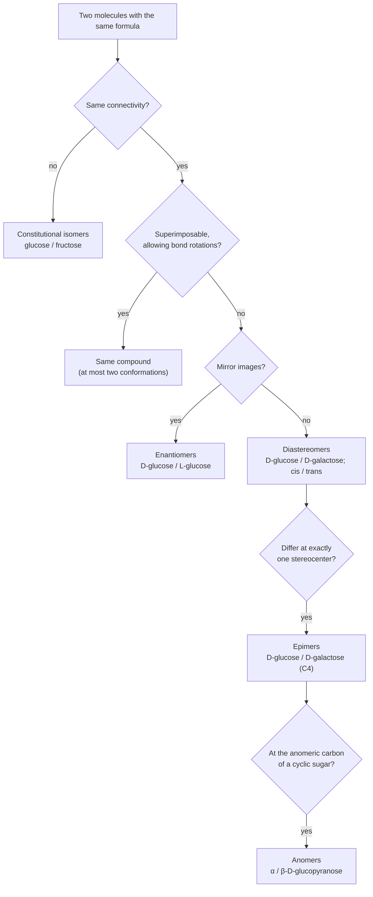

---
aliases:
  - Diastereoisomer
  - Epimer
  - Anomer
  - Meso Compound
  - Diastéréoisomère
tags:
  - type/concept
  - domain/chemistry
  - domain/biology
  - level/L2
  - level/L3
mastery: 0
prerequisites:
  - "[[Isomer]]"
  - "[[Stereochemistry]]"
  - "[[Chirality]]"
  - "[[Fischer Projection]]"
  - "[[Carbohydrate]]"
related:
  - "[[Cis-Trans Isomerism]]"
  - "[[Conformational Analysis]]"
  - "[[Nucleophilic Addition]]"
  - "[[Tautomer]]"
  - "[[Amino Acid]]"
  - "[[Enzyme]]"
  - "[[Molecular Representation]]"
  - "[[Elimination Reaction]]"
projects: []
sources:
  - "[[Organic Chemistry (OpenStax)]]"
  - "[[Lehninger Principles of Biochemistry (Nelson)]]"
  - "[[Biochemistry (Berg)]]"
  - "[[OpenSMILES Specification]]"
---

# Diastereomer

> [!abstract]
> Diastereomers are stereoisomers that are not mirror images, such as glucose and galactose, cis and trans double bonds, or the α and β rings of one sugar. Unlike enantiomers, they differ in energy and physical properties, and enzymes treat them as different molecules.

## Definition

Two stereoisomers (same formula, same connectivity, different arrangement in space) are **diastereomers** when they are not mirror images of each other.[^os56] Two stereoisomers of the same constitution are enantiomers when every stereocenter is inverted and diastereomers when some, but not all, are inverted; cis and trans isomers are diastereomers as well ([[Isomer]], [[Chirality]], [[Cis-Trans Isomerism]]). Two special cases name most diastereomer pairs of biochemistry:

- **Epimers** are diastereomers that differ in configuration at only one stereocenter and are the same at all the others.[^os56]
- **Anomers** are the two forms, α and β, of a cyclic sugar. Ring closure turns the former carbonyl carbon into a new stereocenter, the **anomeric carbon**, and the two anomers differ only there.[^os255][^lehninger] Anomers are therefore epimers at the anomeric carbon.

## Why it matters

- **One formula, one mass, several sugars.** Glucose, galactose and mannose share the formula C₆H₁₂O₆ and the same bonds; only the configuration at C2 or C4 separates them.[^lehninger] They have the same mass, so a mass spectrometer alone cannot tell them apart, and in SMILES they differ only by their `@` and `@@` stereo marks: drop the marks and the three records collapse into one constitution ([[Mass Spectrometry]], [[Molecular Representation]]).[^opensmiles]
- **Enzymes read configuration.** Starch and cellulose are both chains of glucose joined C1 to C4, with α bonds in starch and β bonds in cellulose. Humans digest starch but lack the enzymes that hydrolyze the β1→4 bonds of cellulose.[^berg] Nothing but the configuration of the linkage differs ([[Carbohydrate]]).
- **Separation.** Enantiomers share melting point, solubility and chromatographic behaviour in a non-chiral environment; diastereomers do not. Chemists separate enantiomers by first converting them into diastereomers.[^os5]
- **Checking structures.** Threonine and isoleucine have two stereocenters.[^lehninger] A modeled residue can keep the L configuration at Cα and still be wrong at Cβ: it is then a diastereomer of the real residue, an error that a check of Cα alone misses ([[Protein Structure]]).

## Core (L2)

### Enantiomers or diastereomers: the test



In practice, list the configuration of every stereocenter (R or S, or the side of each OH in a [[Fischer Projection]]) and compare position by position. **Threonine** shows every case. With stereocenters at C2 and C3 it has four stereoisomers, and the natural amino acid is the (2S,3R) isomer.[^os56] Its enantiomer is (2R,3S), with both centers inverted; (2R,3R) and (2S,3S) are its diastereomers, and because each differs at a single center they are also its epimers (at C2 and at C3).

### What differs between diastereomers

- **Energy.** Enantiomers are mirror images with identical energies, so when they interconvert the equilibrium is 50:50, a racemic mixture. Diastereomers have different energies, and their equilibria are unequal: the anomers of D-glucose interconvert in water through the open chain (mutarotation) and settle at about one-third α and two-thirds β.[^lehninger] The chair of the β anomer places all its bulky groups equatorial ([[Conformational Analysis#Core (L1)]]).[^berg]
- **Physical properties.** Melting points, solubilities and chromatographic retention differ, so diastereomers can be separated by crystallization or chromatography.[^os5]
- **Recognition.** An enzyme's active site is chiral, so it can discriminate enantiomers as well as diastereomers ([[Stereochemistry]], [[Enzyme]]).[^os5]

### Epimers and anomers of sugars

![[aldohexose-stereoisomer-relationships.svg]]

- **Epimers.** D-mannose is the C2 epimer of D-glucose and D-galactose its C4 epimer.[^lehninger] D-galactose and D-mannose differ at two centers: diastereomers, not epimers. The D/L label describes only the stereocenter farthest from the carbonyl carbon (C5 in hexoses), so it says nothing about the others ([[Fischer Projection]]).[^lehninger]
- **Anomers.** When glucose closes into its six-membered ring, C1 becomes a stereocenter and two anomers form. In the usual ring drawing of a D-sugar, the α anomer carries its C1 hydroxyl on the face opposite the CH₂OH group of C5, the β anomer on the same face.[^os255] They interconvert in water through the open chain ([[Nucleophilic Addition]]).[^lehninger]
- **Glycosidic bonds fix the anomer.** Once the anomeric carbon is engaged in a glycosidic bond, the ring can no longer open, so its configuration is fixed and becomes part of the bond's name, α1→4 or β1→4 ([[Carbohydrate#Core (L1)]]).[^lehninger] Starch (α1→4) and cellulose (β1→4) are thus diastereomeric polymers of one sugar: the α linkage gives chains that coil into helices, the β linkage straight chains that pack into fibers, and human enzymes hydrolyze the first but not the second.[^berg]

### Meso compounds: symmetry removes a stereoisomer

When two stereocenters carry identical sets of substituents, one combination can contain an internal mirror plane and be superimposable on its mirror image. Such a **meso compound** has stereocenters yet is achiral. Tartaric acid has two stereocenters but only three stereoisomers: the (R,R) and (S,S) enantiomers, and the meso form, a diastereomer of both.[^os5] The $2^k$ count of [[Stereochemistry]] is therefore an upper bound. Sugar alcohols (alditols), made by reducing the aldehyde of an aldose to CH₂OH, have identical ends: galactitol, from galactose, is meso, while glucitol, from glucose, is chiral (computed below).

## Advanced (L3)

- **Recognizing a hand takes a hand.** Two enantiomers bound to one chiral partner form two complexes that are not mirror images of each other: they are diastereomeric and differ in energy. This is how an enzyme tells enantiomers apart, and how a racemate is resolved: react it with a single enantiomer of another compound, separate the two diastereomers (for example as salts) by ordinary means, then release the enantiomers.[^os5]
- **Epimerization is chemistry at one center.** An epimer forms whenever a single stereocenter is broken and remade. Mutarotation does it at the anomeric carbon through the open chain.[^lehninger] A stereocenter next to a carbonyl group can do it through the planar enol, whose former stereocenter is sp² ([[Tautomer]]). Enzymes that interconvert epimers (epimerases) are isomerases; galactose, for example, enters glucose metabolism only after its C4 configuration is inverted, at the level of UDP-sugars.[^berg]
- **Glycan notation is stereochemistry.** In a condensed name such as `Gal(β1-4)Glc` (lactose), the residue names encode diastereomers (Gal and Glc are C4 epimers) and the linkage encodes the anomer and the carbons joined ([[Carbohydrate#Advanced (L3)]]). A record or a mass that drops this information cannot distinguish lactose from the other disaccharides of glucose and galactose.
- **Counting with symmetry.** Software that enumerates the stereoisomers of a candidate structure must not simply list $2^k$ vectors: symmetric constitutions identify some of them, which is a group-orbit problem (Mathematical representation).

## Mathematical representation

**Configuration vectors.** Fix a constitution with $k$ stereocenters numbered $1, \dots, k$ and no internal symmetry. A stereoisomer is a vector $x \in \{+1, -1\}^k$, where $x_i$ is the configuration of center $i$ (+1 for R, −1 for S); its mirror image is $-x$. With the Hamming distance $d(x, y) = |\{i : x_i \neq y_i\}|$ ([[Hamming Distance]]):

$$
x \text{ and } y \text{ are }
\begin{cases}
\text{identical} & d = 0,\\
\text{enantiomers} & d = k,\\
\text{diastereomers} & 1 \le d \le k - 1 \quad (\text{epimers when } d = 1).
\end{cases}
$$

Every stereoisomer therefore has one enantiomer, $k$ epimers and $\sum_{d=1}^{k-1} \binom{k}{d} = 2^k - 2$ diastereomers ([[Binomial Coefficient]]). For the aldohexoses ($k = 4$): 1 enantiomer, 4 epimers, 14 diastereomers.

**Symmetry.** If the constitution has a symmetry operation $g$ (one that permutes stereocenters, such as turning a symmetric chain end for end), $x$ and $g(x)$ describe the same molecule. Molecules are then the orbits of the group $G$ of such operations, counted by Burnside's lemma:

$$N = \frac{1}{|G|} \sum_{g \in G} |\mathrm{Fix}(g)|,$$

where $\mathrm{Fix}(g)$ is the set of vectors that $g$ leaves unchanged. A stereoisomer is **meso** (achiral) when its mirror image lies in its own orbit.

**Alditols.** Write the OH sides of the $m$ inner carbons of a Fischer projection as a word $s \in \{L, R\}^m$, and $\bar{s}$ for the word with L and R swapped. The mirror image is $\mu(s) = \bar{s}$. Both ends are CH₂OH, so turning the projection 180° in its plane gives the same molecule: $\rho(s)_i = \bar{s}_{m+1-i}$. The alditol is meso when $\mu(s) = \rho(s)$, that is $s_i = s_{m+1-i}$ for every $i$: **the OH pattern is a palindrome**, a cousin of the reverse palindromes of [[DNA#Mathematical representation]]. With $G = \{e, \rho\}$: $|\mathrm{Fix}(e)| = 2^m$; $\rho$ fixes $2^{m/2}$ words when $m$ is even (first half free, second half forced) and none when $m$ is odd (the middle letter would have to equal its own swap). Hence

$$N(m) = \frac{2^m + 2^{m/2}}{2} \ \ (m \text{ even}), \qquad N(m) = 2^{m-1} \ \ (m \text{ odd}),$$

so 10 hexitols ($m = 4$) and 4 pentitols ($m = 3$).

## Computational representation

The Fischer patterns of the eight D-aldohexoses (OH right or left at C2 to C5) are enough to compute every relationship;[^lehninger] L sugars are their mirror images.

```python
from itertools import product

# Side of the OH group (R = right, L = left) at C2, C3, C4, C5 in the Fischer projection.
D_ALDOHEXOSES = {"allose": "RRRR", "altrose": "LRRR", "glucose": "RLRR", "mannose": "LLRR",
                 "gulose": "RRLR", "idose": "LRLR", "galactose": "RLLR", "talose": "LLLR"}
FLIP = str.maketrans("RL", "LR")


def mirror(p: str) -> str:
    """Mirror image: every OH changes side."""
    return p.translate(FLIP)


SUGARS = {}
for name, p in D_ALDOHEXOSES.items():
    SUGARS["D-" + name], SUGARS["L-" + name] = p, mirror(p)
NAME = {p: n for n, p in SUGARS.items()}


def relation(p: str, q: str) -> str:
    """Classify two stereoisomers of one constitution without internal symmetry."""
    d = sum(a != b for a, b in zip(p, q))          # number of centers that differ
    if d == 0:
        return "identical"
    if d == len(p):
        return "enantiomers"
    return "epimers" if d == 1 else f"diastereomers ({d} centers differ)"


def epimers(p: str) -> list[str]:
    """Flip one center at a time (C2, C3, C4, C5)."""
    return [NAME[p[:i] + mirror(p[i]) + p[i + 1:]] for i in range(len(p))]


glc = SUGARS["D-glucose"]
for other in ("D-galactose", "D-mannose", "L-glucose"):
    print(f"D-glucose / {other:11} {relation(glc, SUGARS[other])}")
print("D-galactose / D-mannose", relation(SUGARS["D-galactose"], SUGARS["D-mannose"]))
print("epimers of D-glucose:", epimers(glc))


def is_meso_alditol(p: str) -> bool:
    """Both chain ends are CH2OH: the alditol is achiral when its OH pattern is a palindrome."""
    return p == p[::-1]


def canonical_alditol(p: str) -> str:
    """Rotating the projection 180 degrees in the plane reverses the chain and flips every side."""
    return min(p, mirror(p[::-1]))


print("meso hexitols:", [n[:-3] + "itol" for n, p in D_ALDOHEXOSES.items() if is_meso_alditol(p)])
print("D-glucitol is L-gulitol:",
      canonical_alditol(SUGARS["D-glucose"]) == canonical_alditol(SUGARS["L-gulose"]))
for m in (3, 4):
    distinct = {canonical_alditol("".join(s)) for s in product("RL", repeat=m)}
    print(f"{m} inner carbons: {len(distinct)} alditols, {sum(map(is_meso_alditol, distinct))} meso")
```

```text
D-glucose / D-galactose epimers
D-glucose / D-mannose   epimers
D-glucose / L-glucose   enantiomers
D-galactose / D-mannose diastereomers (2 centers differ)
epimers of D-glucose: ['D-mannose', 'D-allose', 'D-galactose', 'L-idose']
meso hexitols: ['allitol', 'galactitol']
D-glucitol is L-gulitol: True
3 inner carbons: 4 alditols, 2 meso
4 inner carbons: 10 alditols, 2 meso
```

The C5 epimer of D-glucose is an L sugar, L-idose: the D/L label flips although a single center changed. The palindrome test finds the two meso hexitols, and the brute-force counts match $N(3) = 4$ and $N(4) = 10$. Real software works on 3D coordinates or on stereo-annotated molecular graphs (signed volumes as in [[Stereochemistry#Computational representation]], `@` and `@@` in SMILES), but the logic is the same: compare per-center configurations, then account for symmetry.

## Worked example

> [!example] Classify, then explain an equilibrium
> 1. **D-glucose and D-galactose.** OH sides `R L R R` and `R L L R`: one difference, at C4. **C4 epimers**, hence diastereomers.
> 2. **D-glucose and L-glucose.** `R L R R` and `L R L L`: all four centers differ. **Enantiomers.**
> 3. **D-galactose and D-mannose.** `R L L R` and `L L R R`: C2 and C4 differ. **Diastereomers, not epimers.**
> 4. **α- and β-D-glucopyranose.** Same ring, same configuration at C2 to C5, opposite at C1: **anomers**.
> 5. **Why mutarotation does not end at 50:50.** At equilibrium about one-third α and two-thirds β,[^lehninger] so $K = [\beta]/[\alpha] \approx 2$ and, at 25 °C ($RT = 2.479$ kJ/mol), $\Delta G^\circ = -RT \ln K \approx -1.7$ kJ/mol in favor of β ([[Gibbs Free Energy]]). Two enantiomers would give $K = 1$ and $\Delta G^\circ = 0$: a nonzero $\Delta G^\circ$ between interconverting stereoisomers is the thermodynamic signature of diastereomers.

## Common misconceptions

> [!warning] "Diastereomers need at least two stereocenters"
> Cis- and trans-but-2-ene are diastereomers without a single stereocenter: stereoisomers that are not mirror images ([[Cis-Trans Isomerism]]). The two-center picture only fits stereoisomerism that comes from tetrahedral centers.

> [!warning] "α and β anomers are mirror images"
> They differ at one of the five stereocenters of the ring, so they are epimers, with different energies (hence the unequal equilibrium). The mirror image of α-D-glucopyranose is α-L-glucopyranose, with all five centers inverted.

> [!warning] "D and L give the configuration of the whole sugar"
> D/L describes a single stereocenter, the one farthest from the carbonyl carbon.[^lehninger] D-glucose and L-idose differ only at C5: epimers with opposite labels (Computational representation). D-glucose and D-galactose share the D label yet are different compounds.

> [!warning] "Any two stereoisomeric sugars are epimers"
> Epimers differ at exactly one center.[^os56] D-galactose and D-mannose differ at C2 and C4: diastereomers, not epimers.

## Exercises

> [!question] Exercise 1 (L2)
> Classify each pair as constitutional isomers, enantiomers, anomers, other epimers or other diastereomers: (a) D-glucose and D-mannose; (b) D-glucose and D-fructose; (c) α- and β-D-galactopyranose; (d) (2S,3R)- and (2R,3S)-threonine; (e) (2S,3R)- and (2S,3S)-threonine; (f) cis- and trans-but-2-ene.

> [!success]- Solution
> (a) Epimers at C2. (b) Constitutional isomers: an aldose and a ketose differ in connectivity, so the stereo vocabulary does not apply ([[Isomer]]). (c) Anomers (epimers at C1). (d) Enantiomers: both centers inverted. (e) Epimers at C3, hence diastereomers. (f) Diastereomers without a stereocenter (cis-trans isomers).

> [!question] Exercise 2 (L2)
> Tartaric acid, HOOC–CH(OH)–CH(OH)–COOH, has two stereocenters. Show that it has only three stereoisomers and give the relationship within each pair.

> [!success]- Solution
> The combinations are (R,R), (S,S), (R,S) and (S,R). Both centers carry the same four substituents, so (R,S) and (S,R) are one molecule, with an internal mirror plane between C2 and C3: the achiral meso form.[^os5] Three stereoisomers remain. (R,R) and (S,S) are enantiomers; the meso form is a diastereomer of each. Its symmetric ends make it the $m = 2$ case of the Mathematical representation: $N(2) = (4 + 2)/2 = 3$.

> [!question] Exercise 3 (L2)
> Amylose (starch) and cellulose are both unbranched chains of D-glucose joined C1 to C4. Why is their difference diastereomeric rather than constitutional, and why does it matter for nutrition?

> [!success]- Solution
> The same atoms are bonded in both (C1 of one residue, the bridging O, C4 of the next), so the constitution is identical; only the configuration at every anomeric carbon differs, α in amylose and β in cellulose. This repeated one-center difference changes the shape of the chain (helix versus straight, fiber-forming chains) and what enzymes can bind: human enzymes hydrolyze the α1→4 bonds of starch but not the β1→4 bonds of cellulose.[^berg]

> [!question] Exercise 4 (L3, Python)
> With `SUGARS`, `relation` and `epimers` from the Computational representation, list the four epimers of D-galactose and count how many of the 16 aldohexoses are identical to it, its enantiomer, its epimers or its other diastereomers. Check the counts against the Mathematical representation.

> [!success]- Solution
> ```python
> from collections import Counter
>
> gal = SUGARS["D-galactose"]
> print(epimers(gal))
> print(Counter(relation(gal, p).split(" (")[0] for p in SUGARS.values()))
> ```
> Output: `['D-talose', 'D-gulose', 'D-glucose', 'L-altrose']`, then `Counter({'diastereomers': 10, 'epimers': 4, 'identical': 1, 'enantiomers': 1})`. With $k = 4$: one enantiomer and $2^4 - 2 = 14$ diastereomers, of which $k = 4$ are epimers and 10 differ at two or three centers. As for glucose, the C5 epimer is an L sugar.

> [!question] Exercise 5 (L3, Python)
> Check the Burnside formula $N(m)$ against brute-force enumeration for $m = 2$ to 5 inner carbons, and count the meso alditols. Interpret $m = 2$: the tetritols made from the tetroses D-erythrose (OH sides `R R`) and D-threose (`L R`).[^lehninger]

> [!success]- Solution
> ```python
> def burnside(m: int) -> int:
>     """(patterns fixed by doing nothing + patterns fixed by the 180-degree rotation) / 2"""
>     fixed = 2 ** (m // 2) if m % 2 == 0 else 0
>     return (2 ** m + fixed) // 2
>
>
> for m in range(2, 6):
>     distinct = {canonical_alditol("".join(s)) for s in product("RL", repeat=m)}
>     print(m, len(distinct), burnside(m), sum(map(is_meso_alditol, distinct)))
> ```
> Output, one line per $m$ (inner carbons, brute force, formula, meso): `2 3 3 1`, `3 4 4 2`, `4 10 10 2`, `5 16 16 4`. For $m = 2$, `R R` is a palindrome, so erythritol is meso, while `L R` gives the two enantiomers of threitol: three stereoisomers, exactly as for tartaric acid.

## Mastery checklist

- [ ] 1 Recognized: I can define diastereomer, epimer, anomer and meso compound and give a biological example of each.
- [ ] 2 Understood: I can classify any pair of stereoisomers and explain why diastereomers differ in energy and properties while enantiomers do not.
- [ ] 3 Practiced: I can classify pairs from configuration vectors, list the epimers of a sugar in code, and count stereoisomers of symmetric molecules with Burnside's lemma.
- [ ] 4 Applied: I compared stereo-aware and stereo-free records of glucose, galactose and mannose in [[PubChem]] and found which identifiers merge them.
- [ ] 5 Explained: I can teach how chiral recognition and resolution rely on diastereomeric pairs, why starch and cellulose differ, and why symmetry lowers stereoisomer counts.

## References

[^os5]: [[Organic Chemistry (OpenStax)]], ch. 5 "Stereochemistry at Tetrahedral Centers" (physical properties of enantiomers and diastereomers, meso compounds with tartaric acid, resolution of enantiomers through diastereomers, chirality in biological environments).
[^os56]: [[Organic Chemistry (OpenStax)]], sec. 5.6 "Diastereomers" (definition, the four stereoisomers of threonine, natural (2S,3R)-threonine, epimers).
[^os255]: [[Organic Chemistry (OpenStax)]], sec. 25.5 "Cyclic Structures of Monosaccharides: Anomers" (new stereocenter at C1, anomeric center, α and β anomers).
[^lehninger]: [[Lehninger Principles of Biochemistry (Nelson)]], 8th ed. (2021), treatment of carbohydrates (the D-aldose series, D/L convention, epimers of D-glucose at C2 and C4, anomers, mutarotation and the α:β equilibrium of D-glucose, glycosidic bonds) and of amino acids (two stereocenters of Thr and Ile).
[^berg]: [[Biochemistry (Berg)]], 5th ed. (2002), treatment of carbohydrates (α1→4 linkages of starch, β1→4 linkages of cellulose, absence of cellulases in mammals, chair form of β-D-glucopyranose) and of galactose metabolism (conversion to glucose derivatives through UDP-sugars).
[^opensmiles]: [[OpenSMILES Specification]], stereochemistry (tetrahedral centers written with `@` and `@@`).
