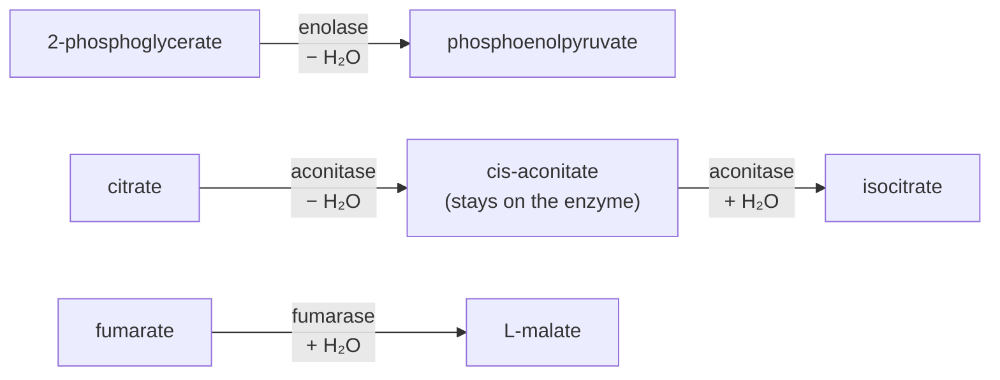

---
aliases:
  - Beta-Elimination
  - β-Elimination
  - E1 Reaction
  - E2 Reaction
  - E1cB Reaction
  - Dehydration Reaction
  - Réaction d'élimination
tags:
  - type/concept
  - domain/chemistry
  - domain/biology
  - level/L2
  - level/L3
mastery: 0
prerequisites:
  - "[[Nucleophilic Substitution]]"
  - "[[Reaction Mechanism]]"
  - "[[Conformational Analysis]]"
  - "[[Cis-Trans Isomerism]]"
  - "[[Acid-Base Equilibrium]]"
related:
  - "[[Carbonyl Group]]"
  - "[[Nucleophilic Addition]]"
  - "[[Glycolysis]]"
  - "[[Citric Acid Cycle]]"
  - "[[Fatty Acid Metabolism]]"
  - "[[Enzyme]]"
  - "[[Hydrolysis]]"
  - "[[Diastereomer]]"
  - "[[Gibbs Free Energy]]"
  - "[[Le Chatelier's Principle]]"
projects: []
sources:
  - "[[Organic Chemistry (OpenStax)]]"
  - "[[Lehninger Principles of Biochemistry (Nelson)]]"
  - "[[ExplorEnz]]"
---

# Elimination Reaction

> [!abstract]
> An elimination removes a hydrogen and a leaving group from two neighbouring carbons and leaves a double bond between them. When the leaving group is OH, water is removed (dehydration); the reverse adds water to the double bond (hydration). Enolase, aconitase and fumarase run such steps at the heart of glycolysis and the citric acid cycle.

## Definition

In a **β-elimination**, a base removes a hydrogen from one carbon (Cβ) while a leaving group departs from the adjacent carbon (Cα), and a C=C double bond forms between them; the reverse reaction is an **addition** across the double bond.[^os117] Removing H and OH is a **dehydration**; adding water is a **hydration**. Three mechanisms differ in the timing of C–H and C–LG bond breaking: **E2** breaks both at once, **E1** breaks C–LG first through a carbocation, and **E1cB** breaks C–H first through a carbanion, the conjugate base of the substrate.[^os117][^os1110]

## Why it matters

- **Central metabolism.** Enolase in glycolysis, aconitase and fumarase in the citric acid cycle catalyze dehydration and hydration steps ([[Glycolysis]], [[Citric Acid Cycle]]).[^os29][^lehninger] Fatty acid oxidation hydrates a C=C bond and fatty acid synthesis dehydrates a β-hydroxy group ([[Fatty Acid Metabolism]]).[^lehninger]
- **Enzyme classification.** These enzymes are hydro-lyases, EC 4.2.1: fumarate hydratase (fumarase) is EC 4.2.1.2, aconitate hydratase (aconitase) EC 4.2.1.3 and phosphopyruvate hydratase (enolase) EC 4.2.1.11.[^explorenz] A hydro-lyase adds or removes water across a double bond, whereas a hydrolase splits a bond with water ([[Enzyme]], [[Hydrolysis]]).
- **Annotation history.** The dehydration half of the aconitase reaction once had its own number, EC 4.2.1.4 (citrate dehydratase), deleted when it was recognized as a partial reaction of aconitate hydratase.[^explorenz] Genome annotations made with older versions of the list can still carry retired numbers ([[Biological Database]]).
- **Stereochemistry in pathways.** Hydrations and dehydrations create or destroy stereocenters and C=C geometries: fumarase hydrates the trans double bond of fumarate and makes only L-malate ([[Cis-Trans Isomerism]], [[Diastereomer]]).[^lehninger]

## Core (L2)

### Three mechanisms

![[elimination-bond-breaking-order.svg]]

| | E2 | E1 | E1cB |
|---|---|---|---|
| Order of events | C–H and C–LG break together | C–LG, then C–H | C–H, then C–LG |
| Intermediate | none | carbocation | carbanion, an enolate when next to C=O |
| Rate law | $k$[substrate][base] | $k$[substrate] | depends on the slow step (Mathematical representation) |
| Geometry | H and LG anti-periplanar | none required | none required |
| Typical case | alkyl halide with a strong base | tertiary substrate, weak base: the partner of SN1 | acidic H next to a carbonyl, poor leaving group such as OH |

- **E2** requires the hydrogen and the leaving group to be **anti-periplanar**, on opposite sides of the C–C bond with a dihedral angle of 180° (a staggered, anti conformation in a Newman projection, [[Conformational Analysis]]).[^os]
- **E1** begins with the same unimolecular dissociation to a carbocation as the SN1 reaction, and has no geometric requirement.[^os1110]
- **E1cB** goes through a carbanion intermediate.[^os1110] All three mechanisms occur in biological pathways, but E1cB is particularly common: the substrate is usually an alcohol, and the hydrogen removed is usually adjacent to a carbonyl group, which makes it acidic and turns the carbanion into a stabilized enolate.[^os1111]
- **Zaitsev's rule.** When several β-carbons carry hydrogens, eliminations give mixtures, and base-induced eliminations generally, though not always, favor the more substituted alkene.[^os117]
- **Substitution or elimination.** A nucleophile is also a base, so the same reagents can substitute or eliminate ([[Nucleophilic Substitution]]).[^os]

### Hydration, the reverse

An elimination run backwards is an addition, and the reverse of each mechanism passes through the same intermediates and transition states (microscopic reversibility). For a C=C bond conjugated with a carbonyl or carboxylate group, the reverse of E1cB is a **conjugate addition** of water: hydroxide or water adds to the β carbon, then the enolate takes up a proton ([[Nucleophilic Addition]]). This is how fumarase hydrates fumarate.[^os29] Which direction runs is set by thermodynamics: $\Delta G = \Delta G^{\circ\prime} + RT \ln Q$, water counted with activity 1 ([[Gibbs Free Energy]], [[Le Chatelier's Principle]]).

### Three hydro-lyases of central metabolism



- **Enolase** (glycolysis, step 9) dehydrates 2-phosphoglycerate to phosphoenolpyruvate by an E1cB mechanism.[^os29] The proton on C2, next to the carboxylate, is removed first; the enolate intermediate is stabilized by Mg²⁺ ions; then the C3 hydroxyl leaves.[^lehninger] The step is reversible, and gluconeogenesis runs it backwards with the same enzyme ([[Gluconeogenesis]]).[^lehninger]
- **Aconitase** (citric acid cycle, step 2) converts citrate into isocitrate by a dehydration to cis-aconitate, which normally stays bound, followed by a rehydration that puts the hydroxyl on the neighbouring carbon. An iron-sulfur center binds the substrate and takes part in adding and removing water.[^lehninger] The point of the detour: citrate is a tertiary alcohol, with no hydrogen on its carbinol carbon, so it cannot be oxidized to a ketone; isocitrate is a secondary alcohol, oxidized in the next step ([[Organic Redox Reaction]]). The equilibrium mixture contains less than 10 % isocitrate, but the reaction is pulled forward because the next step consumes isocitrate.[^lehninger]
- **Fumarase** (citric acid cycle, step 7) adds water to fumarate to give L-malate, by conjugate addition.[^os29] It is stereospecific: it hydrates the trans double bond of fumarate but not the cis bond of maleate, and in the reverse direction it dehydrates L-malate but not D-malate.[^lehninger]

## Advanced (L3)

- **Anti-periplanar in rings.** On a cyclohexane chair, a hydrogen and a leaving group are anti-periplanar only when both are axial, on opposite faces (trans-diaxial), so E2 rates depend on which chair the ring adopts.[^os] Measuring the H–C–C–LG dihedral angle from coordinates (code below) is the same computation as reading backbone torsion angles from a protein structure ([[Protein Secondary Structure]]).
- **Enzymes set regio- and stereochemistry.** In solution, Zaitsev's rule and the available conformations decide which alkene forms. In an active site, the positions of the catalytic base and acid decide: fumarase handles one diastereomer of the alkene and one enantiomer of the alcohol.[^lehninger]
- **Equilibrium versus flux.** Aconitase runs forward although its equilibrium lies on the citrate side, because the next step keeps isocitrate low (Exercise 5);[^lehninger] such near-equilibrium steps are written as reversible in pathway models ([[Metabolic Pathway]]).

## Mathematical representation

- **E2 and E1.** $v_{E2} = k[\mathrm{S}][\mathrm{B}]$ and $v_{E1} = k[\mathrm{S}]$, with S the substrate and B the base ([[Rate Law]]).
- **E1cB.** For S + B ⇌ S⁻ + BH⁺ (rate constants $k_1$ forward, $k_{-1}$ back) followed by S⁻ → alkene + LG⁻ ($k_2$), the steady state of the carbanion ([[Steady-State Approximation]]) gives
$$v = \frac{k_1 k_2 [\mathrm{S}][\mathrm{B}]}{k_{-1}[\mathrm{BH^+}] + k_2}.$$
If $k_2 \gg k_{-1}[\mathrm{BH^+}]$, $v \approx k_1[\mathrm{S}][\mathrm{B}]$: second order, indistinguishable from E2. If $k_{-1}[\mathrm{BH^+}] \gg k_2$, the carbanion is in pre-equilibrium and $v \approx \frac{k_1 k_2}{k_{-1}} \frac{[\mathrm{S}][\mathrm{B}]}{[\mathrm{BH^+}]}$, slowed by the conjugate acid of the base.
- **Dihedral angle.** For atoms at positions $p_0, p_1, p_2, p_3$ (here H, Cβ, Cα, LG), with $b_1 = p_1 - p_0$, $b_2 = p_2 - p_1$, $b_3 = p_3 - p_2$,
$$\phi = \operatorname{atan2}\!\big(\lVert b_2 \rVert\, b_1 \cdot (b_2 \times b_3),\ (b_1 \times b_2) \cdot (b_2 \times b_3)\big),$$
and E2 needs $|\phi| \approx 180°$ ([[Vector]], [[Dot Product]]).
- **Hydration equilibrium.** $K' = [\text{hydrated product}]/[\text{alkene}]$ with water activity 1, $\Delta G^{\circ\prime} = -RT \ln K'$, and $\Delta G = \Delta G^{\circ\prime} + RT \ln Q$ for the actual ratio $Q$.

## Computational representation

Two small tools: the dihedral angle that decides whether an E2 is possible, and a Zaitsev enumeration on a molecular graph. Coordinates are an idealized staggered conformation, written for this note.

```python
import math


def sub(p, q):
    return [a - b for a, b in zip(p, q)]


def cross(u, v):
    return [u[1] * v[2] - u[2] * v[1], u[2] * v[0] - u[0] * v[2], u[0] * v[1] - u[1] * v[0]]


def dot(u, v):
    return sum(a * b for a, b in zip(u, v))


def dihedral(p0, p1, p2, p3) -> float:
    """Torsion angle p0-p1-p2-p3 in degrees: 0 = eclipsed (syn), 180 = anti."""
    b1, b2, b3 = sub(p1, p0), sub(p2, p1), sub(p3, p2)
    y = math.sqrt(dot(b2, b2)) * dot(b1, cross(b2, b3))
    x = dot(cross(b1, b2), cross(b2, b3))
    return math.degrees(math.atan2(y, x))


def substituent(center, axis_sign, azimuth_deg, length):
    """Tetrahedral substituent of a carbon on the x axis, at an azimuth around the C-C bond."""
    t = math.radians(azimuth_deg)
    return [center[0] + axis_sign * 0.334 * length,
            0.943 * length * math.cos(t), 0.943 * length * math.sin(t)]


# Toy staggered conformation (idealized geometry): C-beta at the origin, C-alpha on +x.
c_beta, c_alpha = [0.0, 0.0, 0.0], [1.54, 0.0, 0.0]
br = substituent(c_alpha, +1, 180, 1.94)
for name, az in (("H_a", 0), ("H_b", 120), ("H_c", 240)):
    h = substituent(c_beta, -1, az, 1.09)
    phi = dihedral(h, c_beta, c_alpha, br)
    print(f"{name}: H-C-C-Br dihedral {phi:7.1f}  anti-periplanar: {abs(abs(phi) - 180) < 10}")


def zaitsev(carbons: dict, h_count: dict, alpha: str):
    """List the alkenes from removing LG at alpha and one H from each beta carbon,
    with the number of carbon substituents on the double bond (more = more stable)."""
    products = []
    for beta in carbons[alpha]:
        if h_count[beta] == 0:
            continue
        degree = len(carbons[alpha]) - 1 + len(carbons[beta]) - 1
        products.append((degree, beta, h_count[beta]))
    return sorted(products, reverse=True)


# 2-bromo-2-methylbutane: C1-C2(Br)(C5)-C3-C4, hydrogens counted per carbon
carbons = {"C1": ["C2"], "C2": ["C1", "C3", "C5"], "C3": ["C2", "C4"], "C4": ["C3"], "C5": ["C2"]}
h_count = {"C1": 3, "C2": 0, "C3": 2, "C4": 3, "C5": 3}
for degree, beta, nh in zaitsev(carbons, h_count, "C2"):
    print(f"C2=C{beta[1]}: {degree} carbon substituents on the double bond, {nh} H available")
```

```text
H_a: H-C-C-Br dihedral   180.0  anti-periplanar: True
H_b: H-C-C-Br dihedral    60.0  anti-periplanar: False
H_c: H-C-C-Br dihedral   -60.0  anti-periplanar: False
C2=C3: 3 carbon substituents on the double bond, 2 H available
C2=C5: 2 carbon substituents on the double bond, 3 H available
C2=C1: 2 carbon substituents on the double bond, 3 H available
```

In this conformation only H_a can leave in an E2; rotating about the C–C bond brings the others into position (Exercise 4). For 2-bromo-2-methylbutane, C1 and C5 are equivalent and both give 2-methylbut-1-ene (six hydrogens available), while C3 gives the trisubstituted 2-methylbut-2-ene (two hydrogens): Zaitsev's rule predicts the second as the major product although statistics favor the first.

## Worked example

> [!example] Which mechanism does enolase use?
> 1. **Read the substrate.** In 2-phosphoglycerate, C2 carries an H, the carboxylate (C1) and the phosphate ester; C3 is a CH₂OH. The leaving group would be OH⁻ from C3, a poor one.
> 2. **Rule out E1.** It would need a carbocation on C3, a primary carbon: far too unstable.
> 3. **Look for an acidic hydrogen.** The H on C2 sits next to the carboxylate: removing it gives a resonance-stabilized enolate, which Mg²⁺ ions stabilize further.[^lehninger] With a poor leaving group and an acidic β-hydrogen, the profile is that of E1cB, the mechanism assigned to this step.[^os29]
> 4. **Product.** Expelling the C3 hydroxyl gives phosphoenolpyruvate, whose C2=C3 double bond is an enol phosphate. C2, a stereocenter in 2-phosphoglycerate, is now sp² and planar: the elimination has destroyed a stereocenter.

## Common misconceptions

> [!warning] "Dehydration is the reverse of hydrolysis"
> Hydrolysis splits one molecule into two with water. Hydration adds water across a double bond to give one molecule, and dehydration removes it to form the double bond. Hydro-lyases (EC 4.2.1) and hydrolases (EC 3) are different classes.[^explorenz]

> [!warning] "Zaitsev's rule always gives the product"
> Base-induced eliminations generally, not always, favor the more substituted alkene.[^os117] In enzymes, the active site decides which hydrogen leaves and on which face.

> [!warning] "Any β-hydrogen can be removed in an E2"
> E2 needs the hydrogen anti-periplanar to the leaving group. On a cyclohexane chair, a hydrogen that is not axial and trans to an axial leaving group cannot eliminate by E2 in that chair.[^os]

> [!warning] "Second-order kinetics proves an E2 mechanism"
> An E1cB elimination with fast, irreversible carbanion formation has the same rate law, $k_1[\mathrm{S}][\mathrm{B}]$ (Mathematical representation).

## Exercises

> [!question] Exercise 1 (L2)
> For 2-bromo-2-methylbutane, list the β-hydrogens and the possible alkenes, predict the major alkene, and say which mechanism dominates with sodium ethoxide (a strong base) and on heating in ethanol alone.

> [!success]- Solution
> β-carbons: C1 and C5 (three H each, equivalent, giving 2-methylbut-1-ene, disubstituted) and C3 (two H, giving 2-methylbut-2-ene, trisubstituted). By Zaitsev's rule the major alkene is 2-methylbut-2-ene.[^os117] With ethoxide: E2, rate $= k[\mathrm{RBr}][\mathrm{EtO^-}]$. In ethanol alone: the tertiary bromide ionizes, E1 (in competition with SN1, [[Nucleophilic Substitution]]), rate $= k[\mathrm{RBr}]$.[^os1110]

> [!question] Exercise 2 (L2)
> Write the reactions of enolase, aconitase and fumarase with their EC numbers, and say whether each runs as a dehydration or a hydration in the direction of its pathway.

> [!success]- Solution
> Enolase, EC 4.2.1.11: 2-phosphoglycerate → phosphoenolpyruvate + H₂O, a dehydration in glycolysis. Aconitase, EC 4.2.1.3: citrate → cis-aconitate + H₂O (dehydration), then cis-aconitate + H₂O → isocitrate (hydration). Fumarase, EC 4.2.1.2: fumarate + H₂O → L-malate, a hydration in the citric acid cycle.[^explorenz][^lehninger] All three are reversible.

> [!question] Exercise 3 (L2)
> Fumarase hydrates fumarate but not maleate, and dehydrates L-malate but not D-malate. Name the stereochemical relationship within each pair and explain why an enzyme can discriminate both.

> [!success]- Solution
> Fumarate and maleate are trans and cis isomers of the same butenedioate: diastereomers, with different shapes and properties ([[Cis-Trans Isomerism]]). L- and D-malate are enantiomers. Diastereomers differ in shape, so any binding site can tell them apart; enantiomers differ only toward something chiral, and the active site, built from L-amino acids, is chiral ([[Diastereomer]], [[Chirality]]).[^lehninger]

> [!question] Exercise 4 (L3, Python)
> With `dihedral` and `substituent` from the Computational representation, rotate the three hydrogens of C-beta by 0°, 60° and 120° about the C–C bond and list which hydrogen is anti-periplanar to Br at each step.

> [!success]- Solution
> ```python
> for offset in (0, 60, 120):
>     anti = [name for name, az in (("H_a", 0), ("H_b", 120), ("H_c", 240))
>             if abs(abs(dihedral(substituent(c_beta, -1, az + offset, 1.09),
>                                 c_beta, c_alpha, br)) - 180) < 10]
>     print(offset, anti)
> ```
> Output: `0 ['H_a']`, `60 []`, `120 ['H_c']`. At 60° the conformation is eclipsed and no hydrogen is anti; every 120° rotation brings the next hydrogen into the anti position. In an open chain, rotation is fast, so any β-hydrogen can eventually eliminate; in a ring it cannot rotate freely, hence the trans-diaxial requirement.

> [!question] Exercise 5 (L3, Python)
> The aconitase equilibrium mixture contains less than 10 % isocitrate.[^lehninger] Bound $\Delta G^{\circ\prime}$ for citrate → isocitrate (ignore cis-aconitate), then compute $\Delta G$ if the cell keeps $[\text{isocitrate}]/[\text{citrate}] = 0.01$ (an invented value).

> [!success]- Solution
> ```python
> RT = 8.314462618e-3 * 298.15                 # kJ/mol at 25 degrees C
> K = 10 / 90                                  # at most 10 % isocitrate at equilibrium
> dG0 = -RT * math.log(K)
> print(f"dG0' >= {dG0:+.1f} kJ/mol")
> for Q in (K, 0.01):                          # 0.01: invented in-cell [isocitrate]/[citrate]
>     print(f"Q = {Q:.3f}: dG = {dG0 + RT * math.log(Q):+.1f} kJ/mol")
> ```
> Output: `dG0' >= +5.4 kJ/mol`, `Q = 0.111: dG = +0.0 kJ/mol`, `Q = 0.010: dG = -6.0 kJ/mol`. With at most 10 % isocitrate, $K' \le 1/9$ and $\Delta G^{\circ\prime} \ge +5.4$ kJ/mol. Keeping the product ratio ten times below equilibrium makes $\Delta G$ negative: the "uphill" step runs forward because the next enzyme removes isocitrate ([[Le Chatelier's Principle]]).

> [!question] Exercise 6 (L3)
> Using the E1cB rate law, show when it reduces to $k_1[\mathrm{S}][\mathrm{B}]$, and propose an experiment with D₂O that distinguishes a reversibly formed carbanion from a concerted E2.

> [!success]- Solution
> If $k_2 \gg k_{-1}[\mathrm{BH^+}]$, the denominator is $\approx k_2$ and $v \approx k_1[\mathrm{S}][\mathrm{B}]$, the E2 rate law. Experiment: run the reaction in D₂O and stop it before completion. If the carbanion forms reversibly, it is sometimes reprotonated by solvent deuterium before the leaving group departs, so recovered substrate carries deuterium at Cβ. In a concerted E2, no carbanion exists and unreacted substrate keeps its hydrogen.

## Mastery checklist

- [ ] 1 Recognized: I can identify Cα, Cβ, the leaving group and the base in an elimination, and name dehydration and hydration steps in pathways.
- [ ] 2 Understood: I can compare E1, E2 and E1cB (order of bond breaking, intermediates, rate laws, geometry) and explain why biology favors E1cB.
- [ ] 3 Practiced: I can apply Zaitsev's rule, compute dihedral angles to check anti-periplanar geometry, and compute $\Delta G$ of a hydration from equilibrium data.
- [ ] 4 Applied: I checked the EC 4.2.1 annotations of the glycolysis and citric acid cycle enzymes of a genome against the current IUBMB list, including retired numbers.
- [ ] 5 Explained: I can teach enolase, aconitase and fumarase as eliminations and additions, including their stereospecificity and why aconitase runs forward against its equilibrium.

## References

[^os]: [[Organic Chemistry (OpenStax)]], treatment of elimination reactions (anti-periplanar geometry of the E2 reaction and its consequence in cyclohexane chairs; competition between substitution and elimination) (section numbers not verified beyond those below).
[^os117]: [[Organic Chemistry (OpenStax)]], sec. 11.7 "Elimination Reactions: Zaitsev's Rule" (mixtures of alkenes; base-induced eliminations generally favor the more substituted alkene; E1, E2 and E1cB differ in the timing of C–H and C–X bond breaking).
[^os1110]: [[Organic Chemistry (OpenStax)]], sec. 11.10 "The E1 and E1cB Reactions" (E1 begins with the unimolecular dissociation of SN1 and has no geometric requirement; E1cB proceeds through a carbanion intermediate).
[^os1111]: [[Organic Chemistry (OpenStax)]], sec. 11.11 "Biological Elimination Reactions" (all three mechanisms occur in biological pathways, E1cB particularly often; the substrate is usually an alcohol and the hydrogen removed is usually adjacent to a carbonyl group).
[^os29]: [[Organic Chemistry (OpenStax)]], ch. 29 "The Organic Chemistry of Metabolic Pathways" (glycolysis step 9, enolase, an E1cB dehydration; citric acid cycle: aconitase dehydration and rehydration, fumarase hydration by conjugate addition).
[^lehninger]: [[Lehninger Principles of Biochemistry (Nelson)]], 8th ed. (2021), treatment of glycolysis and gluconeogenesis (enolase and its Mg²⁺ ions; reversible steps shared by both pathways), the citric acid cycle (aconitase: bound cis-aconitate, iron-sulfur center, equilibrium below 10 % isocitrate pulled forward by the next step; fumarase stereospecificity) and fatty acid oxidation and synthesis (hydration and dehydration steps).
[^explorenz]: [[ExplorEnz]], IUBMB Enzyme List: EC 4.2.1 hydro-lyases; EC 4.2.1.2 fumarate hydratase; EC 4.2.1.3 aconitate hydratase; EC 4.2.1.11 phosphopyruvate hydratase; EC 4.2.1.4 deleted as a partial reaction of EC 4.2.1.3.
