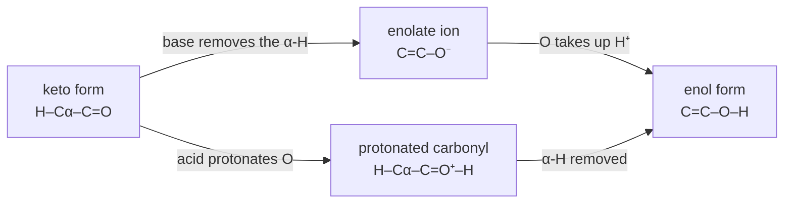
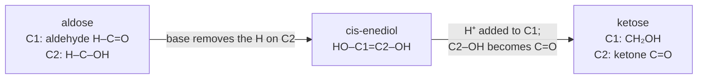

---
aliases:
  - Tautomerism
  - Keto-Enol Tautomerism
  - Amino-Imino Tautomerism
  - Lactam-Lactim Tautomerism
  - Rare Tautomer
  - Tautomère
tags:
  - type/concept
  - domain/chemistry
  - domain/biology
  - level/L2
  - level/L3
  - level/M1
mastery: 0
prerequisites:
  - "[[Isomer]]"
  - "[[Functional Group]]"
  - "[[Acid-Base Equilibrium]]"
  - "[[Base Pairing]]"
  - "[[Heterocyclic Compound]]"
related:
  - "[[Carbonyl Group]]"
  - "[[Resonance (Chemistry)]]"
  - "[[Point Mutation]]"
  - "[[DNA Replication]]"
  - "[[DNA Repair]]"
  - "[[Glycolysis]]"
  - "[[Gibbs Free Energy]]"
  - "[[Diastereomer]]"
  - "[[Molecular Representation]]"
projects: []
sources:
  - "[[Organic Chemistry (OpenStax)]]"
  - "[[Watson 1953 - Molecular Structure of Nucleic Acids]]"
  - "[[Watson 1953 - Genetical Implications of the Structure of Deoxyribonucleic Acid]]"
  - "[[Kimsey 2015 - Visualizing Transient Watson-Crick-Like Mispairs in DNA and RNA Duplexes]]"
  - "[[An Introduction to Genetic Analysis (Griffiths)]]"
  - "[[Biochemistry (Berg)]]"
  - "[[Molecular Biology of the Cell (Alberts)]]"
  - "[[Nurk 2022 - The Complete Sequence of a Human Genome]]"
---

# Tautomer

> [!abstract]
> Tautomers are isomers that turn into each other by moving a hydrogen from one atom to another while a double bond shifts. The keto and enol forms of a carbonyl compound are the classic pair; in biology, enol intermediates let enzymes turn aldoses into ketoses, and rare tautomers of the DNA bases pair with the wrong partner.

## Definition

**Tautomerism** is the spontaneous interconversion of two isomers, usually by a change in the position of a hydrogen; the two forms are **tautomers**.[^os221] Tautomers are constitutional isomers: different compounds with different connectivity, which coexist in equilibrium. Resonance forms, by contrast, are different drawings of one compound ([[Isomer]], [[Resonance (Chemistry)]]).[^os221] In every case below a proton moves between two atoms and a double bond moves between them in the opposite direction:

| Type | Usual form | Tautomer | Where |
|---|---|---|---|
| keto-enol | H–C–C=O | C=C–O–H | carbonyl compounds, sugar isomerases |
| lactam-lactim (amide-imidic acid) | H–N–C=O | N=C–O–H | ring amides of G, T, U ("keto" and "enol" forms) |
| amino-imino | H₂N–C=N | H–N=C–N–H | exocyclic amino groups of A and C |

## Why it matters

- **Base pairing presupposes tautomers.** Watson and Crick obtained their pairs only by assuming the bases in their keto rather than enol forms ([[Base Pairing]]).[^watson] A base in a rare tautomeric form presents another pattern of hydrogen-bond donors and acceptors and pairs with the wrong partner; in their second 1953 letter they proposed this as a mechanism of spontaneous mutation.[^watson53b] Each such mispair produces a transition ([[Point Mutation]]).
- **Sugar isomerases work through enols.** Glycolysis turns glucose 6-phosphate (an aldose) into fructose 6-phosphate (a ketose), and dihydroxyacetone phosphate into glyceraldehyde 3-phosphate, through enediol intermediates: two keto-enol tautomerizations in a row ([[Glycolysis]]).[^os29][^berg]
- **Compound identity.** Two tautomers are two molecular graphs, so they get different SMILES strings, yet in solution they are one substance in equilibrium. Compound registration, metabolite annotation and similarity search must decide whether to merge them, typically by converting both to one canonical tautomer, a software convention rather than the dominant form in water ([[Molecular Representation]]).
- **Structure models.** Neutral histidine exists as two tautomers, with the ring hydrogen on one nitrogen or the other ([[Heterocyclic Compound]]); the form chosen for each residue and ligand changes the hydrogen bonds in a model used for [[Molecular Docking]] or simulation.

## Core (L2)

### Keto-enol tautomerism



Acids and bases both catalyze the interconversion: a base removes the α hydrogen to give an enolate ion, which takes up a proton on oxygen; an acid protonates the carbonyl oxygen first, which makes the α hydrogen easier to remove.[^os221] Why α hydrogens are acidic is the subject of [[Carbonyl Group]].

**Position of the equilibrium.** Most monocarbonyl compounds exist almost entirely in the keto form: cyclohexanone is about 0.0001 % enol at room temperature. The enol predominates only when conjugation or an intramolecular hydrogen bond stabilizes it, as in 2,4-pentanedione, about 76 % enol.[^os221]

### Tautomers of the nucleobases

G, T and U carry ring amides (C=O next to a ring N–H), whose rare form is the lactim or "enol"; A and C carry exocyclic amino groups next to a ring nitrogen, whose rare form is the imino tautomer. The usual forms are keto and amino.[^watson][^griffiths] The proton shift rewrites the pairing edge, read from position 6 (purines) or 4 (pyrimidines) to position 2, as a word of donors (D) and acceptors (A):

| Base | Usual edge | Rare tautomer | Rare edge | Pairs with | Mutation after replication |
|---|---|---|---|---|---|
| G | A D D (O6, N1–H, N2–H) | enol G* | D A D | T | G:C → A:T |
| A | D A – (N6–H, N1, C2–H) | imino A* | A D – | C | A:T → G:C |
| T | A D A (O4, N3–H, O2) | enol T* | D A A | G | A:T → G:C |
| C | D A A (N4–H, N3, O2) | imino C* | A D A | A | G:C → A:T |

![[rare-tautomer-mispairs.svg]]

The table hides a simple rule: **each rare tautomer impersonates the other base of its own class.** T* presents the edge of C, C* the edge of T, G* pairs with T like an A, A* with C like a G. The mispair keeps the purine·pyrimidine geometry of a normal pair, and the resulting substitution is always a transition, purine for purine or pyrimidine for pyrimidine.[^griffiths] A tautomeric shift is not yet a mutation: it is a reversible move to a short-lived form,[^kimsey] and only a wrong nucleotide inserted at that moment, missed by proofreading and repair and copied again, becomes one ([[DNA Replication]], [[DNA Repair]]).

### Enediols in sugar isomerases



Phosphoglucose isomerase first opens the ring of glucose 6-phosphate to its open-chain aldehyde, then converts it through a cis-enediol intermediate into fructose 6-phosphate.[^os29] Triose phosphate isomerase interconverts dihydroxyacetone phosphate and glyceraldehyde 3-phosphate through the same kind of enediol: a glutamate acts as the general base that removes the proton and a histidine as the general acid that donates one ([[Enzyme Catalysis]]).[^berg] Each enzyme thus performs two tautomerizations: aldehyde to enediol, enediol to ketone.

## Advanced (L3)

- **Energetics.** With $K_T = [\text{tautomer}]/[\text{usual form}]$, $\Delta G^\circ = -RT \ln K_T$: cyclohexanone's enol lies about 34 kJ/mol above the keto form, while 2,4-pentanedione's enol lies 2.9 kJ/mol below it (code below). At 25 °C each 5.7 kJ/mol of stabilization multiplies $K_T$ by ten, so a binding pocket that offers one extra hydrogen bond to a rare form can raise its population by orders of magnitude ([[Gibbs Free Energy]]).
- **Tautomer or ion.** Watson-Crick-like mispairs can be stabilized either by a rare enol tautomer or by an anionic (deprotonated) base.[^kimsey] Moving a proton and removing one are competing routes to the wrong pairing, and how much the ionized route contributes depends on the pKa of the base and on pH ([[Acid-Base Equilibrium]]).
- **Enolization erases stereocenters.** The α carbon of an enol or enolate is sp² and planar. A stereocenter next to a carbonyl group therefore loses its configuration on enolization, and reprotonation from either face racemizes or epimerizes it ([[Diastereomer]]). The enediol of glucose has lost the configuration at C2, so it is also the enediol of mannose (its C2 epimer) and of fructose (Exercise 5).

## Frontier (M1)

Direct evidence for the rare-tautomer hypothesis of 1953[^watson53b] came from NMR. Kimsey and colleagues used NMR relaxation dispersion to show that G·T and G·U wobble mispairs in DNA and RNA duplexes exist in dynamic equilibrium with short-lived, low-populated **Watson-Crick-like** mispairs, stabilized by rare enolic or anionic bases. These mispairs can evade Watson-Crick fidelity checkpoints and form with probabilities of $10^{-3}$ to $10^{-5}$, which the authors argue implies a role in replication and translation errors.[^kimsey] For comparison, base selection by a replicative DNA polymerase errs about once in $10^5$ nucleotides before proofreading ([[DNA Replication#Deeper (L2)]]).[^alberts] For bioinformatics, the consequence is mechanistic support for part of the mutation spectrum: a pathway that can only produce transitions adds to the excess of transitions over transversions seen in mutation data, if it operates at these rates ([[Point Mutation]], [[Mutation Rate]]).

## Mathematical representation

- **Equilibrium.** For a usual form U and a tautomer T, $K_T = [\mathrm{T}]/[\mathrm{U}]$, the tautomer fraction is $f = K_T/(1 + K_T)$, and $\Delta G^\circ = -RT \ln K_T$, with $R$ the gas constant and $T$ the temperature. A stabilization $\Delta\Delta G$ of the tautomer multiplies $K_T$ by $e^{\Delta\Delta G/RT}$: tenfold per $RT \ln 10 = 5.71$ kJ/mol at 298 K.
- **Edges as words.** A pairing edge is a word $p \in \{D, A, -\}^3$. Two facing edges $p$ (purine) and $q$ (pyrimidine) **clash** if $p_i = q_i \in \{D, A\}$ for some $i$; otherwise they fit with $b(p, q) = |\{i : \{p_i, q_i\} = \{D, A\}\}|$ hydrogen bonds. Watson-Crick pairs are the fits of the usual forms with the maximum $b$ for their purine.
- **A toy error model.** If each template base is in a rare form with probability $f$ at the moment of copying and every rare form mispairs, a copy of $N$ bases contains on average $Nf$ mispairs before proofreading and repair, each converted into a transition by the next replication.

## Computational representation

The donor-acceptor words of the usual and rare forms are enough to enumerate every fitting pair:

```python
import math

# Watson-Crick edge of each base, from the major-groove side to the minor-groove side:
# D = hydrogen-bond donor, A = acceptor, - = neither (C2-H of adenine).
EDGE = {
    "G": "ADD", "G*": "DAD",     # keto guanine (O6, N1-H, N2-H); enol G*: O6-H, N1
    "A": "DA-", "A*": "AD-",     # amino adenine (N6-H, N1, C2-H); imino A*: N6, N1-H
    "T": "ADA", "T*": "DAA",     # keto thymine (O4, N3-H, O2); enol T*: O4-H, N3
    "C": "DAA", "C*": "ADA",     # amino cytosine (N4-H, N3, O2); imino C*: N4, N3-H
}
PARTNER = {"G": "C", "A": "T"}


def hydrogen_bonds(purine: str, pyrimidine: str) -> int | None:
    """Bonds formed by two facing edges, or None when donor meets donor or acceptor meets acceptor."""
    bonds = 0
    for x, y in zip(EDGE[purine], EDGE[pyrimidine]):
        if {x, y} == {"D", "A"}:
            bonds += 1
        elif x == y != "-":
            return None
    return bonds


for pur in ("G", "G*", "A", "A*"):
    for pyr in ("C", "C*", "T", "T*"):
        n = hydrogen_bonds(pur, pyr)
        if n:
            rare = sum("*" in b for b in (pur, pyr))
            kind = "Watson-Crick partners" if PARTNER[pur[0]] == pyr[0] else "mispair -> transition"
            print(f"{pur:2} . {pyr:2}  {n} H-bonds  rare forms: {rare}  {kind}")

RT = 8.314462618e-3 * 298.15                      # kJ/mol at 25 degrees C
for name, enol_fraction in (("cyclohexanone", 1e-6), ("2,4-pentanedione", 0.76)):
    K = enol_fraction / (1 - enol_fraction)        # K_T = [enol]/[keto]
    print(f"{name:17} K_T = {K:.3g}   dG = {-RT * math.log(K):+.1f} kJ/mol")
```

```text
G  . C   3 H-bonds  rare forms: 0  Watson-Crick partners
G  . T*  3 H-bonds  rare forms: 1  mispair -> transition
G* . C*  3 H-bonds  rare forms: 2  Watson-Crick partners
G* . T   3 H-bonds  rare forms: 1  mispair -> transition
A  . C*  2 H-bonds  rare forms: 1  mispair -> transition
A  . T   2 H-bonds  rare forms: 0  Watson-Crick partners
A* . C   2 H-bonds  rare forms: 1  mispair -> transition
A* . T*  2 H-bonds  rare forms: 2  Watson-Crick partners
cyclohexanone     K_T = 1e-06   dG = +34.2 kJ/mol
2,4-pentanedione  K_T = 3.17   dG = -2.9 kJ/mol
```

Eight edge combinations fit. The four with exactly one rare form are the mispairs of the table, all transitions; the two with two rare forms restore the normal partners and, needing two improbable events at once, matter even less. G·T and A·C with both bases in their usual forms do not appear: their edges clash, which is why such mismatches cannot adopt Watson-Crick geometry without a tautomer or an ion.

## Worked example

> [!example] From one enol guanine to a mutation
> 1. **Round 1.** A G:C pair is copied. At the moment the polymerase reads the G strand, the G is in its enol form G* (edge `D A D`), which fits T (`A D A`) with three hydrogen bonds in Watson-Crick geometry: T is inserted.
> 2. **Back to normal.** G* returns to the keto form within the duplex, leaving a G·T mismatch in one daughter duplex, unless proofreading or mismatch repair removes the T ([[DNA Repair]]). The other daughter, copied from the C strand, is a normal G:C.
> 3. **Round 2.** The mismatched duplex separates: its G strand templates a C (normal G:C), its T strand templates an A, giving A:T.
> 4. **Result.** One of the four granddaughter duplexes carries A:T where the ancestor had G:C: a G:C → A:T **transition**. Written on one strand, it is G>A, or C>T on the other ([[Point Mutation]]).

## Common misconceptions

> [!warning] "Tautomers are resonance structures"
> Resonance structures of one molecule differ only in where electrons are drawn. Tautomers differ in where a hydrogen atom is: they are distinct compounds in equilibrium, which can in principle be separated and have their own spectra.[^os221]

> [!warning] "The enol is only a fleeting intermediate"
> Enols are real compounds in equilibrium with the keto form. They are usually minor (cyclohexanone about 0.0001 %) but can dominate when stabilized (2,4-pentanedione about 76 %).[^os221]

> [!warning] "A rare tautomer can cause any substitution"
> Rare forms keep the purine·pyrimidine geometry and impersonate the other base of their class, so the outcome is a transition (table and code above). A transversion requires a purine to be inserted opposite a purine, or a pyrimidine opposite a pyrimidine, which tautomers of the four bases do not provide ([[Point Mutation]]).

## Exercises

> [!question] Exercise 1 (L2)
> Tautomers or resonance forms? (a) Acetone and prop-1-en-2-ol; (b) the two Lewis structures of an enolate ion; (c) the keto and enol forms of 2,4-pentanedione; (d) the two Kekulé structures of benzene; (e) neutral histidine with its ring hydrogen on one nitrogen or on the other.

> [!success]- Solution
> (a) Tautomers (a hydrogen moves from carbon to oxygen). (b) Resonance forms: same atoms, the negative charge drawn on O or on C. (c) Tautomers. (d) Resonance forms ([[Aromaticity]]). (e) Tautomers: the hydrogen changes nitrogen ([[Heterocyclic Compound]]).

> [!question] Exercise 2 (L2)
> Using the edge table, predict the partner of imino C* and of enol T*, and the mutation each produces after two rounds of replication when the rare form is in the template strand.

> [!success]- Solution
> C* has the edge `A D A`, the edge of T, so it pairs with A: an A is inserted opposite C, and the next round puts T opposite that A. G:C → A:T. T* has the edge `D A A`, the edge of C, so it pairs with G: a G is inserted opposite T, then C opposite that G. A:T → G:C. Both are transitions.

> [!question] Exercise 3 (L2)
> Write the C1-C2 fragments of glucose 6-phosphate (open chain), of the enediol and of fructose 6-phosphate, and name which hydrogens move in each step of phosphoglucose isomerase.

> [!success]- Solution
> Glucose 6-phosphate: C1 is the aldehyde H–C=O, C2 is H–C–OH. Step 1: a base removes the hydrogen on C2 while the C=O oxygen gets a proton: HO–C1=C2–OH, the cis-enediol. Step 2: a proton is added to C1 and the C2 hydroxyl loses its proton as it becomes C=O: C1 is now CH₂OH and C2 a ketone, fructose 6-phosphate (which then closes its ring).[^os29] Net result: a hydrogen moved from C2 to C1, through two keto-enol tautomerizations.

> [!question] Exercise 4 (L3, Python)
> By how much must an environment (a polymerase active site, a mispair) stabilize a rare tautomer to raise its fraction from $10^{-4}$ to $10^{-2}$ at 25 °C?

> [!success]- Solution
> ```python
> def fraction_to_K(f: float) -> float:
>     return f / (1 - f)
>
>
> ddG = RT * math.log(fraction_to_K(1e-2) / fraction_to_K(1e-4))
> print(f"stabilization needed: {ddG:.1f} kJ/mol; tenfold per {RT * math.log(10):.2f} kJ/mol")
> ```
> Output: `stabilization needed: 11.4 kJ/mol; tenfold per 5.71 kJ/mol`. A hundredfold increase costs about two times 5.7 kJ/mol, the order of one or two hydrogen bonds: small energies make rare forms much less rare.

> [!question] Exercise 5 (L3)
> Show that glucose, mannose and fructose share one enediol, and predict what reprotonation of that enediol can give. Which product is an epimer of glucose and which a constitutional isomer?

> [!success]- Solution
> Removing the C2 hydrogen of glucose gives the 1,2-enediol, in which C2 is sp² and planar: its configuration is lost. Glucose and mannose differ only at C2, so they give the same enediol, and so does fructose, the 2-ketose with the same configurations at C3 to C5. Reprotonating C2 from either face gives glucose or mannose (C2 epimers, [[Diastereomer]]); protonating C1 and turning the C2 hydroxyl into C=O gives fructose, a constitutional isomer. One planar intermediate connects all three.

> [!question] Exercise 6 (M1, Python)
> Use the fidelity steps of replication (base selection about 1 error per $10^5$ nucleotides, then about 100-fold from proofreading and 100-fold from mismatch repair)[^alberts] and the haploid human genome size, about $3.055 \times 10^9$ bp,[^nurk] to compute errors per genome copy after each step. Compare with the $10^{-3}$ to $10^{-5}$ probabilities of Watson-Crick-like G·T mispairs and explain why a mispair with normal geometry is a problem for fidelity checks.

> [!success]- Solution
> ```python
> genome = 3.055e9                                   # bp, haploid human genome (T2T)
> errors = genome * 1e-5                             # base selection alone
> for step, factor in (("base selection", 1), ("+ proofreading", 1e-2), ("+ mismatch repair", 1e-2)):
>     errors *= factor
>     print(f"{step:18} {errors:,.0f} errors per genome copy")
> ```
> Output: `base selection 30,550`, `+ proofreading 306`, `+ mismatch repair 3` errors per genome copy. The Watson-Crick-like mispair probabilities reach and exceed the error rate of base selection.[^kimsey] Fidelity checkpoints favor Watson-Crick geometry; a mispair that briefly adopts it can evade them, which is why the authors propose these forms as a source of replication and translation errors.

## Mastery checklist

- [ ] 1 Recognized: I can define tautomerism, tell a tautomer from a resonance form, and name keto-enol, lactam-lactim and amino-imino pairs.
- [ ] 2 Understood: I can explain why the keto form usually dominates, how acids and bases catalyze enolization, and how enediols let isomerases move a carbonyl group.
- [ ] 3 Practiced: I can derive which partner each rare base tautomer pairs with, follow it to a transition, and convert tautomer fractions into free energies.
- [ ] 4 Applied: I compared the canonical tautomers that two cheminformatics tools assign to the same nucleobase or drug record, or checked His tautomer assignments in a real protein structure.
- [ ] 5 Explained: I can teach the 1953 rare-tautomer hypothesis, the NMR evidence for Watson-Crick-like mispairs, and what they imply for mutation spectra.

## References

[^os221]: [[Organic Chemistry (OpenStax)]], sec. 22.1 "Keto–Enol Tautomerism" (definition; tautomers as constitutional isomers versus resonance forms; acid- and base-catalyzed enol formation; cyclohexanone about 0.0001 % enol, 2,4-pentanedione about 76 % enol).
[^os29]: [[Organic Chemistry (OpenStax)]], ch. 29 "The Organic Chemistry of Metabolic Pathways" (isomerizations of glycolysis through enediol intermediates).
[^watson]: [[Watson 1953 - Molecular Structure of Nucleic Acids]], *Nature* 171:737-738 (pairing requires the bases in their keto rather than enol forms).
[^watson53b]: [[Watson 1953 - Genetical Implications of the Structure of Deoxyribonucleic Acid]], *Nature* 171:964-967.
[^kimsey]: [[Kimsey 2015 - Visualizing Transient Watson-Crick-Like Mispairs in DNA and RNA Duplexes]], *Nature* 519:315-320.
[^griffiths]: [[An Introduction to Genetic Analysis (Griffiths)]], 7th ed. (2000), treatment of spontaneous mutation (mispairing during replication through tautomeric shifts; transitions).
[^berg]: [[Biochemistry (Berg)]], 5th ed. (2002), treatment of glycolysis (isomerizations; triose phosphate isomerase, its enediol intermediate, glutamate as general base and histidine as general acid).
[^alberts]: [[Molecular Biology of the Cell (Alberts)]], 4th ed. (2002), treatment of replication fidelity (error rate of base selection, proofreading and mismatch repair).
[^nurk]: [[Nurk 2022 - The Complete Sequence of a Human Genome]], *Science* 376:44-53.
