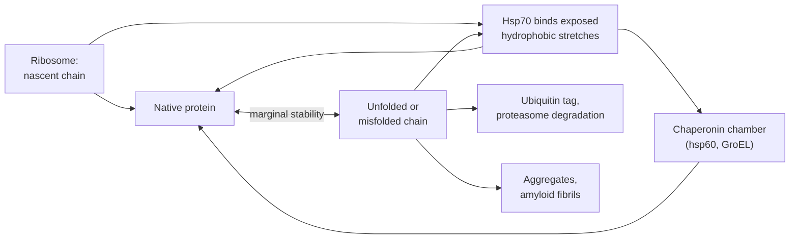

---
aliases:
  - Folding
  - Protein Misfolding
  - Anfinsen's Dogma
  - Thermodynamic Hypothesis
  - Repliement des protéines
tags:
  - type/concept
  - domain/chemistry
  - domain/biology
  - domain/physics
  - domain/bioinformatics
  - level/L2
  - level/L3
mastery: 0
prerequisites:
  - "[[Protein Tertiary Structure]]"
  - "[[Protein Secondary Structure]]"
  - "[[Hydrophobic Effect]]"
  - "[[Gibbs Free Energy]]"
  - "[[Chemical Equilibrium]]"
related:
  - "[[Free Energy Landscape]]"
  - "[[Two-State Model]]"
  - "[[Heat Capacity]]"
  - "[[Boltzmann Distribution]]"
  - "[[Peptide Bond]]"
  - "[[Protein Structure Prediction]]"
  - "[[Molecular Dynamics Simulation]]"
  - "[[Missense Mutation]]"
  - "[[Endomembrane System]]"
  - "[[Intrinsically Disordered Region]]"
projects: []
sources:
  - "[[Biochemistry (Berg)]]"
  - "[[Lehninger Principles of Biochemistry (Nelson)]]"
  - "[[Molecular Biology of the Cell (Alberts)]]"
  - "[[Anfinsen 1973 - Principles That Govern the Folding of Protein Chains]]"
  - "[[Myers 1995 - Denaturant m Values and Heat Capacity Changes]]"
  - "[[Jumper 2021 - Highly Accurate Protein Structure Prediction with AlphaFold]]"
---

# Protein Folding

> [!abstract]
> Protein folding is how a chain of amino acids reaches its working 3D shape: the information is in the sequence, the shape is the chain's state of lowest free energy, and because that state is only marginally stable, cells add helpers, quality control and a disposal system.

## Definition

**Protein folding** is the process by which a polypeptide chain acquires its native three-dimensional structure. Anfinsen's refolding experiments showed that the information needed to specify this structure is contained in the amino acid sequence;[^berg][^anfinsen] his **thermodynamic hypothesis** states that the native structure is the state of lowest free energy of the chain in its physiological environment, and is therefore determined by the sequence in a given environment.[^anfinsen]

## Why it matters

- **Structure prediction rests on it.** If the sequence determines the structure, the structure can in principle be computed from the sequence; AlphaFold 2 predicts protein structures from sequences and their alignments ([[Protein Structure Prediction]]).[^anfinsen][^jumper]
- **Variants act through stability.** The native state is only marginally stable,[^lehninger] so a substitution that costs a few kJ/mol can unfold a substantial fraction of the molecules (Computational representation): one mechanism of a damaging [[Missense Mutation]].
- **Stability is measured.** Chemical and thermal denaturation curves give the stability of a protein and of its variants; the denaturant m value reports the surface exposed on unfolding.[^myers]
- **Misfolding causes disease.** Aggregated, misfolded proteins underlie amyloid and prion diseases.[^berg][^alberts]

## Core (L2)

### Anfinsen: the sequence carries the information

Ribonuclease A is a single chain of 124 residues cross-linked by four disulfide bonds. In 8 M urea with β-mercaptoethanol, which reduces the disulfides, it becomes a randomly coiled, inactive chain. When the urea and the β-mercaptoethanol are removed by dialysis, the chain slowly regains its activity: its eight cysteines re-form the four native disulfides by air oxidation, out of 105 possible pairings. If instead the chain is reoxidized while still in 8 M urea and the urea is then removed, the product, "scrambled" ribonuclease, has about 1 % of the activity; a trace of β-mercaptoethanol, which lets disulfides exchange, converts it to the native enzyme in about 10 hours.[^berg] The native structure is reached from many starting points and is the one that wins when the chain can explore: the signature of a free-energy minimum encoded by the sequence (Worked example).[^berg][^anfinsen]

### Unfolding is cooperative

Proteins are denatured by heat or by chemical denaturants such as urea and guanidinium chloride. The transition from folded to unfolded is sharp: at the midpoint, half of the molecules are folded and half unfolded, with few partly folded molecules. Folding and unfolding are cooperative, "all or none" processes.[^berg] This is why a **two-state model**, native N and unfolded U in equilibrium, describes many small proteins ([[Two-State Model]]):

$$\mathrm{N} \rightleftharpoons \mathrm{U}, \qquad K_U = \frac{[\mathrm{U}]}{[\mathrm{N}]} = e^{-\Delta G_u / RT}, \qquad f_U = \frac{K_U}{1 + K_U},$$

with $\Delta G_u$ the free energy of unfolding, $R$ the gas constant and $T$ the temperature ([[Chemical Equilibrium]]).

### Marginal stability

The [[Hydrophobic Effect]] drives folding,[^berg] but the native state is only marginally stable: its stability is the small difference between large favorable terms (burial of nonpolar groups, many weak interactions) and the large loss of conformational entropy of the chain.[^lehninger] Stability therefore depends on temperature in a curved way, with a maximum and, in principle, cold denaturation ([[Heat Capacity#Deeper (L2)]]). In numbers, at 37 °C a protein with $\Delta G_u = 20$ kJ/mol leaves 0.04 % of its molecules unfolded, one with 5 kJ/mol leaves 13 % (Computational representation).

### The energy landscape: Levinthal's paradox and the funnel

![[folding-energy-funnel.svg]]

If each residue of a 100-residue chain could adopt 3 conformations, the chain would have $3^{100} \approx 5 \times 10^{47}$ conformations; trying them one by one at $10^{-13}$ s each would take about $1.6 \times 10^{27}$ years. Real proteins fold far faster: this contradiction is **Levinthal's paradox**. Folding is not a random search: partly correct intermediates are retained because they are slightly more stable than unfolded regions, a cumulative selection.[^berg] The free-energy landscape is drawn as a **funnel**: at the top, many conformations and a high conformational entropy; going down, fewer conformations, more native structure and lower free energy; depressions on the walls are semistable intermediates that can slow folding.[^lehninger] See [[Free Energy Landscape]] for the general picture and [[Peptide Bond#Mathematical representation]] for the count with two angles per residue.

### Folding in the cell



In the crowded cell, many chains start folding before their synthesis is complete. **Molecular chaperones** help: hsp70 proteins bind short hydrophobic stretches of a chain, often before it leaves the ribosome, and hsp60-like **chaperonins** (GroEL in bacteria) form a barrel-shaped isolation chamber in which a misfolded protein gets another chance to fold; both use ATP hydrolysis. Exposed hydrophobic regions are the signal of an incompletely folded protein; proteins that fail to fold are tagged with ubiquitin and destroyed by the **proteasome**.[^alberts] Two enzymes speed up slow chemical steps: **protein disulfide isomerase** shuffles disulfide bonds until the native ones form, and **peptidyl-prolyl cis-trans isomerase** interconverts the cis and trans forms of peptide bonds before proline ([[Peptide Bond]]).[^lehninger] Disulfide formation and chaperone-assisted folding of secreted proteins take place in the endoplasmic reticulum ([[Endomembrane System]]).[^alberts]

### Misfolding and disease

Misfolded proteins can aggregate into insoluble fibrils rich in β sheet (**amyloid**). Such aggregates are found in Alzheimer's disease (the amyloid-β peptide) and Huntington's disease, and in **prion diseases** (Creutzfeldt-Jakob disease in humans, bovine spongiform encephalopathy in cattle), where the misfolded, aggregated form of the prion protein converts normal molecules of the same sequence and can transmit the disease.[^berg][^alberts]

## Advanced (L3)

**Measuring stability.** In the linear extrapolation model, the stability decreases linearly with denaturant concentration, $\Delta G_u([D]) = \Delta G_u^{w} - m[D]$, so a chemical denaturation curve gives $\Delta G_u^{w}$ (in water) and the slope $m$. Across proteins, m values and the heat capacity change of unfolding both correlate with the surface area exposed on unfolding,[^myers] which links the measurement to the structure ([[Solvent Accessible Surface Area]], [[Heat Capacity]]).

**Variants as $\Delta\Delta G$.** A substitution changes the stability by $\Delta\Delta G = \Delta G_u^{wt} - \Delta G_u^{mut}$ (positive when destabilizing). Because $f_U$ depends exponentially on $\Delta G_u$, the same $\Delta\Delta G$ is harmless for a very stable protein and disabling for a marginal one (Exercise 2). Estimating $\Delta\Delta G$ from a structure is the natural next step of variant interpretation, and the burial of the mutated residue is its first ingredient ([[Protein Tertiary Structure#Advanced (L3)]]).

**Limits of "sequence determines structure".** Anfinsen's statement concerns one chain in a given environment.[^anfinsen] In cells, some chains need chaperones to avoid aggregation (the information is still in the sequence; chaperones prevent wrong intermolecular contacts);[^alberts] some segments have no single native structure ([[Intrinsically Disordered Region]]);[^lehninger] and the prion protein exists in two forms with the same sequence, the abnormal one aggregated.[^berg] Kinetics, partners and concentration matter as well as the free-energy minimum of the isolated chain.

**Prediction is not folding.** AlphaFold 2 outputs coordinates and a per-residue confidence:[^jumper] a predicted end state, not a folding pathway, a stability or an aggregation propensity. Pathways and stabilities are the domain of physical models: [[Molecular Dynamics Simulation]] on a [[Free Energy Landscape]], and calorimetric or denaturation measurements.

## Mathematical representation

- **Two-state equilibrium.** $K_U = e^{-\Delta G_u/RT}$, $f_U = \dfrac{1}{1 + e^{\Delta G_u/RT}}$; $f_U = 1/2$ when $\Delta G_u = 0$.
- **Linear extrapolation.** $\ln K_U([D]) = -\dfrac{\Delta G_u^{w}}{RT} + \dfrac{m}{RT}[D]$, a straight line in the denaturant concentration $[D]$; the midpoint is $C_m = \Delta G_u^{w}/m$. For two variants with the same $m$, $\Delta\Delta G = m\,(C_m^{wt} - C_m^{mut})$.
- **Effect of a variant.** $\dfrac{K_U^{mut}}{K_U^{wt}} = e^{\Delta\Delta G/RT}$: each $RT \ln 10 \approx 5.9$ kJ/mol at 37 °C multiplies the unfolded fraction (while small) by 10.
- **Levinthal count.** With $k$ conformations per residue and $n$ residues, $\Omega = k^n$; a blind search at $\tau$ per conformation takes $\Omega\tau$. With cumulative selection, each round fixes every residue that happens to be right with probability $1/k$, so the number still wrong decays geometrically, $n(1 - 1/k)^r$, and about $\log n / \log\frac{k}{k-1}$ rounds suffice: about 11 for $n = 100$, $k = 3$ (simulated in Exercise 5).
- **Disulfide pairings.** $2p$ cysteines can be paired into $p$ disulfides in $(2p - 1)!! = (2p - 1)(2p - 3) \cdots 1$ ways: 105 for 8 cysteines.

## Computational representation

The script computes unfolded fractions for a range of stabilities, simulates the chemical denaturation of an invented protein ($\Delta G_u^{w} = 25$ kJ/mol, $m = 10$ kJ mol⁻¹ M⁻¹, 25 °C, measurement noise 0.01), fits the two-state model by linear regression of $\ln K_U$ in the transition, and redoes Levinthal's arithmetic.

```python
import math
import random
from statistics import linear_regression

R = 8.314462618e-3                      # gas constant, kJ/(mol K)


def fraction_unfolded(dG_u: float, T: float = 310.15) -> float:
    """Two-state model: f_U = K / (1 + K), K = exp(-dG_u / RT); dG_u in kJ/mol."""
    K = math.exp(-dG_u / (R * T))
    return K / (1 + K)


for dG in (40, 20, 10, 5, 0):
    print(f"dG_u = {dG:2d} kJ/mol -> unfolded at 37 °C: {100 * fraction_unfolded(dG):.3g} %")


def denaturation_curve(dG_w: float, m: float, conc: list[float], T: float, rng: random.Random) -> list[float]:
    """Fraction unfolded versus denaturant concentration (linear extrapolation model), with noise."""
    return [min(max(fraction_unfolded(dG_w - m * c, T) + rng.gauss(0, 0.01), 0.0), 1.0) for c in conc]


def fit_two_state(conc: list[float], f: list[float], T: float) -> tuple[float, float]:
    """Fit ln K = -dG_w/RT + (m/RT)[D] on the transition points (0.05 < f < 0.95); return (dG_w, m)."""
    pts = [(c, math.log(x / (1 - x))) for c, x in zip(conc, f) if 0.05 < x < 0.95]
    slope, intercept = linear_regression([c for c, _ in pts], [y for _, y in pts])
    return -intercept * R * T, slope * R * T


T = 298.15
urea = [0.2 * i for i in range(41)]                       # 0 to 8 M
f_wt = denaturation_curve(25.0, 10.0, urea, T, random.Random(1))   # invented protein
dG_w, m = fit_two_state(urea, f_wt, T)
print(f"fit: dG_u(water) = {dG_w:.1f} kJ/mol, m = {m:.1f} kJ/(mol M), midpoint = {dG_w / m:.2f} M")

n_conf = 3 ** 100                       # Levinthal: 3 conformations per residue, 100 residues
print(f"{n_conf:.2e} conformations, {n_conf * 1e-13 / 3.156e7:.1e} years at 1e-13 s each")
```

```text
dG_u = 40 kJ/mol -> unfolded at 37 °C: 1.83e-05 %
dG_u = 20 kJ/mol -> unfolded at 37 °C: 0.0428 %
dG_u = 10 kJ/mol -> unfolded at 37 °C: 2.03 %
dG_u =  5 kJ/mol -> unfolded at 37 °C: 12.6 %
dG_u =  0 kJ/mol -> unfolded at 37 °C: 50 %
fit: dG_u(water) = 25.0 kJ/mol, m = 10.0 kJ/(mol M), midpoint = 2.50 M
5.15e+47 conformations, 1.6e+27 years at 1e-13 s each
```

A stability of 40 kJ/mol leaves about 2 molecules in 10 million unfolded, 5 kJ/mol leaves 1 in 8: a few kJ/mol separate a robust protein from a fragile one. The fit recovers the invented parameters from the transition alone, and the arithmetic reproduces Levinthal's $10^{27}$ years.[^berg]

## Worked example

> [!example] Scrambled ribonuclease, quantitatively
> 1. **Count the pairings.** Eight cysteines: the first can pair with any of 7 others, the next free one with any of 5, then 3, then 1: $7 \times 5 \times 3 \times 1 = 105$ ways to form four disulfides, one of them native.[^berg]
> 2. **Random reoxidation.** In 8 M urea the chain has no structure, so disulfides form between cysteines that meet by chance. If all 105 isomers were equally likely, the native one would be $1/105 \approx 0.95$ % of the molecules: close to the about 1 % activity of scrambled ribonuclease.[^berg]
> 3. **Let the chain explore.** A trace of β-mercaptoethanol makes disulfides exchangeable. Without urea the chain can fold, and the isomer population drifts to the native one in about 10 hours.[^berg] Nothing but the sequence and the solvent selects it: the native structure is the most stable accessible state.
> 4. **Lesson.** Disulfides lock a structure but do not choose it; the fold chooses them. The same logic underlies protein disulfide isomerase, which shuffles disulfides in the cell.[^lehninger]

## Common misconceptions

> [!warning] "Chaperones tell proteins how to fold"
> They carry no structural information. They bind exposed hydrophobic segments and isolate chains so that wrong contacts and aggregation are avoided, giving the chain another chance to find the structure its sequence encodes.[^alberts][^anfinsen]

> [!warning] "A folded protein is very stable and rigid"
> Its stability is a small difference of large terms,[^lehninger] and at equilibrium a fraction of molecules is unfolded at any moment (0.04 % at 20 kJ/mol, 13 % at 5 kJ/mol, 37 °C). Destabilizing variants, temperature and denaturants shift that fraction exponentially.

> [!warning] "Folding is a search through all conformations"
> A blind search would take about $10^{27}$ years for a 100-residue chain; partly correct structure is kept along the way, down a funnel-shaped landscape.[^berg][^lehninger]

> [!warning] "Misfolding diseases are always inherited"
> Prion diseases can be transmitted: the misfolded prion protein converts normal molecules of the same sequence.[^berg][^alberts]

## Exercises

> [!question] Exercise 1 (L2)
> Redo Levinthal's estimate with 3 conformations for each of the two free backbone angles (φ, ψ) of 100 residues ([[Peptide Bond]]), and a step 100 times faster ($10^{-15}$ s). Does the paradox survive?

> [!success]- Solution
> $3^{200} \approx 2.7 \times 10^{95}$ conformations; $2.7 \times 10^{95} \times 10^{-15}$ s $= 2.7 \times 10^{80}$ s, about $8 \times 10^{72}$ years. Changing the counting or the speed by many orders of magnitude leaves an absurd number: the conclusion (folding is not a blind search) does not depend on the details.

> [!question] Exercise 2 (L2)
> A variant destabilizes a protein by $\Delta\Delta G = 12$ kJ/mol. Compute the unfolded fraction at 37 °C ($RT = 2.58$ kJ/mol) before and after, for a protein with $\Delta G_u = 30$ kJ/mol, then for one with 15 kJ/mol.

> [!success]- Solution
> 30 kJ/mol: $K_U = e^{-30/2.58} = 8.9 \times 10^{-6}$, 0.0009 % unfolded; after the variant, 18 kJ/mol: $K_U = 9.3 \times 10^{-4}$, 0.093 %. The unfolded fraction grows $e^{12/2.58} \approx 105$-fold, yet the protein stays folded. 15 kJ/mol: after the variant, 3 kJ/mol: $K_U = e^{-3/2.58} = 0.31$, so 24 % unfolded. The same $\Delta\Delta G$ is tolerated by a stable protein and is damaging for a marginal one, and unfolded molecules are also targets for degradation and aggregation.[^alberts]

> [!question] Exercise 3 (L2)
> In vitro, an enzyme refolds well when diluted to a low concentration but aggregates when refolded at a high concentration. Explain with reaction orders, and relate to the chaperonin chamber.

> [!success]- Solution
> Folding is intramolecular: its rate is proportional to $[\mathrm{U}]$ (first order). Aggregation needs two or more chains to meet: its rate grows at least as $[\mathrm{U}]^2$. Diluting by 10 slows folding 10 times but aggregation at least 100 times, so folding wins. A chaperonin chamber isolates one chain at a time, a local "infinite dilution" in a crowded cell.[^alberts]

> [!question] Exercise 4 (L3, Python)
> With `denaturation_curve` and `fit_two_state`, simulate an invented variant ($\Delta G_u^{w} = 17$ kJ/mol, same $m$, noise generator `random.Random(2)`), fit it, and estimate $\Delta\Delta G$ in two ways: difference of the extrapolated $\Delta G_u^{w}$, and $m$ times the shift of the midpoint. Which is more robust?

> [!success]- Solution
> ```python
> f_mut = denaturation_curve(17.0, 10.0, urea, T, random.Random(2))  # invented destabilized variant
> dG_mut, m_mut = fit_two_state(urea, f_mut, T)
> print(f"variant: dG_u(water) = {dG_mut:.1f}, m = {m_mut:.1f}, midpoint = {dG_mut / m_mut:.2f} M")
> print(f"ddG from extrapolations: {dG_w - dG_mut:.1f} kJ/mol; "
>       f"from midpoints: {(dG_w / m - dG_mut / m_mut) * (m + m_mut) / 2:.1f} kJ/mol")
> ```
> ```text
> variant: dG_u(water) = 16.9, m = 9.9, midpoint = 1.71 M
> ddG from extrapolations: 8.2 kJ/mol; from midpoints: 7.8 kJ/mol
> ```
> Both are close to the true 8 kJ/mol here. The extrapolated $\Delta G_u^{w}$ multiplies any error in $m$ by the distance from the midpoint to 0 M (here 1.7 to 2.5 M), while the midpoints are measured inside the transition, where the data are informative. With real, noisier data, report $C_m$ and $m$ with their uncertainties, and compute $\Delta\Delta G$ from the midpoint shift and a common $m$.

> [!question] Exercise 5 (L3, Python)
> Simulate cumulative selection: 100 positions, 3 choices each; in each round every wrong position is redrawn and right ones are kept. Run 1000 trials with `random.Random(7)` and compare the number of rounds with a blind search. What does the funnel picture add to this caricature?

> [!success]- Solution
> ```python
> def rounds_with_selection(n: int, k: int, rng: random.Random) -> int:
>     """Rounds until all n positions are right, each wrong one redrawn among k choices per round."""
>     wrong, rounds = n, 0
>     while wrong:
>         wrong = sum(rng.random() >= 1 / k for _ in range(wrong))
>         rounds += 1
>     return rounds
>
>
> rng = random.Random(7)
> runs = [rounds_with_selection(100, 3, rng) for _ in range(1000)]
> print(f"mean {sum(runs) / len(runs):.1f} rounds, max {max(runs)}; blind search: {3 ** 100:.1e} trials")
> # mean 13.5 rounds, max 31; blind search: 5.2e+47 trials
> ```
> Keeping right choices turns $5 \times 10^{47}$ trials into about 14 rounds, close to the $\log n / \log 1.5 \approx 11$ rounds estimated above plus the slow end of the geometric decay. The caricature assumes each residue's correct state is recognized independently; in a real chain, native contacts are favored because they lower the free energy, which is what the funnel's slope represents, and non-native traps on its walls are what the caricature leaves out.[^lehninger]

> [!question] Exercise 6 (L3)
> The prion protein exists in two forms with the same sequence. Does this refute Anfinsen's hypothesis? What would an AlphaFold 2 model of the prion protein tell you about prion disease?

> [!success]- Solution
> Not necessarily. The hypothesis concerns one chain in a given environment;[^anfinsen] the disease form is an aggregate of many chains,[^berg] a different system in which intermolecular contacts count. Prions show that a sequence can be compatible with more than one stable state, so "sequence determines structure" must be read with its conditions. An AlphaFold 2 model gives one predicted structure with a per-residue confidence,[^jumper] not the relative stability of the two forms, the conversion pathway or the aggregation: those need experiments and physical models.

## Mastery checklist

- [ ] 1 Recognized: I can state Anfinsen's result, define the native state, and name chaperones, the proteasome and amyloid.
- [ ] 2 Understood: I can explain cooperative two-state unfolding, marginal stability, Levinthal's paradox and the funnel, and why chaperones do not contradict Anfinsen.
- [ ] 3 Practiced: I can compute unfolded fractions and $\Delta\Delta G$ effects, fit a denaturation curve, and count disulfide pairings.
- [ ] 4 Applied: I analyzed a real denaturation or melting dataset, or interpreted a variant through predicted or measured $\Delta\Delta G$ and the burial of the residue.
- [ ] 5 Explained: I can teach the limits of the thermodynamic hypothesis (chaperones, disorder, aggregation, prions) and what structure predictors do and do not say about folding.

## References

[^berg]: [[Biochemistry (Berg)]], 5th ed. (2002), treatment of protein folding: Anfinsen's ribonuclease experiments (124 residues, four disulfides, 8 M urea and β-mercaptoethanol, 105 possible pairings, scrambled ribonuclease with about 1 % activity, conversion in about 10 hours), cooperative denaturation by heat and chemical denaturants, the hydrophobic driving force, Levinthal's paradox ($3^{100}$ conformations, $10^{-13}$ s, $1.6 \times 10^{27}$ years) and cumulative selection, amyloid and prion diseases.
[^lehninger]: [[Lehninger Principles of Biochemistry (Nelson)]], 8th ed. (2021), treatment of protein stability and folding: marginal stability, the free-energy funnel, protein disulfide isomerase and peptidyl-prolyl cis-trans isomerase, intrinsically disordered proteins.
[^alberts]: [[Molecular Biology of the Cell (Alberts)]], 4th ed. (2002), treatment of protein folding in the cell: folding during synthesis, hsp70 and hsp60 (chaperonin) chaperones, exposed hydrophobic regions in quality control, ubiquitin and the proteasome, folding of secreted proteins in the endoplasmic reticulum, protein aggregation diseases (prion diseases, Alzheimer's and Huntington's diseases).
[^anfinsen]: [[Anfinsen 1973 - Principles That Govern the Folding of Protein Chains]], *Science* 181:223-230.
[^myers]: [[Myers 1995 - Denaturant m Values and Heat Capacity Changes]], *Protein Science* 4:2138-2148.
[^jumper]: [[Jumper 2021 - Highly Accurate Protein Structure Prediction with AlphaFold]], *Nature* 596:583-589.
