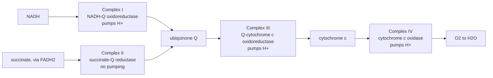

---
aliases:
  - Standard Reduction Potential
  - Redox Potential
  - Electrode Potential
  - Standard Hydrogen Electrode
  - E°′
  - Potentiel d'oxydoréduction
tags:
  - type/concept
  - domain/chemistry
  - domain/biology
  - domain/physics
  - level/L2
  - level/L3
mastery: 0
prerequisites:
  - "[[Redox Reaction]]"
  - "[[Gibbs Free Energy]]"
  - "[[Chemical Equilibrium]]"
  - "[[Electric Potential]]"
  - "[[pH]]"
related:
  - "[[Nernst Equation]]"
  - "[[Oxidative Phosphorylation]]"
  - "[[Mitochondrion]]"
  - "[[Metabolism]]"
  - "[[ATP]]"
  - "[[Membrane Potential]]"
  - "[[Chemical Potential]]"
  - "[[Electric Charge]]"
projects: []
sources:
  - "[[Chemistry 2e (OpenStax)]]"
  - "[[Biochemistry (Berg)]]"
  - "[[NIST Reference on Constants, Units, and Uncertainty]]"
---

# Reduction Potential

> [!abstract]
> The reduction potential E of a redox couple measures, in volts against the hydrogen electrode, how strongly the couple pulls electrons; electrons flow spontaneously from the couple of lower potential to the couple of higher potential, and each volt of difference is worth nF of free energy, ΔG = −nFΔE.

## Definition

A half-reaction written as a reduction, $\mathrm{Ox} + n\,e^- \to \mathrm{Red}$, has a **reduction potential** $E$, measured against the **standard hydrogen electrode** ($2\,\mathrm{H^+} + 2\,e^- \rightleftharpoons \mathrm{H_2}$, with H⁺ at 1 M and H₂ at 1 bar), whose potential is zero by convention. The **standard reduction potential** $E^\circ$ refers to all species in their standard states.[^c17] Biochemistry uses $E^{\circ\prime}$, the standard potential at pH 7; the more positive $E^{\circ\prime}$, the stronger the tendency of the oxidized form to accept electrons.[^berg]

For a redox reaction in which electrons pass from a donor couple to an acceptor couple, $\Delta E = E_{\text{acceptor}} - E_{\text{donor}}$ and

$$\Delta G = -nF\,\Delta E,$$

with $n$ the moles of electrons transferred per mole of reaction and $F$ the Faraday constant; under standard conditions $\Delta G^\circ = -nFE^\circ_{\text{cell}}$ and $E^\circ_{\text{cell}} = (RT/nF)\ln K$.[^c174] The [[Redox Reaction]] note introduces the relation; this note explains where potentials come from, how to combine and convert them, and what they say about the respiratory chain.

## Why it matters

- **The energy budget of respiration.** Oxidizing NADH with O₂ releases about 220 kJ/mol under biochemical standard conditions,[^berg] the free energy that oxidative phosphorylation turns into a proton gradient and then into ATP ([[Oxidative Phosphorylation]], [[Mitochondrion]]).
- **One table, many reactions.** A list of $N$ couples predicts the $\Delta G^\circ$ and $K$ of $N(N-1)/2$ reactions without measuring any of them, which lets a metabolic model check the direction and energy of its redox steps ([[Metabolism]], [[Chemical Equilibrium]]).
- **Standard is not actual.** Away from standard conditions a couple's potential depends on the ratio [Ox]/[Red] ([[Nernst Equation]]): the direction of a redox step in a cell is decided by concentrations as well as by $E^{\circ\prime}$.

## Core (L2)

### Half-cells and the hydrogen electrode

A single electrode potential cannot be measured; only the difference between two electrodes can. Pairing a couple with the hydrogen electrode makes the voltmeter read $E^\circ_{\text{cell}} = E^\circ_{\text{cathode}} - E^\circ_{\text{anode}}$, both written as reductions;[^c17] since the hydrogen electrode is the zero, the reading *is* the potential of the couple. If it is positive, the couple is reduced at the cathode and electrons flow through the wire from H₂ toward it.

![[standard-hydrogen-electrode-cell.svg]]

Sorted by potential, couples form a ladder from the strongest reductants (most negative) to the strongest oxidants (most positive); the redox tower of [[Redox Reaction#Deeper (L2)]] shows NAD⁺/NADH (−0.32 V), pyruvate/lactate (−0.19 V) and O₂/H₂O (+0.82 V).[^berg]

### From volts to free energy and to K

With $F = 96\,485.332\,12$ C/mol,[^nist] one volt is worth 96.5 kJ per mole of electrons. Since $E^\circ_{\text{cell}} = (RT/nF)\ln K$,[^c174] each factor of 10 in $K$ costs $59.16/n$ mV at 25 °C (code). For NADH → O₂, $\Delta E^{\circ\prime} = +1.14$ V and $n = 2$ give $\Delta G^{\circ\prime} = -220$ kJ/mol and $K' = 3.5 \times 10^{38}$: effectively irreversible.

### Potentials are intensive

$E$ is a free energy per unit charge, so multiplying a half-reaction by 2 doubles $\Delta G$ but leaves $E$ unchanged. Two consequences:

- **Full reactions**: electrons cancel, both halves carry the same $n$, and subtracting potentials is valid.
- **New half-reactions**: when two half-reactions add into a third that still contains electrons, add the free energies, not the potentials: $n_3E_3 = n_1E_1 + n_2E_2$. For an invented metal with $E(\mathrm{M^{3+}/M^{2+}}) = +0.80$ V and $E(\mathrm{M^{2+}/M}) = -0.40$ V, $E(\mathrm{M^{3+}/M}) = (0.80 - 0.80)/3 = 0.00$ V, not the 0.40 V that naive addition gives.

### E° and E°′: the proton correction

For $\mathrm{Ox} + m\,\mathrm{H^+} + n\,e^- \to \mathrm{Red}$, fixing $[\mathrm{H^+}] = 10^{-7}$ M instead of 1 M changes the standard free energy by $+7mRT\ln 10$ ([[Gibbs Free Energy#Deeper (L2)]]), so

$$E^{\circ\prime} = E^\circ - \frac{m}{n}\,\frac{RT\ln 10}{F} \times 7 = E^\circ - 0.414\,\frac{m}{n}\ \text{V at 25 °C}.$$

- The hydrogen electrode itself ($m/n = 1$) sits at −0.414 V at pH 7: the biochemical scale is shifted.
- O₂/H₂O ($m/n = 1$), +0.82 V at pH 7, corresponds to +1.23 V at pH 0 (code).
- A couple without protons ($m = 0$) has $E^{\circ\prime} = E^\circ$.

### Bio: the electron path from NADH to O₂

Electrons from NADH reach O₂ through three large complexes, NADH-Q oxidoreductase (Complex I), Q-cytochrome c oxidoreductase (Complex III) and cytochrome c oxidase (Complex IV), with ubiquinone (Q) and cytochrome c carrying them between complexes; the energy released drives proton transport across the inner mitochondrial membrane. Electrons from the FADH₂ of succinate dehydrogenase enter at Q through succinate-Q reductase (Complex II), which does not pump protons.[^berg]



Because $\Delta G$ is a state function, the total is fixed by the end points: $\Delta G_{\mathrm{I}} + \Delta G_{\mathrm{III}} + \Delta G_{\mathrm{IV}} = -2F(E^{\circ\prime}_{\mathrm{O_2}} - E^{\circ\prime}_{\mathrm{NADH}}) = -220$ kJ/mol. The potentials of Q and cytochrome c decide only how this drop is shared among the three pumps, and electrons entering at Q skip the share of Complex I.

## Advanced (L3)

- **A ceiling on proton pumping.** Moving one mole of H⁺ out against a proton-motive force $\Delta p$ costs $F\Delta p$ ([[Mitochondrion]]). With an illustrative $\Delta p = 0.2$ V that is 19.3 kJ/mol, so the 220 kJ/mol of NADH oxidation can pump at most 11.4 H⁺ per NADH (code). Any real stoichiometry must stay below this ceiling, and with a margin: a process exactly at equilibrium has no net rate ([[Chemical Equilibrium]]). Conversely, for a given stoichiometry there is a $\Delta p$ at which the chain stalls (Exercise 5).
- **Two-electron and one-electron carriers.** NAD⁺ takes two electrons at once, with a proton, as a hydride ([[Redox Reaction#Core (L1)]]); ubiquinone carries two electrons and cytochrome c one, so Complex III must split electron pairs, which it does through the Q cycle.[^berg] Stoichiometries of electrons and protons are therefore properties of the mechanism, not of the potentials ([[Oxidative Phosphorylation]]).
- **Thermodynamics is not kinetics.** A large drop in potential makes electron transfer possible, not fast: its rate is a separate, kinetic question, as for any reaction ([[Gibbs Free Energy#Core (L1)]], [[Activation Energy]]).

## Mathematical representation

- Half-reaction $\mathrm{Ox} + m\,\mathrm{H^+} + n\,e^- \to \mathrm{Red}$ against the hydrogen electrode: $\Delta G_{\text{half}} = -nFE$.
- Reaction from donor to acceptor: $\Delta G = -nF(E_{\text{acc}} - E_{\text{don}})$; standard: $E^\circ_{\text{cell}} = (RT/nF)\ln K$.
- Combining half-reactions into a half-reaction: $E = \sum_i n_iE_i / \sum_i n_i$.
- pH conversion: $E(\mathrm{pH}_2) = E(\mathrm{pH}_1) - (m/n)(RT\ln 10/F)(\mathrm{pH}_2 - \mathrm{pH}_1)$, hence $E^{\circ\prime} = E^\circ - 0.414\,m/n$ V at 25 °C.
- Pumping ceiling: $N_{\mathrm{H^+}} \le -\Delta G/(F\,\Delta p)$; stall force $\Delta p_{\max} = -\Delta G/(N_{\mathrm{H^+}}F)$.

## Computational representation

Potentials in volts, energies in kJ/mol, with $F$ in kJ V⁻¹ mol⁻¹ and $R$ from CODATA;[^nist] the three $E^{\circ\prime}$ values are those of Berg:[^berg]

```python
import math

F = 96.48533212        # Faraday constant N_A e, kJ/(V mol), CODATA (exact)
R = 8.314462618e-3     # molar gas constant, kJ/(mol K), CODATA (exact)
T25 = 298.15

# standard reduction potentials at pH 7, E0' in volts (Berg)
E0P = {"NAD+/NADH": -0.32, "pyruvate/lactate": -0.19, "O2/H2O": +0.82}


def delta_g(n: int, e_acceptor: float, e_donor: float) -> float:
    """Free energy (kJ/mol) when n electrons pass from the donor couple to the acceptor couple."""
    return -n * F * (e_acceptor - e_donor)


def k_from_potential(n: int, e_cell: float, t: float = T25) -> float:
    """Equilibrium constant from a standard cell potential, E = (RT/nF) ln K."""
    return math.exp(n * F * e_cell / (R * t))


def combine(halves: list[tuple[int, float]]) -> float:
    """Potential of the half-reaction obtained by adding half-reactions (n_i, E_i): free energies add."""
    return sum(n * e for n, e in halves) / sum(n for n, _ in halves)


def shift_ph(e: float, protons: int, electrons: int, ph_from: float, ph_to: float, t: float = T25) -> float:
    """Standard-state potential of Ox + m H+ + n e- -> Red moved from one pH to another."""
    return e - (protons / electrons) * R * t * math.log(10) / F * (ph_to - ph_from)


de = E0P["O2/H2O"] - E0P["NAD+/NADH"]
dg = delta_g(2, E0P["O2/H2O"], E0P["NAD+/NADH"])
print(f"NADH -> O2: dE0' = {de:+.2f} V, dG0' = {dg:.0f} kJ/mol, K' = {k_from_potential(2, de):.1e}")
print(f"RT ln10 / F = {1000 * R * T25 * math.log(10) / F:.2f} mV per tenfold change of K (n = 1)")
print(f"2 H+ + 2 e- -> H2 at pH 7: {shift_ph(0.0, 2, 2, 0, 7):.3f} V")
print(f"O2 + 4 H+ + 4 e- -> 2 H2O at pH 0: {shift_ph(E0P['O2/H2O'], 4, 4, 7, 0):.2f} V")
print(f"invented metal M: M3+/M2+ +0.80 V and M2+/M -0.40 V give M3+/M {combine([(1, 0.80), (2, -0.40)]):+.2f} V")
for dp in (0.15, 0.20, 0.25):          # proton-motive force, V (illustrative)
    print(f"dp = {dp:.2f} V: {F * dp:.1f} kJ per mol H+, at most {-dg / (F * dp):.1f} H+ per NADH")
```

```text
NADH -> O2: dE0' = +1.14 V, dG0' = -220 kJ/mol, K' = 3.5e+38
RT ln10 / F = 59.16 mV per tenfold change of K (n = 1)
2 H+ + 2 e- -> H2 at pH 7: -0.414 V
O2 + 4 H+ + 4 e- -> 2 H2O at pH 0: 1.23 V
invented metal M: M3+/M2+ +0.80 V and M2+/M -0.40 V give M3+/M +0.00 V
dp = 0.15 V: 14.5 kJ per mol H+, at most 15.2 H+ per NADH
dp = 0.20 V: 19.3 kJ per mol H+, at most 11.4 H+ per NADH
dp = 0.25 V: 24.1 kJ per mol H+, at most 9.1 H+ per NADH
```

Store each couple with its $n$, its proton count $m$ and the pH of its tabulated value: a table that mixes $E^\circ$ and $E^{\circ\prime}$ silently shifts some couples by hundreds of millivolts.

## Worked example

> [!example] Where do the 220 kJ/mol of NADH oxidation go?
> 1. **Total drop**: $\Delta E^{\circ\prime} = +0.82 - (-0.32) = 1.14$ V for two electrons, $\Delta G^{\circ\prime} = -2 \times 96.485 \times 1.14 = -220$ kJ/mol.[^berg] $K' = 3.5 \times 10^{38}$: the reaction never runs backward at standard conditions.
> 2. **Path independence**: the electrons pass Complex I, Q, Complex III, cytochrome c and Complex IV,[^berg] but the three steps must add up to −220 kJ/mol whatever the intermediate potentials.
> 3. **Price of a proton**: against an illustrative proton-motive force of 0.20 V ([[Mitochondrion]]), exporting one mole of H⁺ costs $96.485 \times 0.20 = 19.3$ kJ.
> 4. **Ceiling**: $220/19.3 = 11.4$, so no mechanism can pump more than 11 protons per NADH at this force. Electrons from FADH₂ bypass Complex I, which pumps, and therefore support fewer protons per pair.
> 5. **Read it**: the chain breaks one large drop into three pumping steps, storing the energy in a gradient that ATP synthase later spends ([[ATP]]).

## Common misconceptions

> [!warning] "Doubling a half-reaction doubles its potential"
> $E$ is intensive: doubling a half-reaction doubles $\Delta G$ and $n$, and $E = -\Delta G/nF$ stays the same. Only when combining half-reactions into a new half-reaction must you weight potentials by $n$.

> [!warning] "A negative reduction potential means a species cannot be reduced"
> Potentials are relative to the hydrogen electrode. NAD⁺ (−0.32 V) is reduced constantly in cells, by donors of even more negative potential; a negative value only says that NADH is a strong electron donor.[^berg]

> [!warning] "E°′ tells which way a redox reaction runs in the cell"
> It describes 1 M of every species at pH 7. Real ratios of oxidized to reduced forms shift each potential ([[Nernst Equation]]), exactly as $Q$ shifts $\Delta G$ ([[Gibbs Free Energy]]).

> [!warning] "E° and E°′ are interchangeable"
> For couples that take up protons they differ by $0.414\,m/n$ V at 25 °C: 0.41 V for O₂/H₂O. Mixing them in one calculation produces errors of tens of kJ/mol.

## Exercises

> [!question] Exercise 1 (L2)
> With the potentials above, compute $\Delta G^{\circ\prime}$ and $K'$ for the reduction of pyruvate to lactate by NADH. Does the equilibrium favor lactate?

> [!success]- Solution
> $\Delta E^{\circ\prime} = -0.19 - (-0.32) = +0.13$ V; $\Delta G^{\circ\prime} = -2 \times 96.485 \times 0.13 = -25.1$ kJ/mol; $K' = e^{25.1/2.479} = 2.5 \times 10^4$ (`k_from_potential(2, 0.13)`). Yes: at equilibrium lactate and NAD⁺ dominate unless NADH is scarce. This is the direction in which lactate dehydrogenase uses NADH ([[Redox Reaction#Core (L1)]]).

> [!question] Exercise 2 (L2)
> Among the three couples NAD⁺/NADH, pyruvate/lactate and O₂/H₂O, list the electron transfers that are favorable under standard pH 7 conditions, and compute $\Delta G^{\circ\prime}$ for lactate → O₂ and for lactate → NAD⁺.

> [!success]- Solution
> Electrons flow toward higher potential: NADH can reduce pyruvate and O₂, lactate can reduce O₂. `delta_g(2, 0.82, -0.19)` gives −195 kJ/mol for lactate → O₂; lactate → NAD⁺ has $\Delta E^{\circ\prime} = -0.13$ V, so $\Delta G^{\circ\prime} = +25.1$ kJ/mol: unfavorable under standard conditions. It can still run when the ratios [NAD⁺]/[NADH] and [lactate]/[pyruvate] are high enough to make $\Delta G = \Delta G^{\circ\prime} + RT\ln Q$ negative ([[Nernst Equation]]).

> [!question] Exercise 3 (L2)
> Using the proton correction, give the potential of the hydrogen electrode at pH 7, the pH 0 value of O₂/H₂O from its $E^{\circ\prime}$ of +0.82 V, and the correction for a couple that exchanges electrons without protons.

> [!success]- Solution
> Hydrogen: $0 - 0.414 \times 2/2 = -0.414$ V. O₂/H₂O ($m/n = 4/4$): $+0.82 + 0.414 = +1.23$ V at pH 0. No protons: no correction, $E^{\circ\prime} = E^\circ$. The biochemical scale moves only the proton-coupled couples, each by its own $m/n$.

> [!question] Exercise 4 (L3)
> For the invented metal M, show from free energies that $E(\mathrm{M^{3+}/M}) = 0.00$ V, and explain why adding the potentials (+0.80 − 0.40 = +0.40 V) is wrong.

> [!success]- Solution
> $\Delta G_1 = -1 \cdot F \cdot 0.80$, $\Delta G_2 = -2 \cdot F \cdot (-0.40) = +0.80F$; the sum, for $\mathrm{M^{3+}} + 3\,e^- \to \mathrm{M}$, is $\Delta G_3 = 0$, so $E_3 = -\Delta G_3/3F = 0.00$ V. Potentials are energies per electron: adding them ignores that the second step moves two electrons and the third half-reaction three.

> [!question] Exercise 5 (L3, Python)
> Suppose (hypothetically) that a respiratory chain pumped 10, or 12, protons per NADH oxidized. At what proton-motive force would it stall under standard conditions?

> [!success]- Solution
> ```python
> for n_h in (10, 12):                    # hypothetical pumping stoichiometries
>     print(f"{n_h} H+ per NADH: the chain stalls at dp = {-dg / (n_h * F):.3f} V")
> ```
> ```text
> 10 H+ per NADH: the chain stalls at dp = 0.228 V
> 12 H+ per NADH: the chain stalls at dp = 0.190 V
> ```
> The more protons each NADH must move, the lower the force the chain can build. Stoichiometry trades the size of the gradient against the number of protons pumped.

> [!question] Exercise 6 (L3, Python)
> For $n = 1$ and $n = 2$, compute the standard cell potentials that correspond to $K = 10$, $10^3$ and $10^6$ at 25 °C.

> [!success]- Solution
> ```python
> for n in (1, 2):
>     print(n, [f"{1000 * R * T25 * math.log(k) / (n * F):.0f} mV" for k in (10, 1000, 1e6)])
> ```
> ```text
> 1 ['59 mV', '177 mV', '355 mV']
> 2 ['30 mV', '89 mV', '177 mV']
> ```
> Each decade of $K$ costs 59.2 mV per electron. Potentials of a few hundred millivolts therefore mean equilibria lying very far to one side.

## Mastery checklist

- [ ] 1 Recognized: I can define a standard reduction potential, the hydrogen electrode convention and $E^{\circ\prime}$.
- [ ] 2 Understood: I can explain why electrons flow toward higher potential, why $E$ is intensive, and how pH shifts proton-coupled couples.
- [ ] 3 Practiced: I can compute $\Delta G$, $K$, combined potentials and pH conversions in Python with cited constants.
- [ ] 4 Applied: I checked the direction and free energy of the redox steps of a real pathway (for example glycolysis or the citric acid cycle) with tabulated $E^{\circ\prime}$ values.
- [ ] 5 Explained: I can teach the energetics of the respiratory chain, the proton-pumping ceiling, and why standard potentials do not fix directions in cells.

## References

[^c17]: [[Chemistry 2e (OpenStax)]], ch. 17 "Electrochemistry", treatment of electrode and cell potentials (standard hydrogen electrode as the zero of the scale, standard reduction potentials written as reductions, $E^\circ_{\text{cell}} = E^\circ_{\text{cathode}} - E^\circ_{\text{anode}}$) (section not verified).
[^c174]: [[Chemistry 2e (OpenStax)]], ch. 17, §17.4 "Potential, Free Energy, and Equilibrium" ($\Delta G^\circ = -nFE^\circ_{\text{cell}}$; relation between $E^\circ_{\text{cell}}$ and $K$).
[^berg]: [[Biochemistry (Berg)]], 5th ed. (2002), treatment of oxidative phosphorylation (standard reduction potentials $E^{\circ\prime}$ at pH 7 of NAD⁺/NADH, pyruvate/lactate and O₂/H₂O; $\Delta G^{\circ\prime} = -nF\Delta E^{\circ\prime}$; the respiratory chain of NADH-Q oxidoreductase, Q-cytochrome c oxidoreductase and cytochrome c oxidase, whose energy drives proton transport; succinate-Q reductase, which does not pump protons; the Q cycle).
[^nist]: [[NIST Reference on Constants, Units, and Uncertainty]], CODATA: Faraday constant $F = N_A e = 96\,485.332\,12\ldots$ C mol⁻¹ and molar gas constant $R = 8.314\,462\,618\ldots$ J mol⁻¹ K⁻¹, both exact since the 2019 SI.
