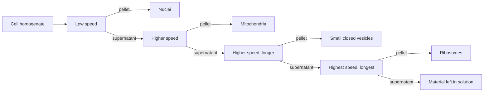

---
aliases:
  - Ultracentrifugation
  - Ultracentrifuge
  - Density Gradient Centrifugation
  - Differential Centrifugation
  - Sedimentation Coefficient
  - Svedberg Unit
  - Relative Centrifugal Force
  - RCF
tags:
  - type/technique
  - domain/physics
  - domain/biology
  - level/L2
  - level/L3
mastery: 0
prerequisites:
  - "[[Stokes' Law]]"
  - "[[Viscosity]]"
  - "[[Kinematics]]"
  - "[[Newton's Laws of Motion]]"
related:
  - "[[Ribosome]]"
  - "[[DNA Replication]]"
  - "[[Isotope]]"
  - "[[Diffusion]]"
  - "[[Stokes-Einstein Relation]]"
  - "[[Boltzmann Distribution]]"
  - "[[Organelle]]"
  - "[[Gel Electrophoresis]]"
projects: []
sources:
  - "[[Biochemistry (Berg)]]"
  - "[[Molecular Biology of the Cell (Alberts)]]"
  - "[[Meselson 1958 - The Replication of DNA in Escherichia coli]]"
  - "[[NobelPrize.org]]"
  - "[[Woese 1977 - Phylogenetic Structure of the Prokaryotic Domain]]"
  - "[[Physical Biology of the Cell (Phillips)]]"
  - "[[NIST Reference on Constants, Units, and Uncertainty]]"
---

# Centrifugation

> [!abstract]
> Centrifugation spins samples so that every particle feels an acceleration far stronger than gravity; particles then separate by how fast they sediment, measured by a sedimentation coefficient in Svedberg units, or by their density.

## Purpose

Separate and characterize particles by how they move in a centrifugal field: split a cell homogenate into nuclei, mitochondria, small vesicles and ribosomes,[^alberts] separate macromolecules by mass and shape or by density, and measure sedimentation coefficients.[^berg]

## Why it matters

- **Names in sequence databases are sedimentation coefficients.** The 16S, 23S, 18S and 28S rRNAs and the 70S and 80S ribosomes are named by how fast they sediment, not by their length or mass.[^alberts] The small-subunit rRNA whose sequences Woese and Fox used to classify prokaryotes ([[16S Ribosomal RNA]])[^woese] carries a Svedberg value in its name, and S values do not add ([[Ribosome#Mathematical representation]]).
- **Data provenance.** Subcellular fractions prepared by centrifugation are the starting material for studying organelles and their components.[^alberts] Which fraction a dataset comes from (whole cells, nuclei, membranes, ribosomes) is metadata that changes its interpretation, and fractions are never pure (Limitations).
- **A decisive experiment.** Density-gradient centrifugation showed that DNA replication is semiconservative, a model of hypothesis testing by design ([[DNA Replication]]).[^meselson]
- **Reproducible protocols.** The force depends on the radius as well as the speed, so a protocol given in rpm without the rotor cannot be reproduced, while one given in RCF (× g) can (Core).

## Principle

**Circular motion.** A particle at distance $r$ from the axis of a rotor turning at angular speed $\omega$ moves on a circle, which requires a centripetal acceleration $\omega^2 r$ toward the axis (derived in Mathematical representation from [[Kinematics]]). In the frame of the spinning tube the particle behaves as in a gravitational field of strength $\omega^2 r$ pointing outward. The **relative centrifugal force** compares this field with standard gravity, $g = 9.80665$ m/s²:[^nist]

$$\mathrm{RCF} = \frac{\omega^2 r}{g}, \qquad \omega = \frac{2\pi N}{60} \quad\Longrightarrow\quad \mathrm{RCF} = 1.118 \times 10^{-5}\; r_{\text{cm}}\, N^2,$$

with $N$ in revolutions per minute (rpm) and $r_\text{cm}$ the radius in cm.

**Sedimentation.** In this field a particle sediments exactly as under gravity ([[Stokes' Law]]). Its terminal velocity divided by the field is the **sedimentation coefficient**[^berg]

$$s = \frac{v}{\omega^2 r} = \frac{m(1 - \bar v\rho)}{f},$$

with $m$ the mass of the particle, $\bar v$ its partial specific volume, $\rho$ the density of the solution and $f$ its friction coefficient ($6\pi\eta r$ for a sphere). $s$ has the dimension of a time and is expressed in **Svedberg units**, 1 S = 10⁻¹³ s. A heavier particle sediments faster than a lighter one of the same shape and density, a compact particle faster than an extended one of the same mass, a denser particle faster than a less dense one; and a particle sinks if $\bar v\rho < 1$, floats if $\bar v\rho > 1$ and stays in place if $\bar v\rho = 1$.[^berg]

**Two uses of a density gradient.**

![[centrifugation-gradient-modes.svg]]

- **Rate-zonal (velocity) sedimentation.** The sample is layered on top of a sucrose density gradient; during the run its components migrate as separate bands at rates set by their $s$, and the tube is then emptied as a series of fractions.[^berg] The run is stopped before the bands reach the bottom (panel a).
- **Isopycnic (equilibrium) sedimentation.** In a concentrated CsCl solution centrifuged until near equilibrium, the salt itself forms a density gradient, and each kind of DNA gathers in a band at the position where the medium matches its density (panel b).[^meselson] The position depends on density only, not on size.

## Protocol overview

Differential centrifugation of a cell homogenate, by successive spins of increasing speed and duration:[^alberts]



Each pellet is impure; resuspending it and repeating the spin removes many contaminants,[^alberts] and a pellet can be refined further on a density gradient (Principle).

## Core (L2)

### From speed and radius to g-force

The field grows with the radius, so the RCF changes along the tube: in a rotor at 40,000 rpm holding a tube from 6 to 9 cm, the top of the liquid feels 107,000 × g and the bottom 161,000 × g (computed below). Examples:

| Speed | Radius | RCF |
|---:|---:|---:|
| 2,990 rpm | 10 cm | 1,000 × g |
| 13,000 rpm | 8 cm | 15,100 × g |
| 31,410 rpm (Meselson and Stahl's Figure 1)[^meselson] | 6.5 cm (assumed) | 71,700 × g |
| 40,000 rpm | 9 cm | 161,000 × g |

Radii are illustrative; only the 31,410 rpm speed comes from the paper. RCF scales as $N^2$: doubling the speed quadruples the force.

### Sedimentation coefficients in Svedberg units

Bacterial ribosomes are 70S particles made of a 30S and a 50S subunit (with 16S, 23S and 5S rRNAs); eukaryotic ribosomes are 80S, made of 40S and 60S subunits (with 18S, 28S, 5.8S and 5S rRNAs).[^alberts] The subunits make a 70S particle, not an 80S one: masses add, S values do not, because $s$ grows only as $M^{2/3}$ for compact particles (derived in [[Ribosome#Mathematical representation]]).[^berg]

An $s$ value turns directly into a speed, $v = s\,\omega^2 r = s \times \mathrm{RCF} \times g$. A 70S ribosome at 100,000 × g moves at $70 \times 10^{-13} \times 10^5 \times 9.81 = 6.9$ µm/s and crosses 1 cm in 24 min; under gravity alone the same centimetre would take 4.6 years.

**Pelleting time.** Because the field grows with $r$, a particle accelerates outward: $dr/dt = s\omega^2 r$ gives $r(t) = r_\text{min}\,e^{s\omega^2 t}$, and a particle starting at the meniscus reaches the bottom after

$$t = \frac{\ln(r_\text{max}/r_\text{min})}{s\,\omega^2}.$$

In the 6 to 9 cm tube at 40,000 rpm: 55 min for a 70S ribosome, 13 h for the 4.85 S illustrative protein of [[Stokes' Law]], 1.6 min for a 2,400 S particle. Time scales as $1/s$: this is what differential centrifugation exploits.

### The Meselson-Stahl experiment

Meselson and Stahl grew *E. coli* with ¹⁵N as the nitrogen source, so its DNA was heavy, then moved the cells to ¹⁴N medium and sampled them over generations ([[Isotope]]).[^meselson] Their DNA was centrifuged in concentrated CsCl until near equilibrium: after one generation it formed a single band of hybrid density, after two generations a hybrid band and a light band (panel b).[^meselson] Each daughter molecule therefore keeps one parental strand: replication is semiconservative ([[DNA Replication]]). Banding by density made the result independent of the lengths of the DNA molecules, which a separation by sedimentation rate would have mixed with density.

## Advanced (L3)

**Sedimentation equilibrium is a Boltzmann distribution.** In the rotating frame a particle of buoyant mass $m_b = m(1 - \bar v\rho)$ has potential energy $-\frac{1}{2}m_b\omega^2 r^2$. When sedimentation and diffusion balance, the concentration follows the [[Boltzmann Distribution]]:

$$c(r) = c(r_0)\exp\!\left[\frac{M(1 - \bar v\rho)\,\omega^2 (r^2 - r_0^2)}{2RT}\right],$$

with $M$ the molar mass. A plot of $\ln c$ against $r^2$ is a straight line whose slope gives $M(1 - \bar v\rho)$ without any assumption on shape: friction does not enter equilibrium ([[Stokes' Law#Advanced (L3)]]).

**The Svedberg equation.** Sedimentation measures $m_b/f$; diffusion measures $k_B T/f$ through the Einstein relation.[^pboc] Their ratio eliminates the friction coefficient:

$$\frac{s}{D} = \frac{m(1 - \bar v\rho)}{k_B T} \quad\Longrightarrow\quad M = \frac{sRT}{D(1 - \bar v\rho)}.$$

A sedimenting boundary moves at $s\omega^2 r$ while it spreads by [[Diffusion]], so following both in one run yields $s$, $D$ and the molar mass (Exercise 4).

**Width of an isopycnic band.** Near the band centre $r_0$, where the medium has the particle's buoyant density $\rho_0 = 1/\bar v$, the net force on the particle is proportional to its distance from $r_0$ and points back toward it. The potential is harmonic, so the band is a Gaussian of variance

$$\sigma^2 = \frac{RT}{M\,\bar v\,\omega^2 r_0\,(d\rho/dr)}.$$

Long molecules give narrow bands. Two species whose densities differ by $\Delta\rho$ sit $\Delta r = \Delta\rho/(d\rho/dr)$ apart; they are resolved when $\Delta r$ is several $\sigma$ (Exercise 5).

## Data produced

- **Preparative runs:** a pellet and a supernatant, or a series of fractions collected along a gradient, each analysed downstream by absorbance, gels ([[Gel Electrophoresis]]), mass spectrometry or sequencing.
- **What to record:** rotor and radius (or RCF), speed, time, temperature, medium and gradient, and how fractions are numbered. Temperature matters because $s \propto 1/\eta$ for a given particle and $\eta$ depends on temperature (values in [[Viscosity]]).
- **Analytical runs:** concentration profiles $c(r, t)$ along the tube, from which $s$, $D$ and $M$ are computed.

## Analysis

- Convert rpm to RCF and back, and compute pelleting times (Computational representation).
- From a moving boundary at $r_b(t)$: $s = \frac{1}{\omega^2}\,\frac{d\ln r_b}{dt}$, the slope of $\ln r_b$ against time divided by $\omega^2$.
- From equilibrium: the slope of $\ln c$ against $r^2$ gives $M(1 - \bar v\rho)\,\omega^2/2RT$.
- Compare $s$ values measured in different solvents or at different temperatures only after correcting for the solvent's viscosity and density, since $s \propto (1 - \bar v\rho)/\eta$ for a given particle.

## Mathematical representation

- **Circular motion.** $\vec r(t) = r(\cos\omega t, \sin\omega t)$ gives $\ddot{\vec r} = -\omega^2\vec r$: an acceleration of magnitude $\omega^2 r$ toward the axis.
- **RCF.** $\mathrm{RCF} = \omega^2 r/g$ with $\omega = 2\pi N/60$; numerically $(2\pi/60)^2/(100\,g) = 1.118 \times 10^{-5}$ per cm per rpm².
- **Sedimentation.** $s = v/(\omega^2 r) = m(1 - \bar v\rho)/f$, 1 S = 10⁻¹³ s; $r(t) = r_0 e^{s\omega^2 t}$; $t_\text{pellet} = \ln(r_\text{max}/r_\text{min})/(s\omega^2)$.
- **Equilibrium.** $\ln c(r) = \ln c(r_0) + M(1 - \bar v\rho)\,\omega^2(r^2 - r_0^2)/(2RT)$.
- **Svedberg equation.** $M = sRT/[D(1 - \bar v\rho)]$, with $R = N_A k_B$.
- **Isopycnic band.** With $\rho(r) \approx \rho_0 + \rho'(r - r_0)$ and $\bar v\rho_0 = 1$, the force is $m(1 - \bar v\rho)\omega^2 r \approx -m\bar v\rho'\omega^2 r_0\,(r - r_0)$, a spring of stiffness $k = m\bar v\rho'\omega^2 r_0$; Boltzmann gives a Gaussian with $\sigma^2 = k_BT/k = RT/(M\bar v\omega^2 r_0\rho')$.

## Computational representation

```python
import math

G = 9.80665                  # m/s^2, standard gravity (exact by convention)
SVEDBERG = 1e-13             # s


def omega(rpm: float) -> float:
    """Angular speed in rad/s from revolutions per minute."""
    return 2 * math.pi * rpm / 60


def rcf(rpm: float, radius_cm: float) -> float:
    """Relative centrifugal force omega^2 r / g, the 'x g' of protocols."""
    return omega(rpm) ** 2 * (radius_cm / 100) / G


def rpm_for(rcf_target: float, radius_cm: float) -> float:
    """Speed giving rcf_target at radius_cm."""
    return math.sqrt(rcf_target * G / (radius_cm / 100)) * 60 / (2 * math.pi)


def pelleting_time(s_svedberg: float, rpm: float, r_min_cm: float, r_max_cm: float) -> float:
    """Seconds for a particle to go from r_min to r_max: dr/dt = s omega^2 r, so r grows exponentially."""
    return math.log(r_max_cm / r_min_cm) / (s_svedberg * SVEDBERG * omega(rpm) ** 2)


print(f"RCF = {omega(1) ** 2 / 100 / G:.4e} x r[cm] x rpm^2")
print(f"13,000 rpm at 8 cm: {rcf(13_000, 8):,.0f} x g;  1,000 x g at 10 cm: {rpm_for(1_000, 10):,.0f} rpm")
print(f"40,000 rpm: {rcf(40_000, 6):,.0f} x g at 6 cm, {rcf(40_000, 9):,.0f} x g at 9 cm")
for name, s in {"protein (4.85 S)": 4.85, "70S ribosome": 70.0, "2,400 S particle": 2400.0}.items():
    print(f"{name:17s} 6 -> 9 cm at 40,000 rpm: {pelleting_time(s, 40_000, 6, 9) / 60:7.1f} min")
```

```text
RCF = 1.1182e-05 x r[cm] x rpm^2
13,000 rpm at 8 cm: 15,119 x g;  1,000 x g at 10 cm: 2,990 rpm
40,000 rpm: 107,351 x g at 6 cm, 161,027 x g at 9 cm
protein (4.85 S)  6 -> 9 cm at 40,000 rpm:   794.1 min
70S ribosome      6 -> 9 cm at 40,000 rpm:    55.0 min
2,400 S particle  6 -> 9 cm at 40,000 rpm:     1.6 min
```

Store speeds as rpm and radii in cm only at the interface with protocols; inside formulas, use rad/s and m.

## Worked example

> [!example] Reading a protocol step: "spin at 20,000 × g for 20 min"
> An illustrative rotor holds the liquid between $r_\text{min} = 4$ cm and $r_\text{max} = 8$ cm, and the RCF is specified at $r_\text{max}$.
> 1. **Speed.** $N = \frac{60}{2\pi}\sqrt{\mathrm{RCF}\,g/r_\text{max}} = \frac{60}{2\pi}\sqrt{20{,}000 \times 9.80665/0.08} = 14{,}950$ rpm. At the top of the liquid the field is only 10,000 × g.
> 2. **Field.** $\omega^2 = \mathrm{RCF}\,g/r_\text{max} = 2.45 \times 10^6$ s⁻².
> 3. **What pellets completely.** A particle starting at the meniscus reaches the bottom in 20 min if $s \geq \ln 2/(\omega^2 t) = 0.693/(2.45 \times 10^6 \times 1200) = 2.36 \times 10^{-10}$ s, about 2,400 S.
> 4. **What stays in solution.** A 70S ribosome would need 11.2 h at this speed: ribosomes stay in the supernatant, which is why they are collected only at higher speeds and after longer spins.[^alberts]
> 5. **Report.** RCF at the stated radius, time, temperature and rotor, not just "15,000 rpm".

## Limitations and biases

> [!warning] What centrifugation cannot do
> - **Fractions are impure.** Particles start at every height, so a pellet also collects smaller particles that began near the bottom; resuspension and repeated spins reduce, but do not remove, contamination.[^alberts]
> - **$s$ mixes mass and shape.** Masses from $s$ alone assume a shape; extended particles sediment more slowly than compact ones of the same mass.[^berg] Combine $s$ with $D$ or use sedimentation equilibrium.
> - **rpm alone is meaningless.** The field depends on the radius and varies along the tube.
> - **Gradient media change the solvent.** Sucrose and CsCl solutions differ from water in density and viscosity, so $s$ measured in them must be corrected before comparison.

## Common misconceptions

> [!warning] "The rpm says how hard a sample was spun"
> The field is $\omega^2 r$: the same 13,000 rpm gives 15,100 × g at 8 cm and 7,600 × g at 4 cm. Only RCF with time and temperature describes a spin.

> [!warning] "A 30S and a 50S subunit make an 80S ribosome"
> Masses add, Svedberg values do not: the two subunits make a 70S ribosome.[^berg][^alberts] For compact particles $s$ grows only as $M^{2/3}$, and shape changes it further.

> [!warning] "Heavier particles always end up lower in the tube"
> In an isopycnic gradient a particle stops where the medium is as dense as it is: a particle that matches the medium neither sinks nor floats, however heavy.[^berg] Mass sets only the width of its band.

## History and variants

The Svedberg developed the ultracentrifuge, which the Nobel Foundation dates to 1925, to study the sedimentation of large molecules such as proteins, and received the 1926 Nobel Prize in Chemistry "for his work on disperse systems".[^nobel] The sedimentation unit bears his name. In 1958 Meselson and Stahl combined ¹⁵N labeling with equilibrium banding in CsCl to settle how DNA replicates.[^meselson] Variants: differential centrifugation (successive pellets), rate-zonal sedimentation (sucrose gradients, separation by $s$), isopycnic sedimentation (CsCl, separation by density), and analytical ultracentrifugation (concentration followed during the run, for $s$, $D$ and $M$).

## Exercises

> [!question] Exercise 1 (L2)
> (a) What RCF does a microcentrifuge produce at 13,000 rpm and $r = 8$ cm? (b) What speed gives 1,000 × g at $r = 10$ cm? (c) Why must the rotor be reported along with the speed?

> [!success]- Solution
> (a) $1.118 \times 10^{-5} \times 8 \times 13{,}000^2 = 15{,}100$ × g. (b) $N = \sqrt{1000/(1.118 \times 10^{-5} \times 10)} = 2{,}990$ rpm. (c) RCF is proportional to $r$: the same speed in a rotor of half the radius gives half the force.

> [!question] Exercise 2 (L2)
> How fast does a 70S ribosome sediment at 100,000 × g, and how long does it take to cross 1 cm? Compare with gravity alone. Why is the ribosome not "80S"?

> [!success]- Solution
> $v = s \times \mathrm{RCF} \times g = 70 \times 10^{-13} \times 10^5 \times 9.81 = 6.9$ µm/s, so 1 cm in about 24 min; at 1 g, $v = 6.9 \times 10^{-11}$ m/s and 1 cm takes 4.6 years. The 30S and 50S subunits add their masses, not their $s$ values ([[Ribosome#Mathematical representation]]).

> [!question] Exercise 3 (L2)
> Derive the pelleting time $t = \ln(r_\text{max}/r_\text{min})/(s\omega^2)$ from $dr/dt = s\omega^2 r$. In a tube from 6 to 9 cm at 40,000 rpm, compute it for a 70S ribosome and a 4.85 S protein. Why is a pellet obtained after a short spin impure?

> [!success]- Solution
> Separate variables: $dr/r = s\omega^2\,dt$, so $\ln(r_\text{max}/r_\text{min}) = s\omega^2 t$. With $\omega = 4189$ rad/s: 55 min for 70S and $55 \times 70/4.85 = 794$ min, about 13 h, for 4.85 S (code above). Time scales as $1/s$, but a particle that starts near the bottom needs far less than this time: after a short spin the pellet holds all the fast particles plus the slow ones that started close to the bottom.

> [!question] Exercise 4 (L3)
> Derive the Svedberg equation from $s = m(1 - \bar v\rho)/f$ and $D = k_BT/f$. Apply it to the illustrative sphere of [[Stokes' Law]]: $s = 4.85$ S, $D = 85.7$ µm²/s at 293.15 K, $\bar v = 1/1.35$ cm³/g, $\rho = 1.000$ g/cm³. Compare with the mass of that sphere (radius 2.5 nm, density 1350 kg/m³).

> [!success]- Solution
> Dividing, $s/D = m(1 - \bar v\rho)/(k_BT)$; per mole, $M = sRT/[D(1 - \bar v\rho)]$. Here $1 - \bar v\rho = 1 - 1/1.35 = 0.259$ and $M = 4.85 \times 10^{-13} \times 8.314 \times 293.15/(8.57 \times 10^{-11} \times 0.259) = 53.2$ kg/mol, i.e. 53 kDa. The sphere's own mass is $\frac{4}{3}\pi(2.5 \times 10^{-9})^3 \times 1350 \times N_A = 53.2$ kg/mol: the friction coefficient, which carries the size and shape, has cancelled.

> [!question] Exercise 5 (L3, Python)
> Could Meselson and Stahl resolve ¹⁵N from ¹⁴N DNA? Full labeling adds 7.5 × 0.99703 u per base pair of 617.9 g/mol ([[Isotope]], [[Mole]]). Assume the volume is unchanged, a buoyant density of 1700 kg/m³ for light DNA, a gradient of 0.1 g/cm³ per cm and bands at $r_0 = 6.5$ cm (assumed or invented values), 298.15 K and the 31,410 rpm of their Figure 1. Using `omega` from the code above, compute the band separation and the band width $\sigma$ for DNA of $10^7$ and $10^6$ g/mol.

> [!success]- Solution
> ```python
> R, T = 8.314462618, 298.15                  # J mol^-1 K^-1 (exact); temperature assumed
> rho0 = 1700.0                               # kg/m^3, assumed buoyant density of light DNA
> frac = 7.5 * 0.99703 / 617.9                # 15N mass gain / mass per bp (Isotope and Mole notes)
> slope = 1e4                                 # kg/m^4, i.e. 0.1 g/cm^3 per cm: invented gradient
> r0 = 0.065                                  # m, assumed radius of the bands
> w2 = omega(31_410) ** 2                     # speed of Meselson and Stahl's Figure 1
>
> gap = rho0 * frac / slope
> print(f"density shift {rho0 * frac:.1f} kg/m^3 ({100 * frac:.2f} %), band separation {gap * 1e3:.2f} mm")
> for M in (1e4, 1e3):                        # kg/mol: 10^7 and 10^6 g/mol, invented fragment sizes
>     sigma = math.sqrt(R * T / (M * (1 / rho0) * w2 * r0 * slope))
>     print(f"M = {M * 1e3:.0e} g/mol: sigma = {sigma * 1e3:.2f} mm, separation = {gap / sigma:.1f} sigma")
> ```
> ```text
> density shift 20.6 kg/m^3 (1.21 %), band separation 2.06 mm
> M = 1e+07 g/mol: sigma = 0.24 mm, separation = 8.4 sigma
> M = 1e+06 g/mol: sigma = 0.77 mm, separation = 2.7 sigma
> ```
> A 1.2 % density difference puts the bands about 2 mm apart in this gradient. Long DNA ($10^7$ g/mol) gives bands 0.24 mm wide, cleanly resolved; DNA ten times shorter gives bands $\sqrt{10}$ times wider that overlap. The estimate ignores counterions and bound water, which move with DNA in the gradient and change its buoyant density, so the measured shift need not equal 1.2 %.

## Mastery checklist

- [ ] 1 Recognized: I can say what centrifugation separates, define RCF and the Svedberg unit, and give the S values of bacterial and eukaryotic ribosomes.
- [ ] 2 Understood: I can derive RCF from circular motion, explain $s = m(1 - \bar v\rho)/f$, and contrast rate-zonal and isopycnic gradients.
- [ ] 3 Practiced: I convert rpm and RCF, compute sedimentation speeds and pelleting times, and explain the Meselson-Stahl bands.
- [ ] 4 Applied: I read the centrifugation steps behind a real dataset (fractionation, gradient, pelleting) and judged what the fractions contain and how pure they can be.
- [ ] 5 Explained: I can derive sedimentation equilibrium and the Svedberg equation, explain why friction cancels, and predict band widths in an isopycnic gradient.

## References

[^alberts]: [[Molecular Biology of the Cell (Alberts)]], 4th ed. (2002), section "Fractionation of Cells" (differential centrifugation of a homogenate: nuclei at low speed, then mitochondria, then small closed vesicles and ribosomes at higher speeds and longer times; impure fractions improved by resuspension and repeated centrifugation) and treatment of the ribosome (70S and 80S ribosomes, their subunits and rRNAs).
[^berg]: [[Biochemistry (Berg)]], 5th ed. (2002), treatment of ultracentrifugation and sedimentation coefficients ($s = m(1 - \bar v\rho)/f$ in Svedberg units of 10⁻¹³ s; effects of mass, shape and density, with particles that sink, float or stay; zonal centrifugation through a sucrose gradient; S values that do not add).
[^meselson]: [[Meselson 1958 - The Replication of DNA in Escherichia coli]], *PNAS* 44(7):671-682 (¹⁵N labeling then transfer to ¹⁴N; DNA banded in a CsCl density gradient formed by centrifugation to near equilibrium, 31,410 rpm in Figure 1; one hybrid band after one generation, hybrid and light bands after two).
[^nobel]: [[NobelPrize.org]], Nobel Prize in Chemistry 1926, The Svedberg, facts and biographical pages (prize motivation "for his work on disperse systems"; ultracentrifuge dated to 1925, built to study the sedimentation of large molecules such as proteins).
[^pboc]: [[Physical Biology of the Cell (Phillips)]], 2nd ed. (2012), treatment of diffusion: the Einstein relation $D = k_BT/\zeta$.
[^woese]: [[Woese 1977 - Phylogenetic Structure of the Prokaryotic Domain]], *PNAS* 74(11):5088-5090 (phylogeny of prokaryotes from ribosomal RNA sequences).
[^nist]: [[NIST Reference on Constants, Units, and Uncertainty]]: standard acceleration of gravity 9.806 65 m s⁻² (exact, conventional value) and molar gas constant $R = 8.314\,462\,618$ J mol⁻¹ K⁻¹ (exact).
