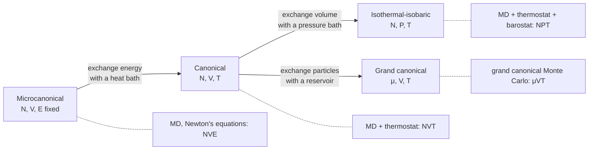

---
aliases:
  - Ensemble
  - Microcanonical Ensemble
  - Canonical Ensemble
  - Grand Canonical Ensemble
  - Isothermal-Isobaric Ensemble
  - NVE
  - NVT
  - NPT
  - Ergodic Hypothesis
  - Ensemble statistique
tags:
  - type/concept
  - domain/physics
  - domain/chemistry
  - domain/bioinformatics
  - level/L2
  - level/L3
mastery: 0
prerequisites:
  - "[[Microstate]]"
  - "[[Boltzmann Entropy]]"
  - "[[Boltzmann Distribution]]"
  - "[[Partition Function]]"
  - "[[Temperature]]"
  - "[[Chemical Potential]]"
related:
  - "[[Molecular Dynamics Simulation]]"
  - "[[Monte Carlo Method]]"
  - "[[Markov Chain Monte Carlo]]"
  - "[[Metropolis-Hastings Algorithm]]"
  - "[[Detailed Balance]]"
  - "[[Langevin Equation]]"
  - "[[Equipartition Theorem]]"
  - "[[Free Energy Landscape]]"
  - "[[Helmholtz Free Energy]]"
  - "[[Gibbs Free Energy]]"
  - "[[Thermodynamic System]]"
  - "[[Law of Large Numbers]]"
  - "[[Ligand Binding]]"
  - "[[Stochastic Gene Expression]]"
  - "[[Optical Tweezers]]"
projects: []
sources:
  - "[[Understanding Molecular Simulation (Frenkel)]]"
  - "[[Physical Biology of the Cell (Phillips)]]"
  - "[[Verlet 1967 - Computer Experiments on Classical Fluids]]"
  - "[[NIST Reference on Constants, Units, and Uncertainty]]"
---

# Statistical Ensemble

> [!abstract]
> An ensemble is the probability distribution over microstates that a system has under given conditions: isolated (fixed energy), in a heat bath (fixed temperature), at fixed pressure, or open to exchange of molecules. What you hold fixed decides the weights, the partition function and the free energy, and it is the first thing to check in any molecular simulation.

## Definition

A **statistical ensemble** is the set of all [[Microstate|microstates]] compatible with the macroscopic constraints on a system, each with its probability. The main ensembles are named by what is fixed: **microcanonical** ($N$, $V$, $E$: isolated system), **canonical** ($N$, $V$, $T$: heat bath), **isothermal-isobaric** ($N$, $P$, $T$: heat and pressure bath) and **grand canonical** ($\mu$, $V$, $T$: heat bath and particle reservoir at chemical potential $\mu$).[^frenkel5] An ensemble average $\langle A\rangle = \sum_i p_i A_i$ is what equilibrium theory predicts; a simulation or an experiment estimates it.

## Why it matters

- **Every molecular simulation samples an ensemble.** Integrating Newton's equations conserves energy (NVE); adding a thermostat targets NVT, and a barostat NPT. Which one is sampled decides how averages, fluctuations and free energies must be read ([[Molecular Dynamics Simulation]]).[^frenkel6]
- **Monte Carlo picks its ensemble through its acceptance rule**, including ensembles that exchange volume or particles with a reservoir ([[Monte Carlo Method]], [[Metropolis-Hastings Algorithm]]).[^frenkel5]
- **Binding is an open-system problem.** A receptor exchanges ligands with the surrounding solution, the situation of the grand canonical ensemble, which gives binding curves directly ([[Ligand Binding]]).[^pboc7]
- **Convergence is an ergodicity question.** A trajectory average equals the ensemble average only if the run crossed every barrier that matters, the main reason simulations of conformational change disagree with experiment ([[Free Energy Landscape]]).

## Core (L2)

### What is held fixed decides the weights

| Ensemble | Fixed | Exchanged with surroundings | Weight of microstate $i$ | Normalization | Free energy |
|---|---|---|---|---|---|
| Microcanonical | $N, V, E$ | nothing | uniform over states with $E_i = E$ | $W(N,V,E)$ | $S = k_B\ln W$ |
| Canonical | $N, V, T$ | energy | $e^{-\beta E_i}$ | $Z(N,V,T)$ | $F = -k_BT\ln Z$ |
| Isothermal-isobaric | $N, P, T$ | energy, volume | $e^{-\beta(E_i + PV_i)}$ | $\Delta(N,P,T)$ | $G = -k_BT\ln\Delta$ |
| Grand canonical | $\mu, V, T$ | energy, particles | $e^{-\beta(E_i - \mu N_i)}$ | $\Xi(\mu,V,T)$ | $\Phi = -k_BT\ln\Xi$ |

with $\beta = 1/k_BT$. The first two rows are the [[Boltzmann Entropy]] and the [[Boltzmann Distribution]]; the [[Partition Function]] note develops the second. The pattern is the same each time: every quantity the system can trade with a reservoir appears in the exponent, multiplied by the reservoir's conjugate variable ($T$ for energy, $P$ for volume, $\mu$ for particles), and the logarithm of the normalization is the free energy minimized under those conditions: $F$ at fixed volume, the [[Gibbs Free Energy]] $G$ at fixed pressure.



### Fluctuations, and why large systems do not care

In the canonical ensemble the energy fluctuates, with $\operatorname{Var}(E) = k_BT^2C_V$ ([[Partition Function#Core (L2)]]). Both $\langle E\rangle$ and $C_V$ grow like the number of molecules $N$, so the relative fluctuation $\sqrt{\operatorname{Var}(E)}/\langle E\rangle$ shrinks like $1/\sqrt{N}$: for a mole it is about $10^{-12}$, and the canonical energy is as sharp as a microcanonical one. Averages computed in different ensembles therefore agree for macroscopic systems ([[Law of Large Numbers]]). They differ in their **fluctuations**, and for **small systems**: a single protein, or a handful of copies of a transcription factor in a cell (Exercise 6).

### Time averages, ensemble averages and ergodicity

An experiment on $1\ \mu$L of a $1\ \mu$M solution measures, at one instant, $10^{-6}\ \text{L} \times 10^{-6}\ \text{M} \times N_A = 6 \times 10^{11}$ molecules:[^nist] an **ensemble average**. A molecular dynamics run, a Markov chain or a single-molecule experiment ([[Optical Tweezers]]) follows **one** system in time and reports a **time average**
$$\bar{A}_\tau = \frac{1}{\tau}\int_0^\tau A(x(t))\,dt.$$
The **ergodic hypothesis** states that $\bar A_\tau \to \langle A\rangle$ as $\tau\to\infty$: given enough time, one trajectory visits every accessible region in proportion to its equilibrium probability. Molecular simulation relies on it.[^frenkel] It fails in practice whenever the run is shorter than the time needed to cross the barriers between important states: with an Arrhenius waiting time $\tau_{\text{cross}} \propto e^{\Delta G^\ddagger/k_BT}$ ([[Activation Energy]]), each extra $10\,k_BT$ of barrier multiplies it by $e^{10} \approx 22{,}000$. A trajectory stuck in one basin estimates the average **within that basin**, with error bars that look small because they measure only the noise inside it (Computational representation).

### Bio: which ensemble a simulation samples

- **NVE.** Integrating Newton's equations step by step, as Verlet did for a model fluid,[^verlet] conserves the total energy ([[Conservation of Energy]]): the trajectory explores a constant-energy surface, the microcanonical ensemble. A drift of total energy in an NVE run is a test of the integrator and time step.
- **NVT.** A thermostat couples the system to a virtual heat bath. The Andersen thermostat (random collisions that redraw velocities) and the Nosé-Hoover thermostat (an extra dynamical variable acting as the bath) are constructed to sample the canonical distribution;[^frenkel6] a Langevin thermostat adds friction and random kicks balanced by the fluctuation-dissipation relation ([[Langevin Equation]]).
- **NPT.** Adding a barostat lets the box volume fluctuate at fixed pressure. Biochemical experiments are run at fixed temperature and pressure, so this is the ensemble whose free energy is $G$, the one compared with measured equilibrium constants ([[Gibbs Free Energy]]).[^frenkel5]
- **μVT.** Grand canonical Monte Carlo inserts and deletes molecules at fixed chemical potential, for problems where the number of bound or adsorbed molecules is the unknown.[^frenkel5]

## Advanced (L3)

- **What a thermostat must not do.** In the canonical ensemble the kinetic energy $K$ of $N_{df}$ quadratic degrees of freedom fluctuates, with relative standard deviation $\sqrt{2/N_{df}}$ ([[Equipartition Theorem]]). Rescaling velocities at every step so that $K$ is exactly constant removes these fluctuations: it samples an isokinetic ensemble, not the canonical one. Thermostats designed to sample the canonical ensemble (Andersen, Nosé-Hoover) also perturb the dynamics, for instance by randomizing velocities, so time-dependent properties such as diffusion require care in the choice of thermostat.[^frenkel6]
- **Grand canonical binding.** One site, empty or holding a ligand of energy $\varepsilon$, in contact with a solution at chemical potential $\mu = \mu_0 + k_BT\ln(c/c_0)$: $\Xi = 1 + e^{-\beta(\varepsilon - \mu)}$, so $p_{\text{bound}} = c/(c + K_d)$ with $K_d = c_0\,e^{\beta(\varepsilon - \mu_0)}$, the lattice-model result of [[Boltzmann Distribution#Core (L1)]] obtained without counting solution microstates (Exercise 3).[^pboc7] Several sites give a binding polynomial in $c$, and $\langle N\rangle = \partial\ln\Xi/\partial(\beta\mu)$.
- **Number fluctuations.** In the grand canonical ensemble $\operatorname{Var}(N) = k_BT\,\partial\langle N\rangle/\partial\mu$; for dilute molecules in a small volume this gives $\operatorname{Var}(N) = \langle N\rangle$, Poisson statistics, a floor on copy-number noise in cells ([[Stochastic Gene Expression]], [[Poisson Distribution]], Exercise 6).
- **Restoring ergodicity.** Enhanced-sampling methods, such as parallel tempering (replicas at several temperatures that exchange configurations), are designed to cross barriers that plain dynamics would not cross in the available time.[^frenkel] Running several independent trajectories from different starting structures is the minimal check: if their averages disagree, none of them is an ensemble average.

## Mathematical representation

- Microcanonical: $p_i = 1/W(N,V,E)$ for $E_i = E$ (0 otherwise); $S = k_B\ln W$.
- Canonical: $p_i = e^{-\beta E_i}/Z$, $Z = \sum_i e^{-\beta E_i}$, $F = -k_BT\ln Z$.
- Isothermal-isobaric: $p(i, V) = e^{-\beta(E_i + PV)}/\Delta$, $\Delta(N,P,T) = \int dV\, e^{-\beta PV}Z(N,V,T)$, $G = -k_BT\ln\Delta$.
- Grand canonical: $p(i, N) = e^{-\beta(E_i - \mu N)}/\Xi$, $\Xi(\mu,V,T) = \sum_N e^{\beta\mu N}Z(N,V,T)$, $\Phi = -k_BT\ln\Xi$; $\langle N\rangle = \partial\ln\Xi/\partial(\beta\mu)$, $\operatorname{Var}(N) = k_BT\,\partial\langle N\rangle/\partial\mu$.
- Canonical energy fluctuation: $\operatorname{Var}(E) = k_BT^2C_V$, relative size $O(N^{-1/2})$.
- Time average $\bar A_\tau = \frac1\tau\int_0^\tau A(x(t))\,dt$; ergodicity: $\lim_{\tau\to\infty}\bar A_\tau = \langle A\rangle$ for almost every starting point. For a Markov chain this is the ergodic theorem of [[Markov Chain|Markov chains]], guaranteed when the chain is irreducible and aperiodic with the target as stationary distribution ([[Detailed Balance]]).

## Computational representation

Two experiments in standard-library Python. First, the canonical distribution emerges inside a microcanonical system: an Einstein solid of $N$ oscillators sharing exactly $q$ energy quanta (fixed total energy), where one chosen oscillator plays the system and the others the heat bath. Counting gives the exact probability that it holds $n$ quanta, compared with the Boltzmann law $(1 - r)r^n$ of the same mean energy:

```python
from math import comb


def multiplicity(n_osc, q):
    """Ways to share q energy quanta among n_osc oscillators (stars and bars)."""
    return comb(q + n_osc - 1, q)


def one_oscillator(n_osc, q, n):
    """Microcanonical: P(a chosen oscillator holds n quanta | the whole solid holds q)."""
    return multiplicity(n_osc - 1, q - n) / multiplicity(n_osc, q)


for n_osc, q in ((400, 400), (4, 4)):
    r = q / (q + n_osc)                      # canonical ratio with the same mean energy
    exact = [one_oscillator(n_osc, q, n) for n in range(5)]
    canon = [(1 - r) * r ** n for n in range(5)]
    print(n_osc, [round(p, 4) for p in exact])
    print(" " * len(str(n_osc)), [round(p, 4) for p in canon])
```

```text
400 [0.4994, 0.2503, 0.1253, 0.0627, 0.0313]
    [0.5, 0.25, 0.125, 0.0625, 0.0312]
4 [0.4286, 0.2857, 0.1714, 0.0857, 0.0286]
  [0.5, 0.25, 0.125, 0.0625, 0.0312]
```

With 399 oscillators as bath the two ensembles agree to three decimals; with 3 they do not. Second, a Metropolis walk in a double well (energies in $k_BT$, lattice $x = -10, \dots, 10$, wells at $\pm 5$) started in the left well: its time average of "$x > 0$" is compared with the exact ensemble value.

```python
import random
from math import exp


def energy(x, barrier):
    """Double well in units of kT: minima at x = -5 and +5, barrier height at x = 0."""
    return barrier * ((x / 5) ** 2 - 1) ** 2


def ensemble_right(barrier):
    """Exact Boltzmann probability that x > 0, on the lattice x = -10..10."""
    w = {x: exp(-energy(x, barrier)) for x in range(-10, 11)}
    return sum(v for x, v in w.items() if x > 0) / sum(w.values())


def time_right(barrier, steps, rng, x=-5):
    """Metropolis walk started in the left well: fraction of steps with x > 0, and crossings."""
    right, crossings, side = 0, 0, -1
    for _ in range(steps):
        new = x + rng.choice((-1, 1))
        if -10 <= new <= 10:
            d_e = energy(new, barrier) - energy(x, barrier)
            if d_e <= 0 or rng.random() < exp(-d_e):
                x = new
        if x * side < 0:                      # reached the other well
            crossings, side = crossings + 1, -side
        right += x > 0
    return right / steps, crossings


rng = random.Random(42)
for barrier in (2, 6, 12):
    t_avg, n_cross = time_right(barrier, 100_000, rng)
    print(barrier, round(ensemble_right(barrier), 3), round(t_avg, 3), n_cross)
```

```text
2 0.49 0.506 983
6 0.5 0.609 33
12 0.5 0.0 0
```

At a $2\,k_BT$ barrier the walk crosses about a thousand times and the time average is close to the ensemble value. At $6\,k_BT$, 33 crossings leave a 20 % error. At $12\,k_BT$ the walk never leaves the left well: the time average is 0 for an ensemble value of 0.5, and nothing inside the run reveals it.

## Worked example

> [!example] Reading a simulation protocol (typical protocol, invented numbers)
> A protein in a box of water, about 30,000 atoms, is simulated with: energy minimization; 100 ps with a thermostat at 310 K in a fixed box; 1 ns with thermostat and barostat at 310 K and 1 bar; 200 ns of production under the same conditions.
> 1. **Ensembles.** The second stage samples NVT; the last two sample NPT, the laboratory conditions, so the production averages belong to the ensemble whose free energy is $G$.
> 2. **Expected temperature noise.** After removing constrained bonds, suppose $N_{df} = 75{,}000$ quadratic kinetic degrees of freedom. The instantaneous kinetic temperature should fluctuate by $\sqrt{2/N_{df}} = 0.52\,\%$, about $\pm 1.6$ K around 310 K. A log showing exactly 310.0 K at every step would indicate an isokinetic scheme, not a canonical one.
> 3. **Ergodicity budget.** If a conformational change crosses a barrier with waiting time $\tau_0 e^{\Delta G^\ddagger/k_BT}$ and $\tau_0 = 1$ ns (invented), then 100 crossings take 15 µs for $5\,k_BT$, 2.2 ms for $10\,k_BT$ and 0.33 s for $15\,k_BT$. A 200 ns run samples only the first kind of process; for the others it is a conditional average within the starting state.
> 4. **Check.** Several independent runs from different starting structures; agreement of their averages is necessary (not sufficient) for convergence.

## Common misconceptions

> [!warning] "An ensemble is a set of real copies of my system"
> It is a probability distribution over microstates. Many copies at one instant (a test tube) or one copy over a long time (an ergodic trajectory) can both sample it.

> [!warning] "The best NVT thermostat keeps the temperature exactly constant"
> Canonical sampling requires the kinetic energy to fluctuate, by $\sqrt{2/N_{df}}$ in relative terms. Freezing it gives a different ensemble.

> [!warning] "A long trajectory is an equilibrium average"
> Only if it crossed every relevant barrier many times. A run trapped in one basin gives precise-looking averages of the wrong quantity (the $12\,k_BT$ case above).

> [!warning] "Different ensembles give different physics"
> For averages in large systems they agree. They differ in fluctuations, in small systems, and in which free energy ($F$ or $G$) is the natural potential.

## Exercises

> [!question] Exercise 1 (L2)
> Name the ensemble sampled in each case: (a) a molecular dynamics run integrating Newton's equations with no thermostat; (b) a protein solution in a sealed tube in a water bath; (c) a receptor exchanging ligands with a large volume of solution at fixed concentration; (d) molecular dynamics with a thermostat and a barostat.

> [!success]- Solution
> (a) Microcanonical (NVE): energy is conserved. (b) Canonical at the scale of the tube (fixed $N$, $V$, bath $T$); for one protein inside it, the surrounding water is also a pressure and particle reservoir. (c) Grand canonical for the receptor: ligands are exchanged with a reservoir of fixed chemical potential. (d) Isothermal-isobaric (NPT).

> [!question] Exercise 2 (L2)
> The relative fluctuation of the kinetic temperature is $\sqrt{2/N_{df}}$. Compute its size at 300 K for $N_{df} = 3000$ (a small peptide in vacuum) and $N_{df} = 300{,}000$ (a solvated protein).

> [!success]- Solution
> $\sqrt{2/3000} = 2.58\,\%$, about $\pm 7.7$ K; $\sqrt{2/300{,}000} = 0.258\,\%$, about $\pm 0.77$ K. Small systems show large temperature noise; this is physics, not a thermostat failure.

> [!question] Exercise 3 (L2)
> A binding site is empty (energy 0) or holds one ligand (energy $\varepsilon$), in contact with a solution at chemical potential $\mu = \mu_0 + k_BT\ln(c/c_0)$. Using the grand canonical weight $e^{-\beta(E - \mu N)}$, derive $p_{\text{bound}}$ and identify $K_d$.

> [!success]- Solution
> $\Xi = 1 + e^{-\beta(\varepsilon - \mu)} = 1 + \frac{c}{c_0}e^{-\beta(\varepsilon - \mu_0)}$. Hence $p_{\text{bound}} = \frac{(c/c_0)e^{-\beta(\varepsilon - \mu_0)}}{1 + (c/c_0)e^{-\beta(\varepsilon - \mu_0)}} = \frac{c}{c + K_d}$ with $K_d = c_0 e^{\beta(\varepsilon - \mu_0)}$. The reservoir enters only through $\mu$: no need to count the arrangements of the ligands in solution, which the lattice model of [[Boltzmann Distribution]] did explicitly.

> [!question] Exercise 4 (L3)
> With waiting time $\tau_0e^{\Delta G^\ddagger/k_BT}$ and $\tau_0 = 1$ ns (invented), how long must a simulation be to observe 100 crossings of barriers of 5, 10, 15 and $20\,k_BT$? Which are reachable with a 1 µs simulation?

> [!success]- Solution
> $100\,\tau_0e^{b}$: 14.8 µs, 2.2 ms, 0.33 s and 48.5 s. None is fully sampled by 1 µs; even the $5\,k_BT$ barrier gives only about 7 crossings ($10^3/148$), so its equilibrium populations would carry roughly 40 % statistical error ($1/\sqrt{7}$). Each $5\,k_BT$ of barrier costs a factor $e^5 \approx 150$ in simulation time, which is why enhanced sampling exists.

> [!question] Exercise 5 (L3, Python)
> In the Einstein solid with 400 oscillators and 400 quanta, take two oscillators as the system. Compute the exact probability that they hold $n = 0, \dots, 4$ quanta together, and compare with the canonical prediction, which must include the degeneracy of $n$ quanta shared by two oscillators.

> [!success]- Solution
> Two oscillators can share $n$ quanta in $n + 1$ ways, so the canonical prediction is $(n + 1)r^n(1 - r)^2$.
> ```python
> from math import comb
>
>
> def multiplicity(n_osc, q):
>     return comb(q + n_osc - 1, q)
>
>
> n_osc, q = 400, 400
> exact = [multiplicity(2, n) * multiplicity(n_osc - 2, q - n) / multiplicity(n_osc, q) for n in range(5)]
> r = q / (q + n_osc)
> canon = [(n + 1) * r ** n * (1 - r) ** 2 for n in range(5)]   # degeneracy n + 1, normalized
> print([round(p, 4) for p in exact])
> print([round(p, 4) for p in canon])
> ```
>
> ```text
> [0.2491, 0.25, 0.188, 0.1255, 0.0784]
> [0.25, 0.25, 0.1875, 0.125, 0.0781]
> ```
>
> The exact and canonical values agree to about 0.001. Energy alone would favor $n = 0$; the degeneracy $n + 1$ makes $n = 0$ and $n = 1$ equally likely, the energy-versus-multiplicity balance of the [[Boltzmann Distribution]].

> [!question] Exercise 6 (L3)
> Show that a molecule species present at 10 nM in a 1 fL compartment (about the volume of an *E. coli* cell[^pboc1]) has on average 6 copies, and use the grand canonical result $\operatorname{Var}(N) = \langle N\rangle$ for dilute molecules to give the relative copy-number fluctuation.

> [!success]- Solution
> $\langle N\rangle = 10^{-15}\ \text{L} \times 10^{-8}\ \text{mol/L} \times 6.022 \times 10^{23}\ \text{mol}^{-1} = 6.02$.[^nist] For a dilute species $\mu = \mu_0 + k_BT\ln\langle N\rangle + \text{const}$, so $\partial\langle N\rangle/\partial\mu = \langle N\rangle/k_BT$ and $\operatorname{Var}(N) = \langle N\rangle$. The standard deviation is $\sqrt{6.02} = 2.45$ copies, 41 % of the mean: at the copy numbers of many regulators, "the concentration" of a single cell is a fluctuating quantity, the equilibrium floor of [[Stochastic Gene Expression]].

## Mastery checklist

- [ ] 1 Recognized: I can name the four ensembles and what each holds fixed.
- [ ] 2 Understood: I can write the weight and free energy of each ensemble, explain why they agree for large systems, and state the ergodic hypothesis.
- [ ] 3 Practiced: I can show numerically that a small part of a microcanonical system is canonical, and detect broken ergodicity in a Monte Carlo run.
- [ ] 4 Applied: I can read a molecular dynamics protocol, say which ensemble each stage samples, and judge whether its length can sample a given process.
- [ ] 5 Explained: I can teach why a constant-temperature log is suspicious, how grand canonical reasoning gives binding curves and copy-number noise, and what enhanced sampling restores.

## References

[^frenkel5]: [[Understanding Molecular Simulation (Frenkel)]], 2nd ed. (2002), ch. 5 "Monte Carlo Simulations in Various Ensembles".
[^frenkel6]: [[Understanding Molecular Simulation (Frenkel)]], 2nd ed. (2002), ch. 6 "Molecular Dynamics in Various Ensembles" (constant-temperature molecular dynamics: Andersen and Nosé-Hoover thermostats).
[^frenkel]: [[Understanding Molecular Simulation (Frenkel)]], 2nd ed. (2002), treatment of ergodicity and of advanced sampling (parallel tempering).
[^pboc7]: [[Physical Biology of the Cell (Phillips)]], 2nd ed. (2012), ch. 7 "Two-State Systems: From Ion Channels to Cooperative Binding" (binding in contact with a particle reservoir, the Gibbs distribution).
[^pboc1]: [[Physical Biology of the Cell (Phillips)]], 2nd ed. (2012), ch. 1 "Why: Biology by the Numbers" (the size of an *E. coli* cell).
[^verlet]: [[Verlet 1967 - Computer Experiments on Classical Fluids]], *Physical Review* 159:98-103 (step-by-step integration of Newton's equations for a model fluid).
[^nist]: [[NIST Reference on Constants, Units, and Uncertainty]], CODATA value of the Avogadro constant (exact since the 2019 SI revision).
