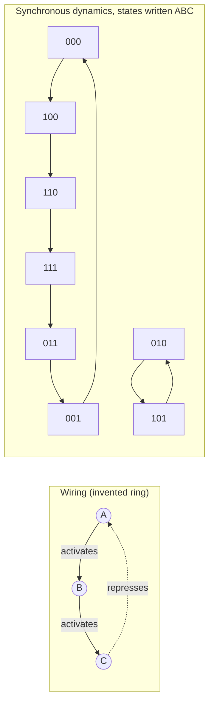

---
aliases:
  - Boolean Logic
  - Switching Algebra
  - Disjunctive Normal Form
  - Conjunctive Normal Form
  - DNF
  - CNF
  - Algèbre de Boole
tags:
  - type/concept
  - domain/mathematics
  - domain/computer-science
  - domain/bioinformatics
  - level/L2
  - level/L3
mastery: 0
prerequisites:
  - "[[Propositional Logic]]"
  - "[[Set]]"
  - "[[Function]]"
related:
  - "[[Boolean Network]]"
  - "[[Gene Regulatory Network]]"
  - "[[Operon]]"
  - "[[Feedback Loop]]"
  - "[[State Machine]]"
  - "[[Bit-Parallel String Matching]]"
  - "[[Mathematical Induction]]"
projects: []
sources:
  - "[[Mathematics for Computer Science (Lehman)]]"
  - "[[MIT 6.042J - Mathematics for Computer Science]]"
  - "[[Kauffman 1969 - Metabolic Stability and Epigenesis in Randomly Constructed Genetic Nets]]"
  - "[[Biology 2e (OpenStax)]]"
  - "[[Python Documentation]]"
---

# Boolean Algebra

> [!abstract]
> Boolean algebra computes with the two values 0 and 1 using AND, OR and NOT: its laws simplify a logical expression the way school algebra simplifies a polynomial, and its normal forms write any logical rule, such as "this gene is on when its activator is present and its repressor absent", in a standard shape.

## Definition

**Boolean algebra** works on the set $\{0, 1\}$ (false, true) with three operations taken from [[Propositional Logic]]: AND, written as a product $xy$; OR, written $x + y$; and NOT, written $\bar x$. Its **laws** are equivalences that hold for every value of the variables, so expressions can be rewritten and simplified by algebra instead of truth tables.[^lehman] A **Boolean function** of $n$ variables is a [[Function]] $f : \{0,1\}^n \to \{0,1\}$. Every Boolean function can be written in **disjunctive normal form** (DNF, an OR of ANDs) and in **conjunctive normal form** (CNF, an AND of ORs).[^lehman][^mcs]

In this notation $1 + 1 = 1$: the plus sign is the inclusive OR, not addition.

## Why it matters

- **Gene regulation as logic.** Kauffman modeled each gene as a binary on/off element whose next state is a Boolean function of the genes that regulate it.[^kauffman] Simplifying the function finds the minimal regulatory logic; its DNF lists the input combinations that switch the gene on ([[Boolean Network]], [[Gene Regulatory Network]]).
- **Filters and queries.** Two equivalent expressions select the same records. Algebra proves the equivalence without enumerating cases, and De Morgan's laws turn a "keep" rule into its "discard" rule ([[Propositional Logic]]).
- **Bitwise computing.** A $w$-bit integer is a vector in $\{0,1\}^w$, and Python's `&`, `|`, `^`, `~` apply the operations to all its bits at once.[^python] Presence or absence of a gene across samples fits in one integer, and every law below holds bitwise, which is what [[Bit-Parallel String Matching]] exploits.

## Core (L2)

### The laws

| Law | OR form | AND form (dual) |
|---|---|---|
| Identity | $x + 0 = x$ | $x \cdot 1 = x$ |
| Domination | $x + 1 = 1$ | $x \cdot 0 = 0$ |
| Idempotence | $x + x = x$ | $xx = x$ |
| Complement | $x + \bar x = 1$ | $x \bar x = 0$ |
| Commutativity, associativity | $x + y = y + x$, $(x + y) + z = x + (y + z)$ | $xy = yx$, $(xy)z = x(yz)$ |
| Distributivity | $x + yz = (x + y)(x + z)$ | $x(y + z) = xy + xz$ |
| Absorption | $x + xy = x$ | $x(x + y) = x$ |
| De Morgan | $\overline{x + y} = \bar x\,\bar y$ | $\overline{xy} = \bar x + \bar y$ |

Together with double negation, $\bar{\bar x} = x$, these are the equivalences of [[Propositional Logic]] written algebraically.[^lehman] Two features have no counterpart for numbers: idempotence ($x + x = x$, not $2x$) and the distributivity of $+$ over the product. Each row is **dual**: exchanging $+$ with $\cdot$ and $0$ with $1$ turns a law into a law, because complementing both sides of a valid law and applying De Morgan gives its dual.

Laws combine into short proofs. Absorption: $x + xy = x \cdot 1 + x y = x(1 + y) = x \cdot 1 = x$. A law used constantly:

$$x + \bar x y = (x + \bar x)(x + y) = 1 \cdot (x + y) = x + y \qquad \text{(distributivity, complement, identity)}.$$

### Simplifying an expression

The **majority** function of three inputs is 1 when at least two inputs are 1: rows 011, 101, 110, 111 of its truth table, so $f = \bar x y z + x \bar y z + x y \bar z + x y z$. Copy $xyz$ three times (idempotence) and pair it with each other term:

$$f = (\bar x + x) yz + x(\bar y + y)z + xy(\bar z + z) = yz + xz + xy.$$

Twelve literals became six. Read biologically (invented rule): a gene expressed when at least two of its three activators are present.

### Normal forms

- A **literal** is a variable or its complement. A **minterm** is an AND of $n$ literals, one per variable: it equals 1 on exactly one row of the truth table. A **maxterm** is an OR of $n$ literals: it equals 0 on exactly one row.
- **Canonical DNF**: the OR of the minterms of the rows where $f = 1$. **Canonical CNF**: the AND of the maxterms of the rows where $f = 0$. Both always exist, so AND, OR and NOT express every truth table.[^lehman] For majority, the CNF has one clause per false row: $(x + y + z)(x + y + \bar z)(x + \bar y + z)(\bar x + y + z)$.
- Canonical forms are unique up to the order of terms, which gives an equivalence test; simplified forms usually are not unique.
- $n$ variables give $2^n$ rows and $2^{2^n}$ Boolean functions: 16 for $n = 2$, 256 for $n = 3$, 65,536 for $n = 4$.

### Bio: regulatory logic and Boolean networks

**From mechanism to rule.** The *lac* operon of *E. coli* is transcribed strongly only when lactose is present and glucose is absent. The lac repressor blocks transcription unless lactose is present, and the activator CAP binds when glucose is low.[^os16] With $L$, $G$ for "lactose present", "glucose present", the repressor is active when $R = \bar L$ and CAP is bound when $C = \bar G$. Strong transcription needs the activator on and the repressor off: $T = C\,\bar R = \bar G\,\bar{\bar L} = L\,\bar G$. Double negation turns the mechanism into the textbook rule ([[Operon]]).

**Boolean networks.** Give every gene of a circuit such a rule. The state of $n$ genes is a vector in $\{0,1\}^n$; under **synchronous** update all genes read the current state and switch together. Kauffman studied large random networks of this kind and found that, with two or three inputs per gene, they settle into short cycles of states; he proposed that these stable modes correspond to cell types.[^kauffman] A three-gene negative feedback ring (invented: A activates B, B activates C, C represses A) has the rules $A' = \bar C$, $B' = A$, $C' = B$, and its eight states fall into two cycles:



There is no fixed point: the negative loop oscillates. A mutual-repression **toggle** ($A' = \bar B$, $B' = \bar A$) instead has two fixed points, 01 and 10, two stable states like two cell fates ([[Feedback Loop]], [[Bistability]]). The continuous counterpart of these oscillations is read from complex eigenvalues ([[Complex Number]]).

## Advanced (L3)

- **Boolean algebras in general.** Any set with two operations, a complement and two constants obeying the laws above is a Boolean algebra. The subsets of a universe $U$ with $\cup$, $\cap$, complement, $\varnothing$ and $U$ form one ([[Set]]); the bit vectors $\{0,1\}^w$ with bitwise operations form another, and they match through indicator vectors (subset $S \subseteq \{1, \dots, w\}$ ↔ bit $i$ = 1 iff $i \in S$). This is why a set of samples can be an integer and an intersection a single `&`.
- **Normal forms can explode.** A canonical form has up to $2^n$ terms, and some functions have no short DNF at all: the parity of $n$ bits needs $2^{n-1}$ terms (Exercise 4). Exhaustive methods cost $2^n$, so a 30-gene rule cannot be simplified by truth table.
- **Satisfiability.** Deciding whether a CNF formula can be made true (SAT) is easy to check for a given assignment, but no algorithm is known that decides every instance in time polynomial in the formula's size; finding one would settle the P versus NP question.[^lehman-sat]
- **The update scheme is part of the model.** The toggle's synchronous 2-cycle 00 → 11 → 00 requires both genes to switch at the same instant. Updating one gene at a time (asynchronous update) removes it, and every trajectory ends in 01 or 10 (Exercise 3). Attractors that depend on the update scheme deserve suspicion ([[Boolean Network]]).

## Mathematical representation

- $\mathbb{B} = \{0, 1\}$, with $xy = \min(x, y)$, $x + y = \max(x, y)$ and $\bar x = 1 - x$, the semantics of [[Propositional Logic#Mathematical representation]].
- For $a = (a_1, \dots, a_n) \in \mathbb{B}^n$, write $x^1 = x$ and $x^0 = \bar x$. The minterm $m_a(x) = \prod_{i=1}^n x_i^{a_i}$ equals 1 iff $x = a$; the maxterm $M_a(x) = \sum_{i=1}^n x_i^{1 - a_i}$ equals 0 iff $x = a$. Then

$$f(x) = \sum_{a \,:\, f(a) = 1} m_a(x) = \prod_{a \,:\, f(a) = 0} M_a(x) \qquad \text{(canonical DNF and CNF).}$$

- **Shannon expansion**: $f(x_1, \dots, x_n) = x_1\, f(1, x_2, \dots, x_n) + \bar x_1\, f(0, x_2, \dots, x_n)$, checked by setting $x_1 = 1$ and $x_1 = 0$. Expanding on each variable in turn yields the canonical DNF, an inductive proof that it always exists ([[Mathematical Induction]]).
- **Boolean network**: $x(t+1) = F(x(t))$ with $F = (F_1, \dots, F_n) : \mathbb{B}^n \to \mathbb{B}^n$, where $F_i$ depends only on the regulators of gene $i$. An **attractor** is a cycle $x, F(x), \dots, F^p(x) = x$ ($p = 1$: a fixed point). With $2^n$ states, every trajectory repeats a state within $2^n$ steps (pigeonhole), so every trajectory ends in an attractor.

## Computational representation

A canonical DNF from a truth table, an equivalence check, and the attractors of the two circuits above:

```python
from itertools import product


def canonical_dnf(f, names):
    """OR (+) of the minterms of the rows where f = 1; x' means NOT x."""
    rows = product((0, 1), repeat=len(names))
    return " + ".join("".join(v if b else v + "'" for v, b in zip(names, bits))
                      for bits in rows if f(*bits)) or "0"


def equivalent(f, g, n):
    """True if f and g agree on all 2**n rows of the truth table."""
    return all(f(*bits) == g(*bits) for bits in product((0, 1), repeat=n))


majority = lambda x, y, z: int(x + y + z >= 2)
print(canonical_dnf(majority, "xyz"))
print(equivalent(majority, lambda x, y, z: (x & y) | (x & z) | (y & z), 3))


def step(state, rules):
    """Synchronous update: every gene reads the same current state."""
    return tuple(rule(*state) for rule in rules)


def attractors(rules, n):
    """Follow each of the 2**n states until one repeats; collect the cycles reached."""
    found = set()
    for start in product((0, 1), repeat=n):
        path, s = [], start
        while s not in path:
            path.append(s)
            s = step(s, rules)
        cycle = path[path.index(s):]
        k = cycle.index(min(cycle))         # same cycle, same starting state
        found.add(tuple(cycle[k:] + cycle[:k]))
    return sorted(found, key=len)


ring = (lambda a, b, c: 1 - c,   # C represses A
        lambda a, b, c: a,       # A activates B
        lambda a, b, c: b)       # B activates C
toggle = (lambda a, b: 1 - b,    # B represses A
          lambda a, b: 1 - a)    # A represses B
for name, rules, n in (("ring", ring, 3), ("toggle", toggle, 2)):
    print(name, [" -> ".join("".join(map(str, s)) for s in c) for c in attractors(rules, n)])
```

```text
x'yz + xy'z + xyz' + xyz
True
ring ['010 -> 101', '000 -> 100 -> 110 -> 111 -> 011 -> 001']
toggle ['01', '10', '00 -> 11']
```

## Worked example

> [!example] Simplifying an invented regulatory rule
> A gene X has an activator A, a repressor R and an inducer I that inactivates R (toy rule, invented). X is on in three rows of $(A, R, I)$: $(1, 0, 0)$, $(1, 0, 1)$ and $(1, 1, 1)$.
> 1. **Canonical DNF**, one minterm per true row: $X = A\bar R\bar I + A\bar R I + A R I$.
> 2. **Factor** the first two terms (distributivity) and use the complement law $\bar I + I = 1$: $X = A\bar R + A R I$.
> 3. **Factor $A$**: $X = A(\bar R + R I)$.
> 4. **Apply** $x + \bar x y = x + y$ with $x = \bar R$ (so $\bar x = R$): $\bar R + R I = \bar R + I$, hence $X = A(\bar R + I)$.
> 5. **Read it**: X needs its activator, and either the repressor absent or the inducer present. Six literals in step 1 became three.
> 6. **Check**: `canonical_dnf(lambda a, r, i: a & ((1 - r) | i), "ARI")` returns `AR'I' + AR'I + ARI`, the three starting rows.

## Common misconceptions

> [!warning] "In Boolean algebra, $1 + 1 = 0$" (or 2)
> The $+$ of Boolean algebra is the inclusive OR, so $1 + 1 = 1$. Addition modulo 2 is the exclusive or, a different operation: mixing them up breaks every simplification.

> [!warning] "A Boolean network attractor is a biological fact"
> Attractors depend on the rules and on the update scheme: the toggle's synchronous cycle 00 → 11 disappears under asynchronous update. A Boolean model is a hypothesis about regulatory logic, to be checked against data ([[Boolean Network]]).

## Exercises

> [!question] Exercise 1 (L2)
> Prove the dual law $x(\bar x + y) = xy$ from the laws, then simplify $\bar x\bar y + \bar x y + x y$.

> [!success]- Solution
> $x(\bar x + y) = x\bar x + xy = 0 + xy = xy$ (distributivity, complement, identity). Next, $\bar x\bar y + \bar x y = \bar x(\bar y + y) = \bar x$, so the expression is $\bar x + xy = \bar x + y$ by the law $x + \bar x y = x + y$ applied with the roles of $x$ and $\bar x$ exchanged.

> [!question] Exercise 2 (L2, Python)
> Simplify $f = \bar x\bar y\bar z + \bar x y\bar z + x\bar y\bar z + x y\bar z + x y z$, then check your answer with `equivalent` from the code above.

> [!success]- Solution
> The first four minterms contain $\bar z$ with all four combinations of $x, y$: their sum is $\bar z$. So $f = \bar z + xyz = \bar z + xy$ (law $x + \bar x y = x + y$ with $x = \bar z$).
> ```python
> f = lambda x, y, z: int((not x and not y and not z) or (not x and y and not z)
>                         or (x and not y and not z) or (x and y and not z) or (x and y and z))
> print(equivalent(f, lambda x, y, z: int(not z or (x and y)), 3))
> ```
> Output: `True`.

> [!question] Exercise 3 (L3, Python)
> Under **asynchronous** update, one gene whose rule disagrees with its current value switches at a time. List the possible successors of each state of the toggle (`toggle` from the code above). What happens to the synchronous cycle 00 → 11?

> [!success]- Solution
> ```python
> def async_successors(state, rules):
>     """Update one gene at a time: one successor per gene whose rule disagrees with its value."""
>     nxt = []
>     for i, rule in enumerate(rules):
>         new = rule(*state)
>         if new != state[i]:
>             nxt.append(state[:i] + (new,) + state[i + 1:])
>     return nxt
>
> for s in product((0, 1), repeat=2):
>     print(s, async_successors(s, toggle))
> ```
> Output: `(0, 0) [(1, 0), (0, 1)]`, `(0, 1) []`, `(1, 0) []`, `(1, 1) [(0, 1), (1, 0)]`. From 00 or 11 the first gene to switch decides the fate, and every trajectory ends in the fixed point 01 or 10. The cycle needed both genes to switch at exactly the same time, which real molecules do not do.

> [!question] Exercise 4 (L3)
> Prove that every DNF of the parity function $x_1 \oplus \dots \oplus x_n$ has at least $2^{n-1}$ terms.

> [!success]- Solution
> Take a term $T$ (an AND of literals, not identically 0) of a DNF of the parity $p$. If $T$ omitted a variable $x_j$, choose an assignment $a$ with $T(a) = 1$; flipping $x_j$ keeps $T = 1$, so $p = 1$ at both assignments, but flipping one bit changes the parity: contradiction. Hence every term contains all $n$ variables, is a minterm, and covers exactly one true row. Pairing each row with the row where $x_1$ is flipped shows that exactly half of the $2^n$ rows have parity 1, so at least $2^{n-1}$ terms are needed: 524,288 for $n = 20$.

## Mastery checklist

- [ ] 1 Recognized: I can state the laws of Boolean algebra and say what a DNF and a CNF are.
- [ ] 2 Understood: I can explain duality, why $x + x = x$, how a truth table yields the canonical DNF and CNF, and what an attractor of a Boolean network is.
- [ ] 3 Practiced: I simplify expressions naming each law, build canonical DNFs and attractors in Python, and check equivalences by enumeration.
- [ ] 4 Applied: I wrote a published regulatory circuit (for example the *lac* operon or a toggle switch) as Boolean rules and compared its attractors under synchronous and asynchronous update.
- [ ] 5 Explained: I can teach why normal forms can be exponentially long, what SAT asks, and why a Boolean network's attractors depend on its update scheme.

## References

[^lehman]: [[Mathematics for Computer Science (Lehman)]], 2017 revision, Part I "Proofs", chapter "Logical Formulas", section "The Algebra of Propositions" (equivalence laws, disjunctive and conjunctive normal forms).
[^lehman-sat]: [[Mathematics for Computer Science (Lehman)]], 2017 revision, chapter "Logical Formulas" (satisfiability: the SAT problem and its link to P versus NP).
[^mcs]: [[MIT 6.042J - Mathematics for Computer Science]], fundamental-concepts third of the course (propositional logic and its formulas).
[^kauffman]: [[Kauffman 1969 - Metabolic Stability and Epigenesis in Randomly Constructed Genetic Nets]], Kauffman SA, *Journal of Theoretical Biology* 22(3):437-467: genes as binary on/off elements, order of random nets with two or three inputs per gene, behavior cycles compared with cell types.
[^os16]: [[Biology 2e (OpenStax)]], ch. 16 "Gene Expression" (prokaryotic gene regulation: the *lac* operon, the lac repressor, CAP and glucose).
[^python]: [[Python Documentation]], 3.13, Library Reference "Built-in Types" (bitwise operations on integer types: `&`, `|`, `^`, `~`).
