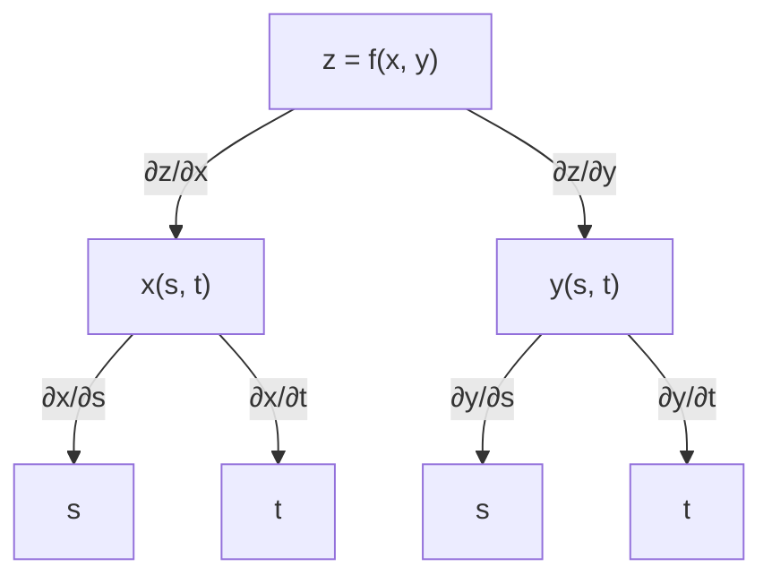
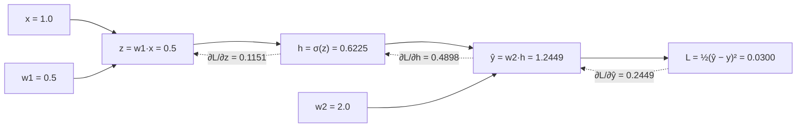

---
aliases:
  - Chain Rule for Several Variables
  - Multivariate Chain Rule
  - Total Derivative
  - Tree Diagram
  - Règle de la chaîne à plusieurs variables
tags:
  - type/concept
  - domain/mathematics
  - domain/statistics
  - domain/computer-science
  - level/L2
  - level/L3
mastery: 0
prerequisites:
  - "[[Differentiation Rules]]"
  - "[[Partial Derivative]]"
  - "[[Gradient]]"
related:
  - "[[Jacobian Matrix]]"
  - "[[Backpropagation]]"
  - "[[Neural Network]]"
  - "[[Automatic Differentiation]]"
  - "[[Lotka-Volterra Model]]"
  - "[[Sensitivity Analysis]]"
  - "[[Matrix Multiplication]]"
projects: []
sources:
  - "[[Calculus (OpenStax)]]"
  - "[[MIT 18.02SC - Multivariable Calculus]]"
  - "[[Mathematical Biology (Murray)]]"
  - "[[An Introduction to Statistical Learning (James)]]"
  - "[[MIT 18.065 - Matrix Methods in Data Analysis, Signal Processing, and Machine Learning]]"
---

# Multivariable Chain Rule

> [!abstract]
> When a quantity depends on intermediate variables that themselves depend on others, its derivative is a sum over all paths of dependence, each path contributing the product of the derivatives along it: the rule behind changes of variables, rates along trajectories, and backpropagation in neural networks.

## Definition

If $z = f(x, y)$ is differentiable and $x = x(t)$, $y = y(t)$ are differentiable, then

$$\frac{dz}{dt} = \frac{\partial f}{\partial x}\frac{dx}{dt} + \frac{\partial f}{\partial y}\frac{dy}{dt}.$$

If instead $x = x(s, t)$ and $y = y(s, t)$, then $\frac{\partial z}{\partial s} = \frac{\partial z}{\partial x}\frac{\partial x}{\partial s} + \frac{\partial z}{\partial y}\frac{\partial y}{\partial s}$, and likewise for $t$. In general, if $z$ depends on $x_1, \dots, x_m$, each depending on $t_1, \dots, t_n$, then $\frac{\partial z}{\partial t_j} = \sum_{i=1}^{m}\frac{\partial z}{\partial x_i}\frac{\partial x_i}{\partial t_j}$. A **tree diagram** lists the dependencies: each path from $z$ down to $t_j$ contributes the product of the derivatives along its edges, and the contributions add.[^os3][^1802]

## Why it matters

- **Backpropagation.** A neural network is a composition of layers, and the gradient of its loss with respect to every weight comes from the chain rule applied layer by layer, from the output back to the inputs ([[Backpropagation]], [[Neural Network]]).[^isl][^18065]
- **Rates along trajectories.** How a function of the state of a model (total biomass, an energy, a conserved quantity) changes along a solution is $\frac{d}{dt}V(x(t), y(t)) = V_x x' + V_y y'$. This proves, for instance, that predator-prey cycles close ([[Lotka-Volterra Model]]).
- **Reparametrization.** Optimizers often work on $\ln\sigma$ instead of $\sigma$, on log rates or on logits; the chain rule converts gradients between parametrizations, and relative sensitivities are derivatives with respect to log-parameters ([[Partial Derivative]]).
- **Implicit dependence.** A steady state that depends on a parameter has a sensitivity $\frac{dx^*}{dp} = -\frac{F_p}{F_x}$, computable without solving for $x^*$ ([[Sensitivity Analysis]]).

## Core (L2)

### One parameter: a path through the plane

Why a sum: for a small change $\Delta t$, $x$ and $y$ move by $\Delta x \approx x'\Delta t$ and $\Delta y \approx y'\Delta t$, and the tangent-plane approximation gives $\Delta z \approx f_x\Delta x + f_y\Delta y$ ([[Linear Approximation]]). Each intermediate variable passes on its own share of the change. Example: $z = x^2y$ with $x = \cos t$, $y = \sin t$:

$$\frac{dz}{dt} = 2xy\cdot(-\sin t) + x^2\cdot\cos t = -2\cos t\sin^2 t + \cos^3 t,$$

the same result as differentiating $z = \cos^2 t\,\sin t$ directly (Exercise 1).

### Tree diagrams: sum over paths



Two paths end at $s$, so $\frac{\partial z}{\partial s} = \frac{\partial z}{\partial x}\frac{\partial x}{\partial s} + \frac{\partial z}{\partial y}\frac{\partial y}{\partial s}$. Forgetting a path is the classic error; the tree makes every path visible.[^os3]

### Bio: rates along a trajectory close the predator-prey cycles

In the Lotka-Volterra model $x' = ax - bxy$ (prey), $y' = -cy + dxy$ (predators), with positive constants,[^murray] take $V(x, y) = dx - c\ln x + by - a\ln y$ for $x, y > 0$. Along any solution,

$$\frac{dV}{dt} = V_x x' + V_y y' = \Big(d - \frac{c}{x}\Big)x(a - by) + \Big(b - \frac{a}{y}\Big)y(dx - c) = (dx - c)(a - by) + (by - a)(dx - c) = 0.$$

$V$ is conserved, so each trajectory stays on one level curve of $V$. $V$ is a sum of a convex function of $x$ and a convex function of $y$, minimal at the equilibrium $(c/d, a/b)$ and growing without bound toward the axes and infinity, so its level curves are closed loops around the equilibrium: the oscillations are closed cycles, a fact that the purely imaginary eigenvalues of the linearization suggest but cannot prove ([[Complex Number]]).

### Bio: backpropagation is the chain rule, layer by layer

A one-unit network computes $z = w_1x$, $h = \sigma(z)$ with $\sigma(z) = \frac{1}{1 + e^{-z}}$, prediction $\hat y = w_2h$ and loss $L = \frac12(\hat y - y)^2$. Following the chain from the loss back:

$$\frac{\partial L}{\partial w_2} = (\hat y - y)\,h, \qquad \frac{\partial L}{\partial w_1} = \underbrace{(\hat y - y)}_{\partial L/\partial\hat y}\;\underbrace{w_2}_{\partial\hat y/\partial h}\;\underbrace{h(1 - h)}_{\partial h/\partial z}\;\underbrace{x}_{\partial z/\partial w_1},$$

using $\sigma' = \sigma(1 - \sigma)$. The factor $\partial L/\partial\hat y$ is computed once and reused for every parameter upstream; in a deep network, each layer receives the derivative of the loss with respect to its output, multiplies by its local derivatives, and passes the result on. That reuse is what makes backpropagation efficient.[^isl][^18065]



Solid arrows: forward pass; dashed arrows: backward pass (values from the worked example, target $y = 1$).

## Advanced (L3)

- **Matrix form.** For $g : \mathbb{R}^n \to \mathbb{R}^m$ and $f : \mathbb{R}^m \to \mathbb{R}^p$, $D(f \circ g)(\mathbf{t}) = Df(g(\mathbf{t}))\,Dg(\mathbf{t})$: the [[Jacobian Matrix]] of a composition is the product of the Jacobians, and the sum over paths of the tree is the sum inside [[Matrix Multiplication]]. For a loss $L = \ell(f_k(\cdots f_1(\boldsymbol\theta)))$, $\nabla L^\top = \frac{\partial\ell}{\partial\mathbf{y}_k}J_k \cdots J_1$.
- **Forward or reverse.** The product can be accumulated from the right (forward mode: push a direction from the inputs, one input direction per pass, as with the dual numbers of [[Differentiation Rules]]) or from the left (reverse mode: pull the row vector $\partial\ell/\partial\mathbf{y}_k$ back through the layers). With one scalar loss and millions of parameters, one reverse pass gives the whole gradient, visiting each operation of the forward pass once more: this is backpropagation, and reverse-mode [[Automatic Differentiation]] does it for any program.
- **Products can shrink.** Since $\sigma'(z) = \sigma(1 - \sigma) \le \frac14$, each sigmoid layer multiplies the backward signal by at most $\frac14$ times its weights; across ten such layers with weights of size at most 1, the gradient reaching the first layer can be $4^{-10} \approx 10^{-6}$ times smaller than at the output, and early layers barely learn. Activations whose derivative stays close to 1 over a useful range avoid this geometric shrinking ([[Neural Network]]).
- **Implicit differentiation.** If $F(x, p) = 0$ defines $x(p)$, differentiating $F(x(p), p) = 0$ gives $F_x\frac{dx}{dp} + F_p = 0$, hence $\frac{dx}{dp} = -\frac{F_p}{F_x}$ wherever $F_x \neq 0$.[^os3] For a steady state of $\frac{dx}{dt} = F(x, p)$, this is the sensitivity of the steady state to the parameter (Exercise 5).
- **Total versus partial.** For $f(x, t)$ with $x = x(t)$, $\frac{df}{dt} = \frac{\partial f}{\partial t} + \frac{\partial f}{\partial x}\frac{dx}{dt}$: the explicit dependence on $t$ plus the dependence through $x$. Writing $\frac{\partial f}{\partial t}$ for both is a frequent source of wrong derivations.

## Mathematical representation

- If $g$ is differentiable at $\mathbf{t}$ and $f$ is differentiable at $g(\mathbf{t})$, then $f \circ g$ is differentiable at $\mathbf{t}$ and $D(f \circ g)(\mathbf{t}) = Df(g(\mathbf{t}))\,Dg(\mathbf{t})$.
- Along a curve $\mathbf{r}(t)$: $\frac{d}{dt}f(\mathbf{r}(t)) = \nabla f(\mathbf{r}(t)) \cdot \mathbf{r}'(t)$ ([[Gradient]]).
- Components: $\frac{\partial z}{\partial t_j} = \sum_{i=1}^{m}\frac{\partial z}{\partial x_i}\frac{\partial x_i}{\partial t_j}$.
- Reparametrization: with $\sigma = e^s$, $\frac{\partial\ell}{\partial s} = \sigma\frac{\partial\ell}{\partial\sigma}$; relative sensitivity $\frac{\partial\ln y}{\partial\ln p} = \frac{p}{y}\frac{\partial y}{\partial p}$.
- Backpropagation recursion for layers $\mathbf{z}_k = W_k\mathbf{h}_{k-1} + \mathbf{b}_k$, $\mathbf{h}_k = \phi(\mathbf{z}_k)$: with $\boldsymbol\delta_k = \partial L/\partial\mathbf{z}_k$, $\boldsymbol\delta_k = (W_{k+1}^\top\boldsymbol\delta_{k+1}) \odot \phi'(\mathbf{z}_k)$, $\frac{\partial L}{\partial W_k} = \boldsymbol\delta_k\mathbf{h}_{k-1}^\top$ and $\frac{\partial L}{\partial\mathbf{b}_k} = \boldsymbol\delta_k$ ($\odot$: elementwise product).

## Computational representation

The conserved quantity of the predator-prey model checked with the chain rule and along a simulated cycle, then backpropagation for a network with two hidden units, checked against central differences and used for training:

```python
import math
import random

a, b, c, d = 1.0, 0.1, 0.5, 0.02                    # invented Lotka-Volterra parameters


def field(x, y):
    """(dx/dt, dy/dt): prey x, predators y."""
    return a * x - b * x * y, -c * y + d * x * y


def V(x, y):
    return d * x - c * math.log(x) + b * y - a * math.log(y)


def dV_dt(x, y):
    """Multivariable chain rule: dV/dt = V_x dx/dt + V_y dy/dt."""
    dx, dy = field(x, y)
    return (d - c / x) * dx + (b - a / y) * dy


print([dV_dt(x, y) for x, y in ((40.0, 2.0), (10.0, 30.0), (25.0, 9.0))])

x, y, dt, values = 25.0, 2.0, 0.001, []             # RK4 along one predator-prey cycle
for step in range(20001):
    if step % 5000 == 0:
        values.append(round(V(x, y), 6))
    k1 = field(x, y)
    k2 = field(x + dt / 2 * k1[0], y + dt / 2 * k1[1])
    k3 = field(x + dt / 2 * k2[0], y + dt / 2 * k2[1])
    k4 = field(x + dt * k3[0], y + dt * k3[1])
    x += dt / 6 * (k1[0] + 2 * k2[0] + 2 * k3[0] + k4[0])
    y += dt / 6 * (k1[1] + 2 * k2[1] + 2 * k3[1] + k4[1])
print(values)


act = lambda z: 1 / (1 + math.exp(-z))              # sigmoid activation
dact = lambda h: h * (1 - h)                        # its derivative, written with h = act(z)

# Invented toy data: two regulator levels -> expression of a target gene
data = [((0.2, 0.9), 0.1), ((0.8, 0.1), 0.9), ((0.5, 0.5), 0.5), ((0.9, 0.7), 0.6)]


def forward(p, x):
    """p = [W11, W12, W21, W22, b1, b2, v1, v2, c0]: 2 inputs -> 2 sigmoid units -> 1 output."""
    z = [p[0] * x[0] + p[1] * x[1] + p[4], p[2] * x[0] + p[3] * x[1] + p[5]]
    h = [act(zj) for zj in z]
    return h, p[6] * h[0] + p[7] * h[1] + p[8]


def loss(p):
    return sum((forward(p, x)[1] - y) ** 2 for x, y in data) / (2 * len(data))


def backprop(p):
    """Gradient of the loss, layer by layer from the output back (chain rule)."""
    g = [0.0] * 9
    for x, y in data:
        h, out = forward(p, x)
        d_out = (out - y) / len(data)                    # dL/d(out)
        g[8] += d_out                                    # d(out)/dc0 = 1
        for j in range(2):
            g[6 + j] += d_out * h[j]                     # d(out)/dv_j = h_j
            d_z = d_out * p[6 + j] * dact(h[j])          # times dh_j/dz_j
            g[4 + j] += d_z                              # dz_j/db_j = 1
            g[2 * j] += d_z * x[0]                       # dz_j/dW_j1 = x_1
            g[2 * j + 1] += d_z * x[1]                   # dz_j/dW_j2 = x_2
    return g


def numerical(f, p, h=1e-6):
    out = []
    for i in range(len(p)):
        up, down = p[:], p[:]
        up[i] += h
        down[i] -= h
        out.append((f(up) - f(down)) / (2 * h))
    return out


random.seed(1)
p = [random.uniform(-1, 1) for _ in range(9)]
print(max(abs(u - v) for u, v in zip(backprop(p), numerical(loss, p))))
start = loss(p)
for _ in range(2000):                                    # gradient descent with backprop
    p = [pi - 0.5 * gi for pi, gi in zip(p, backprop(p))]
print(round(start, 4), round(loss(p), 6), [round(forward(p, x)[1], 2) for x, _ in data])
```

```text
[-5.551115123125783e-17, 0.0, 0.0]
[-1.602585, -1.602585, -1.602585, -1.602585, -1.602585]
6.755043746586864e-11
0.4518 2e-06 [0.1, 0.9, 0.5, 0.6]
```

$dV/dt$ is zero up to rounding, and $V$ keeps the same six decimals over 20 time units of simulation. Backpropagation agrees with central differences to $10^{-10}$, and gradient descent drives the loss from 0.45 to $2 \times 10^{-6}$. With 9 parameters for 4 data points, that perfect fit says nothing about predictions on new samples ([[Overfitting]]).

## Worked example

> [!example] Backpropagation by hand (the network of the second diagram)
> Input $x = 1.0$, weights $w_1 = 0.5$ and $w_2 = 2.0$, target $y = 1.0$ (invented, no biases).
> 1. **Forward**: $z = 0.5$, $h = \sigma(0.5) = 0.6225$, $\hat y = 2 \times 0.6225 = 1.2449$, $L = \frac12(0.2449)^2 = 0.0300$.
> 2. **Output layer**: $\frac{\partial L}{\partial\hat y} = \hat y - y = 0.2449$, so $\frac{\partial L}{\partial w_2} = 0.2449 \times h = 0.1525$.
> 3. **Pass the message back**: $\frac{\partial L}{\partial h} = 0.2449 \times w_2 = 0.4898$.
> 4. **Through the activation**: $\frac{\partial h}{\partial z} = h(1 - h) = 0.2350$, so $\frac{\partial L}{\partial z} = 0.4898 \times 0.2350 = 0.1151$.
> 5. **First layer**: $\frac{\partial L}{\partial w_1} = 0.1151 \times x = 0.1151$.
> 6. **Check**: central differences on $L(w_1, w_2)$ give $(0.1151, 0.1525)$. Both partial derivatives are positive: the prediction is too high, and gradient descent lowers both weights.

## Common misconceptions

> [!warning] "The chain rule multiplies one derivative per variable"
> It multiplies along each path and **adds** over paths. When $x$ and $y$ both depend on $s$, $\frac{\partial z}{\partial s}$ has two terms; dropping one is the most frequent mistake, and the tree diagram prevents it.

> [!warning] "$\frac{\partial f}{\partial t}$ and $\frac{df}{dt}$ are the same thing"
> For $f(x(t), t)$, $\frac{df}{dt}$ includes the change through $x$; $\frac{\partial f}{\partial t}$ holds $x$ fixed. A reaction rate that depends on temperature and on a concentration that itself changes in time has both kinds of derivative.

> [!warning] "Backpropagation is a learning algorithm different from calculus"
> Backpropagation only computes the gradient, exactly, by the chain rule. Learning is the separate step that uses it, such as [[Gradient Descent]].

## Exercises

> [!question] Exercise 1 (L2)
> For $z = x^2y$ with $x = \cos t$ and $y = \sin t$, compute $\frac{dz}{dt}$ with the chain rule, then by substituting first. Evaluate at $t = \pi/4$.

> [!success]- Solution
> Chain rule: $\frac{dz}{dt} = 2xy(-\sin t) + x^2\cos t = -2\cos t\sin^2 t + \cos^3 t$. Substitution: $z = \cos^2 t\sin t$, and the product rule gives $-2\cos t\sin t\cdot\sin t + \cos^2 t\cos t$, the same. At $t = \pi/4$: $\cos = \sin = \frac{\sqrt2}{2}$, so $\frac{dz}{dt} = -2\big(\frac{\sqrt2}{2}\big)^3 + \big(\frac{\sqrt2}{2}\big)^3 = -\frac{\sqrt2}{4} \approx -0.354$.

> [!question] Exercise 2 (L2)
> For $f(x, y) = x^2 + xy$ in polar coordinates $x = r\cos\theta$, $y = r\sin\theta$, compute $\frac{\partial f}{\partial r}$ and $\frac{\partial f}{\partial\theta}$ at $r = 2$, $\theta = \pi/6$ with the chain rule.

> [!success]- Solution
> $\frac{\partial f}{\partial r} = f_x\cos\theta + f_y\sin\theta$ and $\frac{\partial f}{\partial\theta} = -f_x\,r\sin\theta + f_y\,r\cos\theta$. At the point, $x = \sqrt3$, $y = 1$, $f_x = 2x + y = 2\sqrt3 + 1 \approx 4.464$ and $f_y = x \approx 1.732$. So $\frac{\partial f}{\partial r} \approx 4.464 \times 0.866 + 1.732 \times 0.5 = 4.732$ and $\frac{\partial f}{\partial\theta} \approx -4.464 + 3.000 = -1.464$. Direct check: $f = r^2(\cos^2\theta + \frac12\sin 2\theta)$ gives $2r(0.75 + 0.433) = 4.732$ and $r^2(\cos 2\theta - \sin 2\theta) = 4(0.5 - 0.866) = -1.464$.

> [!question] Exercise 3 (L2)
> An optimizer fits the standard deviation of a normal model through $s = \ln\sigma$. Express $\frac{\partial\ell}{\partial s}$ with $\frac{\partial\ell}{\partial\sigma}$, show that both vanish at the same point, and explain the benefit.

> [!success]- Solution
> $\sigma = e^s$, so $\frac{\partial\ell}{\partial s} = \frac{\partial\ell}{\partial\sigma}\frac{d\sigma}{ds} = \sigma\frac{\partial\ell}{\partial\sigma}$. Since $\sigma > 0$, the two derivatives vanish together: the maximum likelihood estimate is the same ([[Gradient]]). But every value of $s$ gives a valid $\sigma = e^s > 0$, so unconstrained steps in $s$ can never produce a negative standard deviation, which steps in $\sigma$ can.

> [!question] Exercise 4 (L3, Python)
> Replace the sigmoid of the code above by $\tanh$, whose derivative is $1 - \tanh^2$, and check the backward pass against `numerical`.

> [!success]- Solution
> Only the local derivative of the activation changes; `forward` and `backprop` read `act` and `dact` when called, so swapping them is enough.
> ```python
> act, dact = math.tanh, lambda h: 1 - h ** 2          # tanh' = 1 - tanh^2
> random.seed(1)
> p = [random.uniform(-1, 1) for _ in range(9)]
> print(max(abs(u - v) for u, v in zip(backprop(p), numerical(loss, p))))
> ```
> Output: `1.3568834944521768e-10`. Run a gradient check like this one after every change to a hand-written backward pass.

> [!question] Exercise 5 (L3)
> A self-repressing gene has the steady state $x^*$ of $\frac{dx}{dt} = F(x, \beta, \gamma) = \frac{\beta}{1 + x^2} - \gamma x$ (as in [[Differentiation Rules]]). At $\beta = 2$, $\gamma = 1$, $x^* = 1$, compute $\frac{dx^*}{d\beta}$, $\frac{dx^*}{d\gamma}$ and the two relative sensitivities. Why are the relative sensitivities opposite?

> [!success]- Solution
> $F_x = -\frac{2\beta x}{(1 + x^2)^2} - \gamma = -2$, $F_\beta = \frac{1}{1 + x^2} = 0.5$ and $F_\gamma = -x = -1$ at the point. Implicit differentiation: $\frac{dx^*}{d\beta} = -\frac{F_\beta}{F_x} = 0.25$ (the value found in [[Differentiation Rules]]) and $\frac{dx^*}{d\gamma} = -\frac{F_\gamma}{F_x} = -0.5$. Relative sensitivities: $\frac{\beta}{x^*}\frac{dx^*}{d\beta} = 0.5$ and $\frac{\gamma}{x^*}\frac{dx^*}{d\gamma} = -0.5$. They are opposite because the steady-state equation can be written $x(1 + x^2) = \beta/\gamma$: $x^*$ depends on the ratio $\beta/\gamma$ only, so a 1 % rise in production and a 1 % rise in degradation cancel.

## Mastery checklist

- [ ] 1 Recognized: I can state the chain rule for $z = f(x(t), y(t))$ and draw the tree diagram of a composition.
- [ ] 2 Understood: I can explain the sum over paths with the tangent-plane approximation, and the difference between total and partial derivatives.
- [ ] 3 Practiced: I apply the chain rule to changes of coordinates, reparametrizations and implicit equations, and I implement and gradient-check a backward pass in Python.
- [ ] 4 Applied: I trained a small neural network or logistic model on real biological data with my own backpropagation, and verified a conserved quantity or a steady-state sensitivity of a published model.
- [ ] 5 Explained: I can teach the matrix form of the chain rule, why reverse mode suits one loss and many parameters, and how products of local derivatives can shrink across layers.

## References

[^os3]: [[Calculus (OpenStax)]], Volume 3, ch. 4 "Differentiation of Functions of Several Variables", section "The Chain Rule" (chain rules for one and two independent variables, tree diagrams, the generalized chain rule, implicit differentiation).
[^1802]: [[MIT 18.02SC - Multivariable Calculus]], differential calculus part (chain rule and gradient).
[^murray]: [[Mathematical Biology (Murray)]], 3rd ed., Volume I, population models (the Lotka-Volterra predator-prey system).
[^isl]: [[An Introduction to Statistical Learning (James)]], deep learning chapter (fitting a neural network: gradient descent, and backpropagation as the chain rule).
[^18065]: [[MIT 18.065 - Matrix Methods in Data Analysis, Signal Processing, and Machine Learning]], lecture "Backpropagation: Find Partial Derivatives".
