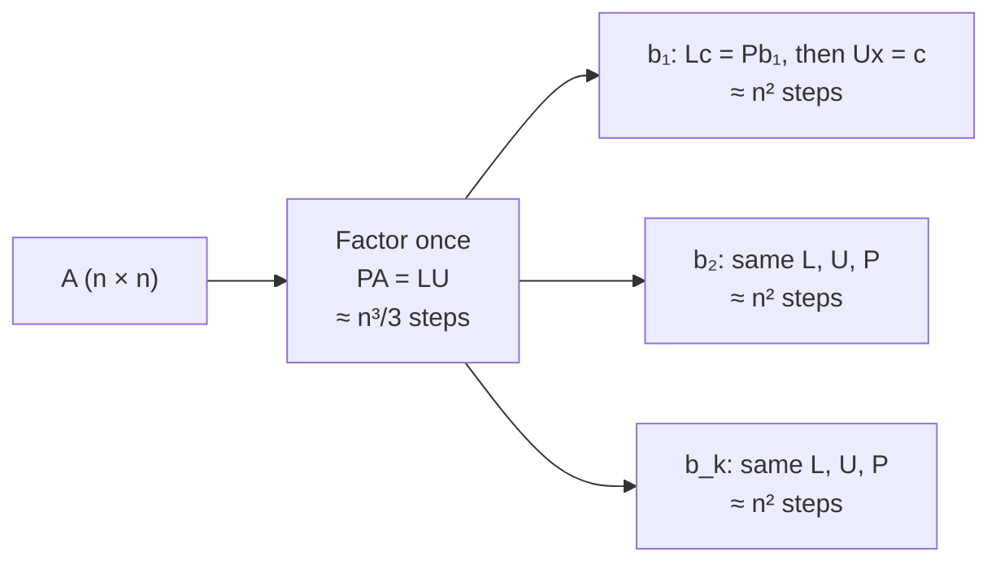

---
aliases:
  - LU Factorization
  - LU Factorisation
  - PA = LU
  - LUP Decomposition
  - Triangular Factorization
  - Décomposition LU
  - Factorisation LU
tags:
  - type/concept
  - domain/mathematics
  - domain/computer-science
  - level/L2
  - level/L3
mastery: 0
prerequisites:
  - "[[Gaussian Elimination]]"
  - "[[Matrix Multiplication]]"
  - "[[Inverse Matrix]]"
  - "[[Big O Notation]]"
related:
  - "[[System of Linear Equations]]"
  - "[[Determinant]]"
  - "[[Symmetric Matrix]]"
  - "[[Positive Definite Matrix]]"
  - "[[QR Decomposition]]"
  - "[[Least Squares]]"
  - "[[Numerical Linear Algebra]]"
  - "[[Floating-Point Arithmetic]]"
  - "[[Sparse Matrix]]"
  - "[[Absorbing Markov Chain]]"
projects:
  - "[[07-evolution-simulator]]"
sources:
  - "[[Introduction to Linear Algebra (Strang)]]"
  - "[[MIT 18.06SC - Linear Algebra]]"
  - "[[Numerical Linear Algebra (Trefethen)]]"
  - "[[LAPACK Users' Guide (Anderson)]]"
  - "[[MIT 6.041SC - Probabilistic Systems Analysis and Applied Probability]]"
  - "[[Principles of Population Genetics (Hartl)]]"
---

# LU Decomposition

> [!abstract]
> LU decomposition stores Gaussian elimination as a product of two triangular matrices, $PA = LU$: the $\Theta(n^3)$ elimination is paid once, then every new right-hand side costs two triangular solves in $\Theta(n^2)$. It is what `solve` does inside NumPy and SciPy.

## Definition

An **LU decomposition** of a square matrix $A$ is a factorization $A = LU$ with $L$ **unit lower triangular** (ones on the diagonal, zeros above it) and $U$ **upper triangular**. Elimination without row exchanges produces it: $U$ is the echelon form reached by [[Gaussian Elimination]], and the entry $\ell_{ij}$ of $L$ below the diagonal is the multiplier that cleared position $(i, j)$. When row exchanges are needed, the factorization is $PA = LU$, where the permutation matrix $P$ reorders the rows of $A$; every invertible matrix has one.[^strang][^1806][^tb]

## Why it matters

- **One matrix, many right-hand sides.** Elimination does the same work on $A$ whatever $b$ is; stored as $L$ and $U$, that work turns each further solve into about $n^2$ operations instead of $n^3/3$. Deconvolving many bulk samples against one signature matrix gives normal equations $(A^\top A)\,x_j = A^\top b_j$ that all share $A^\top A$ ([[System of Linear Equations]]); fitting the same design matrix $X$ to every gene of an expression matrix shares $X^\top X$ ([[Linear Regression]]); fixation probabilities and mean absorption times of a [[Wright-Fisher Model]] from every starting frequency all come from one matrix $I - Q$ (Exercise 5, [[Absorbing Markov Chain]]).
- **It is what the libraries do.** NumPy's documentation states that `np.linalg.solve` calls the LAPACK routine `gesv` and that `np.linalg.det` uses an LU factorization from `getrf`; SciPy's `lu_factor` wraps `getrf` (the docstrings are printed by the code below). In LAPACK, `getrf` computes $A = PLU$ with partial pivoting and row interchanges, `getrs` solves with the stored factors, and the driver `gesv` chains both for any number of right-hand sides.[^lapack] This explains the error `Singular matrix`, why `solve(A, B)` with a matrix `B` beats a Python loop, and why `inv` is never needed ([[Inverse Matrix]]).
- **Determinants for free.** $\det A$ is $\pm$ the product of the pivots ([[Determinant]]), which is how `np.linalg.det` obtains it.

## Core (L2)

### Elimination is factorization

The worked example of [[Gaussian Elimination]] reduced $A$ to $U$ with multipliers $\ell_{21} = -\tfrac32$, $\ell_{31} = -1$, $\ell_{32} = 4$. Put each multiplier in its slot:

$$A = \begin{pmatrix} 2 & 1 & -1 \\ -3 & -1 & 2 \\ -2 & 1 & 2 \end{pmatrix} = \underbrace{\begin{pmatrix} 1 & 0 & 0 \\ -\tfrac32 & 1 & 0 \\ -1 & 4 & 1 \end{pmatrix}}_{L}\underbrace{\begin{pmatrix} 2 & 1 & -1 \\ 0 & \tfrac12 & \tfrac12 \\ 0 & 0 & -1 \end{pmatrix}}_{U}.$$

**Why it works.** Elimination built row $i$ of $U$ as row $i$ of $A$ minus multiples of the rows of $U$ above it: $u_i^\top = a_i^\top - \sum_{j<i} \ell_{ij} u_j^\top$. Read backwards, $a_i^\top = \sum_{j<i} \ell_{ij} u_j^\top + u_i^\top$: each row of $A$ is a combination of rows of $U$ with the coefficients of row $i$ of $L$, which is the row picture of the product $LU$ ([[Matrix Multiplication]]). Row 3: $-1\,(2, 1, -1) + 4\,(0, \tfrac12, \tfrac12) + (0, 0, -1) = (-2, 1, 2)$.

In matrix form, elimination is $E_{32}E_{31}E_{21}A = U$, so $A = E_{21}^{-1}E_{31}^{-1}E_{32}^{-1}U$. Each $E_{ij}^{-1}$ adds back what $E_{ij}$ subtracted, and in this order their product places every multiplier in its slot unchanged: it is $L$.[^strang] The forward product $E = E_{32}E_{31}E_{21} = L^{-1}$ mixes them: its $(3, 1)$ entry is $\ell_{32}\ell_{21} - \ell_{31} = -5$.

### Solving with the factors

$Ax = b$ becomes $L(Ux) = b$, two triangular systems:

1. **Forward substitution**, $Lc = b$, top to bottom: $c_i = b_i - \sum_{j<i} \ell_{ij} c_j$. It replays on $b$ what elimination did to the right-hand side.
2. **Back substitution**, $Ux = c$, bottom to top: $x_i = \big(c_i - \sum_{j>i} u_{ij} x_j\big)/u_{ii}$.

For $b = (8, -11, -3)$: $c = (8,\ -11 + \tfrac32 \cdot 8,\ -3 + 8 - 4 \cdot 1) = (8, 1, 1)$, the right-hand column of the reduced system in [[Gaussian Elimination]], then $x = (2, 3, -1)$. A second right-hand side, $b = (1, 0, 0)$, reuses $L$ and $U$ and gives $x = (4, -2, 5)$, the first column of $A^{-1}$.

### Row exchanges: $PA = LU$

A zero pivot forces a row exchange, and in floating point a small pivot must be avoided too ([[Gaussian Elimination#Limitations]]). **Partial pivoting** brings up the entry of largest absolute value in the current column, so every multiplier satisfies $|\ell_{ij}| \le 1$. Exchanges made during elimination amount to reordering the rows of $A$ beforehand, hence $PA = LU$.[^strang][^tb] With partial pivoting, the matrix above is factored with its rows in the order 2, 3, 1 and pivots $-3, \tfrac53, \tfrac15$ (code below). The invertible matrix $\begin{pmatrix} 0 & 2 \\ 3 & 1 \end{pmatrix}$ has no LU factorization at all, but has one once its rows are exchanged (Exercise 2).

### Cost: factor once, solve often

| Step | Multiply-subtract pairs | Example |
|---|---|---|
| Factor $PA = LU$ | $\approx n^3/3$ | $n = 1000$: $3.3 \times 10^8$ |
| One solve (forward + back) | $\approx n^2/2 + n^2/2 = n^2$ | $n = 1000$: $10^6$ |
| $k$ right-hand sides, factor once | $n^3/3 + kn^2$ | $k = 1000$: $1.3 \times 10^9$ |
| $k$ right-hand sides, eliminate each time | $k\,(n^3/3 + n^2)$ | $k = 1000$: $3.3 \times 10^{11}$ |

The factorization costs what elimination costs ([[Gaussian Elimination#Complexity]]); for $k = 1000$, factoring once does about 250 times fewer operations. Libraries count floating-point operations (flops) instead, two per multiply-subtract, so about $2n^3/3$ flops for the factorization.



## Advanced (L3)

### Pivoting and stability

In floating point, elimination with partial pivoting does not return the exact factors of $A$ but the exact factors of a nearby matrix $PA + \delta A$, with $\lVert \delta A \rVert / \lVert A \rVert$ of the order of $\rho\,\varepsilon_{\text{machine}}$. The **growth factor** $\rho = \max_{ij}|u_{ij}| / \max_{ij}|a_{ij}|$ measures how much entries grow during elimination ([[Floating-Point Arithmetic]]).[^tb] Partial pivoting keeps $|\ell_{ij}| \le 1$ but does not keep $\rho$ small: for the matrix with ones on the diagonal, $-1$ below it and ones in the last column, $\rho = 2^{n-1}$ (Exercise 6). Such growth is almost never met in practice, which is why Gaussian elimination with partial pivoting is the default dense solver.[^tb]

```python
import numpy as np
from scipy.linalg import lu

def growth_example(n):
    """1 on the diagonal, -1 below it, 1 in the last column."""
    W = np.eye(n) - np.tril(np.ones((n, n)), -1)
    W[:, -1] = 1.0
    return W

rng = np.random.default_rng(1)
for name, M in (("worst case", growth_example(60)), ("random", rng.standard_normal((60, 60)))):
    _, _, U_ = lu(M)
    growth = np.abs(U_).max() / np.abs(M).max()
    x_true = rng.standard_normal(60)
    x = np.linalg.solve(M, M @ x_true)
    err = np.linalg.norm(x - x_true) / np.linalg.norm(x_true)
    print(f"{name:10s} growth {growth:.1e}  relative error {err:.1e}  cond {np.linalg.cond(M):.1e}")
```

```text
worst case growth 5.8e+17  relative error 1.2e-01  cond 2.7e+01
random     growth 5.7e+00  relative error 3.9e-15  cond 6.6e+01
```

The worst-case matrix is well conditioned ($\kappa \approx 27$), yet the computed solution is wrong in the second digit: the error comes from the algorithm (growth), not from the problem (conditioning, [[Inverse Matrix#Advanced (L3)]]). On a random matrix of the same size the same solver is accurate to machine precision.

### What a library adds

- **Blocking.** LAPACK reorganizes the factorization by blocks of columns so that most of the arithmetic becomes matrix-matrix products (Level 3 BLAS), which reuse data held in cache: the same $\approx n^3/3$ operations run much faster ([[Numerical Linear Algebra]]).[^lapack]
- **Error control.** Expert drivers estimate the condition number and improve a computed solution by iterative refinement (solve again for the residual with the same factors), returning error bounds.[^lapack]
- **Structure.** For a symmetric matrix that needs no exchanges, $U = DL^\top$ with $D$ the diagonal of pivots, so $A = LDL^\top$ and half the storage suffices ([[Symmetric Matrix]]). For a symmetric positive definite matrix, such as a covariance matrix, the Cholesky factorization $A = R^\top R$ needs no pivoting and about half the work of LU (LAPACK `potrf`, [[Positive Definite Matrix]]).[^tb][^lapack]
- **Sparsity.** The factors of a sparse matrix can be dense ([[Gaussian Elimination#Limitations]]), and the order of the unknowns decides how much. In an "arrow" matrix (dense first row and first column, diagonal elsewhere), eliminating the first unknown first subtracts a dense row from every other row and fills the whole matrix; numbering it last, each elimination step only updates the corner entry and nothing fills in. Factoring large sparse matrices (genome-scale networks, graphs) is therefore as much about ordering as about arithmetic ([[Sparse Matrix]]).

## Mathematical representation

- $A \in \mathbb{R}^{n \times n}$; $P$ a permutation matrix (the identity with its rows reordered, $P^{-1} = P^\top$); $L$ unit lower triangular ($\ell_{ii} = 1$, $\ell_{ij} = 0$ for $j > i$); $U$ upper triangular ($u_{ij} = 0$ for $i > j$); $PA = LU$.
- **Entry formulas.** Without exchanges, $a_{ij} = \sum_{k=1}^{\min(i,j)} \ell_{ik}u_{kj}$, hence
$$u_{ij} = a_{ij} - \sum_{k<i} \ell_{ik}u_{kj} \quad (i \le j), \qquad \ell_{ij} = \frac{1}{u_{jj}}\Big(a_{ij} - \sum_{k<j} \ell_{ik}u_{kj}\Big) \quad (i > j).$$
- **Existence and uniqueness.** Let $A_k$ be the upper-left $k \times k$ block. Block multiplication gives $A_k = L_k U_k$, so $\det A_k = u_{11} \cdots u_{kk}$. An invertible $A$ therefore has an LU factorization without exchanges if and only if every $A_k$ is invertible, and that factorization is unique (Exercise 4).[^tb]
- **Determinant.** With $s$ row exchanges, $\det P = (-1)^s$ and $\det A = (-1)^s\, u_{11}u_{22} \cdots u_{nn}$.

## Computational representation

Exact fractions make the hand computation reproducible; SciPy calls LAPACK on floats.

```python
from fractions import Fraction

def lu_decompose(A, pivot=True):
    """Factor PA = LU by Gaussian elimination, in exact arithmetic.

    Returns (perm, L, U): row i of PA is row perm[i] of A, L is unit lower
    triangular and stores the multipliers, U is the echelon form.
    """
    n = len(A)
    U = [[Fraction(a) for a in row] for row in A]
    L = [[Fraction(0)] * n for _ in range(n)]
    perm = list(range(n))
    for k in range(n):
        p = max(range(k, n), key=lambda i: abs(U[i][k])) if pivot else k
        if U[p][k] == 0:
            raise ValueError("zero pivot: singular matrix, or a row exchange is needed")
        U[k], U[p] = U[p], U[k]
        L[k], L[p] = L[p], L[k]          # stored multipliers travel with their rows
        perm[k], perm[p] = perm[p], perm[k]
        for i in range(k + 1, n):
            L[i][k] = U[i][k] / U[k][k]                      # multiplier l_ik
            U[i] = [a - L[i][k] * b for a, b in zip(U[i], U[k])]
    for i in range(n):
        L[i][i] = Fraction(1)
    return perm, L, U

def forward_substitution(L, b):
    """Solve Lc = b with L unit lower triangular, top to bottom."""
    c = []
    for i, row in enumerate(L):
        c.append(b[i] - sum(row[j] * c[j] for j in range(i)))
    return c

def back_substitution(U, c):
    """Solve Ux = c with U upper triangular, bottom to top."""
    n = len(U)
    x = [Fraction(0)] * n
    for i in reversed(range(n)):
        x[i] = (c[i] - sum(U[i][j] * x[j] for j in range(i + 1, n))) / U[i][i]
    return x

def lu_solve(factors, b):
    """Solve Ax = b from PA = LU: permute b, then two triangular solves."""
    perm, L, U = factors
    return back_substitution(U, forward_substitution(L, [Fraction(b[i]) for i in perm]))

def matmul(A, B):
    return [[sum(a * b for a, b in zip(row, col)) for col in zip(*B)] for row in A]

show = lambda M: [[str(v) for v in row] for row in M]
A = [[2, 1, -1], [-3, -1, 2], [-2, 1, 2]]     # the system of the Gaussian Elimination note

perm, L, U = lu_decompose(A, pivot=False)     # no row exchanges, as by hand
print(show(L), show(U), matmul(L, U) == A)
factors = (perm, L, U)
for b in ([8, -11, -3], [1, 0, 0]):           # factor once, solve twice
    print([str(v) for v in lu_solve(factors, b)])

perm, L, U = lu_decompose(A)                  # partial pivoting
print(perm, [str(U[i][i]) for i in range(3)])

import numpy as np
from scipy.linalg import lu, lu_factor
from scipy.linalg import lu_solve as lapack_lu_solve

An = np.array(A, dtype=float)
P, Ln, Un = lu(An)                            # SciPy convention: A = P @ L @ U
print(np.allclose(P @ Ln @ Un, An), np.diag(Un).round(4))
lu_piv = lu_factor(An)                        # L and U packed in one array, plus pivots
B = np.array([[8, 1], [-11, 0], [-3, 0]], dtype=float)   # two right-hand sides as columns
print(lapack_lu_solve(lu_piv, B).round(4))
print(np.allclose(np.linalg.solve(An, B), lapack_lu_solve(lu_piv, B)))
for f in (np.linalg.solve, np.linalg.det, lu_factor):
    print([s.strip() for s in f.__doc__.splitlines() if "LAPACK" in s or "GETRF" in s.upper()][:2])
```

```text
[['1', '0', '0'], ['-3/2', '1', '0'], ['-1', '4', '1']] [['2', '1', '-1'], ['0', '1/2', '1/2'], ['0', '0', '-1']] True
['2', '3', '-1']
['4', '-2', '5']
[1, 2, 0] ['-3', '5/3', '1/5']
True [-3.      1.6667  0.2   ]
[[ 2.  4.]
 [ 3. -2.]
 [-1.  5.]]
True
['The solutions are computed using LAPACK routine ``_gesv``.']
['The determinant is computed via LU factorization using the LAPACK', 'routine ``z/dgetrf``.']
['This is a wrapper to the ``*GETRF`` routines from LAPACK. Unlike', 'While the underlying ``*GETRF`` routines return 1-based pivot indices, the']
```

SciPy writes the factorization as $A = PLU$: its $P$ is the transpose of the $P$ in $PA = LU$. `lu_factor` returns LAPACK's compact form (both factors in one array, the unit diagonal of $L$ not stored)[^lapack] with the pivot indices; keep that pair and call `lu_solve` whenever a new right-hand side arrives. When all right-hand sides are known at once, pass them as the columns of one matrix. Continuing the code above:

```python
import time
rng = np.random.default_rng(0)
n, k = 500, 500
M = rng.standard_normal((n, n))
Bs = rng.standard_normal((n, k))
t0 = time.perf_counter()
X1 = np.column_stack([np.linalg.solve(M, Bs[:, j]) for j in range(k)])  # refactor k times
t1 = time.perf_counter()
X2 = lapack_lu_solve(lu_factor(M), Bs)                                  # factor once
t2 = time.perf_counter()
print(np.allclose(X1, X2), f"loop {t1 - t0:.2f} s, factor once {t2 - t1:.3f} s")
```

```text
True loop 3.12 s, factor once 0.120 s
```

Timings depend on the machine (these come from the one used to write this note); the ratio, about 26 here, is the point.

## Worked example

> [!example] Two bulk samples, one factorization (invented data)
> Three marker genes, three cell types. Column $k$ of $A$ holds the marker expression of cell type $k$; a bulk sample is modeled as $b = Ax$, with $x$ the cell-type proportions ([[System of Linear Equations]]).
> $$A = \begin{pmatrix} 4 & 1 & 1 \\ 8 & 6 & 3 \\ 4 & 5 & 7 \end{pmatrix}, \qquad b^{(1)} = (2.5, 6.4, 4.9), \qquad b^{(2)} = (1.6, 4.6, 6.0).$$
> 1. **Column 1.** Pivot 4; $\ell_{21} = 8/4 = 2$, $\ell_{31} = 4/4 = 1$. Row 2 becomes $(0, 4, 1)$, row 3 becomes $(0, 4, 6)$.
> 2. **Column 2.** Pivot 4; $\ell_{32} = 4/4 = 1$. Row 3 becomes $(0, 0, 5)$.
> 3. **Factors.** $L = \begin{pmatrix} 1 & 0 & 0 \\ 2 & 1 & 0 \\ 1 & 1 & 1 \end{pmatrix}$, $U = \begin{pmatrix} 4 & 1 & 1 \\ 0 & 4 & 1 \\ 0 & 0 & 5 \end{pmatrix}$, so $\det A = 4 \cdot 4 \cdot 5 = 80$.
> 4. **Sample 1.** $Lc = b^{(1)}$: $c = (2.5,\ 6.4 - 5,\ 4.9 - 2.5 - 1.4) = (2.5, 1.4, 1.0)$. $Ux = c$: $x_3 = 0.2$, $x_2 = (1.4 - 0.2)/4 = 0.3$, $x_1 = (2.5 - 0.3 - 0.2)/4 = 0.5$.
> 5. **Sample 2, same factors.** $c = (1.6,\ 4.6 - 3.2,\ 6.0 - 1.6 - 1.4) = (1.6, 1.4, 3.0)$, then $x = (0.2, 0.2, 0.6)$.
> 6. **Check.** $A\,(0.5, 0.3, 0.2) = (2.5, 6.4, 4.9)$. A library would first exchange rows 1 and 2 (8 is the largest entry of column 1) and reach other factors with the same solutions; its pivots $8, -2, 5$ with one exchange give $\det A = -(8 \cdot (-2) \cdot 5) = 80$ again.
>
> Real deconvolution uses many more marker genes than cell types and solves the normal equations $(A^\top A)\,x = A^\top b$ ([[Least Squares]]): factor the small $K \times K$ matrix $A^\top A$ once ($K$ cell types); each further sample then needs only the product $A^\top b$ and two triangular solves of size $K$.

## Common misconceptions

> [!warning] "Every invertible matrix has an LU decomposition"
> Not without row exchanges. $\begin{pmatrix} 0 & 1 \\ 1 & 0 \end{pmatrix}$ is invertible, but $A = LU$ would force $u_{11} = a_{11} = 0$ and then $a_{21} = \ell_{21}u_{11} = 0 \ne 1$. Every invertible matrix has $PA = LU$, and libraries always pivot.

> [!warning] "For many right-hand sides, compute $A^{-1}$ once and multiply"
> Computing $A^{-1}$ costs about $n^3$ operations against $n^3/3$ for the factors, and each product $A^{-1}b$ costs about $n^2$, like the two triangular solves. Keeping $L$ and $U$ is cheaper to set up, never slower afterwards, and more accurate ([[Inverse Matrix#Advanced (L3)]]).

> [!warning] "With partial pivoting, the answer is always accurate"
> Two things can still go wrong: an ill-conditioned problem loses digits whatever the algorithm ([[Inverse Matrix]]), and on rare matrices the growth factor explodes even when the problem is well conditioned (Advanced). Check residuals, and the condition number when accuracy matters.

## Exercises

> [!question] Exercise 1 (L2)
> Factor $A = \begin{pmatrix} 2 & 1 \\ 6 & 8 \end{pmatrix}$ as $LU$ and solve $Ax = (3, 14)$ by forward and back substitution.

> [!success]- Solution
> $\ell_{21} = 6/2 = 3$; row 2 becomes $(0, 8 - 3) = (0, 5)$. So $L = \begin{pmatrix} 1 & 0 \\ 3 & 1 \end{pmatrix}$, $U = \begin{pmatrix} 2 & 1 \\ 0 & 5 \end{pmatrix}$. Forward: $c = (3, 14 - 9) = (3, 5)$. Back: $x_2 = 1$, $x_1 = (3 - 1)/2 = 1$. In code, `lu_decompose([[2, 1], [6, 8]], pivot=False)` returns these factors and `lu_solve` returns `['1', '1']`.

> [!question] Exercise 2 (L2)
> Show that $A = \begin{pmatrix} 0 & 2 \\ 3 & 1 \end{pmatrix}$ has no factorization $A = LU$, then give $P$, $L$, $U$ with $PA = LU$.

> [!success]- Solution
> $A = LU$ forces $u_{11} = a_{11} = 0$, then $a_{21} = \ell_{21}u_{11} = 0$, but $a_{21} = 3$: impossible. Exchanging the rows gives $PA = \begin{pmatrix} 3 & 1 \\ 0 & 2 \end{pmatrix}$, already upper triangular: $P = \begin{pmatrix} 0 & 1 \\ 1 & 0 \end{pmatrix}$, $L = I$, $U = \begin{pmatrix} 3 & 1 \\ 0 & 2 \end{pmatrix}$. In code, `lu_decompose([[0, 2], [3, 1]], pivot=False)` raises the zero-pivot `ValueError`, while the pivoted call returns `perm = [1, 0]`, $L = I$ and this $U$.

> [!question] Exercise 3 (L2)
> The pivoted factorization of the Core matrix took its rows in the order 2, 3, 1 and found the pivots $-3, \tfrac53, \tfrac15$. Compute $\det A$ from it and compare with the unpivoted factors.

> [!success]- Solution
> The order 2, 3, 1 came from two exchanges (rows 1 and 2 at the first step, then rows 2 and 3), so $\det P = (-1)^2 = 1$ and $\det A = (-3) \cdot \tfrac53 \cdot \tfrac15 = -1$. The unpivoted factors give $2 \cdot \tfrac12 \cdot (-1) = -1$ as well, and `round(np.linalg.det(An), 10)` returns `-1.0`.

> [!question] Exercise 4 (L3)
> Prove that an invertible matrix has at most one factorization $A = LU$ with $L$ unit lower triangular and $U$ upper triangular.

> [!success]- Solution
> Suppose $L_1U_1 = L_2U_2$. Both $U_i$ are invertible because $\det A = \det U_i \ne 0$. Then $L_2^{-1}L_1 = U_2U_1^{-1}$. Inverses and products of unit lower triangular matrices are unit lower triangular, and those of upper triangular matrices are upper triangular, so this matrix is both: it is diagonal with ones on the diagonal, the identity. Hence $L_1 = L_2$ and $U_1 = U_2$.

> [!question] Exercise 5 (L3, Python)
> In a neutral [[Wright-Fisher Model]] with $M = 20$ gene copies, an allele present in $i$ copies has a binomial number of copies in the next generation, with parameters $M$ and $i/M$. States 0 (loss) and $M$ (fixation) are absorbing. With $Q$ the block of transition probabilities among the transient states $1, \dots, M-1$ and $R$ the columns of the two absorbing states, first-step analysis gives the absorption probabilities $H$ from $(I - Q)H = R$ and the expected number of generations before absorption $t$ from $(I - Q)t = \mathbf{1}$.[^6041] Factor $I - Q$ once, solve for both, report $i = 1, 5, 10$, and compare the fixation probabilities with the classical neutral result: an allele is eventually fixed with probability equal to its initial frequency $i/M$.[^hartl]

> [!success]- Solution
> ```python
> from math import comb
> import numpy as np
> from scipy.linalg import lu_factor
> from scipy.linalg import lu_solve as lapack_lu_solve
>
> M = 20                                    # gene copies in the population (2N, N = 10 diploids)
> P = np.array([[comb(M, j) * (i / M) ** j * (1 - i / M) ** (M - j)
>                for j in range(M + 1)] for i in range(M + 1)])
> Q = P[1:M, 1:M]                           # transient states: 1 .. M-1 copies
> R = P[1:M, [0, M]]                        # absorbing states: lost (0), fixed (M)
> factors = lu_factor(np.eye(M - 1) - Q)    # factor I - Q once ...
> H = lapack_lu_solve(factors, R)           # ... absorption probabilities, 2 right-hand sides
> t = lapack_lu_solve(factors, np.ones(M - 1))   # ... expected generations until absorption
> for i in (1, 5, 10):
>     print(i, H[i - 1].round(4), round(t[i - 1], 2))
> print(np.allclose(H[:, 1], np.arange(1, M) / M), np.allclose(H.sum(axis=1), 1))
> ```
> ```text
> 1 [0.95 0.05] 7.23
> 5 [0.75 0.25] 21.14
> 10 [0.5 0.5] 26.23
> True True
> ```
> One factorization of a $19 \times 19$ matrix answers three right-hand sides, each for every starting count at once. The fixation probabilities match $i/M$ and each row of $H$ sums to 1 (absorption is certain). A single new copy is absorbed, almost always by loss, after about 7 generations on average; an allele at frequency one half takes about 26 ([[Fixation Probability]], [[Genetic Drift]]).

> [!question] Exercise 6 (L3)
> Factor the $4 \times 4$ worst-case matrix of the Advanced section (ones on the diagonal, $-1$ below, ones in the last column) by hand with partial pivoting. Show that no exchange occurs and that the last column of $U$ is $(1, 2, 4, 8)$, then explain why $\rho = 2^{n-1}$ for size $n$.

> [!success]- Solution
> In every column, the candidates are the pivot 1 and entries $-1$ of equal size, so the current row is kept (the code below confirms that no exchange occurs). All multipliers are $-1$: each step adds the pivot row to every row below it. The last column starts as $(1, 1, 1, 1)$; step 1 makes it $(1, 2, 2, 2)$, step 2 $(1, 2, 4, 4)$, step 3 $(1, 2, 4, 8)$. Each step doubles the entries below the pivot, so after $n - 1$ steps $u_{nn} = 2^{n-1}$ while all $|a_{ij}| \le 1$.
> ```python
> _, L4, U4 = lu(growth_example(4))
> print(U4[:, -1], L4.min())
> # [1. 2. 4. 8.] -1.0
> ```

## Mastery checklist

- [ ] 1 Recognized: I can say what $L$, $U$ and $P$ contain and why $PA = LU$ turns $Ax = b$ into two triangular solves.
- [ ] 2 Understood: I can factor a $3 \times 3$ matrix by hand, explain why the multipliers land unchanged in $L$, and compare the cost of factoring with the cost of solving.
- [ ] 3 Practiced: I implemented LU with partial pivoting and triangular solves, matched SciPy's `lu_factor` and `lu_solve`, and computed a determinant from the pivots.
- [ ] 4 Applied: I solved a problem with many right-hand sides on real data (many samples against one signature matrix, or absorption probabilities in [[07-evolution-simulator]]) with a single factorization, and timed it against repeated solves.
- [ ] 5 Explained: I can explain growth factors and backward stability, why libraries pivot and work by blocks, and when Cholesky, QR or sparse and iterative methods should replace dense LU.

## References

[^strang]: [[Introduction to Linear Algebra (Strang)]], 6th ed. (2023).
[^1806]: [[MIT 18.06SC - Linear Algebra]], Unit I "Ax = b and the Four Subspaces".
[^tb]: [[Numerical Linear Algebra (Trefethen)]], lectures 20-23 ("Gaussian Elimination", "Pivoting", "Stability of Gaussian Elimination", "Cholesky Factorization").
[^lapack]: [[LAPACK Users' Guide (Anderson)]], 3rd ed. (1999), linear-equation routines (`getrf`, `getrs`, `gesv`, `potrf`), error bounds and block algorithms.
[^6041]: [[MIT 6.041SC - Probabilistic Systems Analysis and Applied Probability]], Markov chains (absorption probabilities and expected time to absorption).
[^hartl]: [[Principles of Population Genetics (Hartl)]], treatment of random genetic drift.
