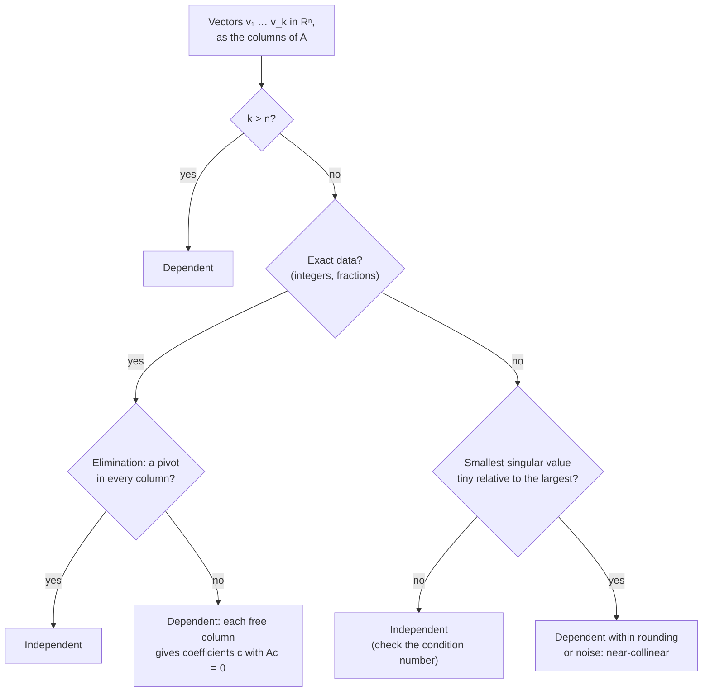

---
aliases:
  - Linearly Independent
  - Linear Dependence
  - Linearly Dependent
  - Collinear Vectors
  - Indépendance linéaire
tags:
  - type/concept
  - domain/mathematics
  - domain/statistics
  - level/L2
  - level/L3
mastery: 0
prerequisites:
  - "[[Vector]]"
  - "[[Vector Space]]"
  - "[[System of Linear Equations]]"
  - "[[Gaussian Elimination]]"
related:
  - "[[Basis and Dimension]]"
  - "[[Matrix Rank]]"
  - "[[Inverse Matrix]]"
  - "[[Determinant]]"
  - "[[Fundamental Theorem of Linear Algebra]]"
  - "[[Design Matrix]]"
  - "[[Dummy Variable]]"
  - "[[Multicollinearity]]"
  - "[[Confounding]]"
  - "[[Batch Effect]]"
  - "[[Parameter Identifiability]]"
  - "[[Singular Value Decomposition]]"
projects: []
sources:
  - "[[Introduction to Linear Algebra (Strang)]]"
  - "[[MIT 18.06SC - Linear Algebra]]"
  - "[[Linear Algebra Done Right (Axler)]]"
  - "[[An Introduction to Statistical Learning (James)]]"
  - "[[Leek 2010 - Tackling the Widespread and Critical Impact of Batch Effects]]"
---

# Linear Independence

> [!abstract]
> Vectors are linearly independent when none of them is a combination of the others, so the only way to combine them into zero is with all coefficients zero. When the columns of a design matrix are dependent, the data cannot tell some effects apart.

## Definition

A list $v_1, \dots, v_k$ of vectors is **linearly independent** if
$$c_1 v_1 + c_2 v_2 + \dots + c_k v_k = 0 \implies c_1 = c_2 = \dots = c_k = 0,$$
and **linearly dependent** otherwise, that is, when some combination with coefficients not all zero gives the zero vector.[^axler][^strang] Equivalently: no $v_j$ is a combination of the others; with the vectors as the columns of $A = [\,v_1 \cdots v_k\,]$, the only solution of $Ac = 0$ is $c = 0$, and elimination finds a pivot in every column.[^strang][^1806]

## Why it matters

- **Identifiability.** In a linear model $y = X\beta + \varepsilon$, dependent columns give a $c \ne 0$ with $Xc = 0$, so $\beta$ and $\beta + tc$ produce exactly the same fitted values for every $t$: no amount of data can choose between them ([[Parameter Identifiability]], [[Design Matrix]]). The classic genomic case is a batch fully confounded with the condition: when all treated samples were processed in one batch and all controls in another, the batch and treatment columns coincide and the two effects cannot be separated by any analysis. Design prevents it: process every condition in every batch.[^leek] ([[Batch Effect]], [[Confounding]], Worked example)
- **Built-in dependencies.** One indicator column per level of a factor plus an intercept is dependent, since the indicators add up to the intercept column; this is why regression codes a factor with one indicator fewer than its number of levels, against a baseline level ([[Dummy Variable]]).[^isl] Proportions that sum to 1 (base composition, cell-type fractions) do the same next to an intercept (Exercise 5).
- **Near-dependence.** Columns that are almost dependent, such as genotypes at two SNPs in strong linkage disequilibrium, keep the model identifiable but make individual coefficients unstable ([[Multicollinearity]], Advanced).[^isl]
- **Counting information.** The number of independent columns of a matrix is its [[Matrix Rank]]; independence is what makes coordinates in a basis unique ([[Basis and Dimension]]).

## Core (L2)

### Pictures

- **Two vectors** are dependent if and only if one is a multiple of the other: they lie on one line through the origin (collinear).
- **Three vectors of $\mathbb{R}^3$** are dependent if and only if they lie in one plane through the origin.[^strang]
- A list containing $0$ is dependent ($1 \cdot 0 = 0$). **More than $n$ vectors of $\mathbb{R}^n$ are always dependent**: $Ac = 0$ then has more unknowns than equations, so elimination leaves a free variable ([[Gaussian Elimination]]).[^strang]

### Testing for independence

1. **Elimination, for exact data.** Put the vectors in the columns of $A$ and reduce. A pivot in every column means independent; each free column gives a dependency, read off the reduced form.[^strang]
2. **Square case.** $n$ vectors of $\mathbb{R}^n$ are independent if and only if $A$ is invertible, if and only if $\det A \ne 0$ ([[Inverse Matrix]], [[Determinant]]).
3. **Gram matrix.** The columns of $A$ are independent if and only if $A^\top A$ is invertible: $A^\top A c = 0$ gives $\lVert Ac \rVert^2 = c^\top A^\top A c = 0$, so $Ac = 0$ ([[Symmetric Matrix]]). This is exactly when the normal equations of regression have one solution.
4. **Floating point.** Exact zero tests mean nothing on measured or rounded data. Look at the singular values of $A$ instead: one that is tiny compared with the largest signals near-dependence, and `np.linalg.matrix_rank` counts those above a tolerance ([[Singular Value Decomposition]]).



**Reading a dependency.** For $v_1 = (1, 0, 1)$, $v_2 = (0, 1, 1)$, $v_3 = (1, 1, 2)$, elimination leaves column 3 free, and the reduced form gives $-v_1 - v_2 + v_3 = 0$, i.e. $v_3 = v_1 + v_2$. Change $v_3$ to $(1, 1, 3)$ and every column gets a pivot (code below). No two of the original vectors are parallel, yet the three are dependent.

### Removing a dependent vector

**Linear dependence lemma.** If $v_1, \dots, v_k$ is dependent, some $v_j$ lies in the span of $v_1, \dots, v_{j-1}$, and removing it does not change the span.[^axler] Repeating this extracts an independent list with the same span, a basis of it ([[Basis and Dimension]]). In a model, dropping a dependent column (one confounded factor, or one level of a factor) keeps the same fitted values and changes the meaning of the remaining coefficients.

## Advanced (L3)

### Near-dependence: multicollinearity

Exact dependence makes coefficients undefined; near-dependence makes them unstable. Two invented SNPs that differ in 3 of 100 genotypes, only the first one acting on the trait:

```python
import numpy as np

rng = np.random.default_rng(42)
n = 100
g1 = rng.integers(0, 3, n).astype(float)        # invented genotypes (0/1/2) at SNP 1
g2 = g1.copy()
idx = rng.choice(n, 3, replace=False)
g2[idx] = (g2[idx] + 1) % 3                      # SNP 2 differs in 3 of 100 people
Xs = np.column_stack([np.ones(n), g1, g2])
for rep in range(4):
    y = 1.0 + 0.5 * g1 + rng.normal(0, 1, n)     # only SNP 1 acts (invented model)
    b = np.linalg.lstsq(Xs, y, rcond=None)[0]
    print(b.round(2), round(b[1] + b[2], 2))

Z = Xs[:, [0, 2]]                                # regress g1 on the other columns
resid = g1 - Z @ np.linalg.lstsq(Z, g1, rcond=None)[0]
r2 = 1 - resid @ resid / np.sum((g1 - g1.mean()) ** 2)
print(round(np.corrcoef(g1, g2)[0, 1], 3), round(1 / (1 - r2), 1), round(np.linalg.cond(Xs), 1))
```

```text
[0.88 0.15 0.35] 0.5
[1.   0.33 0.13] 0.46
[ 1.08  0.94 -0.45] 0.49
[ 0.87  0.74 -0.15] 0.59
0.955 11.3 12.4
```

Across four noise draws the SNP coefficients swing from $-0.45$ to $0.94$ while their sum stays near the true $0.5$: the data pin down the effect along the shared direction, not how it splits between two nearly identical columns. The **variance inflation factor** $\mathrm{VIF}_j = 1/(1 - R_j^2)$, where $R_j^2$ comes from regressing predictor $j$ on the others, is $11.3$ here, above the usual warning range of 5 to 10.[^isl] Real genotypes in strong linkage disequilibrium behave like this ([[Multicollinearity]]).

### What can still be estimated

If $Xc = 0$, the fitted values do not change along $c$. A combination $a^\top \beta$ takes the same value for all equally good $\beta$ exactly when $a^\top c = 0$ for every $c$ in $N(X)$, that is, when $a$ lies in the row space of $X$ ([[Fundamental Theorem of Linear Algebra]]). In the confounded design of the worked example, $N(X)$ is spanned by $c = (0, -1, 1)$: the sum "treatment effect + batch effect", $a = (0, 1, 1)$, is estimable; the treatment effect alone, $a = (0, 1, 0)$, is not ([[Linear Contrast]]).

### Independence of functions, dependence of samples

The functions $1$, $x$, $x^2$ are independent: a nonzero polynomial of degree at most 2 has at most two roots, so it cannot vanish at every $x$. Sampled at only two distinct concentrations, however, the design columns $(1)$, $(x_i)$, $(x_i^2)$ become dependent, because a quadratic can vanish at two points. A quadratic standard curve cannot be fitted from two dilution levels, whatever the number of replicates; a polynomial of degree $d$ needs at least $d + 1$ distinct $x$ values (Exercise 6).

### Linear versus statistical independence

Linear independence is a yes-or-no property of fixed vectors; statistical independence is a property of random variables ([[Correlation]]). Correlated predictors are usually linearly independent (the two SNP columns above, correlation 0.955); only an exact linear relation makes columns dependent. Conversely, nonzero orthogonal vectors are always linearly independent (Exercise 4), and for centered data vectors, orthogonal means uncorrelated.

## Mathematical representation

For $A = [\,v_1 \cdots v_k\,] \in \mathbb{R}^{n \times k}$:
$$v_1, \dots, v_k \text{ independent} \iff N(A) = \{0\} \iff \operatorname{rank} A = k \iff A^\top A \text{ invertible},$$
and, when $k = n$, $\iff \det A \ne 0$. If $k > n$ the list is dependent.[^strang]

- **Non-identifiability**: $X\beta = X\beta' \iff \beta - \beta' \in N(X)$; the least-squares solutions form $\hat\beta + N(X)$.
- **Estimability**: $a^\top\beta$ is constant on $\hat\beta + N(X)$ $\iff a \perp N(X) \iff a \in C(X^\top)$.
- **Variance inflation**: $\mathrm{VIF}_j = \dfrac{1}{1 - R_j^2}$.[^isl]

## Computational representation

Exact elimination returns the dependencies themselves, not just a verdict.

```python
from fractions import Fraction

def rref(M):
    """Reduced row echelon form in exact arithmetic; returns (R, pivot columns)."""
    R = [[Fraction(a) for a in row] for row in M]
    m, n = len(R), len(R[0])
    pivots, r = [], 0
    for c in range(n):
        p = next((i for i in range(r, m) if R[i][c] != 0), None)
        if p is None:
            continue                                   # no pivot: free column
        R[r], R[p] = R[p], R[r]
        R[r] = [a / R[r][c] for a in R[r]]
        for i in range(m):
            if i != r and R[i][c] != 0:
                f = R[i][c]
                R[i] = [a - f * b for a, b in zip(R[i], R[r])]
        pivots.append(c)
        r += 1
        if r == m:
            break
    return R, pivots

def dependencies(vectors):
    """[] if the vectors are independent; otherwise one c per free column with sum c_j v_j = 0."""
    A = [list(col) for col in zip(*vectors)]           # the vectors become columns
    R, pivots = rref(A)
    deps = []
    for f in (j for j in range(len(vectors)) if j not in pivots):
        c = [Fraction(0)] * len(vectors)
        c[f] = Fraction(1)
        for i, p in enumerate(pivots):
            c[p] = -R[i][f]
        deps.append([str(x) for x in c])
    return deps

print(dependencies([(1, 0, 1), (0, 1, 1), (1, 1, 2)]))
print(dependencies([(1, 0, 1), (0, 1, 1), (1, 1, 3)]))

# Design matrices of 4 invented samples: columns intercept, treated, batch 2
confounded = [(1, 1, 1, 1), (0, 0, 1, 1), (0, 0, 1, 1)]   # batch 2 = the treated samples
balanced = [(1, 1, 1, 1), (0, 0, 1, 1), (0, 1, 0, 1)]     # one control and one treated per batch
print(dependencies(confounded), dependencies(balanced))

import numpy as np

X = np.array(confounded, dtype=float).T                    # 4 samples x 3 columns
for t in (0, 5):
    beta = np.array([2.0, 1.0 + t, 3.0 - t])               # beta + t * (0, 1, -1)
    print(t, X @ beta)
print(np.linalg.matrix_rank(X), np.linalg.svd(X, compute_uv=False).round(3))
```

```text
[['-1', '-1', '1']]
[]
[['0', '-1', '1']] []
0 [2. 2. 6. 6.]
5 [2. 2. 6. 6.]
2 [2.613 1.082 0.   ]
```

For the confounded design, the dependency $(0, -1, 1)$ says "treated minus batch 2 is zero"; two different coefficient vectors give identical fitted values; the rank is 2 for 3 columns and the third singular value is 0. The balanced design has none of this.

## Worked example

> [!example] A confounded and a balanced design (invented samples)
> Four samples: two controls, two treated. Columns of $X$: intercept, treated (0/1), batch 2 (0/1).
>
> | Sample | Condition | Batch (confounded) | Batch (balanced) |
> |---|---|---|---|
> | s1 | control | 1 | 1 |
> | s2 | control | 1 | 2 |
> | s3 | treated | 2 | 1 |
> | s4 | treated | 2 | 2 |
>
> 1. **Confounded design.** The treated column $(0, 0, 1, 1)$ equals the batch-2 column: $0 \cdot \text{intercept} - 1 \cdot \text{treated} + 1 \cdot \text{batch} = 0$, so $c = (0, -1, 1)$ and the columns are dependent.
> 2. **Same fit, different stories.** $\beta = (2, 1, 3)$ (treatment effect 1, batch effect 3) and $\beta = (2, 6, -2)$ (treatment effect 6, batch effect $-2$) both give fitted values $(2, 2, 6, 6)$. Only their sum, $\beta_1 + \beta_2 = 4$, is determined by the data.
> 3. **Consequence.** $X^\top X$ is singular ([[Inverse Matrix#Exercises]]), and any treatment estimate a program reports is an arbitrary choice among infinitely many.
> 4. **Balanced design.** Each batch holds one control and one treated sample: batch 2 is $(0, 1, 0, 1)$. Elimination finds three pivots, the columns are independent, and treatment and batch effects are both estimable. The difference was decided at the bench, before any data existed.[^leek]

## Common misconceptions

> [!warning] "If no two vectors are parallel, the list is independent"
> $(1, 0, 1)$, $(0, 1, 1)$, $(1, 1, 2)$ contains no parallel pair, yet the third is the sum of the first two. Designs fail the same way: an intercept with one indicator per level contains no duplicate column and is still dependent.

> [!warning] "Correlated predictors are linearly dependent"
> Only an exact linear relation makes columns dependent. Strong correlation is near-dependence: estimates exist but are unstable (Advanced), which calls for a different remedy than an exactly confounded design.

> [!warning] "If the software returns coefficients, the model is identifiable"
> Numerical routines can return numbers for a rank-deficient design. Check the rank, or the singular values, of $X$ before interpreting any coefficient.

> [!warning] "An exact test works on floating-point data"
> Base frequencies stored as floats do not sum exactly to 1, so exact elimination calls the columns independent while a tolerance-based rank sees the dependency (Exercise 5).

## Exercises

> [!question] Exercise 1 (L2)
> Are $(1, 2, 3)$, $(4, 5, 6)$, $(7, 8, 9)$ independent? If not, give a dependency.

> [!success]- Solution
> No: $(1, 2, 3) - 2\,(4, 5, 6) + (7, 8, 9) = (0, 0, 0)$. Elimination leaves the third column free; with the code above, `dependencies([(1, 2, 3), (4, 5, 6), (7, 8, 9)])` returns `[['1', '-2', '1']]`. The three vectors lie in one plane through the origin.

> [!question] Exercise 2 (L2)
> For which values of $t$ are $(1, t)$ and $(t, 4)$ dependent?

> [!success]- Solution
> Two vectors of $\mathbb{R}^2$ are dependent exactly when the determinant of the matrix they form vanishes: $1 \cdot 4 - t \cdot t = 0$, so $t = 2$ or $t = -2$. Check: $(2, 4) = 2\,(1, 2)$ and $(-2, 4) = -2\,(1, -2)$.

> [!question] Exercise 3 (L2, Python)
> Six samples come from three tissues (liver, liver, brain, brain, heart, heart). Build the columns intercept, liver, brain, heart (0/1 indicators). Are they independent? How does choosing liver as the reference level fix the design?

> [!success]- Solution
> ```python
> tissue = ["liver", "liver", "brain", "brain", "heart", "heart"]
> cols = [tuple(1 for _ in tissue)] + [tuple(int(t == lev) for t in tissue) for lev in ("liver", "brain", "heart")]
> print(dependencies(cols), dependencies(cols[:1] + cols[2:]))
> # [['-1', '1', '1', '1']] []
> ```
> The indicators add up to the intercept: $-\text{intercept} + \text{liver} + \text{brain} + \text{heart} = 0$. Dropping the liver column leaves three independent columns; the brain and heart coefficients then measure differences from liver, the baseline.[^isl]

> [!question] Exercise 4 (L3)
> Prove that nonzero, mutually orthogonal vectors $v_1, \dots, v_k$ are linearly independent.

> [!success]- Solution
> Take the dot product of $\sum_i c_i v_i = 0$ with $v_j$: every term with $i \ne j$ vanishes, leaving $c_j\, v_j \cdot v_j = c_j \lVert v_j \rVert^2 = 0$. Since $v_j \ne 0$, $c_j = 0$, for every $j$.

> [!question] Exercise 5 (L3, Python)
> A model explains promoter activity by the base composition of five invented promoters: columns intercept, $f_A$, $f_C$, $f_G$, $f_T$. Find the dependency with exact fractions, check that intercept plus GC content is fine, and compare with the same columns stored as floats.

> [!success]- Solution
> ```python
> seqs = ["ATGCGCGTAT", "GGGCGCATAA", "ATATATCGCG", "CCGGAATTCA", "TTTTACGAGC"]   # invented promoters
> freq = [[Fraction(s.count(b), len(s)) for b in "ACGT"] for s in seqs]      # exact fractions
> design = [tuple([1] * len(seqs))] + [tuple(f[j] for f in freq) for j in range(4)]
> print(dependencies(design))
> gc = tuple(f[1] + f[2] for f in freq)
> print(dependencies([design[0], gc]))
> as_float = [tuple(float(v) for v in col) for col in design]
> print(dependencies(as_float), np.linalg.matrix_rank(np.array(as_float).T))
> # [['-1', '1', '1', '1', '1']]
> # []
> # [] 4
> ```
> The four frequencies sum to the intercept. As floats they no longer sum exactly to 1, so exact elimination finds no dependency, while `matrix_rank`, which uses a tolerance, reports rank 4 for 5 columns. Keep at most three of the four frequencies (or a summary such as GC content) next to an intercept.

> [!question] Exercise 6 (L3, Python)
> A qPCR standard curve is to be fitted as a quadratic in concentration. Compare the rank of the design $(1, x_i, x_i^2)$ for triplicates at two concentrations (1 and 10) and for duplicates at three (1, 10, 100).

> [!success]- Solution
> ```python
> conc = [1, 1, 1, 10, 10, 10]                    # invented: two dilution levels, triplicates
> V = np.array([[1, c, c ** 2] for c in conc], dtype=float)
> V3 = np.array([[1, c, c ** 2] for c in [1, 1, 10, 10, 100, 100]], dtype=float)
> print(np.linalg.matrix_rank(V), np.linalg.matrix_rank(V3))
> # 2 3
> ```
> With two distinct concentrations, the rows take only two distinct values, so the rank is at most 2 for 3 columns: a polynomial vanishing at 1 and 10, $(x - 1)(x - 10) = x^2 - 11x + 10$, gives the dependency $c = (10, -11, 1)$. Replicates add rows, never new distinct points; three distinct concentrations restore full rank ([[Linear Regression]]).

## Mastery checklist

- [ ] 1 Recognized: I can state the definition of linear independence and recognize collinear or coplanar vectors.
- [ ] 2 Understood: I can explain the equivalent conditions (null space, rank, pivots, $A^\top A$, determinant) and why dependent design columns make a model non-identifiable.
- [ ] 3 Practiced: I can test independence by exact elimination and by singular values, and extract the dependency coefficients in code.
- [ ] 4 Applied: I checked the rank of a real differential-expression design (batch, condition, covariates), found any confounding, and computed variance inflation factors for correlated predictors.
- [ ] 5 Explained: I can explain the difference between exact dependence, near-dependence and statistical correlation, which combinations stay estimable, and why balanced designs are decided at the bench.

## References

[^strang]: [[Introduction to Linear Algebra (Strang)]], 6th ed. (2023).
[^1806]: [[MIT 18.06SC - Linear Algebra]], Unit I "Ax = b and the Four Subspaces".
[^axler]: [[Linear Algebra Done Right (Axler)]], 4th ed. (2024), treatment of linear independence and the linear dependence lemma.
[^isl]: [[An Introduction to Statistical Learning (James)]], Python edition (2023), linear regression (qualitative predictors and dummy variables; collinearity and the variance inflation factor).
[^leek]: [[Leek 2010 - Tackling the Widespread and Critical Impact of Batch Effects]], *Nature Reviews Genetics* 11:733-739.
