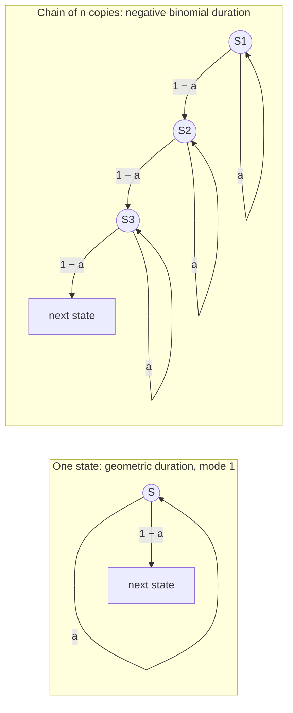

---
aliases:
  - Geom(p)
  - Geometric Law
  - First Success Distribution
  - Waiting Time to First Success
  - Loi géométrique
tags:
  - type/concept
  - domain/statistics
  - domain/mathematics
  - domain/bioinformatics
  - level/L2
  - level/L3
mastery: 0
prerequisites:
  - "[[Bernoulli Distribution]]"
  - "[[Independence (Probability)]]"
  - "[[Expected Value]]"
  - "[[Variance]]"
  - "[[Infinite Series]]"
related:
  - "[[Negative Binomial Distribution]]"
  - "[[Exponential Distribution]]"
  - "[[Bernoulli Process]]"
  - "[[Hidden Markov Model]]"
  - "[[Pair Hidden Markov Model]]"
  - "[[Gap Penalty]]"
  - "[[CpG Island]]"
  - "[[Open Reading Frame]]"
  - "[[Extreme Value Distribution]]"
projects:
  - "[[02-sequence-translation]]"
sources:
  - "[[Introduction to Probability (Blitzstein)]]"
  - "[[Introductory Statistics (OpenStax)]]"
  - "[[MIT 6.041SC - Probabilistic Systems Analysis and Applied Probability]]"
  - "[[Biological Sequence Analysis (Durbin)]]"
---

# Geometric Distribution

> [!abstract]
> The geometric distribution is the number of independent trials needed to get the first success: how many codons until a stop codon, how long a run of identical bases lasts, how many positions a hidden Markov model stays in the same state before leaving it.

## Definition

Repeat independent [[Bernoulli Distribution|Bernoulli]] trials with success probability $p \in (0, 1]$. The number $X$ of trials up to and including the first success has the **geometric distribution**, $X \sim \mathrm{Geom}(p)$:

$$P(X = k) = (1-p)^{k-1}\,p, \qquad k = 1, 2, 3, \dots$$

with tail $P(X > k) = (1-p)^k$, mean $E[X] = 1/p$ and variance $\operatorname{Var}(X) = (1-p)/p^2$.[^openstax][^blitz] Some texts count the **failures before** the first success, $Y = X - 1$ on $\{0, 1, 2, \dots\}$, with mean $(1-p)/p$; Blitzstein and Hwang call $Y$ geometric and $X$ "First Success".[^blitz]

## Why it matters

- **Waiting for a signal along a sequence.** In random sequence each codon is a stop with probability $3/64$, so the number of codons read until the first stop is $\mathrm{Geom}(3/64)$: the null model behind minimum ORF lengths ([[Genetic Code#Mathematical representation]], [[Open Reading Frame]], [[02-sequence-translation]]).
- **Run lengths.** A homopolymer run, or a run of matches between two sequences, ends at the first "different" position: run lengths are geometric, and the longest run in a long sequence grows only like the logarithm of its length (Advanced (L3)).
- **Hidden Markov models.** A state with self-transition probability $a$ is occupied for a $\mathrm{Geom}(1-a)$ number of positions: an HMM imposes geometric lengths on CpG islands, genes or gaps unless it is built to avoid them ([[Hidden Markov Model]]).[^durbin3]
- **Retry loops.** The number of proposals a rejection sampler makes until one is accepted is geometric, with mean 1/(acceptance probability), which sets its cost ([[Random Variate Generation]]).

## Core (L2)

### Waiting for the first success

$X = k$ means $k - 1$ failures followed by a success; by independence, $P(X = k) = (1-p)^{k-1}p$. Likewise $X > k$ means the first $k$ trials all fail, so $P(X > k) = (1-p)^k$, and summing tails gives the mean ([[Expected Value#Tail sums and waiting times]]):

$$E[X] = \sum_{k \ge 0} P(X > k) = \sum_{k \ge 0} (1-p)^k = \frac{1}{p}.$$

A sequence of such trials is a [[Bernoulli Process]]; the gaps between its successes are independent geometric variables.[^6041] The PMF **always decreases**: its mode is 1 whatever $p$. A waiting time with mean 1,000 is still most likely to be 1, its median $\lceil \ln 0.5 / \ln(1-p) \rceil \approx 0.69/p$ lies below the mean, and its standard deviation $\sqrt{1-p}/p$ is nearly as large as the mean when $p$ is small.

| Waiting for | $p$ | Mean $1/p$ | Median | $P(X > \text{mean})$ |
|---|---:|---:|---:|---:|
| a head with a fair coin | 1/2 | 2 | 1 | 0.25 |
| the first stop codon in random sequence | 3/64 | 21.3 | 15 | 0.365 |
| the exit from an HMM state with $a = 0.999$ | 0.001 | 1,000 | 693 | 0.368 |

(For the stop codon, $P(X > 21)$.) When $p$ is small, about $e^{-1} \approx 37$ % of the waits exceed the mean.

### Memorylessness

For all $m, n \ge 0$,

$$P(X > m + n \mid X > m) = \frac{(1-p)^{m+n}}{(1-p)^m} = P(X > n).$$

Having waited $m$ trials in vain changes nothing about the wait still to come. The geometric is the only distribution on $\{1, 2, \dots\}$ with this property (proof in Mathematical representation);[^blitz] its continuous counterpart is the [[Exponential Distribution]], which it approaches when each trial is a short time step.

### Runs in a sequence

In a sequence of independent bases where base $b$ has probability $\pi_b$, a run of $b$ continues at each next position with probability $\pi_b$ and stops at the first other base. Its length is therefore $\mathrm{Geom}(1 - \pi_b)$, with mean $1/(1 - \pi_b)$: $4/3$ for uniform bases. The simulation in Computational representation finds 187,677 runs of A in 1 Mb of random sequence (expected $10^6 \times \tfrac14 \times \tfrac34 = 187{,}500$), with lengths matching $\mathrm{Geom}(3/4)$ to the third decimal.

## Advanced (L3)

### State durations in hidden Markov models



An HMM state with self-transition probability $a$ is left at each position with probability $1 - a$, whatever the time already spent in it: the Markov property is memorylessness. Its duration $d$ is $\mathrm{Geom}(1 - a)$, $P(d) = a^{d-1}(1 - a)$, mean $1/(1-a)$.[^durbin3] Setting $a = 0.999$ for a [[CpG Island]] state encodes a mean island length of 1,000 bp, but also a mode of 1 bp and a 10 % chance of islands shorter than 100 bp (Worked example). A single self-looping state cannot represent features with a typical length. A chain of $n$ copies of the state, each with self-transition $a$, makes the duration a sum of $n$ geometric variables, a [[Negative Binomial Distribution|negative binomial]] whose mode moves away from the minimum (Exercise 4).[^durbin3]

### Gaps: geometric lengths are affine penalties

In a [[Pair Hidden Markov Model]] a gap opens with probability $\delta$ and extends with probability $\varepsilon$, so (ignoring the end state) a gap of length $k$ has probability $\delta\,\varepsilon^{k-1}(1 - \varepsilon)$: geometric lengths. Its logarithm, $\log \delta + \log(1 - \varepsilon) + (k-1)\log\varepsilon$, is linear in $k$: the probabilistic counterpart of an **affine gap penalty**, an opening cost plus a cost per extra position ([[Gap Penalty]]).[^durbin4] Exercise 5 converts $\delta$ and $\varepsilon$ into penalties in bits.

### The longest run

A run of base $b$ of length at least $\ell$ starts at a given position when the previous base is not $b$ and the next $\ell$ bases are: probability $(1 - \pi_b)\pi_b^{\ell}$. In a sequence of length $n$ the expected number of such runs is about $n(1-\pi_b)\pi_b^{\ell}$, which falls to 1 at

$$\ell^* = \log_{1/\pi_b}\big(n(1 - \pi_b)\big).$$

For $n = 10^6$ uniform bases, $\ell^* = \log_4(750{,}000) = 9.8$: a run of 10 A's is expected about once per megabase by chance. Long runs are rare and nearly independent, so their number is approximately Poisson ([[Poisson Distribution]]) and $P(\text{longest} \ge \ell) \approx 1 - \exp\!\big(-n(1-\pi_b)\pi_b^{\ell}\big)$ (Exercise 3). The longest run grows like $\log n$ and its fluctuations do not shrink with $n$: the same logic as the significance of the best alignment score between random sequences ([[Extreme Value Distribution]], [[E-Value]]).

## Mathematical representation

- **Normalization** (geometric series, [[Infinite Series]]): $\sum_{k \ge 1}(1-p)^{k-1}p = \dfrac{p}{1 - (1-p)} = 1$.
- **First-step analysis.** Condition on the first trial: with probability $p$ it succeeds ($X = 1$); otherwise the process restarts and $X = 1 + X'$ with $X'$ an independent copy. Hence $E[X] = p + (1-p)(1 + E[X])$, so $E[X] = 1/p$; and $E[X^2] = p + (1-p)E[(1 + X)^2]$ gives $E[X^2] = (2-p)/p^2$, so $\operatorname{Var}(X) = (1-p)/p^2$.
- **Generating function.** $G_X(s) = E[s^X] = \dfrac{ps}{1 - (1-p)s}$ for $|s| < 1/(1-p)$. A sum of $r$ independent copies has generating function $G_X(s)^r$: the [[Negative Binomial Distribution]], counted in trials.
- **The only memoryless law.** Let $X \in \{1, 2, \dots\}$ with $G(k) = P(X > k)$ satisfy $P(X > m + n \mid X > m) = P(X > n)$, that is $G(m + n) = G(m)G(n)$. With $G(0) = 1$, induction gives $G(k) = G(1)^k$; writing $G(1) = 1 - p$ gives $P(X = k) = G(k-1) - G(k) = (1-p)^{k-1}p$.
- **Maximum likelihood.** From observed durations $d_1, \dots, d_m$, $L(a) = \prod_i a^{d_i - 1}(1 - a)$ is maximized at $\hat a = \sum_i (d_i - 1) / \sum_i d_i = 1 - 1/\bar d$: the fraction of self-transitions among all transitions out of the state, which is how HMM transition probabilities are estimated from labelled sequences ([[Maximum Likelihood Estimation]]).[^durbin3]
- **Continuous limit.** If each trial lasts $\Delta$ and succeeds with probability $\lambda\Delta$, the waiting time $T = X\Delta$ satisfies $P(T > t) = (1 - \lambda\Delta)^{\lfloor t/\Delta \rfloor} \to e^{-\lambda t}$ as $\Delta \to 0$: the [[Exponential Distribution]] ([[Limit]]).

## Computational representation

Sampling by inversion uses $X = \lceil \ln U / \ln(1-p) \rceil$ with $U$ uniform on $(0, 1]$: $X > k \iff U < (1-p)^k$, which has probability $(1-p)^k$ ([[Cumulative Distribution Function#Inverse transform sampling]]).

```python
import math
import random
from collections import Counter
from itertools import groupby


def geom_pmf(k: int, p: float) -> float:
    """P(X = k) for X ~ Geom(p): trials up to and including the first success (k >= 1)."""
    return (1 - p) ** (k - 1) * p if k >= 1 else 0.0


def geom_sf(k: int, p: float) -> float:
    """P(X > k) = (1 - p)^k: the first k trials all fail."""
    return (1 - p) ** max(k, 0)


def geom_sample(p: float, rng: random.Random) -> int:
    """Inversion: X = ceil(ln U / ln(1 - p)), with U uniform on (0, 1]."""
    u = 1.0 - rng.random()                       # in (0, 1]: avoids log(0)
    return max(1, math.ceil(math.log(u) / math.log1p(-p)))


def run_lengths(seq: str, base: str) -> list[int]:
    """Lengths of the maximal runs of `base` in seq (AAA is one run of length 3)."""
    return [len(list(group)) for b, group in groupby(seq) if b == base]


rng = random.Random(5)
p = 0.25
draws = [geom_sample(p, rng) for _ in range(200_000)]
m = sum(draws) / len(draws)
v = sum((x - m) ** 2 for x in draws) / (len(draws) - 1)
print(f"mean {m:.3f} (1/p = {1 / p:g}), variance {v:.2f} ((1-p)/p^2 = {(1 - p) / p**2:g})")

seq = "".join(rng.choices("ACGT", k=1_000_000))   # invented i.i.d. uniform sequence
runs = Counter(run_lengths(seq, "A"))
total = sum(runs.values())
print("runs of A:", total, "| longest:", max(runs))
for k in (1, 2, 3, 4, 6):
    print(k, f"{runs[k] / total:.4f}", f"{geom_pmf(k, 0.75):.4f}")

from scipy import stats
print("SciPy geom(0.1): mean", stats.geom(0.1).mean(), "| P(X = 0) =", stats.geom(0.1).pmf(0),
      "| P(X = 1) =", stats.geom(0.1).pmf(1))
```

```text
mean 4.002 (1/p = 4), variance 12.08 ((1-p)/p^2 = 12)
runs of A: 187677 | longest: 10
1 0.7492 0.7500
2 0.1887 0.1875
3 0.0469 0.0469
4 0.0114 0.0117
6 0.0007 0.0007
SciPy geom(0.1): mean 10.0 | P(X = 0) = 0.0 | P(X = 1) = 0.1
```

The observed run-length frequencies (middle column) match $\mathrm{Geom}(3/4)$ (right column). The last line shows that SciPy's `geom` counts trials, like $X$ here: mean $1/p$, no mass at 0.

## Worked example

> [!example] How long does an HMM think a CpG island is?
> An HMM labels each base as island or background; the island state keeps its label with probability $a = 0.999$ per base (illustrative value). Continuing the code above:
>
> ```python
> a = 0.999                                        # illustrative self-transition probability
> exit_p = 1 - a
> print("mean:", round(1 / exit_p), "| median:", math.ceil(math.log(0.5) / math.log(a)))
> print("P(d <= 100):", round(1 - geom_sf(100, exit_p), 4), "| P(d > 3000):", round(geom_sf(3000, exit_p), 4))
> lengths = [420, 1310, 760, 2050, 515, 980]       # invented annotated island lengths (bp)
> a_hat = 1 - len(lengths) / sum(lengths)          # self-transitions / all transitions out of the state
> print("a_hat:", round(a_hat, 6), "| fitted mean:", round(1 / (1 - a_hat), 1),
>       "| fitted P(d <= 100):", round(1 - geom_sf(100, 1 - a_hat), 4))
> ```
>
> ```text
> mean: 1000 | median: 693
> P(d <= 100): 0.0952 | P(d > 3000): 0.0497
> a_hat: 0.999006 | fitted mean: 1005.8 | fitted P(d <= 100): 0.0947
> ```
>
> 1. **Mean and median.** The model expects islands of 1,000 bp on average, but half of them shorter than 693 bp.
> 2. **Tails.** About 10 % of predicted islands are shorter than 100 bp and 5 % longer than 3 kb: one parameter fixes the whole length distribution.
> 3. **Estimation.** From six invented annotated islands (6,035 bp in total), $\hat a = 1 - 6/6035$ reproduces their mean length, 1,006 bp.
> 4. **Model check.** The fitted geometric still puts 9.5 % of its mass below 100 bp, where none of the observed islands lies. Matching the mean is not matching the shape: a typical length calls for a chain of states (Advanced (L3)).

## Common misconceptions

> [!warning] "The most likely waiting time is the mean"
> The geometric PMF decreases from $k = 1$: the most likely value is always 1, and the median ($\approx 0.69/p$ for small $p$) is below the mean $1/p$. An HMM with mean state duration 1,000 still predicts many very short segments.

> [!warning] "After a long wait, success is due"
> Independent trials have no memory: after 50 codons without a stop, the expected number of further codons to the first stop is still $64/3$. Only a model with dependence or a changing $p$ makes the past informative.

> [!warning] "Geom(p) means the same thing everywhere"
> One convention counts trials ($X \ge 1$, mean $1/p$), the other failures ($Y \ge 0$, mean $(1-p)/p$).[^blitz][^openstax] Check before using a formula: with $p = 0.1$, the two means are 10 and 9.

## Exercises

> [!question] Exercise 1 (L2)
> In a genome with 70 % GC and A = T, G = C (so $\pi_G = 0.35$), with independent bases, give the mean length of a run of G, the probability that a run of G has length at least 5, and the expected number of G runs of length at least 8 in 1 Mb. Compare with uniform composition.

> [!success]- Solution
> Run length $\mathrm{Geom}(1 - 0.35)$: mean $1/0.65 = 1.54$; $P(L \ge 5) = 0.35^4 = 0.015$. Runs of length $\ge 8$: $n(1 - \pi_G)\pi_G^8 = 10^6 \times 0.65 \times 0.35^8 \approx 146$, against $10^6 \times 0.75 \times 0.25^8 \approx 11$ with uniform bases. Composition changes run statistics by an order of magnitude, so a "long homopolymer" must be judged against the local composition.

> [!question] Exercise 2 (L2)
> Prove memorylessness from the tail formula, then say what it means for an HMM state with $a = 0.999$ that has already lasted 500 positions.

> [!success]- Solution
> $P(X > m + n \mid X > m) = (1-p)^{m+n}/(1-p)^m = (1-p)^n = P(X > n)$. After 500 positions the remaining duration is again $\mathrm{Geom}(0.001)$, with mean 1,000 more positions, exactly as at the start. The model cannot express "this island is already long, it should end soon".

> [!question] Exercise 3 (L3, Python)
> Continuing the code above, simulate 20 uniform random sequences of 1 Mb and record the longest run of A in each. Compare with $\ell^* = \log_4(0.75\,n)$ and with the Poisson approximation of $P(\text{longest} \ge \ell)$.

> [!success]- Solution
> ```python
> rng = random.Random(4)
> n = 1_000_000
> longest = sorted(max(run_lengths("".join(rng.choices("ACGT", k=n)), "A")) for _ in range(20))
> print(longest, "| mean", sum(longest) / len(longest))
> print("log4(0.75 n) =", round(math.log(0.75 * n, 4), 2))
> for ell in (9, 10, 12):
>     print(ell, round(1 - math.exp(-0.75 * n * 0.25 ** ell), 3))
> ```
>
> ```text
> [8, 8, 9, 9, 9, 9, 10, 10, 10, 10, 10, 10, 10, 11, 11, 11, 11, 11, 12, 13] | mean 10.1
> log4(0.75 n) = 9.76
> 9 0.943
> 10 0.511
> 12 0.044
> ```
>
> The longest runs cluster around 10. With $x = \ell - \ell^*$, the approximation reads $P(\text{longest} < \ell) \approx \exp(-4^{-x})$, a Gumbel law with scale $1/\ln 4$, whose mean $\ell^* + 0.577/\ln 4 \approx 10.2$ (ignoring discreteness) matches the simulated 10.1. Observed: 14 of 20 runs reach 10 (predicted 51 %) and 2 of 20 reach 12 (predicted 4 %), within the noise of 20 replicates. A run of 12 A's is unremarkable in a 1 Mb region, but in a 100 bp read its expected count is $100 \times 0.75 \times 4^{-12} = 4.5 \times 10^{-6}$: significance depends on the search space.

> [!question] Exercise 4 (L3)
> An HMM represents an island by a chain of two states, each with self-transition $a = 0.99$. Show that the duration $D$ satisfies $P(D = d) = (d-1)(1-a)^2a^{d-2}$ for $d \ge 2$; find its mean and mode, and compare $P(D \le 20)$ with a single state of the same mean.

> [!success]- Solution
> $D = X_1 + X_2$ with independent $X_i \sim \mathrm{Geom}(1-a)$. $D = d$ requires $X_1 = j$ and $X_2 = d - j$ for some $j \in \{1, \dots, d-1\}$, each with probability $a^{j-1}(1-a)\,a^{d-j-1}(1-a) = (1-a)^2 a^{d-2}$, and there are $d - 1$ such $j$. Mean $2/(1-a) = 200$. The ratio $P(D = d+1)/P(D = d) = da/(d-1)$ exceeds 1 while $d < 1/(1-a) = 100$, so the mode is 100 (tied with 101, as a direct computation confirms). Summing the PMF gives $P(D \le 20) = 0.017$, against $1 - (1 - 1/200)^{20} = 0.095$ for one state with mean 200: the chain removes most very short islands. $D - 2$ counts the self-transitions (failures) before the second exit (success): a [[Negative Binomial Distribution]].

> [!question] Exercise 5 (L3)
> In a pair HMM a gap opens with probability $\delta = 0.02$ and extends with probability $\varepsilon = 0.8$ (ignore the end state). Give the mean gap length and the equivalent affine penalties in bits, as $-\log_2$ of probabilities.

> [!success]- Solution
> The gap length is $\mathrm{Geom}(1 - \varepsilon)$, mean $1/(1 - 0.8) = 5$. Then $-\log_2 P(k) = -\log_2 \delta - \log_2(1 - \varepsilon) - (k-1)\log_2\varepsilon = 7.97 + 0.32\,(k-1)$ bits: an opening penalty of about 8 bits and an extension penalty of 0.32 bits per extra position. Extension is cheap because $\varepsilon$ is close to 1, that is because long gaps are expected.

## Mastery checklist

- [ ] 1 Recognized: I can write the geometric PMF and its mean $1/p$, and say which convention (trials or failures) a formula or a library uses.
- [ ] 2 Understood: I can explain memorylessness, why the mode is 1, and why run lengths and HMM state durations are geometric.
- [ ] 3 Practiced: I can sample by inversion, estimate a self-transition probability from durations, and compute longest-run probabilities in Python.
- [ ] 4 Applied: in [[02-sequence-translation]], I compare the ORF lengths of a real genome with the geometric null of random sequence.
- [ ] 5 Explained: I can teach how state chains, affine gap penalties and longest-run significance all derive from geometric waiting times.

## References

[^blitz]: [[Introduction to Probability (Blitzstein)]], 2nd ed., ch. 4 "Expectation" (geometric and first success distributions) and ch. 5 "Continuous Random Variables" (memorylessness).
[^openstax]: [[Introductory Statistics (OpenStax)]], 2nd ed., ch. 4 "Discrete Random Variables" (the geometric distribution).
[^6041]: [[MIT 6.041SC - Probabilistic Systems Analysis and Applied Probability]], the Bernoulli process (independent geometric interarrival times).
[^durbin3]: [[Biological Sequence Analysis (Durbin)]], ch. 3 "Markov chains and hidden Markov models" (estimating transition probabilities from counts; the geometric length distribution of a state and its modelling with chains of states).
[^durbin4]: [[Biological Sequence Analysis (Durbin)]], ch. 4 "Pairwise alignment using HMMs" (pair HMMs, geometric gap lengths and affine gap penalties).
