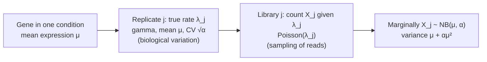

---
aliases:
  - NB
  - NB(r, p)
  - Gamma-Poisson Distribution
  - Pascal Distribution
  - Loi binomiale négative
tags:
  - type/concept
  - domain/statistics
  - domain/mathematics
  - domain/bioinformatics
  - level/L2
  - level/L3
  - level/M1
mastery: 0
prerequisites:
  - "[[Geometric Distribution]]"
  - "[[Poisson Distribution]]"
  - "[[Binomial Coefficient]]"
  - "[[Expected Value]]"
  - "[[Variance]]"
related:
  - "[[Gamma Distribution]]"
  - "[[Overdispersion]]"
  - "[[Mixture Model]]"
  - "[[Differential Expression Analysis]]"
  - "[[RNA Sequencing]]"
  - "[[Size Factor Estimation]]"
  - "[[Negative Binomial Regression]]"
  - "[[Generalized Linear Model]]"
  - "[[Empirical Bayes]]"
  - "[[Beta-Binomial Model]]"
  - "[[Hidden Markov Model]]"
projects: []
sources:
  - "[[Introduction to Probability (Blitzstein)]]"
  - "[[Modern Statistics for Modern Biology (Holmes)]]"
  - "[[Anders 2010 - Differential Expression Analysis for Sequence Count Data]]"
  - "[[Love 2014 - Moderated Estimation of Fold Change and Dispersion for RNA-Seq Data with DESeq2]]"
  - "[[Robinson 2010 - edgeR - A Bioconductor Package for Differential Expression Analysis of Digital Gene Expression Data]]"
  - "[[Biological Sequence Analysis (Durbin)]]"
---

# Negative Binomial Distribution

> [!abstract]
> The negative binomial counts the failures before the $r$-th success. Genomics uses it for another reason: it is what a Poisson count becomes when its rate varies from sample to sample, which makes it the standard model of RNA-seq read counts across biological replicates.

## Definition

**Waiting-time form.** In independent Bernoulli trials with success probability $p$, the number $X$ of failures before the $r$-th success ($r = 1, 2, \dots$) has the **negative binomial distribution**, $X \sim \mathrm{NB}(r, p)$:[^blitz4]

$$P(X = k) = \binom{k + r - 1}{k} p^r (1-p)^k, \qquad k = 0, 1, 2, \dots$$

with mean $r(1-p)/p$ and variance $r(1-p)/p^2$. For $r = 1$ it is the geometric distribution counted in failures ([[Geometric Distribution]]).

**Gamma-Poisson form.** If $X \mid \Lambda \sim \mathrm{Pois}(\Lambda)$ and $\Lambda$ follows a gamma distribution with shape $r$ and mean $\mu$, then $X$ is negative binomial with $p = r/(r + \mu)$, and $r$ may be any positive real.[^blitz][^holmes] Count models write it with the mean $\mu$ and the **dispersion** $\alpha = 1/r$:

$$E[X] = \mu, \qquad \operatorname{Var}(X) = \mu + \alpha\mu^2,$$

the form used by RNA-seq differential expression tools.[^holmes][^love]

## Why it matters

- **RNA-seq differential expression.** DESeq, DESeq2 and edgeR model the reads of each gene in each sample with a negative binomial and a dispersion per gene; DESeq2 fits a negative binomial GLM with size factors for library depth ([[Differential Expression Analysis]], [[RNA Sequencing]]).[^anders][^love][^robinson]
- **Overdispersion.** Resequencing one library adds Poisson noise, but biological replicates also differ in true expression. The term $\alpha\mu^2$ carries this extra variance; a Poisson test that ignores it reports far too many differences ([[Variance#The mean-variance relationship of count data]], [[Overdispersion]]).[^holmes]
- **State durations.** A chain of $n$ HMM states sharing one self-transition probability has a negative binomial duration, a way to model segment lengths that are not geometric ([[Geometric Distribution#State durations in hidden Markov models]], [[Hidden Markov Model]]).[^durbin3]

## Core (L2)

### Waiting for the $r$-th success

$X = k$ means that the first $k + r - 1$ trials contain exactly $r - 1$ successes and that trial $k + r$ is a success: $\binom{k+r-1}{r-1}p^{r-1}(1-p)^k \cdot p$, the PMF above. Equivalently, $X$ is a sum of $r$ independent geometric counts of failures, one per success, so its mean and variance are $r$ times $(1-p)/p$ and $(1-p)/p^2$. The waiting-time form has a binomial dual: the $r$-th success occurs within $n$ trials exactly when $n$ trials contain at least $r$ successes, $P(X + r \le n) = P(\mathrm{Bin}(n, p) \ge r)$ ([[Binomial Distribution]], Exercise 1).

### The gamma-Poisson story behind RNA-seq counts



Two noise sources stack. Biological replicates differ in their true expression $\lambda_j$; given $\lambda_j$, sequencing samples reads with Poisson noise ([[Poisson Distribution]]). Averaging the Poisson PMF over a gamma-distributed $\lambda$ gives exactly the negative binomial (integral in Mathematical representation), and the law of total variance gives $\operatorname{Var}(X) = \mu + \alpha\mu^2$ ([[Variance#Advanced (L3)]]).[^holmes] Since the gamma has variance $\alpha\mu^2$, $\sqrt\alpha$ is the coefficient of variation of the true expression between replicates: $\alpha = 0.1$ means that replicates differ by about 32 % in true expression, however deep the sequencing.

### Two parameterizations

| Parameters | Mean | Variance | Used by |
|---|---|---|---|
| $(r, p)$: number of successes, success probability | $r(1-p)/p$ | $r(1-p)/p^2$ | waiting times; `scipy.stats.nbinom(n=r, p=p)` |
| $(\mu, \alpha)$: mean, dispersion | $\mu$ | $\mu + \alpha\mu^2$ | count models (DESeq2, edgeR) |

Conversion: $r = 1/\alpha$ and $p = 1/(1 + \alpha\mu)$. The variance-to-mean ratio $1 + \alpha\mu$ grows with the mean: overdispersion is negligible for weakly expressed genes and dominates for highly expressed ones.

### Same mean, more zeros, longer tail

![[negative-binomial-poisson-same-mean.svg]]

With mean 10, a Poisson count is almost never 0 ($e^{-10} = 4.5 \times 10^{-5}$) or above 30; a negative binomial with $\alpha = 0.5$ gives $P(X = 0) = (1 + \alpha\mu)^{-1/\alpha} = 1/36 = 0.028$ and $P(X \ge 30) = 0.025$ (Computational representation). Zeros and large counts that look like outliers under a Poisson model are ordinary under a negative binomial. As $\alpha \to 0$ the negative binomial tends to the Poisson with the same mean (Mathematical representation): the Poisson is the special case without biological variation.

## Advanced (L3)

### Estimating the dispersion

For one gene with counts $x_1, \dots, x_m$ in replicates of equal depth, the log-likelihood is

$$\ell(\mu, \alpha) = \sum_{j=1}^{m}\Big[\ln\Gamma(x_j + r) - \ln\Gamma(r) - \ln x_j! + r\ln\frac{r}{r+\mu} + x_j\ln\frac{\mu}{r+\mu}\Big], \qquad r = \frac{1}{\alpha}.$$

Its maximum in $\mu$ is the sample mean whatever $\alpha$ (Mathematical representation); $\alpha$ is then maximized numerically ([[Maximum Likelihood Estimation]]). The method of moments, $\hat\alpha = (s^2 - \bar x)/\bar x^2$, is simpler ([[Method of Moments]], [[Variance#Estimating a variance from a few replicates]]). With 3 replicates any per-gene estimate is very noisy: for a true $\alpha = 0.1$, the method-of-moments estimate of simulated genes ranges from 0.007 to 0.22 between its 10th and 90th percentiles and is negative 5 % of the time (Exercise 3).

### The negative binomial GLM of DESeq2

DESeq2 models the count $K_{ij}$ of gene $i$ in sample $j$ as[^love]

$$K_{ij} \sim \mathrm{NB}(\mu_{ij}, \alpha_i), \qquad \mu_{ij} = s_j\, q_{ij}, \qquad \log_2 q_{ij} = \sum_r x_{jr}\,\beta_{ir}.$$

- $s_j$ is the **size factor** of sample $j$, its sequencing depth relative to the other samples, estimated by DESeq's median-of-ratios method ([[Size Factor Estimation]]).[^anders]
- $q_{ij}$ is proportional to the true concentration of the gene's fragments in sample $j$; $x_{jr}$ are the entries of the design matrix (condition, batch) and $\beta_{ir}$ the gene's coefficients, so the coefficient of a condition is a **log2 fold change**.
- $\alpha_i$ is the gene's dispersion; the coefficients are tested with Wald tests.[^love] The whole model is a [[Negative Binomial Regression]] with a log link, fitted gene by gene ([[Generalized Linear Model]]).

## Frontier (M1)

### Sharing information across genes

A dispersion estimated from 3 to 6 replicates is too noisy to trust, but an experiment measures thousands of genes whose dispersions are related. Each tool borrows strength across genes:

- **DESeq** models the variance as a smooth function of the mean, fitted by local regression across genes.[^anders]
- **edgeR** moderates the degree of overdispersion across transcripts with empirical Bayes methods, which keeps it usable with minimal replication.[^robinson]
- **DESeq2** shrinks the gene-wise estimates of both dispersion and log fold change, to make them stable and interpretable ([[Empirical Bayes]]).[^love]

Why fold changes need shrinkage shows in the variance of a log mean. By the delta method, the natural log of a mean of $m$ replicates has variance about $(1/\mu + \alpha)/m$, so a log fold change computed from low counts is much noisier than one from high counts (Exercise 4). Ranking genes by raw fold change therefore favours weakly expressed, noisy genes.

## Mathematical representation

- **PMF for real $r$.** $\binom{k+r-1}{k} = \dfrac{\Gamma(k + r)}{\Gamma(r)\,k!}$, so $P(X = k) = \dfrac{\Gamma(k+r)}{\Gamma(r)\,k!}\,p^r(1-p)^k$ is defined for any $r > 0$.
- **The gamma-Poisson integral.** Let $\Lambda$ have the gamma density $\frac{\beta^r}{\Gamma(r)}\lambda^{r-1}e^{-\beta\lambda}$ (shape $r$, rate $\beta$, mean $r/\beta$; [[Gamma Distribution]]). Using $\int_0^\infty \lambda^{k+r-1}e^{-(1+\beta)\lambda}\,d\lambda = \Gamma(k+r)/(1+\beta)^{k+r}$ ([[Improper Integral]]):

$$P(X = k) = \int_0^\infty \frac{e^{-\lambda}\lambda^k}{k!}\cdot\frac{\beta^r \lambda^{r-1} e^{-\beta\lambda}}{\Gamma(r)}\,d\lambda = \frac{\Gamma(k+r)}{\Gamma(r)\,k!}\Big(\frac{\beta}{1+\beta}\Big)^r\Big(\frac{1}{1+\beta}\Big)^k,$$

  which is $\mathrm{NB}(r, p)$ with $p = \beta/(1+\beta)$. With mean $\mu = r/\beta$, $p = r/(r + \mu) = 1/(1 + \alpha\mu)$.
- **Generating function and the Poisson limit.** $G_X(s) = \Big(\dfrac{p}{1 - (1-p)s}\Big)^r = \big(1 + \alpha\mu(1 - s)\big)^{-1/\alpha} \to e^{-\mu(1-s)}$ as $\alpha \to 0$, the generating function of $\mathrm{Pois}(\mu)$ ([[Limit]]). At $s = 0$, $P(X = 0) = (1 + \alpha\mu)^{-1/\alpha}$, which exceeds $e^{-\mu}$ for every $\alpha > 0$ because $\ln(1 + x) < x$.
- **Sums.** Independent $\mathrm{NB}(r_1, p)$ and $\mathrm{NB}(r_2, p)$ add to $\mathrm{NB}(r_1 + r_2, p)$: failures before $r_1$ successes, then before $r_2$ more (or multiply generating functions). The common $p$ is essential: two independent counts with the same mean $\mu$ and dispersion $\alpha$ sum to a count with mean $2\mu$ and dispersion $\alpha/2$ ($r$ doubles).
- **Maximum likelihood in $\mu$.** $\partial\ell/\partial\mu = \sum_j \big(x_j/\mu - (x_j + r)/(r + \mu)\big) = 0$ gives $(r + \mu)\sum_j x_j = \mu\big(\sum_j x_j + mr\big)$, that is $\hat\mu = \bar x$ for any $r$.

## Computational representation

Compute the PMF in log space with `math.lgamma`, which accepts a real $r$; simulate by drawing a gamma rate and then a Poisson count, which is the model itself.

```python
import math
import random


def nb_pmf(k: int, mu: float, alpha: float) -> float:
    """P(X = k) for a negative binomial with mean mu and dispersion alpha (variance mu + alpha*mu^2)."""
    r = 1 / alpha
    p = r / (r + mu)                                 # = 1 / (1 + alpha * mu)
    return math.exp(math.lgamma(k + r) - math.lgamma(r) - math.lgamma(k + 1)
                    + r * math.log(p) + k * math.log1p(-p))


def poisson_pmf(k: int, lam: float) -> float:
    return math.exp(-lam + k * math.log(lam) - math.lgamma(k + 1))


def poisson_sample(lam: float, rng: random.Random) -> int:
    """Inversion, as in Poisson Distribution (fine for moderate lam)."""
    u, k = rng.random(), 0
    p = cdf = math.exp(-lam)
    while u > cdf:
        k += 1
        p *= lam / k
        cdf += p
    return k


def gamma_poisson_sample(mu: float, alpha: float, rng: random.Random) -> int:
    """Draw a true rate from a gamma (shape 1/alpha, scale alpha*mu, so mean mu), then a Poisson count."""
    lam = rng.gammavariate(1 / alpha, alpha * mu)
    return poisson_sample(lam, rng)


mu, alpha = 10.0, 0.5
print("P(X = 0): Poisson", f"{poisson_pmf(0, mu):.1e}", "| NB", round(nb_pmf(0, mu, alpha), 4))
print("P(X >= 30): Poisson", f"{1 - sum(poisson_pmf(k, mu) for k in range(30)):.1e}",
      "| NB", round(1 - sum(nb_pmf(k, mu, alpha) for k in range(30)), 4))
rng = random.Random(3)
draws = [gamma_poisson_sample(mu, alpha, rng) for _ in range(200_000)]
m = sum(draws) / len(draws)
v = sum((x - m) ** 2 for x in draws) / (len(draws) - 1)
print(f"gamma-Poisson draws: mean {m:.2f}, variance {v:.1f} (mu + alpha*mu^2 = {mu + alpha * mu**2:g})")
print("simulated P(X = 0):", round(sum(x == 0 for x in draws) / len(draws), 4))

from scipy import stats
r, p = 1 / alpha, 1 / (1 + alpha * mu)               # SciPy takes (n, p) = (r, p)
print(stats.nbinom(r, p).mean(), stats.nbinom(r, p).var(), round(stats.nbinom(r, p).pmf(0), 4))
```

```text
P(X = 0): Poisson 4.5e-05 | NB 0.0278
P(X >= 30): Poisson 2.5e-07 | NB 0.0253
gamma-Poisson draws: mean 10.04, variance 60.3 (mu + alpha*mu^2 = 60)
simulated P(X = 0): 0.0273
10.000000000000002 60.00000000000001 0.0278
```

The gamma-Poisson draws reproduce the mean, the variance $\mu + \alpha\mu^2$ and the zero fraction of the formula. Library parameterizations differ: convert $(\mu, \alpha)$ to $(r, p)$ before calling SciPy, and check any new library against a known mean and variance as in the last line.

## Worked example

> [!example] Is one sample surprising? Poisson versus negative binomial
> A gene has mean normalized count $\mu = 100$ in control replicates and dispersion $\alpha = 0.1$ (illustrative values). One treated sample shows 160 reads. Six invented control counts are then used to estimate $\alpha$. Continuing the code above:
>
> ```python
> mu, alpha, x = 100.0, 0.1, 160
> p_pois = 1 - sum(poisson_pmf(k, mu) for k in range(x))
> p_nb = 1 - sum(nb_pmf(k, mu, alpha) for k in range(x))
> print(f"P(X >= {x}): Poisson {p_pois:.1e}, negative binomial {p_nb:.3f}")
>
> counts = [88, 135, 97, 151, 72, 110]                  # invented replicate counts of one gene
> n = len(counts)
> mean = sum(counts) / n
> var = sum((c - mean) ** 2 for c in counts) / (n - 1)
> alpha_mom = (var - mean) / mean**2
> loglik = lambda a: sum(math.log(nb_pmf(c, mean, a)) for c in counts)   # mu_hat = mean for any alpha
> grid = [i / 10_000 for i in range(1, 5_001)]          # alpha from 0.0001 to 0.5
> alpha_ml = max(grid, key=loglik)
> print(f"mean {mean:.1f}, variance {var:.1f}, alpha MoM {alpha_mom:.4f}, alpha ML {alpha_ml:.4f}")
> ```
>
> ```text
> P(X >= 160): Poisson 2.1e-08, negative binomial 0.051
> mean 108.8, variance 879.0, alpha MoM 0.0650, alpha ML 0.0525
> ```
>
> 1. **Poisson.** With standard deviation $\sqrt{100} = 10$, a count of 160 lies 6 SD above the mean: $P = 2.1 \times 10^{-8}$, and the gene looks strongly induced.
> 2. **Negative binomial.** With a biological CV of $\sqrt{0.1} \approx 0.32$, the standard deviation is $\sqrt{100 + 1000} = 33$ and $P(X \ge 160) = 0.051$: one replicate at 160 is unremarkable. A Poisson test on biological replicates mistakes biological variation for a treatment effect.
> 3. **Estimating $\alpha$.** From six counts (mean 108.8, variance 879), the method of moments gives 0.065 and maximum likelihood 0.053: two reasonable estimators differ by 20 % even with six replicates, which is why the tools share information across genes (Frontier (M1)).

## Common misconceptions

> [!warning] "The dispersion is the variance"
> $\alpha$ is the squared coefficient of variation of the true expression between replicates; the variance is $\mu + \alpha\mu^2$. Two genes with the same $\alpha = 0.1$ have variances 20 at $\mu = 10$ and 101,000 at $\mu = 1000$.

> [!warning] "Sequencing deeper removes overdispersion"
> Depth reduces only the Poisson part of the noise: $\mathrm{CV}^2 = 1/\mu + \alpha$ tends to $\alpha$, not to 0, as $\mu$ grows ([[Variance#The mean-variance relationship of count data]]). Biological variability is averaged out by more replicates, not by more reads.

> [!warning] "Many zeros mean the data are zero-inflated"
> A negative binomial already produces many zeros when the mean is low or the dispersion high: with $\mu = 2$ and $\alpha = 1$, $P(X = 0) = 1/3$, against $e^{-2} = 0.135$ for a Poisson. Compare the observed zero fraction with $(1 + \alpha\mu)^{-1/\alpha}$ before adding a zero-inflation component.

## Exercises

> [!question] Exercise 1 (L2, Python)
> A rare isoform makes up a fraction $p = 0.001$ of the reads of a library (toy value), and reads are independent. How many other reads do you expect before the third read of the isoform, with what standard deviation? What is the probability that 5,000 reads contain at least 3 reads of the isoform? Use the binomial dual and check it against the negative binomial CDF. (Continue the code above.)

> [!success]- Solution
> The other reads before the 3rd isoform read are $\mathrm{NB}(3, 0.001)$: mean $3 \times 0.999/0.001 = 2997$, SD $\sqrt{3 \times 0.999}/0.001 \approx 1731$. At least 3 isoform reads among 5,000 means $X + 3 \le 5000$:
>
> ```python
> pr, rr = 0.001, 3
> print("mean failures", rr * (1 - pr) / pr, "| SD", round(math.sqrt(rr * (1 - pr)) / pr, 1))
> binom_le2 = sum(math.comb(5000, j) * pr**j * (1 - pr) ** (5000 - j) for j in range(3))
> print("P(Bin(5000, 0.001) >= 3):", round(1 - binom_le2, 4), "| NB cdf:", round(stats.nbinom(rr, pr).cdf(5000 - rr), 4))
> ```
>
> ```text
> mean failures 2997.0 | SD 1731.2
> P(Bin(5000, 0.001) >= 3): 0.8755 | NB cdf: 0.8755
> ```
>
> Both routes give 0.876. The standard deviation is more than half the mean: planning depth from the mean alone leaves a one-in-eight chance of seeing fewer than 3 reads at 5,000 reads.

> [!question] Exercise 2 (L2)
> Convert $\mu = 50$, $\alpha = 0.2$ to $(r, p)$; give the variance and $P(X = 0)$, and compare with a Poisson of the same mean. For which $\alpha$ does the biological part of the variance equal the Poisson part at $\mu = 50$?

> [!success]- Solution
> $r = 5$, $p = 1/(1 + 10) = 0.0909$. Variance $50 + 0.2 \times 2500 = 550$, eleven times the Poisson variance. $P(X = 0) = 11^{-5} = 6.2 \times 10^{-6}$, against $e^{-50} = 1.9 \times 10^{-22}$. The two parts are equal when $\alpha\mu^2 = \mu$, i.e. $\alpha = 1/\mu = 0.02$; above that, biological variation dominates.

> [!question] Exercise 3 (L3, Python)
> Continuing the code above, simulate 2,000 genes with $\mu = 200$ and $\alpha = 0.1$, each measured in 3 biological replicates, and estimate $\alpha$ for each by the method of moments. Describe the spread of the estimates.

> [!success]- Solution
> ```python
> rng = random.Random(11)
> est = []
> for _ in range(2_000):
>     xs = [gamma_poisson_sample(200.0, 0.1, rng) for _ in range(3)]
>     m3 = sum(xs) / 3
>     s2 = sum((x - m3) ** 2 for x in xs) / 2
>     est.append((s2 - m3) / m3**2)
> est.sort()
> print("median", round(est[1000], 3), "| 10th and 90th percentiles", round(est[200], 3), round(est[1800], 3),
>       "| fraction <= 0:", sum(e <= 0 for e in est) / len(est))
> ```
>
> ```text
> median 0.069 | 10th and 90th percentiles 0.007 0.22 | fraction <= 0: 0.0495
> ```
>
> The estimates span a factor of 30 between the 10th and 90th percentiles, the median underestimates the true 0.1 (the sampling distribution of $s^2$ is right-skewed), and 5 % are negative, which is meaningless for a dispersion. Gene-by-gene estimates from 3 replicates cannot be used as they are: this is the problem that shrinkage across genes solves.

> [!question] Exercise 4 (M1)
> Two conditions with 3 replicates each have the same true mean $\mu$ and dispersion $\alpha = 0.1$. Use the delta method to approximate the standard deviation of the estimated log2 fold change, $\log_2(\bar x_B/\bar x_A)$, for $\mu = 5$ and $\mu = 1000$. What does it imply for ranking genes by fold change?

> [!success]- Solution
> $\operatorname{Var}(\bar x) = (\mu + \alpha\mu^2)/3$ and $\operatorname{Var}(\ln \bar x) \approx \operatorname{Var}(\bar x)/\mu^2 = (1/\mu + \alpha)/3$. The two means are independent, so $\operatorname{Var}(\ln \bar x_B - \ln \bar x_A) \approx 2(1/\mu + \alpha)/3$. For $\mu = 5$: $0.2$, SD $0.45$ in natural log, $0.45/\ln 2 = 0.65$ in log2. For $\mu = 1000$: $0.067$, SD $0.26$, i.e. $0.37$ in log2. With no true change, a weakly expressed gene shows an apparent 2-fold change ($|\mathrm{LFC}| \ge 1$) far more often than a highly expressed one, so the top of a raw fold-change ranking fills with noise. Shrinking each fold change according to its precision, as DESeq2 does,[^love] corrects the ranking. Note the floor set by $\alpha$: even at $\mu = 1000$ only more replicates reduce the SD.

## Mastery checklist

- [ ] 1 Recognized: I can write the negative binomial PMF in both parameterizations and its variance $\mu + \alpha\mu^2$.
- [ ] 2 Understood: I can explain the waiting-time story, the gamma-Poisson story and why biological replicates are overdispersed while technical resampling is not.
- [ ] 3 Practiced: I can compute PMFs in log space, simulate gamma-Poisson counts, convert parameters for SciPy, and estimate $\alpha$ by moments and by maximum likelihood.
- [ ] 4 Applied: I ran DESeq2 or edgeR on a public RNA-seq dataset, plotted the gene-wise dispersions against the mean, and compared raw and shrunken fold changes.
- [ ] 5 Explained: I can teach why differential expression tools share information across genes, when zeros are evidence of zero inflation, and how HMM state chains produce negative binomial durations.

## References

[^blitz4]: [[Introduction to Probability (Blitzstein)]], 2nd ed., ch. 4 "Expectation" (geometric and negative binomial distributions).
[^blitz]: [[Introduction to Probability (Blitzstein)]], 2nd ed., treatment of the gamma distribution and of gamma-Poisson conjugacy (the distribution of a Poisson count whose rate is gamma-distributed).
[^holmes]: [[Modern Statistics for Modern Biology (Holmes)]], ch. 4 "Mixture Models" (the gamma-Poisson mixture) and ch. 8 "High-Throughput Count Data" (variation between biological replicates, negative binomial models of counts).
[^anders]: [[Anders 2010 - Differential Expression Analysis for Sequence Count Data]], *Genome Biology* 11(10):R106: negative binomial model with the variance linked to the mean by local regression; median-of-ratios size factors.
[^love]: [[Love 2014 - Moderated Estimation of Fold Change and Dispersion for RNA-Seq Data with DESeq2]], *Genome Biology* 15(12):550: the negative binomial GLM with size factors, Wald tests, and shrinkage estimation of dispersions and fold changes.
[^robinson]: [[Robinson 2010 - edgeR - A Bioconductor Package for Differential Expression Analysis of Digital Gene Expression Data]], *Bioinformatics* 26(1):139-140: overdispersed Poisson model of replicated counts, empirical Bayes moderation of overdispersion across transcripts, minimal replication.
[^durbin3]: [[Biological Sequence Analysis (Durbin)]], ch. 3 "Markov chains and hidden Markov models" (length distributions of states; chains of states give negative binomial lengths).
