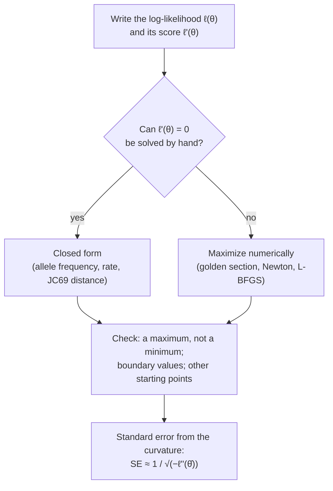

---
aliases:
  - MLE
  - Maximum Likelihood
  - Maximum Likelihood Estimator
  - ML Estimation
  - Estimation du maximum de vraisemblance
tags:
  - type/concept
  - domain/statistics
  - domain/bioinformatics
  - level/L2
  - level/L3
  - level/M1
mastery: 0
prerequisites:
  - "[[Likelihood Function]]"
  - "[[Estimator]]"
  - "[[Statistical Model]]"
  - "[[Derivative]]"
  - "[[Extremum]]"
  - "[[Logarithm]]"
related:
  - "[[Method of Moments]]"
  - "[[Fisher Information]]"
  - "[[Likelihood Ratio Test]]"
  - "[[Newton's Method]]"
  - "[[Optimization]]"
  - "[[Allele Frequency]]"
  - "[[Mutation Rate]]"
  - "[[Jukes-Cantor Model]]"
  - "[[Evolutionary Distance]]"
  - "[[Maximum Likelihood Phylogenetics]]"
  - "[[Felsenstein Pruning Algorithm]]"
  - "[[Expectation-Maximization Algorithm]]"
  - "[[Maximum A Posteriori Estimation]]"
  - "[[Kullback-Leibler Divergence]]"
projects:
  - "[[08-phylogenetic-engine]]"
  - "[[10-genomic-pipeline]]"
sources:
  - "[[MIT 18.650 - Statistics for Applications]]"
  - "[[Biological Sequence Analysis (Durbin)]]"
  - "[[Molecular Evolution (Yang)]]"
  - "[[Felsenstein 1981 - Evolutionary Trees from DNA Sequences]]"
  - "[[Principles of Population Genetics (Hartl)]]"
  - "[[Kong 2012 - Rate of De Novo Mutations and the Importance of Father's Age to Disease Risk]]"
  - "[[Luria 1943 - Mutations of Bacteria from Virus Sensitivity to Virus Resistance]]"
  - "[[Love 2014 - Moderated Estimation of Fold Change and Dispersion for RNA-Seq Data with DESeq2]]"
  - "[[An Introduction to Statistical Learning (James)]]"
---

# Maximum Likelihood Estimation

> [!abstract]
> Maximum likelihood estimation picks the parameter value under which the observed data are most probable. Calculus gives the classic formulas (allele count over chromosomes, mutations over sites), an optimizer handles the cases calculus cannot (branch lengths of a tree), and in large samples the estimates are nearly unbiased, normally distributed and as precise as any estimator can be.

## Definition

The **maximum likelihood estimate** (MLE) of $\theta$ is the value $\hat\theta$ that maximizes the [[Likelihood Function]] $L(\theta)$ of the observed data, or equivalently the log-likelihood $\ell(\theta)$. When $\ell$ is differentiable and the maximum is not on the boundary of the parameter space, $\hat\theta$ solves the **score equation** $\ell'(\theta) = 0$ (one equation per parameter).[^18650][^durbin]

## Why it matters

- **Most reported parameters are MLEs or close relatives**: allele frequencies, error and mutation rates, evolutionary distances, branch lengths, substitution rates.
- **Phylogenetics.** Felsenstein's 1981 method made maximum likelihood trees from DNA sequences computationally practical and is the foundation of programs such as RAxML and IQ-TREE ([[Maximum Likelihood Phylogenetics]], [[08-phylogenetic-engine]]).[^felsenstein81]
- **Count models.** Differential expression fits a negative binomial generalized linear model to each gene ([[Negative Binomial Regression]]);[^love] fitting a generalized linear model means maximizing its likelihood ([[Generalized Linear Model]]).[^18650]
- **Error bars come with the estimate.** The curvature of the log-likelihood at its maximum gives a standard error, and comparing maxima gives a test ([[Likelihood Ratio Test]]).

## Core (L2)

### The recipe



### Allele frequency: gene counting

For $k$ copies among $n$ sampled chromosomes, $\ell'(p) = k/p - (n-k)/(1-p) = 0$ gives $\hat p = k/n$ ([[Extremum]], [[Bernoulli Distribution]]). From genotype counts under [[Hardy-Weinberg Equilibrium]], the log-likelihood depends only on allele counts ([[Likelihood Function#Core (L2)]]), so

$$\hat p = \frac{2n_{AA} + n_{Aa}}{2N},$$

**gene counting**: each homozygote contributes two copies, each heterozygote one ([[Allele Frequency]]).[^hartl] With 30 AA, 50 Aa and 20 aa people (invented), $\hat p = 110/200 = 0.550$, standard error 0.035.

### Mutation rate: a Poisson rate with exposure

New mutations are rare events over many sites: if $K$ de novo mutations are found over an exposure of $E$ site-generations (callable sites × transmitted genomes), model $K \sim \mathrm{Pois}(\mu E)$. Then $\ell(\mu) = k\ln\mu - \mu E + \text{const}$, $\ell'(\mu) = k/\mu - E = 0$, and

$$\hat\mu = \frac{k}{E}, \qquad \ell''(\hat\mu) = -\frac{k}{\hat\mu^2} \;\Rightarrow\; \mathrm{SE}(\hat\mu) = \frac{\hat\mu}{\sqrt{k}}.$$

An invented trio with 60 de novo SNVs over $2 \times 2.5 \times 10^9$ callable site-generations gives $\hat\mu = 1.20 \times 10^{-8}$ per site per generation, with a relative standard error of $1/\sqrt{60} = 13\,\%$; the trio sequencing study of Kong et al. measured $1.20 \times 10^{-8}$ ([[Mutation Rate]]).[^kong] Precision depends on the number of events counted, not on the number of sites.

**Invariance.** The MLE of a function of $\theta$ is that function of $\hat\theta$. In a fluctuation test, the number of mutations per culture is Poisson with mean $m$, so a culture has no mutant with probability $e^{-m}$. Recording only which cultures have mutants, the MLE of that probability is the observed fraction, and the MLE of $m$ is minus its logarithm. In one series of Luria and Delbrück, 11 of 20 cultures had no resistant colony:[^luria] $\hat m = -\ln(11/20) = 0.598$ mutations per culture.

### Bio: the Jukes-Cantor distance

Under the JC69 model, two sequences separated by $d$ expected substitutions per site differ at a site with probability $p(d) = \frac34(1 - e^{-4d/3})$ ([[Jukes-Cantor Model]]).[^yang] With $k$ differences over $n$ sites, $\ell(d) = k\ln p(d) + (n-k)\ln(1 - p(d)) + \text{const}$. The maximum over $p$ is $\hat p = k/n$, and since $d \mapsto p(d)$ is increasing, invariance gives

$$\hat d = -\frac34\ln\left(1 - \frac43\,\frac{k}{n}\right),$$

the same as the moment estimator ([[Method of Moments#Advanced (L3)]]). For 180 differences over 1,000 sites, $\hat d = 0.2058$, and a golden-section search on $\ell(d)$ finds the same value (code below), a useful check of any optimizer.

### Bio: branch lengths of a tree, numerically

Three aligned sequences sit at the tips of a star tree with branch lengths $t_1, t_2, t_3$; each branch evolves under JC69 from an unobserved central base. Each site pattern has a probability that sums over that base ([[Likelihood Function#Advanced (L3)]]), and the log-likelihood sums over sites.[^felsenstein81] The score equations have no closed form, so the code maximizes one branch at a time with a golden-section search, repeating until nothing changes. On 1,000 invented sites it returns $\hat t = (0.0746, 0.1308, 0.1575)$; SciPy's L-BFGS-B, a general quasi-Newton optimizer, agrees. Solving the three pairwise JC69 distances for additive branch lengths gives almost the same values here (0.0746, 0.1312, 0.1580); with more taxa the tree likelihood uses all sequences jointly, computed by the [[Felsenstein Pruning Algorithm]].

### Asymptotic properties

For independent observations from a regular model (identifiable, true $\theta$ inside the parameter space, smooth log-likelihood), as the sample grows:[^18650][^yang]

1. **Consistency**: $\hat\theta \to \theta$.
2. **Asymptotic normality**: $\hat\theta$ is approximately $\mathcal N(\theta, 1/I_n(\theta))$, where $I_n(\theta) = -E[\ell''(\theta)]$ is the [[Fisher Information]]. In practice $\mathrm{SE}(\hat\theta) \approx 1/\sqrt{-\ell''(\hat\theta)}$, the curvature at the maximum.
3. **Efficiency**: no other consistent, asymptotically normal estimator has a smaller asymptotic variance (the Cramér-Rao bound, [[Fisher Information]]).
4. **Invariance** holds exactly, at any sample size.

For the binomial, $-\ell''(\hat p) = n/(\hat p(1 - \hat p))$, so the curvature recovers the familiar $\mathrm{SE} = \sqrt{\hat p(1-\hat p)/n}$ of [[Confidence Interval]]. "Asymptotically" matters: MLEs can be biased in small samples (the variance divides by $n$, [[Estimator]]; a negative binomial dispersion from 6 replicates is about 19 % too low, [[Method of Moments#Advanced (L3)]]). Simulation tells how large $n$ must be: for a JC69 distance of 0.3, 100 sites already give a mean estimate of 0.303, a spread of 0.066 against 0.064 predicted, and 95 % Wald intervals that cover 94.8 % of the time (Exercise 2).

## Advanced (L3)

### When the asymptotics fail

- **Boundary.** With $k = 0$, $\hat p = 0$ and the curvature formula gives a standard error of 0: meaningless. Use exact or likelihood-based intervals ([[Confidence Interval#Advanced (L3)]]).
- **Saturation.** JC69 has no finite maximum when $k/n \ge 3/4$; distances near saturation have huge standard errors.
- **As many parameters as data.** Measure $n$ pairs $(X_{i1}, X_{i2})$ with $X_{ij} \sim \mathcal N(\mu_i, \sigma^2)$, one mean per pair. The MLE is $\hat\sigma^2 = \frac{1}{4n}\sum_i (X_{i1} - X_{i2})^2$, whose expectation is $\sigma^2/2$ for every $n$: more pairs never fix it, because each new pair brings a new nuisance parameter (Mathematical representation). Genomics faces the same structure when every gene has its own mean and dispersion and only a few replicates; dispersion methods correct for the fitted means and borrow strength across genes ([[Dispersion Estimation]], [[Empirical Bayes]]).
- **Ridges and multiple maxima.** On a two-taxon tree only $t_1 + t_2$ is identifiable (Exercise 3): the likelihood has a ridge, not a peak ([[Statistical Model#Advanced (L3)]]). Mixture models and tree topologies can have several local maxima, so optimizers are restarted from several points ([[Expectation-Maximization Algorithm]], [[Phylogenetic Tree Search]]).

### Numerical practice

- **Optimize on an unconstrained scale**: $\log$ for positive parameters (rates, branch lengths, dispersions), logit for proportions. By invariance the MLE is unchanged, and the optimizer cannot step outside the parameter space.
- **Choose the method and the start**: golden-section search is slow but safe for one unimodal parameter; [[Newton's Method]] uses $\ell'$ and $\ell''$ and converges fast near the maximum but can diverge from a poor start; quasi-Newton methods (L-BFGS) handle many parameters ([[Optimization]]). Moment estimates are cheap starting values ([[Method of Moments]]).
- **Check the result**: the gradient is close to 0, the curvature is negative, and other starting points lead to the same maximum.

## Frontier (M1)

### What the MLE estimates when the model is wrong

If the data come from a distribution $g$ that is not in the model, the law of large numbers gives $\frac1n\ell(\theta) \to E_g[\ln f(X; \theta)] = -H(g) - D_{\mathrm{KL}}(g \,\|\, f_\theta)$, where $H(g)$ does not depend on $\theta$. Maximizing the likelihood therefore minimizes an estimate of the [[Kullback-Leibler Divergence]] from the truth: the MLE converges to the member of the family closest to $g$. Its point estimate can stay useful (a Poisson fit to overdispersed counts still estimates the mean), but standard errors from the curvature assume the model is right. In Exercise 4, the Poisson standard error of a mean count is 4.1 while the real one is 13.5, and nominal 95 % intervals cover the truth only 45 % of the time. The [[Bootstrap]] estimates standard errors by resampling the data instead of trusting the model's curvature.[^isl]

### Beyond the plain likelihood

- **Penalized likelihood.** Adding a log-prior to $\ell$ gives [[Maximum A Posteriori Estimation]]; DESeq2's shrunken dispersions and fold changes are estimates of this kind, which stabilize genes measured with few replicates.[^love]
- **Latent variables.** When the model involves unobserved genotypes, ancestral states or mixture labels, the [[Expectation-Maximization Algorithm]] maximizes the likelihood by alternating an expectation and a maximization step ([[Mixture Model]]).

## Mathematical representation

- **Estimator.** $\hat\theta = \arg\max_{\theta \in \Theta} \ell(\theta)$; score $U(\theta) = \ell'(\theta)$; observed information $J(\theta) = -\ell''(\theta)$; Fisher information $I_n(\theta) = E_\theta[J(\theta)]$; $\mathrm{SE}(\hat\theta) \approx J(\hat\theta)^{-1/2}$.
- **Asymptotics.** For i.i.d. data and a regular model, $\sqrt{n}\,(\hat\theta - \theta) \to \mathcal N(0, 1/I_1(\theta))$ in distribution.
- **Closed forms.** Binomial $\hat p = k/n$; Hardy-Weinberg $\hat p = (2n_{AA} + n_{Aa})/(2N)$; Poisson with exposure $\hat\mu = k/E$; normal $\hat\mu = \bar x$, $\hat\sigma^2 = \frac1n\sum(x_i - \bar x)^2$; JC69 $\hat d = -\frac34\ln(1 - \frac43\hat p)$, with $\mathrm{Var}(\hat d) \approx \frac{p(1-p)}{n(1 - 4p/3)^2}$.[^yang]
- **Star tree under JC69.** With $a_i = \frac14 + \frac34 e^{-4t_i/3}$ and $b_i = \frac14 - \frac14 e^{-4t_i/3}$, a pattern with three equal bases has probability $\frac14(a_1a_2a_3 + 3b_1b_2b_3)$; the other classes are in the code.
- **Many nuisance parameters.** For pairs $X_{ij} \sim \mathcal N(\mu_i, \sigma^2)$, $\hat\mu_i = (X_{i1} + X_{i2})/2$ and $\hat\sigma^2 = \frac{1}{2n}\sum_{i,j}(X_{ij} - \hat\mu_i)^2 = \frac{1}{4n}\sum_i (X_{i1} - X_{i2})^2$; since $E[(X_{i1} - X_{i2})^2] = 2\sigma^2$, $E[\hat\sigma^2] = \sigma^2/2$.

## Computational representation

The closed forms above are one-line formulas; the numerical cases need an optimizer. The golden-section search uses only function values; SciPy confirms the result.

```python
import math


# 1. Jukes-Cantor distance: closed form versus numerical maximization
def p_diff(d):
    """Probability that a site differs between two sequences at JC69 distance d."""
    return 0.75 * (1 - math.exp(-4 * d / 3))


def jc_loglik(d, k, n):
    p = p_diff(d)
    return k * math.log(p) + (n - k) * math.log(1 - p)


def golden_max(f, lo, hi, tol=1e-10):
    """Maximize a unimodal function on [lo, hi] by golden-section search."""
    r = (math.sqrt(5) - 1) / 2
    while hi - lo > tol:
        c, d = hi - r * (hi - lo), lo + r * (hi - lo)
        lo, hi = (lo, d) if f(c) > f(d) else (c, hi)
    return (lo + hi) / 2


k, n = 180, 1000                           # invented: 180 differences over 1000 aligned sites
d_formula = -0.75 * math.log(1 - 4 / 3 * k / n)
d_numeric = golden_max(lambda d: jc_loglik(d, k, n), 1e-6, 5.0)
h = 1e-4
curv = (jc_loglik(d_numeric + h, k, n) - 2 * jc_loglik(d_numeric, k, n) + jc_loglik(d_numeric - h, k, n)) / h ** 2
print(f"JC69: formula {d_formula:.4f}, numerical {d_numeric:.4f}, SE from curvature {1 / math.sqrt(-curv):.4f}")


# 2. Branch lengths of a three-taxon star tree under JC69 (no closed form): one branch at a time
def jc_branch(t):
    """P(same base), P(one given other base) at the two ends of a branch of length t."""
    e = math.exp(-4 * t / 3)
    return 0.25 + 0.75 * e, 0.25 - 0.25 * e


def star_loglik(t, counts):
    (a1, b1), (a2, b2), (a3, b3) = (jc_branch(x) for x in t)
    prob = {   # probability of one specific site pattern of each class, root base uniform
        "xxx": (a1 * a2 * a3 + 3 * b1 * b2 * b3) / 4,
        "xxy": (a1 * a2 * b3 + b1 * b2 * a3 + 2 * b1 * b2 * b3) / 4,    # taxon 3 differs
        "xyx": (a1 * b2 * a3 + b1 * a2 * b3 + 2 * b1 * b2 * b3) / 4,    # taxon 2 differs
        "yxx": (b1 * a2 * a3 + a1 * b2 * b3 + 2 * b1 * b2 * b3) / 4,    # taxon 1 differs
        "xyz": (a1 * b2 * b3 + b1 * a2 * b3 + b1 * b2 * a3 + b1 * b2 * b3) / 4,
    }
    return sum(c * math.log(prob[pattern]) for pattern, c in counts.items())


counts = {"xxx": 700, "xxy": 120, "xyx": 100, "yxx": 60, "xyz": 20}    # invented pattern counts, 1000 sites
t = [0.1, 0.1, 0.1]
for _ in range(30):
    for i in range(3):
        t[i] = golden_max(lambda x: star_loglik(t[:i] + [x] + t[i + 1:], counts), 1e-8, 3.0)
print("ML branch lengths:", [round(x, 4) for x in t], "log-likelihood", round(star_loglik(t, counts), 2))

from scipy.optimize import minimize

res = minimize(lambda x: -star_loglik(list(x), counts), x0=[0.1, 0.1, 0.1],
               bounds=[(1e-8, 3.0)] * 3, method="L-BFGS-B")
print("SciPy L-BFGS-B:   ", [round(float(x), 4) for x in res.x])
```

```text
JC69: formula 0.2058, numerical 0.2058, SE from curvature 0.0160
ML branch lengths: [0.0746, 0.1308, 0.1575] log-likelihood -2711.23
SciPy L-BFGS-B:    [0.0746, 0.1308, 0.1575]
```

The curvature is estimated by a finite difference of $\ell$ around the maximum; its standard error, 0.0160, matches the delta-method formula. The pattern probabilities of each class times their numbers of specific patterns (4, 12, 12, 12 and 24) sum to 1, a test worth running on any hand-written likelihood.

## Worked example

> [!example] How far apart are two sequences?
> Two aligned sequences of 1,000 sites differ at 180 (invented).
> 1. **p-distance.** $\hat p = 0.18$ differences per site, an underestimate of the substitutions that occurred, because some sites changed more than once ([[Evolutionary Distance]]).
> 2. **Model and likelihood.** Under JC69 a site differs with probability $p(d) = \frac34(1 - e^{-4d/3})$, so $\ell(d) = 180\ln p(d) + 820\ln(1 - p(d))$.
> 3. **MLE.** $\hat p = 0.18$ maximizes the likelihood in $p$; invariance gives $\hat d = -\frac34\ln(1 - 0.24) = 0.2058$ substitutions per site, 14 % more than the p-distance.
> 4. **Standard error.** $\mathrm{SE} = \sqrt{\frac{0.18 \times 0.82}{1000 \times 0.76^2}} = 0.0160$, the same from the curvature of $\ell$. A 95 % interval: $0.2058 \pm 1.96 \times 0.0160 = [0.174, 0.237]$.
> 5. **Use.** A matrix of such distances feeds distance-based tree building in [[08-phylogenetic-engine]]; joint maximum likelihood on the tree replaces it in [[Maximum Likelihood Phylogenetics]].

## Common misconceptions

> [!warning] "The MLE is the most probable value of the parameter"
> It maximizes $P(\text{data} \mid \theta)$, not $P(\theta \mid \text{data})$. The second needs a prior; with a flat prior the two maxima coincide, but in general they do not ([[Bayesian Inference]], [[Maximum A Posteriori Estimation]]).

> [!warning] "Maximum likelihood estimators are unbiased"
> Only asymptotically. The normal variance MLE divides by $n$, the dispersion MLE from 6 replicates is about 19 % low, and with one nuisance mean per pair the variance MLE converges to half the truth.

> [!warning] "The curvature standard error is always valid"
> It assumes a large sample, an interior maximum and a correct model. A Poisson model for overdispersed counts gives standard errors more than three times too small (Exercise 4).

## Exercises

> [!question] Exercise 1 (L2)
> Among 100 people, 30 are AA, 50 are Aa and 20 are aa. Derive the MLE of the frequency of A under Hardy-Weinberg, and its standard error from the curvature.

> [!success]- Solution
> $\ell(p) = (2 \cdot 30 + 50)\ln p + (2 \cdot 20 + 50)\ln(1 - p) + \text{const} = 110\ln p + 90\ln(1-p)$. $\ell'(p) = 110/p - 90/(1 - p) = 0$ gives $\hat p = 0.55$. $-\ell''(\hat p) = 110/0.55^2 + 90/0.45^2 = 363.6 + 444.4 = 808.1$, so $\mathrm{SE} = 1/\sqrt{808.1} = 0.035$, equal to $\sqrt{0.55 \times 0.45/200}$.

> [!question] Exercise 2 (L3, Python)
> Using `p_diff` from the code above, simulate 10,000 pairs of sequences at JC69 distance 0.3 for $n = 100$ and $n = 1000$ sites (seed 4). Report the mean and SD of $\hat d$, the asymptotic SE, and the coverage of the 95 % Wald interval.

> [!success]- Solution
> ```python
> import random
> import statistics as st
>
> rng = random.Random(4)
> D, REPS = 0.3, 10_000
> pd = p_diff(D)
> for n in (100, 1000):
>     est, covered, undefined = [], 0, 0
>     for _ in range(REPS):
>         k = sum(rng.random() < pd for _ in range(n))
>         ph = k / n
>         if ph >= 0.75:
>             undefined += 1
>             continue
>         d_hat = -0.75 * math.log(1 - 4 * ph / 3)
>         se = math.sqrt(ph * (1 - ph) / (n * (1 - 4 * ph / 3) ** 2))
>         est.append(d_hat)
>         covered += abs(d_hat - D) <= 1.96 * se
>     se_true = math.sqrt(pd * (1 - pd) / (n * (1 - 4 * pd / 3) ** 2))
>     print(f"n = {n:4d} sites: mean d_hat {st.fmean(est):.4f}, SD {st.stdev(est):.4f}, "
>           f"asymptotic SE {se_true:.4f}, Wald coverage {covered / len(est):.3f}, undefined {undefined}")
> ```
> Output: `n =  100 sites: mean d_hat 0.3032, SD 0.0660, asymptotic SE 0.0644, Wald coverage 0.948, undefined 0`, then `n = 1000 sites: mean d_hat 0.3007, SD 0.0203, asymptotic SE 0.0204, Wald coverage 0.945, undefined 0`. The bias (+1 % at 100 sites) and the gap between the real and the predicted spread shrink with $n$, as the asymptotic theory says. Repeat with $D = 1.0$ and 100 sites to see saturation produce undefined estimates.

> [!question] Exercise 3 (L3)
> Two sequences are joined by a tree with branch lengths $t_1$ and $t_2$ from their common ancestor, under JC69 with a uniform ancestral base. Show that the likelihood depends only on $t_1 + t_2$. What does this mean for estimating $t_1$ and $t_2$?

> [!success]- Solution
> With ancestral base $x$ (probability 1/4), tip 1 shows $y$ and tip 2 shows $z$ with probability $\sum_x \frac14 P_{xy}(t_1)P_{xz}(t_2)$. JC69 is symmetric, $P_{xy} = P_{yx}$, so this equals $\frac14\sum_x P_{yx}(t_1)P_{xz}(t_2) = \frac14 P_{yz}(t_1 + t_2)$ by the Chapman-Kolmogorov equation of the [[Markov Chain]]. Every site pattern, hence $L(t_1, t_2) = L^*(t_1 + t_2)$, depends on the sum only: every split of the total length fits equally well, and only the sum, the JC69 distance $\hat d$, is identifiable. The ancestor's position on the path cannot be found without extra information, such as an outgroup or a molecular clock ([[Statistical Model#Advanced (L3)]]).

> [!question] Exercise 4 (M1)
> Counts of a gene in 6 biological replicates follow a negative binomial with mean 100 and dispersion 0.1, but are fitted with a Poisson model. Compute the Poisson (curvature) standard error of the mean, the true standard error, and the actual coverage of the nominal 95 % interval $\bar x \pm 1.96\sqrt{\bar x/6}$, treating $\bar x$ as normal and the Poisson SE as fixed.

> [!success]- Solution
> Poisson SE: $\sqrt{100/6} = 4.08$. True SE: $\sqrt{(100 + 0.1 \times 100^2)/6} = \sqrt{1100/6} = 13.54$, 3.3 times larger. The interval covers the truth when $|\bar x - 100| \le 1.96 \times 4.08 = 8.0$, that is when $|Z| \le 8.0/13.54 = 0.59$: probability $2\Phi(0.59) - 1 = 0.45$ instead of 0.95. The Poisson MLE $\hat\lambda = \bar x$ is still the right point estimate; the error bars are wrong because the curvature assumes variance = mean ([[Overdispersion]]).

## Mastery checklist

- [ ] 1 Recognized: I can define the MLE and the score equation, and list the four asymptotic properties.
- [ ] 2 Understood: I can derive gene counting, the Poisson rate, the normal MLEs and the JC69 distance, and explain invariance and the curvature standard error.
- [ ] 3 Practiced: I can maximize a likelihood numerically (golden section, Newton, SciPy), check the result, and verify asymptotic claims by simulation.
- [ ] 4 Applied: I estimated pairwise distances and branch lengths for a real alignment in [[08-phylogenetic-engine]], or an allele frequency from real genotype likelihoods in [[10-genomic-pipeline]].
- [ ] 5 Explained: I can teach when MLEs fail (boundaries, saturation, many nuisance parameters, ridges) and what they estimate under misspecification.

## References

[^18650]: [[MIT 18.650 - Statistics for Applications]], estimation part (maximum likelihood and its asymptotic properties) and regression part (generalized linear models).
[^durbin]: [[Biological Sequence Analysis (Durbin)]], ch. 1 "Introduction" (probability and inference basics: likelihood and maximum likelihood).
[^yang]: [[Molecular Evolution (Yang)]], treatment of the JC69 model (expected proportion of differences, the JC69 distance and its variance) and of maximum likelihood estimation (variance from the curvature of the log-likelihood).
[^felsenstein81]: [[Felsenstein 1981 - Evolutionary Trees from DNA Sequences]], *J Mol Evol* 17(6):368-376: maximum likelihood trees from DNA sequences, the foundation of later likelihood programs (RAxML, IQ-TREE).
[^hartl]: [[Principles of Population Genetics (Hartl)]], allele and genotype frequencies (gene counting, Hardy-Weinberg proportions).
[^kong]: [[Kong 2012 - Rate of De Novo Mutations and the Importance of Father's Age to Disease Risk]], Kong A et al., *Nature* 488:471-475: $1.20 \times 10^{-8}$ de novo mutations per nucleotide per generation from 78 trios.
[^luria]: [[Luria 1943 - Mutations of Bacteria from Virus Sensitivity to Virus Resistance]], *Genetics* 28:491-511: parallel cultures, one series with 11 of 20 cultures without resistant colonies.
[^love]: [[Love 2014 - Moderated Estimation of Fold Change and Dispersion for RNA-Seq Data with DESeq2]], *Genome Biology* 15:550: negative binomial generalized linear model per gene, shrinkage estimation of dispersions and fold changes.
[^isl]: [[An Introduction to Statistical Learning (James)]], Python edition, ch. 5 (resampling methods: the bootstrap).
