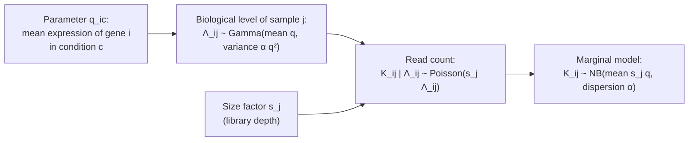

---
aliases:
  - Probabilistic Model
  - Parametric Model
  - Parametric Family
  - i.i.d. Model
  - Modèle statistique
tags:
  - type/concept
  - domain/statistics
  - domain/bioinformatics
  - level/L2
  - level/L3
mastery: 0
prerequisites:
  - "[[Random Variable]]"
  - "[[Probability Distribution]]"
  - "[[Independence (Probability)]]"
  - "[[Poisson Distribution]]"
  - "[[Binomial Distribution]]"
  - "[[Sampling Distribution]]"
related:
  - "[[Mathematical Model]]"
  - "[[Estimator]]"
  - "[[Likelihood Function]]"
  - "[[Maximum Likelihood Estimation]]"
  - "[[Negative Binomial Distribution]]"
  - "[[Overdispersion]]"
  - "[[Generalized Linear Model]]"
  - "[[Model Selection]]"
  - "[[Pseudoreplication]]"
projects:
  - "[[10-genomic-pipeline]]"
sources:
  - "[[MIT 18.650 - Statistics for Applications]]"
  - "[[Introduction to Probability (Blitzstein)]]"
  - "[[Modern Statistics for Modern Biology (Holmes)]]"
  - "[[Anders 2010 - Differential Expression Analysis for Sequence Count Data]]"
  - "[[Nielsen 2011 - Genotype and SNP Calling from Next-Generation Sequencing Data]]"
  - "[[Lander 1988 - Genomic Mapping by Fingerprinting Random Clones]]"
  - "[[Principles of Population Genetics (Hartl)]]"
  - "[[Felsenstein 1981 - Evolutionary Trees from DNA Sequences]]"
  - "[[Molecular Evolution (Yang)]]"
  - "[[Experimental Design for Laboratory Biologists (Lazic)]]"
---

# Statistical Model

> [!abstract]
> A statistical model is an explicit guess about how the data were generated: a family of probability distributions indexed by unknown parameters, plus assumptions, such as independence, that say how the observations relate to each other. Every estimate, interval and test is computed inside one.

## Definition

A **statistical model** for data taking values in a sample space $E$ is a family of probability distributions $\{P_\theta : \theta \in \Theta\}$ on $E$. The model is **parametric** when $\theta$ is a vector of finitely many numbers, $\Theta \subseteq \mathbb{R}^k$ (the **parameter space**). The model is **well specified** if the distribution that actually generated the data belongs to the family. For a sample $X_1, \dots, X_n$, the most common assumption is that the observations are **independent and identically distributed** (i.i.d.) draws from one member $P_\theta$, with $\theta$ unknown.[^18650][^blitz]

## Why it matters

- **Every inference is conditional on a model.** The same read counts give very different p-values under a Poisson and under a negative binomial model: with biological replicates the Poisson variance is far too small, and tests built on it call noise "significant".[^anders]
- **Each data type has a standard model**, and knowing it tells you which numbers a tool estimates:

| Data | Model family | Parameters | Key assumption |
|---|---|---|---|
| Depth at a genome position | Poisson | coverage $\lambda$ | reads placed independently and uniformly ([[Sequencing Coverage]])[^lander] |
| Alternative-allele reads among $d$ at a site | Binomial | per-read probability $p$ (set by genotype and error rate) | reads independent given the genotype ([[Genotype Likelihood]])[^nielsen] |
| Reads of a gene, technical replicates | Poisson | mean $s_j q_i$ | only sampling of reads varies[^holmes] |
| Reads of a gene, biological replicates | [[Negative Binomial Distribution\|Negative binomial]] | mean, dispersion $\alpha$ | true expression varies between individuals[^anders][^holmes] |
| Genotypes of unrelated people | Multinomial with probabilities $(p^2, 2pq, q^2)$ | allele frequency $p$ | [[Hardy-Weinberg Equilibrium]], independent individuals[^hartl] |
| Aligned DNA sequences | Markov substitution model on a tree | branch lengths, substitution rates | sites evolve independently ([[Nucleotide Substitution Model]])[^felsenstein81] |

- **Assumptions are where analyses break.** Technical replicates counted as biological ones, PCR duplicates counted as independent reads or cells of one donor treated as independent replicates violate independence; batches and unequal sequencing depth violate identical distribution ([[Pseudoreplication]], [[Batch Effect]]).[^lazic]
- **A model is a simulator.** Data simulated from a model with known parameters show whether a pipeline recovers the truth, and how often a test errs ([[Monte Carlo Method]]).

## Core (L2)

### Three ingredients

1. **Sample space**: what values the data can take: counts $\{0, 1, 2, \dots\}$, proportions in $[0, 1]$, real-valued log-expressions.
2. **A family of distributions** with its **parameter space**: $\mathrm{Pois}(\lambda)$ with $\lambda > 0$; $\mathrm{Bin}(d, p)$ with $p \in [0, 1]$; $\mathcal{N}(\mu, \sigma^2)$ with $\sigma > 0$.
3. **Assumptions linking the observations**: independence, identical distribution, or an explicit structure (a covariate, a pairing, a batch).

Estimation ([[Estimator]]) picks a member of the family; testing ([[Hypothesis Testing]]) asks whether a sub-family (for example $\mu_A = \mu_B$) is compatible with the data. Neither can repair a family that does not contain anything like the truth.

### What "i.i.d." buys, and what breaks it

- **Independent**: the joint distribution factorizes, $f(x_1, \dots, x_n; \theta) = \prod_i f(x_i; \theta)$, which gives the product form of the [[Likelihood Function]] and the variance $\sigma^2/n$ of a mean ([[Sampling Distribution]]).
- **Identically distributed**: every observation carries information about the same $\theta$, so pooling them makes sense.

| Situation | Assumption broken | Repair |
|---|---|---|
| 3 mice, each sequenced twice, analyzed as $n = 6$ | independence (pairs share a mouse) | analyze mice, not libraries ([[Biological Replicate]]) |
| Libraries of different depths | identical distribution | include size factors $s_j$ in the mean ([[Size Factor Estimation]]) |
| All controls in batch 1, all treated in batch 2 | identical distribution within condition, and confounding | fix by design: [[Randomized Block Design]] |
| Cells from 2 donors as replicates of a donor effect | independence (cells of a donor are correlated) | aggregate per donor, or model the donor |

The table's first row is the classic [[Pseudoreplication]] error.[^lazic] Note what i.i.d. does **not** say: nothing about the shape of the distribution. Skewed counts can be i.i.d.; normal measurements from one animal measured ten times are not independent replicates of the population.

### Bio: a probabilistic model for read counts

Let $K_{ij}$ be the number of reads assigned to gene $i$ in sample $j$. The model is built in two layers:[^anders][^holmes]



- **Sampling of reads.** Given the RNA in the tube, each of millions of reads lands on gene $i$ with a small probability, so the count is approximately Poisson ([[Poisson Distribution]]); technical replicates of one library differ only by this noise.
- **Biological variation.** Independent individuals differ in their true expression. A gamma-distributed level under the Poisson gives the negative binomial, with $E[K] = \mu$ and $\mathrm{Var}(K) = \mu + \alpha\mu^2$ ([[Variance#Advanced (L3)]]).
- **Assumptions.** Samples are independent; within a condition, samples share $q_{ic}$ up to their size factor; each gene has its own dispersion $\alpha_i$; genes are modeled one at a time, although their counts in one library compete for the same reads.

Inside this model, "is gene $i$ differentially expressed?" becomes the precise statement $H_0: q_{iA} = q_{iB}$ ([[Differential Expression Analysis]]).

### Parametric and nonparametric

A parametric model fixes the shape up to a few numbers. A **nonparametric** model allows a much larger family, for example "any continuous distribution", which is what rank tests assume ([[Nonparametric Statistics]], [[Wilcoxon Rank-Sum Test]]). Fewer shape assumptions cost some power when a parametric model is right, but independence and identical distribution are still assumed.

### Checking a model

A model makes predictions about features of the data, and a check compares them with what was observed: is the variance close to the mean (Poisson)? Are there more zeros than the model predicts? Does the spread grow with the mean as $\mu + \alpha\mu^2$ across genes? The most general check is to **simulate data from the fitted model** and see whether the observed feature looks typical among the simulations (Worked example).[^holmes]

## Advanced (L3)

### Identifiability

A parameter is **identifiable** if different values give different distributions: $\theta_1 \ne \theta_2 \Rightarrow P_{\theta_1} \ne P_{\theta_2}$. Without it, no amount of data can tell the values apart.

- **Size factors and expression.** In $K_{ij} \sim \mathrm{Pois}(s_j q_i)$, replacing $(s_j, q_i)$ by $(c\,s_j, q_i/c)$ for any $c > 0$ leaves every distribution unchanged. Only ratios are identifiable until a constraint fixes the scale, for example a geometric mean of the size factors equal to 1 (Exercise 3).
- **Rate and time on a tree.** Substitution models see only the product of rate and time along a branch, so branch lengths are reported in expected substitutions per site; separating rate from time needs a clock assumption and calibration ([[Molecular Clock]]).[^yang]
- **Label switching.** In a two-component [[Mixture Model]], swapping the labels of the components gives the same distribution: the parameters are identifiable only up to permutation.

### Structured models: covariates and hierarchies

"Identically distributed" is often too strong. Regression models replace it by "identically distributed given the covariates": $K_{ij} \sim \mathrm{NB}(\mu_{ij}, \alpha_i)$ with $\log \mu_{ij} = \log s_j + x_j^\top \beta_i$, where $x_j$ codes condition, batch or sex ([[Generalized Linear Model]], [[Negative Binomial Regression]]). Hierarchical models let parameters themselves vary according to a distribution, as the gamma layer above does; estimating that distribution from thousands of genes is the idea of [[Empirical Bayes]]. Standard count methods share information across genes in this spirit, for example by tying each gene's variance to the mean expression through a fitted trend.[^anders]

### Misspecification

No model is exactly true; the useful question is whether it is wrong in ways that matter for the inference at hand. When the family does not contain the truth, a maximum likelihood fit converges to the member closest to it in Kullback-Leibler divergence ([[Maximum Likelihood Estimation#Frontier (M1)]]): a Poisson fit to overdispersed counts still estimates the mean correctly, but its standard errors are too small. Comparing families on the same data is [[Model Selection]]; testing a nested restriction is the [[Likelihood Ratio Test]].

## Mathematical representation

- **Model**: $(E, \{P_\theta\}_{\theta \in \Theta})$, parametric if $\Theta \subseteq \mathbb{R}^k$; densities or mass functions $f(x; \theta)$.
- **i.i.d. sample**: $X_1, \dots, X_n$ with joint density $f(x_1, \dots, x_n; \theta) = \prod_{i=1}^n f(x_i; \theta)$.
- **Identifiability**: the map $\theta \mapsto P_\theta$ is injective.
- **Read count model**: for gene $i$, sample $j$ in condition $c(j)$, with size factor $s_j > 0$,
$$K_{ij} \sim \mathrm{NB}(\mu_{ij}, \alpha_i), \quad \mu_{ij} = s_j\, q_{i, c(j)}, \quad \mathrm{Var}(K_{ij}) = \mu_{ij} + \alpha_i \mu_{ij}^2,$$
with $K_{ij}$ independent across samples; $\alpha_i = 0$ gives back the Poisson model. Parameter space: $q > 0$, $\alpha \ge 0$, $s > 0$ with one scale constraint.
- **Dispersion index** (a Poisson check): for $n$ counts with mean $\bar k$ and sample variance $s^2$, $D = (n-1)s^2/\bar k$ is approximately $\chi^2_{n-1}$ when the counts are Poisson ([[Chi-Square Distribution]]); overdispersion inflates it.

## Computational representation

A model in code is two things: a way to **simulate** data for given parameters and a way to **score** data (the log-likelihood, see [[Likelihood Function]]). The simulation side is enough to check a model.

```python
import random
import statistics as st

rng = random.Random(2024)


def poisson(lam: float, rng: random.Random) -> int:
    """Poisson draw: number of exponential inter-arrival times that fit in one time unit."""
    k, t = 0, rng.expovariate(lam)
    while t < 1.0:
        k, t = k + 1, t + rng.expovariate(lam)
    return k


def gamma_poisson(mu: float, alpha: float, rng: random.Random) -> int:
    """Negative binomial draw: a biological level (gamma, mean mu, variance alpha*mu^2), then Poisson reads."""
    return poisson(rng.gammavariate(1 / alpha, alpha * mu), rng)


# A model is a recipe that can generate data: 6 replicates of one gene (mean 500 reads) under each
print("Poisson model      :", [poisson(500, rng) for _ in range(6)])
print("Gamma-Poisson model:", [gamma_poisson(500, 0.1, rng) for _ in range(6)])

# Observed counts of one gene in 6 biological replicates, equal library sizes (invented)
counts = [512, 380, 702, 455, 610, 298]
m, v = st.fmean(counts), st.variance(counts)
alpha_hat = (v - m) / m ** 2                       # matching the variance (see Method of Moments)
print(f"mean {m:.1f}  variance {v:.0f}  variance/mean {v / m:.1f}  alpha_hat {alpha_hat:.3f}")

# Model check: can each fitted model produce a spread as large as the observed one?
R = 2_000
for name, draw in (("Poisson", lambda: poisson(m, rng)),
                   ("gamma-Poisson", lambda: gamma_poisson(m, alpha_hat, rng))):
    sims = [st.variance([draw() for _ in range(6)]) for _ in range(R)]
    print(f"{name:13s}: median simulated variance {st.median(sims):7.0f}, "
          f"P(variance >= observed) = {sum(s >= v for s in sims) / R:.3f}")
```

```text
Poisson model      : [495, 461, 507, 485, 479, 497]
Gamma-Poisson model: [659, 604, 301, 315, 384, 241]
mean 492.8  variance 21994  variance/mean 44.6  alpha_hat 0.089
Poisson      : median simulated variance     422, P(variance >= observed) = 0.000
gamma-Poisson: median simulated variance   18486, P(variance >= observed) = 0.402
```

The two models share the same mean; only the second reproduces the spread of real biological replicates. The Poisson sampler is exact but slow for large means; libraries such as NumPy provide fast generators.

## Worked example

> [!example] Poisson or negative binomial for this gene?
> Six biological replicates of one gene, equal depths (invented): 512, 380, 702, 455, 610, 298.
> 1. **Summaries.** Mean 492.8, sample variance 21,994: the variance is 44.6 times the mean.
> 2. **Poisson model.** It predicts a variance close to the mean. Among 2,000 simulated experiments from $\mathrm{Pois}(492.8)$, the median sample variance is 422 and none reaches 21,994: the Poisson model is rejected for these data.
> 3. **Negative binomial model.** Matching the variance gives $\hat\alpha = (21{,}994 - 492.8)/492.8^2 = 0.089$ ([[Method of Moments]]). Simulations from the fitted model have median variance 18,486, and 40 % exceed the observed value: the data look typical.
> 4. **Reading.** Since $\mathrm{Var}(K)/\mu^2 = 1/\mu + \alpha$, the replicates vary by about $\sqrt{0.089} \approx 30\,\%$ around their mean for biological reasons, while read sampling alone would give $1/\sqrt{492.8} \approx 4.5\,\%$.
> 5. **Limit of the check.** The variance was used to fit $\alpha$, so step 3 can only fail grossly; a sharper check uses a feature not used in fitting, or the mean-variance trend across thousands of genes.[^holmes]

## Common misconceptions

> [!warning] "The model is the truth"
> A model is a set of assumptions chosen to answer a question. It is judged by whether its predictions match the features of the data that matter for that question; check it before trusting the p-values it produces.

> [!warning] "i.i.d. means normally distributed"
> i.i.d. is about dependence and sameness, not shape. Counts, proportions and skewed measurements can all be i.i.d.; ten normal measurements of one animal are not ten independent replicates of the population.

> [!warning] "Nonparametric methods make no assumptions"
> They drop the assumption about the shape of the distribution, not independence or identical distribution across groups under the null. A rank test on pseudoreplicated cells is as wrong as a t-test on them.

> [!warning] "A richer model is always better"
> Each parameter must be estimated from the data. With 3 replicates per condition, a separate dispersion per gene is estimated from 6 numbers and is very noisy (Exercise 5); richer models need more data or information shared across genes ([[Model Selection]], [[Empirical Bayes]]).

## Exercises

> [!question] Exercise 1 (L2)
> Propose a model family, its parameters and parameter space for: (a) the depth at one position of a genome sequenced at 30× coverage; (b) the number of alternative-allele reads among 25 at a heterozygous site; (c) the genotypes (AA, Aa, aa) of 100 unrelated individuals; (d) the counts of one gene in 5 biological replicates.

> [!success]- Solution
> (a) $\mathrm{Pois}(\lambda)$, $\lambda > 0$ (about 30), if reads start uniformly and independently. (b) $\mathrm{Bin}(25, p)$, $p \in [0, 1]$, with $p$ near 0.5 for a heterozygote, reads independent given the genotype. (c) Multinomial with 100 trials and probabilities $(p^2, 2p(1-p), (1-p)^2)$, $p \in [0, 1]$: one parameter if Hardy-Weinberg holds, two free proportions otherwise. (d) Negative binomial with mean $\mu > 0$ and dispersion $\alpha \ge 0$ (times size factors if depths differ).

> [!question] Exercise 2 (L2)
> Which assumption is violated, and how would you fix it? (a) Variant support is counted from all reads, including PCR duplicates. (b) Tumor and normal samples of 8 patients are analyzed as two independent groups. (c) The expression of 3 cultures is measured in 4 technical replicates each, analyzed with $n = 12$.

> [!success]- Solution
> (a) Independence: duplicates are copies of one original molecule and repeat its errors; mark or remove duplicates before counting. (b) Independence between groups: each tumor is paired with its own normal, so the two groups are correlated; use a paired analysis ([[Paired Design]], [[Student's t-Test]]). (c) Independence: technical replicates of a culture share its biological deviation; average them and analyze $n = 3$ cultures ([[Pseudoreplication]]).

> [!question] Exercise 3 (L2)
> Show that the model $K_{ij} \sim \mathrm{Pois}(s_j q_i)$ is not identifiable, and propose a constraint that makes it identifiable. What remains identifiable without any constraint?

> [!success]- Solution
> For any $c > 0$, $(c\,s_j)(q_i/c) = s_j q_i$, so the parameters $(c\,s, q/c)$ define exactly the same distributions as $(s, q)$. Constraining the scale, for example $\prod_j s_j = 1$ (geometric mean 1) or $s_1 = 1$, picks one representative. Without a constraint, ratios such as $q_i/q_{i'}$ and $s_j/s_{j'}$ are identifiable: fold changes do not depend on the scale.

> [!question] Exercise 4 (L3, Python)
> Using `poisson` and `gamma_poisson` from the code above, simulate 2,000 experiments of 6 counts from $\mathrm{Pois}(200)$ and from the negative binomial with mean 200 and $\alpha = 0.1$. Apply the dispersion test (reject Poisson when $D = (n-1)s^2/\bar k$ exceeds the 95 % quantile of $\chi^2_5$) and report the rejection rates.

> [!success]- Solution
> ```python
> import random
> import statistics as st
> from scipy.stats import chi2
>
> rng = random.Random(7)
> n, R = 6, 2_000
> crit = chi2.ppf(0.95, df=n - 1)                 # dispersion test: (n-1) s^2 / mean ~ chi2(n-1) under Poisson
> for name, draw in (("Poisson(200)", lambda: poisson(200, rng)),
>                    ("gamma-Poisson(200, 0.1)", lambda: gamma_poisson(200, 0.1, rng))):
>     rejections = 0
>     for _ in range(R):
>         xs = [draw() for _ in range(n)]
>         rejections += (n - 1) * st.variance(xs) / st.fmean(xs) > crit
>     print(f"{name:24s} rejection rate {rejections / R:.3f}  (critical value {crit:.2f})")
> ```
> Output: `Poisson(200) rejection rate 0.048`, `gamma-Poisson(200, 0.1) rejection rate 0.992`, critical value 11.07. Under the Poisson model the check errs at its nominal 5 %; with biological variance $200 + 0.1 \times 200^2 = 4{,}200$, 21 times the mean, six replicates almost always reveal the overdispersion.

> [!question] Exercise 5 (L3)
> An RNA-seq experiment measures 20,000 genes in 3 + 3 samples with the negative binomial model of this note (two condition means and one dispersion per gene, one size factor per sample with a scale constraint). Count data points and parameters. What does the ratio imply for per-gene dispersions?

> [!success]- Solution
> Data: $20{,}000 \times 6 = 120{,}000$ counts. Parameters: $2 \times 20{,}000$ means $+ 20{,}000$ dispersions $+ 5$ free size factors $= 60{,}005$: 2.0 counts per parameter. Each gene's dispersion rests on the residual spread of 6 counts around 2 fitted means, so its estimate is very noisy (compare the 100 % relative SD of a variance from 3 values in [[Variance#Advanced (L3)]]). Hence methods tie dispersions to a trend over the mean, estimated from all genes ([[Dispersion Estimation]], [[Empirical Bayes]]).[^anders]

## Mastery checklist

- [ ] 1 Recognized: I can state what a statistical model is (family, parameters, parameter space, assumptions) and what i.i.d. means.
- [ ] 2 Understood: I can explain why every test or interval depends on a model, and which assumption each common design error breaks.
- [ ] 3 Practiced: I can write the model for a data type (coverage, allele reads, gene counts, genotypes), simulate from it and check it against data.
- [ ] 4 Applied: I wrote down the read and error model behind a variant caller in [[10-genomic-pipeline]], or checked a Poisson against a negative binomial model on real RNA-seq counts.
- [ ] 5 Explained: I can teach identifiability, structured and hierarchical models, and what happens to estimates and standard errors when a model is misspecified.

## References

[^18650]: [[MIT 18.650 - Statistics for Applications]], estimation part (parametric inference: statistical models and their parameters).
[^blitz]: [[Introduction to Probability (Blitzstein)]], 2nd ed., treatment of independence and of i.i.d. random variables.
[^anders]: [[Anders 2010 - Differential Expression Analysis for Sequence Count Data]], *Genome Biology* 11:R106: negative binomial model of sequencing counts, variance tied to the mean by local regression across genes, size factors.
[^holmes]: [[Modern Statistics for Modern Biology (Holmes)]], treatment of high-throughput count data (Poisson sampling noise, gamma-Poisson variation between biological replicates, checking the mean-variance relationship).
[^nielsen]: [[Nielsen 2011 - Genotype and SNP Calling from Next-Generation Sequencing Data]], Nielsen R et al., *Nature Reviews Genetics* 12(6):443-451: genotype likelihoods from read data.
[^lander]: [[Lander 1988 - Genomic Mapping by Fingerprinting Random Clones]].
[^hartl]: [[Principles of Population Genetics (Hartl)]], Hardy-Weinberg genotype frequencies.
[^felsenstein81]: [[Felsenstein 1981 - Evolutionary Trees from DNA Sequences]], *J Mol Evol* 17:368-376: likelihood of a tree under an explicit substitution model.
[^yang]: [[Molecular Evolution (Yang)]], models of sequence evolution and molecular clock dating.
[^lazic]: [[Experimental Design for Laboratory Biologists (Lazic)]], material on experimental units, biological and technical replication, and pseudoreplication.
