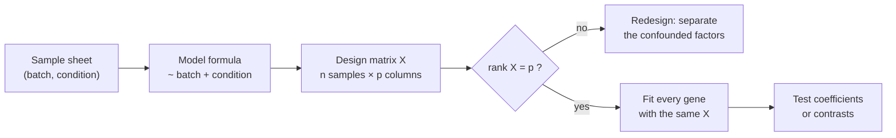

---
aliases:
  - Model Matrix
  - X Matrix
  - Regressor Matrix
  - Matrice de design
tags:
  - type/concept
  - domain/statistics
  - domain/bioinformatics
  - domain/mathematics
  - level/L2
  - level/L3
  - level/M1
mastery: 0
prerequisites:
  - "[[Multiple Linear Regression]]"
  - "[[Matrix]]"
  - "[[Matrix Multiplication]]"
  - "[[Matrix Rank]]"
  - "[[Linear Independence]]"
related:
  - "[[Dummy Variable]]"
  - "[[Interaction Effect]]"
  - "[[Multicollinearity]]"
  - "[[Linear Contrast]]"
  - "[[Analysis of Variance]]"
  - "[[Differential Expression Analysis]]"
  - "[[Batch Effect]]"
  - "[[Confounding]]"
  - "[[Randomized Block Design]]"
  - "[[Paired Design]]"
  - "[[Generalized Linear Model]]"
  - "[[Linear Mixed Model]]"
  - "[[Orthogonal Projection]]"
  - "[[Singular Value Decomposition]]"
projects: []
sources:
  - "[[Law 2020 - A Guide to Creating Design Matrices for Gene Expression Experiments]]"
  - "[[An Introduction to Statistical Learning (James)]]"
  - "[[HarvardX PH525x - Data Analysis for the Life Sciences]]"
  - "[[Introduction to Linear Algebra (Strang)]]"
  - "[[Leek 2010 - Tackling the Widespread and Critical Impact of Batch Effects]]"
  - "[[Modern Statistics for Modern Biology (Holmes)]]"
  - "[[Experimental Design for Laboratory Biologists (Lazic)]]"
---

# Design Matrix

> [!abstract]
> The design matrix $X$ turns a sample sheet into numbers: one row per sample, one column per coefficient, so that the model's mean is $X\boldsymbol\beta$. Its rank decides, before any data exist, which effects an experiment can separate: when batch and condition coincide, no analysis can tell them apart.

## Definition

In a linear model $\mathbf{y} = X\boldsymbol\beta + \boldsymbol\varepsilon$, the **design matrix** $X$ ($n \times p$) has one row per observation and one column per coefficient: a column of ones for the intercept, numeric covariates as measured, a factor as indicator (0/1) columns for its levels except a reference level, and interactions as products of columns.[^isl3][^law][^ph525] It sets up the model: the fitted means are $X\hat{\boldsymbol\beta}$, and the coefficients are uniquely determined only when the columns of $X$ are linearly independent, i.e. $X$ has full column rank $p$.[^strang]

## Why it matters

- **A differential expression analysis is specified by its design matrix**, and its questions by contrasts on the coefficients.[^law] Count-based tools fit one negative binomial model per gene, all genes sharing the same $X$ ([[Differential Expression Analysis]], [[Generalized Linear Model]]).[^msmb8]
- **Design before data.** The rank and the precision of every coefficient, $\sigma^2[(X^\top X)^{-1}]_{jj}$, depend only on $X$: they can be computed from the planned sample sheet before any sample is sequenced (Worked example).
- **Batch effects.** Processing batches that line up with biological groups make technical variation look like biology, and a design in which batch and condition are completely confounded cannot be rescued by correction.[^leek] In $X$, that design is rank-deficient.
- **Design vocabulary.** Blocking, pairing and factorial layouts are column structures of $X$ ([[Randomized Block Design]], [[Paired Design]], [[Factorial Design]]).[^lazic]

## Core (L2)

### From a sample sheet to $X$



Eight invented RNA-seq samples: two conditions processed in two batches, two replicates per combination. The model `~ batch + condition` (R formula notation, "batch plus condition") gives an intercept and one indicator per non-reference level:[^isl3][^law]

| Samples | Batch | Condition | intercept | batchB | conditiontreated |
|---|---|---|---:|---:|---:|
| s1, s2 | A | control | 1 | 0 | 0 |
| s3, s4 | A | treated | 1 | 0 | 1 |
| s5, s6 | B | control | 1 | 1 | 0 |
| s7, s8 | B | treated | 1 | 1 | 1 |

The expected (log-scale) expression of a sample is $\beta_0 + \beta_B\,[\text{batch B}] + \beta_T\,[\text{treated}]$:

- $\beta_0$: control samples of batch A, the reference levels;
- $\beta_B$: the shift of batch B, the same for both conditions;
- $\beta_T$: treated minus control **within a batch**, assumed equal in both batches. On the log scale it is the [[Log Fold Change]]; if the treatment effect may differ between batches, add an [[Interaction Effect]].

How a factor is coded (choice of reference, alternatives) is the subject of [[Dummy Variable]]; this note is about the matrix as a whole.

### Reparameterizing changes the coefficients, not the fit

For one factor with $g$ groups, "intercept + $g - 1$ indicators" and "no intercept + $g$ indicators (one mean per group)" span the same column space: $X_2 = X_1 T$ with $T$ invertible. Fitted values, residuals and the test of any given comparison are identical; only the meaning of each coefficient changes, differences from the reference in one case, group means in the other. Any comparison can be recovered from either as a [[Linear Contrast]] (Exercise 4). Choose the parameterization in which the questions are single coefficients or simple contrasts.

### Full rank: what the data can separate

$\hat{\boldsymbol\beta} = (X^\top X)^{-1}X^\top\mathbf{y}$ requires $X^\top X$ to be invertible, which holds exactly when the columns of $X$ are linearly independent ([[Matrix Rank]], [[Inverse Matrix#Deeper (L2)]]).[^strang] If instead $X\mathbf{v} = \mathbf{0}$ for some $\mathbf{v} \ne \mathbf{0}$, then $X(\boldsymbol\beta + t\mathbf{v}) = X\boldsymbol\beta$ for every $t$: infinitely many coefficient vectors give the same means, and no amount of data chooses between them. Common causes:

1. an indicator for every level of a factor plus an intercept (the indicators sum to the intercept column, see [[Dummy Variable]]);
2. complete confounding, every treated sample in batch B and every control in batch A;
3. a sample-level variable constant within blocks, such as sex in a design with one column per patient (Advanced);
4. more coefficients than samples, $p > n$.

Check the rank yourself before interpreting any coefficient: it is the number of singular values of $X$ that are not numerically zero ([[Singular Value Decomposition]]).

### Bio: `~ batch + condition`, balanced or confounded

Rank and precision of three allocations of the eight samples (computed in Computational representation):

| Control/treated per batch | rank | $\mathrm{SE}(\hat\beta_T)/\sigma$ |
|---|---|---|
| A: 2/2, B: 2/2 (balanced) | 3 of 3 | 0.707 |
| A: 3/1, B: 1/3 (unbalanced) | 3 of 3 | 0.816 |
| A: 4/0, B: 0/4 (confounded) | 2 of 3 | not estimable |

The unbalanced allocation still separates batch from treatment, but its variance is $(0.816/0.707)^2 = 1.33$ times larger: a third more samples for the same precision. In the confounded allocation the batchB column equals the conditiontreated column: the treatment effect is not estimable, whatever the sequencing depth or the number of genes.[^leek] The remedy is to balance conditions across processing batches, decided before the experiment ([[Randomized Block Design]], [[Batch Effect]]).[^lazic]

## Advanced (L3)

**Estimable combinations.** In a rank-deficient design some combinations $\mathbf{c}^\top\boldsymbol\beta$ are still determined by the data: exactly those with $\mathbf{c}$ in the row space of $X$, i.e. orthogonal to every null vector. In the confounded allocation the null vector is $(0, 1, -1)$, so $\beta_B + \beta_T$, the total shift of treated batch-B samples relative to batch-A controls, is estimable, while $\beta_B$ and $\beta_T$ separately are not (Exercise 5). Contrasts tested in a differential expression analysis must be estimable ([[Linear Contrast]]).

**Blocks and nested variables.** In a paired design where each patient is sampled before and after treatment, `~ patient + treatment` gives each patient but the reference a column, and the treatment effect is estimated within patients ([[Paired Design]]).[^lazic] Adding sex, `~ patient + sex + treatment`, makes $X$ rank-deficient: sex is constant within patients, so the sex column is the sum of the columns of the male patients (Exercise 5). A between-patient variable needs a model in which patients are random rather than fixed columns ([[Linear Mixed Model]]).

**Precision is a property of $X$.** $\operatorname{Var}(\hat{\boldsymbol\beta}) = \sigma^2(X^\top X)^{-1}$. In the balanced allocation the centred batch and condition columns are orthogonal (their dot product is 0), so adjusting for batch costs nothing for the condition effect; imbalance makes them correlated and inflates the variance, the mild end of [[Multicollinearity]]. Near-confounding is the extreme: full rank on paper, a tiny smallest singular value and huge standard errors ([[Condition Number]]).

**One $X$ for 20,000 genes.** Every gene shares the design, so for linear models all coefficients come from one product: with $Y$ the samples × genes matrix, $\hat B = (X^\top X)^{-1}X^\top Y$, where $(X^\top X)^{-1}X^\top$ is computed once and each column of $\hat B$ is one gene's fit ([[Vectorization]]).

## Frontier (M1)

- **Random effects get their own design matrix.** A [[Linear Mixed Model]] writes $\mathbf{y} = X\boldsymbol\beta + Z\mathbf{u} + \boldsymbol\varepsilon$: $X$ for fixed effects (condition, batch), $Z$ for random ones (patient, donor), with $\mathbf{u} \sim \mathcal{N}(\mathbf{0}, \sigma_u^2 I)$. Patient-level variables such as sex become estimable again, from differences between patients. The design-matrix guide for expression experiments covers mixed-effects and time-series models alongside interactions.[^law]
- **The same $X$ inside GLMs.** For counts, $X\boldsymbol\beta$ becomes the linear predictor $\log\mu$ of a negative binomial model; the design, the rank requirement and the contrasts carry over unchanged ([[Generalized Linear Model]], [[Negative Binomial Regression]]).[^msmb8]

## Mathematical representation

- $X \in \mathbb{R}^{n \times p}$, rows $\mathbf{x}_i^\top$ (samples), columns (coefficients); $E[\mathbf{y}] = X\boldsymbol\beta$.
- **Identifiability.** $\operatorname{rank} X = p \iff (X\mathbf{v} = \mathbf{0} \Rightarrow \mathbf{v} = \mathbf{0}) \iff X^\top X$ is invertible, because $\mathbf{v}^\top X^\top X\mathbf{v} = \lVert X\mathbf{v}\rVert^2$.
- **Non-identifiability.** If $X\mathbf{v} = \mathbf{0}$ with $\mathbf{v} \ne \mathbf{0}$, then $X(\boldsymbol\beta + t\mathbf{v}) = X\boldsymbol\beta$ for all $t \in \mathbb{R}$.
- **Estimability.** $\mathbf{c}^\top\boldsymbol\beta$ is estimable $\iff \mathbf{c} \in \operatorname{row}(X) \iff \mathbf{c} \perp \operatorname{null}(X)$; then $\mathbf{c}^\top\hat{\boldsymbol\beta}$ is the same for every least-squares solution.
- **Reparameterization.** $X_2 = X_1 T$ with $T$ invertible: same column space, same fitted values (the [[Orthogonal Projection]] onto that space), and $\boldsymbol\beta_2 = T^{-1}\boldsymbol\beta_1$.
- **Precision.** $\operatorname{Var}(\hat{\boldsymbol\beta}) = \sigma^2 (X^\top X)^{-1}$. Balanced example: each batch compares 2 treated with 2 controls, variance $\sigma^2(\frac12 + \frac12) = \sigma^2$, and averaging the two batches gives $\mathrm{SE}(\hat\beta_T) = \sigma\sqrt{1/2} = 0.707\,\sigma$.

## Computational representation

The matrix is built from a sample sheet by hand, then NumPy gives rank, singular values and precision. No expression data are needed: everything below is a property of the design.

```python
import numpy as np


def design(samples, factors, reference):
    """Intercept plus one indicator column per non-reference level of each factor."""
    cols, names = [[1.0] * len(samples)], ["intercept"]
    for f in factors:
        for level in sorted({s[f] for s in samples} - {reference[f]}):
            cols.append([1.0 if s[f] == level else 0.0 for s in samples])
            names.append(f"{f}{level}")
    return np.array(cols).T, names


def sheet(layout):
    """Sample sheet from (batch, condition, number of samples) blocks."""
    return [{"batch": b, "condition": c} for b, c, k in layout for _ in range(k)]


def report(label, samples):
    X, names = design(samples, ["batch", "condition"], {"batch": "A", "condition": "control"})
    rank = np.linalg.matrix_rank(X)
    sv = np.linalg.svd(X, compute_uv=False)
    line = f"{label:<11} rank {rank}/{X.shape[1]}  smallest singular value {sv[-1]:.1e}"
    if rank == X.shape[1]:
        se = np.sqrt(np.diag(np.linalg.inv(X.T @ X)))
        line += f"  SE(treated)/sigma {se[names.index('conditiontreated')]:.3f}"
    print(line)


balanced = sheet([("A", "control", 2), ("A", "treated", 2), ("B", "control", 2), ("B", "treated", 2)])
X, names = design(balanced, ["batch", "condition"], {"batch": "A", "condition": "control"})
print(names)
print(X.astype(int).tolist())
report("balanced", balanced)
report("unbalanced", sheet([("A", "control", 3), ("A", "treated", 1), ("B", "control", 1), ("B", "treated", 3)]))
report("confounded", sheet([("A", "control", 4), ("B", "treated", 4)]))
```

```text
['intercept', 'batchB', 'conditiontreated']
[[1, 0, 0], [1, 0, 0], [1, 0, 1], [1, 0, 1], [1, 1, 0], [1, 1, 0], [1, 1, 1], [1, 1, 1]]
balanced    rank 3/3  smallest singular value 1.1e+00  SE(treated)/sigma 0.707
unbalanced  rank 3/3  smallest singular value 1.0e+00  SE(treated)/sigma 0.816
confounded  rank 2/3  smallest singular value 1.6e-16
```

The confounded matrix has a singular value of $10^{-16}$, zero up to rounding ([[Floating-Point Arithmetic]]): `matrix_rank` counts it as zero.

## Worked example

> [!example] Reading the balanced design, then planning against confounding
> 1. **Columns.** `intercept`, `batchB`, `conditiontreated`: the reference levels are batch A and control, and the rows are s1 to s8 as printed above.
> 2. **Coefficients as group means.** Control A $= \beta_0$; treated A $= \beta_0 + \beta_T$; control B $= \beta_0 + \beta_B$; treated B $= \beta_0 + \beta_B + \beta_T$. Four group means but three coefficients: the additive model assumes one treatment effect for both batches, an assumption an interaction term would test.
> 3. **Rank.** Smallest singular value 1.1, rank 3 of 3: batch and treatment are separable.
> 4. **Precision before sequencing.** $\mathrm{SE}(\hat\beta_T) = 0.707\,\sigma$. For a gene whose residual SD is $\sigma = 0.4$ log2 units (an invented value), a two-fold change ($\beta_T = 1$) gives $t \approx 1/(0.707 \times 0.4) = 3.5$ with $8 - 3 = 5$ residual degrees of freedom.
> 5. **Alternatives.** Swapping one control of batch B with one treated sample of batch A (allocation 3/1, 1/3) keeps rank 3 but multiplies the variance by 1.33; putting all controls in batch A makes the question unanswerable. The sample sheet, not the analysis, decided.

## Common misconceptions

> [!warning] "Batch correction can fix any batch effect"
> Correction needs each batch to contain the conditions being compared. With batch and condition completely confounded, the two columns are equal and the design is rank-deficient: no method can split the shift between them.[^leek]

> [!warning] "More samples fix a rank-deficient design"
> Rank depends on the pattern of the columns, not on their length. With eight or eighty samples, if every treated sample is in batch B the treatment effect stays inestimable; only a different allocation helps.

> [!warning] "The intercept is the overall mean"
> With reference coding the intercept is the mean of the reference group (controls of batch A), and the other coefficients are differences from it. Changing the reference changes the coefficients, not the fit.

> [!warning] "The design matrix is a technical detail of the software"
> It is the hypothesis: which effects are in the model, which comparisons are possible and how precisely they are estimated. Write it out and check it before running a differential expression tool.[^law]

## Exercises

> [!question] Exercise 1 (L2)
> Six samples: liver, liver, lung, lung, brain, brain. Write $X$ for `~ tissue` with liver as reference, interpret each coefficient, then write the version without intercept (one column per tissue). How do you get "lung minus brain" from each?

> [!success]- Solution
> With reference liver (columns intercept, tissuebrain, tissuelung): liver rows $(1, 0, 0)$, lung rows $(1, 0, 1)$, brain rows $(1, 1, 0)$. $\beta_0$ is the liver mean, $\beta_{\text{brain}}$ and $\beta_{\text{lung}}$ are differences from liver. Without intercept (columns liver, brain, lung): liver $(1, 0, 0)$, brain $(0, 1, 0)$, lung $(0, 0, 1)$, and the coefficients are the three means. Lung minus brain is $\beta_{\text{lung}} - \beta_{\text{brain}}$ in the first, $\mu_{\text{lung}} - \mu_{\text{brain}}$ in the second: the same number, a [[Linear Contrast]] in both.

> [!question] Exercise 2 (L2)
> Full rank or not? (a) `~ batch + condition` with each condition in each batch; (b) the same with all treated samples in batch B and all controls in batch A; (c) three patients, each sampled before and after treatment, `~ patient + treatment`; (d) the same with `~ patient + sex + treatment`, patients P1 and P2 female and P3 male; (e) five samples and a model with six coefficients.

> [!success]- Solution
> (a) Full rank. (b) Not: the batchB column equals the conditiontreated column. (c) Full rank: 4 columns (intercept, P2, P3, after), rank 4. (d) Not: the sexM column equals the patientP3 column. (e) Not: the rank of a $5 \times 6$ matrix is at most 5. Exercise 5 checks (b) to (d) numerically.

> [!question] Exercise 3 (L2, Python)
> A lab can process 12 samples in two batches of six. With `sheet` and `report`, compare $\mathrm{SE}(\hat\beta_T)/\sigma$ for 3 control + 3 treated per batch and for 5 + 1 in batch A, 1 + 5 in batch B. How many more samples would the second allocation need to match the first?

> [!success]- Solution
> ```python
> report("3+3 / 3+3", sheet([("A", "control", 3), ("A", "treated", 3), ("B", "control", 3), ("B", "treated", 3)]))
> report("5+1 / 1+5", sheet([("A", "control", 5), ("A", "treated", 1), ("B", "control", 1), ("B", "treated", 5)]))
> ```
> ```text
> 3+3 / 3+3   rank 3/3  smallest singular value 1.4e+00  SE(treated)/sigma 0.577
> 5+1 / 1+5   rank 3/3  smallest singular value 1.0e+00  SE(treated)/sigma 0.775
> ```
> The variance ratio is $(0.775/0.577)^2 = 1.80$: the lopsided allocation needs about 80 % more samples for the same precision, although it uses exactly the same number of controls and treated samples. By hand: within a batch, 3 against 3 gives variance $\sigma^2(\frac13 + \frac13)$, and 5 against 1 gives $\sigma^2(\frac15 + 1)$.

> [!question] Exercise 4 (L3)
> For the six tissue samples of Exercise 1, find the matrix $T$ with $X_{\text{ref}} = X_{\text{means}}T$ (columns of $X_{\text{means}}$ ordered liver, brain, lung). Deduce that both models have the same fitted values and express the group means in terms of the reference-coded coefficients.

> [!success]- Solution
> The intercept column is liver + brain + lung, and the brain and lung indicators are shared, so $T = \begin{pmatrix} 1 & 0 & 0 \\ 1 & 1 & 0 \\ 1 & 0 & 1 \end{pmatrix}$, invertible ($\det T = 1$). Then $X_{\text{ref}}\boldsymbol\beta = X_{\text{means}}(T\boldsymbol\beta)$: every fit of one model is a fit of the other, and the column spaces coincide, so the least-squares fitted values (the projection onto that space) are equal. The means are $T\boldsymbol\beta$: $\mu_{\text{liver}} = \beta_0$, $\mu_{\text{brain}} = \beta_0 + \beta_{\text{brain}}$, $\mu_{\text{lung}} = \beta_0 + \beta_{\text{lung}}$.

> [!question] Exercise 5 (L3, Python)
> With `design` and `sheet`, find a null vector of the confounded design by SVD, build two coefficient vectors that give identical means, and name the estimable combination. Then check the ranks of designs (c) and (d) of Exercise 2.

> [!success]- Solution
> ```python
> Xc, names = design(sheet([("A", "control", 4), ("B", "treated", 4)]),
>                    ["batch", "condition"], {"batch": "A", "condition": "control"})
> U, s, Vt = np.linalg.svd(Xc)
> v = Vt[-1] / Vt[-1][1]                                  # null direction, scaled so its batch entry is 1
> print(names, np.round(v, 3) + 0.0, f"|X v| = {np.linalg.norm(Xc @ v):.1e}")
> b1 = np.array([5.0, 1.0, 2.0])                          # batch shift 1, treatment effect 2
> b2 = b1 + 1.5 * v                                       # batch shift 2.5, treatment effect 0.5
> print(b2, np.allclose(Xc @ b1, Xc @ b2))
> # paired design: 3 patients (2 female, 1 male), each before and after treatment
> patients = [{"patient": p, "sex": sx, "treatment": t}
>             for p, sx in (("P1", "F"), ("P2", "F"), ("P3", "M")) for t in ("before", "after")]
> ref = {"patient": "P1", "sex": "F", "treatment": "before"}
> for factors in (["patient", "treatment"], ["patient", "sex", "treatment"]):
>     Xp, nm = design(patients, factors, ref)
>     print(" + ".join(factors), "->", nm, "rank", np.linalg.matrix_rank(Xp), "of", Xp.shape[1])
> ```
> ```text
> ['intercept', 'batchB', 'conditiontreated'] [ 0.  1. -1.] |X v| = 4.4e-16
> [5.  2.5 0.5] True
> patient + treatment -> ['intercept', 'patientP2', 'patientP3', 'treatmentafter'] rank 4 of 4
> patient + sex + treatment -> ['intercept', 'patientP2', 'patientP3', 'sexM', 'treatmentafter'] rank 4 of 5
> ```
> A batch shift of 1 with a treatment effect of 2, or 2.5 with 0.5, produce identical means: the data cannot choose. The null vector $(0, 1, -1)$ is orthogonal to $(0, 1, 1)$, so $\beta_B + \beta_T = 3$ is estimable in both. The paired design is full rank; adding sex loses one rank, because sexM duplicates patientP3.

## Mastery checklist

- [ ] 1 Recognized: I can say what the rows and columns of a design matrix are and write $X$ for a two-group comparison.
- [ ] 2 Understood: I can interpret coefficients under reference coding, explain full rank, and show why complete confounding makes a design rank-deficient.
- [ ] 3 Practiced: I can build $X$ from a sample sheet in Python, check its rank with the SVD and compare allocations by $\mathrm{SE}(\hat\beta)/\sigma$ before collecting data.
- [ ] 4 Applied: for a public RNA-seq dataset, I wrote the design (`~ batch + condition` or paired), checked its rank, ran a differential expression tool with it and identified which coefficient the reported fold changes refer to.
- [ ] 5 Explained: I can teach estimability, reparameterization, nested variables in paired designs and why the design matrix must be fixed before the experiment.

## References

[^isl3]: [[An Introduction to Statistical Learning (James)]], Python edition, ch. 3 "Linear Regression": qualitative predictors coded with a baseline level, interaction terms (chapter number as checked in [[Linear Models]]).
[^law]: [[Law 2020 - A Guide to Creating Design Matrices for Gene Expression Experiments]], *F1000Research* 9:1444.
[^ph525]: [[HarvardX PH525x - Data Analysis for the Life Sciences]], PH525.2x to 4x (linear models and matrix algebra).
[^strang]: [[Introduction to Linear Algebra (Strang)]], 6th ed. (2023), least squares part (independent columns and the invertibility of $A^\top A$).
[^leek]: [[Leek 2010 - Tackling the Widespread and Critical Impact of Batch Effects]], *Nature Reviews Genetics* 11(10):733-739.
[^msmb8]: [[Modern Statistics for Modern Biology (Holmes)]], ch. 8 "High-Throughput Count Data" (chapter title as cited in [[Student's t-Distribution]]).
[^lazic]: [[Experimental Design for Laboratory Biologists (Lazic)]], common designs (randomized block, paired) and planning.
