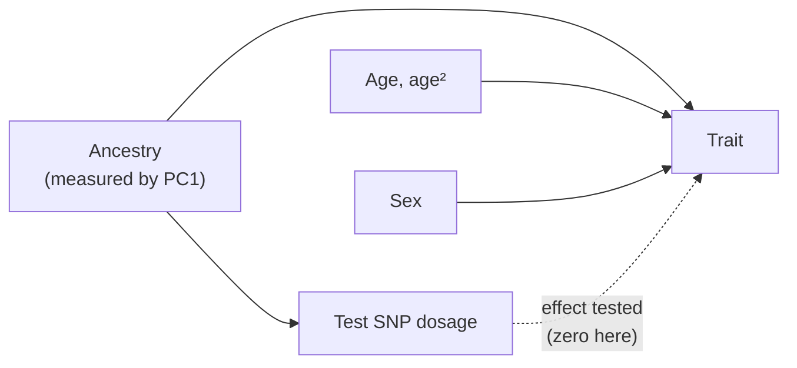

---
aliases:
  - Multiple Regression
  - Multivariable Linear Regression
  - Polynomial Regression
  - Adjusted Regression
  - Régression linéaire multiple
tags:
  - type/concept
  - domain/statistics
  - domain/bioinformatics
  - level/L2
  - level/L3
mastery: 0
prerequisites:
  - "[[Linear Regression]]"
  - "[[Coefficient of Determination]]"
  - "[[Matrix Multiplication]]"
  - "[[Least Squares]]"
related:
  - "[[Design Matrix]]"
  - "[[Dummy Variable]]"
  - "[[Interaction Effect]]"
  - "[[Multicollinearity]]"
  - "[[Analysis of Variance]]"
  - "[[Regression Diagnostics]]"
  - "[[Confounding]]"
  - "[[Population Stratification]]"
  - "[[Genome-Wide Association Study]]"
  - "[[Principal Component Analysis]]"
  - "[[Orthogonal Projection]]"
  - "[[Spline]]"
projects: []
sources:
  - "[[An Introduction to Statistical Learning (James)]]"
  - "[[Stanford - Statistical Learning with Python]]"
  - "[[Price 2006 - Principal Components Analysis Corrects for Stratification in Genome-Wide Association Studies]]"
  - "[[Shabalin 2012 - Matrix eQTL]]"
---

# Multiple Linear Regression

> [!abstract]
> Multiple linear regression explains a response with several predictors at once. Each coefficient is the effect of one predictor with the others held fixed, which is how an association test is adjusted for age, sex and ancestry; powers of a predictor let the same machinery fit curves.

## Definition

**Multiple linear regression** models a quantitative response as a linear combination of $p$ predictors plus an error,

$$Y = \beta_0 + \beta_1 x_1 + \beta_2 x_2 + \dots + \beta_p x_p + \varepsilon,$$

with coefficients estimated by least squares. $\beta_j$ is the average effect on $Y$ of a one-unit increase in $x_j$, **holding all other predictors fixed**.[^isl3] The model is linear in the coefficients, not necessarily in the measured variables: a predictor can be a transformation or a power of another, as in polynomial regression.[^isl3][^slp]

## Why it matters

- **Adjusted association tests.** Quantitative-trait association and eQTL tests regress the trait on genotype dosage together with covariates such as sex and ancestry; linear-regression eQTL software includes covariates for population stratification and gender.[^shabalin] Ancestry is summarized by principal components of genome-wide genotypes; without that adjustment, ancestry differences produce spurious associations.[^price] See [[Genome-Wide Association Study]], [[Population Stratification]].
- **Precision.** A covariate that explains part of the response shrinks the residual variance and sharpens the test of the variable of interest (Exercise 5).
- **Curves with linear tools.** Polynomial terms such as age² model non-linear covariate effects with the same least squares, tests and diagnostics.[^isl3][^slp]
- **Gateway to designed experiments.** Every differential expression design is a multiple regression written as a [[Design Matrix]], with categorical predictors ([[Dummy Variable]]), effects that depend on each other ([[Interaction Effect]]) and correlated predictors ([[Multicollinearity]]).

## Core (L2)

### Several predictors, one matrix

Stack the $n$ observations: $\mathbf{y} = X\boldsymbol\beta + \boldsymbol\varepsilon$, where $X$ has a column of ones and one column per predictor ([[Design Matrix]]). If the columns are linearly independent, least squares gives $\hat{\boldsymbol\beta} = (X^\top X)^{-1}X^\top\mathbf{y}$ ([[Least Squares]], [[Matrix Rank]]). With $p$ predictors, $s^2 = \mathrm{RSS}/(n - p - 1)$, $\mathrm{SE}(\hat\beta_j) = s\sqrt{[(X^\top X)^{-1}]_{jj}}$, and $t_j = \hat\beta_j/\mathrm{SE}(\hat\beta_j)$ follows a $t$ distribution with $n - p - 1$ degrees of freedom under $\beta_j = 0$.[^isl3] With $p = 1$ this is [[Linear Regression]].

### Reading an adjusted coefficient

"Holding the others fixed" is the whole point and the whole difficulty. When $x_j$ is correlated with another cause of $y$, its crude slope mixes both effects; the adjusted coefficient separates them by using only the part of $x_j$ that the other predictors cannot predict (the partialling-out property, proved in Mathematical representation). Two consequences: adjustment can remove a spurious association (the Bio example below), and it cannot separate two predictors that are near copies of each other, whose distinct parts are tiny ([[Multicollinearity]]).

### Testing several coefficients

The $t$ test examines one coefficient. The overall $F$ test of $H_0: \beta_1 = \dots = \beta_p = 0$ uses

$$F = \frac{(\mathrm{TSS} - \mathrm{RSS})/p}{\mathrm{RSS}/(n - p - 1)},$$

and a group of $q$ coefficients (age and age², or ten ancestry components) is tested by comparing the model without them ($\mathrm{RSS}_0$) to the full model: $F = \frac{(\mathrm{RSS}_0 - \mathrm{RSS})/q}{\mathrm{RSS}/(n - p - 1)}$ with $q$ and $n - p - 1$ degrees of freedom.[^isl3] This comparison of nested models is the logic of [[Analysis of Variance]] ([[F-Distribution]]).

### Polynomial terms

$Y = \beta_0 + \beta_1 x + \beta_2 x^2 + \varepsilon$ is still a linear model: $x$ and $x^2$ are two columns of $X$.[^isl3][^slp] Three working rules follow from the algebra:

- **Centre before squaring.** $x$ and $x^2$ are nearly collinear when $x$ is far from 0 (correlation 0.994 for temperatures 20 to 45 °C, 0 after centring, Exercise 2).
- **Read the terms together.** The slope at $x$ is $\beta_1 + 2\beta_2 x$ and the vertex is at $x = -\beta_1/(2\beta_2)$; $\beta_1$ alone is the slope at $x = 0$, which after centring is the mean.
- **Keep the lower-order term** when $x^2$ is in the model; for more flexible shapes, use [[Spline|splines]].

### Bio: an association test adjusted for age, sex and ancestry

An invented cohort of 600 people from two ancestral populations. The trait depends on age (curved), sex and ancestry, through environment or other loci, but **not** on the test SNP, whose allele frequency is 0.2 in one population and 0.6 in the other. A principal component analysis of 300 other SNPs gives PC1, which tracks ancestry ($|r| = 0.97$ with population).



| Model | SNP effect (SE) | p |
|---|---|---|
| trait ~ SNP | +0.273 (0.071) | $1.2 \times 10^{-4}$ |
| + age, age², sex | +0.292 (0.056) | $2.4 \times 10^{-7}$ |
| + age, age², sex, PC1 | +0.008 (0.063) | 0.90 |

The crude association is spurious: carriers of the allele are more often from the population with the higher trait. Age and sex are unrelated to ancestry here, so adjusting for them cannot remove the bias; by explaining trait variance they shrink the standard error and make the false signal *more* significant. PC1 is the confounder's proxy, and adjusting for it removes the association, the correction introduced for genome-wide studies by Price and colleagues.[^price]

## Advanced (L3)

**Partialling out, and what it buys.** The adjusted coefficient of $x_j$ equals the slope of a simple regression of the residuals of $y$ on the residuals of $x_j$, both residualized on the other predictors (proof below, check in Exercise 4). Three uses:

- **Ancestry correction two ways.** Residualizing the trait and every genotype on the ancestry components, then testing, gives the same estimates as putting the components in each model.
- **Speed at scale.** Residualize the trait once and the genotype matrix once on the covariates; each test is then a simple regression, and all of them reduce to one matrix product. eQTL software that accepts covariates gets its speed from such large matrix operations.[^shabalin] The degrees of freedom must still be $n - p - 1$, not $n - 2$.
- **Variance inflation.** $\operatorname{Var}(\hat\beta_j) = \sigma^2/\big(S_{jj}(1 - R_j^2)\big)$, where $R_j^2$ is the $R^2$ of $x_j$ on the other predictors: the more predictable $x_j$ is, the less information is left ([[Multicollinearity]]).

**What to adjust for is a causal question.** Adjust for **confounders**, common causes of $x$ and $y$ (ancestry). Adjust for **precision covariates**, causes of $y$ unrelated to $x$ (age, sex), to gain power. Do not adjust for **mediators**, on the path from $x$ to $y$ (the expression of the gene through which a variant acts), which removes part of the effect being estimated, nor for **colliders**, caused by both $x$ and $y$ (a biomarker raised by both the variant and the disease), which creates an association out of nothing. No fit statistic distinguishes these roles; they come from biology ([[Confounding]]).

**Number of predictors.** As $p$ approaches $n$, $R^2$ rises regardless of signal and the estimates become unstable ([[Coefficient of Determination#Advanced (L3)]]); choosing predictors or shrinking coefficients belongs to [[Model Selection]] and [[Regularization]]. When the residual structure is itself a problem (relatedness between individuals, repeated measures), the model needs random effects ([[Linear Mixed Model]]).

## Mathematical representation

- **Model.** $\mathbf{y} = X\boldsymbol\beta + \boldsymbol\varepsilon$, $X \in \mathbb{R}^{n \times (p+1)}$ of full column rank, $E[\boldsymbol\varepsilon] = \mathbf{0}$, $\operatorname{Var}(\boldsymbol\varepsilon) = \sigma^2 I$.
- **Estimates.** $\hat{\boldsymbol\beta} = (X^\top X)^{-1}X^\top\mathbf{y}$, unbiased, with $\operatorname{Var}(\hat{\boldsymbol\beta}) = \sigma^2(X^\top X)^{-1}$; $s^2 = \mathrm{RSS}/(n - p - 1)$.
- **Partialling out.** Split $X = [\mathbf{x}_j \; Z]$ and let $M_Z = I - Z(Z^\top Z)^{-1}Z^\top$, the symmetric idempotent matrix that returns residuals on $Z$ ($M_Z Z = 0$). The fit is $\mathbf{y} = \mathbf{x}_j\hat\beta_j + Z\hat{\boldsymbol\gamma} + \mathbf{e}$ with $Z^\top\mathbf{e} = \mathbf{0}$ and $\mathbf{x}_j^\top\mathbf{e} = 0$. Applying $M_Z$: $M_Z\mathbf{y} = M_Z\mathbf{x}_j\hat\beta_j + \mathbf{e}$. Multiplying by $\mathbf{x}_j^\top$:
$$\hat\beta_j = \frac{\mathbf{x}_j^\top M_Z\mathbf{y}}{\mathbf{x}_j^\top M_Z\mathbf{x}_j} = \frac{(M_Z\mathbf{x}_j)^\top (M_Z\mathbf{y})}{\lVert M_Z\mathbf{x}_j\rVert^2},$$
the slope of $M_Z\mathbf{y}$ on $M_Z\mathbf{x}_j$, with the same residuals $\mathbf{e}$. Its variance is $\sigma^2/\lVert M_Z\mathbf{x}_j\rVert^2 = \sigma^2/\big(S_{jj}(1 - R_j^2)\big)$ ([[Orthogonal Projection]]).
- **Tests.** $t_j \sim t_{n-p-1}$; overall and partial $F$ as above, with $(p, n-p-1)$ and $(q, n-p-1)$ degrees of freedom.
- **Quadratic.** $E[Y] = \beta_0 + \beta_1 x + \beta_2 x^2$: $dE[Y]/dx = \beta_1 + 2\beta_2 x$, extremum at $x^* = -\beta_1/(2\beta_2)$ (a maximum if $\beta_2 < 0$).

## Computational representation

NumPy for the matrix algebra, SciPy for $t$ tail probabilities. The simulation builds the invented cohort of the Bio example.

```python
import numpy as np
from scipy import stats


def ols(X, y):
    """Least squares with standard errors and two-sided p-values."""
    n, k = X.shape                                      # k = p + 1 coefficients
    beta, *_ = np.linalg.lstsq(X, y, rcond=None)
    resid = y - X @ beta
    s2 = resid @ resid / (n - k)
    se = np.sqrt(s2 * np.diag(np.linalg.inv(X.T @ X)))
    return beta, se, 2 * stats.t.sf(np.abs(beta / se), n - k)


rng = np.random.default_rng(42)
n = 600
pop = np.repeat([0, 1], n // 2)                         # two ancestral populations (invented)
p_a = rng.uniform(0.1, 0.9, 300)                        # 300 genome-wide SNPs
p_b = np.clip(p_a + rng.normal(0, 0.15, 300), 0.02, 0.98)
G = rng.binomial(2, np.where(pop[:, None] == 1, p_b, p_a))
U, S, Vt = np.linalg.svd((G - G.mean(0)) / G.std(0), full_matrices=False)
pc1 = U[:, 0] * S[0]                                    # first principal component score

snp = rng.binomial(2, np.where(pop == 1, 0.6, 0.2))     # test SNP: no effect on the trait
age = rng.uniform(20, 70, n)
sex = rng.integers(0, 2, n)                             # 0/1 coding (invented)
ac = age - age.mean()                                   # centred age, then its square
trait = (0.05 * ac - 0.002 * ac ** 2 + 0.8 * sex + 0.7 * pop
         + rng.normal(0, 1, n))                         # ancestry shifts the trait, not the SNP

one = np.ones(n)
models = {
    "crude": np.column_stack([one, snp]),
    "+ age, age^2, sex": np.column_stack([one, snp, ac, ac ** 2, sex]),
    "+ age, age^2, sex, PC1": np.column_stack([one, snp, ac, ac ** 2, sex, pc1]),
}
for name, X in models.items():
    beta, se, p = ols(X, trait)
    print(f"{name:<24} SNP effect {beta[1]:+.3f} (SE {se[1]:.3f})  p = {p[1]:.1e}")
print(f"|corr(PC1, population)| = {abs(np.corrcoef(pc1, pop)[0, 1]):.3f}")
beta, se, p = ols(models["+ age, age^2, sex, PC1"], trait)
for name, b, s, pv in zip(["intercept", "SNP", "age (centred)", "age^2", "sex", "PC1"], beta, se, p):
    print(f"{name:<14} {b:+.4f}  SE {s:.4f}  p = {pv:.2g}")
```

```text
crude                    SNP effect +0.273 (SE 0.071)  p = 1.2e-04
+ age, age^2, sex        SNP effect +0.292 (SE 0.056)  p = 2.4e-07
+ age, age^2, sex, PC1   SNP effect +0.008 (SE 0.063)  p = 9.0e-01
|corr(PC1, population)| = 0.970
intercept      +0.3166  SE 0.0898  p = 0.00045
SNP            +0.0080  SE 0.0631  p = 0.9
age (centred)  +0.0493  SE 0.0029  p = 7.4e-53
age^2          -0.0020  SE 0.0002  p = 1.6e-18
sex            +0.8024  SE 0.0833  p = 1.6e-20
PC1            -0.1001  SE 0.0121  p = 8.5e-16
```

`np.linalg.inv(X.T @ X)` is acceptable for six well-scaled columns; production code takes standard errors from a QR decomposition of $X$ ([[QR Decomposition]], [[Inverse Matrix#Advanced (L3)]]).

## Worked example

> [!example] Reading the fully adjusted model (invented cohort above)
> 1. **SNP: +0.008 (SE 0.063), p = 0.9.** Among people of the same age, sex and PC1 score, each extra allele changes the trait by about 0.008 units: no detectable effect, the truth in this simulation.
> 2. **Age and age²: +0.0493 and −0.0020.** With centred age, 0.0493 is the slope at the mean age; the slope at age $\bar a + c$ is $0.0493 - 2 \times 0.0020\,c$, zero near $c = 12$ years above the mean (simulated truth: 0.05 and −0.002). Test the two terms together with the partial $F$ test, never $\beta_1$ alone.
> 3. **Sex: +0.80.** Same age, ancestry and genotype: coded-1 individuals average 0.80 units higher (truth 0.8).
> 4. **PC1: −0.10 per unit.** The sign of a principal component is arbitrary; the coefficient says that the trait varies along the ancestry axis. Because PC1 is in the model, the SNP coefficient compares people at the same position on that axis.
> 5. **What the model does not say.** It shows no evidence for a SNP effect; it does not prove there is none ($0.008 \pm 1.96 \times 0.063$ allows effects up to about 0.13 either way), and it is valid only if no other confounder is missing.

## Common misconceptions

> [!warning] "Adding covariates always reduces bias"
> Adjusting for a confounder reduces bias; adjusting for a mediator or a collider adds it. Covariates are chosen from causal knowledge, not by what improves the fit.

> [!warning] "Age and sex adjustment protects against confounding"
> Only against confounding by age and sex. In the Bio example they made a spurious SNP association more significant, by shrinking the residual variance. Ancestry needs its own covariates.[^price]

> [!warning] "A coefficient means the same with or without the other predictors"
> The crude and the adjusted coefficient answer different questions: the difference between groups as sampled, versus the difference among individuals equal on the other predictors. They can differ in size and even in sign ([[Simpson's Paradox]]).

> [!warning] "Polynomial regression is non-linear regression"
> It is linear in the coefficients, so least squares, $t$ and $F$ tests and diagnostics apply unchanged; only the predictor columns are powers.[^isl3]

## Exercises

> [!question] Exercise 1 (L2)
> An invented fitted model reads: trait $= 1.20 + 0.15 \times \text{dosage} + 0.030 \times \text{age} - 0.40 \times \text{female} + 0.05 \times \text{PC1}$. Interpret 0.15; predict the trait of a 50-year-old woman with dosage 2 and PC1 $= -1$; give the predicted difference between two people who differ only in dosage, 0 against 2.

> [!success]- Solution
> 0.15 is the average trait difference per extra allele between people of the same age, sex and ancestry score. Prediction: $1.20 + 0.30 + 1.50 - 0.40 - 0.05 = 2.55$. Difference for 0 against 2 alleles, all else equal: $2 \times 0.15 = 0.30$, whatever their age, sex or PC1 (the model has no [[Interaction Effect|interaction]]).

> [!question] Exercise 2 (L2, Python)
> Invented growth rates of a bacterium (doublings per hour) at 20, 25, 30, 35, 40, 45 °C: 0.35, 0.62, 0.81, 0.88, 0.71, 0.30. Compare a straight line and a quadratic in centred temperature ($R^2$, adjusted $R^2$), estimate the optimal temperature, and compare the correlation of $t$ with $t^2$ before and after centring.

> [!success]- Solution
> ```python
> import numpy as np
>
> temp = np.array([20, 25, 30, 35, 40, 45.0])             # invented: growth rate vs temperature (C)
> rate = np.array([0.35, 0.62, 0.81, 0.88, 0.71, 0.30])   # doublings per hour
> tc = temp - temp.mean()                                 # centre before squaring
> tss = ((rate - rate.mean()) ** 2).sum()
> for name, X in (("linear", np.column_stack([np.ones(6), tc])),
>                 ("quadratic", np.column_stack([np.ones(6), tc, tc ** 2]))):
>     beta, *_ = np.linalg.lstsq(X, rate, rcond=None)
>     rss = ((rate - X @ beta) ** 2).sum()
>     k = X.shape[1]
>     print(f"{name:<9} R2 {1 - rss / tss:.3f}  adjusted R2 {1 - (rss / (6 - k)) / (tss / 5):.3f}")
> print(f"b1 {beta[1]:.5f}, b2 {beta[2]:.5f}; optimum {temp.mean() - beta[1] / (2 * beta[2]):.1f} C")
> print(f"corr(t, t^2): raw {np.corrcoef(temp, temp ** 2)[0, 1]:.4f}, centred {abs(np.corrcoef(tc, tc ** 2)[0, 1]):.4f}")
> ```
> ```text
> linear    R2 0.000  adjusted R2 -0.249
> quadratic R2 0.973  adjusted R2 0.955
> b1 0.00051, b2 -0.00346; optimum 32.6 C
> corr(t, t^2): raw 0.9937, centred 0.0000
> ```
> The straight line explains nothing: a symmetric hump has no linear trend. The quadratic explains 97 % and puts the optimum at $32.5 - 0.00051/(2 \times -0.00346) = 32.6$ °C. Centring makes $t$ and $t^2$ uncorrelated for this symmetric design, so their coefficients are estimated independently.

> [!question] Exercise 3 (L2)
> In the Bio example, why did adjusting for age, age² and sex leave the spurious SNP effect in place, and why did its p-value get smaller, from $1.2 \times 10^{-4}$ to $2.4 \times 10^{-7}$?

> [!success]- Solution
> Age and sex were simulated independently of ancestry, so they carry no information about the confounder: the bias of the SNP coefficient is unchanged (0.27 to 0.29, within noise). But they explain much of the trait variance, so $s$ and the SE fall (0.071 to 0.056) and the same bias becomes more significant. Precision covariates sharpen whatever the model estimates, bias included; only a measure of ancestry (PC1) removes it.[^price]

> [!question] Exercise 4 (L3, Python)
> Continuing the code above, residualize the trait and the SNP on all the other columns of the fully adjusted model, regress residual on residual, and compare the slope and its standard error with the full model, using $n - 2$ and $n - 6$ degrees of freedom.

> [!success]- Solution
> ```python
> X = models["+ age, age^2, sex, PC1"]
> Z = np.delete(X, 1, axis=1)                             # every column except the SNP
>
>
> def residualize(v, Z):
>     coef, *_ = np.linalg.lstsq(Z, v, rcond=None)
>     return v - Z @ coef
>
>
> ry, rg = residualize(trait, Z), residualize(snp.astype(float), Z)
> slope = (rg @ ry) / (rg @ rg)
> rss = ((ry - slope * rg) ** 2).sum()
> beta, se, _ = ols(X, trait)
> print(f"full model {beta[1]:.6f}  residual on residual {slope:.6f}")
> print(f"SE: full {se[1]:.5f}  n-2 df {np.sqrt(rss / (n - 2) / (rg @ rg)):.5f}  "
>       f"n-6 df {np.sqrt(rss / (n - 6) / (rg @ rg)):.5f}")
> ```
> ```text
> full model 0.008003  residual on residual 0.008003
> SE: full 0.06308  n-2 df 0.06287  n-6 df 0.06308
> ```
> The slopes agree to every digit, as the partialling-out formula predicts. The standard error matches only with $n - 6$ degrees of freedom: the four covariates and the intercept spent five of them. With 600 people the difference is small; with 20 samples and 10 covariates it would not be.

> [!question] Exercise 5 (L3, Python)
> Add a causal SNP with effect 0.25 per allele and the same allele frequency (0.3) in both populations. Compare its estimate and standard error without and with the covariates (age, age², sex, PC1).

> [!success]- Solution
> ```python
> rng5 = np.random.default_rng(7)
> causal = rng5.binomial(2, 0.3, n)                       # same frequency in both populations
> trait2 = trait + 0.25 * causal                          # true effect 0.25 per allele
> for name, cols in (("SNP only", [one, causal]),
>                    ("SNP + covariates", [one, causal, ac, ac ** 2, sex, pc1])):
>     beta, se, p = ols(np.column_stack(cols), trait2)
>     print(f"{name:<17} effect {beta[1]:.3f} (SE {se[1]:.3f})  p = {p[1]:.1e}")
> ```
> ```text
> SNP only          effect 0.323 (SE 0.088)  p = 2.5e-04
> SNP + covariates  effect 0.259 (SE 0.065)  p = 7.5e-05
> ```
> This SNP is not confounded, so both estimates target 0.25; the covariates remove trait variance unrelated to it and cut the standard error by about a quarter, which is worth as much as almost doubling the sample size ($(0.088/0.065)^2 \approx 1.8$).

## Mastery checklist

- [ ] 1 Recognized: I can write the multiple regression model and say what "holding the others fixed" means.
- [ ] 2 Understood: I can explain crude versus adjusted coefficients, the $t$ and $F$ tests, and why polynomial regression is a linear model.
- [ ] 3 Practiced: I can fit models with NumPy, test groups of coefficients, centre and interpret quadratic terms, and verify partialling out.
- [ ] 4 Applied: on public genotype and phenotype data, I ran an association test with age, sex and principal components and compared crude and adjusted results.
- [ ] 5 Explained: I can teach confounders versus precision covariates, mediators and colliders, and how partialling out makes genome-wide testing with covariates fast.

## References

[^isl3]: [[An Introduction to Statistical Learning (James)]], Python edition, ch. 3 "Linear Regression": multiple regression, the $F$ statistic, non-linear (polynomial) terms (chapter number as checked in [[Linear Models]]).
[^slp]: [[Stanford - Statistical Learning with Python]], regression part (linear and polynomial regression).
[^price]: [[Price 2006 - Principal Components Analysis Corrects for Stratification in Genome-Wide Association Studies]], *Nature Genetics* 38(8):904-909.
[^shabalin]: [[Shabalin 2012 - Matrix eQTL]], *Bioinformatics* 28(10):1353-1358.
