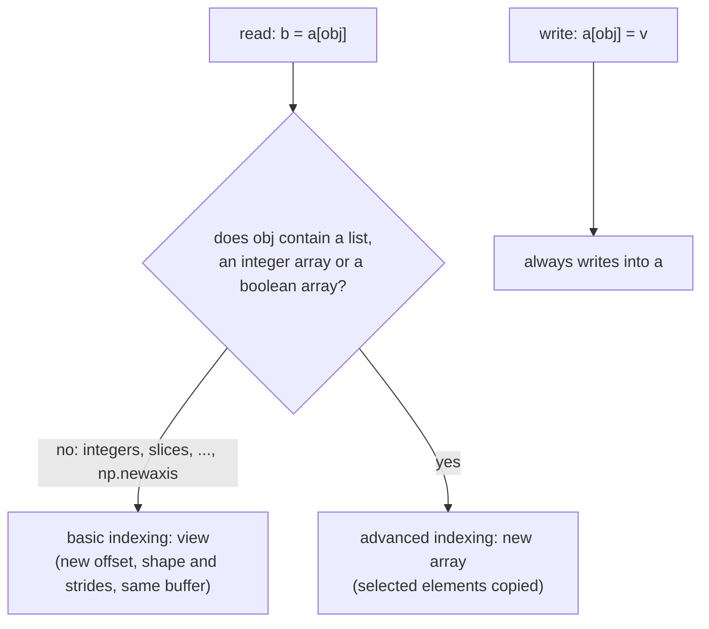

---
aliases:
  - Fancy Indexing
  - Advanced Indexing
  - Boolean Indexing
  - Boolean Mask
  - NumPy Indexing
  - Indexation de tableaux
tags:
  - type/concept
  - domain/computer-science
  - domain/bioinformatics
  - level/L2
  - level/L3
mastery: 0
prerequisites:
  - "[[N-Dimensional Array]]"
  - "[[Python Programming]]"
  - "[[Vectorization]]"
related:
  - "[[Broadcasting]]"
  - "[[Data Frame]]"
  - "[[Array Memory Layout]]"
  - "[[Count Matrix]]"
  - "[[Hash Table]]"
  - "[[Wright-Fisher Model]]"
projects:
  - "[[07-evolution-simulator]]"
sources:
  - "[[Harris 2020 - Array Programming with NumPy]]"
  - "[[Python for Data Analysis (McKinney)]]"
  - "[[Python Documentation]]"
---

# Array Indexing

> [!abstract]
> NumPy selects part of an array in three ways: slices return views that share memory, boolean masks and integer arrays return copies, and any of them on the left of `=` writes into the original; predicting which case you are in keeps selections fast and correct.

## Definition

**Array indexing** is the selection of elements of an [[N-Dimensional Array|ndarray]] with the subscript `a[obj]`. Two families behave differently:[^harris][^mck4]

- **Basic indexing**: `obj` contains only integers, slices `start:stop:step`, `...` (Ellipsis) and `np.newaxis`. Slices, with or without steps, return a **view** of the original data,[^harris] and follow Python's sequence semantics: start included, stop excluded, negative indices counted from the end.[^pydoc]
- **Advanced ("fancy") indexing**: `obj` contains a boolean array (a **mask**) or an array or list of integers. Indexing with masks or with other arrays returns a **copy**, and several index arrays are broadcast together before the lookup.[^harris] A mask keeps the positions where it is `True`; several integer arrays select one element per tuple of indices.[^mck4]
- **Assignment** `a[obj] = value` writes into `a` with either family, for instance `a[a < 0] = 0`.[^mck4]

## Why it matters

- **Daily operations on count matrices.** Selecting the samples of one condition (a column mask built from the sample sheet), the genes of a list (integer positions), the expressed genes (a row mask), or putting columns in sample-sheet order are all indexing ([[Count Matrix]], [[Data Frame]]).
- **Correctness and memory.** A view writes through to its source and a copy silently absorbs writes, the distinction behind pandas' chained-assignment pitfall ([[Data Frame#Advanced (L3)]]). A copy costs the size of the selection; a view costs nothing but keeps the whole source buffer alive (Advanced).
- **Lookup tables and resampling.** Integer-array indexing translates byte codes through a table (the one-hot encoding of [[N-Dimensional Array#Advanced (L3)]]) and draws individuals with replacement in [[07-evolution-simulator]] (Exercise 5).

## Core (L2)

All outputs come from NumPy 2.4.6 on Python 3.11. The running example is an invented count matrix, 4 genes × 6 samples, whose labels live in parallel arrays.



**Slices are views.** A slice changes only the offset, shape and strides of the array header ([[N-Dimensional Array#Deeper (L2)]]). An integer removes its axis; a length-1 slice, a list or `None` keeps one:

```python
import numpy as np

genes = np.array(["g1", "g2", "g3", "g4"])
samples = np.array(["S1", "S2", "S3", "S4", "S5", "S6"])
condition = np.array(["ctrl", "ctrl", "ctrl", "heat", "heat", "heat"])
counts = np.array([[120, 100, 90, 400, 380, 420],
                   [30, 45, 38, 10, 12, 9],
                   [0, 2, 1, 1, 0, 3],
                   [50, 53, 47, 0, 60, 55]])                 # invented: 4 genes x 6 samples

sub = counts[1:3, ::2]                                        # genes g2, g3; samples S1, S3, S5
print(sub.tolist(), counts.strides, sub.strides, np.shares_memory(sub, counts))
print(counts[0].shape, counts[0:1].shape, counts[:, 3].shape, counts[:, [3]].shape, counts[:, 3, None].shape)
```

```text
[[30, 38, 12], [0, 1, 0]] (48, 8) (48, 16) True
(6,) (1, 6) (4,) (4, 1) (4, 1)
```

The step 2 doubled the column stride (8 → 16 bytes) and no element moved. A single element, `counts[0, 0]`, is a NumPy scalar, not a view.

**Boolean masks.** A comparison yields a boolean array, and indexing with it keeps the `True` positions. Combine masks with `&`, `|` and `~`, never with `and` or `or`, and put comparisons in parentheses:[^mck4]

```python
heat = condition == "heat"                                    # mask over samples (columns)
expressed = counts.sum(axis=1) >= 20                          # mask over genes (rows)
print(heat, expressed)
print(counts[:, heat].tolist(), np.shares_memory(counts[:, heat], counts))
print(genes[expressed & (genes != "g4")], counts[counts == 0], np.nonzero(counts == 0))
print(counts.sum(axis=1) >= 20 & (genes != "g4"))            # precedence trap: & binds before >=
```

```text
[False False False  True  True  True] [ True  True False  True]
[[400, 380, 420], [10, 12, 9], [1, 0, 3], [0, 60, 55]] False
['g1' 'g2'] [0 0 0] (array([2, 2, 3]), array([0, 4, 3]))
[ True  True  True  True]
```

`expressed and genes != "g4"` raises a `ValueError` (the truth value of an array is ambiguous). The last line is the silent trap: Python evaluated `20 & (genes != "g4")`, an array of zeros, before the comparison, so every gene passed, g4 included. A 2-D mask over a 2-D array returns a flat array in row-major order; `np.nonzero` gives the coordinates (rows, then columns) of the selected elements.

**Integer arrays.** A list or array of positions selects in any order, with repeats, and the result takes the shape of the index array. Two index arrays pair up element by element; for a submatrix, `np.ix_` turns them into a column and a row that broadcast to a grid:[^mck4][^harris]

```python
row = {g: i for i, g in enumerate(genes)}
idx = np.array([row[g] for g in ["g4", "g1", "g4"]])         # any order, repeats allowed
print(idx, counts[idx, :2].tolist())
print(counts[[0, 2], [3, 5]], counts[np.ix_([0, 2], [3, 5])].tolist())
```

```text
[3 0 3] [[50, 53], [120, 100], [50, 53]]
[400   3] [[400, 420], [1, 3]]
```

**Reading copies, writing in place.** `a[obj]` on the right of `=` builds a new array for advanced indices, but `a[obj] = v` is a different operation (`__setitem__`) that writes into `a`. A chain of two indexing steps therefore writes into `a` only if the first step returned a view:

```python
work = counts.copy()
work[work < 5] = 0                    # one indexing operation on the left of =: writes into work
work[:, heat][0] = -1                 # work[:, heat] is a copy: the write is lost
print(work[0].tolist())
work[0][heat] = -1                    # work[0] is a view: the masked write reaches work
print(work[0].tolist())
work[1, heat] = -2                    # the safe form: one operation
print(work[1].tolist(), work[2].tolist())
```

```text
[120, 100, 90, 400, 380, 420]
[120, 100, 90, -1, -1, -1]
[30, 45, 38, -2, -2, -2] [0, 0, 0, 0, 0, 0]
```

The rule: **one indexing operation per assignment**.

## Advanced (L3)

**Where the new axes go.** When basic and advanced indices are mixed, the index arrays are first broadcast to a common shape $B$ ([[Broadcasting]]).[^harris] The outputs below show the placement rule: if the advanced indices are adjacent, $B$ takes their place; if a slice separates them, $B$ comes first (fourth case: shapes $(2, 1)$ and $(2,)$ broadcast to $(2, 2)$, placed before the sliced axis of length 6).

```python
x = np.zeros((5, 6, 7))
print(x[:, [0, 1, 2], :].shape, x[:, [0, 1], [0, 1]].shape, x[[0, 1], :, [0, 1]].shape,
      x[[[0], [1]], :, [0, 1]].shape, x[np.ix_([0, 1], [2, 3], [4, 5])].shape)
```

```text
(5, 3, 7) (5, 2) (2, 6) (2, 2, 6) (2, 2, 2)
```

**A view keeps its base alive.** A ten-element view of an 80 MB array holds all 80 MB, because the view references the base buffer:

```python
big = np.zeros(10_000_000)                                    # 80 MB
head = big[:10]
print(head.nbytes, head.base.nbytes, head.base is big, big[:10].copy().base)
```

```text
80 80000000 True None
```

A function that loads a large array and returns a small selection should return a `.copy()`, so that the large buffer can be freed.

**Lookups by label.** Arrays carry no labels, so mapping identifiers to positions needs a dictionary ([[Hash Table]]) or a [[Binary Search]] on sorted identifiers. `np.searchsorted` searches a whole query array at once, but it returns an insertion point even for an absent identifier, so check equality:

```python
gene_ids = np.array(["g5", "g1", "g9", "g3"])                 # invented, unsorted
order = np.argsort(gene_ids)
sorted_ids = gene_ids[order]
query = np.array(["g3", "g7", "g5"])
pos = np.minimum(np.searchsorted(sorted_ids, query), len(sorted_ids) - 1)
found = sorted_ids[pos] == query
rows = order[pos[found]]
print(sorted_ids, pos, found, rows, gene_ids[rows], query[~found])
```

```text
['g1' 'g3' 'g5' 'g9'] [1 3 2] [ True False  True] [3 0] ['g3' 'g5'] ['g7']
```

**Cost.** A view costs $O(1)$ whatever its size. Advanced indexing reads every selected element and writes it to a new buffer, $O(k)$ time and memory for $k$ elements, with scattered reads when positions are not contiguous, which caches penalize ([[Memory Hierarchy]], [[Array Memory Layout]]). A mask adds one pass over the mask itself. Repeated indices in `a[idx] += 1` are applied once only: see `np.add.at` in [[Vectorization#Deeper (L2)]].

## Mathematical representation

- Let $A : I \to T$ with index set $I = \prod_{k=0}^{n-1} \{0, \dots, d_k - 1\}$ and byte strides $\sigma_k$ ([[N-Dimensional Array#Mathematical representation]]).
- **Slice.** On axis $k$, `start:stop:step` with step $s > 0$ selects $i_j = \mathrm{start} + j s$ for $j = 0, \dots, \ell - 1$, with $\ell = \max\left(0, \lceil (\mathrm{stop} - \mathrm{start})/s \rceil\right)$ after clipping start and stop to $[0, d_k]$. The view has offset $o' = o + \mathrm{start} \cdot \sigma_k$ and stride $\sigma'_k = s\,\sigma_k$: a new header built in $O(1)$.
- **Mask.** For $M : I \to \{0, 1\}$, $A[M]$ is the sequence $(A(i))_{i : M(i) = 1}$ in lexicographic (C) order, of length $\sum_{i \in I} M(i)$.
- **Integer array along axis 0.** For $J : I_J \to \{0, \dots, d_0 - 1\}$, $(A[J])(j, i_1, \dots, i_{n-1}) = A(J(j), i_1, \dots, i_{n-1})$, of shape $\mathrm{shape}(J) + (d_1, \dots, d_{n-1})$. Indexing composes like functions, $A[J][K] = A[J \circ K]$; for a permutation $P$, $A[P][P^{-1}] = A$ with $P^{-1} = \operatorname{argsort}(P)$ (Exercise 4).
- **Several index arrays.** $J_0, \dots, J_{m-1}$ broadcast to a shape $B$ and $(A[J_0, \dots, J_{m-1}])(b) = A(J_0(b), \dots, J_{m-1}(b))$ for every index $b$ of $B$. `np.ix_(r, c)` reshapes $r$ to $(|r|, 1)$ and $c$ to $(1, |c|)$, so $B = (|r|, |c|)$ and the result is the submatrix $\left(A(r_p, c_q)\right)_{p, q}$: the Cartesian product of two index sets, obtained by broadcasting.

## Computational representation

| Need | Expression | Result |
|---|---|---|
| one row or column | `a[i]`, `a[:, j]` | view, axis removed |
| range, with step | `a[i:j:k]` | view |
| rows that pass a test | `a[mask]`, `np.compress(mask, a, axis=0)` | copy |
| rows by position, any order, repeats | `a[idx]`, `np.take(a, idx, axis=0)` | copy |
| submatrix, rows × columns | `a[np.ix_(rows, cols)]` (masks accepted) | copy |
| positions of `True` | `np.flatnonzero(mask)`, `np.nonzero(mask)` | index arrays |
| reorder by a key, labels too | `a[order]`, `labels[order]` with `order = np.argsort(key)` | copies |

`.iloc` in pandas follows these positional rules, while `.loc` selects by label and includes the stop label of a slice ([[Data Frame]]).

## Worked example

> [!example] Align a count matrix with a sample sheet
> An invented sample sheet lists samples in the order `S4, S1, S6, S2`; the analysis needs the expressed genes (total ≥ 20) in that column order.
> 1. **Positions and mask**: a dictionary from names to positions gives `cols = [3, 0, 5, 1]`; gene totals `[1510, 144, 7, 265]` give `expressed = [True, True, False, True]`.
> 2. **Both axes at once**: `counts[np.ix_(expressed, cols)]`. Writing `counts[expressed, cols]` pairs 3 row positions with 4 column positions and raises `IndexError: shape mismatch: indexing arrays could not be broadcast together with shapes (3,) (4,)`.
> 3. **Labels with the same indices**: `samples[cols]` must equal the sheet order.
> ```python
> sheet = np.array(["S4", "S1", "S6", "S2"])                   # invented sample-sheet order
> col = {s: j for j, s in enumerate(samples)}
> cols = np.array([col[s] for s in sheet])
> M = counts[np.ix_(expressed, cols)]
> print(cols, samples[cols], genes[expressed], M.tolist(), np.shares_memory(M, counts))
> print(np.array_equal(samples[cols], sheet))
> ```
> ```text
> [3 0 5 1] ['S4' 'S1' 'S6' 'S2'] ['g1' 'g2' 'g4'] [[400, 120, 420, 100], [10, 30, 9, 45], [0, 50, 55, 53]] False
> True
> ```
> 4. **Interpret**: `M` is a copy, so normalizing it in place cannot corrupt `counts`. A sheet name absent from the matrix would raise a `KeyError` at step 1, the failure you want before an analysis rather than a silently misaligned column.

## Common misconceptions

> [!warning] "`a[mask]` gives me the selected elements to edit"
> It gives a copy: edits never reach `a`. Write with `a[mask] = value`, a single operation.

> [!warning] "`a[[0, 2], [3, 5]]` is the block of rows 0, 2 and columns 3, 5"
> Two index arrays pair up, so the result is the two elements `a[0, 3]` and `a[2, 5]`.[^mck4] The 2 × 2 block is `a[np.ix_([0, 2], [3, 5])]`.

> [!warning] "Chained indexing is only a matter of style"
> `a[:, mask][0] = v` writes into a temporary copy and is lost, while `a[0][mask] = v` works because `a[0]` happens to be a view. Code whose correctness depends on which step returns a view breaks silently when an index changes from a slice to a list.

## Exercises

> [!question] Exercise 1 (L2)
> For `x = np.arange(24).reshape(4, 6)`, predict the shape of each result and whether it shares memory with `x`: `x[1]`, `x[1:2]`, `x[:, 1]`, `x[:, [1]]`, `x[x % 5 == 0]`, `x[[0, 3], [0, 5]]`, `x[np.ix_([0, 3], [0, 5])]`, `x[::-1, ::2]`, `x[1:3][:, [0]]`.

> [!success]- Solution
> Views: `x[1]` (6,), `x[1:2]` (1, 6), `x[:, 1]` (4,), `x[::-1, ::2]` (4, 3). Copies: `x[:, [1]]` (4, 1), `x[x % 5 == 0]` (5,), equal to `[0 5 10 15 20]`, `x[[0, 3], [0, 5]]` (2,), the two elements `[0 23]`, `x[np.ix_([0, 3], [0, 5])]` (2, 2), and `x[1:3][:, [0]]` (2, 1). Integers and slices, even reversed or strided, give views; any list or mask gives a copy, even after a view. Each answer was checked with `.shape` and `np.shares_memory(result, x)`.

> [!question] Exercise 2 (L2)
> Without a loop, list the genes of `counts` that have at least 10 counts in **every** heat sample.

> [!success]- Solution
> `genes[(counts[:, heat] >= 10).all(axis=1)]` gives `['g1']`. The column mask keeps the 3 heat samples, the comparison gives a 4 × 3 boolean array, and `all(axis=1)` reduces each gene's row. The per-gene numbers of passing samples, `(counts[:, heat] >= 10).sum(axis=1)`, are `[3 2 0 2]`: g2 fails on S6 (9 counts) and g4 on S4 (0 counts).

> [!question] Exercise 3 (L2)
> Starting each time from `a = np.array([1, 5, 3, 7])`, which statements modify `a`? `a[a > 2] = 0`; `a[a > 2][0] = 0`; `a[1:][0] = 0`; `b = a[[0, 1]]; b[:] = 0`; `a[[0, 1]] += 5`.

> [!success]- Solution
> Modified: `a[a > 2] = 0` gives `[1 0 0 0]`, `a[1:][0] = 0` gives `[1 0 3 7]`, `a[[0, 1]] += 5` gives `[6 10 3 7]`. Unchanged: `a[a > 2][0] = 0` and `b = a[[0, 1]]; b[:] = 0` (checked by running each statement on a fresh array). The first and last are single assignments through an index (`a[[0, 1]] += 5` runs `a[[0, 1]] = a[[0, 1]] + 5`). The second writes into the copy made by the mask; the third writes through the view `a[1:]`; the fourth edits `b`, a copy.

> [!question] Exercise 4 (L3, Python)
> Sort the genes of `counts` by decreasing total, keeping `genes` in sync, then build the inverse permutation in two ways and check that it restores the original order.

> [!success]- Solution
> ```python
> tot = counts.sum(axis=1)
> perm = np.argsort(-tot, kind="stable")
> inv = np.empty_like(perm)
> inv[perm] = np.arange(len(perm))
> print(inv, np.array_equal(counts[perm][inv], counts), np.array_equal(np.argsort(perm), inv))
> ```
> ```text
> [0 2 3 1] True True
> ```
> `perm` is `[0 3 1 2]`: g1, g4, g2, g3 (totals 1510, 265, 144, 7); `genes[perm]` and `counts[perm]` use the same index array, so labels stay aligned. `inv[perm] = arange` states $P^{-1}(P(j)) = j$; `argsort(perm)` computes the same permutation by sorting, in $O(n \log n)$ instead of $O(n)$. A stable sort keeps tied genes in their original order.

> [!question] Exercise 5 (L3, Python)
> Neutral resampling: a population of $N = 20$ haploid genomes at 4 biallelic sites is an `(N, 4)` `uint8` array (invented, seed 11). Each generation, every offspring copies one parent drawn uniformly with replacement, the sampling scheme of the [[Wright-Fisher Model]]. Implement 30 generations with integer-array indexing and report the allele-1 frequencies at generations 0, 10, 20 and 30. Why must this be a copy rather than a view?

> [!success]- Solution
> ```python
> rng = np.random.default_rng(11)
> N, L = 20, 4
> pop = (rng.random((N, L)) < 0.5).astype(np.uint8)            # invented: allele 0/1 at 4 sites
> freq = [pop.mean(axis=0)]
> for _ in range(30):
>     parents = rng.integers(0, N, size=N)                      # each offspring picks a parent
>     pop = pop[parents]                                        # gather whole genomes: a new array
>     freq.append(pop.mean(axis=0))
> print(np.array(freq)[[0, 10, 20, 30]])
> ```
> ```text
> [[0.55 0.55 0.7  0.6 ]
>  [0.8  0.45 1.   0.8 ]
>  [0.85 0.25 1.   0.85]
>  [1.   0.6  1.   1.  ]]
> ```
> Three sites reach frequency 1 (fixation) by drift alone. `pop[parents]` repeats some rows and drops others, which no choice of offset and strides can express, so it must copy; the copy also makes the new generation independent of the old one. Generations stay a Python loop (each depends on the previous), individuals and sites are vectorized ([[Vectorization]], [[07-evolution-simulator]]).

## Mastery checklist

- [ ] 1 Recognized: I can name basic and advanced indexing and say which returns a view and which a copy.
- [ ] 2 Understood: I can predict the shape and view or copy status of any mix of integers, slices, masks and index arrays, and explain why a chained assignment can be lost.
- [ ] 3 Practiced: I can select, reorder and filter a count matrix with masks, index arrays and `np.ix_`, keep labels in sync, and check sharing with `np.shares_memory`.
- [ ] 4 Applied: [[07-evolution-simulator]] resamples individuals by integer-array indexing and filters them with masks, with no Python loop over individuals.
- [ ] 5 Explained: I can teach the placement rule for mixed indices, the cost of a gather versus a view, and how a small view can pin a large buffer in memory.

## References

[^harris]: [[Harris 2020 - Array Programming with NumPy]], *Nature* 585:357-362, Fig. 1 and text: slices with or without steps return views; indexing with masks, scalar coordinates or other arrays returns copies; index arrays are broadcast before the lookup.
[^mck4]: [[Python for Data Analysis (McKinney)]], 3rd ed. (2022), ch. 4 "NumPy Basics: Arrays and Vectorized Computation": slicing, boolean indexing (`&` and `|` instead of `and` and `or`, selections that copy, assignment through a mask), fancy indexing with one or several integer arrays.
[^pydoc]: [[Python Documentation]], 3.13, Library Reference, built-in types, common sequence operations: slicing `s[i:j:k]` and negative indices.
