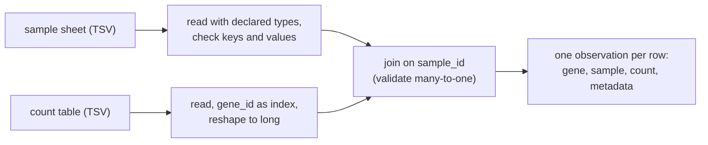

---
aliases:
  - DataFrame
  - pandas DataFrame
  - Polars DataFrame
  - Tableau de données
tags:
  - type/concept
  - domain/computer-science
  - domain/bioinformatics
  - domain/statistics
  - level/L2
  - level/L3
mastery: 0
prerequisites:
  - "[[N-Dimensional Array]]"
  - "[[Array Indexing]]"
  - "[[Delimited Text Format]]"
  - "[[Relational Database]]"
related:
  - "[[Split-Apply-Combine]]"
  - "[[Tidy Data]]"
  - "[[Missing Data]]"
  - "[[Count Matrix]]"
projects:
  - "[[10-genomic-pipeline]]"
sources:
  - "[[Python for Data Analysis (McKinney)]]"
  - "[[Wickham 2014 - Tidy Data]]"
---

# Data Frame

> [!abstract]
> A data frame is a table of named, typed columns that share one row index: the structure of sample sheets, count tables and result tables. Using it safely means declaring types on load, treating missing values explicitly, relying on labels rather than positions, joining on validated keys and keeping one observation per row.

## Definition

A **data frame** is a rectangular table: an ordered collection of named columns, each with its own type, sharing a row index. In pandas, a `DataFrame` has a row index and a column index, and each column is a `Series`, a one-dimensional array with labels.[^mck5] Operations between pandas objects **align on labels**: arithmetic matches rows and columns by index value, not by position.[^mck5] A table is **tidy** when each variable forms a column, each observation forms a row, and each type of observational unit forms a table.[^wickham]

## Why it matters

- **Sample sheets** (one row per sample: identifier, condition, batch, file paths) drive pipelines such as [[10-genomic-pipeline]]; count tables ([[Count Matrix]]) and differential expression results are tables too, exchanged as TSV ([[Delimited Text Format]]).
- **Every analysis by condition starts with a join** of measurements to sample [[Metadata]], the operation of [[SQL]] in another syntax.
- **The failures are silent**: inferred types, missing values that change a column's type, keys that do not match, duplicated keys that multiply rows, assignments that never reach the table. Each is shown below with its guard.

## Core (L2)

Outputs come from pandas 3.0.6 and NumPy 2.4.6 on Python 3.11 (pyarrow not installed), with pandas 2.3.3 and Polars 2.1.0 where stated.



**Load with declared types.** Reading options are detailed in [[Delimited Text Format]]; declare what you know. An invented sheet of 7 samples and an invented count table of 4 genes × 6 samples:

```python
import io

import numpy as np
import pandas as pd

sheet_tsv = """sample_id\tcondition\tbatch\trin\tfastq
S1\tctrl\tb1\t9.1\tS1_R1.fastq.gz
S2\tctrl\tb1\t8.7\tS2_R1.fastq.gz
S3\tctrl\tb2\t9.4\tS3_R1.fastq.gz
S4\theat\tb1\t7.9\tS4_R1.fastq.gz
S5\theat\tb2\t\tS5_R1.fastq.gz
S6\theat\tb2\t8.8\tS6_R1.fastq.gz
S7\theat\tb2\t9.0\tS7_R1.fastq.gz
"""                                                             # invented sample sheet
counts_tsv = """gene_id\tS1\tS2\tS3\tS4\tS5\tS6
g1\t120\t100\t90\t400\t380\t420
g2\t30\t45\t38\t10\t12\t9
g3\t0\t2\t1\t1\t0\t3
g4\t50\t53\t47\t0\t60\t55
"""                                                             # invented count table, genes x samples
sheet = pd.read_csv(io.StringIO(sheet_tsv), sep="\t", index_col="sample_id",
                    dtype={"sample_id": "str", "condition": "category", "batch": "str"})
counts = pd.read_csv(io.StringIO(counts_tsv), sep="\t", index_col="gene_id")
print(sheet.dtypes.astype(str).to_dict(), sheet.index.is_unique)
print(counts.shape, counts.dtypes.unique().tolist())
```

```text
{'condition': 'category', 'batch': 'str', 'rin': 'float64', 'fastq': 'str'} True
(4, 6) [dtype('int64')]
```

The empty RIN of S5 made `rin` a `float64` column holding `NaN`; text columns use pandas 3's `str` type and `condition` is categorical.

**Select, and check keys first.** `.loc` takes labels and includes the end of a slice, `.iloc` takes positions and excludes it, and a list of labels must exist entirely:

```python
print(counts.loc["g2":"g4", "S1"].tolist(), counts.iloc[1:3, 0].tolist())
heat_ids = sheet.index[sheet["condition"] == "heat"]
try:
    counts[heat_ids]
except KeyError as err:
    print("KeyError:", err)
print(sheet.index.difference(counts.columns).tolist(), counts.columns.difference(sheet.index).tolist())
```

```text
[30, 0, 50] [30, 0]
KeyError: "['S7'] not in index"
['S7'] []
```

S7 is in the sheet but has no counts. The two set differences are the check to run before any join.

**Alignment by label.** A per-sample `Series` divides the matching columns whatever its order; converting it to an array drops the labels:

```python
lib = counts.sum()                                              # Series: sample -> library size
factor = (lib / lib.mean()).sort_values()                       # same labels, another order
by_label = counts / factor                                      # factor's index aligned on the columns
by_position = counts / factor.to_numpy()                        # positions: silently mismatched
print(factor.index.tolist())
print(by_label.loc["g1"].round(1).tolist())
print(by_position.loc["g1"].round(1).tolist())
print((counts / sheet["rin"]).columns.tolist(), (counts / sheet["rin"])["S7"].tolist())
```

```text
['S3', 'S1', 'S2', 'S4', 'S5', 'S6']
[192.6, 160.5, 164.1, 312.4, 269.9, 276.8]
[218.9, 160.5, 144.5, 312.4, 269.9, 276.8]
['S1', 'S2', 'S3', 'S4', 'S5', 'S6', 'S7'] [nan, nan, nan, nan]
```

The positional version divides S1 by the factor of S3 and S3 by that of S2, without error. With partially matching labels, the result covers the union of the labels and holds `NaN` where a side is missing (S7; S5 has no RIN). This is [[Broadcasting]] by label; to divide rows, use `counts.div(per_gene, axis=0)`.

**Missing values change types.** A left join that finds no QC values for S7, and an assignment of `NaN`:

```python
qc = pd.DataFrame({"sample_id": ["S1", "S2", "S3", "S4", "S5", "S6"],
                   "reads_m": [21, 25, 19, 30, 27, 24]})        # invented: millions of reads
j = sheet.reset_index().merge(qc, on="sample_id", how="left", validate="one_to_one")
print(qc["reads_m"].dtype, j["reads_m"].dtype, j["reads_m"].tolist()[-2:])
print(j["reads_m"].mean(), j["reads_m"].count(), len(j), j["rin"].isna().sum())
j2 = sheet.reset_index().merge(qc.astype({"reads_m": "Int64"}), on="sample_id", how="left")
s = pd.Series([1, 2, 3])
s.loc[1] = np.nan                                               # assigning a missing value
print(j2["reads_m"].dtype, j2["reads_m"].tolist()[-2:], s.dtype, s.tolist())
```

```text
int64 float64 [24.0, nan]
24.333333333333332 6 7 1
Int64 [24, <NA>] float64 [1.0, nan, 3.0]
```

pandas marks missing values in `float64` data with the `NaN` sentinel, so integer data that receives a missing value becomes `float64`; the nullable `Int64` type keeps integers and shows `<NA>`.[^mck7] Reductions skip missing values: the mean is over 6 values and `count()` finds 6 non-missing out of 7 rows. Decide per column whether to drop (`dropna(subset=...)`), fill with a justified value, or keep and model the gap ([[Missing Data]]).

**Join on validated keys.** Reshaped to one row per gene and sample (`melt`, see [[Split-Apply-Combine]]), the counts are joined to the sheet:

```python
long = counts.reset_index().melt(id_vars="gene_id", var_name="sample_id", value_name="count")
ann = long.merge(sheet.reset_index(), on="sample_id", how="left", validate="many_to_one")
print(long.shape, ann.shape)
dup = pd.concat([sheet.reset_index(), sheet.reset_index().iloc[[1]]])          # S2 pasted twice
try:
    long.merge(dup, on="sample_id", validate="many_to_one")
except pd.errors.MergeError as err:
    print("MergeError:", str(err).splitlines()[0])
print(len(long.merge(dup, on="sample_id")), dup["sample_id"].duplicated().sum())
```

```text
(24, 3) (24, 7)
MergeError: Merge keys are not unique in right dataset; not a many-to-one merge
28 1
```

`validate` states the expected cardinality and raises when it is violated; without it, the duplicated S2 row silently yields 28 rows instead of 24, because a many-to-many join forms the Cartesian product of the matching keys.[^mck8] With `indicator=True`, `merge` also labels each row `both`, `left_only` or `right_only`, a quick audit of unmatched keys.

**One observation per row.** The sheet's observational unit is the sample: one row each, under a unique key. The count table is wide, one row per gene and one column per sample, so the variable "sample" lives in the column names; its long form has one row per measurement, the layout that joins, grouping and plotting expect ([[Tidy Data]]).[^wickham] Both layouts are legitimate for storage: know which one each operation needs.

## Advanced (L3)

**Chained assignment and Copy-on-Write.** Assigning through chained indexing may modify a temporary object instead of the table; the fix is a single `.loc[rows, column] = value`.[^mck5] How the chain fails depends on the pandas version:

```python
import warnings

df = pd.DataFrame({"condition": ["ctrl", "heat", "heat"], "rin": [9.1, 7.9, 8.8]},
                  index=["S1", "S4", "S6"])                     # invented
low = df["rin"] < 8.0
with warnings.catch_warnings(record=True) as caught:
    warnings.simplefilter("always")
    df["rin"][low] = np.nan                                     # chained: column, then mask
print(pd.__version__, df["rin"].tolist(), [type(w.message).__name__ for w in caught],
      any("Copy-on-Write" in str(w.message) for w in caught))
df.loc[low, "rin"] = np.nan                                     # one operation: always reaches df
print(df["rin"].tolist())
```

```text
3.0.6 [9.1, 7.9, 8.8] ['ChainedAssignmentError'] True
[9.1, nan, 8.8]
```

Run under pandas 2.3.3, the same code printed `2.3.3 [9.1, nan, 8.8] ['FutureWarning', 'SettingWithCopyWarning'] True`: the chain modified `df`, with a warning that the behaviour will change in pandas 3.0. Under 3.0.6 it leaves `df` untouched. In both versions a warning names Copy-on-Write, the rule that every indexing result behaves as a copy. Code written for pandas 2 can therefore silently stop updating its data: replace every chained assignment by one `.loc` call, and take `.copy()` explicitly when you mean a new table.

**Polars.** The same reshape and join in Polars 2.1.0, a data frame library without a row index:

```python
import polars as pl

pl_sheet = pl.read_csv(io.StringIO(sheet_tsv), separator="\t", schema_overrides={"batch": pl.Categorical})
pl_counts = pl.read_csv(io.StringIO(counts_tsv), separator="\t")
long_pl = pl_counts.unpivot(index="gene_id", variable_name="sample_id", value_name="count")
ann_pl = long_pl.join(pl_sheet, on="sample_id", how="left", validate="m:1")
xs = pl.Series("x", [1.0, None, float("nan")])
print(pl.__version__, ann_pl.shape, ann_pl["rin"].null_count(), pl_sheet.schema["batch"])
print(xs.null_count(), xs.is_nan().to_list(), xs.mean(), xs.drop_nans().mean())
```

```text
2.1.0 (24, 7) 4 Categorical
1 [False, None, True] nan 1.0
```

Rows are matched only through explicit join keys, with the same cardinality check (`"m:1"`). Polars keeps `null` (missing) distinct from `NaN` (a floating-point value): `null_count` sees one, `is_nan` is null for the null, and the `NaN` propagates through the mean until dropped. Tables larger than memory call for [[Columnar Storage]] files and [[Embedded Database|embedded analytical databases]].

## Mathematical representation

- Let $L = (\ell_1, \dots, \ell_n)$ be the row labels and $c_1, \dots, c_p$ the columns with types $T_1, \dots, T_p$. Column $j$ is a function $x_j : L \to T_j \cup \{\mathrm{NA}\}$; with a unique index, the frame is a relation keyed by $L$ ([[Relational Database]]).
- **Alignment.** For $a : L_a \to \mathbb{R}$ and $b : L_b \to \mathbb{R}$, $a \oplus b$ is defined on $L_a \cup L_b$, with $(a \oplus b)(\ell) = a(\ell) \oplus b(\ell)$ if $\ell \in L_a \cap L_b$ and NA otherwise. Positional arithmetic on the underlying arrays agrees only if $L_a = L_b$ in the same order.
- **Join size.** With $n_R(v)$ and $n_S(v)$ the numbers of rows of $R$ and $S$ with key $v$, an inner join has $\sum_v n_R(v)\, n_S(v)$ rows. Many-to-one ($n_S(v) \le 1$ for all $v$) guarantees at most $|R|$ rows; a key repeated $m$ times in $S$ multiplies its matching rows by $m$: $24 + 4 \times (2 - 1) = 28$ above.
- **Missing values and layouts.** With $O \subseteq L$ the labels where $x$ is observed, $\bar x = \frac{1}{|O|} \sum_{\ell \in O} x(\ell)$: for `reads_m`, $146/6 = 24.33$, whereas counting the missing value as 0 would give $146/7 = 20.86$. A matrix $X \in \mathbb{N}^{g \times s}$ and the relation $\{(i, j, X_{ij})\}$ hold the same information; the long form has $g \times s$ rows ($4 \times 6 = 24$), one per observation.

## Computational representation

| Task | pandas | Polars | SQL |
|---|---|---|---|
| read with types | `pd.read_csv(..., dtype=...)` | `pl.read_csv(..., schema_overrides=...)` | `CREATE TABLE`, then import |
| keep rows | `df[df["x"] > 0]`, `df.loc[mask, cols]` | `df.filter(pl.col("x") > 0)` | `WHERE` |
| join | `merge(..., validate="many_to_one")` | `join(..., validate="m:1")` | `JOIN` |
| missing values | `NaN`, `pd.NA`; `isna()` | `null` distinct from `NaN`; `is_null()` | `NULL`; `IS NULL` |
| update values | `df.loc[mask, "col"] = v` | new column from `pl.when(...).then(...).otherwise(...)` | `UPDATE ... WHERE` |

## Worked example

> [!example] Sample sheet plus count table, with every check
> Inputs: the invented sheet (7 samples, RIN missing for S5) and count table (4 genes × 6 samples) above.
> The checks: unique keys, samples without counts reported, no counts without a sample, 24 rows before and after a many-to-one join, a condition on every row, and per-condition totals as a first [[Split-Apply-Combine]].
> ```python
> assert sheet.index.is_unique and counts.index.is_unique
> missing = sheet.index.difference(counts.columns)                # samples without counts
> assert counts.columns.isin(sheet.index).all(), "counts for samples absent from the sheet"
> ann = long.merge(sheet.reset_index(), on="sample_id", how="left", validate="many_to_one")
> assert len(ann) == counts.size and ann["condition"].notna().all()
> print(missing.tolist(), ann.groupby("condition", observed=True)["count"].sum().to_dict())
> ```
> ```text
> ['S7'] {'ctrl': 576, 'heat': 1350}
> ```
> The assertions encode the expectations (unique keys, no orphan counts, no row created or lost, no sample without a condition), so any violation stops the analysis before a wrong number exists. S7 is reported, not silently dropped.

## Common misconceptions

> [!warning] "`.to_numpy()` (or `.values`) is the same data, only faster"
> It is the same numbers without the labels. Any later operation by position ignores a different column order, as in the S1/S3 swap above.

> [!warning] "A left join cannot add rows"
> It keeps every left row, but a key repeated in the right table repeats the matching left rows: 28 rows from 24 with one duplicated sample. Pass `validate`.

## Exercises

> [!question] Exercise 1 (L2)
> `long` has 4 rows per sample for S1 to S6; `dup` is the sheet with S2 pasted twice (8 rows, S7 included). Predict the number of rows of `long.merge(dup, on="sample_id")` and of `dup.merge(long, on="sample_id", how="left")`.

> [!success]- Solution
> Inner join: $\sum_v n_R(v)\, n_S(v) = 5 \times 4 \times 1 + 4 \times 2 = 28$; S7 has no counts and disappears. Left join from `dup`: the same 28 rows plus one row for S7 with missing counts, 29. `print(len(long.merge(dup, on="sample_id")), len(dup.merge(long, on="sample_id", how="left")))` prints `28 29`.

> [!question] Exercise 2 (L3, Python)
> An invented sheet has one row per FASTQ file: S1 and S3 were sequenced on lane L1, S2 on lanes L1 and L2, with columns `sample_id`, `condition`, `lane`, `fastq`. Explain why joining it to per-sample expression values duplicates rows, and restructure it so that each table holds one type of observational unit.[^wickham]

> [!success]- Solution
> The table mixes samples (condition) and sequencing runs (lane, file), so the sample key repeats. Split it into a samples table keyed by `sample_id` and a runs table keyed by (`sample_id`, `lane`):
> ```python
> runs_tsv = "sample_id\tcondition\tlane\tfastq\nS1\tctrl\tL1\tS1_L1.fastq.gz\nS2\tctrl\tL1\tS2_L1.fastq.gz\nS2\tctrl\tL2\tS2_L2.fastq.gz\nS3\theat\tL1\tS3_L1.fastq.gz\n"
> runs_sheet = pd.read_csv(io.StringIO(runs_tsv), sep="\t")
> samples_t = runs_sheet[["sample_id", "condition"]].drop_duplicates()
> runs_t = runs_sheet[["sample_id", "lane", "fastq"]]
> expr = pd.DataFrame({"sample_id": ["S1", "S2", "S3"], "count": [120, 100, 90]})   # invented, one gene
> print(samples_t["sample_id"].is_unique, runs_t.duplicated(subset=["sample_id", "lane"]).any(),
>       len(expr.merge(runs_sheet, on="sample_id")), len(expr.merge(samples_t, on="sample_id", validate="one_to_one")))
> ```
> ```text
> True False 4 3
> ```
> Joined to the run-level sheet, the 3 expression rows become 4 (S2 twice); joined to the samples table they stay 3 under a one-to-one check. The pipeline reads files from the runs table and conditions from the samples table ([[Database Normalization]]).

> [!question] Exercise 3 (L2)
> Predict, then check: `pd.Series([1, 2], index=["S1", "S2"]) + pd.Series([10, 20], index=["S2", "S3"])`, and the same sum with `.add(..., fill_value=0)`.

> [!success]- Solution
> Alignment takes the union of labels: `S1 NaN, S2 12.0, S3 NaN`, in `float64` because of the `NaN`. With `fill_value=0` a label missing on one side counts as 0: `S1 1.0, S2 12.0, S3 20.0`. Checked with pandas 3.0.6: `[nan, 12.0, nan]` and `[1.0, 12.0, 20.0]`. Filling with 0 is right for counts known to be zero, wrong for values that were never measured ([[Missing Data]]).

## Mastery checklist

- [ ] 1 Recognized: I can describe a data frame as typed columns sharing an index, and name `Series`, `DataFrame` and `Index`.
- [ ] 2 Understood: I can explain label alignment, why missing values change types, how a join can multiply rows, and why chained assignment fails in pandas 3.
- [ ] 3 Practiced: I can load a sample sheet and a count table with declared types, check their keys, reshape and join them with `validate`, and handle missing values deliberately.
- [ ] 4 Applied: [[10-genomic-pipeline]] reads its sample sheet through a validated loader and joins metadata to per-sample results with cardinality checks.
- [ ] 5 Explained: I can teach pandas versus Polars missing values, the Copy-on-Write change between pandas 2 and 3, and how to recognize a table holding two observational units.

## References

[^mck5]: [[Python for Data Analysis (McKinney)]], 3rd ed. (2022), ch. 5 "Getting Started with pandas": `Series`, `DataFrame` and `Index`; selection with `loc` and `iloc`; arithmetic and data alignment; pitfalls of chained indexing in assignments (`SettingWithCopyWarning`) and the single-`loc` fix.
[^mck7]: [[Python for Data Analysis (McKinney)]], 3rd ed. (2022), ch. 7 "Data Cleaning and Preparation": `NaN` as the missing-value sentinel of `float64` data, integer data converted to `float64` when values are missing, nullable extension types such as `Int64` shown as `<NA>`.
[^mck8]: [[Python for Data Analysis (McKinney)]], 3rd ed. (2022), ch. 8 "Data Wrangling: Join, Combine, and Reshape": database-style joins with `merge`, many-to-many joins as the Cartesian product of matching keys, the `validate` argument, `melt` and `pivot`.
[^wickham]: [[Wickham 2014 - Tidy Data]], *Journal of Statistical Software* 59(10): each variable a column, each observation a row, each type of observational unit a table.
