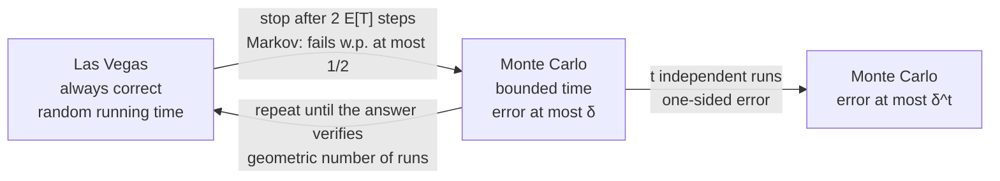

---
aliases:
  - Las Vegas Algorithm
  - Monte Carlo Algorithm
  - Randomized Quicksort
  - Quickselect
  - Probabilistic Algorithm
  - Algorithme probabiliste
tags:
  - type/concept
  - domain/computer-science
  - domain/statistics
  - level/L2
  - level/L3
mastery: 0
prerequisites:
  - "[[Sorting]]"
  - "[[Divide and Conquer]]"
  - "[[Random Variable]]"
  - "[[Expected Value]]"
  - "[[Independence (Probability)]]"
  - "[[Big O Notation]]"
related:
  - "[[Master Theorem]]"
  - "[[Amortized Analysis]]"
  - "[[Hash Function]]"
  - "[[Hash Table]]"
  - "[[Rabin-Karp Algorithm]]"
  - "[[Bloom Filter]]"
  - "[[MinHash]]"
  - "[[Minimizer]]"
  - "[[Monte Carlo Method]]"
  - "[[Random Number Generation]]"
  - "[[Geometric Distribution]]"
  - "[[Quantile]]"
projects:
  - "[[bio-algorithms]]"
sources:
  - "[[Introduction to Algorithms (Cormen)]]"
  - "[[MIT 6.046J - Design and Analysis of Algorithms]]"
  - "[[Coursera Stanford - Algorithms Specialization]]"
  - "[[Introduction to Probability (Blitzstein)]]"
  - "[[Mathematics for Computer Science (Lehman)]]"
  - "[[Roberts 2004 - Reducing Storage Requirements for Biological Sequence Comparison]]"
---

# Randomized Algorithm

> [!abstract]
> A randomized algorithm makes random choices of its own: a Las Vegas algorithm is always correct and only its running time is random (randomized quicksort, quickselect), while a Monte Carlo algorithm runs in bounded time and errs with a probability that can be bounded and shrunk by repetition; because the randomness is internal, both guarantees hold for every input.

## Definition

A **randomized algorithm** is one whose behavior depends not only on its input but also on values produced by a random-number generator.[^clrs5] Its guarantees are probabilities and expectations over those values, for each fixed input:

- **Las Vegas**: the output is always correct; the running time is a random variable, bounded in expectation for every input. Randomized quicksort is the model.[^clrs7][^6046-l6]
- **Monte Carlo**: the running time is bounded; the output may be wrong, with probability at most $\delta$ for every input. Checking a matrix product with random vectors is the classic case.[^6046-l6]

This differs from **probabilistic analysis**, which averages a fixed algorithm's cost over a distribution of inputs: that distribution is an assumption about the data, whereas a randomized algorithm brings its own.[^clrs5]

## Why it matters

- **No bad inputs, only bad luck.** A first-element pivot makes quicksort quadratic on already sorted input, a common case for genomic files ([[Sorting#Implementation]]); a random pivot gives expected $O(n \log n)$ on every input (Core).
- **Medians and quantiles of coverage** ([[Quantile]]): quickselect finds a median in expected linear time, with less machinery than median of medians ([[Divide and Conquer#Linear-time selection]]).
- **Hashing and filters** rest on random choices with bounded error: expected-time hash tables ([[Hash Function]], [[Hash Table]]), fingerprint matching ([[Rabin-Karp Algorithm]]), and [[Bloom Filter|Bloom filters]], which answer membership in little memory with a false-positive rate.[^stanford]
- **Genome sketches.** [[MinHash]] estimates the Jaccard similarity of k-mer sets from random minima ([[Jaccard Index]]), and minimizer sampling,[^roberts] analyzed under a random order of k-mers, keeps about $2/(w+1)$ of all positions (Advanced).
- **Verification.** A Monte Carlo test checks that two k-mer count tables, from two tools or two shards of a parallel run, hold the same multiset, in linear time and without sorting (Core).
- **Not to be confused** with the [[Monte Carlo Method]], which estimates integrals and p-values by simulation; seeds make both reproducible ([[Random Number Generation]]).

## Core (L2)

### Las Vegas: randomized quicksort

Choose each pivot uniformly at random from the current subarray ([[Sorting]]). **Theorem**: for every input of $n$ distinct keys, the expected number of comparisons is[^clrs7]

$$E[C_n] = \sum_{1 \le i < j \le n} \frac{2}{j - i + 1} = 2(n + 1)H_n - 4n \approx 2n \ln n \approx 1.39\, n \lg n,$$

with $H_n = \sum_{m=1}^{n} 1/m$ the harmonic number.

*Proof.* Let $z_1 < \dots < z_n$ be the keys in sorted order and $X_{ij}$ the indicator that $z_i$ and $z_j$ are compared. Keys are compared only with a pivot, which then leaves the recursion, so each pair is compared at most once and $C_n = \sum_{i<j} X_{ij}$. Until a key of $Z_{ij} = \{z_i, \dots, z_j\}$ is chosen as pivot, all of $Z_{ij}$ stays in one subarray. If the first such pivot lies strictly between $z_i$ and $z_j$, they are separated forever; if it is $z_i$ or $z_j$, they are compared. Each of the $j - i + 1$ keys of $Z_{ij}$ is equally likely to be first, so $P(X_{ij} = 1) = \frac{2}{j - i + 1}$. By linearity of expectation, which needs no independence,[^blitzstein][^lehman] $E[C_n] = \sum_{i<j} \frac{2}{j-i+1}$. Grouping pairs by $m = j - i + 1$ (there are $n + 1 - m$ of them): $\sum_{m=2}^{n} \frac{2(n + 1 - m)}{m} = 2(n+1)(H_n - 1) - 2(n - 1) = 2(n+1)H_n - 4n$. $\square$

The expectation is over the algorithm's coins, for the worst input; the worst case $\Theta(n^2)$ still exists, but for no input is it likely. Measured below: 10,994 comparisons on average for sorted input of size 1,000, against the predicted 10,986.

### Las Vegas: quickselect

Partition around a random pivot and recurse into the **one** side that contains rank $k$. Let $E(n)$ be the largest expected number of comparisons over inputs of size at most $n$ and all ranks. The pivot rank $q$ is uniform on $\{1, \dots, n\}$ and the recursion continues on at most $\max(q - 1, n - q)$ keys, each value in $\{\lfloor n/2 \rfloor, \dots, n - 1\}$ arising for at most two values of $q$:

$$E(n) \le n - 1 + \frac{2}{n} \sum_{m = \lfloor n/2 \rfloor}^{n-1} E(m).$$

Assume $E(m) \le 4m$ for $m < n$. Since $\sum_{m=\lfloor n/2 \rfloor}^{n-1} m \le \frac{3n^2}{8}$, $E(n) \le n - 1 + \frac{8}{n} \cdot \frac{3n^2}{8} < 4n$: **expected linear time for every input and every rank**.[^clrs9][^stanford] The running time is random: over 50 runs below, the median of 100,001 values cost $3.05n$ comparisons on average but up to $6.14n$ in one run.

### Monte Carlo: one-sided error and amplification

**Are two multisets equal?** Two k-mer tables (codes $< p$, $p$ prime) are equal as multisets exactly when their characteristic polynomials $F_A(x) = \prod_{a \in A} (x - a)$ and $F_B(x)$ are equal, by unique factorization. Evaluate both at a random $r \in \{0, \dots, p - 1\}$, modulo $p$:

- if $A = B$, the values always agree: the answer "equal" is always given;
- if $A \neq B$ with $|A| = |B| = n$, then $F_A - F_B$ is a nonzero polynomial of degree at most $n$ over the field $\mathbb{Z}_p$, which has at most $n$ roots, so $P(F_A(r) = F_B(r)) \le n/p$.

The error is **one-sided**: "different" is always right ($r$ is a witness), only "equal" can be wrong. With $t$ independent trials, $P(\text{wrong}) \le (n/p)^t$: errors shrink exponentially with repetition ([[Independence (Probability)]]). The same reasoning checks a matrix product $AB = C$ in $O(n^2)$: multiply both sides by a random 0/1 vector $r$; if $D = AB - C$ has a nonzero entry $d_{ij}$, then for any values of the other coordinates at most one of the two values of $r_j$ makes $(Dr)_i = 0$, so the check fails to notice with probability at most $1/2$ per trial.[^6046-l6]

### Converting between the two kinds



- **Las Vegas to Monte Carlo.** For a nonnegative random variable $T$ and $a > 0$, **Markov's inequality** $P(T \ge a) \le E[T]/a$ follows from $a\,\mathbf{1}[T \ge a] \le T$ by taking expectations. Stopping at $a = 2E[T]$ fails with probability at most $1/2$.
- **Monte Carlo to Las Vegas**, when an answer can be checked: repeat until a run returns a verified answer. If each run succeeds with probability $q$, the number of runs is geometric with mean $1/q$ ([[Geometric Distribution]]).

## Advanced (L3)

### Random minima: MinHash and minimizers

For a uniformly random ordering $\pi$ of all k-mers and two k-mer sets $A$ and $B$, the minimum of $\pi$ over $A \cup B$ is equally likely to be any element of $A \cup B$, and the minima over $A$ and over $B$ coincide exactly when it lies in $A \cap B$:

$$P\big(\min \pi(A) = \min \pi(B)\big) = \frac{|A \cap B|}{|A \cup B|} = J(A, B).$$

With $s$ independent orderings, the fraction of agreements $\hat J$ is an unbiased Monte Carlo estimate of the Jaccard index with variance $J(1 - J)/s$ ([[Binomial Distribution]]): standard error $O(1/\sqrt{s})$ whatever the genome sizes ([[MinHash]]).

Minimizers keep the smallest k-mer of each window of $w$ consecutive k-mers.[^roberts] Under a random order, and if the $w + 1$ k-mers of two consecutive windows are distinct, their minimum is equally likely to sit at any of the $w + 1$ positions; the second window selects a new position exactly when that minimum is the k-mer that left (first position) or the one that entered (last position). Selected positions never move backwards, so the expected fraction of selected positions tends to $\frac{2}{w + 1}$. Repeated k-mers break the distinctness assumption, as low-complexity DNA does (Exercise 5).

## Mathematical representation

- Input $x$, random bits $R$; running time $T(x, R)$; output $A(x, R)$.
- **Las Vegas**: $P_R\big(A(x, R) \text{ correct}\big) = 1$ and $E_R[T(x, R)] \le f(|x|)$ for every input $x$.
- **Monte Carlo**: $T(x, R) \le f(|x|)$ for all $x, R$, and $P_R\big(A(x, R) \text{ wrong}\big) \le \delta$ for every input $x$.
- **Tools**: indicator variables and linearity of expectation $E\left[\sum_i X_i\right] = \sum_i E[X_i]$, valid without independence ([[Expected Value]]);[^blitzstein] Markov's inequality; for $t$ independent runs, $P(\text{all fail}) = \delta^t$.

## Computational representation

Randomized quicksort and quickselect, instrumented, with the exact expectation checked against the recurrence $E(n) = n - 1 + \frac1n \sum_q \big(E(q-1) + E(n-q)\big)$ in exact rational arithmetic:

```python
import math
import random
import statistics
from fractions import Fraction
from functools import lru_cache

def quicksort(a: list, rng: random.Random) -> tuple:
    """Randomized quicksort of distinct keys: (sorted list, number of key comparisons)."""
    if len(a) <= 1:
        return list(a), 0
    p = rng.randrange(len(a))                  # the algorithm's own coin flips
    smaller, larger = [], []
    for j, x in enumerate(a):
        if j != p:                             # one comparison with the pivot per key
            (smaller if x < a[p] else larger).append(x)
    left, c1 = quicksort(smaller, rng)
    right, c2 = quicksort(larger, rng)
    return left + [a[p]] + right, len(a) - 1 + c1 + c2

def quickselect(a: list, k: int, rng: random.Random) -> tuple:
    """k-th smallest (k = 0 is the minimum) and the number of three-way comparisons."""
    comparisons = 0
    while True:
        pivot = a[rng.randrange(len(a))]
        comparisons += len(a)
        lows = [x for x in a if x < pivot]
        n_equal = sum(1 for x in a if x == pivot)
        if k < len(lows):
            a = lows
        elif k < len(lows) + n_equal:
            return pivot, comparisons
        else:
            a, k = [x for x in a if x > pivot], k - len(lows) - n_equal

def expected_quicksort(n: int) -> Fraction:
    """E[comparisons] = sum over pairs i < j of 2 / (j - i + 1) = 2(n + 1)H_n - 4n."""
    return 2 * (n + 1) * sum(Fraction(1, i) for i in range(1, n + 1)) - 4 * n

@lru_cache(maxsize=None)
def exact_by_recurrence(n: int) -> Fraction:
    """E(n) = n - 1 + (1/n) sum over pivot ranks q of E(q - 1) + E(n - q)."""
    if n <= 1:
        return Fraction(0)
    return n - 1 + Fraction(1, n) * sum(exact_by_recurrence(q - 1) + exact_by_recurrence(n - q)
                                        for q in range(1, n + 1))

rng = random.Random(11)
for _ in range(300):                           # Las Vegas: the output is always correct
    xs = rng.sample(range(1000), rng.randint(0, 60))
    assert quicksort(xs, rng)[0] == sorted(xs)
    ys = [rng.randrange(20) for _ in range(rng.randint(1, 60))]
    k = rng.randrange(len(ys))
    assert quickselect(ys, k, rng)[0] == sorted(ys)[k]
assert all(exact_by_recurrence(n) == expected_quicksort(n) for n in range(1, 60))

n = 1000
for name, data in [("sorted input", list(range(n))), ("random input", rng.sample(range(n), n))]:
    runs = [quicksort(data, rng)[1] for _ in range(300)]
    print(f"{name}: mean {statistics.mean(runs):.0f}, sd {statistics.stdev(runs):.0f}, max {max(runs)}")
print("expected:", round(float(expected_quicksort(n))), " n log2 n:", round(n * math.log2(n)))

depths = [rng.randrange(0, 60) for _ in range(100_001)]   # invented per-position read depths
runs = [quickselect(depths, len(depths) // 2, rng) for _ in range(50)]
print("median depth", runs[0][0], "=", sorted(depths)[len(depths) // 2],
      f"| comparisons / n: mean {statistics.mean(c for _, c in runs) / len(depths):.2f}, "
      f"max {max(c for _, c in runs) / len(depths):.2f}")
```

```text
sorted input: mean 10994, sd 593, max 13450
random input: mean 10964, sd 623, max 13140
expected: 10986  n log2 n: 9966
median depth 30 = 30 | comparisons / n: mean 3.05, max 6.14
```

- **Every input is average**: sorted and random inputs give the same mean, within one standard error of the exact $2(n+1)H_n - 4n = 10{,}986$, about $1.1\, n \lg n$ at this size. The largest of 300 runs is only 22 % above the mean.
- **Quickselect** returns the true median every time (Las Vegas) with about $3n$ comparisons on average, below the $4n$ bound, while single runs vary.

The Monte Carlo multiset test, with $p = 2^{31} - 1$ (prime, checked by trial division) and 15-mer codes below $p$:

```python
P = 2_147_483_647                              # 2^31 - 1
assert all(P % d for d in range(2, math.isqrt(P) + 1))   # prime, by trial division

def fingerprint(items: list, r: int, p: int = P) -> int:
    """prod over the multiset of (r - x) mod p: its characteristic polynomial evaluated at r."""
    f = 1
    for x in items:
        f = f * (r - x) % p
    return f

def same_multiset(a: list, b: list, trials: int, rng: random.Random, p: int = P) -> bool:
    """Monte Carlo, one-sided error: 'False' is always right; 'True' is wrong w.p. <= (n/p)^trials."""
    if len(a) != len(b):
        return False
    for _ in range(trials):
        r = rng.randrange(p)
        if fingerprint(a, r, p) != fingerprint(b, r, p):
            return False                       # r is a witness: certainly different
    return True

CODE = {"A": 0, "C": 1, "G": 2, "T": 3}
def codes(seq: str, k: int) -> list:           # 2-bit k-mer codes, < 4^k < p for k <= 15
    return [int("".join(str(CODE[b]) for b in seq[i:i + k]), 4) for i in range(len(seq) - k + 1)]

genome = "".join(rng.choices("ACGT", k=20_000))           # invented sequence
counted_once = codes(genome, 15)
shuffled = rng.sample(counted_once, len(counted_once))     # same multiset, other order
one_off = shuffled[:-1] + [shuffled[-1] ^ 1]               # one k-mer differs in one base
print(same_multiset(counted_once, shuffled, 2, rng), same_multiset(counted_once, one_off, 2, rng))

small_p, n_items, wrong = 101, 20, 0                        # a tiny prime makes errors visible
for _ in range(20_000):
    a = [rng.randrange(small_p) for _ in range(n_items)]
    b = a[:-1] + [(a[-1] + rng.randrange(1, small_p)) % small_p]
    wrong += same_multiset(a, b, 1, rng, small_p)
print(f"error rate {wrong / 20_000:.4f} <= bound {n_items / small_p:.4f}")
```

```text
True False
error rate 0.1729 <= bound 0.1980
```

One changed base among 19,986 k-mers is detected; with a deliberately tiny prime, the observed error rate stays below the bound $n/p$, which is nearly tight here because the two multisets differ in a single element.

## Worked example

> [!example] Expected comparisons of randomized quicksort on 4 keys
> Keys $z_1 < z_2 < z_3 < z_4$; the pair $(z_i, z_j)$ is compared with probability $\frac{2}{j - i + 1}$.
> 1. **Neighbors** $(1,2), (2,3), (3,4)$: probability $2/2 = 1$. No key lies strictly between them to separate them, so they are always compared: 3.
> 2. **Gap 2**, $(1,3)$ and $(2,4)$: probability $2/3$ each: $4/3$.
> 3. **Extremes** $(1,4)$: probability $2/4$: compared only if $z_1$ or $z_4$ is the first pivot: $1/2$.
> 4. **Total**: $3 + \frac43 + \frac12 = \frac{29}{6} \approx 4.83$, and the formula agrees: $2 \cdot 5 \cdot H_4 - 16 = 10 \cdot \frac{25}{12} - 16 = \frac{29}{6}$.
> 5. **By the recurrence**: an extreme first pivot (probability $1/2$) costs $3 + E(3) = 3 + \frac83$; a middle one costs $3 + E(1) + E(2) = 4$; so $E(4) = \frac12 \cdot \frac{17}{3} + \frac12 \cdot 4 = \frac{29}{6}$. The code confirms both: `print(expected_quicksort(4), exact_by_recurrence(4))` prints `29/6 29/6`. A first-element pivot needs $\binom{4}{2} = 6$ comparisons on sorted input.

## Common misconceptions

> [!warning] "Randomized quicksort is fast because real inputs look random"
> That is probabilistic analysis of a deterministic algorithm, and it fails on sorted files. Randomized quicksort's expectation is over its own pivots and holds for every input, sorted ones included (same mean above).

> [!warning] "A Monte Carlo algorithm is a Monte Carlo simulation"
> A Monte Carlo algorithm solves a definite problem with a bounded error probability; the [[Monte Carlo Method]] estimates a quantity by averaging simulations, with a statistical error that shrinks as $1/\sqrt{N}$.

> [!warning] "An algorithm that can be wrong is unusable"
> Its error is a bounded, tunable probability, and one-sided errors shrink as $\delta^t$: six trials of the multiset test on $10^7$ k-mers with $p = 2^{31} - 1$ push it below $10^{-12}$ (Exercise 3). Correctness proofs are statements about this probability, not hopes.

> [!warning] "A fixed seed keeps the guarantee"
> A fixed seed makes the algorithm deterministic: reproducible, but an input exists that defeats it, and anyone knowing the seed can build it. Record seeds for reproducibility; draw fresh ones for guarantees. Expected bounds (worst input, random coins) also differ from amortized ones (worst sequence, no probability), and hash tables combine both ([[Amortized Analysis]]).

## Exercises

> [!question] Exercise 1 (L2)
> Turn randomized quicksort into a Monte Carlo algorithm that always stops within $2E[C_n]$ comparisons, and bound its failure probability. Then restart it until it finishes: show that the result is Las Vegas with expected cost at most $4E[C_n]$.

> [!success]- Solution
> By Markov's inequality, $P(C_n \ge 2E[C_n]) \le 1/2$, so the truncated version fails with probability at most $1/2$. Restarting with fresh coins makes the attempts independent, each succeeding with probability $q \ge 1/2$; the number of attempts is geometric with mean $1/q \le 2$, and each costs at most $2E[C_n]$, so the expected total is at most $2 \cdot 2E[C_n] = 4E[C_n]$. The output is always sorted: Las Vegas again.

> [!question] Exercise 2 (L2)
> Quickselect for the minimum ($k = 0$, distinct keys, $n - 1$ comparisons per round): show that $E(n) = n - 1 + \frac1n \sum_{m=1}^{n-1} E(m)$ and solve it.

> [!success]- Solution
> The pivot rank $q$ is uniform; if $q = 1$ the minimum is found, otherwise the search continues among the $q - 1$ smaller keys, which gives the recurrence. Multiply by $n$ and subtract the same identity for $n - 1$: $nE(n) - (n-1)E(n-1) = 2(n - 1) + E(n-1)$, so $E(n) = E(n-1) + 2 - \frac{2}{n}$, and with $E(1) = 0$, $E(n) = 2n - 2H_n \approx 2n - 2\ln n$. Check: $E(2) = 1$, $E(3) = \frac73$. Finding the minimum by a scan takes $n - 1$: quickselect pays about twice that, the price of not knowing $k$ in advance.

> [!question] Exercise 3 (L3)
> You compare two tables of $n = 10^7$ k-mer codes with the multiset test. (a) With $p = 2^{31} - 1$, which k-mer sizes are allowed, and how many trials bring the error below $10^{-12}$? (b) What changes for 31-mers?

> [!success]- Solution
> (a) Codes must be distinct residues modulo $p$, so $4^k < p$: $k \le 15$. One trial errs with probability at most $n/p \approx 4.66 \times 10^{-3}$; $t$ trials with at most $(4.66 \times 10^{-3})^t$, below $10^{-12}$ from $t = 6$ (since $\log_{10}$ of the ratio is $-2.33$, and $6 \times 2.33 = 14.0 \ge 12$, while $5 \times 2.33 = 11.7$ is not enough). (b) 31-mer codes reach $4^{31} = 2^{62}$, so a prime $p > 2^{62}$ is needed (Python integers handle it); then one trial errs with probability at most $10^7 / 4.6 \times 10^{18} \approx 2.2 \times 10^{-12}$, two trials at most about $5 \times 10^{-24}$. Reducing codes modulo a smaller prime would be wrong: two different codes could collide deterministically, and the bound would no longer hold.

> [!question] Exercise 4 (L3)
> Karger's contraction algorithm repeatedly merges the endpoints of a uniformly random edge (keeping parallel edges, deleting loops) until two vertices remain, and outputs the edges between them, a cut.[^stanford] Show that a given minimum cut survives with probability at least $2/(n(n-1))$, and that $\binom{n}{2} \ln n$ independent runs find it with probability at least $1 - 1/n$.

> [!success]- Solution
> Let the minimum cut have $c$ edges. With $i$ vertices left, every vertex has degree at least $c$ (else its edges would form a smaller cut), so at least $ci/2$ edges remain, and a random edge belongs to the cut with probability at most $\frac{c}{ci/2} = \frac{2}{i}$. The cut survives all $n - 2$ contractions with probability at least $\prod_{i=3}^{n}\left(1 - \frac{2}{i}\right) = \prod_{i=3}^{n} \frac{i-2}{i} = \frac{2}{n(n-1)} = 1/\binom{n}{2}$. With $N = \binom{n}{2}\ln n$ runs, all fail with probability at most $(1 - 1/\binom{n}{2})^{N} \le e^{-\ln n} = 1/n$, using $1 - x \le e^{-x}$.
> For $n = 1000$ that is about $3.5 \times 10^6$ runs. The error is one-sided in its own way: the output is always a cut, never smaller than the minimum, but sometimes larger.

> [!question] Exercise 5 (L3, Python)
> Measure the fraction of positions selected as $(w, k)$-minimizers with $k = 11$, $w = 10$, under a random order of k-mers and under lexicographic order, on a uniform random sequence and on a sequence with runs of 40 A's every 100 bp (both invented). Compare with $2/(w+1)$ and explain the gaps.

> [!success]- Solution
> ```python
> def minimizer_density(seq: str, k: int, w: int, order) -> float:
>     """Fraction of k-mer positions selected as (w, k)-minimizers under a given order."""
>     keys = [order(seq[i:i + k]) for i in range(len(seq) - k + 1)]
>     picked = {min(range(j, j + w), key=lambda i: (keys[i], i)) for j in range(len(keys) - w + 1)}
>     return len(picked) / len(keys)
>
> k, w = 11, 10
> rank = {}                                      # a random order, drawn lazily per distinct k-mer
> random_order = lambda kmer: rank.setdefault(kmer, rng.random())
> lexicographic = lambda kmer: kmer
> uniform = "".join(rng.choices("ACGT", k=30_000))
> repeats = ("A" * 40 + "".join(rng.choices("ACGT", k=60))) * 300            # A-runs every 100 bp
> for name, seq in [("uniform", uniform), ("with A-runs", repeats)]:
>     print(name, round(minimizer_density(seq, k, w, random_order), 4),
>           round(minimizer_density(seq, k, w, lexicographic), 4), "2/(w+1) =", round(2 / (w + 1), 4))
> ```
> Output: `uniform 0.1805 0.1966 2/(w+1) = 0.1818`, then `with A-runs 0.36 0.4801 2/(w+1) = 0.1818`. On uniform sequence the random order matches the derivation; lexicographic order selects more positions. Inside a run of 40 A's, the 30 k-mers are identical: the distinctness assumption fails, and with leftmost tie-breaking every window shift selects a new position. Lexicographic order is worse still, because the all-A k-mer is the smallest of all and wins every window that reaches the run. Low-complexity DNA is exactly where sampling schemes need random orders and careful tie rules.

## Mastery checklist

- [ ] 1 Recognized: I can tell Las Vegas from Monte Carlo algorithms, and randomized algorithms from probabilistic analysis.
- [ ] 2 Understood: I can derive $E[C_n] = 2(n+1)H_n - 4n$ for randomized quicksort with indicator variables, and the $4n$ bound for quickselect.
- [ ] 3 Practiced: I can bound one-sided error with a polynomial-roots argument, amplify it by repetition, and convert between Las Vegas and Monte Carlo with Markov's inequality.
- [ ] 4 Applied: in [[bio-algorithms]], I compute coverage medians with quickselect and verify k-mer tables with fingerprints, with seeds recorded and error bounds stated.
- [ ] 5 Explained: I can teach why MinHash and minimizers rely on random orders, why fixed seeds void guarantees, and when an expected bound is not enough.

## References

[^clrs5]: [[Introduction to Algorithms (Cormen)]], 4th ed. (2022), ch. 5 "Probabilistic Analysis and Randomized Algorithms" (probabilistic analysis versus randomized algorithms, indicator random variables).
[^clrs7]: [[Introduction to Algorithms (Cormen)]], 4th ed. (2022), ch. 7 "Quicksort" (randomized version, expected running time).
[^clrs9]: [[Introduction to Algorithms (Cormen)]], 4th ed. (2022), ch. 9 "Medians and Order Statistics" (selection in expected linear time).
[^6046-l6]: [[MIT 6.046J - Design and Analysis of Algorithms]], Spring 2015, lecture 6 "Randomization: Matrix Multiply, Quicksort" (a Monte Carlo check of a matrix product and randomized quicksort), and its recitation on randomized median finding.
[^stanford]: [[Coursera Stanford - Algorithms Specialization]], course 1 (QuickSort and its analysis, linear-time selection, the contraction algorithm for minimum cuts) and course 2 (hash tables, Bloom filters).
[^blitzstein]: [[Introduction to Probability (Blitzstein)]], 2nd ed., treatment of expectation (indicator random variables, linearity of expectation).
[^lehman]: [[Mathematics for Computer Science (Lehman)]], probability part (random variables, expectation, linearity of expectation).
[^roberts]: [[Roberts 2004 - Reducing Storage Requirements for Biological Sequence Comparison]], *Bioinformatics* 20(18):3363-3369.
