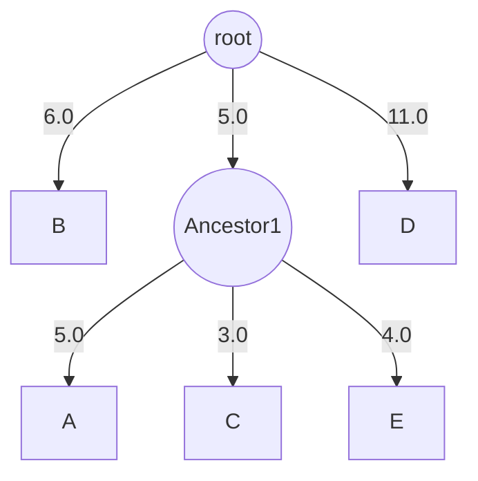

---
aliases:
  - Newick
  - Newick Tree Format
  - Newick Standard
  - nwk
  - Format Newick
tags:
  - type/concept
  - domain/bioinformatics
  - domain/computer-science
  - level/L2
  - level/L3
mastery: 0
prerequisites:
  - "[[Phylogenetic Tree]]"
  - "[[Tree (Data Structure)]]"
  - "[[Recursion]]"
  - "[[String]]"
related:
  - "[[Stack]]"
  - "[[Tree (Graph Theory)]]"
  - "[[Tree Rooting]]"
  - "[[Phylogenetic Network]]"
  - "[[Consensus Tree]]"
  - "[[Phylogenetic Bootstrap]]"
  - "[[Neighbor Joining]]"
  - "[[UPGMA]]"
  - "[[Data Serialization]]"
  - "[[Regular Expression]]"
projects:
  - "[[08-phylogenetic-engine]]"
sources:
  - "[[PHYLIP]]"
  - "[[Cardona 2008 - Extended Newick]]"
  - "[[Inferring Phylogenies (Felsenstein)]]"
---

# Newick Format

> [!abstract]
> Newick writes a tree as nested parentheses: each internal node is a pair of parentheses around its children, separated by commas, then its optional label and `:length`; the whole tree ends with a semicolon, as in `(B:6.0,(A:5.0,C:3.0,E:4.0):5.0,D:11.0);`.

## Definition

The **Newick standard** represents a tree in computer-readable form through the correspondence between trees and nested parentheses: an interior node is a pair of matched parentheses enclosing the representations of its immediate descendants, separated by commas; a tip is represented by its name; a number after a colon gives the length of the branch leading to a node; an interior node may be named after its closing parenthesis; and the tree ends with a semicolon.[^fels] It was adopted on 26 June 1986 by an informal committee convened by Joseph Felsenstein, and named after Newick's restaurant in Dover, New Hampshire, where the committee's second session met; it has never been formally published.[^fels]

## Why it matters

- **The exchange format of trees.** Phylogenetic programs read and write it, specialized databases provide trees in it,[^cardona] and the tree blocks of the NEXUS format contain Newick trees.[^fels] [[08-phylogenetic-engine]] writes the trees it builds ([[Neighbor Joining]], [[UPGMA]]) as Newick.
- **A recursive format.** The grammar mirrors the recursive definition of a rooted tree, so parsing it is a lesson in [[Recursion]] and in the [[Stack]], where an iterative parser already lives.
- **Silent comparison errors.** One tree has many Newick strings, and an unrooted tree is written as if rooted: comparing strings instead of trees, or reading an arbitrary root as a biological one, produces wrong conclusions without any error message.[^fels]

## Core (L2)

### Reading the reference examples

Felsenstein's page builds the format from one five-tip tree:[^fels]

```text
(B,(A,C,E),D);                                       topology only
(B:6.0,(A:5.0,C:3.0,E:4.0):5.0,D:11.0);              with branch lengths
(B:6.0,(A:5.0,C:3.0,E:4.0)Ancestor1:5.0,D:11.0);     with an interior node name
```

The outer parentheses are the root, with three descendants: tip B, an interior node, and tip D. The interior node encloses tips A, C and E, so the tree is multifurcating, which the format allows at any level. `A:5.0` puts 5.0 on the branch between A and its parent, and `):5.0` the length of the branch above the interior node; the third string names that node `Ancestor1`.



### The rules

| Element | Rule |
|---|---|
| tree | a descendant list, an optional root label, an optional `:length`, then `;` |
| interior node | `(child,child,...)` followed by an optional label and an optional `:length` |
| tip | a label, possibly empty, followed by an optional `:length` |
| unquoted label | no blanks, parentheses, square brackets, single quotes, colons, semicolons or commas; an underscore is read as a blank |
| quoted label | between single quotes, any printable characters; a single quote inside is written twice (`''`) |
| branch length | a signed or unsigned number after `:` |
| comment | between square brackets, wherever a newline is allowed |
| whitespace | blanks, tabs and newlines anywhere except inside unquoted labels and branch lengths |

[^fels][^olsen]

Empty names are legal: `(,(,,),);` is a tree with five unnamed tips.[^fels]

### Rooted and unrooted trees

The standard represents a **rooted** tree. When the root is unknown, the convention is to root the tree arbitrarily and write that: `(B,(A,D),C);`, `(A,(B,C),D);` and `((A,D),(C,B));` are the same unrooted tree.[^fels] PHYLIP requires an unrooted tree to begin with a trifurcation, a root with three descendants, like the mammal example used in the exercises.[^olsen] Whether a file's root is biological ([[Tree Rooting]]) is information the format does not carry.

## Advanced (L3)

**One tree, many strings.** Swapping the descendants of any node gives another string for the same tree: `(A,(B,C),D);`, `(A,(C,B),D);`, `(D,(C,B),A);` and `((C,B),A,D);` describe one tree.[^fels] A rooted binary tree with $n$ tips has $n - 1$ interior nodes, each with two orders of its children, hence $2^{n-1}$ strings (Exercise 4). To compare rooted trees, compare a **canonical form** in which children are sorted.

**Comparing unrooted trees.** Each internal branch of an unrooted tree splits the tips into two sets, a **bipartition**, and two unrooted trees with the same tips have the same topology iff they have the same set of bipartitions (Exercise 5). The number of bipartitions found in only one of two trees is a distance between them, and counting bipartitions across many trees is how they are summarized in a [[Consensus Tree]].[^felsbook]

**What labels mean is out of band.** Interior labels can be names or numbers; whether a number is a support value ([[Phylogenetic Bootstrap]]), an age or a name is not stated by the format and must be documented with the file, like the units of branch lengths.

**Dialects and extensions.** Programs differ: some allow nested comments, some write a branch length for the root (0.0), some refuse a rooted tree where an unrooted one is expected.[^olsen] Extended Newick keeps the parenthesized syntax to represent **phylogenetic networks**, in which some nodes have several parents because of reticulate events such as recombination, hybridization or lateral gene transfer ([[Phylogenetic Network]]).[^cardona] PhyloXML writes trees as nested XML elements instead of parentheses.[^fels]

**Deep trees.** A recursive parser uses one call per nesting level and stops at the language's recursion limit on very unbalanced trees; the explicit-stack parser of [[Stack]] has no such limit.

## Mathematical representation

**Grammar** (after Olsen's 1990 interpretation of the standard; `{}` = zero or more, `[]` = optional):[^olsen]

```text
tree            = descendant_list [ label ] [ ":" length ] ";"
descendant_list = "(" subtree { "," subtree } ")"
subtree         = descendant_list [ label ] [ ":" length ]
                | label [ ":" length ]
label           = unquoted_label | "'" quoted_text "'"
```

- A Newick string denotes a rooted tree $T = (V, E)$ with root $r$, tips $L \subseteq V$ carrying labels, and an optional length function $\ell : E \to \mathbb{R}$.
- **Patristic distance** between tips $a$ and $b$: $d(a, b) = \sum_{e \in P(a, b)} \ell(e)$, where $P(a, b)$ is the path through their most recent common ancestor.
- **Number of strings** for one tree: $\prod_{v \notin L} k_v!$, with $k_v$ the number of children of $v$; for a rooted binary tree, $2^{n-1}$.
- **Bipartitions.** For an internal edge $e$ of the unrooted tree, removing $e$ separates $L$ into $X$ and $L \setminus X$; the tree's topology is determined by $\Sigma(T) = \{\{X, L \setminus X\}\}$, and $|\Sigma(T_1) \,\triangle\, \Sigma(T_2)|$ counts the bipartitions that differ.

## Computational representation

A tokenizer and a recursive-descent parser that follow the grammar (quoted labels, comments, underscores, branch lengths, interior labels), a writer that quotes labels when needed, and the computations of this note. Standard library only.

```python
import re
from dataclasses import dataclass, field

TOKEN = re.compile(r"\s*(?:(\[[^\]]*\])|('(?:[^']|'')*')|([(),:;])|([^\s(),:;\[\]']+))")
UNSAFE = set(" ()[]':;,_")                    # characters that force quoting when writing

@dataclass
class Node:
    label: str | None = None
    length: float | None = None
    children: list = field(default_factory=list)

def tokenize(text: str) -> list[tuple[str, str]]:
    tokens, pos = [], 0
    while pos < len(text):
        m = TOKEN.match(text, pos)
        if not m or m.end() == pos:
            if text[pos:].strip() == "":
                break
            raise ValueError(f"unexpected character {text[pos]!r} at {pos}")
        comment, quoted, punct, word = m.groups()
        if quoted:
            tokens.append(("label", quoted[1:-1].replace("''", "'")))
        elif punct:
            tokens.append((punct, punct))
        elif word:
            tokens.append(("word", word))
        pos = m.end()                          # comments are skipped
    return tokens

def parse_newick(text: str) -> Node:
    tokens, i = tokenize(text), 0

    def peek():
        return tokens[i][0] if i < len(tokens) else None

    def take(kind):
        nonlocal i
        if peek() != kind:
            raise ValueError(f"expected {kind!r}, got {peek()!r} at token {i}")
        i += 1
        return tokens[i - 1][1]

    def subtree() -> Node:                     # one call per node: recursion mirrors the tree
        node = Node()
        if peek() == "(":
            take("(")
            node.children.append(subtree())
            while peek() == ",":
                take(",")
                node.children.append(subtree())
            take(")")
        if peek() == "label":
            node.label = take("label")
        elif peek() == "word":
            node.label = take("word").replace("_", " ")      # unquoted: underscore = blank
        if peek() == ":":
            take(":")
            node.length = float(take("word"))
        return node

    root = subtree()
    take(";")
    if i != len(tokens):
        raise ValueError("text after the final ';'")
    return root

def quote(label: str) -> str:
    if not label:
        return ""
    if " " in label and not (UNSAFE - {" "}) & set(label):
        return label.replace(" ", "_")
    return "'" + label.replace("'", "''") + "'" if UNSAFE & set(label) else label

def to_newick(node: Node, root: bool = True) -> str:
    text = "(" + ",".join(to_newick(c, False) for c in node.children) + ")" if node.children else ""
    text += quote(node.label or "")
    if node.length is not None:
        text += f":{node.length:g}"
    return text + (";" if root else "")

def leaves(node: Node) -> list[str]:
    return [node.label] if not node.children else [x for c in node.children for x in leaves(c)]

def paths(node: Node, prefix=()) -> dict:
    """Tip label -> tuple of (node id, branch length) from the root down to the tip."""
    here = prefix + ((id(node), node.length or 0.0),)
    if not node.children:
        return {node.label: here}
    return {k: v for c in node.children for k, v in paths(c, here).items()}

def patristic(tree: Node, a: str, b: str) -> float:
    pa, pb = paths(tree)[a], paths(tree)[b]
    k = 0
    while k < min(len(pa), len(pb)) and pa[k][0] == pb[k][0]:
        k += 1                                 # pa[k-1] is the most recent common ancestor
    return sum(l for _, l in pa[k:]) + sum(l for _, l in pb[k:])

def canonical(node: Node) -> str:
    """Topology with sorted children: equal strings <=> same rooted tree (tip labels only)."""
    if not node.children:
        return node.label or ""
    return "(" + ",".join(sorted(canonical(c) for c in node.children)) + ")"

def splits(tree: Node) -> set:
    """Bipartitions of the unrooted tree, each stored as the side without the smallest label."""
    everything = frozenset(leaves(tree))
    anchor, out = min(everything), set()

    def walk(node):
        below = frozenset(leaves(node))
        if node.children and node is not tree and 1 < len(below) < len(everything) - 1:
            out.add(below if anchor not in below else everything - below)
        for c in node.children:
            walk(c)
    walk(tree)
    return out

examples = ["(B,(A,C,E),D);",
            "(B:6.0,(A:5.0,C:3.0,E:4.0)Ancestor1:5.0,D:11.0);",
            "('Homo sapiens':0.1,Pan_troglodytes:0.12[comment ignored],'O''Brien''s taxon':0.3);",
            "(,(,,),);"]
for text in examples:
    t = parse_newick(text)
    print(leaves(t), "->", to_newick(t), parse_newick(to_newick(t)) == t)
t = parse_newick(examples[1])
print(t.children[1].label, t.children[1].length, patristic(t, "A", "B"), patristic(t, "A", "C"))
print(canonical(parse_newick("(A,(B,C),D);")) == canonical(parse_newick("(D,(C,B),A);")),
      canonical(parse_newick("(A,(B,C),D);")))
```

```text
['B', 'A', 'C', 'E', 'D'] -> (B,(A,C,E),D); True
['B', 'A', 'C', 'E', 'D'] -> (B:6,(A:5,C:3,E:4)Ancestor1:5,D:11); True
['Homo sapiens', 'Pan troglodytes', "O'Brien's taxon"] -> (Homo_sapiens:0.1,Pan_troglodytes:0.12,'O''Brien''s taxon':0.3); True
[None, None, None, None, None] -> (,(,,),); True
Ancestor1 5.0 16.0 8.0
True ((B,C),A,D)
```

Every string reads back to the same tree after writing (round trip). The writer turns blanks into underscores when that is enough and quotes otherwise; the comment disappears, as comments carry no tree data. `6.0` is written `6`: the same number, a different string, one more reason to compare trees rather than strings.

## Worked example

> [!example] Parsing `(B:6.0,(A:5.0,C:3.0,E:4.0)Ancestor1:5.0,D:11.0);`
> 1. **Tokens:** `(` `B` `:` `6.0` `,` `(` `A` `:` `5.0` `,` `C` `:` `3.0` `,` `E` `:` `4.0` `)` `Ancestor1` `:` `5.0` `,` `D` `:` `11.0` `)` `;`
> 2. **Root:** the first `(` opens the root's descendant list. Its first child is the tip B with length 6.0.
> 3. **Interior node:** after `,`, a new `(` opens a child that is itself a list: A (5.0), C (3.0), E (4.0). At `)`, the label `Ancestor1` and `:5.0` belong to this interior node.
> 4. **Last child:** D with length 11.0; the final `)` closes the root, which has no label or length, and `;` ends the tree.
> 5. **Distances:** A to C goes through Ancestor1 only: $5.0 + 3.0 = 8.0$. A to B climbs to the root: $5.0 + 5.0 + 6.0 = 16.0$ (output above).
> 6. **Root:** three descendants. Read as an unrooted tree, this root is only the place where the tree was cut open for writing.

## Common misconceptions

> [!warning] "The string tells where the root is"
> The standard writes rooted trees, and unrooted trees are written by choosing a root arbitrarily: a file does not say whether its root is biological.[^fels] Rooting is a separate inference ([[Tree Rooting]]).

> [!warning] "Two different strings are two different trees"
> The left-right order of descendants changes the string, not the tree.[^fels] Compare canonical forms (rooted trees) or bipartitions (unrooted trees).

> [!warning] "Underscores are part of the name"
> In the standard, an underscore in an unquoted label stands for a blank: `Homo_sapiens` reads as `Homo sapiens`.[^fels][^olsen] To keep a literal underscore, quote the label.

> [!warning] "Numbers on internal nodes are bootstrap values"
> The format only allows interior nodes to carry labels; what the label means is not part of the file.[^fels] Read it from the documentation of the program that wrote it.

## Exercises

> [!question] Exercise 1 (L2)
> Write the Newick string of this invented rooted tree: the root has two children, an interior node X at distance 0.05 and the tip gorilla at 0.2; X has the tips human (0.1) and chimp (0.12).

> [!success]- Solution
> `((human:0.1,chimp:0.12)X:0.05,gorilla:0.2);`. The interior node's label and length follow its closing parenthesis; any order of children is correct, for instance `(gorilla:0.2,(chimp:0.12,human:0.1)X:0.05);`.[^fels]

> [!question] Exercise 2 (L2)
> How many tips and interior nodes do `(,(,,),);` and `(Alpha,Beta,Gamma,Delta,,Epsilon,,,);` contain?

> [!success]- Solution
> `(,(,,),);`: the root has three descendants (an empty tip, an interior node with three empty tips, an empty tip): 5 tips, 2 interior nodes. `(Alpha,Beta,Gamma,Delta,,Epsilon,,,);`: one interior node, the root, with 9 tips, four of them unnamed; both strings are examples of the PHYLIP page.[^fels]

> [!question] Exercise 3 (L2, Python)
> Parse the mammal tree of the PHYLIP page and give the number of tips and the patristic distances raccoon-bear, sea lion-seal and dog-cat.

> [!success]- Solution
> ```python
> mammals = parse_newick("""((raccoon:19.19959,bear:6.80041):0.84600,((sea_lion:11.99700,
> seal:12.00300):7.52973,((monkey:100.85930,cat:47.14069):20.59201,
> weasel:18.87953):2.09460):3.87382,dog:25.46154);""")
> print(len(leaves(mammals)), round(patristic(mammals, "raccoon", "bear"), 5),
>       round(patristic(mammals, "sea lion", "seal"), 5), round(patristic(mammals, "dog", "cat"), 5))
> # 8 26.0 24.0 99.16266
> ```
> The tree spans three lines: newlines between tokens are allowed.[^olsen] `sea_lion` becomes `sea lion`. Raccoon-bear is $19.19959 + 6.80041 = 26.0$; dog-cat takes the dog branch up to the root, then four branches down to cat: $25.46154 + 3.87382 + 2.09460 + 20.59201 + 47.14069 = 99.16266$. The root has three descendants: this is an unrooted tree written with a basal trifurcation.

> [!question] Exercise 4 (L3, Python)
> Enumerate all Newick strings (without lengths) of the rooted trees `(((A,B),C),D);` and `((A,B),(C,D));`. Compare with $2^{n-1}$.

> [!success]- Solution
> ```python
> from itertools import product
>
> def orderings(node: Node) -> set:
>     if not node.children:
>         return {node.label}
>     left, right = (orderings(c) for c in node.children)
>     return {f"({a},{b})" for a, b in product(left, right)} | {f"({b},{a})" for a, b in product(left, right)}
>
> print(len(orderings(parse_newick("(((A,B),C),D);"))), len(orderings(parse_newick("((A,B),(C,D));"))), 2 ** (4 - 1))
> # 8 8 8
> ```
> Both trees have 3 interior nodes with 2 children each, so $2^3 = 8$ strings, whatever the shape. With 20 tips there are $2^{19} = 524{,}288$ strings for one rooted binary tree: comparing strings is hopeless, canonical forms are needed.

> [!question] Exercise 5 (L3, Python)
> Using `splits`, show that the three strings of the PHYLIP page `(B,(A,D),C);`, `(A,(B,C),D);` and `((A,D),(C,B));` are one unrooted tree, and that `(A,(B,D),C);` is another.

> [!success]- Solution
> ```python
> unrooted = [parse_newick(s) for s in ("(B,(A,D),C);", "(A,(B,C),D);", "((A,D),(C,B));")]
> print([sorted(map(sorted, splits(u))) for u in unrooted], sorted(map(sorted, splits(parse_newick("(A,(B,D),C);")))))
> # [[['B', 'C']], [['B', 'C']], [['B', 'C']]] [['B', 'D']]
> ```
> A four-tip unrooted binary tree has one internal branch, hence one bipartition: AD|BC for the first three strings (stored as the side without A), AC|BD for the last. In `((A,D),(C,B));` the two children of the root give the same bipartition twice: once unrooted, the two branches at the root are one branch.[^fels]

## Mastery checklist

- [ ] 1 Recognized: I can read a Newick string and draw its tree with branch lengths.
- [ ] 2 Understood: I can state the rules for labels, quoting, underscores, comments and lengths, and explain non-uniqueness and the rooting convention.
- [ ] 3 Practiced: I can write a parser and a writer in Python that pass a round-trip test, and compute patristic distances, canonical forms and bipartitions.
- [ ] 4 Applied: [[08-phylogenetic-engine]] writes Newick that other programs read, and my tests compare trees by topology, not by string.
- [ ] 5 Explained: I can teach the dialect pitfalls, the meaning of an arbitrary root, and the extension of the format to networks.

## References

[^fels]: [[PHYLIP]], "The Newick tree format" (J. Felsenstein): syntax, examples, non-uniqueness, rooted and unrooted trees, NEXUS and PhyloXML, origin of the standard.
[^olsen]: [[PHYLIP]], "Newick's 8:45" Tree Format Standard (G. Olsen, 1990): grammar, quoting, underscores, whitespace and comments, notes on PAUP, TreeAlign and PHYLIP.
[^cardona]: [[Cardona 2008 - Extended Newick]], *BMC Bioinformatics* 9:532: Newick as the format in which specialized databases provide phylogenetic trees, and its extension to phylogenetic networks with reticulate events.
[^felsbook]: [[Inferring Phylogenies (Felsenstein)]], treatment of consensus trees and of distances between trees; chapter not verified.
