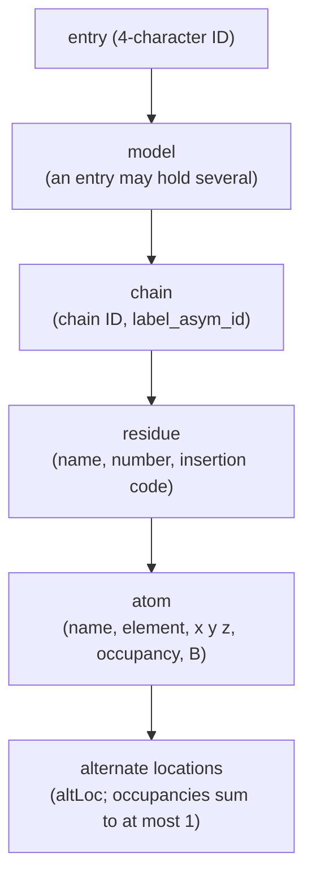

---
aliases:
  - PDB File Format
  - Protein Data Bank Format
  - mmCIF
  - PDBx
  - Macromolecular Crystallographic Information File
  - Format PDB
tags:
  - type/concept
  - domain/bioinformatics
  - domain/biology
  - domain/computer-science
  - level/L2
  - level/L3
mastery: 0
prerequisites:
  - "[[Protein Structure]]"
  - "[[Amino Acid]]"
  - "[[Atom]]"
  - "[[Biological Database]]"
related:
  - "[[Structural Bioinformatics]]"
  - "[[X-ray Crystallography]]"
  - "[[Cryo-Electron Microscopy]]"
  - "[[Nuclear Magnetic Resonance Spectroscopy]]"
  - "[[Ramachandran Plot]]"
  - "[[Root-Mean-Square Deviation]]"
  - "[[Kabsch Algorithm]]"
  - "[[Structural Alignment]]"
  - "[[Secondary Structure Assignment]]"
  - "[[Peptide Bond]]"
  - "[[Data Serialization]]"
projects: []
sources:
  - "[[Worldwide Protein Data Bank]]"
  - "[[RCSB Protein Data Bank]]"
---

# PDB Format

> [!abstract]
> A structure entry lists every modeled atom with its residue, chain and $x, y, z$ coordinates in ångströms. The legacy PDB format writes each atom as a fixed-column text line; PDBx/mmCIF, the archive's format since 2014, writes the same data as named columns of a table and has no size limits.

## Definition

The Protein Data Bank archive stores 3D models of macromolecules in two formats maintained by the wwPDB:[^policy]

- the **PDB format**: fixed-width text records whose first six columns name the record type and whose fields occupy fixed columns, with `ATOM` and `HETATM` records for the atoms;[^pdb33]
- **PDBx/mmCIF**: a dictionary-based format in which each value is a named data item (`_category.item`) and repeated items form tables introduced by `loop_`; the dictionary defines every item's meaning, type and units.[^dict]

PDBx/mmCIF became the archive format in 2014 and the legacy format was frozen.[^policy]

## Why it matters

- **Every structural analysis starts with parsing.** Distances and contacts, superposition and [[Root-Mean-Square Deviation]] ([[Kabsch Algorithm]]), backbone torsion angles for a [[Ramachandran Plot]], [[Secondary Structure Assignment]]: all start from atom coordinates read from an entry. Each entry also states its experimental method and resolution, to read before trusting atomic details.[^rcsb]
- **Two formats, one archive.** Entries with more than 99,999 atoms or more than 62 chains exist only in PDBx/mmCIF: a reader of legacy files silently misses the largest complexes.[^policy]
- **Numbering traps.** "Residue 12" can mean the author's number or a position in the sequence; alternate atom positions and insertion codes break code that assumes one atom per name and one residue per number.[^dict]
- **Downstream notes.** [[Structural Bioinformatics]] assumes this note; [[Protein Structure]] explains what the coordinates describe.

## Core (L2)

### The hierarchy inside an entry



### Legacy PDB format: the ATOM and HETATM records

| Columns | Field | Content |
|---|---|---|
| 1-6 | record name | `ATOM` for atoms of standard residues, `HETATM` for other groups such as ligands |
| 7-11 | serial | atom serial number |
| 13-16 | name | atom name (`CA`, `OG1`...) |
| 17 | altLoc | alternate location indicator |
| 18-20 | resName | residue name (`VAL`) |
| 22 | chainID | chain identifier, one character |
| 23-26 | resSeq | residue number |
| 27 | iCode | insertion code |
| 31-38, 39-46, 47-54 | x, y, z | orthogonal coordinates in Å, Real(8.3) |
| 55-60 | occupancy | Real(6.2) |
| 61-66 | tempFactor | temperature factor (B), Real(6.2) |
| 77-78 | element | element symbol, right-justified |
| 79-80 | charge | charge on the atom |

[^pdb33]

Other record types carry the header (`HEADER`, `TITLE`, `REMARK`), the sequence of each chain (`SEQRES`), secondary structure (`HELIX`, `SHEET`), the unit cell (`CRYST1`), models (`MODEL`, `ENDMDL`) and chain ends (`TER`).[^pdb33] The lines below are the example rows of the PDBx/mmCIF dictionary (based on entry 5HVP), written in PDB columns by the code of this note; the ruler gives the column numbers:[^dict]

```text
         1         2         3         4         5         6         7         8
12345678901234567890123456789012345678901234567890123456789012345678901234567890
ATOM      1  N   VAL A  11      25.369  30.691  11.795  1.00 17.93           N  
ATOM      2  CA  VAL A  11      25.970  31.965  12.332  1.00 17.75           C  
ATOM     13  OG13THR A  12      27.946  33.921  16.183  0.50 20.29           O  
ATOM     14  OG14THR A  12      27.769  32.142  17.103  0.50 20.59           O  
HETATM  101  C1 1APS C 300       4.171  29.012   7.116  0.58 17.27           C  
```

In `OG13THR`, the atom name `OG1` (columns 14-16) touches the alternate location `3` (column 17) and the residue name: only the columns tell them apart.

### PDBx/mmCIF: the same atoms as a table

The same rows in the dictionary's own form: one `_atom_site.` item per column, then one whitespace-separated row per atom, `.` where no value applies (no alternate location):[^dict]

```text
loop_
_atom_site.group_PDB
_atom_site.type_symbol
_atom_site.label_atom_id
_atom_site.label_comp_id
_atom_site.label_asym_id
_atom_site.label_seq_id
_atom_site.label_alt_id
_atom_site.Cartn_x
_atom_site.Cartn_y
_atom_site.Cartn_z
_atom_site.occupancy
_atom_site.B_iso_or_equiv
_atom_site.footnote_id
_atom_site.auth_seq_id
_atom_site.id
ATOM N  N   VAL  A  11  .  25.369  30.691  11.795  1.00  17.93  .  11   1
ATOM O  OG1 THR  A  12  3  27.946  33.921  16.183  0.50  20.29  4  12  13
HETATM C C1 APS  C   .  1   4.171  29.012   7.116  0.58  17.27  1 300  101
```

| Item | Meaning |
|---|---|
| `group_PDB` | `ATOM` or `HETATM`, kept for compatibility with the PDB format |
| `id` | unique atom identifier |
| `type_symbol` | element |
| `label_atom_id`, `label_comp_id` | atom name, residue (chemical component) name |
| `label_asym_id` | chain instance identifier; `auth_asym_id` is the author's chain name |
| `label_seq_id` | position in the polymer sequence: sequential positive integers |
| `auth_seq_id` (+ `pdbx_PDB_ins_code`) | author's residue numbering, as in the publication: may be negative, skip numbers or use insertion codes |
| `label_alt_id` | alternate location of an atom modeled in several positions |
| `Cartn_x`, `Cartn_y`, `Cartn_z` | coordinates in Å on orthogonal axes |
| `occupancy` | fraction of the atom at this site; occupancies at one site sum to at most 1.0 |
| `B_iso_or_equiv` | isotropic atomic displacement parameter $B$ |
| `pdbx_PDB_model_num` | model number |

[^dict]

## Advanced (L3)

**Two residue numberings.** `label_seq_id` indexes the polymer sequence of the entity and is always $1, 2, 3, \dots$; `auth_seq_id` follows the authors, for instance to keep the numbering of a homologous structure or of a full-length protein when only a fragment was solved, so it may be negative or skip values. The wwPDB recommends the author identifiers for publications.[^dict] A non-polymer group has no sequence position: the group `APS` above has `label_seq_id` `.` and author number 300. To map residues to a UniProt sequence or to a paper, choose the numbering explicitly.

**Alternate locations and occupancy.** When an atom is modeled in more than one position, each position gets its own alternate location indicator and a partial occupancy; the occupancies at a site may not exceed 1.0.[^dict] In the example, the side-chain oxygen OG1 of Thr 12 has positions `3` and `4` with occupancy 0.50 each, 2.01 Å apart (Exercise 6): code that keeps "the last OG1 seen" silently picks one conformation.

**Displacement (B) factors.** `B_iso_or_equiv` is the isotropic atomic displacement parameter, related to the displacement parameter $U$ (in Ų) by $B = 8\pi^2 U$.[^dict] Compare B values within one structure (Exercise 3).

**Limits of fixed columns.** Five digits of atom serial number, one character of chain identifier: the legacy format cannot hold more than 99,999 atoms or 62 chains, and such entries are distributed only in PDBx/mmCIF. The wwPDB announced in 2019 that crystallographic structures would be deposited only in PDBx/mmCIF.[^policy] Readers written today should treat mmCIF as the primary input and the legacy format as a convenience ([[Data Serialization]]).

## Mathematical representation

- An atom is a tuple $(\text{name}, \text{element}, \text{residue}, \text{chain}, \text{model}, \mathbf{x}, o, B)$ with $\mathbf{x} \in \mathbb{R}^3$ in Å, occupancy $o \in [0, 1]$ and displacement factor $B$.
- **Columns as intervals.** A field occupying the 1-based closed columns $[a, b]$ is the 0-based half-open slice `line[a-1:b]`, the conversion of [[Genomic Coordinate System]] applied to text columns.
- **Distance**: $d_{ij} = \lVert \mathbf{x}_i - \mathbf{x}_j \rVert_2$.
- **Torsion angle** of four atoms $\mathbf{p}_0, \dots, \mathbf{p}_3$: with $\mathbf{b}_0 = \mathbf{p}_0 - \mathbf{p}_1$, $\hat{\mathbf{b}}_1 = (\mathbf{p}_2 - \mathbf{p}_1)/\lVert \mathbf{p}_2 - \mathbf{p}_1 \rVert$, $\mathbf{b}_2 = \mathbf{p}_3 - \mathbf{p}_2$, project out the axis, $\mathbf{v} = \mathbf{b}_0 - (\mathbf{b}_0 \cdot \hat{\mathbf{b}}_1)\hat{\mathbf{b}}_1$ and $\mathbf{w} = \mathbf{b}_2 - (\mathbf{b}_2 \cdot \hat{\mathbf{b}}_1)\hat{\mathbf{b}}_1$, then $\theta = \operatorname{atan2}\big((\hat{\mathbf{b}}_1 \times \mathbf{v}) \cdot \mathbf{w},\ \mathbf{v} \cdot \mathbf{w}\big)$. The backbone angles $\phi$ (C$_{i-1}$, N, CA, C), $\psi$ (N, CA, C, N$_{i+1}$) and $\omega$ (CA, C, N$_{i+1}$, CA$_{i+1}$) are torsions of this kind ([[Ramachandran Plot]]).
- **RMSD** between matched atom sets $\{\mathbf{x}_i\}$ and $\{\mathbf{y}_i\}$: $\sqrt{\frac{1}{n}\sum_i \lVert \mathbf{x}_i - \mathbf{y}_i \rVert^2}$, after optimal superposition ([[Root-Mean-Square Deviation]], [[Kabsch Algorithm]]).

## Computational representation

Standard-library Python that reads `_atom_site` rows from mmCIF, writes and reads them back in PDB columns, and computes geometry. `shlex` approximates CIF tokenization (whitespace-separated values, quoted strings); multi-line text fields, which `atom_site` does not use, are not handled.

```python
import math
import shlex

# ATOM/HETATM columns of the PDB format guide (1-based, inclusive)
COLUMNS = {"record": (1, 6), "serial": (7, 11), "name": (13, 16), "altLoc": (17, 17),
           "resName": (18, 20), "chainID": (22, 22), "resSeq": (23, 26), "iCode": (27, 27),
           "x": (31, 38), "y": (39, 46), "z": (47, 54), "occupancy": (55, 60),
           "tempFactor": (61, 66), "element": (77, 78), "charge": (79, 80)}
NUMERIC = {"serial": int, "resSeq": int, "x": float, "y": float, "z": float,
           "occupancy": float, "tempFactor": float}

def parse_atom_line(line: str) -> dict:
    """Slice an ATOM/HETATM line by columns; never split on spaces."""
    line = line.rstrip("\r\n").ljust(80)
    atom = {k: line[a - 1:b].strip() for k, (a, b) in COLUMNS.items()}   # [a, b] -> [a-1, b)
    for k, cast in NUMERIC.items():
        atom[k] = cast(atom[k])
    return atom

def format_atom_line(a: dict) -> str:
    name = a["name"] if len(a["name"]) == 4 else " " + a["name"]
    return (f"{a['record']:<6}{a['serial']:>5} {name:<4}{a['altLoc'] or ' '}{a['resName']:>3} "
            f"{a['chainID']}{a['resSeq']:>4}{a['iCode'] or ' '}   "
            f"{a['x']:8.3f}{a['y']:8.3f}{a['z']:8.3f}{a['occupancy']:6.2f}{a['tempFactor']:6.2f}"
            f"          {a['element']:>2}{a['charge']:<2}")

def parse_atom_site(cif_text: str) -> list[dict]:
    """Rows of the loop_ of _atom_site items (lines starting with # are comments)."""
    lines = [l for l in cif_text.splitlines() if not l.strip().startswith("#")]
    tokens = shlex.split("\n".join(lines))
    start, names = tokens.index("loop_") + 1, []
    while tokens[start].startswith("_atom_site."):
        names.append(tokens[start][len("_atom_site."):]); start += 1
    values = tokens[start:]
    return [dict(zip(names, values[i:i + len(names)])) for i in range(0, len(values), len(names))]

def to_pdb(row: dict) -> dict:
    """An _atom_site row as legacy fields (chain: label_asym_id, since the example has no
    auth_asym_id; residue number: auth_seq_id)."""
    return {"record": row["group_PDB"], "serial": int(row["id"]), "name": row["label_atom_id"],
            "altLoc": "" if row["label_alt_id"] in ".?" else row["label_alt_id"],
            "resName": row["label_comp_id"], "chainID": row["label_asym_id"],
            "resSeq": int(row["auth_seq_id"]), "iCode": "", "x": float(row["Cartn_x"]),
            "y": float(row["Cartn_y"]), "z": float(row["Cartn_z"]),
            "occupancy": float(row["occupancy"]), "tempFactor": float(row["B_iso_or_equiv"]),
            "element": row["type_symbol"], "charge": ""}

def distance(a: dict, b: dict) -> float:
    return math.dist((a["x"], a["y"], a["z"]), (b["x"], b["y"], b["z"]))

def dihedral(p0, p1, p2, p3) -> float:
    """Torsion angle in degrees, in (-180, 180]."""
    sub = lambda u, v: [u[i] - v[i] for i in range(3)]
    dot = lambda u, v: sum(u[i] * v[i] for i in range(3))
    cross = lambda u, v: [u[1] * v[2] - u[2] * v[1], u[2] * v[0] - u[0] * v[2], u[0] * v[1] - u[1] * v[0]]
    b0, b1, b2 = sub(p0, p1), sub(p2, p1), sub(p3, p2)
    n = math.sqrt(dot(b1, b1)); b1 = [c / n for c in b1]
    v = sub(b0, [dot(b0, b1) * c for c in b1])
    w = sub(b2, [dot(b2, b1) * c for c in b1])
    return math.degrees(math.atan2(dot(cross(b1, v), w), dot(v, w)))

# Rows of the ATOM_SITE example of the PDBx/mmCIF dictionary (based on PDB entry 5HVP).
CIF = """loop_
_atom_site.group_PDB
_atom_site.type_symbol
_atom_site.label_atom_id
_atom_site.label_comp_id
_atom_site.label_asym_id
_atom_site.label_seq_id
_atom_site.label_alt_id
_atom_site.Cartn_x
_atom_site.Cartn_y
_atom_site.Cartn_z
_atom_site.occupancy
_atom_site.B_iso_or_equiv
_atom_site.footnote_id
_atom_site.auth_seq_id
_atom_site.id
ATOM N  N   VAL  A  11  .  25.369  30.691  11.795  1.00  17.93  .  11   1
ATOM C  CA  VAL  A  11  .  25.970  31.965  12.332  1.00  17.75  .  11   2
ATOM C  C   VAL  A  11  .  25.569  32.010  13.808  1.00  17.83  .  11   3
ATOM O  O   VAL  A  11  .  24.735  31.190  14.167  1.00  17.53  .  11   4
ATOM N  N   THR  A  12  .  26.095  32.930  14.590  1.00  18.97  4  12   8
ATOM C  CA  THR  A  12  .  25.734  32.995  16.032  1.00  19.80  4  12   9
ATOM C  C   THR  A  12  .  24.695  34.106  16.113  1.00  20.92  4  12  10
ATOM O  OG1 THR  A  12  3  27.946  33.921  16.183  0.50  20.29  4  12  13
ATOM O  OG1 THR  A  12  4  27.769  32.142  17.103  0.50  20.59  4  12  14
ATOM N  N   ILE  A  13  .  23.664  33.855  16.884  1.00  22.08  .  13  17
# - - - - data truncated for brevity - - - -
HETATM C C1 APS  C   .  1   4.171  29.012   7.116  0.58  17.27  1 300  101"""

rows = parse_atom_site(CIF)
atoms = [to_pdb(r) for r in rows]
lines = [format_atom_line(a) for a in atoms]
print("         1         2         3         4         5         6         7         8")
print("12345678901234567890123456789012345678901234567890123456789012345678901234567890")
for l in lines[:2] + lines[7:9] + lines[-1:]:
    print(l)
print(len(rows), "atoms; round trip:", [parse_atom_line(l) for l in lines] == atoms, "; width:", {len(l) for l in lines})
print(rows[-1]["label_seq_id"], rows[-1]["auth_seq_id"], rows[-1]["label_asym_id"])
```

The first seven lines of output are the ruler and the five records shown in Core (L2); the last two are:

```text
11 atoms; round trip: True ; width: {80}
. 300 C
```

Writing then re-reading every line gives back the same values, and every line is exactly 80 characters wide. For whole entries, production readers handle every CIF quoting rule and the categories beyond `atom_site`.

## Worked example

> [!example] Reading `ATOM      2  CA  VAL A  11      25.970  31.965  12.332  1.00 17.75           C`
> 1. **Columns 1-6** `ATOM`: an atom of a standard residue. **7-11** `2`: serial number.
> 2. **13-16** ` CA `: atom name CA, the alpha carbon; **17** blank: no alternate location.
> 3. **18-20** `VAL`, **22** `A`, **23-26** `11`, **27** blank: valine 11 of chain A, no insertion code.
> 4. **31-54**: $\mathbf{x} = (25.970, 31.965, 12.332)$ Å.
> 5. **55-60** `1.00`: fully occupied; **61-66** `17.75`: B factor, close to the 17.53-17.93 of the other atoms of this residue.
> 6. **77-78** `C`: carbon. The same atom in mmCIF is the row `ATOM C CA VAL A 11 . 25.970 31.965 12.332 1.00 17.75 . 11 2`, where position replaces column numbers and the item names give the meaning.[^dict]

## Common misconceptions

> [!warning] "PDB fields are separated by spaces"
> They are fixed columns. Adjacent fields can touch (`OG13THR`, or `-123.456-100.001` when coordinates are negative and large), and blank fields shift every later token; `line.split()` fails silently or loudly depending on the line (Exercise 2).[^pdb33]

> [!warning] "Residue 12 is the twelfth residue of the protein"
> The residue number in an entry is usually the author's, which may skip values, start anywhere, be negative or carry insertion codes; only `label_seq_id` counts positions in the sequence.[^dict]

> [!warning] "Each atom has one position"
> Atoms modeled in several conformations carry alternate location indicators and partial occupancies, and an entry may contain several models: decide which ones your analysis keeps.[^dict]

> [!warning] "Any entry can be downloaded as a .pdb file"
> Entries beyond 99,999 atoms or 62 chains are distributed only in PDBx/mmCIF.[^policy]

## Exercises

> [!question] Exercise 1 (L2)
> Read the HETATM line of Core (L2): which atom, residue, chain, residue number, coordinates, occupancy and B factor? What is its mmCIF `label_seq_id`, and why?

> [!success]- Solution
> Atom `C1` (carbon) of the group `APS`, alternate location `1`, chain `C`, author number 300, at $(4.171, 29.012, 7.116)$ Å, occupancy 0.58, B = 17.27. `APS` is a non-polymer group (a HETATM record), so it has no position in a polymer sequence: `label_seq_id` is `.`.[^dict] Its occupancy below 1 shows that this conformation is only part of the population.

> [!question] Exercise 2 (L2, Python)
> Write one atom with serial 12345 and coordinates $(-123.456, -100.001, 7.5)$ with `format_atom_line`, then split it on whitespace. What goes wrong, and what does `parse_atom_line` return?

> [!success]- Solution
> ```python
> crowded = format_atom_line({**atoms[1], "serial": 12345, "x": -123.456, "y": -100.001, "z": 7.5})
> print(crowded)
> print(crowded.split()[:8])
> print(parse_atom_line(crowded)["x"], parse_atom_line(crowded)["y"])
> # ATOM  12345  CA  VAL A  11    -123.456-100.001   7.500  1.00 17.75           C
> # ['ATOM', '12345', 'CA', 'VAL', 'A', '11', '-123.456-100.001', '7.500']
> # -123.456 -100.001
> ```
> The serial fills columns 7-11 and x and y fill their 8 columns completely, so no space separates them: split returns `-123.456-100.001` as one token. Column slicing reads each value correctly.

> [!question] Exercise 3 (L2, Python)
> Compute the mean B factor of each residue in the example rows. Which residue is the most mobile, and what limits this comparison?

> [!success]- Solution
> ```python
> from collections import defaultdict
>
> bfactors = defaultdict(list)
> for a in atoms:
>     bfactors[(a["chainID"], a["resSeq"], a["resName"])].append(a["tempFactor"])
> print({k: round(sum(v) / len(v), 2) for k, v in bfactors.items()})
> # {('A', 11, 'VAL'): 17.76, ('A', 12, 'THR'): 20.11, ('A', 13, 'ILE'): 22.08, ('C', 300, 'APS'): 17.27}
> ```
> B rises from Val 11 to Ile 13 in this excerpt, but Ile 13 is represented by one atom only (the rows are truncated), so its mean is not comparable: compare residues with all their atoms, within one structure.

> [!question] Exercise 4 (L3)
> From the column widths, derive the largest atom serial number, the number of possible one-character chain identifiers made of letters and digits, and the largest residue number. Why do large complexes need PDBx/mmCIF?

> [!success]- Solution
> Columns 7-11 hold 5 digits: at most 99,999 atoms. Column 22 holds one character: with upper- and lowercase letters and digits, $26 + 26 + 10 = 62$ chains. Columns 23-26 hold 4 characters: at most 9,999 (or −999). Large assemblies exceed the first two limits, and the wwPDB distributes such entries only in PDBx/mmCIF, whose values have no fixed width.[^policy][^pdb33]

> [!question] Exercise 5 (L3, Python)
> With the example coordinates, compute the N-CA bond of Val 11, the peptide C-N bond between Val 11 and Thr 12, the CA-CA distance, and the torsions $\psi$ of Val 11, $\omega$ and $\phi$ of Thr 12. What does $\omega$ tell you?

> [!success]- Solution
> ```python
> by = {(a["resSeq"], a["name"], a["altLoc"]): a for a in atoms}
> v11 = lambda n: by[(11, n, "")]
> t12 = lambda n: by[(12, n, "")]
> xyz = lambda a: (a["x"], a["y"], a["z"])
> print("N-CA", round(distance(v11("N"), v11("CA")), 3), "C-N peptide", round(distance(v11("C"), t12("N")), 3),
>       "CA-CA", round(distance(v11("CA"), t12("CA")), 3))
> print("psi(V11)", round(dihedral(*map(xyz, (v11("N"), v11("CA"), v11("C"), t12("N")))), 1),
>       "omega", round(dihedral(*map(xyz, (v11("CA"), v11("C"), t12("N"), t12("CA")))), 1),
>       "phi(T12)", round(dihedral(*map(xyz, (v11("C"), t12("N"), t12("CA"), t12("C")))), 1))
> # N-CA 1.508 C-N peptide 1.317 CA-CA 3.848
> # psi(V11) 171.4 omega -179.5 phi(T12) -99.8
> ```
> The peptide C-N bond (1.32 Å) is shorter than the single N-CA bond (1.51 Å), and $\omega \approx 180°$: the four atoms lie in one plane with the two CA on opposite sides, a planar trans peptide bond ([[Peptide Bond]]). The pair $(\phi, \psi)$ places these residues on a [[Ramachandran Plot]].

> [!question] Exercise 6 (L3, Python)
> Thr 12 has two OG1 atoms. Report their alternate locations, occupancies and separation. What happens if a parser stores atoms in a dictionary keyed by (residue, atom name)?

> [!success]- Solution
> ```python
> og1 = [a for a in atoms if a["resSeq"] == 12 and a["name"] == "OG1"]
> print([(a["altLoc"], a["occupancy"]) for a in og1], "sum", sum(a["occupancy"] for a in og1),
>       "separation", round(distance(*og1), 2))
> # [('3', 0.5), ('4', 0.5)] sum 1.0 separation 2.01
> ```
> Two half-occupied positions 2.01 Å apart: the side chain takes two conformations. Keyed by (residue, name), the second overwrites the first and the analysis keeps one conformation without saying so; include `altLoc` in the key, or pick the highest occupancy explicitly.[^dict]

## Mastery checklist

- [ ] 1 Recognized: I can tell a legacy PDB file from a PDBx/mmCIF file and find the coordinates in each.
- [ ] 2 Understood: I can explain fixed columns, ATOM versus HETATM, the model-chain-residue-atom hierarchy, label versus author numbering, alternate locations and occupancy.
- [ ] 3 Practiced: I can parse both formats in Python, convert between them and compute distances and torsion angles.
- [ ] 4 Applied: I parsed a real entry from the PDB, selected one model, chain and conformation explicitly, and computed its backbone torsions.
- [ ] 5 Explained: I can teach why the archive moved to PDBx/mmCIF, and the numbering, alternate-location and B-factor pitfalls of structure files.

## References

[^pdb33]: [[Worldwide Protein Data Bank]], PDB format guide version 3.3 (Atomic Coordinate Entry Format Description), coordinate section: ATOM and HETATM columns.
[^dict]: [[Worldwide Protein Data Bank]], PDBx/mmCIF dictionary `mmcif_pdbx_v50` (version 5.417), category `atom_site` (example based on entry 5HVP) and its items: `group_PDB`, `label_*` and `auth_*` identifiers, `label_alt_id`, `occupancy`, `B_iso_or_equiv`, `Cartn_x`, `pdbx_PDB_ins_code`, `pdbx_PDB_model_num`.
[^policy]: [[Worldwide Protein Data Bank]], file-format announcements: PDBx/mmCIF archive format since 2014, legacy format frozen, entries above 99,999 atoms or 62 chains in PDBx/mmCIF only, 2019 announcement on crystallographic depositions.
[^rcsb]: [[RCSB Protein Data Bank]], entries on RCSB.org (experimental method and resolution of each entry).
