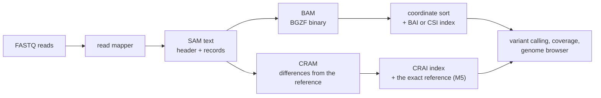

---
aliases:
  - SAM
  - Sequence Alignment Map Format
  - BAM
  - BAM Format
  - CRAM
  - CRAM Format
  - Format SAM
tags:
  - type/concept
  - domain/bioinformatics
  - domain/computer-science
  - level/L2
  - level/L3
  - level/M1
mastery: 0
prerequisites:
  - "[[FASTQ Format]]"
  - "[[Genomic Coordinate System]]"
  - "[[Reference Genome]]"
  - "[[Sequence Alignment]]"
  - "[[Reverse Complement]]"
related:
  - "[[Read Mapping]]"
  - "[[Mapping Quality]]"
  - "[[Paired-End Read]]"
  - "[[Spliced Read Alignment]]"
  - "[[Genomic File Indexing]]"
  - "[[VCF Format]]"
  - "[[Variant Calling]]"
  - "[[Duplicate Read]]"
  - "[[Integer Representation]]"
  - "[[Regular Expression]]"
  - "[[Data Compression]]"
projects:
  - "[[10-genomic-pipeline]]"
  - "[[bio-core]]"
sources:
  - "[[GA4GH hts-specs]]"
  - "[[HTSlib]]"
  - "[[Integrative Genomics Viewer]]"
  - "[[Bioinformatics Data Skills (Buffalo)]]"
---

# SAM Format

> [!abstract]
> SAM is the tab-separated text format of read alignments: a header naming the reference sequences, then one line per alignment whose 11 mandatory fields say where a read maps (RNAME, POS), how (FLAG, CIGAR) and how surely (MAPQ). BAM stores the same records in compressed binary; CRAM stores them as differences from the reference.

## Definition

**SAM** (Sequence Alignment/Map) is a TAB-delimited text format made of an optional header section, whose lines start with `@`, followed by an alignment section in which each line has 11 mandatory fields and a variable number of optional fields.[^sam1] The same specification (version 1.6) defines **BAM**, the binary form compressed with BGZF, and its index.[^bam] **CRAM** is a separate format that aims at better lossless compression than BAM with full BAM compatibility, by encoding bases as differences from a reference sequence.[^cram] Positions in SAM are 1-based ([[Genomic Coordinate System]]).[^sam1]

## Why it matters

- **Every mapped read lives in one.** [[Read Mapping]] writes alignments as SAM or BAM, and every downstream step (coverage, [[Variant Calling]], visual inspection) reads them; IGV displays BAM and SAM files once sorted and indexed.[^igv] In [[10-genomic-pipeline]] the BAM file is the hinge between the FASTQ input and the VCF output ([[VCF Format]]).
- **A daily format.** Practical texts teach SAM and BAM next to FASTA and FASTQ as the files of day-to-day genomics.[^buffalo]
- **Bugs hide in two fields.** FLAG is a bit field and CIGAR a run-length code: counting lines instead of primary alignments double-counts reads, and ignoring clips or deletions misplaces bases. Decoding both by hand is the core skill of this note.
- **Text is rarely kept.** BAM compresses records with BGZF and CRAM with the reference, and both can be indexed for region queries ([[Genomic File Indexing]]).[^bam][^cram]

## Core (L2)



### Header

Each header line is `@` plus a two-letter record type, followed by TAB-separated `TAG:VALUE` fields.[^samhdr]

| Line | Required | Meaning |
|---|---|---|
| `@HD` | `VN` | first line if present: format version; `SO` sort order (`unknown`, `unsorted`, `queryname`, `coordinate`) |
| `@SQ` | `SN`, `LN` | one per reference sequence: name and length (1 to $2^{31} - 1$); their order defines coordinate sorting; optional `M5` (MD5 of the sequence) and `AS` (assembly) |
| `@RG` | `ID` | read group: sample `SM`, library `LB`, platform `PL`; records point to it with the `RG` tag |
| `@PG` | `ID` | program that wrote or processed the file, with its name `PN` and command line `CL` |
| `@CO` | | free-text comment |

### The 11 mandatory fields

| Col | Field | Type | Meaning |
|---:|---|---|---|
| 1 | `QNAME` | string | template name; segments of one template (a read pair) share it |
| 2 | `FLAG` | integer | bit field (next table) |
| 3 | `RNAME` | string | reference sequence name, `*` if none |
| 4 | `POS` | integer | 1-based leftmost position of the first CIGAR operation that consumes a reference base; 0 if unplaced |
| 5 | `MAPQ` | integer | $-10\log_{10}\Pr(\text{mapping position is wrong})$, rounded; 255 = not available |
| 6 | `CIGAR` | string | the alignment as run-length operations, `*` if unavailable |
| 7 | `RNEXT` | string | reference of the next segment of the template: `=` same, `*` unknown |
| 8 | `PNEXT` | integer | position of the next segment, 0 if unknown |
| 9 | `TLEN` | integer | signed observed template length |
| 10 | `SEQ` | string | segment sequence, `*` if not stored |
| 11 | `QUAL` | string | base qualities in Phred+33, as in Sanger FASTQ ([[FASTQ Format]]); `*` if not stored |

Every alignment is written on the forward genomic strand: for a read mapped to the reverse strand, `SEQ` is reverse-complemented, `QUAL` and `CIGAR` reversed, and flag 0x10 is set ([[Reverse Complement]]).[^samfields]

### FLAG

| Bit | Hex | Meaning |
|---:|---:|---|
| 1 | 0x1 | template has multiple segments (paired) |
| 2 | 0x2 | each segment properly aligned according to the aligner |
| 4 | 0x4 | segment unmapped |
| 8 | 0x8 | next segment unmapped |
| 16 | 0x10 | `SEQ` reverse-complemented |
| 32 | 0x20 | `SEQ` of the next segment reverse-complemented |
| 64 | 0x40 | first segment of the template |
| 128 | 0x80 | last segment of the template |
| 256 | 0x100 | secondary alignment |
| 512 | 0x200 | not passing filters (platform or vendor quality controls) |
| 1024 | 0x400 | PCR or optical duplicate |
| 2048 | 0x800 | supplementary alignment |

Rules:[^samfields] each read has exactly one **primary line**, the one with `FLAG & 0x900 == 0`; 0x4 is the only reliable sign of an unmapped segment; if 0x1 is unset, bits 0x2, 0x8, 0x20, 0x40 and 0x80 mean nothing; in Illumina paired-end data 0x40 is read 1 and 0x80 read 2, whatever their strands ([[Paired-End Read]], [[Duplicate Read]]).

### CIGAR

| Op | Meaning | Consumes query | Consumes reference |
|:---:|---|:---:|:---:|
| `M` | alignment match: a match **or** a mismatch | yes | yes |
| `I` | insertion to the reference | yes | no |
| `D` | deletion from the reference | no | yes |
| `N` | skipped reference region (an intron, for mRNA-to-genome alignments) | no | yes |
| `S` | soft clip: bases present in `SEQ`, not aligned | yes | no |
| `H` | hard clip: bases absent from `SEQ` | no | no |
| `P` | padding: silent deletion from a padded reference | no | no |
| `=` / `X` | sequence match / sequence mismatch | yes | yes |

`H` may only be first or last, `S` may only have `H` between it and the ends, and the lengths of `M`, `I`, `S`, `=` and `X` sum to the length of `SEQ`.[^samfields] Two derived numbers are used everywhere: the **query length** and the **reference span** (sum of `M`, `D`, `N`, `=`, `X`), which gives the last aligned reference base, `POS + span - 1` ([[Spliced Read Alignment]] uses `N`).

### Optional fields

Each is `TAG:TYPE:VALUE`, with TYPE `A` (character), `i` (integer), `f` (float), `Z` (string), `H` (hex bytes) or `B` (typed numeric array); tags containing lowercase letters or starting with `X`, `Y` or `Z` are reserved for local use.[^samopt] The standard tags are defined in a companion document:[^samtags]

| Tag | Meaning |
|---|---|
| `NM:i` | edit distance to the reference: mismatches plus inserted and deleted bases; clips, skips and padding excluded |
| `MD:Z` | runs of matches, mismatched reference bases and `^`-prefixed deleted reference bases: rebuilds the reference without the FASTA |
| `AS:i` | alignment score from the aligner |
| `NH:i` | number of reported alignments containing the read |
| `RG:Z` | read group, matching an `@RG ID` |
| `SA:Z` | other parts of a chimeric alignment, as `rname,pos,strand,CIGAR,mapQ,NM;` |

### The specification's example

Six records on a 45 bp reference, columns aligned with spaces for display (the file uses tabs):[^samex]

```text
@HD VN:1.6 SO:coordinate
@SQ SN:ref LN:45
r001   99 ref  7 30 8M2I4M1D3M = 37  39 TTAGATAAAGGATACTG *
r002    0 ref  9 30 3S6M1P1I4M *  0   0 AAAAGATAAGGATA    *
r003    0 ref  9 30 5S6M       *  0   0 GCCTAAGCTAA       * SA:Z:ref,29,-,6H5M,17,0;
r004    0 ref 16 30 6M14N5M    *  0   0 ATAGCTTCAGC       *
r003 2064 ref 29 17 6H5M       *  0   0 TAGGC             * SA:Z:ref,9,+,5S6M,30,1;
r001  147 ref 37 30 9M         =  7 -39 CAGCGGCAT         * NM:i:1
```

`r001` is a read pair, `r003` a chimeric read (a primary line and a supplementary line flagged 2048 + 16), `r004` a split alignment with a 14-base skip.[^samex]

## Advanced (L3)

**BAM, the same record in binary.** BGZF compresses the data as a series of gzip blocks of at most 64 KiB that any gunzip can read and an index can address one by one ([[Genomic File Indexing]]); all integers are little-endian; the file starts with the magic `BAM\1`, the header text and the list of reference names and lengths.[^bam] A record holds fixed-size fields first (`refID`, an index into that list, −1 for none; `pos` = POS − 1, 0-based; `mapq`; a precomputed index `bin`; `n_cigar_op`; `flag`; `l_seq`; mate fields; `tlen`), then the NUL-terminated name, the CIGAR as 32-bit integers `op_len << 4 | op` with `MIDNSHP=X` coded 0 to 8, the sequence at 4 bits per base, two per byte ([[Integer Representation]]), the qualities as raw bytes 0 to 93 without the +33 offset (0xFF when absent), and typed optional fields.[^bam]

**Sorting.** `SO:coordinate` orders records by the `@SQ` order of RNAME, then by POS; indexing a BAM file requires this order.[^samhdr][^bai]

**CRAM, differences from the reference.** CRAM aims at significantly better lossless compression than BAM, full compatibility with BAM, an effortless transition, and controlled loss of data where the user chooses it; bases are compressed by encoding their differences from the reference.[^cram] The price is strict: the `@SQ M5` checksum of each reference sequence is required unless the reference is embedded in the file, readers must check it, and decoding needs that exact sequence.[^cram] The MD5 is computed on the printable characters of the sequence, uppercased, so that `1`, `Chr1` and `chr1` in different files can be recognized as the same sequence (Exercise 5).[^samhdr] Random access works through slices listed in a `.crai` index and needs two reads (container header, then slice) instead of one.[^cram]

**Multiple, secondary and supplementary alignments.**[^samterms]

- A **multiple mapping** (a read in a repeat) has one primary alignment and secondary ones (0x100); the specification notes that all but the best usually receive a MAPQ below 3 and are ignored by most variant callers ([[Mapping Quality]]).
- A **chimeric alignment** (structural variants, gene fusions, misassemblies) is a set of linear alignments: one representative, the others supplementary (0x800), linked by `SA` tags.[^samtags] In the example, the supplementary line of `r003` hard-clips (`6H5M`) and stores 5 bases, while its primary line keeps the other part as a soft clip (`5S6M`).
- **TLEN** has had two definitions (5' to 5', or leftmost to rightmost mapped base) that differ for overlapping pairs; the exact definition is implementation-defined.[^samfields]

## Frontier (M1)

- **Long reads.** Chimeric alignments become more frequent as reads get longer.[^samterms] An alignment with more than 65,535 CIGAR operations does not fit BAM's 16-bit `n_cigar_op`: the real CIGAR goes into a `CG:B,I` tag and the CIGAR field holds the placeholder `kSmN` ($k$ = read length, $m$ = reference span).[^bam]
- **Base modifications.** The `MM` and `ML` tags carry modified-base calls (for instance 5-methylcytosine) and their probabilities along the read as sequenced: `C+m,5,12,0;` says that, counting C's from the 5' end, the 6th, 19th and 20th have a call, whose probabilities (0 to 255) are listed in `ML`.[^samtags] Methylation thus travels inside the alignment file.
- **Formats keep moving.** The CRAM specification covers versions 3.0 and 3.1,[^cram] and SAM 1.6 has kept receiving additions (new platforms, topology of circular references): parsers must tolerate unknown tags and header fields.[^samhist]

## Mathematical representation

- **FLAG.** $f = \sum_{b \in B} 2^b$ for the set $B \subseteq \{0, \dots, 11\}$ of bits that are set; bit $b$ is set iff $\lfloor f / 2^b \rfloor \bmod 2 = 1$ (in code, `f & (1 << b)`). Primary line: $f \wedge (2^8 + 2^{11}) = 0$.
- **CIGAR.** A word $C = (n_1, o_1) \cdots (n_k, o_k)$ with $n_i \ge 1$ and $o_i \in \{M, I, D, N, S, H, P, =, X\}$. With $Q = \{M, I, S, =, X\}$ and $R = \{M, D, N, =, X\}$, the query length is $\ell_q(C) = \sum_{o_i \in Q} n_i$ and the reference span $\ell_r(C) = \sum_{o_i \in R} n_i$; validity requires $\ell_q(C) = |\mathrm{SEQ}|$. The record covers the 1-based closed interval $[p, p + \ell_r - 1]$, or $[p - 1, p - 1 + \ell_r)$ in 0-based half-open form.
- **Alignment path.** Each operation moves along the dynamic-programming grid of [[Sequence Alignment]] by $(\Delta_{\text{query}}, \Delta_{\text{ref}})$: $(1, 1)$ for M, =, X; $(1, 0)$ for I and S; $(0, 1)$ for D and N; $(0, 0)$ for H and P. NM counts the mismatched diagonal steps plus all I and D steps.
- **MAPQ.** $Q = \mathrm{round}(-10 \log_{10} p)$ and $p = 10^{-Q/10}$: MAPQ 30 means $p = 10^{-3}$, MAPQ 3 means $p \approx 0.5$.
- **BAM CIGAR word.** $v = 16\,n + c(o)$ with $c$ mapping `MIDNSHP=X` to $0, \dots, 8$; decoding is $n = \lfloor v / 16 \rfloor$, $o = c^{-1}(v \bmod 16)$.

## Computational representation

A SAM reader in standard-library Python, run on the specification's example. It keeps POS 1-based, as in the file, and converts to 0-based half-open intervals only for aligned blocks ([[Genomic Coordinate System]]). It validates CIGAR syntax with a [[Regular Expression]] and checks CIGAR against `SEQ`.

```python
import re
from collections import namedtuple

FLAG_BITS = [(0x1, "paired"), (0x2, "proper_pair"), (0x4, "unmapped"), (0x8, "mate_unmapped"),
             (0x10, "reverse"), (0x20, "mate_reverse"), (0x40, "first"), (0x80, "last"),
             (0x100, "secondary"), (0x200, "qc_fail"), (0x400, "duplicate"), (0x800, "supplementary")]
CIGAR = re.compile(r"(\d+)([MIDNSHP=X])")
QUERY_OPS, REF_OPS = set("MIS=X"), set("MDN=X")          # operations consuming query / reference
SamRecord = namedtuple("SamRecord", "qname flag rname pos mapq cigar rnext pnext tlen seq qual tags")

def decode_flag(flag: int) -> list[str]:
    return [name for bit, name in FLAG_BITS if flag & bit]

def parse_cigar(text: str) -> list[tuple[int, str]]:
    ops = [] if text == "*" else [(int(n), op) for n, op in CIGAR.findall(text)]
    if text != "*" and "".join(f"{n}{op}" for n, op in ops) != text:
        raise ValueError(f"malformed CIGAR {text!r}")
    return ops

def query_length(ops) -> int:
    return sum(n for n, op in ops if op in QUERY_OPS)

def reference_span(ops) -> int:
    return sum(n for n, op in ops if op in REF_OPS)

def parse_tag(field: str):
    tag, typ, value = field.split(":", 2)                 # B arrays and H bytes kept as text here
    return tag, int(value) if typ == "i" else float(value) if typ == "f" else value

def parse_sam(lines):
    """Return (header, records); header maps '@SQ' etc. to lists of {TAG: value} dicts."""
    header, records = {}, []
    for line in (l.rstrip("\r\n") for l in lines):
        if line.startswith("@CO"):
            header.setdefault("@CO", []).append(line[4:])
        elif line.startswith("@"):
            kind, *fields = line.split("\t")
            header.setdefault(kind, []).append(dict(f.split(":", 1) for f in fields))
        elif line:
            f = line.split("\t")
            ops = parse_cigar(f[5])
            if ops and f[9] != "*" and query_length(ops) != len(f[9]):
                raise ValueError(f"{f[0]}: CIGAR implies {query_length(ops)} bases, SEQ has {len(f[9])}")
            records.append(SamRecord(f[0], int(f[1]), f[2], int(f[3]), int(f[4]), ops, f[6],
                                     int(f[7]), int(f[8]), f[9], f[10], dict(map(parse_tag, f[11:]))))
    return header, records

def alignment_end(rec) -> int:
    return rec.pos + reference_span(rec.cigar) - 1        # 1-based, closed

def aligned_blocks(rec) -> list[tuple[int, int]]:
    """0-based half-open reference intervals of M/=/X runs (D and N interrupt them)."""
    blocks, ref = [], rec.pos - 1
    for n, op in rec.cigar:
        if op in "M=X":
            if blocks and blocks[-1][1] == ref:
                blocks[-1] = (blocks[-1][0], ref + n)      # merge e.g. 3=2X
            else:
                blocks.append((ref, ref + n))
        ref += n if op in REF_OPS else 0
    return blocks

def explicit_alignment(ref_seq: str, rec):
    """Two rows (reference, read) and NM; clipped bases are not shown."""
    top, bottom, r, q, nm = [], [], rec.pos - 1, 0, 0
    for n, op in rec.cigar:
        if op in "M=X":
            pairs = list(zip(ref_seq[r:r + n], rec.seq[q:q + n]))
            top += [a for a, _ in pairs]; bottom += [b for _, b in pairs]
            nm += sum(a.upper() != b.upper() for a, b in pairs)
        elif op == "I":
            top.append("-" * n); bottom.append(rec.seq[q:q + n]); nm += n
        elif op == "D":
            top.append(ref_seq[r:r + n]); bottom.append("-" * n); nm += n
        elif op == "N":
            top.append(f"<{n}N>"); bottom.append(f"<{n}N>")
        r += n if op in REF_OPS else 0
        q += n if op in QUERY_OPS else 0
    return "".join(top), "".join(bottom), nm

# Example of the SAM specification (section 1.1), rewritten with tabs as in a real file.
EXAMPLE = """@HD VN:1.6 SO:coordinate
@SQ SN:ref LN:45
r001 99 ref 7 30 8M2I4M1D3M = 37 39 TTAGATAAAGGATACTG *
r002 0 ref 9 30 3S6M1P1I4M * 0 0 AAAAGATAAGGATA *
r003 0 ref 9 30 5S6M * 0 0 GCCTAAGCTAA * SA:Z:ref,29,-,6H5M,17,0;
r004 0 ref 16 30 6M14N5M * 0 0 ATAGCTTCAGC *
r003 2064 ref 29 17 6H5M * 0 0 TAGGC * SA:Z:ref,9,+,5S6M,30,1;
r001 147 ref 37 30 9M = 7 -39 CAGCGGCAT * NM:i:1"""
REF = "AGCATGTTAGATAAGATAGCTGTGCTAGTAGGCAGTCAGCGCCAT"      # the example's 45 bp reference

header, records = parse_sam("\t".join(line.split()) for line in EXAMPLE.splitlines())
print(header["@SQ"], len(REF))
for rec in records:
    nm = explicit_alignment(REF, rec)[2]
    print(rec.qname, rec.flag, f"{rec.pos}-{alignment_end(rec)}", aligned_blocks(rec), "NM", nm, rec.tags)
ref_row, read_row, _ = explicit_alignment(REF, records[0])
print(ref_row, read_row, sep="\n")
primary = [(r.qname, r.flag & 0xC0) for r in records if r.flag & 0x900 == 0]
print(len(records), "lines,", len(primary), "primary lines, unique:", len(primary) == len(set(primary)))
```

```text
[{'SN': 'ref', 'LN': '45'}] 45
r001 99 7-22 [(6, 18), (19, 22)] NM 3 {}
r002 0 9-18 [(8, 18)] NM 1 {}
r003 0 9-14 [(8, 14)] NM 1 {'SA': 'ref,29,-,6H5M,17,0;'}
r004 0 16-40 [(15, 21), (35, 40)] NM 0 {}
r003 2064 29-33 [(28, 33)] NM 0 {'SA': 'ref,9,+,5S6M,30,1;'}
r001 147 37-45 [(36, 45)] NM 1 {'NM': 1}
TTAGATAA--GATAGCTG
TTAGATAAAGGATA-CTG
6 lines, 5 primary lines, unique: True
```

The computed edit distances agree with every value the example states: `NM:i:1` on the last line, and the NM fields inside both `SA` tags (1 for the primary part of `r003`, 0 for its supplementary part). The primary lines are identified per segment (`QNAME` plus bits 0x40 and 0x80), since the two reads of a pair share a name. For real files, read BAM and CRAM through HTSlib-based tools or bindings; a hand-written parser is for understanding and for tests.[^htslib]

## Worked example

> [!example] Decoding `r001` and its mate
> Line: `r001 99 ref 7 30 8M2I4M1D3M = 37 39 TTAGATAAAGGATACTG *` (specification example).[^samex]
> 1. **FLAG** 99 = 64 + 32 + 2 + 1: paired, properly aligned, mate reverse-complemented, first segment; 0x10 is unset, so this read maps to the forward strand.
> 2. **CIGAR** 8M2I4M1D3M: query length 8 + 2 + 4 + 3 = 17 = |SEQ|; reference span 8 + 4 + 1 + 3 = 16, so the read covers bases 7 to 22.
> 3. **Explicit alignment** against reference bases 7-22 (output above): `TTAGATAA--GATAGCTG` over `TTAGATAAAGGATA-CTG`: two inserted bases (`AG`) and one deleted reference base (`G`), no mismatch, NM = 3.
> 4. **MAPQ** 30: the aligner estimates a probability $10^{-3}$ that this position is wrong.
> 5. **Mate.** RNEXT `=` and PNEXT 37 point to `r001 147 ref 37 30 9M = 7 -39 ...`: FLAG 147 = 128 + 16 + 2 + 1 (last segment, reverse strand), span 9, so bases 37 to 45. Its 9 bases differ from the reference at one position (`CAGCGGCAT` over `CAGCGCCAT`): `NM:i:1`.
> 6. **TLEN.** Leftmost mapped base 7, rightmost 45: $45 - 7 + 1 = 39$, written +39 on the leftmost segment and −39 on the rightmost.[^samfields]

## Common misconceptions

> [!warning] "RNAME `*` means unmapped, and a position means mapped"
> Only flag 0x4 says whether a segment is unmapped. An unmapped read whose mate is mapped should even receive its mate's RNAME and POS, so that sorting places them together.[^samfields][^samrp]

> [!warning] "One line is one read"
> Secondary (0x100) and supplementary (0x800) lines repeat reads: the example has 6 lines for 5 reads. Count primary lines (`FLAG & 0x900 == 0`), and add the duplicate bit (0x400) to count unique fragments.[^samfields]

> [!warning] "M means that the base matches"
> M is an aligned column, match or mismatch; only `=` and `X` tell them apart. Count mismatches with NM or MD, or against the reference.[^samfields][^samtags]

> [!warning] "POS is where the read starts"
> POS is the first aligned reference base: soft-clipped bases precede it in SEQ without being placed. For a reverse-strand read, the 5' end of the original read lies at the alignment end, because SEQ is stored reverse-complemented.[^samfields]

## Exercises

> [!question] Exercise 1 (L2)
> Decode the FLAGs 83, 163, 4, 2064 and 1171. Which lines would you keep to count reads, and which to count unique fragments?

> [!success]- Solution
> ```python
> for flag in (83, 163, 4, 2064, 1171):
>     print(flag, decode_flag(flag))
> # 83 ['paired', 'proper_pair', 'reverse', 'first']
> # 163 ['paired', 'proper_pair', 'mate_reverse', 'last']
> # 4 ['unmapped']
> # 2064 ['reverse', 'supplementary']
> # 1171 ['paired', 'proper_pair', 'reverse', 'last', 'duplicate']
> ```
> 83 and 163 are the two reads of a typical properly paired fragment (read 1 reverse, read 2 forward). To count reads, keep primary lines (drop 0x100 and 0x800, so drop 2064); to count unique fragments, also drop 0x400 (1171) and count each template once.

> [!question] Exercise 2 (L2)
> For `r002` (`3S6M1P1I4M` at POS 9, SEQ `AAAAGATAAGGATA`), compute the query length, the reference span and the last aligned base. What does `P` change?

> [!success]- Solution
> Query length $3 + 6 + 1 + 4 = 14$ = |SEQ|. Reference span $6 + 4 = 10$, so bases 9 to 18. The three soft-clipped `A` are in SEQ but not aligned. `P` consumes neither query nor reference: it only marks a gap in a padded multiple alignment (the `*` columns of the specification's padded reference), so positions are unchanged.[^samfields]

> [!question] Exercise 3 (L2, Python)
> Give the aligned blocks of `r004` (`6M14N5M` at POS 16) as BED intervals, and the intron, in BED and 1-based forms.

> [!success]- Solution
> ```python
> blocks = aligned_blocks(records[3])                  # r004
> print(blocks, "intron:", (blocks[0][1], blocks[1][0]))
> # [(15, 21), (35, 40)] intron: (21, 35)
> ```
> BED lines `ref 15 21` and `ref 35 40` ([[BED Format]]), that is 1-based 16-21 and 36-40; the skipped region `ref 21 35` is 22-35 in 1-based form, $35 - 21 = 14$ bases, the `14N`. For a spliced RNA-seq read this is the intron ([[Spliced Read Alignment]]).

> [!question] Exercise 4 (L3, Python)
> An invented record has `SEQ = TTGCAGGTACCA`, `CIGAR = 2S4M1I2M2D3M` and `MD:Z:2T3^AG3`. Rebuild the aligned reference bases and compute NM.

> [!success]- Solution
> MD numbers count only aligned read bases (M, =, X): insertions and clips are skipped, deleted bases appear after `^`.[^samtags]
> ```python
> MD = re.compile(r"(\d+)|(\^[A-Z]+)|([A-Z])")
>
> def reference_from_md(seq: str, ops, md: str) -> str:
>     """Aligned reference bases rebuilt from SEQ, CIGAR and MD (alignments without N)."""
>     aligned, q = "", 0
>     for n, op in ops:
>         aligned += seq[q:q + n] if op in "M=X" else ""   # read bases facing reference bases
>         q += n if op in QUERY_OPS else 0
>     out, i = [], 0
>     for run, deleted, mismatch in MD.findall(md):
>         if run:
>             out.append(aligned[i:i + int(run)]); i += int(run)
>         else:                                            # ^deleted bases, or one mismatched base
>             out.append(deleted[1:] or mismatch); i += 0 if deleted else 1
>     return "".join(out)
>
> def nm_from_md(ops, md: str) -> int:
>     return sum(1 for _, _, mm in MD.findall(md) if mm) + sum(n for n, op in ops if op in "ID")
>
> seq, ops, md = "TTGCAGGTACCA", parse_cigar("2S4M1I2M2D3M"), "2T3^AG3"   # invented record
> ref = reference_from_md(seq, ops, md)
> print(ref, len(ref), reference_span(ops), nm_from_md(ops, md))
> # GCTGTAAGCCA 11 11 4
> ```
> The rebuilt reference has 11 bases, equal to the reference span, a useful consistency check. NM = 1 mismatch + 1 inserted + 2 deleted = 4.

> [!question] Exercise 5 (L3, Python)
> The SAM specification computes `M5` on a reference written as `ACGT ACGT ACGT`, `acgt acgt acgt`, `... 12345 !!!` (three lines). Reproduce its digest `dfabdbb36e239a6da88957841f32b8e4`. Why does CRAM require this tag, and what do the cleaning rules buy?

> [!success]- Solution
> ```python
> import hashlib
>
> raw = "ACGT ACGT ACGT\nacgt acgt acgt\n... 12345 !!!\n"    # example of SAMv1 section 1.3.2
> kept = "".join(c for c in raw if 33 <= ord(c) <= 126).upper()
> print(kept, hashlib.md5(kept.encode("ascii")).hexdigest())
> # ACGTACGTACGTACGTACGTACGT...12345!!! dfabdbb36e239a6da88957841f32b8e4
> ```
> Characters outside 33-126 (spaces, newlines) are dropped, the rest uppercased, so line width, line endings and soft-masking do not change the digest.[^samhdr] CRAM stores bases as differences from the reference: decoding with another sequence, even one differing by a single base, silently changes the reads, so readers check `M5` before trusting the data.[^cram]

> [!question] Exercise 6 (M1, Python)
> Encode the CIGAR `8M2I4M1D3M` as BAM 32-bit words and decode them back. Then: what does BAM store for a 100,000-base read whose alignment has 70,000 operations and spans 98,500 reference bases?

> [!success]- Solution
> ```python
> import struct
>
> CODES = "MIDNSHP=X"
> packed = [n << 4 | CODES.index(op) for n, op in parse_cigar("8M2I4M1D3M")]
> print(packed, [(v >> 4, CODES[v & 0xF]) for v in packed])
> print(struct.pack("<5I", *packed).hex(" ", 4))
> # [128, 33, 64, 18, 48] [(8, 'M'), (2, 'I'), (4, 'M'), (1, 'D'), (3, 'M')]
> # 80000000 21000000 40000000 12000000 30000000
> ```
> Each word is little-endian, so `8M` = 128 is written `80 00 00 00`. 70,000 operations exceed the 65,535 that `n_cigar_op` can count: BAM stores the real CIGAR in the `CG:B,I` tag and writes the placeholder `100000S98500N` (2 operations) in the CIGAR field; a library reading it restores the real CIGAR.[^bam]

## Mastery checklist

- [ ] 1 Recognized: I can name the 11 mandatory SAM fields and say what BAM and CRAM change.
- [ ] 2 Understood: I can decode a FLAG and a CIGAR by hand and explain primary, secondary and supplementary lines, soft and hard clips, and 1-based POS versus 0-based BAM `pos`.
- [ ] 3 Practiced: I can parse SAM in Python and compute spans, aligned blocks, NM, MD reconstructions and explicit alignments.
- [ ] 4 Applied: in [[10-genomic-pipeline]] I read real BAM files through a library, filter by FLAG and MAPQ, and count primary, non-duplicate reads correctly.
- [ ] 5 Explained: I can teach how BAM encodes a record, why CRAM needs the reference MD5, and the pitfalls of TLEN, clipping and multiple mappings.

## References

[^sam1]: [[GA4GH hts-specs]], `SAMv1` (SAM and BAM version 1.6), §1 "The SAM Format Specification" (TAB-delimited text, optional header, 11 mandatory fields) and §1.4 (POS 1-based).
[^samex]: [[GA4GH hts-specs]], `SAMv1`, §1.1 "An example".
[^samterms]: [[GA4GH hts-specs]], `SAMv1`, §1.2 "Terminologies and Concepts": linear, chimeric and multiple alignments, with the footnote on their causes, their frequency with longer reads and the MAPQ of non-primary mappings.
[^samhdr]: [[GA4GH hts-specs]], `SAMv1`, §1.3 "The header section" (record types, required tags, `SO`, `@SQ` order) and §1.3.2 "Reference MD5 calculation".
[^samfields]: [[GA4GH hts-specs]], `SAMv1`, §1.4 "The alignment section: mandatory fields": field table, FLAG bits and rules, POS, MAPQ, CIGAR operations and constraints, TLEN and its two historical definitions, SEQ, QUAL, forward-strand representation.
[^samopt]: [[GA4GH hts-specs]], `SAMv1`, §1.5 "The alignment section: optional fields".
[^samrp]: [[GA4GH hts-specs]], `SAMv1`, §2 "Recommended Practice for the SAM Format" (unmapped reads placed at their mate's position).
[^bam]: [[GA4GH hts-specs]], `SAMv1`, §4 "The BAM Format Specification": BGZF, record layout, "N_CIGAR_OP field" (CG tag), "SEQ and QUAL encoding".
[^bai]: [[GA4GH hts-specs]], `SAMv1`, §5 "Indexing BAM" (sorting required before indexing).
[^samhist]: [[GA4GH hts-specs]], `SAMv1`, appendix "SAM Version History" (changes made while version 1.6 is current).
[^samtags]: [[GA4GH hts-specs]], `SAMtags` (Sequence Alignment/Map Optional Fields Specification): `AS`, `MD`, `NH`, `NM`, `SA`, `RG`, and the base-modification tags `MM` and `ML`.
[^cram]: [[GA4GH hts-specs]], `CRAMv3` (CRAM 3.0 and 3.1): "Overview" (objectives, reference-based compression), "Reference sequences" (M5 required and checked) and "Indexing" (CRAM index, two reads per random access).
[^htslib]: [[HTSlib]], the C library used by samtools and bcftools to read and write SAM, BAM and CRAM (Bonfield et al. 2021).
[^igv]: [[Integrative Genomics Viewer]], desktop documentation, "File Formats" (BAM and SAM, sorted and indexed).
[^buffalo]: [[Bioinformatics Data Skills (Buffalo)]], material on genomics formats (FASTA, FASTQ, SAM and BAM); chapter not verified.
