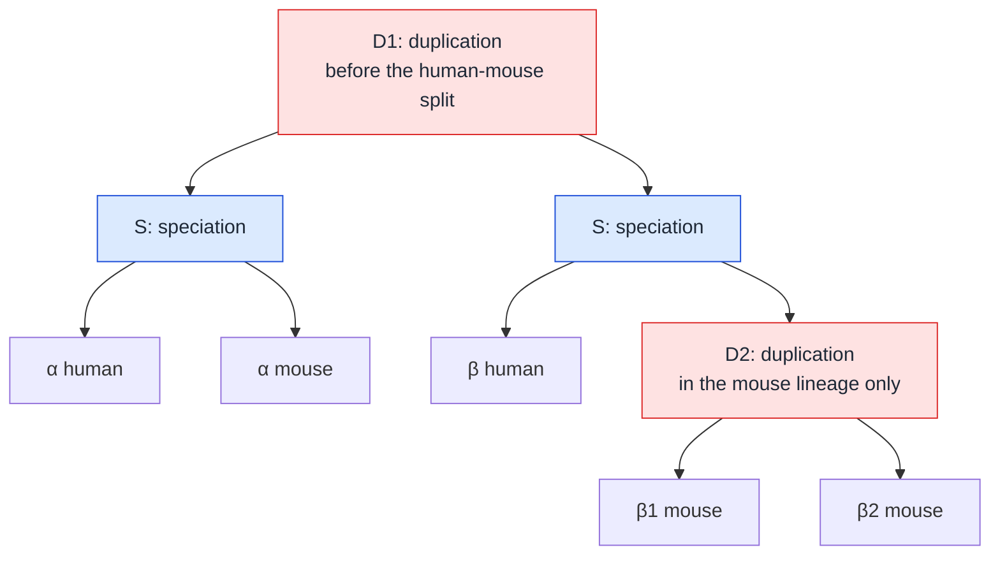

---
aliases:
  - Paralogue
  - Paralogous Gene
  - Paralogy
  - Gène paralogue
tags:
  - type/concept
  - domain/bioinformatics
  - domain/biology
  - level/L2
  - level/L3
mastery: 0
prerequisites:
  - "[[Sequence Homology]]"
  - "[[Gene Duplication]]"
  - "[[Ortholog]]"
related:
  - "[[Protein Family]]"
  - "[[Orthology Inference]]"
  - "[[Gene Tree Reconciliation]]"
  - "[[Molecular Evolution]]"
  - "[[Synteny]]"
  - "[[Comparative Genomics]]"
  - "[[Functional Annotation]]"
  - "[[Read Mapping]]"
  - "[[Protein Substitution Model]]"
projects: []
sources:
  - "[[Fitch 1970 - Distinguishing Homologous from Analogous Proteins]]"
  - "[[Koonin 2005 - Orthologs, Paralogs, and Evolutionary Genomics]]"
  - "[[Kellis 2004 - Proof and Evolutionary Analysis of Ancient Genome Duplication in the Yeast Saccharomyces cerevisiae]]"
  - "[[Evolution (Futuyma)]]"
  - "[[Blattner 1997 - The Complete Genome Sequence of Escherichia coli K-12]]"
  - "[[Biochemistry (Berg)]]"
---

# Paralog

> [!abstract]
> Paralogs are homologous genes separated by a gene duplication: two copies that started identical, one of which is free to change, which is why paralogs so often end up doing different jobs.

## Definition

Paralogs are homologs whose divergence began with a **gene duplication**: in a gene tree, the last common ancestor of two paralogs is a duplication node.[^fitch][^koonin] Fitch's example is the pair of α- and β-hemoglobin.[^fitch] Paralogs usually sit in the same genome, but not necessarily: a human gene and a mouse gene are paralogs when the duplication that separated their lineages preceded the speciation ([[Ortholog]]).

## Why it matters

- **Gene families.** Duplication is a major source of new genes, and genomes are full of paralog families:[^futuyma] in *Escherichia coli* K-12 the largest contains 80 ABC transporters.[^blattner] Membership of a family is often the first clue to the function of a new gene ([[Protein Family]]).
- **Annotation errors.** Transferring the function of a paralog as if it were an ortholog is a classic source of misannotation; telling the two apart is critical for reliable functional annotation.[^koonin]
- **Phylogenetics.** A tree built from a mixture of orthologs and paralogs records a duplication as if it were a speciation (hidden paralogy) and can return a wrong species tree ([[Phylogenomics]], [[Gene Tree Reconciliation]]).
- **Reads and variants.** Recent paralogs are nearly identical, so a short read from one copy may align equally well to the other: its position is ambiguous, and a fixed difference between the copies can be mistaken for a variant ([[Read Mapping]], Exercise 5).

## Core (L2)

### Recognizing paralogs

Same test as for orthologs: follow both genes back to the node where their lineages meet; if it is a duplication, they are paralogs.



The topology is Fitch's globin example; the mouse duplication D2 is invented for illustration.

### In-paralogs and out-paralogs

Relative to a chosen speciation, paralogs come in two kinds:[^koonin]

- **In-paralogs** arose by a duplication *after* that speciation, in one lineage: β1 and β2 mouse, relative to the human-mouse split. Together they are co-orthologs of human β.
- **Out-paralogs** arose by a duplication *before* the speciation: α and β, whether in one species (α human, β human) or across species (α human, β mouse).

The labels depend on the speciation chosen: relative to a split inside the mouse lineage that happened after D2, β1 and β2 would be out-paralogs.

### Why paralogs diverge in function

Right after a duplication, the two copies are identical and redundant: a mutation that damages one copy is covered by the other, so selection on one copy relaxes.[^futuyma] Three outcomes follow, detailed in [[Gene Duplication]]:[^futuyma]

1. **Loss**: one copy accumulates disabling mutations and becomes a pseudogene, the most common fate.
2. **Neofunctionalization**: one copy keeps the ancestral function, the other acquires a new one.
3. **Subfunctionalization**: the copies split the ancestral functions between them, so that both become necessary.

**One copy changes, the other does not.** The genome of *Saccharomyces cerevisiae* descends from a whole-genome duplication, proved by its 1:2 correspondence with *Kluyveromyces waltii*, a yeast that diverged before the duplication. Among the surviving duplicate pairs, 95% of the cases of accelerated evolution involve only one member of the pair,[^kellis] the signature of asymmetric divergence: one copy conserved, the other changing. A genome that diverged before the duplication plays the role of an outgroup to tell which copy changed (Worked example).

**Time matters too.** The α/β duplication is older than the human-mouse speciation, so α human and β human have been diverging longer than α human and α mouse: with comparable rates, the out-paralogs are expected to be less similar than the orthologs.

**Diverged but related.** Paralogs often keep related roles. α- and β-globin both carry oxygen, as the two kinds of chains of adult hemoglobin, a tetramer of two α and two β chains.[^berg] Divergence of function is a frequent outcome of paralogy, not its definition.

## Advanced (L3)

- **Relative-rate test.** With paralogs A and B and an outgroup gene O from a species that diverged before the duplication, additive distances on the tree ((A, B), O) give the length of each branch since the duplication (Mathematical representation). A much longer branch marks the accelerated copy. P-distances saturate on long branches, because a site hit twice counts once; correct them with a substitution model before comparing rates ([[Protein Substitution Model]], Exercise 3).
- **Hidden paralogy.** When two lineages lose complementary copies, the survivors are paralogs that look like one-to-one orthologs, the pseudo-orthologs of [[Ortholog#Advanced (L3)]].[^koonin] A genome that kept both copies, or conserved gene order, reveals them.
- **Whole-genome versus small-scale duplication.** A whole-genome duplication creates paralogs of every gene at once, all of the same age, and leaves duplicated blocks with conserved gene order, which is how the yeast duplication was demonstrated region by region ([[Synteny]]).[^kellis] Tandem and segmental duplications create paralogs one region at a time, at all ages.
- **Copy number as a variable.** Families expand and contract between lineages; reconciling gene trees with species trees infers where the duplications and losses happened ([[Gene Tree Reconciliation]]).

## Mathematical representation

With the notation of [[Ortholog#Mathematical representation]] (gene tree $G$, species map $\sigma$, event labels $\tau$):

- $x, y$ are paralogs $\iff \tau(\mathrm{lca}(x, y)) = \text{duplication}$.
- **In and out.** For a speciation node $s$ separating species $A$ and $B$, and paralogs $x, y$ with duplication $d = \mathrm{lca}(x, y)$: in-paralogs relative to $s$ if $d$ is a descendant of $s$, out-paralogs if $d$ is an ancestor of $s$. Without the species tree, an operational test: the genes below $d$ include only one of the species $A$, $B$ (in-paralogs) or both (out-paralogs); differential loss can fool it.
- **Three-point formulas.** On the unrooted tree ((A, B), O) with branch lengths $b_A, b_B, b_O$ from the central node, additive distances satisfy $d_{AB} = b_A + b_B$, $d_{AO} = b_A + b_O$, $d_{BO} = b_B + b_O$. Solving the system:
$$b_A = \tfrac{1}{2}(d_{AB} + d_{AO} - d_{BO}),\qquad b_B = \tfrac{1}{2}(d_{AB} + d_{BO} - d_{AO}),\qquad b_O = \tfrac{1}{2}(d_{AO} + d_{BO} - d_{AB}).$$
In particular $b_B - b_A = d_{BO} - d_{AO}$: the copy farther from the outgroup changed more since the duplication.

## Computational representation

The same nested-tuple gene tree as in [[Ortholog]], now listing the paralogous pairs with their type relative to the human-mouse speciation, plus the distance tools of the relative-rate test.

```python
TREE = (("human:alpha", "mouse:alpha"), ("human:beta", ("mouse:beta1", "mouse:beta2")))


def leaves(node) -> list[str]:
    return [node] if isinstance(node, str) else [g for child in node for g in leaves(child)]


def species(gene: str) -> str:
    return gene.split(":")[0]


def paralog_pairs(node, sp1: str, sp2: str):
    """Yield (x, y, kind) for paralogs, kind relative to the sp1/sp2 speciation."""
    if isinstance(node, str):
        return
    for child in node:
        yield from paralog_pairs(child, sp1, sp2)
    left, right = (leaves(child) for child in node)
    sides = [{species(g) for g in side} for side in (left, right)]
    if sides[0] & sides[1]:                                  # species overlap: a duplication
        below = sides[0] | sides[1]                          # species descending from it
        kind = "out-paralogs" if {sp1, sp2} <= below else "in-paralogs"
        for x in left:
            for y in right:
                yield x, y, kind


for x, y, kind in paralog_pairs(TREE, "human", "mouse"):
    print(f"{x:12s} {y:12s} {kind}")


def p_distance(x: str, y: str) -> float:
    return sum(a != b for a, b in zip(x, y)) / len(x)


def branch_lengths(a: str, b: str, out: str) -> tuple[float, float, float]:
    """Three-point formulas on the unrooted tree ((a, b), out): branch to a, to b, to out."""
    ab, ao, bo = p_distance(a, b), p_distance(a, out), p_distance(b, out)
    return (ab + ao - bo) / 2, (ab + bo - ao) / 2, (ao + bo - ab) / 2
```

```text
mouse:beta1  mouse:beta2  in-paralogs
human:alpha  human:beta   out-paralogs
human:alpha  mouse:beta1  out-paralogs
human:alpha  mouse:beta2  out-paralogs
mouse:alpha  human:beta   out-paralogs
mouse:alpha  mouse:beta1  out-paralogs
mouse:alpha  mouse:beta2  out-paralogs
```

Seven paralogous pairs, against three orthologous ones in [[Ortholog#Computational representation]]: in this small family, most pairs of homologs are paralogs.

## Worked example

> [!example] Which copy changed? (invented 20-residue alignment)
> ```python
> anc = "MKVLAAGIRSTEELLKQHGF"
> def change(seq, edits):
>     s = list(seq)
>     for pos, aa in edits.items():
>         s[pos] = aa
>     return "".join(s)
> O = change(anc, {3: "I", 15: "R"})                                   # 2 changes
> A = change(anc, {8: "K"})                                            # 1 change
> B = change(anc, {1: "R", 5: "S", 10: "N", 12: "D", 17: "Y", 19: "L"})  # 6 changes
> for name, seq in (("O", O), ("A", A), ("B", B)):
>     print(name, seq)
> print([round(p_distance(*pair), 2) for pair in ((A, O), (B, O), (A, B))])
> print([round(x, 2) for x in branch_lengths(A, B, O)])
> ```
> ```text
> O MKVIAAGIRSTEELLRQHGF
> A MKVLAAGIKSTEELLKQHGF
> B MRVLASGIRSNEDLLKQYGL
> [0.15, 0.4, 0.35]
> [0.05, 0.3, 0.1]
> ```
> 1. **Count differences.** A and O differ at positions 4, 9 and 16: $d_{AO} = 3/20 = 0.15$. B and O differ at 8 positions: $d_{BO} = 0.40$. A and B at 7: $d_{AB} = 0.35$.
> 2. **Solve for the branches.** $b_A = (0.35 + 0.15 - 0.40)/2 = 0.05$, $b_B = (0.35 + 0.40 - 0.15)/2 = 0.30$, $b_O = (0.15 + 0.40 - 0.35)/2 = 0.10$.
> 3. **Read the asymmetry.** Since the duplication, B changed six times as much as A: A is the conserved copy, B the accelerated one, the pattern that dominates the yeast duplicate pairs.[^kellis]
> 4. **Interpret with care.** A is the better candidate for the ancestral function, B for a new or reduced one; only experiments can say which.

## Common misconceptions

> [!warning] "Paralogs are genes of the same species"
> Paralogy is defined by a duplication, not by location: α human and β mouse are paralogs.[^fitch] Two genes of one species are paralogs; two genes of different species can be orthologs or paralogs.

> [!warning] "Paralogs have different functions by definition"
> Divergence of function is a frequent outcome, not the definition. Recent paralogs can be nearly identical and redundant, and old ones can keep related roles, like the α and β chains of hemoglobin.[^berg]

> [!warning] "In-paralogs share a genome, out-paralogs are in different genomes"
> Both terms are relative to a chosen speciation:[^koonin] α human and β human share a genome and are out-paralogs relative to the human-mouse split.

> [!warning] "A duplicated gene soon acquires a new function"
> Loss is the most common fate of a duplicate; new functions, when they appear, accumulate over time in a copy released from selection.[^futuyma]

## Exercises

> [!question] Exercise 1 (L2)
> In the Mermaid tree, classify relative to the human-mouse speciation: (a) β1 mouse and β2 mouse; (b) α human and β human; (c) α mouse and β1 mouse. Which genes are co-orthologs of β human?

> [!success]- Solution
> (a) In-paralogs: D2 happened in the mouse lineage after the split. (b) Out-paralogs: D1 precedes the split. (c) Out-paralogs, separated at D1. β1 and β2 mouse are the co-orthologs of β human, in a 1:2 relation.[^koonin]

> [!question] Exercise 2 (L2)
> Why is α human expected to be more similar to α mouse than to β human? Give one situation in which the expectation fails.

> [!success]- Solution
> α human and α mouse have diverged since the speciation, α human and β human since the older duplication: more time, more differences, if rates are comparable. The expectation fails if one ortholog accelerated strongly after the speciation (for example after losing its constraint), so that its divergence since the speciation exceeds the paralogs' divergence since the duplication.

> [!question] Exercise 3 (L3, Python)
> Simulate the relative-rate test: a 300-residue ancestor, an outgroup with 60 random substitutions, copy A with 15 and copy B with 90 (seed 3, three replicates). Estimate the branch lengths with `branch_lengths` and compare them with the true numbers of substitutions per site.

> [!success]- Solution
> ```python
> import random
>
> AA = "ACDEFGHIKLMNPQRSTVWY"
> def evolve(seq: str, n_subs: int, rng: random.Random) -> str:
>     s = list(seq)
>     for _ in range(n_subs):                                  # positions can be hit twice
>         pos = rng.randrange(len(s))
>         s[pos] = rng.choice([a for a in AA if a != s[pos]])
>     return "".join(s)
> rng = random.Random(3)
> for rep in range(3):
>     root = "".join(rng.choices(AA, k=300))
>     out, a, b = evolve(root, 60, rng), evolve(root, 15, rng), evolve(root, 90, rng)
>     print(rep, [round(x, 3) for x in branch_lengths(a, b, out)])
> ```
> ```text
> 0 [0.058, 0.222, 0.158]
> 1 [0.068, 0.225, 0.155]
> 2 [0.057, 0.24, 0.153]
> ```
> True values: 0.05, 0.30 and 0.20 substitutions per site. The ranking is always right, B far ahead of A, but the long branches are underestimated: a site hit twice counts once in a p-distance, so distances stop being additive and the errors spread to the short branch. A substitution model corrects for multiple hits ([[Protein Substitution Model]]).

> [!question] Exercise 4 (L3)
> Species P kept copy X1 of a duplicated gene and lost X2; species Q kept X2 and lost X1. What does a reciprocal best hit search between P and Q report, what is the truth, and what evidence would reveal it?

> [!success]- Solution
> It pairs P:X1 with Q:X2 as one-to-one orthologs, since each is the other's only homolog. They are out-paralogs (pseudo-orthologs), separated by the duplication.[^koonin] A third genome that kept both copies places the duplication below their common ancestor; conserved gene order around each copy ([[Synteny]]) can show that P:X1 and Q:X2 sit in non-corresponding regions.

> [!question] Exercise 5 (L3)
> Two recent paralogs differ at one position in 1,000 on average, spread at random. What fraction of 150-nt reads from one copy contains no distinguishing position? Same question for copies differing at one position in 100. What does it mean for read mapping?

> [!success]- Solution
> Each position distinguishes the copies with probability $p$, independently: $P(\text{none}) = (1-p)^{150}$. $0.999^{150} \approx 0.861$ and $0.99^{150} \approx 0.221$. For the closer pair, 86% of reads match both copies equally well and cannot be placed uniquely; a mapper reports them with low confidence, and a variant called from them may be a paralogous difference rather than a mutation ([[Read Mapping]]).

## Mastery checklist

- [ ] 1 Recognized: I can define paralogs by duplication and give Fitch's α/β-hemoglobin example.
- [ ] 2 Understood: I can distinguish in-paralogs from out-paralogs relative to a speciation and explain why paralogs diverge in function.
- [ ] 3 Practiced: I can list paralogous pairs in a gene tree in code and run a relative-rate test with an outgroup.
- [ ] 4 Applied: I identified a real gene family in two genomes, separated its in-paralogs from its out-paralogs and checked which copy evolved faster.
- [ ] 5 Explained: I can explain hidden paralogy, whole-genome versus small-scale duplication, and the consequences of paralogs for annotation, phylogenetics and read mapping.

## References

[^fitch]: [[Fitch 1970 - Distinguishing Homologous from Analogous Proteins]], *Systematic Zoology* 19(2):99-113.
[^koonin]: [[Koonin 2005 - Orthologs, Paralogs, and Evolutionary Genomics]], *Annual Review of Genetics* 39:309-338.
[^kellis]: [[Kellis 2004 - Proof and Evolutionary Analysis of Ancient Genome Duplication in the Yeast Saccharomyces cerevisiae]], *Nature* 428:617-624.
[^futuyma]: [[Evolution (Futuyma)]], 5th ed. (2023), evolution of genes and genomes (gene duplication and the fates of duplicated genes).
[^blattner]: [[Blattner 1997 - The Complete Genome Sequence of Escherichia coli K-12]], *Science* (paralogous gene families).
[^berg]: [[Biochemistry (Berg)]], 5th ed. (2002), structure of hemoglobin.
